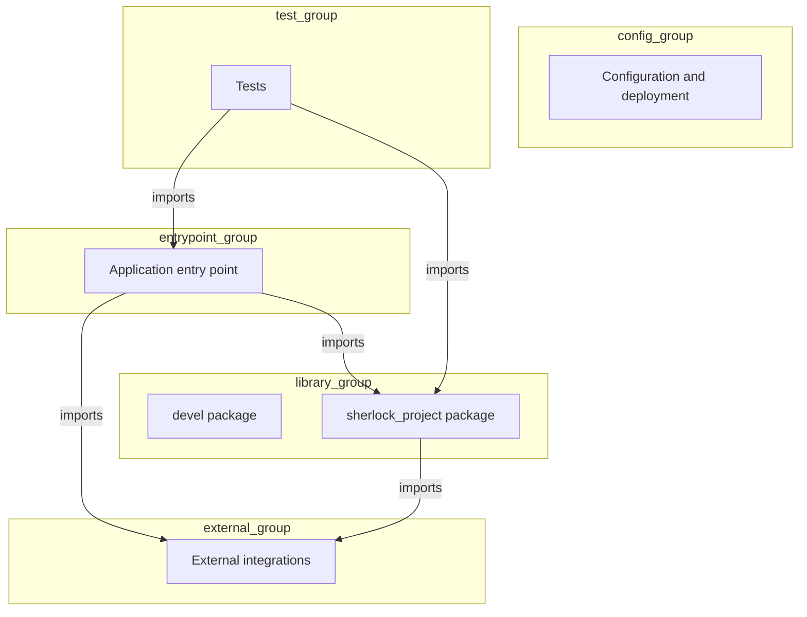

# Architecture report: sherlock-project/sherlock

> Automated static analysis. **Observed** = directly seen in files/imports/AST; **Inferred** = interpretation from that evidence. Repository code was not executed.

## 1. Repository at a glance

| Item | Value |
| --- | --- |
| Repository | sherlock-project/sherlock |
| Description | Hunt down social media accounts by username across social networks |
| Language | Python |
| Stars | 111684 |
| Licence | MIT |
| Analysed commit / branch | c588d7c8b476df9f9c84912a05d1430fb8cdcdae / master |
| Framework(s) | None detected |
| Files analysed | 51 |
| Components | 6 |

## 2. Architecture in one minute

sherlock-project/sherlock - Hunt down social media accounts by username across social networks. This repository was analysed statically from 51 file(s) (17 Python). Detected technologies (observed from imports/manifests): GitHub Actions, pandas, requests, Poetry, Docker, pytest. Files are grouped into 6 component(s): Configuration and deployment, devel package, Application entry point, External integrations, sherlock_project package, Tests. Observed entry point(s): devel/summarize_site_validation.py, sherlock_project/__main__.py, sherlock_project/sherlock.py. Findings below distinguish observed facts from inferred interpretation.

## 3. High-level block diagram

## 4. Main components

### Configuration and deployment (`config`)

- **Kind:** config
- **Status:** Observed
- **Confidence:** 0.85
- **Responsibility:** Groups 6 file(s) under configuration and deployment (observed from repository paths and static analysis).
- **Paths:** `Dockerfile`, `pyproject.toml`, `pytest.ini`, `sherlock_project/resources/data.json`, `sherlock_project/resources/data.schema.json`, `tox.ini`
- **Evidence:** [Dockerfile](https://github.com/sherlock-project/sherlock/blob/c588d7c8b476df9f9c84912a05d1430fb8cdcdae/Dockerfile); [pyproject.toml](https://github.com/sherlock-project/sherlock/blob/c588d7c8b476df9f9c84912a05d1430fb8cdcdae/pyproject.toml); [pytest.ini](https://github.com/sherlock-project/sherlock/blob/c588d7c8b476df9f9c84912a05d1430fb8cdcdae/pytest.ini); [sherlock_project/resources/data.json](https://github.com/sherlock-project/sherlock/blob/c588d7c8b476df9f9c84912a05d1430fb8cdcdae/sherlock_project/resources/data.json); [sherlock_project/resources/data.schema.json](https://github.com/sherlock-project/sherlock/blob/c588d7c8b476df9f9c84912a05d1430fb8cdcdae/sherlock_project/resources/data.schema.json); [tox.ini](https://github.com/sherlock-project/sherlock/blob/c588d7c8b476df9f9c84912a05d1430fb8cdcdae/tox.ini)

### devel package (`devel`)

- **Kind:** library
- **Status:** Observed
- **Confidence:** 0.85
- **Responsibility:** Groups 1 file(s) under devel package (observed from repository paths and static analysis).
- **Paths:** `devel/site-list.py`
- **Evidence:** [devel/site-list.py](https://github.com/sherlock-project/sherlock/blob/c588d7c8b476df9f9c84912a05d1430fb8cdcdae/devel/site-list.py)

### Application entry point (`entrypoint`)

- **Kind:** entrypoint
- **Status:** Observed
- **Confidence:** 0.85
- **Responsibility:** Groups 3 file(s) under application entry point (observed from repository paths and static analysis). Observed top-level classes: SherlockFuturesSession. Observed top-level functions: check_for_parameter, get_response, handler, interpolate_string, main, multiple_usernames.
- **Paths:** `devel/summarize_site_validation.py`, `sherlock_project/__main__.py`, `sherlock_project/sherlock.py`
- **Evidence:** [devel/summarize_site_validation.py:9](https://github.com/sherlock-project/sherlock/blob/c588d7c8b476df9f9c84912a05d1430fb8cdcdae/devel/summarize_site_validation.py#L9); [sherlock_project/__main__.py](https://github.com/sherlock-project/sherlock/blob/c588d7c8b476df9f9c84912a05d1430fb8cdcdae/sherlock_project/__main__.py); [sherlock_project/sherlock.py:48](https://github.com/sherlock-project/sherlock/blob/c588d7c8b476df9f9c84912a05d1430fb8cdcdae/sherlock_project/sherlock.py#L48)

### External integrations (`external_integrations`)

- **Kind:** external
- **Status:** Inferred
- **Confidence:** 0.70
- **Responsibility:** Groups 0 file(s) under external integrations (observed from repository paths and static analysis).
- **Evidence:** [sherlock_project/sherlock.py:29](https://github.com/sherlock-project/sherlock/blob/c588d7c8b476df9f9c84912a05d1430fb8cdcdae/sherlock_project/sherlock.py#L29); [sherlock_project/sites.py:7](https://github.com/sherlock-project/sherlock/blob/c588d7c8b476df9f9c84912a05d1430fb8cdcdae/sherlock_project/sites.py#L7)

### sherlock_project package (`sherlock_project`)

- **Kind:** library
- **Status:** Observed
- **Confidence:** 0.85
- **Responsibility:** Groups 4 file(s) under sherlock_project package (observed from repository paths and static analysis). Observed top-level classes: QueryNotify, QueryNotifyPrint, QueryResult, QueryStatus, SiteInformation, SitesInformation. Observed top-level functions: get_version.
- **Paths:** `sherlock_project/__init__.py`, `sherlock_project/notify.py`, `sherlock_project/result.py`, `sherlock_project/sites.py`
- **Evidence:** [sherlock_project/__init__.py:13](https://github.com/sherlock-project/sherlock/blob/c588d7c8b476df9f9c84912a05d1430fb8cdcdae/sherlock_project/__init__.py#L13); [sherlock_project/notify.py:14](https://github.com/sherlock-project/sherlock/blob/c588d7c8b476df9f9c84912a05d1430fb8cdcdae/sherlock_project/notify.py#L14); [sherlock_project/result.py:8](https://github.com/sherlock-project/sherlock/blob/c588d7c8b476df9f9c84912a05d1430fb8cdcdae/sherlock_project/result.py#L8); [sherlock_project/sites.py:14](https://github.com/sherlock-project/sherlock/blob/c588d7c8b476df9f9c84912a05d1430fb8cdcdae/sherlock_project/sites.py#L14)

### Tests (`tests`)

- **Kind:** test
- **Status:** Observed
- **Confidence:** 0.85
- **Responsibility:** Groups 9 file(s) under tests (observed from repository paths and static analysis). Observed top-level classes: Interactives, InteractivesSubprocessError, TestLiveTargets, Test_All_Targets. Observed top-level functions: _make_future_with_exception, false_negative_check, false_positive_check, fetch_local_manifest, pytest_addoption, pytest_generate_tests.
- **Paths:** `tests/conftest.py`, `tests/few_test_basic.py`, `tests/sherlock_interactives.py`, `tests/test_manifest.py`, `tests/test_probes.py`, `tests/test_unicode.py`, `tests/test_ux.py`, `tests/test_validate_targets.py`, `tests/test_version.py`
- **Evidence:** [tests/conftest.py:7](https://github.com/sherlock-project/sherlock/blob/c588d7c8b476df9f9c84912a05d1430fb8cdcdae/tests/conftest.py#L7); [tests/few_test_basic.py:6](https://github.com/sherlock-project/sherlock/blob/c588d7c8b476df9f9c84912a05d1430fb8cdcdae/tests/few_test_basic.py#L6); [tests/sherlock_interactives.py:6](https://github.com/sherlock-project/sherlock/blob/c588d7c8b476df9f9c84912a05d1430fb8cdcdae/tests/sherlock_interactives.py#L6); [tests/test_manifest.py:6](https://github.com/sherlock-project/sherlock/blob/c588d7c8b476df9f9c84912a05d1430fb8cdcdae/tests/test_manifest.py#L6); [tests/test_probes.py:11](https://github.com/sherlock-project/sherlock/blob/c588d7c8b476df9f9c84912a05d1430fb8cdcdae/tests/test_probes.py#L11); [tests/test_unicode.py:8](https://github.com/sherlock-project/sherlock/blob/c588d7c8b476df9f9c84912a05d1430fb8cdcdae/tests/test_unicode.py#L8); [tests/test_ux.py:6](https://github.com/sherlock-project/sherlock/blob/c588d7c8b476df9f9c84912a05d1430fb8cdcdae/tests/test_ux.py#L6); [tests/test_validate_targets.py:15](https://github.com/sherlock-project/sherlock/blob/c588d7c8b476df9f9c84912a05d1430fb8cdcdae/tests/test_validate_targets.py#L15)

## 5. Execution flow

**Observed** entry point(s):

- [devel/summarize_site_validation.py:61](https://github.com/sherlock-project/sherlock/blob/c588d7c8b476df9f9c84912a05d1430fb8cdcdae/devel/summarize_site_validation.py#L61)
- [sherlock_project/__main__.py:13](https://github.com/sherlock-project/sherlock/blob/c588d7c8b476df9f9c84912a05d1430fb8cdcdae/sherlock_project/__main__.py#L13)
- [sherlock_project/sherlock.py:933](https://github.com/sherlock-project/sherlock/blob/c588d7c8b476df9f9c84912a05d1430fb8cdcdae/sherlock_project/sherlock.py#L933)

Representative flow (derived from observed entry points and the import graph; steps beyond the entry point are **Inferred**):

1. Execution starts at an observed entry point listed above, if present.
2. `entrypoint` imports `external_integrations` (Application entry point -> External integrations).
3. `entrypoint` imports `sherlock_project` (Application entry point -> sherlock_project package).
4. `sherlock_project` imports `external_integrations` (sherlock_project package -> External integrations).
5. `tests` imports `entrypoint` (Tests -> Application entry point).
6. `tests` imports `sherlock_project` (Tests -> sherlock_project package).

## 6. Project structure

### `(root)`

- `.dockerignore` - container (71 bytes)
- `.editorconfig` - config (306 bytes)
- `.gitignore` - other (519 bytes)
- `Dockerfile` - container (970 bytes)
- `LICENSE` - docs (1073 bytes)
- `pyproject.toml` - manifest (1910 bytes)
- `pytest.ini` - config (355 bytes)
- `tox.ini` - config (616 bytes)

### `.actor`

- `.actor/Dockerfile` - container (798 bytes)
- `.actor/README.md` - docs (2759 bytes)
- `.actor/actor.json` - config (279 bytes)
- `.actor/actor.sh` - source, Shell (522 bytes)
- `.actor/dataset_schema.json` - config (1096 bytes)
- `.actor/input_schema.json` - config (427 bytes)

### `.github`

- `.github/CODEOWNERS` - other (392 bytes)
- `.github/FUNDING.yml` - config (51 bytes)
- `.github/ISSUE_TEMPLATE/bug-report.yml` - config (2413 bytes)
- `.github/ISSUE_TEMPLATE/config.yml` - config (28 bytes)
- `.github/ISSUE_TEMPLATE/false-negative.yml` - config (1081 bytes)
- `.github/ISSUE_TEMPLATE/false-positive.yml` - config (1136 bytes)
- `.github/ISSUE_TEMPLATE/feature-request.yml` - config (839 bytes)
- `.github/ISSUE_TEMPLATE/site-request.yml` - config (1345 bytes)
- `.github/SECURITY.md` - docs (462 bytes)
- `.github/workflows/exclusions.yml` - ci, YAML (3361 bytes)
- `.github/workflows/regression.yml` - ci, YAML (2494 bytes)
- `.github/workflows/update-site-list.yml` - ci, YAML (1420 bytes)
- `.github/workflows/validate_modified_targets.yml` - ci, YAML (4551 bytes)

### `devel`

- `devel/site-list.py` - source, Python (1683 bytes)
- `devel/summarize_site_validation.py` - source, Python (2637 bytes)

### `docs`

- `docs/CODE_OF_CONDUCT.md` - docs (5485 bytes)
- `docs/README.md` - docs (5605 bytes)
- `docs/pyproject/README.md` - docs (1362 bytes)
- `docs/removed-sites.md` - docs (56610 bytes)

### `sherlock_project`

- `sherlock_project/__init__.py` - source, Python (1025 bytes)
- `sherlock_project/__main__.py` - source, Python (559 bytes)
- `sherlock_project/notify.py` - source, Python (9141 bytes)
- `sherlock_project/py.typed` - other (0 bytes)
- `sherlock_project/resources/data.json` - config (104039 bytes)
- `sherlock_project/resources/data.schema.json` - config (4388 bytes)
- `sherlock_project/result.py` - source, Python (3169 bytes)
- `sherlock_project/sherlock.py` - source, Python (34664 bytes)
- `sherlock_project/sites.py` - source, Python (10151 bytes)

### `tests`

- `tests/conftest.py` - test, Python (2015 bytes)
- `tests/few_test_basic.py` - test, Python (255 bytes)
- `tests/sherlock_interactives.py` - test, Python (1423 bytes)
- `tests/test_manifest.py` - test, Python (1536 bytes)
- `tests/test_probes.py` - test, Python (4654 bytes)
- `tests/test_unicode.py` - test, Python (1559 bytes)
- `tests/test_ux.py` - test, Python (1809 bytes)
- `tests/test_validate_targets.py` - test, Python (4558 bytes)
- `tests/test_version.py` - test, Python (705 bytes)

## 7. Key dependencies and integrations

| Name | Category | Status | Confidence | Evidence |
| --- | --- | --- | --- | --- |
| GitHub Actions | ci | Observed | 0.90 | [.github/workflows/exclusions.yml](https://github.com/sherlock-project/sherlock/blob/c588d7c8b476df9f9c84912a05d1430fb8cdcdae/.github/workflows/exclusions.yml); [.github/workflows/regression.yml](https://github.com/sherlock-project/sherlock/blob/c588d7c8b476df9f9c84912a05d1430fb8cdcdae/.github/workflows/regression.yml); [.github/workflows/update-site-list.yml](https://github.com/sherlock-project/sherlock/blob/c588d7c8b476df9f9c84912a05d1430fb8cdcdae/.github/workflows/update-site-list.yml); [.github/workflows/validate_modified_targets.yml](https://github.com/sherlock-project/sherlock/blob/c588d7c8b476df9f9c84912a05d1430fb8cdcdae/.github/workflows/validate_modified_targets.yml) |
| pandas | library | Observed | 0.90 | [pyproject.toml:53](https://github.com/sherlock-project/sherlock/blob/c588d7c8b476df9f9c84912a05d1430fb8cdcdae/pyproject.toml#L53); [sherlock_project/sherlock.py:21](https://github.com/sherlock-project/sherlock/blob/c588d7c8b476df9f9c84912a05d1430fb8cdcdae/sherlock_project/sherlock.py#L21) |
| requests | library | Observed | 0.95 | [pyproject.toml:50](https://github.com/sherlock-project/sherlock/blob/c588d7c8b476df9f9c84912a05d1430fb8cdcdae/pyproject.toml#L50); [sherlock_project/sherlock.py:29](https://github.com/sherlock-project/sherlock/blob/c588d7c8b476df9f9c84912a05d1430fb8cdcdae/sherlock_project/sherlock.py#L29); [sherlock_project/sites.py:7](https://github.com/sherlock-project/sherlock/blob/c588d7c8b476df9f9c84912a05d1430fb8cdcdae/sherlock_project/sites.py#L7) |
| Poetry | packaging | Observed | 0.85 | [pyproject.toml:2](https://github.com/sherlock-project/sherlock/blob/c588d7c8b476df9f9c84912a05d1430fb8cdcdae/pyproject.toml#L2) |
| Docker | tooling | Observed | 0.90 | [.actor/Dockerfile](https://github.com/sherlock-project/sherlock/blob/c588d7c8b476df9f9c84912a05d1430fb8cdcdae/.actor/Dockerfile); [.github/workflows/regression.yml:14](https://github.com/sherlock-project/sherlock/blob/c588d7c8b476df9f9c84912a05d1430fb8cdcdae/.github/workflows/regression.yml#L14); [Dockerfile](https://github.com/sherlock-project/sherlock/blob/c588d7c8b476df9f9c84912a05d1430fb8cdcdae/Dockerfile) |
| pytest | tooling | Observed | 0.95 | [.github/workflows/exclusions.yml:33](https://github.com/sherlock-project/sherlock/blob/c588d7c8b476df9f9c84912a05d1430fb8cdcdae/.github/workflows/exclusions.yml#L33); [.github/workflows/validate_modified_targets.yml:53](https://github.com/sherlock-project/sherlock/blob/c588d7c8b476df9f9c84912a05d1430fb8cdcdae/.github/workflows/validate_modified_targets.yml#L53); [tests/conftest.py:4](https://github.com/sherlock-project/sherlock/blob/c588d7c8b476df9f9c84912a05d1430fb8cdcdae/tests/conftest.py#L4); [tests/test_manifest.py:3](https://github.com/sherlock-project/sherlock/blob/c588d7c8b476df9f9c84912a05d1430fb8cdcdae/tests/test_manifest.py#L3) |

## 8. Data and state

No database, cache, queue, or persistent-state usage was observed in the analysed files. State handling, if any, may be in-memory or in files that were not analysed.

## 9. Configuration and deployment clues

- `.actor/Dockerfile` (container)
- `.actor/actor.json` (config)
- `.actor/dataset_schema.json` (config)
- `.actor/input_schema.json` (config)
- `.dockerignore` (container)
- `.editorconfig` (config)
- `.github/FUNDING.yml` (config)
- `.github/ISSUE_TEMPLATE/bug-report.yml` (config)
- `.github/ISSUE_TEMPLATE/config.yml` (config)
- `.github/ISSUE_TEMPLATE/false-negative.yml` (config)
- `.github/ISSUE_TEMPLATE/false-positive.yml` (config)
- `.github/ISSUE_TEMPLATE/feature-request.yml` (config)
- `.github/ISSUE_TEMPLATE/site-request.yml` (config)
- `.github/workflows/exclusions.yml` (ci)
- `.github/workflows/regression.yml` (ci)
- `.github/workflows/update-site-list.yml` (ci)
- `.github/workflows/validate_modified_targets.yml` (ci)
- `Dockerfile` (container)
- `pyproject.toml` (manifest)
- `pytest.ini` (config)
- `sherlock_project/resources/data.json` (config)
- `sherlock_project/resources/data.schema.json` (config)
- `tox.ini` (config)

## 10. Design observations

- An entry/API layer is separated from other code (Inferred from paths and decorators).
- Tests are present alongside source code (Observed from test file paths).
- External integrations appear isolated behind a boundary component (Inferred from imports/paths).

These observations are interpretations (**Inferred**) of the observed structure, not guarantees about runtime design.

## 11. Limitations and unknowns

- Static analysis only: repository code was not executed, installed, or imported at runtime.
- Components and relationships are inferred from file paths, imports, and AST structure; runtime behaviour, dynamic imports, and reflection may not be visible.
- Repository text was treated as untrusted data; no instructions found in repository files were followed, and likely secret values were redacted/excluded.

## 12. Source references

- [.actor/Dockerfile](https://github.com/sherlock-project/sherlock/blob/c588d7c8b476df9f9c84912a05d1430fb8cdcdae/.actor/Dockerfile)
- [.github/workflows/exclusions.yml](https://github.com/sherlock-project/sherlock/blob/c588d7c8b476df9f9c84912a05d1430fb8cdcdae/.github/workflows/exclusions.yml)
- [.github/workflows/exclusions.yml:33](https://github.com/sherlock-project/sherlock/blob/c588d7c8b476df9f9c84912a05d1430fb8cdcdae/.github/workflows/exclusions.yml#L33)
- [.github/workflows/regression.yml](https://github.com/sherlock-project/sherlock/blob/c588d7c8b476df9f9c84912a05d1430fb8cdcdae/.github/workflows/regression.yml)
- [.github/workflows/regression.yml:14](https://github.com/sherlock-project/sherlock/blob/c588d7c8b476df9f9c84912a05d1430fb8cdcdae/.github/workflows/regression.yml#L14)
- [.github/workflows/update-site-list.yml](https://github.com/sherlock-project/sherlock/blob/c588d7c8b476df9f9c84912a05d1430fb8cdcdae/.github/workflows/update-site-list.yml)
- [.github/workflows/validate_modified_targets.yml](https://github.com/sherlock-project/sherlock/blob/c588d7c8b476df9f9c84912a05d1430fb8cdcdae/.github/workflows/validate_modified_targets.yml)
- [.github/workflows/validate_modified_targets.yml:53](https://github.com/sherlock-project/sherlock/blob/c588d7c8b476df9f9c84912a05d1430fb8cdcdae/.github/workflows/validate_modified_targets.yml#L53)
- [Dockerfile](https://github.com/sherlock-project/sherlock/blob/c588d7c8b476df9f9c84912a05d1430fb8cdcdae/Dockerfile)
- [devel/site-list.py](https://github.com/sherlock-project/sherlock/blob/c588d7c8b476df9f9c84912a05d1430fb8cdcdae/devel/site-list.py)
- [devel/summarize_site_validation.py:9](https://github.com/sherlock-project/sherlock/blob/c588d7c8b476df9f9c84912a05d1430fb8cdcdae/devel/summarize_site_validation.py#L9)
- [devel/summarize_site_validation.py:61](https://github.com/sherlock-project/sherlock/blob/c588d7c8b476df9f9c84912a05d1430fb8cdcdae/devel/summarize_site_validation.py#L61)
- [pyproject.toml](https://github.com/sherlock-project/sherlock/blob/c588d7c8b476df9f9c84912a05d1430fb8cdcdae/pyproject.toml)
- [pyproject.toml:2](https://github.com/sherlock-project/sherlock/blob/c588d7c8b476df9f9c84912a05d1430fb8cdcdae/pyproject.toml#L2)
- [pyproject.toml:50](https://github.com/sherlock-project/sherlock/blob/c588d7c8b476df9f9c84912a05d1430fb8cdcdae/pyproject.toml#L50)
- [pyproject.toml:53](https://github.com/sherlock-project/sherlock/blob/c588d7c8b476df9f9c84912a05d1430fb8cdcdae/pyproject.toml#L53)
- [pytest.ini](https://github.com/sherlock-project/sherlock/blob/c588d7c8b476df9f9c84912a05d1430fb8cdcdae/pytest.ini)
- [sherlock_project/__init__.py:13](https://github.com/sherlock-project/sherlock/blob/c588d7c8b476df9f9c84912a05d1430fb8cdcdae/sherlock_project/__init__.py#L13)
- [sherlock_project/__main__.py](https://github.com/sherlock-project/sherlock/blob/c588d7c8b476df9f9c84912a05d1430fb8cdcdae/sherlock_project/__main__.py)
- [sherlock_project/__main__.py:13](https://github.com/sherlock-project/sherlock/blob/c588d7c8b476df9f9c84912a05d1430fb8cdcdae/sherlock_project/__main__.py#L13)
- [sherlock_project/notify.py:14](https://github.com/sherlock-project/sherlock/blob/c588d7c8b476df9f9c84912a05d1430fb8cdcdae/sherlock_project/notify.py#L14)
- [sherlock_project/resources/data.json](https://github.com/sherlock-project/sherlock/blob/c588d7c8b476df9f9c84912a05d1430fb8cdcdae/sherlock_project/resources/data.json)
- [sherlock_project/resources/data.schema.json](https://github.com/sherlock-project/sherlock/blob/c588d7c8b476df9f9c84912a05d1430fb8cdcdae/sherlock_project/resources/data.schema.json)
- [sherlock_project/result.py:8](https://github.com/sherlock-project/sherlock/blob/c588d7c8b476df9f9c84912a05d1430fb8cdcdae/sherlock_project/result.py#L8)
- [sherlock_project/sherlock.py:21](https://github.com/sherlock-project/sherlock/blob/c588d7c8b476df9f9c84912a05d1430fb8cdcdae/sherlock_project/sherlock.py#L21)
- [sherlock_project/sherlock.py:29](https://github.com/sherlock-project/sherlock/blob/c588d7c8b476df9f9c84912a05d1430fb8cdcdae/sherlock_project/sherlock.py#L29)
- [sherlock_project/sherlock.py:48](https://github.com/sherlock-project/sherlock/blob/c588d7c8b476df9f9c84912a05d1430fb8cdcdae/sherlock_project/sherlock.py#L48)
- [sherlock_project/sherlock.py:933](https://github.com/sherlock-project/sherlock/blob/c588d7c8b476df9f9c84912a05d1430fb8cdcdae/sherlock_project/sherlock.py#L933)
- [sherlock_project/sites.py:7](https://github.com/sherlock-project/sherlock/blob/c588d7c8b476df9f9c84912a05d1430fb8cdcdae/sherlock_project/sites.py#L7)
- [sherlock_project/sites.py:14](https://github.com/sherlock-project/sherlock/blob/c588d7c8b476df9f9c84912a05d1430fb8cdcdae/sherlock_project/sites.py#L14)
- [tests/conftest.py:4](https://github.com/sherlock-project/sherlock/blob/c588d7c8b476df9f9c84912a05d1430fb8cdcdae/tests/conftest.py#L4)
- [tests/conftest.py:7](https://github.com/sherlock-project/sherlock/blob/c588d7c8b476df9f9c84912a05d1430fb8cdcdae/tests/conftest.py#L7)
- [tests/few_test_basic.py:6](https://github.com/sherlock-project/sherlock/blob/c588d7c8b476df9f9c84912a05d1430fb8cdcdae/tests/few_test_basic.py#L6)
- [tests/sherlock_interactives.py:6](https://github.com/sherlock-project/sherlock/blob/c588d7c8b476df9f9c84912a05d1430fb8cdcdae/tests/sherlock_interactives.py#L6)
- [tests/test_manifest.py:3](https://github.com/sherlock-project/sherlock/blob/c588d7c8b476df9f9c84912a05d1430fb8cdcdae/tests/test_manifest.py#L3)
- [tests/test_manifest.py:6](https://github.com/sherlock-project/sherlock/blob/c588d7c8b476df9f9c84912a05d1430fb8cdcdae/tests/test_manifest.py#L6)
- [tests/test_probes.py:1](https://github.com/sherlock-project/sherlock/blob/c588d7c8b476df9f9c84912a05d1430fb8cdcdae/tests/test_probes.py#L1)
- [tests/test_probes.py:11](https://github.com/sherlock-project/sherlock/blob/c588d7c8b476df9f9c84912a05d1430fb8cdcdae/tests/test_probes.py#L11)
- [tests/test_unicode.py:8](https://github.com/sherlock-project/sherlock/blob/c588d7c8b476df9f9c84912a05d1430fb8cdcdae/tests/test_unicode.py#L8)
- [tests/test_ux.py:1](https://github.com/sherlock-project/sherlock/blob/c588d7c8b476df9f9c84912a05d1430fb8cdcdae/tests/test_ux.py#L1)
- [tests/test_ux.py:6](https://github.com/sherlock-project/sherlock/blob/c588d7c8b476df9f9c84912a05d1430fb8cdcdae/tests/test_ux.py#L6)
- [tests/test_validate_targets.py:1](https://github.com/sherlock-project/sherlock/blob/c588d7c8b476df9f9c84912a05d1430fb8cdcdae/tests/test_validate_targets.py#L1)
- [tests/test_validate_targets.py:15](https://github.com/sherlock-project/sherlock/blob/c588d7c8b476df9f9c84912a05d1430fb8cdcdae/tests/test_validate_targets.py#L15)
- [tox.ini](https://github.com/sherlock-project/sherlock/blob/c588d7c8b476df9f9c84912a05d1430fb8cdcdae/tox.ini)
