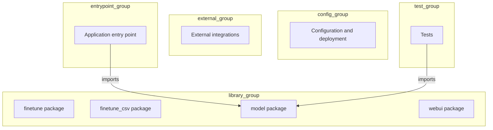

# Architecture report: shiyu-coder/Kronos

> Automated static analysis. **Observed** = directly seen in files/imports/AST; **Inferred** = interpretation from that evidence. Repository code was not executed.

## 1. Repository at a glance

| Item | Value |
| --- | --- |
| Repository | shiyu-coder/Kronos |
| Description | Kronos: A Foundation Model for the Language of Financial Markets |
| Language | Python |
| Stars | 47794 |
| Licence | MIT |
| Analysed commit / branch | 67b630e67f6a18c9e9be918d9b4337c960db1e9a / master |
| Framework(s) | Flask |
| Files analysed | 78 |
| Components | 8 |

## 2. Architecture in one minute

shiyu-coder/Kronos - Kronos: A Foundation Model for the Language of Financial Markets. This repository was analysed statically from 78 file(s) (30 Python). Detected technologies (observed from imports/manifests): Flask, NumPy, pandas, requests, pytest. Files are grouped into 8 component(s): Configuration and deployment, Application entry point, External integrations, finetune package, finetune_csv package, model package, Tests, webui package. Observed entry point(s): finetune/dataset.py, finetune/qlib_data_preprocess.py, finetune/qlib_test.py. Findings below distinguish observed facts from inferred interpretation.

## 3. High-level block diagram

## 4. Main components

### Configuration and deployment (`config`)

- **Kind:** config
- **Status:** Observed
- **Confidence:** 0.85
- **Responsibility:** Groups 33 file(s) under configuration and deployment (observed from repository paths and static analysis). Observed top-level classes: Config.
- **Paths:** `finetune/config.py`, `finetune_csv/configs/config_ali09988_candle-5min.yaml`, `requirements.txt`, `webui/prediction_results/prediction_20250826_163800.json`, `webui/prediction_results/prediction_20250826_164030.json`, `webui/prediction_results/prediction_20250826_164422.json`, `webui/prediction_results/prediction_20250826_170831.json`, `webui/prediction_results/prediction_20250826_171720.json`, `webui/prediction_results/prediction_20250826_171913.json`, `webui/prediction_results/prediction_20250826_172031.json`, `webui/prediction_results/prediction_20250826_172153.json`, `webui/prediction_results/prediction_20250826_172740.json`, `webui/prediction_results/prediction_20250826_173322.json`, `webui/prediction_results/prediction_20250826_173455.json`, `webui/prediction_results/prediction_20250826_174410.json`, `webui/prediction_results/prediction_20250826_174809.json`, `webui/prediction_results/prediction_20250826_175057.json`, `webui/prediction_results/prediction_20250826_175135.json`, `webui/prediction_results/prediction_20250826_175909.json`, `webui/prediction_results/prediction_20250826_180308.json`, `webui/prediction_results/prediction_20250826_180632.json`, `webui/prediction_results/prediction_20250826_180745.json`, `webui/prediction_results/prediction_20250826_180806.json`, `webui/prediction_results/prediction_20250826_181012.json`, `webui/prediction_results/prediction_20250826_181139.json`, `webui/prediction_results/prediction_20250826_181240.json`, `webui/prediction_results/prediction_20250826_181434.json`, `webui/prediction_results/prediction_20250826_181513.json`, `webui/prediction_results/prediction_20250826_181612.json`, `webui/prediction_results/prediction_20250826_181648.json`, `webui/prediction_results/prediction_20250826_181800.json`, `webui/prediction_results/prediction_20250826_181932.json`, `webui/requirements.txt`
- **Evidence:** [finetune/config.py:3](https://github.com/shiyu-coder/Kronos/blob/67b630e67f6a18c9e9be918d9b4337c960db1e9a/finetune/config.py#L3); [finetune_csv/configs/config_ali09988_candle-5min.yaml](https://github.com/shiyu-coder/Kronos/blob/67b630e67f6a18c9e9be918d9b4337c960db1e9a/finetune_csv/configs/config_ali09988_candle-5min.yaml); [requirements.txt](https://github.com/shiyu-coder/Kronos/blob/67b630e67f6a18c9e9be918d9b4337c960db1e9a/requirements.txt); [webui/prediction_results/prediction_20250826_163800.json](https://github.com/shiyu-coder/Kronos/blob/67b630e67f6a18c9e9be918d9b4337c960db1e9a/webui/prediction_results/prediction_20250826_163800.json); [webui/prediction_results/prediction_20250826_164030.json](https://github.com/shiyu-coder/Kronos/blob/67b630e67f6a18c9e9be918d9b4337c960db1e9a/webui/prediction_results/prediction_20250826_164030.json); [webui/prediction_results/prediction_20250826_164422.json](https://github.com/shiyu-coder/Kronos/blob/67b630e67f6a18c9e9be918d9b4337c960db1e9a/webui/prediction_results/prediction_20250826_164422.json); [webui/prediction_results/prediction_20250826_170831.json](https://github.com/shiyu-coder/Kronos/blob/67b630e67f6a18c9e9be918d9b4337c960db1e9a/webui/prediction_results/prediction_20250826_170831.json); [webui/prediction_results/prediction_20250826_171720.json](https://github.com/shiyu-coder/Kronos/blob/67b630e67f6a18c9e9be918d9b4337c960db1e9a/webui/prediction_results/prediction_20250826_171720.json)

### Application entry point (`entrypoint`)

- **Kind:** entrypoint
- **Status:** Observed
- **Confidence:** 0.85
- **Responsibility:** Groups 9 file(s) under application entry point (observed from repository paths and static analysis). Observed application object created via Flask. Observed routes: ROUTE /, ROUTE /api/data-files, ROUTE /api/load-data, ROUTE /api/predict, ROUTE /api/load-model. Observed top-level classes: CustomKlineDataset, QlibDataPreprocessor, QlibDataset, SequentialTrainer. Observed top-level functions: check_dependencies, create_dataloaders, create_prediction_chart, format_time, get_available_models, get_data_files.
- **Paths:** `finetune/dataset.py`, `finetune/qlib_data_preprocess.py`, `finetune/train_predictor.py`, `finetune/train_tokenizer.py`, `finetune_csv/finetune_base_model.py`, `finetune_csv/finetune_tokenizer.py`, `finetune_csv/train_sequential.py`, `webui/app.py`, `webui/run.py`
- **Evidence:** [finetune/dataset.py:9](https://github.com/shiyu-coder/Kronos/blob/67b630e67f6a18c9e9be918d9b4337c960db1e9a/finetune/dataset.py#L9); [finetune/qlib_data_preprocess.py:14](https://github.com/shiyu-coder/Kronos/blob/67b630e67f6a18c9e9be918d9b4337c960db1e9a/finetune/qlib_data_preprocess.py#L14); [finetune/train_predictor.py:29](https://github.com/shiyu-coder/Kronos/blob/67b630e67f6a18c9e9be918d9b4337c960db1e9a/finetune/train_predictor.py#L29); [finetune/train_tokenizer.py:32](https://github.com/shiyu-coder/Kronos/blob/67b630e67f6a18c9e9be918d9b4337c960db1e9a/finetune/train_tokenizer.py#L32); [finetune_csv/finetune_base_model.py:25](https://github.com/shiyu-coder/Kronos/blob/67b630e67f6a18c9e9be918d9b4337c960db1e9a/finetune_csv/finetune_base_model.py#L25); [finetune_csv/finetune_tokenizer.py:24](https://github.com/shiyu-coder/Kronos/blob/67b630e67f6a18c9e9be918d9b4337c960db1e9a/finetune_csv/finetune_tokenizer.py#L24); [finetune_csv/train_sequential.py:18](https://github.com/shiyu-coder/Kronos/blob/67b630e67f6a18c9e9be918d9b4337c960db1e9a/finetune_csv/train_sequential.py#L18); [webui/app.py:24](https://github.com/shiyu-coder/Kronos/blob/67b630e67f6a18c9e9be918d9b4337c960db1e9a/webui/app.py#L24)

### External integrations (`external_integrations`)

- **Kind:** external
- **Status:** Inferred
- **Confidence:** 0.70
- **Responsibility:** Groups 0 file(s) under external integrations (observed from repository paths and static analysis).
- **Evidence:** [examples/get_akshare_date_2024-2025_x.py:2](https://github.com/shiyu-coder/Kronos/blob/67b630e67f6a18c9e9be918d9b4337c960db1e9a/examples/get_akshare_date_2024-2025_x.py#L2); [examples/get_akshare_date_2024-2025_x.py:577](https://github.com/shiyu-coder/Kronos/blob/67b630e67f6a18c9e9be918d9b4337c960db1e9a/examples/get_akshare_date_2024-2025_x.py#L577); [examples/get_akshare_date_2024-2025_x.py:583](https://github.com/shiyu-coder/Kronos/blob/67b630e67f6a18c9e9be918d9b4337c960db1e9a/examples/get_akshare_date_2024-2025_x.py#L583); [examples/get_date_new.py:2](https://github.com/shiyu-coder/Kronos/blob/67b630e67f6a18c9e9be918d9b4337c960db1e9a/examples/get_date_new.py#L2); [examples/get_date_new.py:609](https://github.com/shiyu-coder/Kronos/blob/67b630e67f6a18c9e9be918d9b4337c960db1e9a/examples/get_date_new.py#L609); [examples/get_date_new.py:615](https://github.com/shiyu-coder/Kronos/blob/67b630e67f6a18c9e9be918d9b4337c960db1e9a/examples/get_date_new.py#L615)

### finetune package (`finetune`)

- **Kind:** library
- **Status:** Observed
- **Confidence:** 0.85
- **Responsibility:** Groups 2 file(s) under finetune package (observed from repository paths and static analysis). Observed top-level functions: cleanup_ddp, format_time, get_model_size, reduce_tensor, set_seed, setup_ddp.
- **Paths:** `finetune/utils/__init__.py`, `finetune/utils/training_utils.py`
- **Evidence:** [finetune/utils/__init__.py](https://github.com/shiyu-coder/Kronos/blob/67b630e67f6a18c9e9be918d9b4337c960db1e9a/finetune/utils/__init__.py); [finetune/utils/training_utils.py:9](https://github.com/shiyu-coder/Kronos/blob/67b630e67f6a18c9e9be918d9b4337c960db1e9a/finetune/utils/training_utils.py#L9)

### finetune_csv package (`finetune_csv`)

- **Kind:** library
- **Status:** Observed
- **Confidence:** 0.85
- **Responsibility:** Groups 1 file(s) under finetune_csv package (observed from repository paths and static analysis). Observed top-level classes: ConfigLoader, CustomFinetuneConfig.
- **Paths:** `finetune_csv/config_loader.py`
- **Evidence:** [finetune_csv/config_loader.py:6](https://github.com/shiyu-coder/Kronos/blob/67b630e67f6a18c9e9be918d9b4337c960db1e9a/finetune_csv/config_loader.py#L6)

### model package (`model`)

- **Kind:** library
- **Status:** Observed
- **Confidence:** 0.85
- **Responsibility:** Groups 3 file(s) under model package (observed from repository paths and static analysis). Observed top-level classes: BSQuantizer, BinarySphericalQuantizer, DependencyAwareLayer, DifferentiableEntropyFunction, DualHead, FeedForward. Observed top-level functions: auto_regressive_inference, calc_time_stamps, codebook_entropy, get_model_class, sample_from_logits, top_k_top_p_filtering.
- **Paths:** `model/__init__.py`, `model/kronos.py`, `model/module.py`
- **Evidence:** [model/__init__.py:10](https://github.com/shiyu-coder/Kronos/blob/67b630e67f6a18c9e9be918d9b4337c960db1e9a/model/__init__.py#L10); [model/kronos.py:13](https://github.com/shiyu-coder/Kronos/blob/67b630e67f6a18c9e9be918d9b4337c960db1e9a/model/kronos.py#L13); [model/module.py:10](https://github.com/shiyu-coder/Kronos/blob/67b630e67f6a18c9e9be918d9b4337c960db1e9a/model/module.py#L10)

### Tests (`tests`)

- **Kind:** test
- **Status:** Observed
- **Confidence:** 0.85
- **Responsibility:** Groups 6 file(s) under tests (observed from repository paths and static analysis). Observed top-level classes: QlibBacktest, QlibTestDataset. Observed top-level functions: collate_fn_for_inference, generate_output, generate_predictions, load_models, main, set_seed.
- **Paths:** `finetune/qlib_test.py`, `tests/data/generate_regression_output.py`, `tests/data/regression_input.csv`, `tests/data/regression_output_256.csv`, `tests/data/regression_output_512.csv`, `tests/test_kronos_regression.py`
- **Evidence:** [finetune/qlib_test.py:32](https://github.com/shiyu-coder/Kronos/blob/67b630e67f6a18c9e9be918d9b4337c960db1e9a/finetune/qlib_test.py#L32); [tests/data/generate_regression_output.py:26](https://github.com/shiyu-coder/Kronos/blob/67b630e67f6a18c9e9be918d9b4337c960db1e9a/tests/data/generate_regression_output.py#L26); [tests/data/regression_input.csv](https://github.com/shiyu-coder/Kronos/blob/67b630e67f6a18c9e9be918d9b4337c960db1e9a/tests/data/regression_input.csv); [tests/data/regression_output_256.csv](https://github.com/shiyu-coder/Kronos/blob/67b630e67f6a18c9e9be918d9b4337c960db1e9a/tests/data/regression_output_256.csv); [tests/data/regression_output_512.csv](https://github.com/shiyu-coder/Kronos/blob/67b630e67f6a18c9e9be918d9b4337c960db1e9a/tests/data/regression_output_512.csv); [tests/test_kronos_regression.py:36](https://github.com/shiyu-coder/Kronos/blob/67b630e67f6a18c9e9be918d9b4337c960db1e9a/tests/test_kronos_regression.py#L36)

### webui package (`webui`)

- **Kind:** library
- **Status:** Observed
- **Confidence:** 0.85
- **Responsibility:** Groups 1 file(s) under webui package (observed from repository paths and static analysis).
- **Paths:** `webui/start.sh`
- **Evidence:** [webui/start.sh](https://github.com/shiyu-coder/Kronos/blob/67b630e67f6a18c9e9be918d9b4337c960db1e9a/webui/start.sh)

## 5. Execution flow

**Observed** entry point(s):

- [finetune/dataset.py:126](https://github.com/shiyu-coder/Kronos/blob/67b630e67f6a18c9e9be918d9b4337c960db1e9a/finetune/dataset.py#L126)
- [finetune/qlib_data_preprocess.py:124](https://github.com/shiyu-coder/Kronos/blob/67b630e67f6a18c9e9be918d9b4337c960db1e9a/finetune/qlib_data_preprocess.py#L124)
- [finetune/qlib_test.py:359](https://github.com/shiyu-coder/Kronos/blob/67b630e67f6a18c9e9be918d9b4337c960db1e9a/finetune/qlib_test.py#L359)
- [finetune/train_predictor.py:238](https://github.com/shiyu-coder/Kronos/blob/67b630e67f6a18c9e9be918d9b4337c960db1e9a/finetune/train_predictor.py#L238)
- [finetune/train_tokenizer.py:275](https://github.com/shiyu-coder/Kronos/blob/67b630e67f6a18c9e9be918d9b4337c960db1e9a/finetune/train_tokenizer.py#L275)
- [finetune_csv/finetune_base_model.py:467](https://github.com/shiyu-coder/Kronos/blob/67b630e67f6a18c9e9be918d9b4337c960db1e9a/finetune_csv/finetune_base_model.py#L467)
- [finetune_csv/finetune_tokenizer.py:357](https://github.com/shiyu-coder/Kronos/blob/67b630e67f6a18c9e9be918d9b4337c960db1e9a/finetune_csv/finetune_tokenizer.py#L357)
- [finetune_csv/train_sequential.py:360](https://github.com/shiyu-coder/Kronos/blob/67b630e67f6a18c9e9be918d9b4337c960db1e9a/finetune_csv/train_sequential.py#L360)
- [webui/app.py:24](https://github.com/shiyu-coder/Kronos/blob/67b630e67f6a18c9e9be918d9b4337c960db1e9a/webui/app.py#L24)
- [webui/run.py:88](https://github.com/shiyu-coder/Kronos/blob/67b630e67f6a18c9e9be918d9b4337c960db1e9a/webui/run.py#L88)

**Observed** routes (from decorators):

- `ROUTE /` -> `index` in `webui/app.py:331`
- `ROUTE /api/data-files` -> `get_data_files` in `webui/app.py:336`
- `ROUTE /api/load-data` -> `load_data` in `webui/app.py:342`
- `ROUTE /api/predict` -> `predict` in `webui/app.py:405`
- `ROUTE /api/load-model` -> `load_model` in `webui/app.py:627`
- `ROUTE /api/available-models` -> `get_available_models` in `webui/app.py:666`
- `ROUTE /api/model-status` -> `get_model_status` in `webui/app.py:674`

Representative flow (derived from observed entry points and the import graph; steps beyond the entry point are **Inferred**):

1. Execution starts at an observed entry point listed above, if present.
2. `entrypoint` imports `model` (Application entry point -> model package).
3. `tests` imports `model` (Tests -> model package).

## 6. Project structure

### `(root)`

- `.gitignore` - other (619 bytes)
- `LICENSE` - docs (1062 bytes)
- `README.md` - docs (16657 bytes)
- `requirements.txt` - manifest (129 bytes)

### `examples`

- `examples/get_akshare_date_2024-2025_x.py` - source, Python (22761 bytes)
- `examples/get_date_new.py` - source, Python (24268 bytes)
- `examples/prediction_akshare_2024-2025.py` - source, Python (22647 bytes)
- `examples/prediction_batch_example.py` - source, Python (2312 bytes)
- `examples/prediction_cn_markets_day.py` - source, Python (6514 bytes)
- `examples/prediction_example.py` - source, Python (2457 bytes)
- `examples/prediction_new.py` - source, Python (52593 bytes)
- `examples/prediction_new_GUI.py` - source, Python (65400 bytes)
- `examples/prediction_wo_vol_example.py` - source, Python (1918 bytes)
- `examples/run_backtest_kronos.py` - source, Python (16811 bytes)
- `examples/yuce/000021_comprehensive_analysis_report.json` - config (1793 bytes)
- `examples/yuce/002354_comprehensive_analysis_report.json` - config (1796 bytes)
- `examples/yuce/300207_comprehensive_analysis_report.json` - config (2022 bytes)
- `examples/yuce/600580_comprehensive_analysis_report.json` - config (2937 bytes)
- `examples/yuce/historical_backtest.py` - source, Python (14807 bytes)
- `examples/yuce/market_analysis_report.json` - config (1084 bytes)

### `finetune`

- `finetune/config.py` - source, Python (6247 bytes)
- `finetune/dataset.py` - source, Python (5434 bytes)
- `finetune/qlib_data_preprocess.py` - source, Python (5645 bytes)
- `finetune/qlib_test.py` - test, Python (15140 bytes)
- `finetune/train_predictor.py` - source, Python (10026 bytes)
- `finetune/train_tokenizer.py` - source, Python (11455 bytes)
- `finetune/utils/__init__.py` - source, Python (0 bytes)
- `finetune/utils/training_utils.py` - source, Python (3830 bytes)

### `finetune_csv`

- `finetune_csv/README.md` - docs (3959 bytes)
- `finetune_csv/README_CN.md` - docs (3650 bytes)
- `finetune_csv/config_loader.py` - source, Python (11688 bytes)
- `finetune_csv/configs/config_ali09988_candle-5min.yaml` - config (2132 bytes)
- `finetune_csv/finetune_base_model.py` - source, Python (19127 bytes)
- `finetune_csv/finetune_tokenizer.py` - source, Python (13741 bytes)
- `finetune_csv/train_sequential.py` - source, Python (15358 bytes)

### `model`

- `model/__init__.py` - source, Python (412 bytes)
- `model/kronos.py` - source, Python (30133 bytes)
- `model/module.py` - source, Python (23426 bytes)

### `tests`

- `tests/data/generate_regression_output.py` - test, Python (2814 bytes)
- `tests/data/regression_input.csv` - test (147854 bytes)
- `tests/data/regression_output_256.csv` - test (674 bytes)
- `tests/data/regression_output_512.csv` - test (673 bytes)
- `tests/test_kronos_regression.py` - test, Python (5326 bytes)

### `webui`

- `webui/README.md` - docs (4120 bytes)
- `webui/app.py` - source, Python (30464 bytes)
- `webui/prediction_results/prediction_20250826_163800.json` - config (53680 bytes)
- `webui/prediction_results/prediction_20250826_164030.json` - config (53423 bytes)
- `webui/prediction_results/prediction_20250826_164422.json` - config (53885 bytes)
- `webui/prediction_results/prediction_20250826_170831.json` - config (54467 bytes)
- `webui/prediction_results/prediction_20250826_171720.json` - config (54467 bytes)
- `webui/prediction_results/prediction_20250826_171913.json` - config (54467 bytes)
- `webui/prediction_results/prediction_20250826_172031.json` - config (54357 bytes)
- `webui/prediction_results/prediction_20250826_172153.json` - config (54647 bytes)
- `webui/prediction_results/prediction_20250826_172740.json` - config (54979 bytes)
- `webui/prediction_results/prediction_20250826_173322.json` - config (54983 bytes)
- `webui/prediction_results/prediction_20250826_173455.json` - config (54937 bytes)
- `webui/prediction_results/prediction_20250826_174410.json` - config (54826 bytes)
- `webui/prediction_results/prediction_20250826_174809.json` - config (54826 bytes)
- `webui/prediction_results/prediction_20250826_175057.json` - config (54821 bytes)
- `webui/prediction_results/prediction_20250826_175135.json` - config (54636 bytes)
- `webui/prediction_results/prediction_20250826_175909.json` - config (53086 bytes)
- `webui/prediction_results/prediction_20250826_180308.json` - config (53086 bytes)
- `webui/prediction_results/prediction_20250826_180632.json` - config (53810 bytes)
- `webui/prediction_results/prediction_20250826_180745.json` - config (53701 bytes)
- `webui/prediction_results/prediction_20250826_180806.json` - config (53488 bytes)
- `webui/prediction_results/prediction_20250826_181012.json` - config (53498 bytes)
- `webui/prediction_results/prediction_20250826_181139.json` - config (53617 bytes)
- `webui/prediction_results/prediction_20250826_181240.json` - config (53765 bytes)
- `webui/prediction_results/prediction_20250826_181434.json` - config (52890 bytes)
- `webui/prediction_results/prediction_20250826_181513.json` - config (53442 bytes)
- `webui/prediction_results/prediction_20250826_181612.json` - config (53591 bytes)
- `webui/prediction_results/prediction_20250826_181648.json` - config (53650 bytes)
- `webui/prediction_results/prediction_20250826_181800.json` - config (53657 bytes)
- `webui/prediction_results/prediction_20250826_181932.json` - config (53459 bytes)
- `webui/requirements.txt` - manifest (111 bytes)
- `webui/run.py` - source, Python (2608 bytes)
- `webui/start.sh` - source, Shell (1007 bytes)
- `webui/templates/index.html` - other (45997 bytes)

## 7. Key dependencies and integrations

| Name | Category | Status | Confidence | Evidence |
| --- | --- | --- | --- | --- |
| Flask | framework | Observed | 0.95 | [webui/app.py:7](https://github.com/shiyu-coder/Kronos/blob/67b630e67f6a18c9e9be918d9b4337c960db1e9a/webui/app.py#L7); [webui/requirements.txt:1](https://github.com/shiyu-coder/Kronos/blob/67b630e67f6a18c9e9be918d9b4337c960db1e9a/webui/requirements.txt#L1); [webui/run.py:15](https://github.com/shiyu-coder/Kronos/blob/67b630e67f6a18c9e9be918d9b4337c960db1e9a/webui/run.py#L15) |
| NumPy | library | Observed | 0.95 | [examples/get_akshare_date_2024-2025_x.py:399](https://github.com/shiyu-coder/Kronos/blob/67b630e67f6a18c9e9be918d9b4337c960db1e9a/examples/get_akshare_date_2024-2025_x.py#L399); [examples/get_akshare_date_2024-2025_x.py:578](https://github.com/shiyu-coder/Kronos/blob/67b630e67f6a18c9e9be918d9b4337c960db1e9a/examples/get_akshare_date_2024-2025_x.py#L578); [examples/get_akshare_date_2024-2025_x.py:584](https://github.com/shiyu-coder/Kronos/blob/67b630e67f6a18c9e9be918d9b4337c960db1e9a/examples/get_akshare_date_2024-2025_x.py#L584); [examples/get_date_new.py:401](https://github.com/shiyu-coder/Kronos/blob/67b630e67f6a18c9e9be918d9b4337c960db1e9a/examples/get_date_new.py#L401) |
| pandas | library | Observed | 0.95 | [examples/get_akshare_date_2024-2025_x.py:1](https://github.com/shiyu-coder/Kronos/blob/67b630e67f6a18c9e9be918d9b4337c960db1e9a/examples/get_akshare_date_2024-2025_x.py#L1); [examples/get_akshare_date_2024-2025_x.py:268](https://github.com/shiyu-coder/Kronos/blob/67b630e67f6a18c9e9be918d9b4337c960db1e9a/examples/get_akshare_date_2024-2025_x.py#L268); [examples/get_date_new.py:1](https://github.com/shiyu-coder/Kronos/blob/67b630e67f6a18c9e9be918d9b4337c960db1e9a/examples/get_date_new.py#L1); [examples/get_date_new.py:250](https://github.com/shiyu-coder/Kronos/blob/67b630e67f6a18c9e9be918d9b4337c960db1e9a/examples/get_date_new.py#L250) |
| requests | library | Observed | 0.95 | [examples/get_akshare_date_2024-2025_x.py:2](https://github.com/shiyu-coder/Kronos/blob/67b630e67f6a18c9e9be918d9b4337c960db1e9a/examples/get_akshare_date_2024-2025_x.py#L2); [examples/get_akshare_date_2024-2025_x.py:577](https://github.com/shiyu-coder/Kronos/blob/67b630e67f6a18c9e9be918d9b4337c960db1e9a/examples/get_akshare_date_2024-2025_x.py#L577); [examples/get_akshare_date_2024-2025_x.py:583](https://github.com/shiyu-coder/Kronos/blob/67b630e67f6a18c9e9be918d9b4337c960db1e9a/examples/get_akshare_date_2024-2025_x.py#L583); [examples/get_date_new.py:2](https://github.com/shiyu-coder/Kronos/blob/67b630e67f6a18c9e9be918d9b4337c960db1e9a/examples/get_date_new.py#L2) |
| pytest | tooling | Observed | 0.90 | [tests/test_kronos_regression.py:6](https://github.com/shiyu-coder/Kronos/blob/67b630e67f6a18c9e9be918d9b4337c960db1e9a/tests/test_kronos_regression.py#L6) |

## 8. Data and state

No database, cache, queue, or persistent-state usage was observed in the analysed files. State handling, if any, may be in-memory or in files that were not analysed.

## 9. Configuration and deployment clues

- `examples/yuce/000021_comprehensive_analysis_report.json` (config)
- `examples/yuce/002354_comprehensive_analysis_report.json` (config)
- `examples/yuce/300207_comprehensive_analysis_report.json` (config)
- `examples/yuce/600580_comprehensive_analysis_report.json` (config)
- `examples/yuce/market_analysis_report.json` (config)
- `finetune_csv/configs/config_ali09988_candle-5min.yaml` (config)
- `requirements.txt` (manifest)
- `webui/prediction_results/prediction_20250826_163800.json` (config)
- `webui/prediction_results/prediction_20250826_164030.json` (config)
- `webui/prediction_results/prediction_20250826_164422.json` (config)
- `webui/prediction_results/prediction_20250826_170831.json` (config)
- `webui/prediction_results/prediction_20250826_171720.json` (config)
- `webui/prediction_results/prediction_20250826_171913.json` (config)
- `webui/prediction_results/prediction_20250826_172031.json` (config)
- `webui/prediction_results/prediction_20250826_172153.json` (config)
- `webui/prediction_results/prediction_20250826_172740.json` (config)
- `webui/prediction_results/prediction_20250826_173322.json` (config)
- `webui/prediction_results/prediction_20250826_173455.json` (config)
- `webui/prediction_results/prediction_20250826_174410.json` (config)
- `webui/prediction_results/prediction_20250826_174809.json` (config)
- `webui/prediction_results/prediction_20250826_175057.json` (config)
- `webui/prediction_results/prediction_20250826_175135.json` (config)
- `webui/prediction_results/prediction_20250826_175909.json` (config)
- `webui/prediction_results/prediction_20250826_180308.json` (config)
- `webui/prediction_results/prediction_20250826_180632.json` (config)
- `webui/prediction_results/prediction_20250826_180745.json` (config)
- `webui/prediction_results/prediction_20250826_180806.json` (config)
- `webui/prediction_results/prediction_20250826_181012.json` (config)
- `webui/prediction_results/prediction_20250826_181139.json` (config)
- `webui/prediction_results/prediction_20250826_181240.json` (config)
- `webui/prediction_results/prediction_20250826_181434.json` (config)
- `webui/prediction_results/prediction_20250826_181513.json` (config)
- `webui/prediction_results/prediction_20250826_181612.json` (config)
- `webui/prediction_results/prediction_20250826_181648.json` (config)
- `webui/prediction_results/prediction_20250826_181800.json` (config)
- `webui/prediction_results/prediction_20250826_181932.json` (config)
- `webui/requirements.txt` (manifest)

## 10. Design observations

- An entry/API layer is separated from other code (Inferred from paths and decorators).
- Tests are present alongside source code (Observed from test file paths).
- External integrations appear isolated behind a boundary component (Inferred from imports/paths).

These observations are interpretations (**Inferred**) of the observed structure, not guarantees about runtime design.

## 11. Limitations and unknowns

- Static analysis only: repository code was not executed, installed, or imported at runtime.
- Components and relationships are inferred from file paths, imports, and AST structure; runtime behaviour, dynamic imports, and reflection may not be visible.
- Repository text was treated as untrusted data; no instructions found in repository files were followed, and likely secret values were redacted/excluded.

## 12. Source references

- [examples/get_akshare_date_2024-2025_x.py:1](https://github.com/shiyu-coder/Kronos/blob/67b630e67f6a18c9e9be918d9b4337c960db1e9a/examples/get_akshare_date_2024-2025_x.py#L1)
- [examples/get_akshare_date_2024-2025_x.py:2](https://github.com/shiyu-coder/Kronos/blob/67b630e67f6a18c9e9be918d9b4337c960db1e9a/examples/get_akshare_date_2024-2025_x.py#L2)
- [examples/get_akshare_date_2024-2025_x.py:268](https://github.com/shiyu-coder/Kronos/blob/67b630e67f6a18c9e9be918d9b4337c960db1e9a/examples/get_akshare_date_2024-2025_x.py#L268)
- [examples/get_akshare_date_2024-2025_x.py:399](https://github.com/shiyu-coder/Kronos/blob/67b630e67f6a18c9e9be918d9b4337c960db1e9a/examples/get_akshare_date_2024-2025_x.py#L399)
- [examples/get_akshare_date_2024-2025_x.py:577](https://github.com/shiyu-coder/Kronos/blob/67b630e67f6a18c9e9be918d9b4337c960db1e9a/examples/get_akshare_date_2024-2025_x.py#L577)
- [examples/get_akshare_date_2024-2025_x.py:578](https://github.com/shiyu-coder/Kronos/blob/67b630e67f6a18c9e9be918d9b4337c960db1e9a/examples/get_akshare_date_2024-2025_x.py#L578)
- [examples/get_akshare_date_2024-2025_x.py:583](https://github.com/shiyu-coder/Kronos/blob/67b630e67f6a18c9e9be918d9b4337c960db1e9a/examples/get_akshare_date_2024-2025_x.py#L583)
- [examples/get_akshare_date_2024-2025_x.py:584](https://github.com/shiyu-coder/Kronos/blob/67b630e67f6a18c9e9be918d9b4337c960db1e9a/examples/get_akshare_date_2024-2025_x.py#L584)
- [examples/get_date_new.py:1](https://github.com/shiyu-coder/Kronos/blob/67b630e67f6a18c9e9be918d9b4337c960db1e9a/examples/get_date_new.py#L1)
- [examples/get_date_new.py:2](https://github.com/shiyu-coder/Kronos/blob/67b630e67f6a18c9e9be918d9b4337c960db1e9a/examples/get_date_new.py#L2)
- [examples/get_date_new.py:250](https://github.com/shiyu-coder/Kronos/blob/67b630e67f6a18c9e9be918d9b4337c960db1e9a/examples/get_date_new.py#L250)
- [examples/get_date_new.py:401](https://github.com/shiyu-coder/Kronos/blob/67b630e67f6a18c9e9be918d9b4337c960db1e9a/examples/get_date_new.py#L401)
- [examples/get_date_new.py:609](https://github.com/shiyu-coder/Kronos/blob/67b630e67f6a18c9e9be918d9b4337c960db1e9a/examples/get_date_new.py#L609)
- [examples/get_date_new.py:610](https://github.com/shiyu-coder/Kronos/blob/67b630e67f6a18c9e9be918d9b4337c960db1e9a/examples/get_date_new.py#L610)
- [examples/get_date_new.py:615](https://github.com/shiyu-coder/Kronos/blob/67b630e67f6a18c9e9be918d9b4337c960db1e9a/examples/get_date_new.py#L615)
- [examples/get_date_new.py:616](https://github.com/shiyu-coder/Kronos/blob/67b630e67f6a18c9e9be918d9b4337c960db1e9a/examples/get_date_new.py#L616)
- [examples/prediction_akshare_2024-2025.py:1](https://github.com/shiyu-coder/Kronos/blob/67b630e67f6a18c9e9be918d9b4337c960db1e9a/examples/prediction_akshare_2024-2025.py#L1)
- [examples/prediction_akshare_2024-2025.py:3](https://github.com/shiyu-coder/Kronos/blob/67b630e67f6a18c9e9be918d9b4337c960db1e9a/examples/prediction_akshare_2024-2025.py#L3)
- [examples/prediction_batch_example.py:1](https://github.com/shiyu-coder/Kronos/blob/67b630e67f6a18c9e9be918d9b4337c960db1e9a/examples/prediction_batch_example.py#L1)
- [examples/prediction_cn_markets_day.py:27](https://github.com/shiyu-coder/Kronos/blob/67b630e67f6a18c9e9be918d9b4337c960db1e9a/examples/prediction_cn_markets_day.py#L27)
- [examples/prediction_example.py:1](https://github.com/shiyu-coder/Kronos/blob/67b630e67f6a18c9e9be918d9b4337c960db1e9a/examples/prediction_example.py#L1)
- [examples/prediction_new.py:3](https://github.com/shiyu-coder/Kronos/blob/67b630e67f6a18c9e9be918d9b4337c960db1e9a/examples/prediction_new.py#L3)
- [examples/prediction_new.py:8](https://github.com/shiyu-coder/Kronos/blob/67b630e67f6a18c9e9be918d9b4337c960db1e9a/examples/prediction_new.py#L8)
- [examples/prediction_new_GUI.py:8](https://github.com/shiyu-coder/Kronos/blob/67b630e67f6a18c9e9be918d9b4337c960db1e9a/examples/prediction_new_GUI.py#L8)
- [finetune/config.py:3](https://github.com/shiyu-coder/Kronos/blob/67b630e67f6a18c9e9be918d9b4337c960db1e9a/finetune/config.py#L3)
- [finetune/dataset.py:9](https://github.com/shiyu-coder/Kronos/blob/67b630e67f6a18c9e9be918d9b4337c960db1e9a/finetune/dataset.py#L9)
- [finetune/dataset.py:126](https://github.com/shiyu-coder/Kronos/blob/67b630e67f6a18c9e9be918d9b4337c960db1e9a/finetune/dataset.py#L126)
- [finetune/qlib_data_preprocess.py:14](https://github.com/shiyu-coder/Kronos/blob/67b630e67f6a18c9e9be918d9b4337c960db1e9a/finetune/qlib_data_preprocess.py#L14)
- [finetune/qlib_data_preprocess.py:124](https://github.com/shiyu-coder/Kronos/blob/67b630e67f6a18c9e9be918d9b4337c960db1e9a/finetune/qlib_data_preprocess.py#L124)
- [finetune/qlib_test.py:32](https://github.com/shiyu-coder/Kronos/blob/67b630e67f6a18c9e9be918d9b4337c960db1e9a/finetune/qlib_test.py#L32)
- [finetune/qlib_test.py:359](https://github.com/shiyu-coder/Kronos/blob/67b630e67f6a18c9e9be918d9b4337c960db1e9a/finetune/qlib_test.py#L359)
- [finetune/train_predictor.py:29](https://github.com/shiyu-coder/Kronos/blob/67b630e67f6a18c9e9be918d9b4337c960db1e9a/finetune/train_predictor.py#L29)
- [finetune/train_predictor.py:238](https://github.com/shiyu-coder/Kronos/blob/67b630e67f6a18c9e9be918d9b4337c960db1e9a/finetune/train_predictor.py#L238)
- [finetune/train_tokenizer.py:32](https://github.com/shiyu-coder/Kronos/blob/67b630e67f6a18c9e9be918d9b4337c960db1e9a/finetune/train_tokenizer.py#L32)
- [finetune/train_tokenizer.py:275](https://github.com/shiyu-coder/Kronos/blob/67b630e67f6a18c9e9be918d9b4337c960db1e9a/finetune/train_tokenizer.py#L275)
- [finetune/utils/__init__.py](https://github.com/shiyu-coder/Kronos/blob/67b630e67f6a18c9e9be918d9b4337c960db1e9a/finetune/utils/__init__.py)
- [finetune/utils/training_utils.py:9](https://github.com/shiyu-coder/Kronos/blob/67b630e67f6a18c9e9be918d9b4337c960db1e9a/finetune/utils/training_utils.py#L9)
- [finetune_csv/config_loader.py:6](https://github.com/shiyu-coder/Kronos/blob/67b630e67f6a18c9e9be918d9b4337c960db1e9a/finetune_csv/config_loader.py#L6)
- [finetune_csv/configs/config_ali09988_candle-5min.yaml](https://github.com/shiyu-coder/Kronos/blob/67b630e67f6a18c9e9be918d9b4337c960db1e9a/finetune_csv/configs/config_ali09988_candle-5min.yaml)
- [finetune_csv/finetune_base_model.py:25](https://github.com/shiyu-coder/Kronos/blob/67b630e67f6a18c9e9be918d9b4337c960db1e9a/finetune_csv/finetune_base_model.py#L25)
- [finetune_csv/finetune_base_model.py:467](https://github.com/shiyu-coder/Kronos/blob/67b630e67f6a18c9e9be918d9b4337c960db1e9a/finetune_csv/finetune_base_model.py#L467)
- [finetune_csv/finetune_tokenizer.py:24](https://github.com/shiyu-coder/Kronos/blob/67b630e67f6a18c9e9be918d9b4337c960db1e9a/finetune_csv/finetune_tokenizer.py#L24)
- [finetune_csv/finetune_tokenizer.py:357](https://github.com/shiyu-coder/Kronos/blob/67b630e67f6a18c9e9be918d9b4337c960db1e9a/finetune_csv/finetune_tokenizer.py#L357)
- [finetune_csv/train_sequential.py:18](https://github.com/shiyu-coder/Kronos/blob/67b630e67f6a18c9e9be918d9b4337c960db1e9a/finetune_csv/train_sequential.py#L18)
- [finetune_csv/train_sequential.py:360](https://github.com/shiyu-coder/Kronos/blob/67b630e67f6a18c9e9be918d9b4337c960db1e9a/finetune_csv/train_sequential.py#L360)
- [model/__init__.py:10](https://github.com/shiyu-coder/Kronos/blob/67b630e67f6a18c9e9be918d9b4337c960db1e9a/model/__init__.py#L10)
- [model/kronos.py:13](https://github.com/shiyu-coder/Kronos/blob/67b630e67f6a18c9e9be918d9b4337c960db1e9a/model/kronos.py#L13)
- [model/module.py:10](https://github.com/shiyu-coder/Kronos/blob/67b630e67f6a18c9e9be918d9b4337c960db1e9a/model/module.py#L10)
- [requirements.txt](https://github.com/shiyu-coder/Kronos/blob/67b630e67f6a18c9e9be918d9b4337c960db1e9a/requirements.txt)
- [tests/data/generate_regression_output.py:26](https://github.com/shiyu-coder/Kronos/blob/67b630e67f6a18c9e9be918d9b4337c960db1e9a/tests/data/generate_regression_output.py#L26)
- [tests/data/regression_input.csv](https://github.com/shiyu-coder/Kronos/blob/67b630e67f6a18c9e9be918d9b4337c960db1e9a/tests/data/regression_input.csv)
- [tests/data/regression_output_256.csv](https://github.com/shiyu-coder/Kronos/blob/67b630e67f6a18c9e9be918d9b4337c960db1e9a/tests/data/regression_output_256.csv)
- [tests/data/regression_output_512.csv](https://github.com/shiyu-coder/Kronos/blob/67b630e67f6a18c9e9be918d9b4337c960db1e9a/tests/data/regression_output_512.csv)
- [tests/test_kronos_regression.py:6](https://github.com/shiyu-coder/Kronos/blob/67b630e67f6a18c9e9be918d9b4337c960db1e9a/tests/test_kronos_regression.py#L6)
- [tests/test_kronos_regression.py:36](https://github.com/shiyu-coder/Kronos/blob/67b630e67f6a18c9e9be918d9b4337c960db1e9a/tests/test_kronos_regression.py#L36)
- [webui/app.py:7](https://github.com/shiyu-coder/Kronos/blob/67b630e67f6a18c9e9be918d9b4337c960db1e9a/webui/app.py#L7)
- [webui/app.py:24](https://github.com/shiyu-coder/Kronos/blob/67b630e67f6a18c9e9be918d9b4337c960db1e9a/webui/app.py#L24)
- [webui/prediction_results/prediction_20250826_163800.json](https://github.com/shiyu-coder/Kronos/blob/67b630e67f6a18c9e9be918d9b4337c960db1e9a/webui/prediction_results/prediction_20250826_163800.json)
- [webui/prediction_results/prediction_20250826_164030.json](https://github.com/shiyu-coder/Kronos/blob/67b630e67f6a18c9e9be918d9b4337c960db1e9a/webui/prediction_results/prediction_20250826_164030.json)
- [webui/prediction_results/prediction_20250826_164422.json](https://github.com/shiyu-coder/Kronos/blob/67b630e67f6a18c9e9be918d9b4337c960db1e9a/webui/prediction_results/prediction_20250826_164422.json)
- [webui/prediction_results/prediction_20250826_170831.json](https://github.com/shiyu-coder/Kronos/blob/67b630e67f6a18c9e9be918d9b4337c960db1e9a/webui/prediction_results/prediction_20250826_170831.json)
- [webui/prediction_results/prediction_20250826_171720.json](https://github.com/shiyu-coder/Kronos/blob/67b630e67f6a18c9e9be918d9b4337c960db1e9a/webui/prediction_results/prediction_20250826_171720.json)
- [webui/requirements.txt:1](https://github.com/shiyu-coder/Kronos/blob/67b630e67f6a18c9e9be918d9b4337c960db1e9a/webui/requirements.txt#L1)
- [webui/run.py:15](https://github.com/shiyu-coder/Kronos/blob/67b630e67f6a18c9e9be918d9b4337c960db1e9a/webui/run.py#L15)
- [webui/run.py:88](https://github.com/shiyu-coder/Kronos/blob/67b630e67f6a18c9e9be918d9b4337c960db1e9a/webui/run.py#L88)
- [webui/start.sh](https://github.com/shiyu-coder/Kronos/blob/67b630e67f6a18c9e9be918d9b4337c960db1e9a/webui/start.sh)
