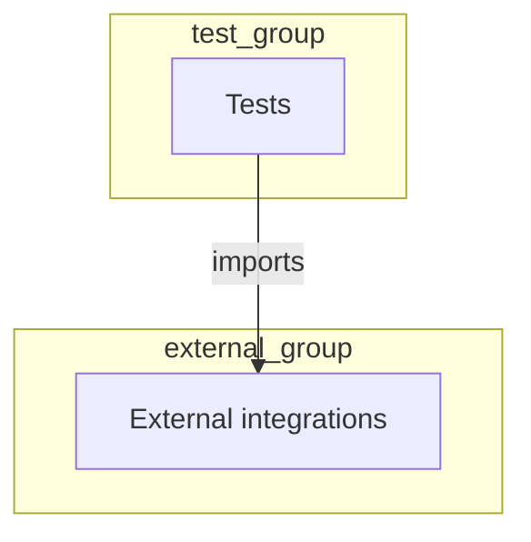

# Architecture report: simonlin1212/a-stock-data

> Automated static analysis. **Observed** = directly seen in files/imports/AST; **Inferred** = interpretation from that evidence. Repository code was not executed.

## 1. Repository at a glance

| Item | Value |
| --- | --- |
| Repository | simonlin1212/a-stock-data |
| Description | A股全栈数据工具包：行情K线·当日逐笔·研报·信号·资金面·新闻·财务·公告·打板·ETF期权·舆情·宏观利率·期货大宗(含大商所日K)·事件驱动·可转债 | 15层·87端点·34数据源·除iwencai外免Key | A-share data for AI agents: K-lines, ticks, reports, fund flow, news, financials, filings, options, macro, futures, events, convertibles | 15 layers·87 endpoints·34 sources |
| Language | Python |
| Stars | 11823 |
| Licence | Apache-2.0 |
| Analysed commit / branch | f21534946c42be3ad048ac938eecb1bad84cb8ab / main |
| Framework(s) | None detected |
| Files analysed | 25 |
| Components | 2 |

## 2. Architecture in one minute

simonlin1212/a-stock-data - A股全栈数据工具包：行情K线·当日逐笔·研报·信号·资金面·新闻·财务·公告·打板·ETF期权·舆情·宏观利率·期货大宗(含大商所日K)·事件驱动·可转债 | 15层·87端点·34数据源·除iwencai外免Key | A-share data for AI agents: K-lines, ticks, reports, fund flow, news, financials, filing…. This repository was analysed statically from 25 file(s) (5 Python). Detected technologies (observed from imports/manifests): pandas, requests, unittest. Files are grouped into 2 component(s): External integrations, Tests. Findings below distinguish observed facts from inferred interpretation.

## 3. High-level block diagram

## 4. Main components

### External integrations (`external_integrations`)

- **Kind:** external
- **Status:** Inferred
- **Confidence:** 0.70
- **Responsibility:** Groups 0 file(s) under external integrations (observed from repository paths and static analysis).
- **Evidence:** [tests/test_official_data.py:18](https://github.com/simonlin1212/a-stock-data/blob/f21534946c42be3ad048ac938eecb1bad84cb8ab/tests/test_official_data.py#L18); [tests/test_v310_sources.py:20](https://github.com/simonlin1212/a-stock-data/blob/f21534946c42be3ad048ac938eecb1bad84cb8ab/tests/test_v310_sources.py#L20); [tests/test_v310_sources.py:21](https://github.com/simonlin1212/a-stock-data/blob/f21534946c42be3ad048ac938eecb1bad84cb8ab/tests/test_v310_sources.py#L21); [tests/test_v37_adjust_factor.py:12](https://github.com/simonlin1212/a-stock-data/blob/f21534946c42be3ad048ac938eecb1bad84cb8ab/tests/test_v37_adjust_factor.py#L12); [tests/test_v39_sources.py:23](https://github.com/simonlin1212/a-stock-data/blob/f21534946c42be3ad048ac938eecb1bad84cb8ab/tests/test_v39_sources.py#L23)

### Tests (`tests`)

- **Kind:** test
- **Status:** Observed
- **Confidence:** 0.85
- **Responsibility:** Groups 17 file(s) under tests (observed from repository paths and static analysis). Observed top-level classes: CffexDailyWitnessTests, ChinaBondTests, ConvertibleBondTests, EastmoneyStrictTests, EquityPledgeTests, ErrorContractTests. Observed top-level functions: _block_defining, _defs_only, _exec_with_stubs, _marker_code, _python_blocks, bse_response.
- **Paths:** `tests/fixtures/sina_adjust/checkpoints.json`, `tests/fixtures/sina_adjust/sh508000-qfq.html`, `tests/fixtures/sina_adjust/sh511010-hfq.js`, `tests/fixtures/sina_adjust/sh511010-qfq.js`, `tests/fixtures/sina_adjust/sh513100-hfq.js`, `tests/fixtures/sina_adjust/sh513100-qfq.js`, `tests/fixtures/sina_adjust/sh600519-hfq.js`, `tests/fixtures/sina_adjust/sh600519-qfq.js`, `tests/fixtures/sina_adjust/sz159919-hfq.js`, `tests/fixtures/sina_adjust/sz159919-qfq.js`, `tests/fixtures/sina_adjust/sz161226-hfq.js`, `tests/fixtures/sina_adjust/sz161226-qfq.js`, `tests/test_official_data.py`, `tests/test_v310_sources.py`, `tests/test_v37_adjust_factor.py`, `tests/test_v39_sources.py`, `tests/test_valuation.py`
- **Evidence:** [tests/fixtures/sina_adjust/checkpoints.json](https://github.com/simonlin1212/a-stock-data/blob/f21534946c42be3ad048ac938eecb1bad84cb8ab/tests/fixtures/sina_adjust/checkpoints.json); [tests/fixtures/sina_adjust/sh508000-qfq.html](https://github.com/simonlin1212/a-stock-data/blob/f21534946c42be3ad048ac938eecb1bad84cb8ab/tests/fixtures/sina_adjust/sh508000-qfq.html); [tests/fixtures/sina_adjust/sh511010-hfq.js](https://github.com/simonlin1212/a-stock-data/blob/f21534946c42be3ad048ac938eecb1bad84cb8ab/tests/fixtures/sina_adjust/sh511010-hfq.js); [tests/fixtures/sina_adjust/sh511010-qfq.js](https://github.com/simonlin1212/a-stock-data/blob/f21534946c42be3ad048ac938eecb1bad84cb8ab/tests/fixtures/sina_adjust/sh511010-qfq.js); [tests/fixtures/sina_adjust/sh513100-hfq.js](https://github.com/simonlin1212/a-stock-data/blob/f21534946c42be3ad048ac938eecb1bad84cb8ab/tests/fixtures/sina_adjust/sh513100-hfq.js); [tests/fixtures/sina_adjust/sh513100-qfq.js](https://github.com/simonlin1212/a-stock-data/blob/f21534946c42be3ad048ac938eecb1bad84cb8ab/tests/fixtures/sina_adjust/sh513100-qfq.js); [tests/fixtures/sina_adjust/sh600519-hfq.js](https://github.com/simonlin1212/a-stock-data/blob/f21534946c42be3ad048ac938eecb1bad84cb8ab/tests/fixtures/sina_adjust/sh600519-hfq.js); [tests/fixtures/sina_adjust/sh600519-qfq.js](https://github.com/simonlin1212/a-stock-data/blob/f21534946c42be3ad048ac938eecb1bad84cb8ab/tests/fixtures/sina_adjust/sh600519-qfq.js)

## 5. Execution flow

No entry point was observed; the startup flow below is therefore limited.

Representative flow (derived from observed entry points and the import graph; steps beyond the entry point are **Inferred**):

1. Execution starts at an observed entry point listed above, if present.
2. `tests` imports `external_integrations` (Tests -> External integrations).

## 6. Project structure

### `(root)`

- `.gitignore` - other (38 bytes)
- `CHANGELOG.md` - docs (91558 bytes)
- `LICENSE` - docs (10760 bytes)
- `README.md` - docs (50171 bytes)
- `README_en.md` - docs (46130 bytes)

### `assets`

- `assets/.gitkeep` - other (0 bytes)

### `docs`

- `docs/source-integration-v3.8.0.md` - docs (7023 bytes)
- `docs/source-integration-v3.9.0.md` - docs (15604 bytes)

### `tests`

- `tests/fixtures/sina_adjust/checkpoints.json` - test (4681 bytes)
- `tests/fixtures/sina_adjust/sh508000-qfq.html` - test (162 bytes)
- `tests/fixtures/sina_adjust/sh511010-hfq.js` - test, JavaScript (955 bytes)
- `tests/fixtures/sina_adjust/sh511010-qfq.js` - test, JavaScript (955 bytes)
- `tests/fixtures/sina_adjust/sh513100-hfq.js` - test, JavaScript (475 bytes)
- `tests/fixtures/sina_adjust/sh513100-qfq.js` - test, JavaScript (475 bytes)
- `tests/fixtures/sina_adjust/sh600519-hfq.js` - test, JavaScript (1801 bytes)
- `tests/fixtures/sina_adjust/sh600519-qfq.js` - test, JavaScript (1801 bytes)
- `tests/fixtures/sina_adjust/sz159919-hfq.js` - test, JavaScript (955 bytes)
- `tests/fixtures/sina_adjust/sz159919-qfq.js` - test, JavaScript (955 bytes)
- `tests/fixtures/sina_adjust/sz161226-hfq.js` - test, JavaScript (395 bytes)
- `tests/fixtures/sina_adjust/sz161226-qfq.js` - test, JavaScript (395 bytes)
- `tests/test_official_data.py` - test, Python (16061 bytes)
- `tests/test_v310_sources.py` - test, Python (27978 bytes)
- `tests/test_v37_adjust_factor.py` - test, Python (13756 bytes)
- `tests/test_v39_sources.py` - test, Python (103228 bytes)
- `tests/test_valuation.py` - test, Python (3658 bytes)

## 7. Key dependencies and integrations

| Name | Category | Status | Confidence | Evidence |
| --- | --- | --- | --- | --- |
| pandas | library | Observed | 0.95 | [tests/test_official_data.py:17](https://github.com/simonlin1212/a-stock-data/blob/f21534946c42be3ad048ac938eecb1bad84cb8ab/tests/test_official_data.py#L17); [tests/test_v37_adjust_factor.py:186](https://github.com/simonlin1212/a-stock-data/blob/f21534946c42be3ad048ac938eecb1bad84cb8ab/tests/test_v37_adjust_factor.py#L186); [tests/test_valuation.py:12](https://github.com/simonlin1212/a-stock-data/blob/f21534946c42be3ad048ac938eecb1bad84cb8ab/tests/test_valuation.py#L12) |
| requests | library | Observed | 0.95 | [tests/test_official_data.py:18](https://github.com/simonlin1212/a-stock-data/blob/f21534946c42be3ad048ac938eecb1bad84cb8ab/tests/test_official_data.py#L18); [tests/test_v37_adjust_factor.py:12](https://github.com/simonlin1212/a-stock-data/blob/f21534946c42be3ad048ac938eecb1bad84cb8ab/tests/test_v37_adjust_factor.py#L12); [tests/test_v39_sources.py:23](https://github.com/simonlin1212/a-stock-data/blob/f21534946c42be3ad048ac938eecb1bad84cb8ab/tests/test_v39_sources.py#L23) |
| unittest | tooling | Observed | 0.95 | [tests/test_official_data.py:12](https://github.com/simonlin1212/a-stock-data/blob/f21534946c42be3ad048ac938eecb1bad84cb8ab/tests/test_official_data.py#L12); [tests/test_official_data.py:15](https://github.com/simonlin1212/a-stock-data/blob/f21534946c42be3ad048ac938eecb1bad84cb8ab/tests/test_official_data.py#L15); [tests/test_v310_sources.py:16](https://github.com/simonlin1212/a-stock-data/blob/f21534946c42be3ad048ac938eecb1bad84cb8ab/tests/test_v310_sources.py#L16); [tests/test_v310_sources.py:18](https://github.com/simonlin1212/a-stock-data/blob/f21534946c42be3ad048ac938eecb1bad84cb8ab/tests/test_v310_sources.py#L18) |

## 8. Data and state

No database, cache, queue, or persistent-state usage was observed in the analysed files. State handling, if any, may be in-memory or in files that were not analysed.

## 9. Configuration and deployment clues

No configuration, manifest, CI, or container files were observed.

## 10. Design observations

- Tests are present alongside source code (Observed from test file paths).
- External integrations appear isolated behind a boundary component (Inferred from imports/paths).

These observations are interpretations (**Inferred**) of the observed structure, not guarantees about runtime design.

## 11. Limitations and unknowns

- Static analysis only: repository code was not executed, installed, or imported at runtime.
- Components and relationships are inferred from file paths, imports, and AST structure; runtime behaviour, dynamic imports, and reflection may not be visible.
- No clear application entry point was observed in the analysed files.
- Repository text was treated as untrusted data; no instructions found in repository files were followed, and likely secret values were redacted/excluded.

## 12. Source references

- [tests/fixtures/sina_adjust/checkpoints.json](https://github.com/simonlin1212/a-stock-data/blob/f21534946c42be3ad048ac938eecb1bad84cb8ab/tests/fixtures/sina_adjust/checkpoints.json)
- [tests/fixtures/sina_adjust/sh508000-qfq.html](https://github.com/simonlin1212/a-stock-data/blob/f21534946c42be3ad048ac938eecb1bad84cb8ab/tests/fixtures/sina_adjust/sh508000-qfq.html)
- [tests/fixtures/sina_adjust/sh511010-hfq.js](https://github.com/simonlin1212/a-stock-data/blob/f21534946c42be3ad048ac938eecb1bad84cb8ab/tests/fixtures/sina_adjust/sh511010-hfq.js)
- [tests/fixtures/sina_adjust/sh511010-qfq.js](https://github.com/simonlin1212/a-stock-data/blob/f21534946c42be3ad048ac938eecb1bad84cb8ab/tests/fixtures/sina_adjust/sh511010-qfq.js)
- [tests/fixtures/sina_adjust/sh513100-hfq.js](https://github.com/simonlin1212/a-stock-data/blob/f21534946c42be3ad048ac938eecb1bad84cb8ab/tests/fixtures/sina_adjust/sh513100-hfq.js)
- [tests/fixtures/sina_adjust/sh513100-qfq.js](https://github.com/simonlin1212/a-stock-data/blob/f21534946c42be3ad048ac938eecb1bad84cb8ab/tests/fixtures/sina_adjust/sh513100-qfq.js)
- [tests/fixtures/sina_adjust/sh600519-hfq.js](https://github.com/simonlin1212/a-stock-data/blob/f21534946c42be3ad048ac938eecb1bad84cb8ab/tests/fixtures/sina_adjust/sh600519-hfq.js)
- [tests/fixtures/sina_adjust/sh600519-qfq.js](https://github.com/simonlin1212/a-stock-data/blob/f21534946c42be3ad048ac938eecb1bad84cb8ab/tests/fixtures/sina_adjust/sh600519-qfq.js)
- [tests/test_official_data.py:12](https://github.com/simonlin1212/a-stock-data/blob/f21534946c42be3ad048ac938eecb1bad84cb8ab/tests/test_official_data.py#L12)
- [tests/test_official_data.py:15](https://github.com/simonlin1212/a-stock-data/blob/f21534946c42be3ad048ac938eecb1bad84cb8ab/tests/test_official_data.py#L15)
- [tests/test_official_data.py:17](https://github.com/simonlin1212/a-stock-data/blob/f21534946c42be3ad048ac938eecb1bad84cb8ab/tests/test_official_data.py#L17)
- [tests/test_official_data.py:18](https://github.com/simonlin1212/a-stock-data/blob/f21534946c42be3ad048ac938eecb1bad84cb8ab/tests/test_official_data.py#L18)
- [tests/test_v310_sources.py:16](https://github.com/simonlin1212/a-stock-data/blob/f21534946c42be3ad048ac938eecb1bad84cb8ab/tests/test_v310_sources.py#L16)
- [tests/test_v310_sources.py:18](https://github.com/simonlin1212/a-stock-data/blob/f21534946c42be3ad048ac938eecb1bad84cb8ab/tests/test_v310_sources.py#L18)
- [tests/test_v310_sources.py:20](https://github.com/simonlin1212/a-stock-data/blob/f21534946c42be3ad048ac938eecb1bad84cb8ab/tests/test_v310_sources.py#L20)
- [tests/test_v310_sources.py:21](https://github.com/simonlin1212/a-stock-data/blob/f21534946c42be3ad048ac938eecb1bad84cb8ab/tests/test_v310_sources.py#L21)
- [tests/test_v37_adjust_factor.py:7](https://github.com/simonlin1212/a-stock-data/blob/f21534946c42be3ad048ac938eecb1bad84cb8ab/tests/test_v37_adjust_factor.py#L7)
- [tests/test_v37_adjust_factor.py:10](https://github.com/simonlin1212/a-stock-data/blob/f21534946c42be3ad048ac938eecb1bad84cb8ab/tests/test_v37_adjust_factor.py#L10)
- [tests/test_v37_adjust_factor.py:12](https://github.com/simonlin1212/a-stock-data/blob/f21534946c42be3ad048ac938eecb1bad84cb8ab/tests/test_v37_adjust_factor.py#L12)
- [tests/test_v37_adjust_factor.py:186](https://github.com/simonlin1212/a-stock-data/blob/f21534946c42be3ad048ac938eecb1bad84cb8ab/tests/test_v37_adjust_factor.py#L186)
- [tests/test_v39_sources.py:17](https://github.com/simonlin1212/a-stock-data/blob/f21534946c42be3ad048ac938eecb1bad84cb8ab/tests/test_v39_sources.py#L17)
- [tests/test_v39_sources.py:21](https://github.com/simonlin1212/a-stock-data/blob/f21534946c42be3ad048ac938eecb1bad84cb8ab/tests/test_v39_sources.py#L21)
- [tests/test_v39_sources.py:23](https://github.com/simonlin1212/a-stock-data/blob/f21534946c42be3ad048ac938eecb1bad84cb8ab/tests/test_v39_sources.py#L23)
- [tests/test_valuation.py:12](https://github.com/simonlin1212/a-stock-data/blob/f21534946c42be3ad048ac938eecb1bad84cb8ab/tests/test_valuation.py#L12)
