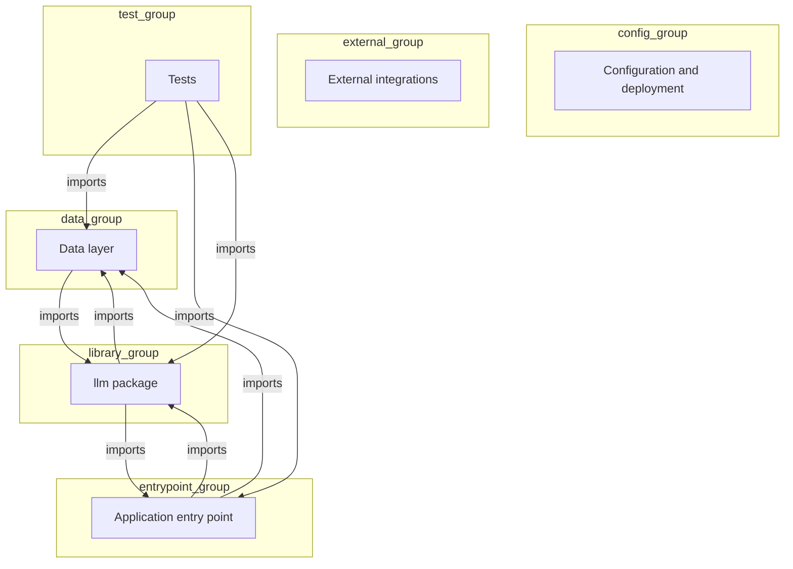

# Architecture report: simonw/llm

> Automated static analysis. **Observed** = directly seen in files/imports/AST; **Inferred** = interpretation from that evidence. Repository code was not executed.

## 1. Repository at a glance

| Item | Value |
| --- | --- |
| Repository | simonw/llm |
| Description | Access large language models from the command-line |
| Language | Python |
| Stars | 12756 |
| Licence | Apache-2.0 |
| Analysed commit / branch | 8b475ffdfc2d33aa86c9518baff3ac94bcea409e / main |
| Framework(s) | None detected |
| Files analysed | 123 |
| Components | 6 |

## 2. Architecture in one minute

simonw/llm - Access large language models from the command-line. This repository was analysed statically from 123 file(s) (59 Python). Detected technologies (observed from imports/manifests): GitHub Actions, SQLite, Click, NumPy, Pydantic, Poetry. Files are grouped into 6 component(s): Configuration and deployment, Data layer, Application entry point, External integrations, llm package, Tests. Observed entry point(s): llm/__main__.py, llm/cli.py. Findings below distinguish observed facts from inferred interpretation.

## 3. High-level block diagram

## 4. Main components

### Configuration and deployment (`config`)

- **Kind:** config
- **Status:** Observed
- **Confidence:** 0.85
- **Responsibility:** Groups 5 file(s) under configuration and deployment (observed from repository paths and static analysis).
- **Paths:** `MANIFEST.in`, `mypy.ini`, `pyproject.toml`, `pytest.ini`, `ruff.toml`
- **Evidence:** [MANIFEST.in](https://github.com/simonw/llm/blob/8b475ffdfc2d33aa86c9518baff3ac94bcea409e/MANIFEST.in); [mypy.ini](https://github.com/simonw/llm/blob/8b475ffdfc2d33aa86c9518baff3ac94bcea409e/mypy.ini); [pyproject.toml](https://github.com/simonw/llm/blob/8b475ffdfc2d33aa86c9518baff3ac94bcea409e/pyproject.toml); [pytest.ini](https://github.com/simonw/llm/blob/8b475ffdfc2d33aa86c9518baff3ac94bcea409e/pytest.ini); [ruff.toml](https://github.com/simonw/llm/blob/8b475ffdfc2d33aa86c9518baff3ac94bcea409e/ruff.toml)

### Data layer (`data_layer`)

- **Kind:** data
- **Status:** Observed
- **Confidence:** 0.85
- **Responsibility:** Groups 1 file(s) under data layer (observed from repository paths and static analysis). Observed top-level classes: AsyncChainResponse, AsyncConversation, AsyncKeyModel, AsyncModel, AsyncResponse, Attachment. Observed top-level functions: _accepts_llm_tool_call, _append_tool_results_to_chain, _append_turn_input, _chain_for_tool_results, _combine_system, _conversation_name.
- **Paths:** `llm/models.py`
- **Evidence:** [llm/models.py:57](https://github.com/simonw/llm/blob/8b475ffdfc2d33aa86c9518baff3ac94bcea409e/llm/models.py#L57)

### Application entry point (`entrypoint`)

- **Kind:** entrypoint
- **Status:** Observed
- **Confidence:** 0.85
- **Responsibility:** Groups 2 file(s) under application entry point (observed from repository paths and static analysis). Observed top-level classes: AttachmentError, AttachmentType, FragmentNotFound, LoadTemplateError. Observed top-level functions: _apply_template, _approve_tool_call, _cli_database, _debug_tool_call, _display_token_usage, _gather_tools.
- **Paths:** `llm/__main__.py`, `llm/cli.py`
- **Evidence:** [llm/__main__.py](https://github.com/simonw/llm/blob/8b475ffdfc2d33aa86c9518baff3ac94bcea409e/llm/__main__.py); [llm/cli.py:99](https://github.com/simonw/llm/blob/8b475ffdfc2d33aa86c9518baff3ac94bcea409e/llm/cli.py#L99)

### External integrations (`external_integrations`)

- **Kind:** external
- **Status:** Inferred
- **Confidence:** 0.70
- **Responsibility:** Groups 0 file(s) under external integrations (observed from repository paths and static analysis).
- **Evidence:** [llm/cli.py:11](https://github.com/simonw/llm/blob/8b475ffdfc2d33aa86c9518baff3ac94bcea409e/llm/cli.py#L11); [tests/conftest.py:3](https://github.com/simonw/llm/blob/8b475ffdfc2d33aa86c9518baff3ac94bcea409e/tests/conftest.py#L3); [tests/test_connection_cleanup.py:1](https://github.com/simonw/llm/blob/8b475ffdfc2d33aa86c9518baff3ac94bcea409e/tests/test_connection_cleanup.py#L1); [tests/test_logs_store.py:10](https://github.com/simonw/llm/blob/8b475ffdfc2d33aa86c9518baff3ac94bcea409e/tests/test_logs_store.py#L10)

### llm package (`llm`)

- **Kind:** library
- **Status:** Observed
- **Confidence:** 0.85
- **Responsibility:** Groups 16 file(s) under llm package (observed from repository paths and static analysis). Observed top-level classes: AsyncChat, AsyncResponses, AttachmentDict, AttachmentPart, AttachmentPartDict, AttachmentType. Observed top-level functions: _append_extra_model, _attachment, _attachment_from_dict, _attachment_ids, _attachment_summary, _attachment_to_dict.
- **Paths:** `llm/__init__.py`, `llm/default_plugins/__init__.py`, `llm/default_plugins/default_tools.py`, `llm/default_plugins/openai_models.py`, `llm/embeddings.py`, `llm/embeddings_migrations.py`, `llm/errors.py`, `llm/hookspecs.py`, `llm/logs.py`, `llm/migrations.py`, `llm/parts.py`, `llm/plugins.py`, `llm/serialization.py`, `llm/templates.py`, `llm/tools.py`, `llm/utils.py`
- **Evidence:** [llm/__init__.py:96](https://github.com/simonw/llm/blob/8b475ffdfc2d33aa86c9518baff3ac94bcea409e/llm/__init__.py#L96); [llm/default_plugins/__init__.py](https://github.com/simonw/llm/blob/8b475ffdfc2d33aa86c9518baff3ac94bcea409e/llm/default_plugins/__init__.py); [llm/default_plugins/default_tools.py:6](https://github.com/simonw/llm/blob/8b475ffdfc2d33aa86c9518baff3ac94bcea409e/llm/default_plugins/default_tools.py#L6); [llm/default_plugins/openai_models.py:45](https://github.com/simonw/llm/blob/8b475ffdfc2d33aa86c9518baff3ac94bcea409e/llm/default_plugins/openai_models.py#L45); [llm/embeddings.py:17](https://github.com/simonw/llm/blob/8b475ffdfc2d33aa86c9518baff3ac94bcea409e/llm/embeddings.py#L17); [llm/embeddings_migrations.py:10](https://github.com/simonw/llm/blob/8b475ffdfc2d33aa86c9518baff3ac94bcea409e/llm/embeddings_migrations.py#L10); [llm/errors.py:1](https://github.com/simonw/llm/blob/8b475ffdfc2d33aa86c9518baff3ac94bcea409e/llm/errors.py#L1); [llm/hookspecs.py:8](https://github.com/simonw/llm/blob/8b475ffdfc2d33aa86c9518baff3ac94bcea409e/llm/hookspecs.py#L8)

### Tests (`tests`)

- **Kind:** test
- **Status:** Observed
- **Confidence:** 0.85
- **Responsibility:** Groups 51 file(s) under tests (observed from repository paths and static analysis). Observed top-level classes: AsyncMockModel, AsyncServerToolsOnlyModel, AsyncSingleTurnModel, Counter, DemoServerSideTool, Discovery. Observed top-level functions: _add_chat_response, _add_chat_tool_call_response, _allowed, _assert_web_search_streaming_uses_final_payload, _capture_async, _capture_sync.
- **Paths:** `tests/cassettes/test_openai_responses/test_responses_basic_non_streaming.yaml`, `tests/cassettes/test_openai_responses/test_responses_basic_streaming.yaml`, `tests/cassettes/test_openai_responses/test_responses_interleaved_reasoning_between_tool_calls.yaml`, `tests/cassettes/test_openai_responses/test_responses_round_trips_encrypted_reasoning.yaml`, `tests/cassettes/test_openai_responses/test_responses_tool_use.yaml`, `tests/cassettes/test_openai_responses/test_responses_tool_use_streaming.yaml`, `tests/cassettes/test_tools/test_tool_use_basic.yaml`, `tests/cassettes/test_tools/test_tool_use_chain_of_two_calls.yaml`, `tests/cassettes/test_tools_streaming/test_tools_streaming_variant_a.yaml`, `tests/cassettes/test_tools_streaming/test_tools_streaming_variant_b.yaml`, `tests/cassettes/test_tools_streaming/test_tools_streaming_variant_c.yaml`, `tests/cassettes/test_tools_streaming/test_tools_streaming_variant_d.yaml`, `tests/conftest.py`, `tests/test-llm-load-plugins.sh`, `tests/test_aliases.py`, `tests/test_async.py`, `tests/test_async_parity.py`, `tests/test_attachments.py`, `tests/test_chain_callbacks.py`, `tests/test_chat.py`, `tests/test_chat_templates.py`, `tests/test_cli_openai_models.py`, `tests/test_cli_options.py`, `tests/test_cli_streaming.py`, `tests/test_connection_cleanup.py`, `tests/test_embed.py`, `tests/test_embed_cli.py`, `tests/test_encode_decode.py`, `tests/test_fragments_cli.py`, `tests/test_incremental_logging.py`, `tests/test_keys.py`, `tests/test_llm.py`, `tests/test_llm_logs.py`, `tests/test_logs_store.py`, `tests/test_migrate.py`, `tests/test_openai_endpoint.py`, `tests/test_openai_endpoint_add.py`, `tests/test_openai_key_leaks.py`, `tests/test_openai_messages.py`, `tests/test_openai_responses.py`, `tests/test_options_parameter.py`, `tests/test_parts.py`, `tests/test_pause_resume.py`, `tests/test_plugins.py`, `tests/test_schema_turn_usage.py`, `tests/test_serialization.py`, `tests/test_supports_conversation.py`, `tests/test_templates.py`, `tests/test_tools.py`, `tests/test_tools_streaming.py`, `tests/test_utils.py`
- **Evidence:** [tests/cassettes/test_openai_responses/test_responses_basic_non_streaming.yaml](https://github.com/simonw/llm/blob/8b475ffdfc2d33aa86c9518baff3ac94bcea409e/tests/cassettes/test_openai_responses/test_responses_basic_non_streaming.yaml); [tests/cassettes/test_openai_responses/test_responses_basic_streaming.yaml](https://github.com/simonw/llm/blob/8b475ffdfc2d33aa86c9518baff3ac94bcea409e/tests/cassettes/test_openai_responses/test_responses_basic_streaming.yaml); [tests/cassettes/test_openai_responses/test_responses_interleaved_reasoning_between_tool_calls.yaml](https://github.com/simonw/llm/blob/8b475ffdfc2d33aa86c9518baff3ac94bcea409e/tests/cassettes/test_openai_responses/test_responses_interleaved_reasoning_between_tool_calls.yaml); [tests/cassettes/test_openai_responses/test_responses_round_trips_encrypted_reasoning.yaml](https://github.com/simonw/llm/blob/8b475ffdfc2d33aa86c9518baff3ac94bcea409e/tests/cassettes/test_openai_responses/test_responses_round_trips_encrypted_reasoning.yaml); [tests/cassettes/test_openai_responses/test_responses_tool_use.yaml](https://github.com/simonw/llm/blob/8b475ffdfc2d33aa86c9518baff3ac94bcea409e/tests/cassettes/test_openai_responses/test_responses_tool_use.yaml); [tests/cassettes/test_openai_responses/test_responses_tool_use_streaming.yaml](https://github.com/simonw/llm/blob/8b475ffdfc2d33aa86c9518baff3ac94bcea409e/tests/cassettes/test_openai_responses/test_responses_tool_use_streaming.yaml); [tests/cassettes/test_tools/test_tool_use_basic.yaml](https://github.com/simonw/llm/blob/8b475ffdfc2d33aa86c9518baff3ac94bcea409e/tests/cassettes/test_tools/test_tool_use_basic.yaml); [tests/cassettes/test_tools/test_tool_use_chain_of_two_calls.yaml](https://github.com/simonw/llm/blob/8b475ffdfc2d33aa86c9518baff3ac94bcea409e/tests/cassettes/test_tools/test_tool_use_chain_of_two_calls.yaml)

## 5. Execution flow

**Observed** entry point(s):

- [llm/__main__.py:3](https://github.com/simonw/llm/blob/8b475ffdfc2d33aa86c9518baff3ac94bcea409e/llm/__main__.py#L3)
- [llm/cli.py](https://github.com/simonw/llm/blob/8b475ffdfc2d33aa86c9518baff3ac94bcea409e/llm/cli.py)

Representative flow (derived from observed entry points and the import graph; steps beyond the entry point are **Inferred**):

1. Execution starts at an observed entry point listed above, if present.
2. `data_layer` imports `llm` (Data layer -> llm package).
3. `entrypoint` imports `data_layer` (Application entry point -> Data layer).
4. `entrypoint` imports `llm` (Application entry point -> llm package).
5. `llm` imports `data_layer` (llm package -> Data layer).
6. `llm` imports `entrypoint` (llm package -> Application entry point).
7. `tests` imports `data_layer` (Tests -> Data layer).
8. `tests` imports `entrypoint` (Tests -> Application entry point).
9. `tests` imports `llm` (Tests -> llm package).

## 6. Project structure

### `(root)`

- `.gitignore` - other (145 bytes)
- `.readthedocs.yaml` - config (226 bytes)
- `AGENTS.md` - docs (429 bytes)
- `Justfile` - other (972 bytes)
- `LICENSE` - docs (11357 bytes)
- `MANIFEST.in` - manifest (23 bytes)
- `README.md` - docs (32914 bytes)
- `mypy.ini` - config (114 bytes)
- `pyproject.toml` - manifest (2285 bytes)
- `pytest.ini` - config (54 bytes)
- `ruff.toml` - config (43 bytes)

### `.github`

- `.github/FUNDING.yml` - config (17 bytes)
- `.github/dependabot.yml` - config (155 bytes)
- `.github/workflows/cog.yml` - ci, YAML (1440 bytes)
- `.github/workflows/publish.yml` - ci, YAML (1173 bytes)
- `.github/workflows/stable-docs.yml` - ci, YAML (2141 bytes)
- `.github/workflows/test.yml` - ci, YAML (1731 bytes)

### `docs`

- `docs/.gitignore` - docs (7 bytes)
- `docs/Makefile` - docs (695 bytes)
- `docs/_templates/base.html` - docs (510 bytes)
- `docs/aliases.md` - docs (2370 bytes)
- `docs/changelog.md` - docs (119630 bytes)
- `docs/conf.py` - docs (5913 bytes)
- `docs/contributing.md` - docs (2583 bytes)
- `docs/embeddings/cli.md` - docs (17246 bytes)
- `docs/embeddings/index.md` - docs (1585 bytes)
- `docs/embeddings/python-api.md` - docs (10212 bytes)
- `docs/embeddings/storage.md` - docs (1015 bytes)
- `docs/embeddings/writing-plugins.md` - docs (5620 bytes)
- `docs/fragments.md` - docs (7986 bytes)
- `docs/help.md` - docs (37028 bytes)
- `docs/index.md` - docs (6604 bytes)
- `docs/logging.md` - docs (38107 bytes)
- `docs/openai-models.md` - docs (12572 bytes)
- `docs/other-models.md` - docs (11403 bytes)
- `docs/plugins/advanced-model-plugins.md` - docs (36344 bytes)
- `docs/plugins/directory.md` - docs (11692 bytes)
- `docs/plugins/index.md` - docs (549 bytes)
- `docs/plugins/installing-plugins.md` - docs (2214 bytes)
- `docs/plugins/llm-markov/llm_markov.py` - docs (1952 bytes)
- `docs/plugins/llm-markov/pyproject.toml` - manifest (95 bytes)
- `docs/plugins/plugin-hooks.md` - docs (10895 bytes)
- `docs/plugins/plugin-utilities.md` - docs (3617 bytes)
- `docs/plugins/tutorial-model-plugin.md` - docs (21626 bytes)
- `docs/python-api.md` - docs (39835 bytes)
- `docs/related-tools.md` - docs (2183 bytes)
- `docs/requirements.txt` - manifest (115 bytes)
- `docs/schemas.md` - docs (25935 bytes)
- `docs/setup.md` - docs (6056 bytes)
- `docs/templates.md` - docs (12881 bytes)
- `docs/tools.md` - docs (5491 bytes)
- `docs/usage.md` - docs (45848 bytes)

### `llm`

- `llm/__init__.py` - source, Python (15047 bytes)
- `llm/__main__.py` - source, Python (59 bytes)
- `llm/cli.py` - source, Python (148087 bytes)
- `llm/default_plugins/__init__.py` - source, Python (0 bytes)
- `llm/default_plugins/default_tools.py` - source, Python (150 bytes)
- `llm/default_plugins/openai_models.py` - source, Python (124665 bytes)
- `llm/embeddings.py` - source, Python (15928 bytes)
- `llm/embeddings_migrations.py` - source, Python (2784 bytes)
- `llm/errors.py` - source, Python (305 bytes)
- `llm/hookspecs.py` - source, Python (820 bytes)
- `llm/logs.py` - source, Python (77721 bytes)
- `llm/migrations.py` - source, Python (21876 bytes)
- `llm/models.py` - source, Python (139216 bytes)
- `llm/parts.py` - source, Python (12396 bytes)
- `llm/plugins.py` - source, Python (1620 bytes)
- `llm/py.typed` - other (0 bytes)
- `llm/serialization.py` - source, Python (5248 bytes)
- `llm/templates.py` - source, Python (3271 bytes)
- `llm/tools.py` - source, Python (1136 bytes)
- `llm/utils.py` - source, Python (25994 bytes)

### `tests`

- `tests/cassettes/test_openai_responses/test_responses_basic_non_streaming.yaml` - test (3645 bytes)
- `tests/cassettes/test_openai_responses/test_responses_basic_streaming.yaml` - test (7298 bytes)
- `tests/cassettes/test_openai_responses/test_responses_interleaved_reasoning_between_tool_calls.yaml` - test (34884 bytes)
- `tests/cassettes/test_openai_responses/test_responses_round_trips_encrypted_reasoning.yaml` - test (18398 bytes)
- `tests/cassettes/test_openai_responses/test_responses_tool_use.yaml` - test (7971 bytes)
- `tests/cassettes/test_openai_responses/test_responses_tool_use_streaming.yaml` - test (24354 bytes)
- `tests/cassettes/test_tools/test_tool_use_basic.yaml` - test (19888 bytes)
- `tests/cassettes/test_tools/test_tool_use_chain_of_two_calls.yaml` - test (12496 bytes)
- `tests/cassettes/test_tools_streaming/test_tools_streaming_variant_a.yaml` - test (10420 bytes)
- `tests/cassettes/test_tools_streaming/test_tools_streaming_variant_b.yaml` - test (9996 bytes)
- `tests/cassettes/test_tools_streaming/test_tools_streaming_variant_c.yaml` - test (9800 bytes)
- `tests/cassettes/test_tools_streaming/test_tools_streaming_variant_d.yaml` - test (8971 bytes)
- `tests/conftest.py` - test, Python (16223 bytes)
- `tests/test-llm-load-plugins.sh` - test, Shell (929 bytes)
- `tests/test_aliases.py` - test, Python (4510 bytes)
- `tests/test_async.py` - test, Python (1859 bytes)
- `tests/test_async_parity.py` - test, Python (12929 bytes)
- `tests/test_attachments.py` - test, Python (11084 bytes)
- `tests/test_chain_callbacks.py` - test, Python (3643 bytes)
- `tests/test_chat.py` - test, Python (15741 bytes)
- `tests/test_chat_templates.py` - test, Python (3342 bytes)
- `tests/test_cli_openai_models.py` - test, Python (24645 bytes)
- `tests/test_cli_options.py` - test, Python (4252 bytes)
- `tests/test_cli_streaming.py` - test, Python (4881 bytes)
- `tests/test_connection_cleanup.py` - test, Python (3337 bytes)
- `tests/test_embed.py` - test, Python (16064 bytes)
- `tests/test_embed_cli.py` - test, Python (35061 bytes)
- `tests/test_encode_decode.py` - test, Python (410 bytes)
- `tests/test_fragments_cli.py` - test, Python (5394 bytes)
- `tests/test_incremental_logging.py` - test, Python (7342 bytes)
- `tests/test_keys.py` - test, Python (4207 bytes)
- `tests/test_llm.py` - test, Python (36621 bytes)
- `tests/test_llm_logs.py` - test, Python (54627 bytes)
- `tests/test_logs_store.py` - test, Python (92445 bytes)
- `tests/test_migrate.py` - test, Python (5448 bytes)
- `tests/test_openai_endpoint.py` - test, Python (32468 bytes)
- `tests/test_openai_endpoint_add.py` - test, Python (15755 bytes)
- `tests/test_openai_key_leaks.py` - test, Python (10013 bytes)
- `tests/test_openai_messages.py` - test, Python (22015 bytes)
- `tests/test_openai_responses.py` - test, Python (55173 bytes)
- `tests/test_options_parameter.py` - test, Python (4226 bytes)
- `tests/test_parts.py` - test, Python (101905 bytes)
- `tests/test_pause_resume.py` - test, Python (12239 bytes)
- `tests/test_plugins.py` - test, Python (41634 bytes)
- `tests/test_schema_turn_usage.py` - test, Python (2244 bytes)
- `tests/test_serialization.py` - test, Python (16121 bytes)
- `tests/test_supports_conversation.py` - test, Python (5644 bytes)
- `tests/test_templates.py` - test, Python (19051 bytes)
- `tests/test_tools.py` - test, Python (45001 bytes)
- `tests/test_tools_streaming.py` - test, Python (4213 bytes)
- `tests/test_utils.py` - test, Python (22345 bytes)

## 7. Key dependencies and integrations

| Name | Category | Status | Confidence | Evidence |
| --- | --- | --- | --- | --- |
| GitHub Actions | ci | Observed | 0.90 | [.github/workflows/cog.yml](https://github.com/simonw/llm/blob/8b475ffdfc2d33aa86c9518baff3ac94bcea409e/.github/workflows/cog.yml); [.github/workflows/publish.yml](https://github.com/simonw/llm/blob/8b475ffdfc2d33aa86c9518baff3ac94bcea409e/.github/workflows/publish.yml); [.github/workflows/stable-docs.yml](https://github.com/simonw/llm/blob/8b475ffdfc2d33aa86c9518baff3ac94bcea409e/.github/workflows/stable-docs.yml); [.github/workflows/test.yml](https://github.com/simonw/llm/blob/8b475ffdfc2d33aa86c9518baff3ac94bcea409e/.github/workflows/test.yml) |
| SQLite | database | Observed | 0.95 | [llm/cli.py:11](https://github.com/simonw/llm/blob/8b475ffdfc2d33aa86c9518baff3ac94bcea409e/llm/cli.py#L11); [tests/conftest.py:3](https://github.com/simonw/llm/blob/8b475ffdfc2d33aa86c9518baff3ac94bcea409e/tests/conftest.py#L3); [tests/test_connection_cleanup.py:1](https://github.com/simonw/llm/blob/8b475ffdfc2d33aa86c9518baff3ac94bcea409e/tests/test_connection_cleanup.py#L1); [tests/test_logs_store.py:10](https://github.com/simonw/llm/blob/8b475ffdfc2d33aa86c9518baff3ac94bcea409e/tests/test_logs_store.py#L10) |
| Click | library | Observed | 0.95 | [llm/__init__.py:9](https://github.com/simonw/llm/blob/8b475ffdfc2d33aa86c9518baff3ac94bcea409e/llm/__init__.py#L9); [llm/cli.py:21](https://github.com/simonw/llm/blob/8b475ffdfc2d33aa86c9518baff3ac94bcea409e/llm/cli.py#L21); [llm/default_plugins/openai_models.py:11](https://github.com/simonw/llm/blob/8b475ffdfc2d33aa86c9518baff3ac94bcea409e/llm/default_plugins/openai_models.py#L11); [llm/utils.py:12](https://github.com/simonw/llm/blob/8b475ffdfc2d33aa86c9518baff3ac94bcea409e/llm/utils.py#L12) |
| NumPy | library | Observed | 0.90 | [tests/test_encode_decode.py:1](https://github.com/simonw/llm/blob/8b475ffdfc2d33aa86c9518baff3ac94bcea409e/tests/test_encode_decode.py#L1) |
| Pydantic | library | Observed | 0.95 | [docs/plugins/llm-markov/llm_markov.py:4](https://github.com/simonw/llm/blob/8b475ffdfc2d33aa86c9518baff3ac94bcea409e/docs/plugins/llm-markov/llm_markov.py#L4); [llm/cli.py:23](https://github.com/simonw/llm/blob/8b475ffdfc2d33aa86c9518baff3ac94bcea409e/llm/cli.py#L23); [llm/default_plugins/openai_models.py:17](https://github.com/simonw/llm/blob/8b475ffdfc2d33aa86c9518baff3ac94bcea409e/llm/default_plugins/openai_models.py#L17); [llm/models.py:43](https://github.com/simonw/llm/blob/8b475ffdfc2d33aa86c9518baff3ac94bcea409e/llm/models.py#L43) |
| Poetry | packaging | Observed | 0.90 | [docs/plugins/llm-markov/pyproject.toml](https://github.com/simonw/llm/blob/8b475ffdfc2d33aa86c9518baff3ac94bcea409e/docs/plugins/llm-markov/pyproject.toml); [pyproject.toml](https://github.com/simonw/llm/blob/8b475ffdfc2d33aa86c9518baff3ac94bcea409e/pyproject.toml) |
| setuptools | packaging | Observed | 0.90 | [pyproject.toml:39](https://github.com/simonw/llm/blob/8b475ffdfc2d33aa86c9518baff3ac94bcea409e/pyproject.toml#L39) |
| pytest | tooling | Observed | 0.95 | [.github/workflows/publish.yml:29](https://github.com/simonw/llm/blob/8b475ffdfc2d33aa86c9518baff3ac94bcea409e/.github/workflows/publish.yml#L29); [.github/workflows/test.yml:28](https://github.com/simonw/llm/blob/8b475ffdfc2d33aa86c9518baff3ac94bcea409e/.github/workflows/test.yml#L28); [tests/conftest.py:6](https://github.com/simonw/llm/blob/8b475ffdfc2d33aa86c9518baff3ac94bcea409e/tests/conftest.py#L6); [tests/test_aliases.py:4](https://github.com/simonw/llm/blob/8b475ffdfc2d33aa86c9518baff3ac94bcea409e/tests/test_aliases.py#L4) |
| unittest | tooling | Observed | 0.95 | [tests/test_attachments.py:3](https://github.com/simonw/llm/blob/8b475ffdfc2d33aa86c9518baff3ac94bcea409e/tests/test_attachments.py#L3); [tests/test_chat.py:5](https://github.com/simonw/llm/blob/8b475ffdfc2d33aa86c9518baff3ac94bcea409e/tests/test_chat.py#L5); [tests/test_embed.py:2](https://github.com/simonw/llm/blob/8b475ffdfc2d33aa86c9518baff3ac94bcea409e/tests/test_embed.py#L2); [tests/test_embed_cli.py:4](https://github.com/simonw/llm/blob/8b475ffdfc2d33aa86c9518baff3ac94bcea409e/tests/test_embed_cli.py#L4) |

## 8. Data and state

- **SQLite** (Observed, confidence 0.95) - evidence: [llm/cli.py:11](https://github.com/simonw/llm/blob/8b475ffdfc2d33aa86c9518baff3ac94bcea409e/llm/cli.py#L11); [tests/conftest.py:3](https://github.com/simonw/llm/blob/8b475ffdfc2d33aa86c9518baff3ac94bcea409e/tests/conftest.py#L3); [tests/test_connection_cleanup.py:1](https://github.com/simonw/llm/blob/8b475ffdfc2d33aa86c9518baff3ac94bcea409e/tests/test_connection_cleanup.py#L1); [tests/test_logs_store.py:10](https://github.com/simonw/llm/blob/8b475ffdfc2d33aa86c9518baff3ac94bcea409e/tests/test_logs_store.py#L10)
- Data component `data_layer` (Observed): Groups 1 file(s) under data layer (observed from repository paths and static analysis). Observed top-level classes: AsyncChainResponse, AsyncConversation, AsyncKeyModel, AsyncModel, AsyncResponse, Attachment. Observed top-level functions: _accepts_llm_tool_call, _append_tool_results_to_chain, _appe…

## 9. Configuration and deployment clues

- `.github/FUNDING.yml` (config)
- `.github/dependabot.yml` (config)
- `.github/workflows/cog.yml` (ci)
- `.github/workflows/publish.yml` (ci)
- `.github/workflows/stable-docs.yml` (ci)
- `.github/workflows/test.yml` (ci)
- `.readthedocs.yaml` (config)
- `MANIFEST.in` (manifest)
- `docs/plugins/llm-markov/pyproject.toml` (manifest)
- `docs/requirements.txt` (manifest)
- `mypy.ini` (config)
- `pyproject.toml` (manifest)
- `pytest.ini` (config)
- `ruff.toml` (config)

Console scripts declared in packaging metadata (**Observed**):

- `llm` -> `llm.cli:cli`

## 10. Design observations

- An entry/API layer is separated from other code (Inferred from paths and decorators).
- Data-related code is grouped separately, suggesting a data-layer boundary (Inferred).
- Tests are present alongside source code (Observed from test file paths).
- External integrations appear isolated behind a boundary component (Inferred from imports/paths).

These observations are interpretations (**Inferred**) of the observed structure, not guarantees about runtime design.

## 11. Limitations and unknowns

- Static analysis only: repository code was not executed, installed, or imported at runtime.
- Components and relationships are inferred from file paths, imports, and AST structure; runtime behaviour, dynamic imports, and reflection may not be visible.
- Repository text was treated as untrusted data; no instructions found in repository files were followed, and likely secret values were redacted/excluded.

## 12. Source references

- [.github/workflows/cog.yml](https://github.com/simonw/llm/blob/8b475ffdfc2d33aa86c9518baff3ac94bcea409e/.github/workflows/cog.yml)
- [.github/workflows/publish.yml](https://github.com/simonw/llm/blob/8b475ffdfc2d33aa86c9518baff3ac94bcea409e/.github/workflows/publish.yml)
- [.github/workflows/publish.yml:29](https://github.com/simonw/llm/blob/8b475ffdfc2d33aa86c9518baff3ac94bcea409e/.github/workflows/publish.yml#L29)
- [.github/workflows/stable-docs.yml](https://github.com/simonw/llm/blob/8b475ffdfc2d33aa86c9518baff3ac94bcea409e/.github/workflows/stable-docs.yml)
- [.github/workflows/test.yml](https://github.com/simonw/llm/blob/8b475ffdfc2d33aa86c9518baff3ac94bcea409e/.github/workflows/test.yml)
- [.github/workflows/test.yml:28](https://github.com/simonw/llm/blob/8b475ffdfc2d33aa86c9518baff3ac94bcea409e/.github/workflows/test.yml#L28)
- [MANIFEST.in](https://github.com/simonw/llm/blob/8b475ffdfc2d33aa86c9518baff3ac94bcea409e/MANIFEST.in)
- [docs/plugins/llm-markov/llm_markov.py:4](https://github.com/simonw/llm/blob/8b475ffdfc2d33aa86c9518baff3ac94bcea409e/docs/plugins/llm-markov/llm_markov.py#L4)
- [docs/plugins/llm-markov/pyproject.toml](https://github.com/simonw/llm/blob/8b475ffdfc2d33aa86c9518baff3ac94bcea409e/docs/plugins/llm-markov/pyproject.toml)
- [llm/__init__.py:9](https://github.com/simonw/llm/blob/8b475ffdfc2d33aa86c9518baff3ac94bcea409e/llm/__init__.py#L9)
- [llm/__init__.py:96](https://github.com/simonw/llm/blob/8b475ffdfc2d33aa86c9518baff3ac94bcea409e/llm/__init__.py#L96)
- [llm/__main__.py](https://github.com/simonw/llm/blob/8b475ffdfc2d33aa86c9518baff3ac94bcea409e/llm/__main__.py)
- [llm/__main__.py:3](https://github.com/simonw/llm/blob/8b475ffdfc2d33aa86c9518baff3ac94bcea409e/llm/__main__.py#L3)
- [llm/cli.py](https://github.com/simonw/llm/blob/8b475ffdfc2d33aa86c9518baff3ac94bcea409e/llm/cli.py)
- [llm/cli.py:11](https://github.com/simonw/llm/blob/8b475ffdfc2d33aa86c9518baff3ac94bcea409e/llm/cli.py#L11)
- [llm/cli.py:21](https://github.com/simonw/llm/blob/8b475ffdfc2d33aa86c9518baff3ac94bcea409e/llm/cli.py#L21)
- [llm/cli.py:23](https://github.com/simonw/llm/blob/8b475ffdfc2d33aa86c9518baff3ac94bcea409e/llm/cli.py#L23)
- [llm/cli.py:99](https://github.com/simonw/llm/blob/8b475ffdfc2d33aa86c9518baff3ac94bcea409e/llm/cli.py#L99)
- [llm/default_plugins/__init__.py](https://github.com/simonw/llm/blob/8b475ffdfc2d33aa86c9518baff3ac94bcea409e/llm/default_plugins/__init__.py)
- [llm/default_plugins/default_tools.py:6](https://github.com/simonw/llm/blob/8b475ffdfc2d33aa86c9518baff3ac94bcea409e/llm/default_plugins/default_tools.py#L6)
- [llm/default_plugins/openai_models.py:11](https://github.com/simonw/llm/blob/8b475ffdfc2d33aa86c9518baff3ac94bcea409e/llm/default_plugins/openai_models.py#L11)
- [llm/default_plugins/openai_models.py:17](https://github.com/simonw/llm/blob/8b475ffdfc2d33aa86c9518baff3ac94bcea409e/llm/default_plugins/openai_models.py#L17)
- [llm/default_plugins/openai_models.py:45](https://github.com/simonw/llm/blob/8b475ffdfc2d33aa86c9518baff3ac94bcea409e/llm/default_plugins/openai_models.py#L45)
- [llm/embeddings.py:17](https://github.com/simonw/llm/blob/8b475ffdfc2d33aa86c9518baff3ac94bcea409e/llm/embeddings.py#L17)
- [llm/embeddings_migrations.py:10](https://github.com/simonw/llm/blob/8b475ffdfc2d33aa86c9518baff3ac94bcea409e/llm/embeddings_migrations.py#L10)
- [llm/errors.py:1](https://github.com/simonw/llm/blob/8b475ffdfc2d33aa86c9518baff3ac94bcea409e/llm/errors.py#L1)
- [llm/hookspecs.py:8](https://github.com/simonw/llm/blob/8b475ffdfc2d33aa86c9518baff3ac94bcea409e/llm/hookspecs.py#L8)
- [llm/models.py:43](https://github.com/simonw/llm/blob/8b475ffdfc2d33aa86c9518baff3ac94bcea409e/llm/models.py#L43)
- [llm/models.py:57](https://github.com/simonw/llm/blob/8b475ffdfc2d33aa86c9518baff3ac94bcea409e/llm/models.py#L57)
- [llm/templates.py:4](https://github.com/simonw/llm/blob/8b475ffdfc2d33aa86c9518baff3ac94bcea409e/llm/templates.py#L4)
- [llm/utils.py:12](https://github.com/simonw/llm/blob/8b475ffdfc2d33aa86c9518baff3ac94bcea409e/llm/utils.py#L12)
- [mypy.ini](https://github.com/simonw/llm/blob/8b475ffdfc2d33aa86c9518baff3ac94bcea409e/mypy.ini)
- [pyproject.toml](https://github.com/simonw/llm/blob/8b475ffdfc2d33aa86c9518baff3ac94bcea409e/pyproject.toml)
- [pyproject.toml:28](https://github.com/simonw/llm/blob/8b475ffdfc2d33aa86c9518baff3ac94bcea409e/pyproject.toml#L28)
- [pyproject.toml:34](https://github.com/simonw/llm/blob/8b475ffdfc2d33aa86c9518baff3ac94bcea409e/pyproject.toml#L34)
- [pyproject.toml:39](https://github.com/simonw/llm/blob/8b475ffdfc2d33aa86c9518baff3ac94bcea409e/pyproject.toml#L39)
- [pytest.ini](https://github.com/simonw/llm/blob/8b475ffdfc2d33aa86c9518baff3ac94bcea409e/pytest.ini)
- [ruff.toml](https://github.com/simonw/llm/blob/8b475ffdfc2d33aa86c9518baff3ac94bcea409e/ruff.toml)
- [tests/cassettes/test_openai_responses/test_responses_basic_non_streaming.yaml](https://github.com/simonw/llm/blob/8b475ffdfc2d33aa86c9518baff3ac94bcea409e/tests/cassettes/test_openai_responses/test_responses_basic_non_streaming.yaml)
- [tests/cassettes/test_openai_responses/test_responses_basic_streaming.yaml](https://github.com/simonw/llm/blob/8b475ffdfc2d33aa86c9518baff3ac94bcea409e/tests/cassettes/test_openai_responses/test_responses_basic_streaming.yaml)
- [tests/cassettes/test_openai_responses/test_responses_interleaved_reasoning_between_tool_calls.yaml](https://github.com/simonw/llm/blob/8b475ffdfc2d33aa86c9518baff3ac94bcea409e/tests/cassettes/test_openai_responses/test_responses_interleaved_reasoning_between_tool_calls.yaml)
- [tests/cassettes/test_openai_responses/test_responses_round_trips_encrypted_reasoning.yaml](https://github.com/simonw/llm/blob/8b475ffdfc2d33aa86c9518baff3ac94bcea409e/tests/cassettes/test_openai_responses/test_responses_round_trips_encrypted_reasoning.yaml)
- [tests/cassettes/test_openai_responses/test_responses_tool_use.yaml](https://github.com/simonw/llm/blob/8b475ffdfc2d33aa86c9518baff3ac94bcea409e/tests/cassettes/test_openai_responses/test_responses_tool_use.yaml)
- [tests/cassettes/test_openai_responses/test_responses_tool_use_streaming.yaml](https://github.com/simonw/llm/blob/8b475ffdfc2d33aa86c9518baff3ac94bcea409e/tests/cassettes/test_openai_responses/test_responses_tool_use_streaming.yaml)
- [tests/cassettes/test_tools/test_tool_use_basic.yaml](https://github.com/simonw/llm/blob/8b475ffdfc2d33aa86c9518baff3ac94bcea409e/tests/cassettes/test_tools/test_tool_use_basic.yaml)
- [tests/cassettes/test_tools/test_tool_use_chain_of_two_calls.yaml](https://github.com/simonw/llm/blob/8b475ffdfc2d33aa86c9518baff3ac94bcea409e/tests/cassettes/test_tools/test_tool_use_chain_of_two_calls.yaml)
- [tests/conftest.py:3](https://github.com/simonw/llm/blob/8b475ffdfc2d33aa86c9518baff3ac94bcea409e/tests/conftest.py#L3)
- [tests/conftest.py:6](https://github.com/simonw/llm/blob/8b475ffdfc2d33aa86c9518baff3ac94bcea409e/tests/conftest.py#L6)
- [tests/conftest.py:8](https://github.com/simonw/llm/blob/8b475ffdfc2d33aa86c9518baff3ac94bcea409e/tests/conftest.py#L8)
- [tests/test_aliases.py:4](https://github.com/simonw/llm/blob/8b475ffdfc2d33aa86c9518baff3ac94bcea409e/tests/test_aliases.py#L4)
- [tests/test_aliases.py:5](https://github.com/simonw/llm/blob/8b475ffdfc2d33aa86c9518baff3ac94bcea409e/tests/test_aliases.py#L5)
- [tests/test_async.py:1](https://github.com/simonw/llm/blob/8b475ffdfc2d33aa86c9518baff3ac94bcea409e/tests/test_async.py#L1)
- [tests/test_async_parity.py:10](https://github.com/simonw/llm/blob/8b475ffdfc2d33aa86c9518baff3ac94bcea409e/tests/test_async_parity.py#L10)
- [tests/test_attachments.py:3](https://github.com/simonw/llm/blob/8b475ffdfc2d33aa86c9518baff3ac94bcea409e/tests/test_attachments.py#L3)
- [tests/test_attachments.py:6](https://github.com/simonw/llm/blob/8b475ffdfc2d33aa86c9518baff3ac94bcea409e/tests/test_attachments.py#L6)
- [tests/test_attachments.py:7](https://github.com/simonw/llm/blob/8b475ffdfc2d33aa86c9518baff3ac94bcea409e/tests/test_attachments.py#L7)
- [tests/test_chain_callbacks.py:3](https://github.com/simonw/llm/blob/8b475ffdfc2d33aa86c9518baff3ac94bcea409e/tests/test_chain_callbacks.py#L3)
- [tests/test_chat.py:5](https://github.com/simonw/llm/blob/8b475ffdfc2d33aa86c9518baff3ac94bcea409e/tests/test_chat.py#L5)
- [tests/test_chat.py:8](https://github.com/simonw/llm/blob/8b475ffdfc2d33aa86c9518baff3ac94bcea409e/tests/test_chat.py#L8)
- [tests/test_connection_cleanup.py:1](https://github.com/simonw/llm/blob/8b475ffdfc2d33aa86c9518baff3ac94bcea409e/tests/test_connection_cleanup.py#L1)
- [tests/test_embed.py:2](https://github.com/simonw/llm/blob/8b475ffdfc2d33aa86c9518baff3ac94bcea409e/tests/test_embed.py#L2)
- [tests/test_embed_cli.py:4](https://github.com/simonw/llm/blob/8b475ffdfc2d33aa86c9518baff3ac94bcea409e/tests/test_embed_cli.py#L4)
- [tests/test_encode_decode.py:1](https://github.com/simonw/llm/blob/8b475ffdfc2d33aa86c9518baff3ac94bcea409e/tests/test_encode_decode.py#L1)
- [tests/test_fragments_cli.py:5](https://github.com/simonw/llm/blob/8b475ffdfc2d33aa86c9518baff3ac94bcea409e/tests/test_fragments_cli.py#L5)
- [tests/test_llm.py:9](https://github.com/simonw/llm/blob/8b475ffdfc2d33aa86c9518baff3ac94bcea409e/tests/test_llm.py#L9)
- [tests/test_llm.py:13](https://github.com/simonw/llm/blob/8b475ffdfc2d33aa86c9518baff3ac94bcea409e/tests/test_llm.py#L13)
- [tests/test_logs_store.py:10](https://github.com/simonw/llm/blob/8b475ffdfc2d33aa86c9518baff3ac94bcea409e/tests/test_logs_store.py#L10)
- [tests/test_plugins.py:6](https://github.com/simonw/llm/blob/8b475ffdfc2d33aa86c9518baff3ac94bcea409e/tests/test_plugins.py#L6)
- [tests/test_templates.py:6](https://github.com/simonw/llm/blob/8b475ffdfc2d33aa86c9518baff3ac94bcea409e/tests/test_templates.py#L6)
