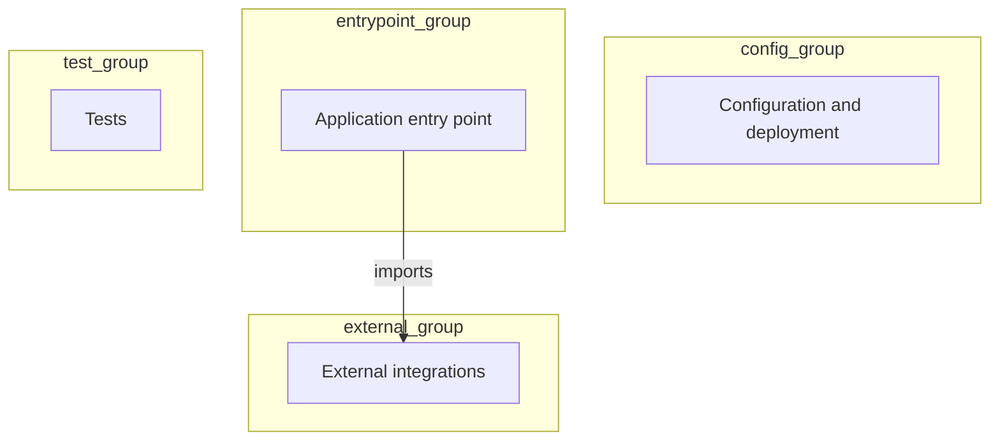

# Architecture report: sivel/speedtest-cli

> Automated static analysis. **Observed** = directly seen in files/imports/AST; **Inferred** = interpretation from that evidence. Repository code was not executed.

## 1. Repository at a glance

| Item | Value |
| --- | --- |
| Repository | sivel/speedtest-cli |
| Description | Command line interface for testing internet bandwidth using speedtest.net |
| Language | Python |
| Stars | 14036 |
| Licence | Apache-2.0 |
| Analysed commit / branch | 22210ca35228f0bbcef75a7c14587c4ecb875ab4 / master |
| Framework(s) | None detected |
| Files analysed | 12 |
| Components | 4 |

## 2. Architecture in one minute

sivel/speedtest-cli - Command line interface for testing internet bandwidth using speedtest.net. This repository was analysed statically from 12 file(s) (3 Python). Detected technologies (observed from imports/manifests): setuptools. Files are grouped into 4 component(s): Configuration and deployment, Application entry point, External integrations, Tests. Observed entry point(s): speedtest.py. Findings below distinguish observed facts from inferred interpretation.

## 3. High-level block diagram

## 4. Main components

### Configuration and deployment (`config`)

- **Kind:** config
- **Status:** Observed
- **Confidence:** 0.85
- **Responsibility:** Groups 4 file(s) under configuration and deployment (observed from repository paths and static analysis). Observed top-level functions: find_version.
- **Paths:** `MANIFEST.in`, `setup.cfg`, `setup.py`, `tox.ini`
- **Evidence:** [MANIFEST.in](https://github.com/sivel/speedtest-cli/blob/22210ca35228f0bbcef75a7c14587c4ecb875ab4/MANIFEST.in); [setup.cfg](https://github.com/sivel/speedtest-cli/blob/22210ca35228f0bbcef75a7c14587c4ecb875ab4/setup.cfg); [setup.py:30](https://github.com/sivel/speedtest-cli/blob/22210ca35228f0bbcef75a7c14587c4ecb875ab4/setup.py#L30); [tox.ini](https://github.com/sivel/speedtest-cli/blob/22210ca35228f0bbcef75a7c14587c4ecb875ab4/tox.ini)

### Application entry point (`entrypoint`)

- **Kind:** entrypoint
- **Status:** Observed
- **Confidence:** 0.85
- **Responsibility:** Groups 1 file(s) under application entry point (observed from repository paths and static analysis). Observed top-level classes: ConfigRetrievalError, FakeShutdownEvent, GzipDecodedResponse, HTTPDownloader, HTTPUploader, HTTPUploaderData. Observed top-level functions: _build_connection, build_opener, build_request, build_user_agent, catch_request, create_connection.
- **Paths:** `speedtest.py`
- **Evidence:** [speedtest.py:42](https://github.com/sivel/speedtest-cli/blob/22210ca35228f0bbcef75a7c14587c4ecb875ab4/speedtest.py#L42)

### External integrations (`external_integrations`)

- **Kind:** external
- **Status:** Inferred
- **Confidence:** 0.70
- **Responsibility:** Groups 0 file(s) under external integrations (observed from repository paths and static analysis).
- **Evidence:** [speedtest.py:26](https://github.com/sivel/speedtest-cli/blob/22210ca35228f0bbcef75a7c14587c4ecb875ab4/speedtest.py#L26)

### Tests (`tests`)

- **Kind:** test
- **Status:** Observed
- **Confidence:** 0.85
- **Responsibility:** Groups 1 file(s) under tests (observed from repository paths and static analysis).
- **Paths:** `tests/scripts/source.py`
- **Evidence:** [tests/scripts/source.py](https://github.com/sivel/speedtest-cli/blob/22210ca35228f0bbcef75a7c14587c4ecb875ab4/tests/scripts/source.py)

## 5. Execution flow

**Observed** entry point(s):

- [speedtest.py](https://github.com/sivel/speedtest-cli/blob/22210ca35228f0bbcef75a7c14587c4ecb875ab4/speedtest.py)
- [speedtest.py](https://github.com/sivel/speedtest-cli/blob/22210ca35228f0bbcef75a7c14587c4ecb875ab4/speedtest.py)

Representative flow (derived from observed entry points and the import graph; steps beyond the entry point are **Inferred**):

1. Execution starts at an observed entry point listed above, if present.
2. `entrypoint` imports `external_integrations` (Application entry point -> External integrations).

## 6. Project structure

### `(root)`

- `.gitignore` - other (232 bytes)
- `.travis.yml` - ci, YAML (1380 bytes)
- `CONTRIBUTING.md` - docs (1671 bytes)
- `LICENSE` - docs (11358 bytes)
- `MANIFEST.in` - manifest (35 bytes)
- `README.rst` - docs (5606 bytes)
- `setup.cfg` - manifest (20 bytes)
- `setup.py` - manifest, Python (3420 bytes)
- `speedtest-cli.1` - other (3039 bytes)
- `speedtest.py` - source, Python (65334 bytes)
- `tox.ini` - config (497 bytes)

### `tests`

- `tests/scripts/source.py` - test, Python (1132 bytes)

## 7. Key dependencies and integrations

| Name | Category | Status | Confidence | Evidence |
| --- | --- | --- | --- | --- |
| setuptools | packaging | Observed | 0.90 | [setup.py:22](https://github.com/sivel/speedtest-cli/blob/22210ca35228f0bbcef75a7c14587c4ecb875ab4/setup.py#L22) |

## 8. Data and state

No database, cache, queue, or persistent-state usage was observed in the analysed files. State handling, if any, may be in-memory or in files that were not analysed.

## 9. Configuration and deployment clues

- `.travis.yml` (ci)
- `MANIFEST.in` (manifest)
- `setup.cfg` (manifest)
- `setup.py` (manifest)
- `tox.ini` (config)

Console scripts declared in packaging metadata (**Observed**):

- `speedtest` -> `speedtest:main`
- `speedtest-cli` -> `speedtest:main`

## 10. Design observations

- An entry/API layer is separated from other code (Inferred from paths and decorators).
- Tests are present alongside source code (Observed from test file paths).
- External integrations appear isolated behind a boundary component (Inferred from imports/paths).

These observations are interpretations (**Inferred**) of the observed structure, not guarantees about runtime design.

## 11. Limitations and unknowns

- Static analysis only: repository code was not executed, installed, or imported at runtime.
- Components and relationships are inferred from file paths, imports, and AST structure; runtime behaviour, dynamic imports, and reflection may not be visible.
- Repository text was treated as untrusted data; no instructions found in repository files were followed, and likely secret values were redacted/excluded.
- The GitHub repository was marked archived at selection time.

## 12. Source references

- [MANIFEST.in](https://github.com/sivel/speedtest-cli/blob/22210ca35228f0bbcef75a7c14587c4ecb875ab4/MANIFEST.in)
- [setup.cfg](https://github.com/sivel/speedtest-cli/blob/22210ca35228f0bbcef75a7c14587c4ecb875ab4/setup.cfg)
- [setup.py:22](https://github.com/sivel/speedtest-cli/blob/22210ca35228f0bbcef75a7c14587c4ecb875ab4/setup.py#L22)
- [setup.py:30](https://github.com/sivel/speedtest-cli/blob/22210ca35228f0bbcef75a7c14587c4ecb875ab4/setup.py#L30)
- [speedtest.py](https://github.com/sivel/speedtest-cli/blob/22210ca35228f0bbcef75a7c14587c4ecb875ab4/speedtest.py)
- [speedtest.py:26](https://github.com/sivel/speedtest-cli/blob/22210ca35228f0bbcef75a7c14587c4ecb875ab4/speedtest.py#L26)
- [speedtest.py:42](https://github.com/sivel/speedtest-cli/blob/22210ca35228f0bbcef75a7c14587c4ecb875ab4/speedtest.py#L42)
- [tests/scripts/source.py](https://github.com/sivel/speedtest-cli/blob/22210ca35228f0bbcef75a7c14587c4ecb875ab4/tests/scripts/source.py)
- [tox.ini](https://github.com/sivel/speedtest-cli/blob/22210ca35228f0bbcef75a7c14587c4ecb875ab4/tox.ini)
