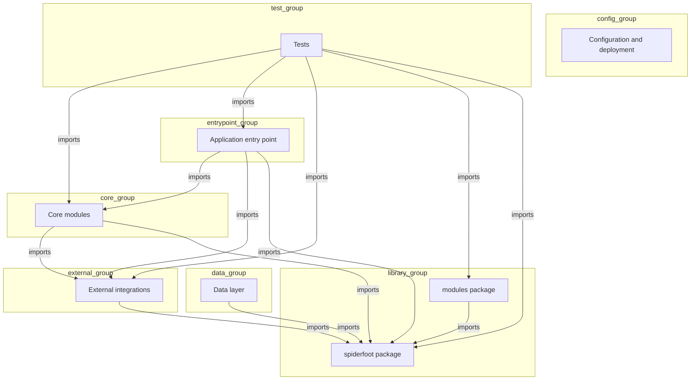

# Architecture report: smicallef/spiderfoot

> Automated static analysis. **Observed** = directly seen in files/imports/AST; **Inferred** = interpretation from that evidence. Repository code was not executed.

## 1. Repository at a glance

| Item | Value |
| --- | --- |
| Repository | smicallef/spiderfoot |
| Description | SpiderFoot automates OSINT for threat intelligence and mapping your attack surface. |
| Language | Python |
| Stars | 24589 |
| Licence | MIT |
| Analysed commit / branch | 0f815a203afebf05c98b605dba5cf0475a0ee5fd / master |
| Framework(s) | None detected |
| Files analysed | 791 |
| Components | 8 |

## 2. Architecture in one minute

smicallef/spiderfoot - SpiderFoot automates OSINT for threat intelligence and mapping your attack surface.. This repository was analysed statically from 791 file(s) (702 Python). Detected technologies (observed from imports/manifests): GitHub Actions, SQLite, requests, Docker, Docker Compose, pytest. Files are grouped into 8 component(s): Configuration and deployment, Core modules, Data layer, Application entry point, External integrations, modules package, spiderfoot package, Tests. Observed entry point(s): sf.py, sfcli.py. Findings below distinguish observed facts from inferred interpretation.

## 3. High-level block diagram

## 4. Main components

### Configuration and deployment (`config`)

- **Kind:** config
- **Status:** Observed
- **Confidence:** 0.85
- **Responsibility:** Groups 46 file(s) under configuration and deployment (observed from repository paths and static analysis).
- **Paths:** `Dockerfile`, `Dockerfile.full`, `correlations/cert_expired.yaml`, `correlations/cloud_bucket_open.yaml`, `correlations/cloud_bucket_open_related.yaml`, `correlations/data_from_base64.yaml`, `correlations/data_from_docmeta.yaml`, `correlations/database_exposed.yaml`, `correlations/dev_or_test_system.yaml`, `correlations/dns_zone_transfer_possible.yaml`, `correlations/egress_ip_from_wikipedia.yaml`, `correlations/email_in_multiple_breaches.yaml`, `correlations/email_in_whois.yaml`, `correlations/email_only_from_pasteleak_site.yaml`, `correlations/host_only_from_bruteforce.yaml`, `correlations/host_only_from_certificatetransparency.yaml`, `correlations/http_errors.yaml`, `correlations/human_name_in_whois.yaml`, `correlations/internal_host.yaml`, `correlations/multiple_malicious.yaml`, `correlations/multiple_malicious_affiliate.yaml`, `correlations/multiple_malicious_cohost.yaml`, `correlations/name_only_from_pasteleak_site.yaml`, `correlations/open_port_version.yaml`, `correlations/outlier_cloud.yaml`, `correlations/outlier_country.yaml`, `correlations/outlier_email.yaml`, `correlations/outlier_hostname.yaml`, `correlations/outlier_ipaddress.yaml`, `correlations/outlier_registrar.yaml`, `correlations/outlier_webserver.yaml`, `correlations/remote_desktop_exposed.yaml`, `correlations/root_path_needs_auth.yaml`, `correlations/stale_host.yaml`, `correlations/strong_affiliate_certs.yaml`, `correlations/strong_similardomain_crossref.yaml`, `correlations/template.yaml`, `correlations/vulnerability_critical.yaml`, `correlations/vulnerability_high.yaml`, `correlations/vulnerability_mediumlow.yaml`, `docker-compose-dev.yml`, `docker-compose-full.yml`, `docker-compose.yml`, `requirements.txt`, `setup.cfg`, `spiderfoot/static/package.json`
- **Evidence:** [Dockerfile](https://github.com/smicallef/spiderfoot/blob/0f815a203afebf05c98b605dba5cf0475a0ee5fd/Dockerfile); [Dockerfile.full](https://github.com/smicallef/spiderfoot/blob/0f815a203afebf05c98b605dba5cf0475a0ee5fd/Dockerfile.full); [correlations/cert_expired.yaml](https://github.com/smicallef/spiderfoot/blob/0f815a203afebf05c98b605dba5cf0475a0ee5fd/correlations/cert_expired.yaml); [correlations/cloud_bucket_open.yaml](https://github.com/smicallef/spiderfoot/blob/0f815a203afebf05c98b605dba5cf0475a0ee5fd/correlations/cloud_bucket_open.yaml); [correlations/cloud_bucket_open_related.yaml](https://github.com/smicallef/spiderfoot/blob/0f815a203afebf05c98b605dba5cf0475a0ee5fd/correlations/cloud_bucket_open_related.yaml); [correlations/data_from_base64.yaml](https://github.com/smicallef/spiderfoot/blob/0f815a203afebf05c98b605dba5cf0475a0ee5fd/correlations/data_from_base64.yaml); [correlations/data_from_docmeta.yaml](https://github.com/smicallef/spiderfoot/blob/0f815a203afebf05c98b605dba5cf0475a0ee5fd/correlations/data_from_docmeta.yaml); [correlations/database_exposed.yaml](https://github.com/smicallef/spiderfoot/blob/0f815a203afebf05c98b605dba5cf0475a0ee5fd/correlations/database_exposed.yaml)

### Core modules (`core`)

- **Kind:** core
- **Status:** Observed
- **Confidence:** 0.85
- **Responsibility:** Groups 3 file(s) under core modules (observed from repository paths and static analysis). Observed top-level classes: SpiderFoot, SpiderFootScanner, SpiderFootWebUi. Observed top-level functions: startSpiderFootScanner.
- **Paths:** `sflib.py`, `sfscan.py`, `sfwebui.py`
- **Evidence:** [sflib.py:44](https://github.com/smicallef/spiderfoot/blob/0f815a203afebf05c98b605dba5cf0475a0ee5fd/sflib.py#L44); [sfscan.py:26](https://github.com/smicallef/spiderfoot/blob/0f815a203afebf05c98b605dba5cf0475a0ee5fd/sfscan.py#L26); [sfwebui.py:46](https://github.com/smicallef/spiderfoot/blob/0f815a203afebf05c98b605dba5cf0475a0ee5fd/sfwebui.py#L46)

### Data layer (`data_layer`)

- **Kind:** data
- **Status:** Observed
- **Confidence:** 0.85
- **Responsibility:** Groups 1 file(s) under data layer (observed from repository paths and static analysis). Observed top-level classes: SpiderFootDb.
- **Paths:** `spiderfoot/db.py`
- **Evidence:** [spiderfoot/db.py:22](https://github.com/smicallef/spiderfoot/blob/0f815a203afebf05c98b605dba5cf0475a0ee5fd/spiderfoot/db.py#L22)

### Application entry point (`entrypoint`)

- **Kind:** entrypoint
- **Status:** Observed
- **Confidence:** 0.85
- **Responsibility:** Groups 2 file(s) under application entry point (observed from repository paths and static analysis). Observed top-level classes: SpiderFootCli, bcolors. Observed top-level functions: handle_abort, main, start_scan, start_web_server.
- **Paths:** `sf.py`, `sfcli.py`
- **Evidence:** [sf.py:42](https://github.com/smicallef/spiderfoot/blob/0f815a203afebf05c98b605dba5cf0475a0ee5fd/sf.py#L42); [sfcli.py:46](https://github.com/smicallef/spiderfoot/blob/0f815a203afebf05c98b605dba5cf0475a0ee5fd/sfcli.py#L46)

### External integrations (`external_integrations`)

- **Kind:** external
- **Status:** Observed
- **Confidence:** 0.85
- **Responsibility:** Groups 1 file(s) under external integrations (observed from repository paths and static analysis). Observed top-level classes: sfp_crobat_api.
- **Paths:** `modules/sfp_crobat_api.py`
- **Evidence:** [modules/sfp_crobat_api.py:22](https://github.com/smicallef/spiderfoot/blob/0f815a203afebf05c98b605dba5cf0475a0ee5fd/modules/sfp_crobat_api.py#L22)

### modules package (`modules`)

- **Kind:** library
- **Status:** Observed
- **Confidence:** 0.85
- **Responsibility:** Groups 233 file(s) under modules package (observed from repository paths and static analysis). Observed top-level classes: sfp__stor_db, sfp__stor_stdout, sfp_abstractapi, sfp_abusech, sfp_abuseipdb, sfp_abusix.
- **Paths:** `modules/__init__.py`, `modules/sfp__stor_db.py`, `modules/sfp__stor_stdout.py`, `modules/sfp_abstractapi.py`, `modules/sfp_abusech.py`, `modules/sfp_abuseipdb.py`, `modules/sfp_abusix.py`, `modules/sfp_accounts.py`, `modules/sfp_adblock.py`, `modules/sfp_adguard_dns.py`, `modules/sfp_ahmia.py`, `modules/sfp_alienvault.py`, `modules/sfp_alienvaultiprep.py`, `modules/sfp_apple_itunes.py`, `modules/sfp_archiveorg.py`, `modules/sfp_arin.py`, `modules/sfp_azureblobstorage.py`, `modules/sfp_base64.py`, `modules/sfp_bgpview.py`, `modules/sfp_binaryedge.py`, `modules/sfp_bingsearch.py`, `modules/sfp_bingsharedip.py`, `modules/sfp_binstring.py`, `modules/sfp_bitcoin.py`, `modules/sfp_bitcoinabuse.py`, `modules/sfp_bitcoinwhoswho.py`, `modules/sfp_blockchain.py`, `modules/sfp_blocklistde.py`, `modules/sfp_botscout.py`, `modules/sfp_botvrij.py`, `modules/sfp_builtwith.py`, `modules/sfp_c99.py`, `modules/sfp_callername.py`, `modules/sfp_censys.py`, `modules/sfp_certspotter.py`, `modules/sfp_cinsscore.py`, `modules/sfp_circllu.py`, `modules/sfp_citadel.py`, `modules/sfp_cleanbrowsing.py`, `modules/sfp_cleantalk.py`, `modules/sfp_clearbit.py`, `modules/sfp_cloudflaredns.py`, `modules/sfp_coinblocker.py`, `modules/sfp_commoncrawl.py`, `modules/sfp_comodo.py`, `modules/sfp_company.py`, `modules/sfp_cookie.py`, `modules/sfp_countryname.py`, `modules/sfp_creditcard.py`, `modules/sfp_crossref.py`, `modules/sfp_crt.py`, `modules/sfp_crxcavator.py`, `modules/sfp_customfeed.py`, `modules/sfp_cybercrimetracker.py`, `modules/sfp_debounce.py`, `modules/sfp_dehashed.py`, `modules/sfp_digitaloceanspace.py`, `modules/sfp_dns_for_family.py`, `modules/sfp_dnsbrute.py`, `modules/sfp_dnscommonsrv.py`, `modules/sfp_dnsdb.py`, `modules/sfp_dnsdumpster.py`, `modules/sfp_dnsgrep.py`, `modules/sfp_dnsneighbor.py`, `modules/sfp_dnsraw.py`, `modules/sfp_dnsresolve.py`, `modules/sfp_dnszonexfer.py`, `modules/sfp_dronebl.py`, `modules/sfp_duckduckgo.py`, `modules/sfp_email.py`, `modules/sfp_emailcrawlr.py`, `modules/sfp_emailformat.py`, `modules/sfp_emailrep.py`, `modules/sfp_emergingthreats.py`, `modules/sfp_errors.py`, `modules/sfp_ethereum.py`, `modules/sfp_etherscan.py`, `modules/sfp_filemeta.py`, `modules/sfp_flickr.py`, `modules/sfp_focsec.py`, `modules/sfp_fortinet.py`, `modules/sfp_fraudguard.py`, `modules/sfp_fsecure_riddler.py`, `modules/sfp_fullcontact.py`, `modules/sfp_fullhunt.py`, `modules/sfp_github.py`, `modules/sfp_gleif.py`, `modules/sfp_google_tag_manager.py`, `modules/sfp_googlemaps.py`, `modules/sfp_googleobjectstorage.py`, `modules/sfp_googlesafebrowsing.py`, `modules/sfp_googlesearch.py`, `modules/sfp_gravatar.py`, `modules/sfp_grayhatwarfare.py`, `modules/sfp_greensnow.py`, `modules/sfp_grep_app.py`, `modules/sfp_greynoise.py`, `modules/sfp_greynoise_community.py`, `modules/sfp_h1nobbdde.py`, `modules/sfp_hackertarget.py`, `modules/sfp_hashes.py`, `modules/sfp_haveibeenpwned.py`, `modules/sfp_honeypot.py`, `modules/sfp_hosting.py`, `modules/sfp_hostio.py`, `modules/sfp_hunter.py`, `modules/sfp_hybrid_analysis.py`, `modules/sfp_iban.py`, `modules/sfp_iknowwhatyoudownload.py`, `modules/sfp_intelx.py`, `modules/sfp_intfiles.py`, `modules/sfp_ipapico.py`, `modules/sfp_ipapicom.py`, `modules/sfp_ipinfo.py`, `modules/sfp_ipqualityscore.py`, `modules/sfp_ipregistry.py`, `modules/sfp_ipstack.py`, `modules/sfp_isc.py`, `modules/sfp_jsonwhoiscom.py`, `modules/sfp_junkfiles.py`, `modules/sfp_keybase.py`, `modules/sfp_koodous.py`, `modules/sfp_leakix.py`, `modules/sfp_maltiverse.py`, `modules/sfp_malwarepatrol.py`, `modules/sfp_metadefender.py`, `modules/sfp_mnemonic.py`, `modules/sfp_multiproxy.py`, `modules/sfp_myspace.py`, `modules/sfp_nameapi.py`, `modules/sfp_names.py`, `modules/sfp_networksdb.py`, `modules/sfp_neutrinoapi.py`, `modules/sfp_numverify.py`, `modules/sfp_onioncity.py`, `modules/sfp_onionsearchengine.py`, `modules/sfp_onyphe.py`, `modules/sfp_openbugbounty.py`, `modules/sfp_opencorporates.py`, `modules/sfp_opendns.py`, `modules/sfp_opennic.py`, `modules/sfp_openphish.py`, `modules/sfp_openstreetmap.py`, `modules/sfp_pageinfo.py`, `modules/sfp_pastebin.py`, `modules/sfp_pgp.py`, `modules/sfp_phishstats.py`, `modules/sfp_phishtank.py`, `modules/sfp_phone.py`, `modules/sfp_portscan_tcp.py`, `modules/sfp_projectdiscovery.py`, `modules/sfp_psbdmp.py`, `modules/sfp_pulsedive.py`, `modules/sfp_punkspider.py`, `modules/sfp_quad9.py`, `modules/sfp_reversewhois.py`, `modules/sfp_ripe.py`, `modules/sfp_riskiq.py`, `modules/sfp_robtex.py`, `modules/sfp_s3bucket.py`, `modules/sfp_searchcode.py`, `modules/sfp_securitytrails.py`, `modules/sfp_seon.py`, `modules/sfp_shodan.py`, `modules/sfp_similar.py`, `modules/sfp_skymem.py`, `modules/sfp_slideshare.py`, `modules/sfp_snov.py`, `modules/sfp_social.py`, `modules/sfp_sociallinks.py`, `modules/sfp_socialprofiles.py`, `modules/sfp_sorbs.py`, `modules/sfp_spamcop.py`, `modules/sfp_spamhaus.py`, `modules/sfp_spider.py`, `modules/sfp_spur.py`, `modules/sfp_spyonweb.py`, `modules/sfp_sslcert.py`, `modules/sfp_stackoverflow.py`, `modules/sfp_stevenblack_hosts.py`, `modules/sfp_strangeheaders.py`, `modules/sfp_subdomain_takeover.py`, `modules/sfp_sublist3r.py`, `modules/sfp_surbl.py`, `modules/sfp_talosintel.py`, `modules/sfp_template.py`, `modules/sfp_textmagic.py`, `modules/sfp_threatcrowd.py`, `modules/sfp_threatfox.py`, `modules/sfp_threatjammer.py`, `modules/sfp_threatminer.py`, `modules/sfp_tldsearch.py`, `modules/sfp_tool_cmseek.py`, `modules/sfp_tool_dnstwist.py`, `modules/sfp_tool_nbtscan.py`, `modules/sfp_tool_nmap.py`, `modules/sfp_tool_nuclei.py`, `modules/sfp_tool_onesixtyone.py`, `modules/sfp_tool_retirejs.py`, `modules/sfp_tool_snallygaster.py`, `modules/sfp_tool_testsslsh.py`, `modules/sfp_tool_trufflehog.py`, `modules/sfp_tool_wafw00f.py`, `modules/sfp_tool_wappalyzer.py`, `modules/sfp_tool_whatweb.py`, `modules/sfp_torch.py`, `modules/sfp_torexits.py`, `modules/sfp_trashpanda.py`, `modules/sfp_trumail.py`, `modules/sfp_twilio.py`, `modules/sfp_twitter.py`, `modules/sfp_uceprotect.py`, `modules/sfp_urlscan.py`, `modules/sfp_venmo.py`, `modules/sfp_viewdns.py`, `modules/sfp_virustotal.py`, `modules/sfp_voipbl.py`, `modules/sfp_vxvault.py`, `modules/sfp_webanalytics.py`, `modules/sfp_webframework.py`, `modules/sfp_webserver.py`, `modules/sfp_whatcms.py`, `modules/sfp_whois.py`, `modules/sfp_whoisology.py`, `modules/sfp_whoxy.py`, `modules/sfp_wigle.py`, `modules/sfp_wikileaks.py`, `modules/sfp_wikipediaedits.py`, `modules/sfp_xforce.py`, `modules/sfp_yandexdns.py`, `modules/sfp_zetalytics.py`, `modules/sfp_zonefiles.py`, `modules/sfp_zoneh.py`
- **Evidence:** [modules/__init__.py](https://github.com/smicallef/spiderfoot/blob/0f815a203afebf05c98b605dba5cf0475a0ee5fd/modules/__init__.py); [modules/sfp__stor_db.py:17](https://github.com/smicallef/spiderfoot/blob/0f815a203afebf05c98b605dba5cf0475a0ee5fd/modules/sfp__stor_db.py#L17); [modules/sfp__stor_stdout.py:18](https://github.com/smicallef/spiderfoot/blob/0f815a203afebf05c98b605dba5cf0475a0ee5fd/modules/sfp__stor_stdout.py#L18); [modules/sfp_abstractapi.py:20](https://github.com/smicallef/spiderfoot/blob/0f815a203afebf05c98b605dba5cf0475a0ee5fd/modules/sfp_abstractapi.py#L20); [modules/sfp_abusech.py:19](https://github.com/smicallef/spiderfoot/blob/0f815a203afebf05c98b605dba5cf0475a0ee5fd/modules/sfp_abusech.py#L19); [modules/sfp_abuseipdb.py:22](https://github.com/smicallef/spiderfoot/blob/0f815a203afebf05c98b605dba5cf0475a0ee5fd/modules/sfp_abuseipdb.py#L22); [modules/sfp_abusix.py:21](https://github.com/smicallef/spiderfoot/blob/0f815a203afebf05c98b605dba5cf0475a0ee5fd/modules/sfp_abusix.py#L21); [modules/sfp_accounts.py:24](https://github.com/smicallef/spiderfoot/blob/0f815a203afebf05c98b605dba5cf0475a0ee5fd/modules/sfp_accounts.py#L24)

### spiderfoot package (`spiderfoot`)

- **Kind:** library
- **Status:** Observed
- **Confidence:** 0.85
- **Responsibility:** Groups 16 file(s) under spiderfoot package (observed from repository paths and static analysis). Observed top-level classes: SpiderFootCorrelator, SpiderFootEvent, SpiderFootHelpers, SpiderFootPlugin, SpiderFootPluginLogger, SpiderFootSqliteLogHandler. Observed top-level functions: logListenerSetup, logWorkerSetup, stop_listener.
- **Paths:** `spiderfoot/__init__.py`, `spiderfoot/__version__.py`, `spiderfoot/correlation.py`, `spiderfoot/dicts/__init__.py`, `spiderfoot/dicts/ispell/__init__.py`, `spiderfoot/event.py`, `spiderfoot/helpers.py`, `spiderfoot/logger.py`, `spiderfoot/plugin.py`, `spiderfoot/static/js/spiderfoot.js`, `spiderfoot/static/js/spiderfoot.newscan.js`, `spiderfoot/static/js/spiderfoot.opts.js`, `spiderfoot/static/js/spiderfoot.scanlist.js`, `spiderfoot/static/js/viz.js`, `spiderfoot/target.py`, `spiderfoot/threadpool.py`
- **Evidence:** [spiderfoot/__init__.py](https://github.com/smicallef/spiderfoot/blob/0f815a203afebf05c98b605dba5cf0475a0ee5fd/spiderfoot/__init__.py); [spiderfoot/__version__.py](https://github.com/smicallef/spiderfoot/blob/0f815a203afebf05c98b605dba5cf0475a0ee5fd/spiderfoot/__version__.py); [spiderfoot/correlation.py:9](https://github.com/smicallef/spiderfoot/blob/0f815a203afebf05c98b605dba5cf0475a0ee5fd/spiderfoot/correlation.py#L9); [spiderfoot/dicts/__init__.py](https://github.com/smicallef/spiderfoot/blob/0f815a203afebf05c98b605dba5cf0475a0ee5fd/spiderfoot/dicts/__init__.py); [spiderfoot/dicts/ispell/__init__.py](https://github.com/smicallef/spiderfoot/blob/0f815a203afebf05c98b605dba5cf0475a0ee5fd/spiderfoot/dicts/ispell/__init__.py); [spiderfoot/event.py:6](https://github.com/smicallef/spiderfoot/blob/0f815a203afebf05c98b605dba5cf0475a0ee5fd/spiderfoot/event.py#L6); [spiderfoot/helpers.py:68](https://github.com/smicallef/spiderfoot/blob/0f815a203afebf05c98b605dba5cf0475a0ee5fd/spiderfoot/helpers.py#L68); [spiderfoot/logger.py:11](https://github.com/smicallef/spiderfoot/blob/0f815a203afebf05c98b605dba5cf0475a0ee5fd/spiderfoot/logger.py#L11)

### Tests (`tests`)

- **Kind:** test
- **Status:** Observed
- **Confidence:** 0.85
- **Responsibility:** Groups 458 file(s) under tests (observed from repository paths and static analysis). Observed top-level classes: TestModulViewdns, TestModuleAbstractapi, TestModuleAbusech, TestModuleAbuseipdb, TestModuleAbusix, TestModuleAccounts. Observed top-level functions: default_options.
- **Paths:** `test/README.md`, `test/__init__.py`, `test/acceptance/requirements.txt`, `test/acceptance/run`, `test/acceptance/scan.robot`, `test/bandit`, `test/conftest.py`, `test/integration/__init__.py`, `test/integration/modules/__init__.py`, `test/integration/modules/test_sfp__stor_db.py`, `test/integration/modules/test_sfp__stor_stdout.py`, `test/integration/modules/test_sfp_abstractapi.py`, `test/integration/modules/test_sfp_abusech.py`, `test/integration/modules/test_sfp_abuseipdb.py`, `test/integration/modules/test_sfp_abusix.py`, `test/integration/modules/test_sfp_accounts.py`, `test/integration/modules/test_sfp_adblock.py`, `test/integration/modules/test_sfp_adguard_dns.py`, `test/integration/modules/test_sfp_ahmia.py`, `test/integration/modules/test_sfp_alienvault.py`, `test/integration/modules/test_sfp_alienvaultiprep.py`, `test/integration/modules/test_sfp_apple_itunes.py`, `test/integration/modules/test_sfp_archiveorg.py`, `test/integration/modules/test_sfp_arin.py`, `test/integration/modules/test_sfp_azureblobstorage.py`, `test/integration/modules/test_sfp_bgpview.py`, `test/integration/modules/test_sfp_binaryedge.py`, `test/integration/modules/test_sfp_bingsearch.py`, `test/integration/modules/test_sfp_bingsharedip.py`, `test/integration/modules/test_sfp_bitcoinabuse.py`, `test/integration/modules/test_sfp_bitcoinwhoswho.py`, `test/integration/modules/test_sfp_blockchain.py`, `test/integration/modules/test_sfp_blocklistde.py`, `test/integration/modules/test_sfp_botscout.py`, `test/integration/modules/test_sfp_botvrij.py`, `test/integration/modules/test_sfp_builtwith.py`, `test/integration/modules/test_sfp_c99.py`, `test/integration/modules/test_sfp_callername.py`, `test/integration/modules/test_sfp_censys.py`, `test/integration/modules/test_sfp_certspotter.py`, `test/integration/modules/test_sfp_cinsscore.py`, `test/integration/modules/test_sfp_circllu.py`, `test/integration/modules/test_sfp_citadel.py`, `test/integration/modules/test_sfp_cleanbrowsing.py`, `test/integration/modules/test_sfp_cleantalk.py`, `test/integration/modules/test_sfp_clearbit.py`, `test/integration/modules/test_sfp_cloudflaredns.py`, `test/integration/modules/test_sfp_coinblocker.py`, `test/integration/modules/test_sfp_commoncrawl.py`, `test/integration/modules/test_sfp_comodo.py`, `test/integration/modules/test_sfp_crobat_api.py`, `test/integration/modules/test_sfp_crossref.py`, `test/integration/modules/test_sfp_crt.py`, `test/integration/modules/test_sfp_crxcavator.py`, `test/integration/modules/test_sfp_customfeed.py`, `test/integration/modules/test_sfp_cybercrimetracker.py`, `test/integration/modules/test_sfp_debounce.py`, `test/integration/modules/test_sfp_dehashed.py`, `test/integration/modules/test_sfp_digitaloceanspace.py`, `test/integration/modules/test_sfp_dns_for_family.py`, `test/integration/modules/test_sfp_dnsbrute.py`, `test/integration/modules/test_sfp_dnscommonsrv.py`, `test/integration/modules/test_sfp_dnsdb.py`, `test/integration/modules/test_sfp_dnsdumpster.py`, `test/integration/modules/test_sfp_dnsgrep.py`, `test/integration/modules/test_sfp_dnsneighbor.py`, `test/integration/modules/test_sfp_dnsraw.py`, `test/integration/modules/test_sfp_dnsresolve.py`, `test/integration/modules/test_sfp_dnszonexfer.py`, `test/integration/modules/test_sfp_dronebl.py`, `test/integration/modules/test_sfp_duckduckgo.py`, `test/integration/modules/test_sfp_email.py`, `test/integration/modules/test_sfp_emailcrawlr.py`, `test/integration/modules/test_sfp_emailformat.py`, `test/integration/modules/test_sfp_emailrep.py`, `test/integration/modules/test_sfp_emergingthreats.py`, `test/integration/modules/test_sfp_etherscan.py`, `test/integration/modules/test_sfp_filemeta.py`, `test/integration/modules/test_sfp_flickr.py`, `test/integration/modules/test_sfp_focsec.py`, `test/integration/modules/test_sfp_fortinet.py`, `test/integration/modules/test_sfp_fraudguard.py`, `test/integration/modules/test_sfp_fsecure_riddler.py`, `test/integration/modules/test_sfp_fullcontact.py`, `test/integration/modules/test_sfp_fullhunt.py`, `test/integration/modules/test_sfp_github.py`, `test/integration/modules/test_sfp_gleif.py`, `test/integration/modules/test_sfp_google_tag_manager.py`, `test/integration/modules/test_sfp_googlemaps.py`, `test/integration/modules/test_sfp_googleobjectstorage.py`, `test/integration/modules/test_sfp_googlesafebrowsing.py`, `test/integration/modules/test_sfp_googlesearch.py`, `test/integration/modules/test_sfp_gravatar.py`, `test/integration/modules/test_sfp_grayhatwarfare.py`, `test/integration/modules/test_sfp_greensnow.py`, `test/integration/modules/test_sfp_grep_app.py`, `test/integration/modules/test_sfp_greynoise.py`, `test/integration/modules/test_sfp_h1nobbdde.py`, `test/integration/modules/test_sfp_hackertarget.py`, `test/integration/modules/test_sfp_haveibeenpwned.py`, `test/integration/modules/test_sfp_honeypot.py`, `test/integration/modules/test_sfp_hosting.py`, `test/integration/modules/test_sfp_hostio.py`, `test/integration/modules/test_sfp_hunter.py`, `test/integration/modules/test_sfp_hybrid_analysis.py`, `test/integration/modules/test_sfp_iknowwhatyoudownload.py`, `test/integration/modules/test_sfp_intelx.py`, `test/integration/modules/test_sfp_ipapico.py`, `test/integration/modules/test_sfp_ipapicom.py`, `test/integration/modules/test_sfp_ipinfo.py`, `test/integration/modules/test_sfp_ipqualityscore.py`, `test/integration/modules/test_sfp_ipregistry.py`, `test/integration/modules/test_sfp_ipstack.py`, `test/integration/modules/test_sfp_isc.py`, `test/integration/modules/test_sfp_jsonwhoiscom.py`, `test/integration/modules/test_sfp_junkfiles.py`, `test/integration/modules/test_sfp_keybase.py`, `test/integration/modules/test_sfp_koodous.py`, `test/integration/modules/test_sfp_leakix.py`, `test/integration/modules/test_sfp_maltiverse.py`, `test/integration/modules/test_sfp_malwarepatrol.py`, `test/integration/modules/test_sfp_metadefender.py`, `test/integration/modules/test_sfp_mnemonic.py`, `test/integration/modules/test_sfp_multiproxy.py`, `test/integration/modules/test_sfp_myspace.py`, `test/integration/modules/test_sfp_nameapi.py`, `test/integration/modules/test_sfp_networksdb.py`, `test/integration/modules/test_sfp_neutrinoapi.py`, `test/integration/modules/test_sfp_numverify.py`, `test/integration/modules/test_sfp_onioncity.py`, `test/integration/modules/test_sfp_onionsearchengine.py`, `test/integration/modules/test_sfp_onyphe.py`, `test/integration/modules/test_sfp_openbugbounty.py`, `test/integration/modules/test_sfp_opencorporates.py`, `test/integration/modules/test_sfp_opendns.py`, `test/integration/modules/test_sfp_opennic.py`, `test/integration/modules/test_sfp_openphish.py`, `test/integration/modules/test_sfp_openstreetmap.py`, `test/integration/modules/test_sfp_pageinfo.py`, `test/integration/modules/test_sfp_pastebin.py`, `test/integration/modules/test_sfp_pgp.py`, `test/integration/modules/test_sfp_phishstats.py`, `test/integration/modules/test_sfp_phishtank.py`, `test/integration/modules/test_sfp_portscan_tcp.py`, `test/integration/modules/test_sfp_projectdiscovery.py`, `test/integration/modules/test_sfp_psbdmp.py`, `test/integration/modules/test_sfp_pulsedive.py`, `test/integration/modules/test_sfp_punkspider.py`, `test/integration/modules/test_sfp_quad9.py`, `test/integration/modules/test_sfp_reversewhois.py`, `test/integration/modules/test_sfp_ripe.py`, `test/integration/modules/test_sfp_riskiq.py`, `test/integration/modules/test_sfp_robtex.py`, `test/integration/modules/test_sfp_s3bucket.py`, `test/integration/modules/test_sfp_searchcode.py`, `test/integration/modules/test_sfp_securitytrails.py`, `test/integration/modules/test_sfp_seon.py`, `test/integration/modules/test_sfp_shodan.py`, `test/integration/modules/test_sfp_similar.py`, `test/integration/modules/test_sfp_skymem.py`, `test/integration/modules/test_sfp_slideshare.py`, `test/integration/modules/test_sfp_snov.py`, `test/integration/modules/test_sfp_sociallinks.py`, `test/integration/modules/test_sfp_socialprofiles.py`, `test/integration/modules/test_sfp_sorbs.py`, `test/integration/modules/test_sfp_spamcop.py`, `test/integration/modules/test_sfp_spamhaus.py`, `test/integration/modules/test_sfp_spider.py`, `test/integration/modules/test_sfp_spur.py`, `test/integration/modules/test_sfp_spyonweb.py`, `test/integration/modules/test_sfp_sslcert.py`, `test/integration/modules/test_sfp_stackoverflow.py`, `test/integration/modules/test_sfp_stevenblack_hosts.py`, `test/integration/modules/test_sfp_subdomain_takeover.py`, `test/integration/modules/test_sfp_sublist3r.py`, `test/integration/modules/test_sfp_surbl.py`, `test/integration/modules/test_sfp_talosintel.py`, `test/integration/modules/test_sfp_textmagic.py`, `test/integration/modules/test_sfp_threatcrowd.py`, `test/integration/modules/test_sfp_threatfox.py`, `test/integration/modules/test_sfp_threatminer.py`, `test/integration/modules/test_sfp_tldsearch.py`, `test/integration/modules/test_sfp_torch.py`, `test/integration/modules/test_sfp_torexits.py`, `test/integration/modules/test_sfp_trashpanda.py`, `test/integration/modules/test_sfp_trumail.py`, `test/integration/modules/test_sfp_twilio.py`, `test/integration/modules/test_sfp_twitter.py`, `test/integration/modules/test_sfp_uceprotect.py`, `test/integration/modules/test_sfp_urlscan.py`, `test/integration/modules/test_sfp_venmo.py`, `test/integration/modules/test_sfp_viewdns.py`, `test/integration/modules/test_sfp_virustotal.py`, `test/integration/modules/test_sfp_voipbl.py`, `test/integration/modules/test_sfp_vxvault.py`, `test/integration/modules/test_sfp_webserver.py`, `test/integration/modules/test_sfp_whatcms.py`, `test/integration/modules/test_sfp_whois.py`, `test/integration/modules/test_sfp_whoisology.py`, `test/integration/modules/test_sfp_whoxy.py`, `test/integration/modules/test_sfp_wigle.py`, `test/integration/modules/test_sfp_wikileaks.py`, `test/integration/modules/test_sfp_wikipediaedits.py`, `test/integration/modules/test_sfp_xforce.py`, `test/integration/modules/test_sfp_yandexdns.py`, `test/integration/modules/test_sfp_zetalytics.py`, `test/integration/modules/test_sfp_zoneh.py`, `test/integration/test_sf.py`, `test/integration/test_sfcli.py`, `test/integration/test_sfwebui.py`, `test/requirements.txt`, `test/run`, `test/unit/__init__.py`, `test/unit/modules/__init__.py`, `test/unit/modules/test_sfp__stor_db.py`, `test/unit/modules/test_sfp__stor_stdout.py`, `test/unit/modules/test_sfp_abstractapi.py`, `test/unit/modules/test_sfp_abusech.py`, `test/unit/modules/test_sfp_abuseipdb.py`, `test/unit/modules/test_sfp_abusix.py`, `test/unit/modules/test_sfp_accounts.py`, `test/unit/modules/test_sfp_adblock.py`, `test/unit/modules/test_sfp_adguard_dns.py`, `test/unit/modules/test_sfp_ahmia.py`, `test/unit/modules/test_sfp_alienvault.py`, `test/unit/modules/test_sfp_alienvaultiprep.py`, `test/unit/modules/test_sfp_apple_itunes.py`, `test/unit/modules/test_sfp_archiveorg.py`, `test/unit/modules/test_sfp_arin.py`, `test/unit/modules/test_sfp_azureblobstorage.py`, `test/unit/modules/test_sfp_base64.py`, `test/unit/modules/test_sfp_bgpview.py`, `test/unit/modules/test_sfp_binaryedge.py`, `test/unit/modules/test_sfp_bingsearch.py`, `test/unit/modules/test_sfp_bingsharedip.py`, `test/unit/modules/test_sfp_binstring.py`, `test/unit/modules/test_sfp_bitcoin.py`, `test/unit/modules/test_sfp_bitcoinabuse.py`, `test/unit/modules/test_sfp_bitcoinwhoswho.py`, `test/unit/modules/test_sfp_blockchain.py`, `test/unit/modules/test_sfp_blocklistde.py`, `test/unit/modules/test_sfp_botscout.py`, `test/unit/modules/test_sfp_botvrij.py`, `test/unit/modules/test_sfp_builtwith.py`, `test/unit/modules/test_sfp_c99.py`, `test/unit/modules/test_sfp_callername.py`, `test/unit/modules/test_sfp_censys.py`, `test/unit/modules/test_sfp_certspotter.py`, `test/unit/modules/test_sfp_cinsscore.py`, `test/unit/modules/test_sfp_circllu.py`, `test/unit/modules/test_sfp_citadel.py`, `test/unit/modules/test_sfp_cleanbrowsing.py`, `test/unit/modules/test_sfp_cleantalk.py`, `test/unit/modules/test_sfp_clearbit.py`, `test/unit/modules/test_sfp_cloudflaredns.py`, `test/unit/modules/test_sfp_coinblocker.py`, `test/unit/modules/test_sfp_commoncrawl.py`, `test/unit/modules/test_sfp_comodo.py`, `test/unit/modules/test_sfp_company.py`, `test/unit/modules/test_sfp_cookie.py`, `test/unit/modules/test_sfp_countryname.py`, `test/unit/modules/test_sfp_creditcard.py`, `test/unit/modules/test_sfp_crobat_api.py`, `test/unit/modules/test_sfp_crossref.py`, `test/unit/modules/test_sfp_crt.py`, `test/unit/modules/test_sfp_crxcavator.py`, `test/unit/modules/test_sfp_customfeed.py`, `test/unit/modules/test_sfp_cybercrimetracker.py`, `test/unit/modules/test_sfp_debounce.py`, `test/unit/modules/test_sfp_dehashed.py`, `test/unit/modules/test_sfp_digitaloceanspace.py`, `test/unit/modules/test_sfp_dns_for_family.py`, `test/unit/modules/test_sfp_dnsbrute.py`, `test/unit/modules/test_sfp_dnscommonsrv.py`, `test/unit/modules/test_sfp_dnsdb.py`, `test/unit/modules/test_sfp_dnsdumpster.py`, `test/unit/modules/test_sfp_dnsgrep.py`, `test/unit/modules/test_sfp_dnsneighbor.py`, `test/unit/modules/test_sfp_dnsraw.py`, `test/unit/modules/test_sfp_dnsresolve.py`, `test/unit/modules/test_sfp_dnszonexfer.py`, `test/unit/modules/test_sfp_dronebl.py`, `test/unit/modules/test_sfp_duckduckgo.py`, `test/unit/modules/test_sfp_email.py`, `test/unit/modules/test_sfp_emailcrawlr.py`, `test/unit/modules/test_sfp_emailformat.py`, `test/unit/modules/test_sfp_emailrep.py`, `test/unit/modules/test_sfp_emergingthreats.py`, `test/unit/modules/test_sfp_errors.py`, `test/unit/modules/test_sfp_ethereum.py`, `test/unit/modules/test_sfp_etherscan.py`, `test/unit/modules/test_sfp_filemeta.py`, `test/unit/modules/test_sfp_flickr.py`, `test/unit/modules/test_sfp_focsec.py`, `test/unit/modules/test_sfp_fortinet.py`, `test/unit/modules/test_sfp_fraudguard.py`, `test/unit/modules/test_sfp_fsecure_riddler.py`, `test/unit/modules/test_sfp_fullcontact.py`, `test/unit/modules/test_sfp_fullhunt.py`, `test/unit/modules/test_sfp_github.py`, `test/unit/modules/test_sfp_gleif.py`, `test/unit/modules/test_sfp_google_tag_manager.py`, `test/unit/modules/test_sfp_googlemaps.py`, `test/unit/modules/test_sfp_googleobjectstorage.py`, `test/unit/modules/test_sfp_googlesafebrowsing.py`, `test/unit/modules/test_sfp_googlesearch.py`, `test/unit/modules/test_sfp_gravatar.py`, `test/unit/modules/test_sfp_grayhatwarfare.py`, `test/unit/modules/test_sfp_greensnow.py`, `test/unit/modules/test_sfp_grep_app.py`, `test/unit/modules/test_sfp_greynoise.py`, `test/unit/modules/test_sfp_h1nobbdde.py`, `test/unit/modules/test_sfp_hackertarget.py`, `test/unit/modules/test_sfp_hashes.py`, `test/unit/modules/test_sfp_haveibeenpwned.py`, `test/unit/modules/test_sfp_honeypot.py`, `test/unit/modules/test_sfp_hosting.py`, `test/unit/modules/test_sfp_hostio.py`, `test/unit/modules/test_sfp_hunter.py`, `test/unit/modules/test_sfp_hybrid_analysis.py`, `test/unit/modules/test_sfp_iban.py`, `test/unit/modules/test_sfp_iknowwhatyoudownload.py`, `test/unit/modules/test_sfp_intelx.py`, `test/unit/modules/test_sfp_intfiles.py`, `test/unit/modules/test_sfp_ipapico.py`, `test/unit/modules/test_sfp_ipapicom.py`, `test/unit/modules/test_sfp_ipinfo.py`, `test/unit/modules/test_sfp_ipqualityscore.py`, `test/unit/modules/test_sfp_ipregistry.py`, `test/unit/modules/test_sfp_ipstack.py`, `test/unit/modules/test_sfp_isc.py`, `test/unit/modules/test_sfp_jsonwhoiscom.py`, `test/unit/modules/test_sfp_junkfiles.py`, `test/unit/modules/test_sfp_keybase.py`, `test/unit/modules/test_sfp_koodous.py`, `test/unit/modules/test_sfp_leakix.py`, `test/unit/modules/test_sfp_maltiverse.py`, `test/unit/modules/test_sfp_malwarepatrol.py`, `test/unit/modules/test_sfp_metadefender.py`, `test/unit/modules/test_sfp_mnemonic.py`, `test/unit/modules/test_sfp_multiproxy.py`, `test/unit/modules/test_sfp_myspace.py`, `test/unit/modules/test_sfp_nameapi.py`, `test/unit/modules/test_sfp_names.py`, `test/unit/modules/test_sfp_networksdb.py`, `test/unit/modules/test_sfp_neutrinoapi.py`, `test/unit/modules/test_sfp_numverify.py`, `test/unit/modules/test_sfp_onioncity.py`, `test/unit/modules/test_sfp_onionsearchengine.py`, `test/unit/modules/test_sfp_onyphe.py`, `test/unit/modules/test_sfp_openbugbounty.py`, `test/unit/modules/test_sfp_opencorporates.py`, `test/unit/modules/test_sfp_opendns.py`, `test/unit/modules/test_sfp_opennic.py`, `test/unit/modules/test_sfp_openphish.py`, `test/unit/modules/test_sfp_openstreetmap.py`, `test/unit/modules/test_sfp_pageinfo.py`, `test/unit/modules/test_sfp_pastebin.py`, `test/unit/modules/test_sfp_pgp.py`, `test/unit/modules/test_sfp_phishstats.py`, `test/unit/modules/test_sfp_phishtank.py`, `test/unit/modules/test_sfp_phone.py`, `test/unit/modules/test_sfp_portscan_tcp.py`, `test/unit/modules/test_sfp_projectdiscovery.py`, `test/unit/modules/test_sfp_psbdmp.py`, `test/unit/modules/test_sfp_pulsedive.py`, `test/unit/modules/test_sfp_punkspider.py`, `test/unit/modules/test_sfp_quad9.py`, `test/unit/modules/test_sfp_reversewhois.py`, `test/unit/modules/test_sfp_ripe.py`, `test/unit/modules/test_sfp_riskiq.py`, `test/unit/modules/test_sfp_robtex.py`, `test/unit/modules/test_sfp_s3bucket.py`, `test/unit/modules/test_sfp_searchcode.py`, `test/unit/modules/test_sfp_securitytrails.py`, `test/unit/modules/test_sfp_seon.py`, `test/unit/modules/test_sfp_shodan.py`, `test/unit/modules/test_sfp_similar.py`, `test/unit/modules/test_sfp_skymem.py`, `test/unit/modules/test_sfp_slideshare.py`, `test/unit/modules/test_sfp_snov.py`, `test/unit/modules/test_sfp_social.py`, `test/unit/modules/test_sfp_sociallinks.py`, `test/unit/modules/test_sfp_socialprofiles.py`, `test/unit/modules/test_sfp_sorbs.py`, `test/unit/modules/test_sfp_spamcop.py`, `test/unit/modules/test_sfp_spamhaus.py`, `test/unit/modules/test_sfp_spider.py`, `test/unit/modules/test_sfp_spur.py`, `test/unit/modules/test_sfp_spyonweb.py`, `test/unit/modules/test_sfp_sslcert.py`, `test/unit/modules/test_sfp_stackoverflow.py`, `test/unit/modules/test_sfp_stevenblack_hosts.py`, `test/unit/modules/test_sfp_strangeheaders.py`, `test/unit/modules/test_sfp_subdomain_takeover.py`, `test/unit/modules/test_sfp_sublist3r.py`, `test/unit/modules/test_sfp_surbl.py`, `test/unit/modules/test_sfp_talosintel.py`, `test/unit/modules/test_sfp_template.py`, `test/unit/modules/test_sfp_textmagic.py`, `test/unit/modules/test_sfp_threatcrowd.py`, `test/unit/modules/test_sfp_threatfox.py`, `test/unit/modules/test_sfp_threatminer.py`, `test/unit/modules/test_sfp_tldsearch.py`, `test/unit/modules/test_sfp_tool_cmseek.py`, `test/unit/modules/test_sfp_tool_dnstwist.py`, `test/unit/modules/test_sfp_tool_nbtscan.py`, `test/unit/modules/test_sfp_tool_nmap.py`, `test/unit/modules/test_sfp_tool_nuclei.py`, `test/unit/modules/test_sfp_tool_onesixtyone.py`, `test/unit/modules/test_sfp_tool_retirejs.py`, `test/unit/modules/test_sfp_tool_snallygaster.py`, `test/unit/modules/test_sfp_tool_testsslsh.py`, `test/unit/modules/test_sfp_tool_trufflehog.py`, `test/unit/modules/test_sfp_tool_wafw00f.py`, `test/unit/modules/test_sfp_tool_wappalyzer.py`, `test/unit/modules/test_sfp_tool_whatweb.py`, `test/unit/modules/test_sfp_torch.py`, `test/unit/modules/test_sfp_torexits.py`, `test/unit/modules/test_sfp_trashpanda.py`, `test/unit/modules/test_sfp_trumail.py`, `test/unit/modules/test_sfp_twilio.py`, `test/unit/modules/test_sfp_twitter.py`, `test/unit/modules/test_sfp_uceprotect.py`, `test/unit/modules/test_sfp_urlscan.py`, `test/unit/modules/test_sfp_venmo.py`, `test/unit/modules/test_sfp_viewdns.py`, `test/unit/modules/test_sfp_virustotal.py`, `test/unit/modules/test_sfp_voipbl.py`, `test/unit/modules/test_sfp_vxvault.py`, `test/unit/modules/test_sfp_webanalytics.py`, `test/unit/modules/test_sfp_webframework.py`, `test/unit/modules/test_sfp_webserver.py`, `test/unit/modules/test_sfp_whatcms.py`, `test/unit/modules/test_sfp_whois.py`, `test/unit/modules/test_sfp_whoisology.py`, `test/unit/modules/test_sfp_whoxy.py`, `test/unit/modules/test_sfp_wigle.py`, `test/unit/modules/test_sfp_wikileaks.py`, `test/unit/modules/test_sfp_wikipediaedits.py`, `test/unit/modules/test_sfp_xforce.py`, `test/unit/modules/test_sfp_yandexdns.py`, `test/unit/modules/test_sfp_zetalytics.py`, `test/unit/modules/test_sfp_zonefiles.py`, `test/unit/modules/test_sfp_zoneh.py`, `test/unit/spiderfoot/test_spiderfootcorrelator.py`, `test/unit/spiderfoot/test_spiderfootdb.py`, `test/unit/spiderfoot/test_spiderfootevent.py`, `test/unit/spiderfoot/test_spiderfoothelpers.py`, `test/unit/spiderfoot/test_spiderfootplugin.py`, `test/unit/spiderfoot/test_spiderfoottarget.py`, `test/unit/spiderfoot/test_spiderfootthreadpool.py`, `test/unit/test_modules.py`, `test/unit/test_spiderfoot.py`, `test/unit/test_spiderfootcli.py`, `test/unit/test_spiderfootscanner.py`, `test/unit/test_spiderfootwebui.py`, `test/update-requirements`
- **Evidence:** [test/README.md](https://github.com/smicallef/spiderfoot/blob/0f815a203afebf05c98b605dba5cf0475a0ee5fd/test/README.md); [test/__init__.py](https://github.com/smicallef/spiderfoot/blob/0f815a203afebf05c98b605dba5cf0475a0ee5fd/test/__init__.py); [test/acceptance/requirements.txt](https://github.com/smicallef/spiderfoot/blob/0f815a203afebf05c98b605dba5cf0475a0ee5fd/test/acceptance/requirements.txt); [test/acceptance/run](https://github.com/smicallef/spiderfoot/blob/0f815a203afebf05c98b605dba5cf0475a0ee5fd/test/acceptance/run); [test/acceptance/scan.robot](https://github.com/smicallef/spiderfoot/blob/0f815a203afebf05c98b605dba5cf0475a0ee5fd/test/acceptance/scan.robot); [test/bandit](https://github.com/smicallef/spiderfoot/blob/0f815a203afebf05c98b605dba5cf0475a0ee5fd/test/bandit); [test/conftest.py:6](https://github.com/smicallef/spiderfoot/blob/0f815a203afebf05c98b605dba5cf0475a0ee5fd/test/conftest.py#L6); [test/integration/__init__.py](https://github.com/smicallef/spiderfoot/blob/0f815a203afebf05c98b605dba5cf0475a0ee5fd/test/integration/__init__.py)

## 5. Execution flow

**Observed** entry point(s):

- [sf.py:607](https://github.com/smicallef/spiderfoot/blob/0f815a203afebf05c98b605dba5cf0475a0ee5fd/sf.py#L607)
- [sfcli.py:1350](https://github.com/smicallef/spiderfoot/blob/0f815a203afebf05c98b605dba5cf0475a0ee5fd/sfcli.py#L1350)

Representative flow (derived from observed entry points and the import graph; steps beyond the entry point are **Inferred**):

1. Execution starts at an observed entry point listed above, if present.
2. `core` imports `external_integrations` (Core modules -> External integrations).
3. `core` imports `spiderfoot` (Core modules -> spiderfoot package).
4. `data_layer` imports `spiderfoot` (Data layer -> spiderfoot package).
5. `entrypoint` imports `core` (Application entry point -> Core modules).
6. `entrypoint` imports `external_integrations` (Application entry point -> External integrations).
7. `entrypoint` imports `spiderfoot` (Application entry point -> spiderfoot package).
8. `external_integrations` imports `spiderfoot` (External integrations -> spiderfoot package).
9. `modules` imports `spiderfoot` (modules package -> spiderfoot package).

## 6. Project structure

### `(root)`

- `.dockerignore` - container (129 bytes)
- `.gitignore` - other (4407 bytes)
- `.pylintrc` - other (14767 bytes)
- `Dockerfile` - container (2779 bytes)
- `Dockerfile.full` - container (4902 bytes)
- `LICENSE` - docs (1077 bytes)
- `README.md` - docs (33982 bytes)
- `THANKYOU` - other (2207 bytes)
- `VERSION` - other (17 bytes)
- `docker-compose-dev.yml` - config (78 bytes)
- `docker-compose-full.yml` - config (103 bytes)
- `docker-compose.yml` - container (816 bytes)
- `generate-certificate` - other (489 bytes)
- `requirements.txt` - manifest (544 bytes)
- `setup.cfg` - manifest (725 bytes)
- `sf.py` - source, Python (24599 bytes)
- `sfcli.py` - source, Python (45851 bytes)
- `sflib.py` - source, Python (53181 bytes)
- `sfscan.py` - source, Python (23447 bytes)
- `sfwebui.py` - source, Python (65599 bytes)

### `.github`

- `.github/ISSUE_TEMPLATE.md` - docs (386 bytes)
- `.github/workflows/codeql-analysis.yml` - ci, YAML (605 bytes)
- `.github/workflows/tests.yaml` - ci, YAML (1094 bytes)

### `correlations`

- `correlations/README.md` - docs (18505 bytes)
- `correlations/cert_expired.yaml` - config (516 bytes)
- `correlations/cloud_bucket_open.yaml` - config (714 bytes)
- `correlations/cloud_bucket_open_related.yaml` - config (773 bytes)
- `correlations/data_from_base64.yaml` - config (603 bytes)
- `correlations/data_from_docmeta.yaml` - config (620 bytes)
- `correlations/database_exposed.yaml` - config (1125 bytes)
- `correlations/dev_or_test_system.yaml` - config (705 bytes)
- `correlations/dns_zone_transfer_possible.yaml` - config (546 bytes)
- `correlations/egress_ip_from_wikipedia.yaml` - config (871 bytes)
- `correlations/email_in_multiple_breaches.yaml` - config (753 bytes)
- `correlations/email_in_whois.yaml` - config (698 bytes)
- `correlations/email_only_from_pasteleak_site.yaml` - config (930 bytes)
- `correlations/host_only_from_bruteforce.yaml` - config (813 bytes)
- `correlations/host_only_from_certificatetransparency.yaml` - config (966 bytes)
- `correlations/http_errors.yaml` - config (689 bytes)
- `correlations/human_name_in_whois.yaml` - config (605 bytes)
- `correlations/internal_host.yaml` - config (796 bytes)
- `correlations/multiple_malicious.yaml` - config (1092 bytes)
- `correlations/multiple_malicious_affiliate.yaml` - config (1059 bytes)
- `correlations/multiple_malicious_cohost.yaml` - config (1028 bytes)
- `correlations/name_only_from_pasteleak_site.yaml` - config (915 bytes)
- `correlations/open_port_version.yaml` - config (678 bytes)
- `correlations/outlier_cloud.yaml` - config (627 bytes)
- `correlations/outlier_country.yaml` - config (467 bytes)
- `correlations/outlier_email.yaml` - config (493 bytes)
- `correlations/outlier_hostname.yaml` - config (472 bytes)
- `correlations/outlier_ipaddress.yaml` - config (517 bytes)
- `correlations/outlier_registrar.yaml` - config (608 bytes)
- `correlations/outlier_webserver.yaml` - config (617 bytes)
- `correlations/remote_desktop_exposed.yaml` - config (726 bytes)
- `correlations/root_path_needs_auth.yaml` - config (663 bytes)
- `correlations/stale_host.yaml` - config (1243 bytes)
- `correlations/strong_affiliate_certs.yaml` - config (1048 bytes)
- `correlations/strong_similardomain_crossref.yaml` - config (753 bytes)
- `correlations/template.yaml` - config (3437 bytes)
- `correlations/vulnerability_critical.yaml` - config (496 bytes)
- `correlations/vulnerability_high.yaml` - config (476 bytes)
- `correlations/vulnerability_mediumlow.yaml` - config (721 bytes)

### `docs`

- `docs/Makefile` - docs (634 bytes)
- `docs/conf.py` - docs (2519 bytes)
- `docs/index.rst` - docs (460 bytes)
- `docs/make.bat` - docs (795 bytes)
- `docs/spiderfoot.rst` - docs (864 bytes)

### `modules`

- `modules/__init__.py` - source, Python (0 bytes)
- `modules/sfp__stor_db.py` - source, Python (1958 bytes)
- `modules/sfp__stor_stdout.py` - source, Python (3661 bytes)
- `modules/sfp_abstractapi.py` - source, Python (11316 bytes)
- `modules/sfp_abusech.py` - source, Python (14443 bytes)
- `modules/sfp_abuseipdb.py` - source, Python (10168 bytes)
- `modules/sfp_abusix.py` - source, Python (11015 bytes)
- `modules/sfp_accounts.py` - source, Python (14829 bytes)
- `modules/sfp_adblock.py` - source, Python (6460 bytes)
- `modules/sfp_adguard_dns.py` - source, Python (4148 bytes)
- `modules/sfp_ahmia.py` - source, Python (5937 bytes)
- `modules/sfp_alienvault.py` - source, Python (19845 bytes)
- `modules/sfp_alienvaultiprep.py` - source, Python (7421 bytes)
- `modules/sfp_apple_itunes.py` - source, Python (5800 bytes)
- `modules/sfp_archiveorg.py` - source, Python (7853 bytes)
- `modules/sfp_arin.py` - source, Python (6680 bytes)
- `modules/sfp_azureblobstorage.py` - source, Python (5833 bytes)
- `modules/sfp_base64.py` - source, Python (2928 bytes)
- `modules/sfp_bgpview.py` - source, Python (7469 bytes)
- `modules/sfp_binaryedge.py` - source, Python (17103 bytes)
- `modules/sfp_bingsearch.py` - source, Python (4430 bytes)
- `modules/sfp_bingsharedip.py` - source, Python (6898 bytes)
- `modules/sfp_binstring.py` - source, Python (4911 bytes)
- `modules/sfp_bitcoin.py` - source, Python (3045 bytes)
- `modules/sfp_bitcoinabuse.py` - source, Python (6000 bytes)
- `modules/sfp_bitcoinwhoswho.py` - source, Python (4324 bytes)
- `modules/sfp_blockchain.py` - source, Python (3560 bytes)
- `modules/sfp_blocklistde.py` - source, Python (7574 bytes)
- `modules/sfp_botscout.py` - source, Python (6261 bytes)
- `modules/sfp_botvrij.py` - source, Python (5866 bytes)
- `modules/sfp_builtwith.py` - source, Python (10943 bytes)
- `modules/sfp_c99.py` - source, Python (15210 bytes)
- `modules/sfp_callername.py` - source, Python (4692 bytes)
- `modules/sfp_censys.py` - source, Python (15507 bytes)
- `modules/sfp_certspotter.py` - source, Python (9574 bytes)
- `modules/sfp_cinsscore.py` - source, Python (6231 bytes)
- `modules/sfp_circllu.py` - source, Python (10119 bytes)
- `modules/sfp_citadel.py` - source, Python (5557 bytes)
- `modules/sfp_cleanbrowsing.py` - source, Python (6817 bytes)
- `modules/sfp_cleantalk.py` - source, Python (7135 bytes)
- `modules/sfp_clearbit.py` - source, Python (10100 bytes)
- `modules/sfp_cloudflaredns.py` - source, Python (4927 bytes)
- `modules/sfp_coinblocker.py` - source, Python (6445 bytes)
- `modules/sfp_commoncrawl.py` - source, Python (6623 bytes)
- `modules/sfp_comodo.py` - source, Python (4484 bytes)
- `modules/sfp_company.py` - source, Python (6208 bytes)
- `modules/sfp_cookie.py` - source, Python (2320 bytes)
- `modules/sfp_countryname.py` - source, Python (8208 bytes)
- `modules/sfp_creditcard.py` - source, Python (2293 bytes)
- `modules/sfp_crobat_api.py` - source, Python (5317 bytes)
- `modules/sfp_crossref.py` - source, Python (5663 bytes)
- `modules/sfp_crt.py` - source, Python (7988 bytes)
- `modules/sfp_crxcavator.py` - source, Python (8598 bytes)
- `modules/sfp_customfeed.py` - source, Python (9834 bytes)
- `modules/sfp_cybercrimetracker.py` - source, Python (6888 bytes)
- `modules/sfp_debounce.py` - source, Python (3354 bytes)
- `modules/sfp_dehashed.py` - source, Python (8511 bytes)
- `modules/sfp_digitaloceanspace.py` - source, Python (6893 bytes)
- `modules/sfp_dns_for_family.py` - source, Python (3467 bytes)
- `modules/sfp_dnsbrute.py` - source, Python (8309 bytes)
- `modules/sfp_dnscommonsrv.py` - source, Python (4293 bytes)
- `modules/sfp_dnsdb.py` - source, Python (12221 bytes)
- `modules/sfp_dnsdumpster.py` - source, Python (5141 bytes)
- `modules/sfp_dnsgrep.py` - source, Python (5485 bytes)
- `modules/sfp_dnsneighbor.py` - source, Python (6871 bytes)
- `modules/sfp_dnsraw.py` - source, Python (6365 bytes)
- `modules/sfp_dnsresolve.py` - source, Python (21495 bytes)
- `modules/sfp_dnszonexfer.py` - source, Python (4110 bytes)
- `modules/sfp_dronebl.py` - source, Python (8809 bytes)
- `modules/sfp_duckduckgo.py` - source, Python (4744 bytes)
- `modules/sfp_email.py` - source, Python (3353 bytes)
- `modules/sfp_emailcrawlr.py` - source, Python (7433 bytes)
- `modules/sfp_emailformat.py` - source, Python (3674 bytes)
- `modules/sfp_emailrep.py` - source, Python (5166 bytes)
- `modules/sfp_emergingthreats.py` - source, Python (6607 bytes)
- `modules/sfp_errors.py` - source, Python (3664 bytes)
- `modules/sfp_ethereum.py` - source, Python (2279 bytes)
- `modules/sfp_etherscan.py` - source, Python (4555 bytes)
- `modules/sfp_filemeta.py` - source, Python (7147 bytes)
- `modules/sfp_flickr.py` - source, Python (9348 bytes)
- `modules/sfp_focsec.py` - source, Python (6040 bytes)
- `modules/sfp_fortinet.py` - source, Python (4289 bytes)
- `modules/sfp_fraudguard.py` - source, Python (10791 bytes)
- `modules/sfp_fsecure_riddler.py` - source, Python (8913 bytes)
- `modules/sfp_fullcontact.py` - source, Python (9070 bytes)
- `modules/sfp_fullhunt.py` - source, Python (7098 bytes)
- `modules/sfp_github.py` - source, Python (9873 bytes)
- `modules/sfp_gleif.py` - source, Python (9203 bytes)
- `modules/sfp_google_tag_manager.py` - source, Python (5776 bytes)
- `modules/sfp_googlemaps.py` - source, Python (5610 bytes)
- `modules/sfp_googleobjectstorage.py` - source, Python (6855 bytes)
- `modules/sfp_googlesafebrowsing.py` - source, Python (7675 bytes)
- `modules/sfp_googlesearch.py` - source, Python (5058 bytes)
- `modules/sfp_gravatar.py` - source, Python (7361 bytes)
- `modules/sfp_grayhatwarfare.py` - source, Python (5885 bytes)
- `modules/sfp_greensnow.py` - source, Python (6443 bytes)
- `modules/sfp_grep_app.py` - source, Python (7755 bytes)
- `modules/sfp_greynoise.py` - source, Python (13449 bytes)
- `modules/sfp_greynoise_community.py` - source, Python (6620 bytes)
- `modules/sfp_h1nobbdde.py` - source, Python (3543 bytes)
- `modules/sfp_hackertarget.py` - source, Python (12673 bytes)
- `modules/sfp_hashes.py` - source, Python (2291 bytes)
- `modules/sfp_haveibeenpwned.py` - source, Python (8390 bytes)
- `modules/sfp_honeypot.py` - source, Python (8613 bytes)
- `modules/sfp_hosting.py` - source, Python (3283 bytes)
- `modules/sfp_hostio.py` - source, Python (7712 bytes)
- `modules/sfp_hunter.py` - source, Python (6025 bytes)
- `modules/sfp_hybrid_analysis.py` - source, Python (9358 bytes)
- `modules/sfp_iban.py` - source, Python (2270 bytes)
- `modules/sfp_iknowwhatyoudownload.py` - source, Python (5359 bytes)
- `modules/sfp_intelx.py` - source, Python (11440 bytes)
- `modules/sfp_intfiles.py` - source, Python (2299 bytes)
- `modules/sfp_ipapico.py` - source, Python (3753 bytes)
- `modules/sfp_ipapicom.py` - source, Python (4919 bytes)
- `modules/sfp_ipinfo.py` - source, Python (4414 bytes)
- `modules/sfp_ipqualityscore.py` - source, Python (8945 bytes)
- `modules/sfp_ipregistry.py` - source, Python (5473 bytes)
- `modules/sfp_ipstack.py` - source, Python (4118 bytes)
- `modules/sfp_isc.py` - source, Python (5153 bytes)
- `modules/sfp_jsonwhoiscom.py` - source, Python (9977 bytes)
- `modules/sfp_junkfiles.py` - source, Python (8026 bytes)
- `modules/sfp_keybase.py` - source, Python (9296 bytes)
- `modules/sfp_koodous.py` - source, Python (7211 bytes)
- `modules/sfp_leakix.py` - source, Python (9736 bytes)
- `modules/sfp_maltiverse.py` - source, Python (8915 bytes)
- `modules/sfp_malwarepatrol.py` - source, Python (6533 bytes)
- `modules/sfp_metadefender.py` - source, Python (7968 bytes)
- `modules/sfp_mnemonic.py` - source, Python (9996 bytes)
- `modules/sfp_multiproxy.py` - source, Python (7248 bytes)
- `modules/sfp_myspace.py` - source, Python (5214 bytes)
- `modules/sfp_nameapi.py` - source, Python (4017 bytes)
- `modules/sfp_names.py` - source, Python (6678 bytes)
- `modules/sfp_networksdb.py` - source, Python (13602 bytes)
- `modules/sfp_neutrinoapi.py` - source, Python (9940 bytes)
- `modules/sfp_numverify.py` - source, Python (6083 bytes)
- `modules/sfp_onioncity.py` - source, Python (6928 bytes)
- `modules/sfp_onionsearchengine.py` - source, Python (6758 bytes)
- `modules/sfp_onyphe.py` - source, Python (15201 bytes)
- `modules/sfp_openbugbounty.py` - source, Python (4433 bytes)
- `modules/sfp_opencorporates.py` - source, Python (8536 bytes)
- `modules/sfp_opendns.py` - source, Python (4792 bytes)
- `modules/sfp_opennic.py` - source, Python (4735 bytes)
- `modules/sfp_openphish.py` - source, Python (6201 bytes)
- `modules/sfp_openstreetmap.py` - source, Python (4912 bytes)
- `modules/sfp_pageinfo.py` - source, Python (5393 bytes)
- `modules/sfp_pastebin.py` - source, Python (5336 bytes)
- `modules/sfp_pgp.py` - source, Python (5670 bytes)
- `modules/sfp_phishstats.py` - source, Python (7521 bytes)
- `modules/sfp_phishtank.py` - source, Python (6272 bytes)
- `modules/sfp_phone.py` - source, Python (3919 bytes)
- `modules/sfp_portscan_tcp.py` - source, Python (8212 bytes)
- `modules/sfp_projectdiscovery.py` - source, Python (5246 bytes)
- `modules/sfp_psbdmp.py` - source, Python (3713 bytes)
- `modules/sfp_pulsedive.py` - source, Python (9599 bytes)
- `modules/sfp_punkspider.py` - source, Python (4185 bytes)
- `modules/sfp_quad9.py` - source, Python (4733 bytes)
- `modules/sfp_reversewhois.py` - source, Python (4584 bytes)
- `modules/sfp_ripe.py` - source, Python (13925 bytes)
- `modules/sfp_riskiq.py` - source, Python (11144 bytes)
- `modules/sfp_robtex.py` - source, Python (8774 bytes)
- `modules/sfp_s3bucket.py` - source, Python (7495 bytes)
- `modules/sfp_searchcode.py` - source, Python (6989 bytes)
- `modules/sfp_securitytrails.py` - source, Python (9563 bytes)
- `modules/sfp_seon.py` - source, Python (13453 bytes)
- `modules/sfp_shodan.py` - source, Python (12246 bytes)
- `modules/sfp_similar.py` - source, Python (4493 bytes)
- `modules/sfp_skymem.py` - source, Python (5047 bytes)
- `modules/sfp_slideshare.py` - source, Python (4201 bytes)
- `modules/sfp_snov.py` - source, Python (7915 bytes)
- `modules/sfp_social.py` - source, Python (3249 bytes)
- `modules/sfp_sociallinks.py` - source, Python (10372 bytes)
- `modules/sfp_socialprofiles.py` - source, Python (10156 bytes)
- `modules/sfp_sorbs.py` - source, Python (9206 bytes)
- `modules/sfp_spamcop.py` - source, Python (6949 bytes)
- `modules/sfp_spamhaus.py` - source, Python (8589 bytes)
- `modules/sfp_spider.py` - source, Python (15579 bytes)
- `modules/sfp_spur.py` - source, Python (10071 bytes)
- `modules/sfp_spyonweb.py` - source, Python (10699 bytes)
- `modules/sfp_sslcert.py` - source, Python (6696 bytes)
- `modules/sfp_stackoverflow.py` - source, Python (9428 bytes)
- `modules/sfp_stevenblack_hosts.py` - source, Python (5922 bytes)
- `modules/sfp_strangeheaders.py` - source, Python (3806 bytes)
- `modules/sfp_subdomain_takeover.py` - source, Python (4956 bytes)
- `modules/sfp_sublist3r.py` - source, Python (3702 bytes)
- `modules/sfp_surbl.py` - source, Python (7751 bytes)
- `modules/sfp_talosintel.py` - source, Python (7742 bytes)
- `modules/sfp_template.py` - source, Python (18751 bytes)
- `modules/sfp_textmagic.py` - source, Python (4687 bytes)
- `modules/sfp_threatcrowd.py` - source, Python (7268 bytes)
- `modules/sfp_threatfox.py` - source, Python (5199 bytes)
- `modules/sfp_threatjammer.py` - source, Python (7898 bytes)
- `modules/sfp_threatminer.py` - source, Python (9341 bytes)
- `modules/sfp_tldsearch.py` - source, Python (6496 bytes)
- `modules/sfp_tool_cmseek.py` - source, Python (5247 bytes)
- `modules/sfp_tool_dnstwist.py` - source, Python (6313 bytes)
- `modules/sfp_tool_nbtscan.py` - source, Python (6325 bytes)
- `modules/sfp_tool_nmap.py` - source, Python (7285 bytes)
- `modules/sfp_tool_nuclei.py` - source, Python (8445 bytes)
- `modules/sfp_tool_onesixtyone.py` - source, Python (6982 bytes)
- `modules/sfp_tool_retirejs.py` - source, Python (5839 bytes)
- `modules/sfp_tool_snallygaster.py` - source, Python (5190 bytes)
- `modules/sfp_tool_testsslsh.py` - source, Python (9196 bytes)
- `modules/sfp_tool_trufflehog.py` - source, Python (5794 bytes)
- `modules/sfp_tool_wafw00f.py` - source, Python (5013 bytes)
- `modules/sfp_tool_wappalyzer.py` - source, Python (5296 bytes)
- `modules/sfp_tool_whatweb.py` - source, Python (6864 bytes)
- `modules/sfp_torch.py` - source, Python (6060 bytes)
- `modules/sfp_torexits.py` - source, Python (7118 bytes)
- `modules/sfp_trashpanda.py` - source, Python (5843 bytes)
- `modules/sfp_trumail.py` - source, Python (3553 bytes)
- `modules/sfp_twilio.py` - source, Python (5150 bytes)
- `modules/sfp_twitter.py` - source, Python (3779 bytes)
- `modules/sfp_uceprotect.py` - source, Python (7704 bytes)
- `modules/sfp_urlscan.py` - source, Python (6793 bytes)
- `modules/sfp_venmo.py` - source, Python (3560 bytes)
- `modules/sfp_viewdns.py` - source, Python (8054 bytes)
- `modules/sfp_virustotal.py` - source, Python (10699 bytes)
- `modules/sfp_voipbl.py` - source, Python (6892 bytes)
- `modules/sfp_vxvault.py` - source, Python (6462 bytes)
- `modules/sfp_webanalytics.py` - source, Python (19680 bytes)
- `modules/sfp_webframework.py` - source, Python (3833 bytes)
- `modules/sfp_webserver.py` - source, Python (5084 bytes)
- `modules/sfp_whatcms.py` - source, Python (7596 bytes)
- `modules/sfp_whois.py` - source, Python (4475 bytes)
- `modules/sfp_whoisology.py` - source, Python (5382 bytes)
- `modules/sfp_whoxy.py` - source, Python (5679 bytes)
- `modules/sfp_wigle.py` - source, Python (6033 bytes)
- `modules/sfp_wikileaks.py` - source, Python (6068 bytes)
- `modules/sfp_wikipediaedits.py` - source, Python (4406 bytes)
- `modules/sfp_xforce.py` - source, Python (17523 bytes)
- `modules/sfp_yandexdns.py` - source, Python (4382 bytes)
- `modules/sfp_zetalytics.py` - source, Python (7815 bytes)
- `modules/sfp_zonefiles.py` - source, Python (6736 bytes)
- `modules/sfp_zoneh.py` - source, Python (5609 bytes)

### `spiderfoot`

- `spiderfoot/__init__.py` - source, Python (315 bytes)
- `spiderfoot/__version__.py` - source, Python (63 bytes)
- `spiderfoot/correlation.py` - source, Python (38347 bytes)
- `spiderfoot/db.py` - source, Python (71888 bytes)
- `spiderfoot/dicts/__init__.py` - source, Python (0 bytes)
- `spiderfoot/dicts/generic-usernames.txt` - docs (371 bytes)
- `spiderfoot/dicts/ispell/LICENSE` - docs (2269 bytes)
- `spiderfoot/dicts/ispell/__init__.py` - source, Python (0 bytes)
- `spiderfoot/dicts/ispell/names.dict` - other (46945 bytes)
- `spiderfoot/dicts/subdomains-10000.txt` - docs (62861 bytes)
- `spiderfoot/dicts/subdomains.txt` - docs (4877 bytes)
- `spiderfoot/event.py` - source, Python (8942 bytes)
- `spiderfoot/helpers.py` - source, Python (47656 bytes)
- `spiderfoot/logger.py` - source, Python (5033 bytes)
- `spiderfoot/plugin.py` - source, Python (19659 bytes)
- `spiderfoot/static/css/dark.css` - other (7060 bytes)
- `spiderfoot/static/css/spiderfoot.css` - other (2773 bytes)
- `spiderfoot/static/js/spiderfoot.js` - source, JavaScript (5934 bytes)
- `spiderfoot/static/js/spiderfoot.newscan.js` - source, JavaScript (1551 bytes)
- `spiderfoot/static/js/spiderfoot.opts.js` - source, JavaScript (1356 bytes)
- `spiderfoot/static/js/spiderfoot.scanlist.js` - source, JavaScript (12404 bytes)
- `spiderfoot/static/js/viz.js` - source, JavaScript (13033 bytes)
- `spiderfoot/static/package.json` - manifest (181 bytes)
- `spiderfoot/target.py` - source, Python (7531 bytes)
- `spiderfoot/templates/FOOTER.tmpl` - other (2287 bytes)
- `spiderfoot/templates/HEADER.tmpl` - other (6561 bytes)
- `spiderfoot/templates/error.tmpl` - other (307 bytes)
- `spiderfoot/templates/newscan.tmpl` - other (6948 bytes)
- `spiderfoot/templates/opts.tmpl` - other (8171 bytes)
- `spiderfoot/templates/scaninfo.tmpl` - other (50687 bytes)
- `spiderfoot/templates/scanlist.tmpl` - other (1422 bytes)
- `spiderfoot/threadpool.py` - source, Python (9807 bytes)

### `test`

- `test/README.md` - test (1559 bytes)
- `test/__init__.py` - test, Python (0 bytes)
- `test/acceptance/requirements.txt` - test (231 bytes)
- `test/acceptance/run` - test (299 bytes)
- `test/acceptance/scan.robot` - test (7584 bytes)
- `test/bandit` - test (164 bytes)
- `test/conftest.py` - test, Python (1738 bytes)
- `test/integration/__init__.py` - test, Python (0 bytes)
- `test/integration/modules/__init__.py` - test, Python (0 bytes)
- `test/integration/modules/test_sfp__stor_db.py` - test, Python (870 bytes)
- `test/integration/modules/test_sfp__stor_stdout.py` - test, Python (886 bytes)
- `test/integration/modules/test_sfp_abstractapi.py` - test, Python (882 bytes)
- `test/integration/modules/test_sfp_abusech.py` - test, Python (866 bytes)
- `test/integration/modules/test_sfp_abuseipdb.py` - test, Python (874 bytes)
- `test/integration/modules/test_sfp_abusix.py` - test, Python (862 bytes)
- `test/integration/modules/test_sfp_accounts.py` - test, Python (870 bytes)
- `test/integration/modules/test_sfp_adblock.py` - test, Python (4298 bytes)
- `test/integration/modules/test_sfp_adguard_dns.py` - test, Python (2800 bytes)
- `test/integration/modules/test_sfp_ahmia.py` - test, Python (858 bytes)
- `test/integration/modules/test_sfp_alienvault.py` - test, Python (878 bytes)
- `test/integration/modules/test_sfp_alienvaultiprep.py` - test, Python (898 bytes)
- `test/integration/modules/test_sfp_apple_itunes.py` - test, Python (885 bytes)
- `test/integration/modules/test_sfp_archiveorg.py` - test, Python (878 bytes)
- `test/integration/modules/test_sfp_arin.py` - test, Python (854 bytes)
- `test/integration/modules/test_sfp_azureblobstorage.py` - test, Python (902 bytes)
- `test/integration/modules/test_sfp_bgpview.py` - test, Python (866 bytes)
- `test/integration/modules/test_sfp_binaryedge.py` - test, Python (878 bytes)
- `test/integration/modules/test_sfp_bingsearch.py` - test, Python (878 bytes)
- `test/integration/modules/test_sfp_bingsharedip.py` - test, Python (886 bytes)
- `test/integration/modules/test_sfp_bitcoinabuse.py` - test, Python (886 bytes)
- `test/integration/modules/test_sfp_bitcoinwhoswho.py` - test, Python (894 bytes)
- `test/integration/modules/test_sfp_blockchain.py` - test, Python (878 bytes)
- `test/integration/modules/test_sfp_blocklistde.py` - test, Python (882 bytes)
- `test/integration/modules/test_sfp_botscout.py` - test, Python (870 bytes)
- `test/integration/modules/test_sfp_botvrij.py` - test, Python (866 bytes)
- `test/integration/modules/test_sfp_builtwith.py` - test, Python (874 bytes)
- `test/integration/modules/test_sfp_c99.py` - test, Python (850 bytes)
- `test/integration/modules/test_sfp_callername.py` - test, Python (878 bytes)
- `test/integration/modules/test_sfp_censys.py` - test, Python (862 bytes)
- `test/integration/modules/test_sfp_certspotter.py` - test, Python (885 bytes)
- `test/integration/modules/test_sfp_cinsscore.py` - test, Python (874 bytes)
- `test/integration/modules/test_sfp_circllu.py` - test, Python (866 bytes)
- `test/integration/modules/test_sfp_citadel.py` - test, Python (866 bytes)
- `test/integration/modules/test_sfp_cleanbrowsing.py` - test, Python (2817 bytes)
- `test/integration/modules/test_sfp_cleantalk.py` - test, Python (1502 bytes)
- `test/integration/modules/test_sfp_clearbit.py` - test, Python (870 bytes)
- `test/integration/modules/test_sfp_cloudflaredns.py` - test, Python (2811 bytes)
- `test/integration/modules/test_sfp_coinblocker.py` - test, Python (882 bytes)
- `test/integration/modules/test_sfp_commoncrawl.py` - test, Python (882 bytes)
- `test/integration/modules/test_sfp_comodo.py` - test, Python (1325 bytes)
- `test/integration/modules/test_sfp_crobat_api.py` - test, Python (878 bytes)
- `test/integration/modules/test_sfp_crossref.py` - test, Python (870 bytes)
- `test/integration/modules/test_sfp_crt.py` - test, Python (850 bytes)
- `test/integration/modules/test_sfp_crxcavator.py` - test, Python (878 bytes)
- `test/integration/modules/test_sfp_customfeed.py` - test, Python (878 bytes)
- `test/integration/modules/test_sfp_cybercrimetracker.py` - test, Python (906 bytes)
- `test/integration/modules/test_sfp_debounce.py` - test, Python (869 bytes)
- `test/integration/modules/test_sfp_dehashed.py` - test, Python (869 bytes)
- `test/integration/modules/test_sfp_digitaloceanspace.py` - test, Python (906 bytes)
- `test/integration/modules/test_sfp_dns_for_family.py` - test, Python (2815 bytes)
- `test/integration/modules/test_sfp_dnsbrute.py` - test, Python (870 bytes)
- `test/integration/modules/test_sfp_dnscommonsrv.py` - test, Python (886 bytes)
- `test/integration/modules/test_sfp_dnsdb.py` - test, Python (858 bytes)
- `test/integration/modules/test_sfp_dnsdumpster.py` - test, Python (882 bytes)
- `test/integration/modules/test_sfp_dnsgrep.py` - test, Python (866 bytes)
- `test/integration/modules/test_sfp_dnsneighbor.py` - test, Python (882 bytes)
- `test/integration/modules/test_sfp_dnsraw.py` - test, Python (844 bytes)
- `test/integration/modules/test_sfp_dnsresolve.py` - test, Python (8241 bytes)
- `test/integration/modules/test_sfp_dnszonexfer.py` - test, Python (882 bytes)
- `test/integration/modules/test_sfp_dronebl.py` - test, Python (1321 bytes)
- `test/integration/modules/test_sfp_duckduckgo.py` - test, Python (878 bytes)
- `test/integration/modules/test_sfp_email.py` - test, Python (858 bytes)
- `test/integration/modules/test_sfp_emailcrawlr.py` - test, Python (881 bytes)
- `test/integration/modules/test_sfp_emailformat.py` - test, Python (882 bytes)
- `test/integration/modules/test_sfp_emailrep.py` - test, Python (870 bytes)
- `test/integration/modules/test_sfp_emergingthreats.py` - test, Python (898 bytes)
- `test/integration/modules/test_sfp_etherscan.py` - test, Python (874 bytes)
- `test/integration/modules/test_sfp_filemeta.py` - test, Python (870 bytes)
- `test/integration/modules/test_sfp_flickr.py` - test, Python (862 bytes)
- `test/integration/modules/test_sfp_focsec.py` - test, Python (862 bytes)
- `test/integration/modules/test_sfp_fortinet.py` - test, Python (870 bytes)
- `test/integration/modules/test_sfp_fraudguard.py` - test, Python (878 bytes)
- `test/integration/modules/test_sfp_fsecure_riddler.py` - test, Python (897 bytes)
- `test/integration/modules/test_sfp_fullcontact.py` - test, Python (855 bytes)
- `test/integration/modules/test_sfp_fullhunt.py` - test, Python (870 bytes)
- `test/integration/modules/test_sfp_github.py` - test, Python (862 bytes)
- `test/integration/modules/test_sfp_gleif.py` - test, Python (851 bytes)
- `test/integration/modules/test_sfp_google_tag_manager.py` - test, Python (908 bytes)
- `test/integration/modules/test_sfp_googlemaps.py` - test, Python (878 bytes)
- `test/integration/modules/test_sfp_googleobjectstorage.py` - test, Python (914 bytes)
- `test/integration/modules/test_sfp_googlesafebrowsing.py` - test, Python (910 bytes)
- `test/integration/modules/test_sfp_googlesearch.py` - test, Python (886 bytes)
- `test/integration/modules/test_sfp_gravatar.py` - test, Python (870 bytes)
- `test/integration/modules/test_sfp_grayhatwarfare.py` - test, Python (897 bytes)
- `test/integration/modules/test_sfp_greensnow.py` - test, Python (874 bytes)
- `test/integration/modules/test_sfp_grep_app.py` - test, Python (869 bytes)
- `test/integration/modules/test_sfp_greynoise.py` - test, Python (874 bytes)
- `test/integration/modules/test_sfp_h1nobbdde.py` - test, Python (874 bytes)
- `test/integration/modules/test_sfp_hackertarget.py` - test, Python (886 bytes)
- `test/integration/modules/test_sfp_haveibeenpwned.py` - test, Python (893 bytes)
- `test/integration/modules/test_sfp_honeypot.py` - test, Python (870 bytes)
- `test/integration/modules/test_sfp_hosting.py` - test, Python (2345 bytes)
- `test/integration/modules/test_sfp_hostio.py` - test, Python (865 bytes)
- `test/integration/modules/test_sfp_hunter.py` - test, Python (862 bytes)
- `test/integration/modules/test_sfp_hybrid_analysis.py` - test, Python (897 bytes)
- `test/integration/modules/test_sfp_iknowwhatyoudownload.py` - test, Python (918 bytes)
- `test/integration/modules/test_sfp_intelx.py` - test, Python (862 bytes)
- `test/integration/modules/test_sfp_ipapico.py` - test, Python (866 bytes)
- `test/integration/modules/test_sfp_ipapicom.py` - test, Python (870 bytes)
- `test/integration/modules/test_sfp_ipinfo.py` - test, Python (862 bytes)
- `test/integration/modules/test_sfp_ipqualityscore.py` - test, Python (896 bytes)
- `test/integration/modules/test_sfp_ipregistry.py` - test, Python (878 bytes)
- `test/integration/modules/test_sfp_ipstack.py` - test, Python (866 bytes)
- `test/integration/modules/test_sfp_isc.py` - test, Python (850 bytes)
- `test/integration/modules/test_sfp_jsonwhoiscom.py` - test, Python (886 bytes)
- `test/integration/modules/test_sfp_junkfiles.py` - test, Python (874 bytes)
- `test/integration/modules/test_sfp_keybase.py` - test, Python (866 bytes)
- `test/integration/modules/test_sfp_koodous.py` - test, Python (866 bytes)
- `test/integration/modules/test_sfp_leakix.py` - test, Python (862 bytes)
- `test/integration/modules/test_sfp_maltiverse.py` - test, Python (878 bytes)
- `test/integration/modules/test_sfp_malwarepatrol.py` - test, Python (890 bytes)
- `test/integration/modules/test_sfp_metadefender.py` - test, Python (886 bytes)
- `test/integration/modules/test_sfp_mnemonic.py` - test, Python (870 bytes)
- `test/integration/modules/test_sfp_multiproxy.py` - test, Python (878 bytes)
- `test/integration/modules/test_sfp_myspace.py` - test, Python (866 bytes)
- `test/integration/modules/test_sfp_nameapi.py` - test, Python (865 bytes)
- `test/integration/modules/test_sfp_networksdb.py` - test, Python (878 bytes)
- `test/integration/modules/test_sfp_neutrinoapi.py` - test, Python (882 bytes)
- `test/integration/modules/test_sfp_numverify.py` - test, Python (874 bytes)
- `test/integration/modules/test_sfp_onioncity.py` - test, Python (874 bytes)
- `test/integration/modules/test_sfp_onionsearchengine.py` - test, Python (906 bytes)
- `test/integration/modules/test_sfp_onyphe.py` - test, Python (862 bytes)
- `test/integration/modules/test_sfp_openbugbounty.py` - test, Python (890 bytes)
- `test/integration/modules/test_sfp_opencorporates.py` - test, Python (894 bytes)
- `test/integration/modules/test_sfp_opendns.py` - test, Python (2762 bytes)
- `test/integration/modules/test_sfp_opennic.py` - test, Python (1510 bytes)
- `test/integration/modules/test_sfp_openphish.py` - test, Python (874 bytes)
- `test/integration/modules/test_sfp_openstreetmap.py` - test, Python (890 bytes)
- `test/integration/modules/test_sfp_pageinfo.py` - test, Python (870 bytes)
- `test/integration/modules/test_sfp_pastebin.py` - test, Python (870 bytes)
- `test/integration/modules/test_sfp_pgp.py` - test, Python (850 bytes)
- `test/integration/modules/test_sfp_phishstats.py` - test, Python (878 bytes)
- `test/integration/modules/test_sfp_phishtank.py` - test, Python (874 bytes)
- `test/integration/modules/test_sfp_portscan_tcp.py` - test, Python (885 bytes)
- `test/integration/modules/test_sfp_projectdiscovery.py` - test, Python (901 bytes)
- `test/integration/modules/test_sfp_psbdmp.py` - test, Python (862 bytes)
- `test/integration/modules/test_sfp_pulsedive.py` - test, Python (874 bytes)
- `test/integration/modules/test_sfp_punkspider.py` - test, Python (881 bytes)
- `test/integration/modules/test_sfp_quad9.py` - test, Python (1319 bytes)
- `test/integration/modules/test_sfp_reversewhois.py` - test, Python (881 bytes)
- `test/integration/modules/test_sfp_ripe.py` - test, Python (854 bytes)
- `test/integration/modules/test_sfp_riskiq.py` - test, Python (862 bytes)
- `test/integration/modules/test_sfp_robtex.py` - test, Python (862 bytes)
- `test/integration/modules/test_sfp_s3bucket.py` - test, Python (870 bytes)
- `test/integration/modules/test_sfp_searchcode.py` - test, Python (873 bytes)
- `test/integration/modules/test_sfp_securitytrails.py` - test, Python (894 bytes)
- `test/integration/modules/test_sfp_seon.py` - test, Python (854 bytes)
- `test/integration/modules/test_sfp_shodan.py` - test, Python (862 bytes)
- `test/integration/modules/test_sfp_similar.py` - test, Python (866 bytes)
- `test/integration/modules/test_sfp_skymem.py` - test, Python (862 bytes)
- `test/integration/modules/test_sfp_slideshare.py` - test, Python (878 bytes)
- `test/integration/modules/test_sfp_snov.py` - test, Python (854 bytes)
- `test/integration/modules/test_sfp_sociallinks.py` - test, Python (881 bytes)
- `test/integration/modules/test_sfp_socialprofiles.py` - test, Python (894 bytes)
- `test/integration/modules/test_sfp_sorbs.py` - test, Python (1311 bytes)
- `test/integration/modules/test_sfp_spamcop.py` - test, Python (1321 bytes)
- `test/integration/modules/test_sfp_spamhaus.py` - test, Python (1326 bytes)
- `test/integration/modules/test_sfp_spider.py` - test, Python (862 bytes)
- `test/integration/modules/test_sfp_spur.py` - test, Python (854 bytes)
- `test/integration/modules/test_sfp_spyonweb.py` - test, Python (870 bytes)
- `test/integration/modules/test_sfp_sslcert.py` - test, Python (866 bytes)
- `test/integration/modules/test_sfp_stackoverflow.py` - test, Python (890 bytes)
- `test/integration/modules/test_sfp_stevenblack_hosts.py` - test, Python (3338 bytes)
- `test/integration/modules/test_sfp_subdomain_takeover.py` - test, Python (909 bytes)
- `test/integration/modules/test_sfp_sublist3r.py` - test, Python (874 bytes)
- `test/integration/modules/test_sfp_surbl.py` - test, Python (1311 bytes)
- `test/integration/modules/test_sfp_talosintel.py` - test, Python (878 bytes)
- `test/integration/modules/test_sfp_textmagic.py` - test, Python (876 bytes)
- `test/integration/modules/test_sfp_threatcrowd.py` - test, Python (882 bytes)
- `test/integration/modules/test_sfp_threatfox.py` - test, Python (874 bytes)
- `test/integration/modules/test_sfp_threatminer.py` - test, Python (882 bytes)
- `test/integration/modules/test_sfp_tldsearch.py` - test, Python (874 bytes)
- `test/integration/modules/test_sfp_torch.py` - test, Python (858 bytes)
- `test/integration/modules/test_sfp_torexits.py` - test, Python (870 bytes)
- `test/integration/modules/test_sfp_trashpanda.py` - test, Python (877 bytes)
- `test/integration/modules/test_sfp_trumail.py` - test, Python (865 bytes)
- `test/integration/modules/test_sfp_twilio.py` - test, Python (862 bytes)
- `test/integration/modules/test_sfp_twitter.py` - test, Python (866 bytes)
- `test/integration/modules/test_sfp_uceprotect.py` - test, Python (1336 bytes)
- `test/integration/modules/test_sfp_urlscan.py` - test, Python (866 bytes)
- `test/integration/modules/test_sfp_venmo.py` - test, Python (858 bytes)
- `test/integration/modules/test_sfp_viewdns.py` - test, Python (866 bytes)
- `test/integration/modules/test_sfp_virustotal.py` - test, Python (878 bytes)
- `test/integration/modules/test_sfp_voipbl.py` - test, Python (862 bytes)
- `test/integration/modules/test_sfp_vxvault.py` - test, Python (866 bytes)
- `test/integration/modules/test_sfp_webserver.py` - test, Python (874 bytes)
- `test/integration/modules/test_sfp_whatcms.py` - test, Python (866 bytes)
- `test/integration/modules/test_sfp_whois.py` - test, Python (858 bytes)
- `test/integration/modules/test_sfp_whoisology.py` - test, Python (878 bytes)
- `test/integration/modules/test_sfp_whoxy.py` - test, Python (858 bytes)
- `test/integration/modules/test_sfp_wigle.py` - test, Python (858 bytes)
- `test/integration/modules/test_sfp_wikileaks.py` - test, Python (874 bytes)
- `test/integration/modules/test_sfp_wikipediaedits.py` - test, Python (894 bytes)
- `test/integration/modules/test_sfp_xforce.py` - test, Python (905 bytes)
- `test/integration/modules/test_sfp_yandexdns.py` - test, Python (2774 bytes)
- `test/integration/modules/test_sfp_zetalytics.py` - test, Python (881 bytes)
- `test/integration/modules/test_sfp_zoneh.py` - test, Python (858 bytes)
- `test/integration/test_sf.py` - test, Python (5666 bytes)
- `test/integration/test_sfcli.py` - test, Python (645 bytes)
- `test/integration/test_sfwebui.py` - test, Python (9895 bytes)
- `test/requirements.txt` - test (360 bytes)
- `test/run` - test (453 bytes)
- `test/unit/__init__.py` - test, Python (0 bytes)
- `test/unit/modules/__init__.py` - test, Python (0 bytes)
- `test/unit/modules/test_sfp__stor_db.py` - test, Python (799 bytes)
- `test/unit/modules/test_sfp__stor_stdout.py` - test, Python (827 bytes)
- `test/unit/modules/test_sfp_abstractapi.py` - test, Python (2531 bytes)
- `test/unit/modules/test_sfp_abusech.py` - test, Python (726 bytes)
- `test/unit/modules/test_sfp_abuseipdb.py` - test, Python (1471 bytes)
- `test/unit/modules/test_sfp_abusix.py` - test, Python (1447 bytes)
- `test/unit/modules/test_sfp_accounts.py` - test, Python (733 bytes)
- `test/unit/modules/test_sfp_adblock.py` - test, Python (726 bytes)
- `test/unit/modules/test_sfp_adguard_dns.py` - test, Python (753 bytes)
- `test/unit/modules/test_sfp_ahmia.py` - test, Python (713 bytes)
- `test/unit/modules/test_sfp_alienvault.py` - test, Python (2572 bytes)
- `test/unit/modules/test_sfp_alienvaultiprep.py` - test, Python (782 bytes)
- `test/unit/modules/test_sfp_apple_itunes.py` - test, Python (760 bytes)
- `test/unit/modules/test_sfp_archiveorg.py` - test, Python (747 bytes)
- `test/unit/modules/test_sfp_arin.py` - test, Python (705 bytes)
- `test/unit/modules/test_sfp_azureblobstorage.py` - test, Python (789 bytes)
- `test/unit/modules/test_sfp_base64.py` - test, Python (2908 bytes)
- `test/unit/modules/test_sfp_bgpview.py` - test, Python (726 bytes)
- `test/unit/modules/test_sfp_binaryedge.py` - test, Python (1479 bytes)
- `test/unit/modules/test_sfp_bingsearch.py` - test, Python (1479 bytes)
- `test/unit/modules/test_sfp_bingsharedip.py` - test, Python (1495 bytes)
- `test/unit/modules/test_sfp_binstring.py` - test, Python (740 bytes)
- `test/unit/modules/test_sfp_bitcoin.py` - test, Python (4245 bytes)
- `test/unit/modules/test_sfp_bitcoinabuse.py` - test, Python (2548 bytes)
- `test/unit/modules/test_sfp_bitcoinwhoswho.py` - test, Python (1512 bytes)
- `test/unit/modules/test_sfp_blockchain.py` - test, Python (747 bytes)
- `test/unit/modules/test_sfp_blocklistde.py` - test, Python (754 bytes)
- `test/unit/modules/test_sfp_botscout.py` - test, Python (1771 bytes)
- `test/unit/modules/test_sfp_botvrij.py` - test, Python (726 bytes)
- `test/unit/modules/test_sfp_builtwith.py` - test, Python (1471 bytes)
- `test/unit/modules/test_sfp_c99.py` - test, Python (1423 bytes)
- `test/unit/modules/test_sfp_callername.py` - test, Python (747 bytes)
- `test/unit/modules/test_sfp_censys.py` - test, Python (2495 bytes)
- `test/unit/modules/test_sfp_certspotter.py` - test, Python (1491 bytes)
- `test/unit/modules/test_sfp_cinsscore.py` - test, Python (740 bytes)
- `test/unit/modules/test_sfp_circllu.py` - test, Python (1455 bytes)
- `test/unit/modules/test_sfp_citadel.py` - test, Python (726 bytes)
- `test/unit/modules/test_sfp_cleanbrowsing.py` - test, Python (768 bytes)
- `test/unit/modules/test_sfp_cleantalk.py` - test, Python (740 bytes)
- `test/unit/modules/test_sfp_clearbit.py` - test, Python (2508 bytes)
- `test/unit/modules/test_sfp_cloudflaredns.py` - test, Python (768 bytes)
- `test/unit/modules/test_sfp_coinblocker.py` - test, Python (754 bytes)
- `test/unit/modules/test_sfp_commoncrawl.py` - test, Python (754 bytes)
- `test/unit/modules/test_sfp_comodo.py` - test, Python (719 bytes)
- `test/unit/modules/test_sfp_company.py` - test, Python (5233 bytes)
- `test/unit/modules/test_sfp_cookie.py` - test, Python (3414 bytes)
- `test/unit/modules/test_sfp_countryname.py` - test, Python (4843 bytes)
- `test/unit/modules/test_sfp_creditcard.py` - test, Python (2900 bytes)
- `test/unit/modules/test_sfp_crobat_api.py` - test, Python (1788 bytes)
- `test/unit/modules/test_sfp_crossref.py` - test, Python (733 bytes)
- `test/unit/modules/test_sfp_crt.py` - test, Python (1726 bytes)
- `test/unit/modules/test_sfp_crxcavator.py` - test, Python (747 bytes)
- `test/unit/modules/test_sfp_customfeed.py` - test, Python (1480 bytes)
- `test/unit/modules/test_sfp_cybercrimetracker.py` - test, Python (796 bytes)
- `test/unit/modules/test_sfp_debounce.py` - test, Python (733 bytes)
- `test/unit/modules/test_sfp_dehashed.py` - test, Python (1463 bytes)
- `test/unit/modules/test_sfp_digitaloceanspace.py` - test, Python (796 bytes)
- `test/unit/modules/test_sfp_dns_for_family.py` - test, Python (773 bytes)
- `test/unit/modules/test_sfp_dnsbrute.py` - test, Python (733 bytes)
- `test/unit/modules/test_sfp_dnscommonsrv.py` - test, Python (761 bytes)
- `test/unit/modules/test_sfp_dnsdb.py` - test, Python (1439 bytes)
- `test/unit/modules/test_sfp_dnsdumpster.py` - test, Python (754 bytes)
- `test/unit/modules/test_sfp_dnsgrep.py` - test, Python (726 bytes)
- `test/unit/modules/test_sfp_dnsneighbor.py` - test, Python (754 bytes)
- `test/unit/modules/test_sfp_dnsraw.py` - test, Python (719 bytes)
- `test/unit/modules/test_sfp_dnsresolve.py` - test, Python (747 bytes)
- `test/unit/modules/test_sfp_dnszonexfer.py` - test, Python (754 bytes)
- `test/unit/modules/test_sfp_dronebl.py` - test, Python (726 bytes)
- `test/unit/modules/test_sfp_duckduckgo.py` - test, Python (747 bytes)
- `test/unit/modules/test_sfp_email.py` - test, Python (2285 bytes)
- `test/unit/modules/test_sfp_emailcrawlr.py` - test, Python (2537 bytes)
- `test/unit/modules/test_sfp_emailformat.py` - test, Python (754 bytes)
- `test/unit/modules/test_sfp_emailrep.py` - test, Python (733 bytes)
- `test/unit/modules/test_sfp_emergingthreats.py` - test, Python (782 bytes)
- `test/unit/modules/test_sfp_errors.py` - test, Python (5849 bytes)
- `test/unit/modules/test_sfp_ethereum.py` - test, Python (2928 bytes)
- `test/unit/modules/test_sfp_etherscan.py` - test, Python (1471 bytes)
- `test/unit/modules/test_sfp_filemeta.py` - test, Python (733 bytes)
- `test/unit/modules/test_sfp_flickr.py` - test, Python (719 bytes)
- `test/unit/modules/test_sfp_focsec.py` - test, Python (1447 bytes)
- `test/unit/modules/test_sfp_fortinet.py` - test, Python (733 bytes)
- `test/unit/modules/test_sfp_fraudguard.py` - test, Python (1479 bytes)
- `test/unit/modules/test_sfp_fsecure_riddler.py` - test, Python (1518 bytes)
- `test/unit/modules/test_sfp_fullcontact.py` - test, Python (1487 bytes)
- `test/unit/modules/test_sfp_fullhunt.py` - test, Python (2487 bytes)
- `test/unit/modules/test_sfp_github.py` - test, Python (1879 bytes)
- `test/unit/modules/test_sfp_gleif.py` - test, Python (1823 bytes)
- `test/unit/modules/test_sfp_google_tag_manager.py` - test, Python (802 bytes)
- `test/unit/modules/test_sfp_googlemaps.py` - test, Python (1479 bytes)
- `test/unit/modules/test_sfp_googleobjectstorage.py` - test, Python (810 bytes)
- `test/unit/modules/test_sfp_googlesafebrowsing.py` - test, Python (1543 bytes)
- `test/unit/modules/test_sfp_googlesearch.py` - test, Python (1495 bytes)
- `test/unit/modules/test_sfp_gravatar.py` - test, Python (733 bytes)
- `test/unit/modules/test_sfp_grayhatwarfare.py` - test, Python (1514 bytes)
- `test/unit/modules/test_sfp_greensnow.py` - test, Python (740 bytes)
- `test/unit/modules/test_sfp_grep_app.py` - test, Python (732 bytes)
- `test/unit/modules/test_sfp_greynoise.py` - test, Python (1471 bytes)
- `test/unit/modules/test_sfp_h1nobbdde.py` - test, Python (740 bytes)
- `test/unit/modules/test_sfp_hackertarget.py` - test, Python (761 bytes)
- `test/unit/modules/test_sfp_hashes.py` - test, Python (2876 bytes)
- `test/unit/modules/test_sfp_haveibeenpwned.py` - test, Python (1510 bytes)
- `test/unit/modules/test_sfp_honeypot.py` - test, Python (1463 bytes)
- `test/unit/modules/test_sfp_hosting.py` - test, Python (726 bytes)
- `test/unit/modules/test_sfp_hostio.py` - test, Python (1450 bytes)
- `test/unit/modules/test_sfp_hunter.py` - test, Python (1447 bytes)
- `test/unit/modules/test_sfp_hybrid_analysis.py` - test, Python (1840 bytes)
- `test/unit/modules/test_sfp_iban.py` - test, Python (2793 bytes)
- `test/unit/modules/test_sfp_iknowwhatyoudownload.py` - test, Python (1559 bytes)
- `test/unit/modules/test_sfp_intelx.py` - test, Python (1447 bytes)
- `test/unit/modules/test_sfp_intfiles.py` - test, Python (3397 bytes)
- `test/unit/modules/test_sfp_ipapico.py` - test, Python (727 bytes)
- `test/unit/modules/test_sfp_ipapicom.py` - test, Python (1464 bytes)
- `test/unit/modules/test_sfp_ipinfo.py` - test, Python (1447 bytes)
- `test/unit/modules/test_sfp_ipqualityscore.py` - test, Python (1513 bytes)
- `test/unit/modules/test_sfp_ipregistry.py` - test, Python (1480 bytes)
- `test/unit/modules/test_sfp_ipstack.py` - test, Python (1455 bytes)
- `test/unit/modules/test_sfp_isc.py` - test, Python (698 bytes)
- `test/unit/modules/test_sfp_jsonwhoiscom.py` - test, Python (2505 bytes)
- `test/unit/modules/test_sfp_junkfiles.py` - test, Python (740 bytes)
- `test/unit/modules/test_sfp_keybase.py` - test, Python (726 bytes)
- `test/unit/modules/test_sfp_koodous.py` - test, Python (2497 bytes)
- `test/unit/modules/test_sfp_leakix.py` - test, Python (1760 bytes)
- `test/unit/modules/test_sfp_maltiverse.py` - test, Python (747 bytes)
- `test/unit/modules/test_sfp_malwarepatrol.py` - test, Python (1503 bytes)
- `test/unit/modules/test_sfp_metadefender.py` - test, Python (2591 bytes)
- `test/unit/modules/test_sfp_mnemonic.py` - test, Python (733 bytes)
- `test/unit/modules/test_sfp_multiproxy.py` - test, Python (747 bytes)
- `test/unit/modules/test_sfp_myspace.py` - test, Python (1890 bytes)
- `test/unit/modules/test_sfp_nameapi.py` - test, Python (1454 bytes)
- `test/unit/modules/test_sfp_names.py` - test, Python (4420 bytes)
- `test/unit/modules/test_sfp_networksdb.py` - test, Python (2572 bytes)
- `test/unit/modules/test_sfp_neutrinoapi.py` - test, Python (2575 bytes)
- `test/unit/modules/test_sfp_numverify.py` - test, Python (1471 bytes)
- `test/unit/modules/test_sfp_onioncity.py` - test, Python (1471 bytes)
- `test/unit/modules/test_sfp_onionsearchengine.py` - test, Python (796 bytes)
- `test/unit/modules/test_sfp_onyphe.py` - test, Python (1447 bytes)
- `test/unit/modules/test_sfp_openbugbounty.py` - test, Python (768 bytes)
- `test/unit/modules/test_sfp_opencorporates.py` - test, Python (775 bytes)
- `test/unit/modules/test_sfp_opendns.py` - test, Python (726 bytes)
- `test/unit/modules/test_sfp_opennic.py` - test, Python (726 bytes)
- `test/unit/modules/test_sfp_openphish.py` - test, Python (740 bytes)
- `test/unit/modules/test_sfp_openstreetmap.py` - test, Python (768 bytes)
- `test/unit/modules/test_sfp_pageinfo.py` - test, Python (733 bytes)
- `test/unit/modules/test_sfp_pastebin.py` - test, Python (1463 bytes)
- `test/unit/modules/test_sfp_pgp.py` - test, Python (1613 bytes)
- `test/unit/modules/test_sfp_phishstats.py` - test, Python (747 bytes)
- `test/unit/modules/test_sfp_phishtank.py` - test, Python (740 bytes)
- `test/unit/modules/test_sfp_phone.py` - test, Python (4728 bytes)
- `test/unit/modules/test_sfp_portscan_tcp.py` - test, Python (760 bytes)
- `test/unit/modules/test_sfp_projectdiscovery.py` - test, Python (1527 bytes)
- `test/unit/modules/test_sfp_psbdmp.py` - test, Python (719 bytes)
- `test/unit/modules/test_sfp_pulsedive.py` - test, Python (1471 bytes)
- `test/unit/modules/test_sfp_punkspider.py` - test, Python (1796 bytes)
- `test/unit/modules/test_sfp_quad9.py` - test, Python (712 bytes)
- `test/unit/modules/test_sfp_reversewhois.py` - test, Python (761 bytes)
- `test/unit/modules/test_sfp_ripe.py` - test, Python (705 bytes)
- `test/unit/modules/test_sfp_riskiq.py` - test, Python (1447 bytes)
- `test/unit/modules/test_sfp_robtex.py` - test, Python (719 bytes)
- `test/unit/modules/test_sfp_s3bucket.py` - test, Python (733 bytes)
- `test/unit/modules/test_sfp_searchcode.py` - test, Python (747 bytes)
- `test/unit/modules/test_sfp_securitytrails.py` - test, Python (1511 bytes)
- `test/unit/modules/test_sfp_seon.py` - test, Python (1431 bytes)
- `test/unit/modules/test_sfp_shodan.py` - test, Python (1447 bytes)
- `test/unit/modules/test_sfp_similar.py` - test, Python (726 bytes)
- `test/unit/modules/test_sfp_skymem.py` - test, Python (719 bytes)
- `test/unit/modules/test_sfp_slideshare.py` - test, Python (1923 bytes)
- `test/unit/modules/test_sfp_snov.py` - test, Python (1431 bytes)
- `test/unit/modules/test_sfp_social.py` - test, Python (2916 bytes)
- `test/unit/modules/test_sfp_sociallinks.py` - test, Python (1486 bytes)
- `test/unit/modules/test_sfp_socialprofiles.py` - test, Python (1511 bytes)
- `test/unit/modules/test_sfp_sorbs.py` - test, Python (712 bytes)
- `test/unit/modules/test_sfp_spamcop.py` - test, Python (726 bytes)
- `test/unit/modules/test_sfp_spamhaus.py` - test, Python (733 bytes)
- `test/unit/modules/test_sfp_spider.py` - test, Python (719 bytes)
- `test/unit/modules/test_sfp_spur.py` - test, Python (1431 bytes)
- `test/unit/modules/test_sfp_spyonweb.py` - test, Python (1463 bytes)
- `test/unit/modules/test_sfp_sslcert.py` - test, Python (726 bytes)
- `test/unit/modules/test_sfp_stackoverflow.py` - test, Python (768 bytes)
- `test/unit/modules/test_sfp_stevenblack_hosts.py` - test, Python (795 bytes)
- `test/unit/modules/test_sfp_strangeheaders.py` - test, Python (3556 bytes)
- `test/unit/modules/test_sfp_subdomain_takeover.py` - test, Python (803 bytes)
- `test/unit/modules/test_sfp_sublist3r.py` - test, Python (740 bytes)
- `test/unit/modules/test_sfp_surbl.py` - test, Python (712 bytes)
- `test/unit/modules/test_sfp_talosintel.py` - test, Python (747 bytes)
- `test/unit/modules/test_sfp_template.py` - test, Python (733 bytes)
- `test/unit/modules/test_sfp_textmagic.py` - test, Python (1473 bytes)
- `test/unit/modules/test_sfp_threatcrowd.py` - test, Python (754 bytes)
- `test/unit/modules/test_sfp_threatfox.py` - test, Python (740 bytes)
- `test/unit/modules/test_sfp_threatminer.py` - test, Python (754 bytes)
- `test/unit/modules/test_sfp_tldsearch.py` - test, Python (741 bytes)
- `test/unit/modules/test_sfp_tool_cmseek.py` - test, Python (1500 bytes)
- `test/unit/modules/test_sfp_tool_dnstwist.py` - test, Python (767 bytes)
- `test/unit/modules/test_sfp_tool_nbtscan.py` - test, Python (1507 bytes)
- `test/unit/modules/test_sfp_tool_nmap.py` - test, Python (1483 bytes)
- `test/unit/modules/test_sfp_tool_nuclei.py` - test, Python (1499 bytes)
- `test/unit/modules/test_sfp_tool_onesixtyone.py` - test, Python (1539 bytes)
- `test/unit/modules/test_sfp_tool_retirejs.py` - test, Python (1515 bytes)
- `test/unit/modules/test_sfp_tool_snallygaster.py` - test, Python (1547 bytes)
- `test/unit/modules/test_sfp_tool_testsslsh.py` - test, Python (1523 bytes)
- `test/unit/modules/test_sfp_tool_trufflehog.py` - test, Python (1532 bytes)
- `test/unit/modules/test_sfp_tool_wafw00f.py` - test, Python (1510 bytes)
- `test/unit/modules/test_sfp_tool_wappalyzer.py` - test, Python (1527 bytes)
- `test/unit/modules/test_sfp_tool_whatweb.py` - test, Python (1507 bytes)
- `test/unit/modules/test_sfp_torch.py` - test, Python (712 bytes)
- `test/unit/modules/test_sfp_torexits.py` - test, Python (733 bytes)
- `test/unit/modules/test_sfp_trashpanda.py` - test, Python (1478 bytes)
- `test/unit/modules/test_sfp_trumail.py` - test, Python (726 bytes)
- `test/unit/modules/test_sfp_twilio.py` - test, Python (1448 bytes)
- `test/unit/modules/test_sfp_twitter.py` - test, Python (1890 bytes)
- `test/unit/modules/test_sfp_uceprotect.py` - test, Python (747 bytes)
- `test/unit/modules/test_sfp_urlscan.py` - test, Python (726 bytes)
- `test/unit/modules/test_sfp_venmo.py` - test, Python (712 bytes)
- `test/unit/modules/test_sfp_viewdns.py` - test, Python (1453 bytes)
- `test/unit/modules/test_sfp_virustotal.py` - test, Python (1479 bytes)
- `test/unit/modules/test_sfp_voipbl.py` - test, Python (719 bytes)
- `test/unit/modules/test_sfp_vxvault.py` - test, Python (726 bytes)
- `test/unit/modules/test_sfp_webanalytics.py` - test, Python (6089 bytes)
- `test/unit/modules/test_sfp_webframework.py` - test, Python (4732 bytes)
- `test/unit/modules/test_sfp_webserver.py` - test, Python (740 bytes)
- `test/unit/modules/test_sfp_whatcms.py` - test, Python (2491 bytes)
- `test/unit/modules/test_sfp_whois.py` - test, Python (712 bytes)
- `test/unit/modules/test_sfp_whoisology.py` - test, Python (1479 bytes)
- `test/unit/modules/test_sfp_whoxy.py` - test, Python (1439 bytes)
- `test/unit/modules/test_sfp_wigle.py` - test, Python (1396 bytes)
- `test/unit/modules/test_sfp_wikileaks.py` - test, Python (740 bytes)
- `test/unit/modules/test_sfp_wikipediaedits.py` - test, Python (775 bytes)
- `test/unit/modules/test_sfp_xforce.py` - test, Python (2474 bytes)
- `test/unit/modules/test_sfp_yandexdns.py` - test, Python (740 bytes)
- `test/unit/modules/test_sfp_zetalytics.py` - test, Python (1482 bytes)
- `test/unit/modules/test_sfp_zonefiles.py` - test, Python (1780 bytes)
- `test/unit/modules/test_sfp_zoneh.py` - test, Python (712 bytes)
- `test/unit/spiderfoot/test_spiderfootcorrelator.py` - test, Python (7490 bytes)
- `test/unit/spiderfoot/test_spiderfootdb.py` - test, Python (49781 bytes)
- `test/unit/spiderfoot/test_spiderfootevent.py` - test, Python (13868 bytes)
- `test/unit/spiderfoot/test_spiderfoothelpers.py` - test, Python (29085 bytes)
- `test/unit/spiderfoot/test_spiderfootplugin.py` - test, Python (10681 bytes)
- `test/unit/spiderfoot/test_spiderfoottarget.py` - test, Python (12077 bytes)
- `test/unit/spiderfoot/test_spiderfootthreadpool.py` - test, Python (2561 bytes)
- `test/unit/test_modules.py` - test, Python (8050 bytes)
- `test/unit/test_spiderfoot.py` - test, Python (28918 bytes)
- `test/unit/test_spiderfootcli.py` - test, Python (15433 bytes)
- `test/unit/test_spiderfootscanner.py` - test, Python (12840 bytes)
- `test/unit/test_spiderfootwebui.py` - test, Python (25722 bytes)
- `test/update-requirements` - test (374 bytes)

## 7. Key dependencies and integrations

| Name | Category | Status | Confidence | Evidence |
| --- | --- | --- | --- | --- |
| GitHub Actions | ci | Observed | 0.90 | [.github/workflows/codeql-analysis.yml](https://github.com/smicallef/spiderfoot/blob/0f815a203afebf05c98b605dba5cf0475a0ee5fd/.github/workflows/codeql-analysis.yml); [.github/workflows/tests.yaml](https://github.com/smicallef/spiderfoot/blob/0f815a203afebf05c98b605dba5cf0475a0ee5fd/.github/workflows/tests.yaml) |
| SQLite | database | Observed | 0.90 | [spiderfoot/db.py:17](https://github.com/smicallef/spiderfoot/blob/0f815a203afebf05c98b605dba5cf0475a0ee5fd/spiderfoot/db.py#L17) |
| requests | library | Observed | 0.95 | [requirements.txt:11](https://github.com/smicallef/spiderfoot/blob/0f815a203afebf05c98b605dba5cf0475a0ee5fd/requirements.txt#L11); [sfcli.py:26](https://github.com/smicallef/spiderfoot/blob/0f815a203afebf05c98b605dba5cf0475a0ee5fd/sfcli.py#L26); [sflib.py:35](https://github.com/smicallef/spiderfoot/blob/0f815a203afebf05c98b605dba5cf0475a0ee5fd/sflib.py#L35) |
| Docker | tooling | Observed | 0.90 | [Dockerfile](https://github.com/smicallef/spiderfoot/blob/0f815a203afebf05c98b605dba5cf0475a0ee5fd/Dockerfile); [Dockerfile.full](https://github.com/smicallef/spiderfoot/blob/0f815a203afebf05c98b605dba5cf0475a0ee5fd/Dockerfile.full) |
| Docker Compose | tooling | Observed | 0.85 | [docker-compose.yml](https://github.com/smicallef/spiderfoot/blob/0f815a203afebf05c98b605dba5cf0475a0ee5fd/docker-compose.yml) |
| pytest | tooling | Observed | 0.95 | [.github/workflows/tests.yaml:27](https://github.com/smicallef/spiderfoot/blob/0f815a203afebf05c98b605dba5cf0475a0ee5fd/.github/workflows/tests.yaml#L27); [test/conftest.py:1](https://github.com/smicallef/spiderfoot/blob/0f815a203afebf05c98b605dba5cf0475a0ee5fd/test/conftest.py#L1); [test/integration/modules/test_sfp__stor_db.py:1](https://github.com/smicallef/spiderfoot/blob/0f815a203afebf05c98b605dba5cf0475a0ee5fd/test/integration/modules/test_sfp__stor_db.py#L1); [test/integration/modules/test_sfp__stor_stdout.py:1](https://github.com/smicallef/spiderfoot/blob/0f815a203afebf05c98b605dba5cf0475a0ee5fd/test/integration/modules/test_sfp__stor_stdout.py#L1) |
| unittest | tooling | Observed | 0.95 | [test/integration/modules/test_sfp__stor_db.py:2](https://github.com/smicallef/spiderfoot/blob/0f815a203afebf05c98b605dba5cf0475a0ee5fd/test/integration/modules/test_sfp__stor_db.py#L2); [test/integration/modules/test_sfp__stor_stdout.py:2](https://github.com/smicallef/spiderfoot/blob/0f815a203afebf05c98b605dba5cf0475a0ee5fd/test/integration/modules/test_sfp__stor_stdout.py#L2); [test/integration/modules/test_sfp_abstractapi.py:2](https://github.com/smicallef/spiderfoot/blob/0f815a203afebf05c98b605dba5cf0475a0ee5fd/test/integration/modules/test_sfp_abstractapi.py#L2); [test/integration/modules/test_sfp_abusech.py:2](https://github.com/smicallef/spiderfoot/blob/0f815a203afebf05c98b605dba5cf0475a0ee5fd/test/integration/modules/test_sfp_abusech.py#L2) |

## 8. Data and state

- **SQLite** (Observed, confidence 0.90) - evidence: [spiderfoot/db.py:17](https://github.com/smicallef/spiderfoot/blob/0f815a203afebf05c98b605dba5cf0475a0ee5fd/spiderfoot/db.py#L17)
- Data component `data_layer` (Observed): Groups 1 file(s) under data layer (observed from repository paths and static analysis). Observed top-level classes: SpiderFootDb.

## 9. Configuration and deployment clues

- `.dockerignore` (container)
- `.github/workflows/codeql-analysis.yml` (ci)
- `.github/workflows/tests.yaml` (ci)
- `Dockerfile` (container)
- `Dockerfile.full` (container)
- `correlations/cert_expired.yaml` (config)
- `correlations/cloud_bucket_open.yaml` (config)
- `correlations/cloud_bucket_open_related.yaml` (config)
- `correlations/data_from_base64.yaml` (config)
- `correlations/data_from_docmeta.yaml` (config)
- `correlations/database_exposed.yaml` (config)
- `correlations/dev_or_test_system.yaml` (config)
- `correlations/dns_zone_transfer_possible.yaml` (config)
- `correlations/egress_ip_from_wikipedia.yaml` (config)
- `correlations/email_in_multiple_breaches.yaml` (config)
- `correlations/email_in_whois.yaml` (config)
- `correlations/email_only_from_pasteleak_site.yaml` (config)
- `correlations/host_only_from_bruteforce.yaml` (config)
- `correlations/host_only_from_certificatetransparency.yaml` (config)
- `correlations/http_errors.yaml` (config)
- `correlations/human_name_in_whois.yaml` (config)
- `correlations/internal_host.yaml` (config)
- `correlations/multiple_malicious.yaml` (config)
- `correlations/multiple_malicious_affiliate.yaml` (config)
- `correlations/multiple_malicious_cohost.yaml` (config)
- `correlations/name_only_from_pasteleak_site.yaml` (config)
- `correlations/open_port_version.yaml` (config)
- `correlations/outlier_cloud.yaml` (config)
- `correlations/outlier_country.yaml` (config)
- `correlations/outlier_email.yaml` (config)
- `correlations/outlier_hostname.yaml` (config)
- `correlations/outlier_ipaddress.yaml` (config)
- `correlations/outlier_registrar.yaml` (config)
- `correlations/outlier_webserver.yaml` (config)
- `correlations/remote_desktop_exposed.yaml` (config)
- `correlations/root_path_needs_auth.yaml` (config)
- `correlations/stale_host.yaml` (config)
- `correlations/strong_affiliate_certs.yaml` (config)
- `correlations/strong_similardomain_crossref.yaml` (config)
- `correlations/template.yaml` (config)
- `correlations/vulnerability_critical.yaml` (config)
- `correlations/vulnerability_high.yaml` (config)
- `correlations/vulnerability_mediumlow.yaml` (config)
- `docker-compose-dev.yml` (config)
- `docker-compose-full.yml` (config)
- `docker-compose.yml` (container)
- `requirements.txt` (manifest)
- `setup.cfg` (manifest)
- `spiderfoot/static/package.json` (manifest)

## 10. Design observations

- An entry/API layer is separated from other code (Inferred from paths and decorators).
- Data-related code is grouped separately, suggesting a data-layer boundary (Inferred).
- Tests are present alongside source code (Observed from test file paths).
- External integrations appear isolated behind a boundary component (Inferred from imports/paths).

These observations are interpretations (**Inferred**) of the observed structure, not guarantees about runtime design.

## 11. Limitations and unknowns

- Static analysis only: repository code was not executed, installed, or imported at runtime.
- Components and relationships are inferred from file paths, imports, and AST structure; runtime behaviour, dynamic imports, and reflection may not be visible.
- 4 file(s) were skipped during inventory (4 x vendored/generated directory excluded).
- Repository text was treated as untrusted data; no instructions found in repository files were followed, and likely secret values were redacted/excluded.

## 12. Source references

- [.github/workflows/codeql-analysis.yml](https://github.com/smicallef/spiderfoot/blob/0f815a203afebf05c98b605dba5cf0475a0ee5fd/.github/workflows/codeql-analysis.yml)
- [.github/workflows/tests.yaml](https://github.com/smicallef/spiderfoot/blob/0f815a203afebf05c98b605dba5cf0475a0ee5fd/.github/workflows/tests.yaml)
- [.github/workflows/tests.yaml:27](https://github.com/smicallef/spiderfoot/blob/0f815a203afebf05c98b605dba5cf0475a0ee5fd/.github/workflows/tests.yaml#L27)
- [Dockerfile](https://github.com/smicallef/spiderfoot/blob/0f815a203afebf05c98b605dba5cf0475a0ee5fd/Dockerfile)
- [Dockerfile.full](https://github.com/smicallef/spiderfoot/blob/0f815a203afebf05c98b605dba5cf0475a0ee5fd/Dockerfile.full)
- [correlations/cert_expired.yaml](https://github.com/smicallef/spiderfoot/blob/0f815a203afebf05c98b605dba5cf0475a0ee5fd/correlations/cert_expired.yaml)
- [correlations/cloud_bucket_open.yaml](https://github.com/smicallef/spiderfoot/blob/0f815a203afebf05c98b605dba5cf0475a0ee5fd/correlations/cloud_bucket_open.yaml)
- [correlations/cloud_bucket_open_related.yaml](https://github.com/smicallef/spiderfoot/blob/0f815a203afebf05c98b605dba5cf0475a0ee5fd/correlations/cloud_bucket_open_related.yaml)
- [correlations/data_from_base64.yaml](https://github.com/smicallef/spiderfoot/blob/0f815a203afebf05c98b605dba5cf0475a0ee5fd/correlations/data_from_base64.yaml)
- [correlations/data_from_docmeta.yaml](https://github.com/smicallef/spiderfoot/blob/0f815a203afebf05c98b605dba5cf0475a0ee5fd/correlations/data_from_docmeta.yaml)
- [correlations/database_exposed.yaml](https://github.com/smicallef/spiderfoot/blob/0f815a203afebf05c98b605dba5cf0475a0ee5fd/correlations/database_exposed.yaml)
- [docker-compose.yml](https://github.com/smicallef/spiderfoot/blob/0f815a203afebf05c98b605dba5cf0475a0ee5fd/docker-compose.yml)
- [modules/__init__.py](https://github.com/smicallef/spiderfoot/blob/0f815a203afebf05c98b605dba5cf0475a0ee5fd/modules/__init__.py)
- [modules/sfp__stor_db.py:17](https://github.com/smicallef/spiderfoot/blob/0f815a203afebf05c98b605dba5cf0475a0ee5fd/modules/sfp__stor_db.py#L17)
- [modules/sfp__stor_stdout.py:18](https://github.com/smicallef/spiderfoot/blob/0f815a203afebf05c98b605dba5cf0475a0ee5fd/modules/sfp__stor_stdout.py#L18)
- [modules/sfp_abstractapi.py:20](https://github.com/smicallef/spiderfoot/blob/0f815a203afebf05c98b605dba5cf0475a0ee5fd/modules/sfp_abstractapi.py#L20)
- [modules/sfp_abusech.py:19](https://github.com/smicallef/spiderfoot/blob/0f815a203afebf05c98b605dba5cf0475a0ee5fd/modules/sfp_abusech.py#L19)
- [modules/sfp_abuseipdb.py:22](https://github.com/smicallef/spiderfoot/blob/0f815a203afebf05c98b605dba5cf0475a0ee5fd/modules/sfp_abuseipdb.py#L22)
- [modules/sfp_abusix.py:21](https://github.com/smicallef/spiderfoot/blob/0f815a203afebf05c98b605dba5cf0475a0ee5fd/modules/sfp_abusix.py#L21)
- [modules/sfp_accounts.py:24](https://github.com/smicallef/spiderfoot/blob/0f815a203afebf05c98b605dba5cf0475a0ee5fd/modules/sfp_accounts.py#L24)
- [modules/sfp_crobat_api.py:22](https://github.com/smicallef/spiderfoot/blob/0f815a203afebf05c98b605dba5cf0475a0ee5fd/modules/sfp_crobat_api.py#L22)
- [requirements.txt:11](https://github.com/smicallef/spiderfoot/blob/0f815a203afebf05c98b605dba5cf0475a0ee5fd/requirements.txt#L11)
- [sf.py:42](https://github.com/smicallef/spiderfoot/blob/0f815a203afebf05c98b605dba5cf0475a0ee5fd/sf.py#L42)
- [sf.py:607](https://github.com/smicallef/spiderfoot/blob/0f815a203afebf05c98b605dba5cf0475a0ee5fd/sf.py#L607)
- [sfcli.py:26](https://github.com/smicallef/spiderfoot/blob/0f815a203afebf05c98b605dba5cf0475a0ee5fd/sfcli.py#L26)
- [sfcli.py:46](https://github.com/smicallef/spiderfoot/blob/0f815a203afebf05c98b605dba5cf0475a0ee5fd/sfcli.py#L46)
- [sfcli.py:1350](https://github.com/smicallef/spiderfoot/blob/0f815a203afebf05c98b605dba5cf0475a0ee5fd/sfcli.py#L1350)
- [sflib.py:35](https://github.com/smicallef/spiderfoot/blob/0f815a203afebf05c98b605dba5cf0475a0ee5fd/sflib.py#L35)
- [sflib.py:44](https://github.com/smicallef/spiderfoot/blob/0f815a203afebf05c98b605dba5cf0475a0ee5fd/sflib.py#L44)
- [sfscan.py:26](https://github.com/smicallef/spiderfoot/blob/0f815a203afebf05c98b605dba5cf0475a0ee5fd/sfscan.py#L26)
- [sfwebui.py:46](https://github.com/smicallef/spiderfoot/blob/0f815a203afebf05c98b605dba5cf0475a0ee5fd/sfwebui.py#L46)
- [spiderfoot/__init__.py](https://github.com/smicallef/spiderfoot/blob/0f815a203afebf05c98b605dba5cf0475a0ee5fd/spiderfoot/__init__.py)
- [spiderfoot/__version__.py](https://github.com/smicallef/spiderfoot/blob/0f815a203afebf05c98b605dba5cf0475a0ee5fd/spiderfoot/__version__.py)
- [spiderfoot/correlation.py:9](https://github.com/smicallef/spiderfoot/blob/0f815a203afebf05c98b605dba5cf0475a0ee5fd/spiderfoot/correlation.py#L9)
- [spiderfoot/db.py:17](https://github.com/smicallef/spiderfoot/blob/0f815a203afebf05c98b605dba5cf0475a0ee5fd/spiderfoot/db.py#L17)
- [spiderfoot/db.py:22](https://github.com/smicallef/spiderfoot/blob/0f815a203afebf05c98b605dba5cf0475a0ee5fd/spiderfoot/db.py#L22)
- [spiderfoot/dicts/__init__.py](https://github.com/smicallef/spiderfoot/blob/0f815a203afebf05c98b605dba5cf0475a0ee5fd/spiderfoot/dicts/__init__.py)
- [spiderfoot/dicts/ispell/__init__.py](https://github.com/smicallef/spiderfoot/blob/0f815a203afebf05c98b605dba5cf0475a0ee5fd/spiderfoot/dicts/ispell/__init__.py)
- [spiderfoot/event.py:6](https://github.com/smicallef/spiderfoot/blob/0f815a203afebf05c98b605dba5cf0475a0ee5fd/spiderfoot/event.py#L6)
- [spiderfoot/helpers.py:68](https://github.com/smicallef/spiderfoot/blob/0f815a203afebf05c98b605dba5cf0475a0ee5fd/spiderfoot/helpers.py#L68)
- [spiderfoot/logger.py:11](https://github.com/smicallef/spiderfoot/blob/0f815a203afebf05c98b605dba5cf0475a0ee5fd/spiderfoot/logger.py#L11)
- [test/README.md](https://github.com/smicallef/spiderfoot/blob/0f815a203afebf05c98b605dba5cf0475a0ee5fd/test/README.md)
- [test/__init__.py](https://github.com/smicallef/spiderfoot/blob/0f815a203afebf05c98b605dba5cf0475a0ee5fd/test/__init__.py)
- [test/acceptance/requirements.txt](https://github.com/smicallef/spiderfoot/blob/0f815a203afebf05c98b605dba5cf0475a0ee5fd/test/acceptance/requirements.txt)
- [test/acceptance/run](https://github.com/smicallef/spiderfoot/blob/0f815a203afebf05c98b605dba5cf0475a0ee5fd/test/acceptance/run)
- [test/acceptance/scan.robot](https://github.com/smicallef/spiderfoot/blob/0f815a203afebf05c98b605dba5cf0475a0ee5fd/test/acceptance/scan.robot)
- [test/bandit](https://github.com/smicallef/spiderfoot/blob/0f815a203afebf05c98b605dba5cf0475a0ee5fd/test/bandit)
- [test/conftest.py:1](https://github.com/smicallef/spiderfoot/blob/0f815a203afebf05c98b605dba5cf0475a0ee5fd/test/conftest.py#L1)
- [test/conftest.py:6](https://github.com/smicallef/spiderfoot/blob/0f815a203afebf05c98b605dba5cf0475a0ee5fd/test/conftest.py#L6)
- [test/integration/__init__.py](https://github.com/smicallef/spiderfoot/blob/0f815a203afebf05c98b605dba5cf0475a0ee5fd/test/integration/__init__.py)
- [test/integration/modules/test_sfp__stor_db.py:1](https://github.com/smicallef/spiderfoot/blob/0f815a203afebf05c98b605dba5cf0475a0ee5fd/test/integration/modules/test_sfp__stor_db.py#L1)
- [test/integration/modules/test_sfp__stor_db.py:2](https://github.com/smicallef/spiderfoot/blob/0f815a203afebf05c98b605dba5cf0475a0ee5fd/test/integration/modules/test_sfp__stor_db.py#L2)
- [test/integration/modules/test_sfp__stor_stdout.py:1](https://github.com/smicallef/spiderfoot/blob/0f815a203afebf05c98b605dba5cf0475a0ee5fd/test/integration/modules/test_sfp__stor_stdout.py#L1)
- [test/integration/modules/test_sfp__stor_stdout.py:2](https://github.com/smicallef/spiderfoot/blob/0f815a203afebf05c98b605dba5cf0475a0ee5fd/test/integration/modules/test_sfp__stor_stdout.py#L2)
- [test/integration/modules/test_sfp_abstractapi.py:1](https://github.com/smicallef/spiderfoot/blob/0f815a203afebf05c98b605dba5cf0475a0ee5fd/test/integration/modules/test_sfp_abstractapi.py#L1)
- [test/integration/modules/test_sfp_abstractapi.py:2](https://github.com/smicallef/spiderfoot/blob/0f815a203afebf05c98b605dba5cf0475a0ee5fd/test/integration/modules/test_sfp_abstractapi.py#L2)
- [test/integration/modules/test_sfp_abusech.py:1](https://github.com/smicallef/spiderfoot/blob/0f815a203afebf05c98b605dba5cf0475a0ee5fd/test/integration/modules/test_sfp_abusech.py#L1)
- [test/integration/modules/test_sfp_abusech.py:2](https://github.com/smicallef/spiderfoot/blob/0f815a203afebf05c98b605dba5cf0475a0ee5fd/test/integration/modules/test_sfp_abusech.py#L2)
- [test/integration/modules/test_sfp_abuseipdb.py:1](https://github.com/smicallef/spiderfoot/blob/0f815a203afebf05c98b605dba5cf0475a0ee5fd/test/integration/modules/test_sfp_abuseipdb.py#L1)
- [test/integration/modules/test_sfp_abuseipdb.py:2](https://github.com/smicallef/spiderfoot/blob/0f815a203afebf05c98b605dba5cf0475a0ee5fd/test/integration/modules/test_sfp_abuseipdb.py#L2)
- [test/integration/modules/test_sfp_abusix.py:1](https://github.com/smicallef/spiderfoot/blob/0f815a203afebf05c98b605dba5cf0475a0ee5fd/test/integration/modules/test_sfp_abusix.py#L1)
- [test/integration/modules/test_sfp_abusix.py:2](https://github.com/smicallef/spiderfoot/blob/0f815a203afebf05c98b605dba5cf0475a0ee5fd/test/integration/modules/test_sfp_abusix.py#L2)
- [test/integration/modules/test_sfp_accounts.py:2](https://github.com/smicallef/spiderfoot/blob/0f815a203afebf05c98b605dba5cf0475a0ee5fd/test/integration/modules/test_sfp_accounts.py#L2)
- [test/integration/modules/test_sfp_adblock.py:2](https://github.com/smicallef/spiderfoot/blob/0f815a203afebf05c98b605dba5cf0475a0ee5fd/test/integration/modules/test_sfp_adblock.py#L2)
