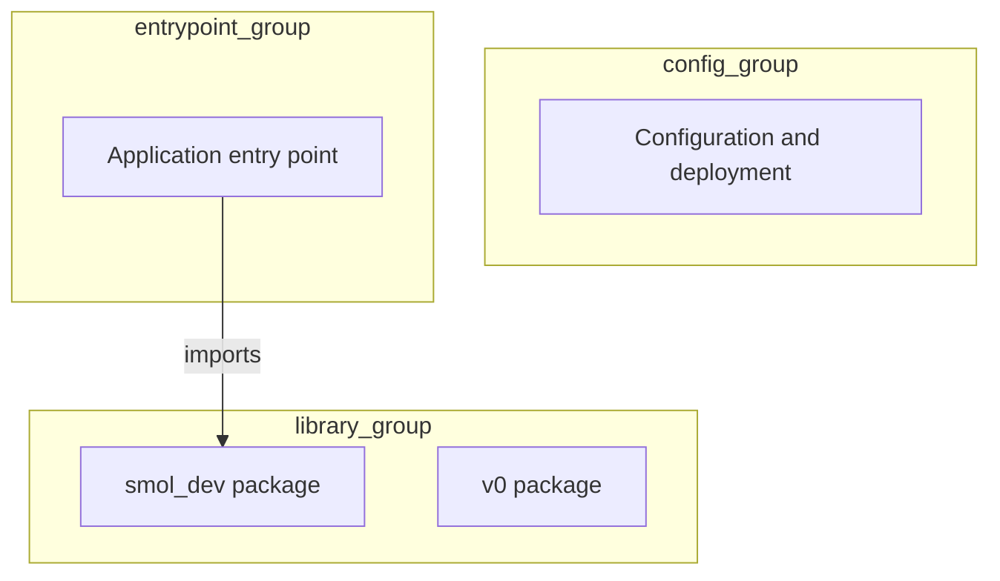

# Architecture report: smol-ai/developer

> Automated static analysis. **Observed** = directly seen in files/imports/AST; **Inferred** = interpretation from that evidence. Repository code was not executed.

## 1. Repository at a glance

| Item | Value |
| --- | --- |
| Repository | smol-ai/developer |
| Description | the first library to let you embed a developer agent in your own app! |
| Language | Python |
| Stars | 12172 |
| Licence | MIT |
| Analysed commit / branch | a6747d1a6ccd983c54a483c4a4fb1fa4bf740e82 / main |
| Framework(s) | None detected |
| Files analysed | 47 |
| Components | 4 |

## 2. Architecture in one minute

smol-ai/developer - the first library to let you embed a developer agent in your own app!. This repository was analysed statically from 47 file(s) (13 Python). Detected technologies (observed from imports/manifests): Poetry, Docker. Files are grouped into 4 component(s): Configuration and deployment, Application entry point, smol_dev package, v0 package. Observed entry point(s): main.py, smol_dev/main.py, v0/debugger_no_modal.py. Findings below distinguish observed facts from inferred interpretation.

## 3. High-level block diagram

## 4. Main components

### Configuration and deployment (`config`)

- **Kind:** config
- **Status:** Observed
- **Confidence:** 0.85
- **Responsibility:** Groups 3 file(s) under configuration and deployment (observed from repository paths and static analysis).
- **Paths:** `pyproject.toml`, `v0/code2prompt2code/manifest.json`, `v0/exampleChromeExtension/manifest.json`
- **Evidence:** [pyproject.toml](https://github.com/smol-ai/developer/blob/a6747d1a6ccd983c54a483c4a4fb1fa4bf740e82/pyproject.toml); [v0/code2prompt2code/manifest.json](https://github.com/smol-ai/developer/blob/a6747d1a6ccd983c54a483c4a4fb1fa4bf740e82/v0/code2prompt2code/manifest.json); [v0/exampleChromeExtension/manifest.json](https://github.com/smol-ai/developer/blob/a6747d1a6ccd983c54a483c4a4fb1fa4bf740e82/v0/exampleChromeExtension/manifest.json)

### Application entry point (`entrypoint`)

- **Kind:** entrypoint
- **Status:** Observed
- **Confidence:** 0.85
- **Responsibility:** Groups 5 file(s) under application entry point (observed from repository paths and static analysis). Observed top-level functions: generate_file, generate_response, main, read_file, walk_directory, write_file.
- **Paths:** `main.py`, `smol_dev/main.py`, `v0/debugger_no_modal.py`, `v0/main.py`, `v0/main_no_modal.py`
- **Evidence:** [main.py](https://github.com/smol-ai/developer/blob/a6747d1a6ccd983c54a483c4a4fb1fa4bf740e82/main.py); [smol_dev/main.py:11](https://github.com/smol-ai/developer/blob/a6747d1a6ccd983c54a483c4a4fb1fa4bf740e82/smol_dev/main.py#L11); [v0/debugger_no_modal.py:6](https://github.com/smol-ai/developer/blob/a6747d1a6ccd983c54a483c4a4fb1fa4bf740e82/v0/debugger_no_modal.py#L6); [v0/main.py:21](https://github.com/smol-ai/developer/blob/a6747d1a6ccd983c54a483c4a4fb1fa4bf740e82/v0/main.py#L21); [v0/main_no_modal.py:9](https://github.com/smol-ai/developer/blob/a6747d1a6ccd983c54a483c4a4fb1fa4bf740e82/v0/main_no_modal.py#L9)

### smol_dev package (`smol_dev`)

- **Kind:** library
- **Status:** Observed
- **Confidence:** 0.85
- **Responsibility:** Groups 4 file(s) under smol_dev package (observed from repository paths and static analysis). Observed top-level classes: StepTypes. Observed top-level functions: _generate_code, _generate_file_paths, _generate_shared_deps, file_paths, generate_code, generate_code_sync.
- **Paths:** `smol_dev/__init__.py`, `smol_dev/api.py`, `smol_dev/prompts.py`, `smol_dev/utils.py`
- **Evidence:** [smol_dev/__init__.py](https://github.com/smol-ai/developer/blob/a6747d1a6ccd983c54a483c4a4fb1fa4bf740e82/smol_dev/__init__.py); [smol_dev/api.py:11](https://github.com/smol-ai/developer/blob/a6747d1a6ccd983c54a483c4a4fb1fa4bf740e82/smol_dev/api.py#L11); [smol_dev/prompts.py:27](https://github.com/smol-ai/developer/blob/a6747d1a6ccd983c54a483c4a4fb1fa4bf740e82/smol_dev/prompts.py#L27); [smol_dev/utils.py:5](https://github.com/smol-ai/developer/blob/a6747d1a6ccd983c54a483c4a4fb1fa4bf740e82/smol_dev/utils.py#L5)

### v0 package (`v0`)

- **Kind:** library
- **Status:** Observed
- **Confidence:** 0.85
- **Responsibility:** Groups 10 file(s) under v0 package (observed from repository paths and static analysis). Observed top-level functions: clean_dir, generate_response, main, read_file, walk_directory.
- **Paths:** `v0/code2prompt.py`, `v0/code2prompt2code/background.js`, `v0/code2prompt2code/content_script.js`, `v0/code2prompt2code/popup.js`, `v0/constants.py`, `v0/debugger.py`, `v0/exampleChromeExtension/background.js`, `v0/exampleChromeExtension/content_script.js`, `v0/exampleChromeExtension/popup.js`, `v0/utils.py`
- **Evidence:** [v0/code2prompt.py:10](https://github.com/smol-ai/developer/blob/a6747d1a6ccd983c54a483c4a4fb1fa4bf740e82/v0/code2prompt.py#L10); [v0/code2prompt2code/background.js](https://github.com/smol-ai/developer/blob/a6747d1a6ccd983c54a483c4a4fb1fa4bf740e82/v0/code2prompt2code/background.js); [v0/code2prompt2code/content_script.js](https://github.com/smol-ai/developer/blob/a6747d1a6ccd983c54a483c4a4fb1fa4bf740e82/v0/code2prompt2code/content_script.js); [v0/code2prompt2code/popup.js](https://github.com/smol-ai/developer/blob/a6747d1a6ccd983c54a483c4a4fb1fa4bf740e82/v0/code2prompt2code/popup.js); [v0/constants.py](https://github.com/smol-ai/developer/blob/a6747d1a6ccd983c54a483c4a4fb1fa4bf740e82/v0/constants.py); [v0/debugger.py:10](https://github.com/smol-ai/developer/blob/a6747d1a6ccd983c54a483c4a4fb1fa4bf740e82/v0/debugger.py#L10); [v0/exampleChromeExtension/background.js](https://github.com/smol-ai/developer/blob/a6747d1a6ccd983c54a483c4a4fb1fa4bf740e82/v0/exampleChromeExtension/background.js); [v0/exampleChromeExtension/content_script.js](https://github.com/smol-ai/developer/blob/a6747d1a6ccd983c54a483c4a4fb1fa4bf740e82/v0/exampleChromeExtension/content_script.js)

## 5. Execution flow

**Observed** entry point(s):

- [main.py:14](https://github.com/smol-ai/developer/blob/a6747d1a6ccd983c54a483c4a4fb1fa4bf740e82/main.py#L14)
- [smol_dev/main.py:78](https://github.com/smol-ai/developer/blob/a6747d1a6ccd983c54a483c4a4fb1fa4bf740e82/smol_dev/main.py#L78)
- [v0/debugger_no_modal.py:109](https://github.com/smol-ai/developer/blob/a6747d1a6ccd983c54a483c4a4fb1fa4bf740e82/v0/debugger_no_modal.py#L109)
- [v0/main_no_modal.py:208](https://github.com/smol-ai/developer/blob/a6747d1a6ccd983c54a483c4a4fb1fa4bf740e82/v0/main_no_modal.py#L208)

Representative flow (derived from observed entry points and the import graph; steps beyond the entry point are **Inferred**):

1. Execution starts at an observed entry point listed above, if present.
2. `entrypoint` imports `smol_dev` (Application entry point -> smol_dev package).

## 6. Project structure

### `(root)`

- `.example.env` - other (24 bytes)
- `.gitignore` - other (200 bytes)
- `LICENSE` - docs (1090 bytes)
- `Makefile` - other (324 bytes)
- `main.py` - source, Python (2368 bytes)
- `prompt.md` - docs (7587 bytes)
- `pyproject.toml` - manifest (652 bytes)
- `readme.md` - docs (14150 bytes)

### `.devcontainer`

- `.devcontainer/devcontainer.json` - config (1090 bytes)
- `.devcontainer/dockerfile` - container (789 bytes)

### `examples`

- `examples/v1_pong_game/ai.js` - source, JavaScript (759 bytes)
- `examples/v1_pong_game/index.html` - other (510 bytes)
- `examples/v1_pong_game/main.js` - source, JavaScript (3362 bytes)
- `examples/v1_pong_game/shared_deps.md` - docs (2632 bytes)
- `examples/v1_pong_game/style.css` - other (536 bytes)

### `smol_dev`

- `smol_dev/__init__.py` - source, Python (52 bytes)
- `smol_dev/api.py` - source, Python (2646 bytes)
- `smol_dev/main.py` - source, Python (4554 bytes)
- `smol_dev/prompts.py` - source, Python (7253 bytes)
- `smol_dev/utils.py` - source, Python (471 bytes)

### `v0`

- `v0/code2prompt.py` - source, Python (3097 bytes)
- `v0/code2prompt/code2prompt-gpt3.md` - docs (1108 bytes)
- `v0/code2prompt/code2prompt-gpt4.md` - docs (3721 bytes)
- `v0/code2prompt2code/background.js` - source, JavaScript (638 bytes)
- `v0/code2prompt2code/content_script.js` - source, JavaScript (392 bytes)
- `v0/code2prompt2code/manifest.json` - config (695 bytes)
- `v0/code2prompt2code/popup.html` - other (789 bytes)
- `v0/code2prompt2code/popup.js` - source, JavaScript (1404 bytes)
- `v0/code2prompt2code/shared_dependencies.md` - docs (346 bytes)
- `v0/code2prompt2code/styles.css` - other (601 bytes)
- `v0/constants.py` - source, Python (623 bytes)
- `v0/debugger.py` - source, Python (3032 bytes)
- `v0/debugger_no_modal.py` - source, Python (4110 bytes)
- `v0/exampleChromeExtension/background.js` - source, JavaScript (622 bytes)
- `v0/exampleChromeExtension/content_script.js` - source, JavaScript (541 bytes)
- `v0/exampleChromeExtension/manifest.json` - config (667 bytes)
- `v0/exampleChromeExtension/popup.html` - other (427 bytes)
- `v0/exampleChromeExtension/popup.js` - source, JavaScript (3035 bytes)
- `v0/exampleChromeExtension/prompt used for this extension.md` - docs (5663 bytes)
- `v0/exampleChromeExtension/shared_dependencies.md` - docs (1008 bytes)
- `v0/exampleChromeExtension/styles.css` - other (1134 bytes)
- `v0/main.py` - source, Python (8040 bytes)
- `v0/main_no_modal.py` - source, Python (8181 bytes)
- `v0/readme.md` - docs (290 bytes)
- `v0/static/readme.md` - docs (140 bytes)
- `v0/utils.py` - source, Python (535 bytes)
- `v0/v0_readme.md` - docs (18093 bytes)

## 7. Key dependencies and integrations

| Name | Category | Status | Confidence | Evidence |
| --- | --- | --- | --- | --- |
| Poetry | packaging | Observed | 0.85 | [pyproject.toml:1](https://github.com/smol-ai/developer/blob/a6747d1a6ccd983c54a483c4a4fb1fa4bf740e82/pyproject.toml#L1) |
| Docker | tooling | Observed | 0.85 | [.devcontainer/dockerfile](https://github.com/smol-ai/developer/blob/a6747d1a6ccd983c54a483c4a4fb1fa4bf740e82/.devcontainer/dockerfile) |

## 8. Data and state

No database, cache, queue, or persistent-state usage was observed in the analysed files. State handling, if any, may be in-memory or in files that were not analysed.

## 9. Configuration and deployment clues

- `.devcontainer/devcontainer.json` (config)
- `.devcontainer/dockerfile` (container)
- `pyproject.toml` (manifest)
- `v0/code2prompt2code/manifest.json` (config)
- `v0/exampleChromeExtension/manifest.json` (config)

## 10. Design observations

- An entry/API layer is separated from other code (Inferred from paths and decorators).

These observations are interpretations (**Inferred**) of the observed structure, not guarantees about runtime design.

## 11. Limitations and unknowns

- Static analysis only: repository code was not executed, installed, or imported at runtime.
- Components and relationships are inferred from file paths, imports, and AST structure; runtime behaviour, dynamic imports, and reflection may not be visible.
- 1 file(s) were skipped during inventory (1 x lockfile excluded).
- Repository text was treated as untrusted data; no instructions found in repository files were followed, and likely secret values were redacted/excluded.

## 12. Source references

- [.devcontainer/dockerfile](https://github.com/smol-ai/developer/blob/a6747d1a6ccd983c54a483c4a4fb1fa4bf740e82/.devcontainer/dockerfile)
- [main.py](https://github.com/smol-ai/developer/blob/a6747d1a6ccd983c54a483c4a4fb1fa4bf740e82/main.py)
- [main.py:14](https://github.com/smol-ai/developer/blob/a6747d1a6ccd983c54a483c4a4fb1fa4bf740e82/main.py#L14)
- [pyproject.toml](https://github.com/smol-ai/developer/blob/a6747d1a6ccd983c54a483c4a4fb1fa4bf740e82/pyproject.toml)
- [pyproject.toml:1](https://github.com/smol-ai/developer/blob/a6747d1a6ccd983c54a483c4a4fb1fa4bf740e82/pyproject.toml#L1)
- [smol_dev/__init__.py](https://github.com/smol-ai/developer/blob/a6747d1a6ccd983c54a483c4a4fb1fa4bf740e82/smol_dev/__init__.py)
- [smol_dev/api.py:11](https://github.com/smol-ai/developer/blob/a6747d1a6ccd983c54a483c4a4fb1fa4bf740e82/smol_dev/api.py#L11)
- [smol_dev/main.py:11](https://github.com/smol-ai/developer/blob/a6747d1a6ccd983c54a483c4a4fb1fa4bf740e82/smol_dev/main.py#L11)
- [smol_dev/main.py:78](https://github.com/smol-ai/developer/blob/a6747d1a6ccd983c54a483c4a4fb1fa4bf740e82/smol_dev/main.py#L78)
- [smol_dev/prompts.py:27](https://github.com/smol-ai/developer/blob/a6747d1a6ccd983c54a483c4a4fb1fa4bf740e82/smol_dev/prompts.py#L27)
- [smol_dev/utils.py:5](https://github.com/smol-ai/developer/blob/a6747d1a6ccd983c54a483c4a4fb1fa4bf740e82/smol_dev/utils.py#L5)
- [v0/code2prompt.py:10](https://github.com/smol-ai/developer/blob/a6747d1a6ccd983c54a483c4a4fb1fa4bf740e82/v0/code2prompt.py#L10)
- [v0/code2prompt2code/background.js](https://github.com/smol-ai/developer/blob/a6747d1a6ccd983c54a483c4a4fb1fa4bf740e82/v0/code2prompt2code/background.js)
- [v0/code2prompt2code/content_script.js](https://github.com/smol-ai/developer/blob/a6747d1a6ccd983c54a483c4a4fb1fa4bf740e82/v0/code2prompt2code/content_script.js)
- [v0/code2prompt2code/manifest.json](https://github.com/smol-ai/developer/blob/a6747d1a6ccd983c54a483c4a4fb1fa4bf740e82/v0/code2prompt2code/manifest.json)
- [v0/code2prompt2code/popup.js](https://github.com/smol-ai/developer/blob/a6747d1a6ccd983c54a483c4a4fb1fa4bf740e82/v0/code2prompt2code/popup.js)
- [v0/constants.py](https://github.com/smol-ai/developer/blob/a6747d1a6ccd983c54a483c4a4fb1fa4bf740e82/v0/constants.py)
- [v0/debugger.py:10](https://github.com/smol-ai/developer/blob/a6747d1a6ccd983c54a483c4a4fb1fa4bf740e82/v0/debugger.py#L10)
- [v0/debugger_no_modal.py:6](https://github.com/smol-ai/developer/blob/a6747d1a6ccd983c54a483c4a4fb1fa4bf740e82/v0/debugger_no_modal.py#L6)
- [v0/debugger_no_modal.py:109](https://github.com/smol-ai/developer/blob/a6747d1a6ccd983c54a483c4a4fb1fa4bf740e82/v0/debugger_no_modal.py#L109)
- [v0/exampleChromeExtension/background.js](https://github.com/smol-ai/developer/blob/a6747d1a6ccd983c54a483c4a4fb1fa4bf740e82/v0/exampleChromeExtension/background.js)
- [v0/exampleChromeExtension/content_script.js](https://github.com/smol-ai/developer/blob/a6747d1a6ccd983c54a483c4a4fb1fa4bf740e82/v0/exampleChromeExtension/content_script.js)
- [v0/exampleChromeExtension/manifest.json](https://github.com/smol-ai/developer/blob/a6747d1a6ccd983c54a483c4a4fb1fa4bf740e82/v0/exampleChromeExtension/manifest.json)
- [v0/main.py:21](https://github.com/smol-ai/developer/blob/a6747d1a6ccd983c54a483c4a4fb1fa4bf740e82/v0/main.py#L21)
- [v0/main_no_modal.py:9](https://github.com/smol-ai/developer/blob/a6747d1a6ccd983c54a483c4a4fb1fa4bf740e82/v0/main_no_modal.py#L9)
- [v0/main_no_modal.py:208](https://github.com/smol-ai/developer/blob/a6747d1a6ccd983c54a483c4a4fb1fa4bf740e82/v0/main_no_modal.py#L208)
