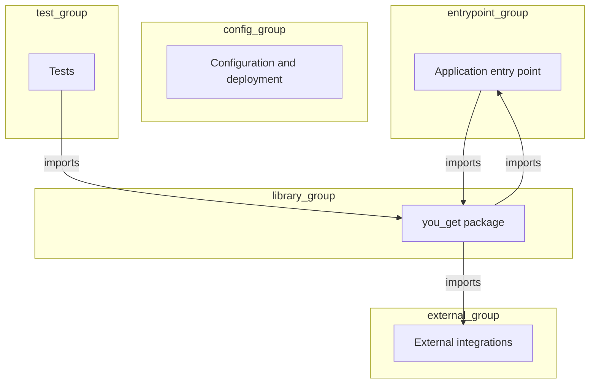

# Architecture report: soimort/you-get

> Automated static analysis. **Observed** = directly seen in files/imports/AST; **Inferred** = interpretation from that evidence. Repository code was not executed.

## 1. Repository at a glance

| Item | Value |
| --- | --- |
| Repository | soimort/you-get |
| Description | :arrow_double_down: Dumb downloader that scrapes the web |
| Language | Python |
| Stars | 56849 |
| Licence | Other |
| Analysed commit / branch | 049548f3f3f35e67ba8d3181c71fdc71d11cf260 / develop |
| Framework(s) | None detected |
| Files analysed | 155 |
| Components | 5 |

## 2. Architecture in one minute

soimort/you-get - :arrow_double_down: Dumb downloader that scrapes the web. This repository was analysed statically from 155 file(s) (137 Python). Detected technologies (observed from imports/manifests): GitHub Actions, SQLite, setuptools, unittest. Files are grouped into 5 component(s): Configuration and deployment, Application entry point, External integrations, Tests, you_get package. Observed entry point(s): src/you_get/__main__.py, src/you_get/processor/join_flv.py, src/you_get/processor/join_mp4.py. Findings below distinguish observed facts from inferred interpretation.

## 3. High-level block diagram

## 4. Main components

### Configuration and deployment (`config`)

- **Kind:** config
- **Status:** Observed
- **Confidence:** 0.85
- **Responsibility:** Groups 5 file(s) under configuration and deployment (observed from repository paths and static analysis). Observed top-level functions: load_source.
- **Paths:** `MANIFEST.in`, `requirements.txt`, `setup.cfg`, `setup.py`, `you-get.json`
- **Evidence:** [MANIFEST.in](https://github.com/soimort/you-get/blob/049548f3f3f35e67ba8d3181c71fdc71d11cf260/MANIFEST.in); [requirements.txt](https://github.com/soimort/you-get/blob/049548f3f3f35e67ba8d3181c71fdc71d11cf260/requirements.txt); [setup.cfg](https://github.com/soimort/you-get/blob/049548f3f3f35e67ba8d3181c71fdc71d11cf260/setup.cfg); [setup.py:11](https://github.com/soimort/you-get/blob/049548f3f3f35e67ba8d3181c71fdc71d11cf260/setup.py#L11); [you-get.json](https://github.com/soimort/you-get/blob/049548f3f3f35e67ba8d3181c71fdc71d11cf260/you-get.json)

### Application entry point (`entrypoint`)

- **Kind:** entrypoint
- **Status:** Observed
- **Confidence:** 0.85
- **Responsibility:** Groups 5 file(s) under application entry point (observed from repository paths and static analysis). Observed top-level classes: Atom, CompositeAtom, ECMAObject, VariableAtom. Observed top-level functions: concat_flv, concat_mp4, concat_ts, copy_stream, guess_output, main.
- **Paths:** `src/you_get/__main__.py`, `src/you_get/cli_wrapper/player/__main__.py`, `src/you_get/processor/join_flv.py`, `src/you_get/processor/join_mp4.py`, `src/you_get/processor/join_ts.py`
- **Evidence:** [src/you_get/__main__.py:24](https://github.com/soimort/you-get/blob/049548f3f3f35e67ba8d3181c71fdc71d11cf260/src/you_get/__main__.py#L24); [src/you_get/cli_wrapper/player/__main__.py](https://github.com/soimort/you-get/blob/049548f3f3f35e67ba8d3181c71fdc71d11cf260/src/you_get/cli_wrapper/player/__main__.py); [src/you_get/processor/join_flv.py:31](https://github.com/soimort/you-get/blob/049548f3f3f35e67ba8d3181c71fdc71d11cf260/src/you_get/processor/join_flv.py#L31); [src/you_get/processor/join_mp4.py:12](https://github.com/soimort/you-get/blob/049548f3f3f35e67ba8d3181c71fdc71d11cf260/src/you_get/processor/join_mp4.py#L12); [src/you_get/processor/join_ts.py:10](https://github.com/soimort/you-get/blob/049548f3f3f35e67ba8d3181c71fdc71d11cf260/src/you_get/processor/join_ts.py#L10)

### External integrations (`external_integrations`)

- **Kind:** external
- **Status:** Inferred
- **Confidence:** 0.70
- **Responsibility:** Groups 0 file(s) under external integrations (observed from repository paths and static analysis).
- **Evidence:** [src/you_get/common.py:9](https://github.com/soimort/you-get/blob/049548f3f3f35e67ba8d3181c71fdc71d11cf260/src/you_get/common.py#L9); [src/you_get/common.py:1456](https://github.com/soimort/you-get/blob/049548f3f3f35e67ba8d3181c71fdc71d11cf260/src/you_get/common.py#L1456)

### Tests (`tests`)

- **Kind:** test
- **Status:** Observed
- **Confidence:** 0.85
- **Responsibility:** Groups 4 file(s) under tests (observed from repository paths and static analysis). Observed top-level classes: TestCommon, TestUtil, YouGetTests.
- **Paths:** `tests/__init__.py`, `tests/test.py`, `tests/test_common.py`, `tests/test_util.py`
- **Evidence:** [tests/__init__.py](https://github.com/soimort/you-get/blob/049548f3f3f35e67ba8d3181c71fdc71d11cf260/tests/__init__.py); [tests/test.py:19](https://github.com/soimort/you-get/blob/049548f3f3f35e67ba8d3181c71fdc71d11cf260/tests/test.py#L19); [tests/test_common.py:7](https://github.com/soimort/you-get/blob/049548f3f3f35e67ba8d3181c71fdc71d11cf260/tests/test_common.py#L7); [tests/test_util.py:7](https://github.com/soimort/you-get/blob/049548f3f3f35e67ba8d3181c71fdc71d11cf260/tests/test_util.py#L7)

### you_get package (`you_get`)

- **Kind:** library
- **Status:** Observed
- **Confidence:** 0.85
- **Responsibility:** Groups 127 file(s) under you_get package (observed from repository paths and static analysis). Observed top-level classes: AcFun, Bigthink, Bilibili, BokeCC, CNTV, DummyProgressBar. Observed top-level functions: _get_resource_uri, _get_video_list, _get_video_query_url, _get_virtualPath, _ucas_get_url_lists_by_resourceID, _wanmen_get_boke_id_by_json_topic_part.
- **Paths:** `src/you_get/__init__.py`, `src/you_get/cli_wrapper/__init__.py`, `src/you_get/cli_wrapper/downloader/__init__.py`, `src/you_get/cli_wrapper/openssl/__init__.py`, `src/you_get/cli_wrapper/player/__init__.py`, `src/you_get/cli_wrapper/player/dragonplayer.py`, `src/you_get/cli_wrapper/player/gnome_mplayer.py`, `src/you_get/cli_wrapper/player/mplayer.py`, `src/you_get/cli_wrapper/player/vlc.py`, `src/you_get/cli_wrapper/player/wmp.py`, `src/you_get/cli_wrapper/transcoder/__init__.py`, `src/you_get/cli_wrapper/transcoder/ffmpeg.py`, `src/you_get/cli_wrapper/transcoder/libav.py`, `src/you_get/cli_wrapper/transcoder/mencoder.py`, `src/you_get/common.py`, `src/you_get/extractor.py`, `src/you_get/extractors/__init__.py`, `src/you_get/extractors/acfun.py`, `src/you_get/extractors/alive.py`, `src/you_get/extractors/archive.py`, `src/you_get/extractors/baidu.py`, `src/you_get/extractors/bandcamp.py`, `src/you_get/extractors/baomihua.py`, `src/you_get/extractors/bigthink.py`, `src/you_get/extractors/bilibili.py`, `src/you_get/extractors/bokecc.py`, `src/you_get/extractors/cbs.py`, `src/you_get/extractors/ckplayer.py`, `src/you_get/extractors/cntv.py`, `src/you_get/extractors/coub.py`, `src/you_get/extractors/dailymotion.py`, `src/you_get/extractors/douban.py`, `src/you_get/extractors/douyin.py`, `src/you_get/extractors/douyutv.py`, `src/you_get/extractors/ehow.py`, `src/you_get/extractors/embed.py`, `src/you_get/extractors/facebook.py`, `src/you_get/extractors/fc2video.py`, `src/you_get/extractors/flickr.py`, `src/you_get/extractors/freesound.py`, `src/you_get/extractors/funshion.py`, `src/you_get/extractors/giphy.py`, `src/you_get/extractors/google.py`, `src/you_get/extractors/heavymusic.py`, `src/you_get/extractors/huomaotv.py`, `src/you_get/extractors/icourses.py`, `src/you_get/extractors/ifeng.py`, `src/you_get/extractors/imgur.py`, `src/you_get/extractors/infoq.py`, `src/you_get/extractors/instagram.py`, `src/you_get/extractors/interest.py`, `src/you_get/extractors/iqilu.py`, `src/you_get/extractors/iqiyi.py`, `src/you_get/extractors/iwara.py`, `src/you_get/extractors/ixigua.py`, `src/you_get/extractors/joy.py`, `src/you_get/extractors/kakao.py`, `src/you_get/extractors/khan.py`, `src/you_get/extractors/ku6.py`, `src/you_get/extractors/kuaishou.py`, `src/you_get/extractors/kugou.py`, `src/you_get/extractors/kuwo.py`, `src/you_get/extractors/le.py`, `src/you_get/extractors/lizhi.py`, `src/you_get/extractors/longzhu.py`, `src/you_get/extractors/lrts.py`, `src/you_get/extractors/magisto.py`, `src/you_get/extractors/metacafe.py`, `src/you_get/extractors/mgtv.py`, `src/you_get/extractors/miaopai.py`, `src/you_get/extractors/miomio.py`, `src/you_get/extractors/missevan.py`, `src/you_get/extractors/mixcloud.py`, `src/you_get/extractors/mtv81.py`, `src/you_get/extractors/nanagogo.py`, `src/you_get/extractors/naver.py`, `src/you_get/extractors/netease.py`, `src/you_get/extractors/nicovideo.py`, `src/you_get/extractors/pinterest.py`, `src/you_get/extractors/pixnet.py`, `src/you_get/extractors/pptv.py`, `src/you_get/extractors/qie.py`, `src/you_get/extractors/qie_video.py`, `src/you_get/extractors/qingting.py`, `src/you_get/extractors/qq.py`, `src/you_get/extractors/qq_egame.py`, `src/you_get/extractors/showroom.py`, `src/you_get/extractors/sina.py`, `src/you_get/extractors/sohu.py`, `src/you_get/extractors/soundcloud.py`, `src/you_get/extractors/suntv.py`, `src/you_get/extractors/ted.py`, `src/you_get/extractors/theplatform.py`, `src/you_get/extractors/tiktok.py`, `src/you_get/extractors/toutiao.py`, `src/you_get/extractors/tucao.py`, `src/you_get/extractors/tudou.py`, `src/you_get/extractors/tumblr.py`, `src/you_get/extractors/twitter.py`, `src/you_get/extractors/ucas.py`, `src/you_get/extractors/universal.py`, `src/you_get/extractors/veoh.py`, `src/you_get/extractors/vimeo.py`, `src/you_get/extractors/vk.py`, `src/you_get/extractors/w56.py`, `src/you_get/extractors/wanmen.py`, `src/you_get/extractors/ximalaya.py`, `src/you_get/extractors/xinpianchang.py`, `src/you_get/extractors/yixia.py`, `src/you_get/extractors/yizhibo.py`, `src/you_get/extractors/youku.py`, `src/you_get/extractors/youtube.py`, `src/you_get/extractors/zhanqi.py`, `src/you_get/extractors/zhibo.py`, `src/you_get/extractors/zhihu.py`, `src/you_get/json_output.py`, `src/you_get/processor/__init__.py`, `src/you_get/processor/ffmpeg.py`, `src/you_get/processor/rtmpdump.py`, `src/you_get/util/__init__.py`, `src/you_get/util/fs.py`, `src/you_get/util/git.py`, `src/you_get/util/log.py`, `src/you_get/util/os.py`, `src/you_get/util/strings.py`, `src/you_get/util/term.py`, `src/you_get/version.py`
- **Evidence:** [src/you_get/__init__.py](https://github.com/soimort/you-get/blob/049548f3f3f35e67ba8d3181c71fdc71d11cf260/src/you_get/__init__.py); [src/you_get/cli_wrapper/__init__.py](https://github.com/soimort/you-get/blob/049548f3f3f35e67ba8d3181c71fdc71d11cf260/src/you_get/cli_wrapper/__init__.py); [src/you_get/cli_wrapper/downloader/__init__.py](https://github.com/soimort/you-get/blob/049548f3f3f35e67ba8d3181c71fdc71d11cf260/src/you_get/cli_wrapper/downloader/__init__.py); [src/you_get/cli_wrapper/openssl/__init__.py](https://github.com/soimort/you-get/blob/049548f3f3f35e67ba8d3181c71fdc71d11cf260/src/you_get/cli_wrapper/openssl/__init__.py); [src/you_get/cli_wrapper/player/__init__.py](https://github.com/soimort/you-get/blob/049548f3f3f35e67ba8d3181c71fdc71d11cf260/src/you_get/cli_wrapper/player/__init__.py); [src/you_get/cli_wrapper/player/dragonplayer.py](https://github.com/soimort/you-get/blob/049548f3f3f35e67ba8d3181c71fdc71d11cf260/src/you_get/cli_wrapper/player/dragonplayer.py); [src/you_get/cli_wrapper/player/gnome_mplayer.py](https://github.com/soimort/you-get/blob/049548f3f3f35e67ba8d3181c71fdc71d11cf260/src/you_get/cli_wrapper/player/gnome_mplayer.py); [src/you_get/cli_wrapper/player/mplayer.py](https://github.com/soimort/you-get/blob/049548f3f3f35e67ba8d3181c71fdc71d11cf260/src/you_get/cli_wrapper/player/mplayer.py)

## 5. Execution flow

**Observed** entry point(s):

- [src/you_get/__main__.py:94](https://github.com/soimort/you-get/blob/049548f3f3f35e67ba8d3181c71fdc71d11cf260/src/you_get/__main__.py#L94)
- [src/you_get/processor/join_flv.py:364](https://github.com/soimort/you-get/blob/049548f3f3f35e67ba8d3181c71fdc71d11cf260/src/you_get/processor/join_flv.py#L364)
- [src/you_get/processor/join_mp4.py:944](https://github.com/soimort/you-get/blob/049548f3f3f35e67ba8d3181c71fdc71d11cf260/src/you_get/processor/join_mp4.py#L944)
- [src/you_get/processor/join_ts.py:64](https://github.com/soimort/you-get/blob/049548f3f3f35e67ba8d3181c71fdc71d11cf260/src/you_get/processor/join_ts.py#L64)

Representative flow (derived from observed entry points and the import graph; steps beyond the entry point are **Inferred**):

1. Execution starts at an observed entry point listed above, if present.
2. `entrypoint` imports `you_get` (Application entry point -> you_get package).
3. `tests` imports `you_get` (Tests -> you_get package).
4. `you_get` imports `entrypoint` (you_get package -> Application entry point).
5. `you_get` imports `external_integrations` (you_get package -> External integrations).

## 6. Project structure

### `(root)`

- `.gitignore` - other (931 bytes)
- `CHANGELOG.rst` - docs (10866 bytes)
- `CONTRIBUTING.md` - docs (1460 bytes)
- `LICENSE.txt` - docs (1232 bytes)
- `MANIFEST.in` - manifest (179 bytes)
- `Makefile` - other (660 bytes)
- `README.md` - docs (21056 bytes)
- `README.rst` - docs (2498 bytes)
- `SECURITY.md` - docs (112 bytes)
- `requirements.txt` - manifest (29 bytes)
- `setup.cfg` - manifest (99 bytes)
- `setup.py` - manifest, Python (1811 bytes)
- `you-get` - other (477 bytes)
- `you-get.json` - config (1223 bytes)
- `you-get.plugin.zsh` - other (138 bytes)

### `.github`

- `.github/workflows/python-package.yml` - ci, YAML (1247 bytes)

### `contrib`

- `contrib/completion/_you-get` - other (1522 bytes)
- `contrib/completion/you-get-completion.bash` - other (916 bytes)
- `contrib/completion/you-get.fish` - other (1595 bytes)

### `src`

- `src/you_get/__init__.py` - source, Python (371 bytes)
- `src/you_get/__main__.py` - source, Python (2578 bytes)
- `src/you_get/cli_wrapper/__init__.py` - source, Python (0 bytes)
- `src/you_get/cli_wrapper/downloader/__init__.py` - source, Python (0 bytes)
- `src/you_get/cli_wrapper/openssl/__init__.py` - source, Python (0 bytes)
- `src/you_get/cli_wrapper/player/__init__.py` - source, Python (46 bytes)
- `src/you_get/cli_wrapper/player/__main__.py` - source, Python (150 bytes)
- `src/you_get/cli_wrapper/player/dragonplayer.py` - source, Python (0 bytes)
- `src/you_get/cli_wrapper/player/gnome_mplayer.py` - source, Python (0 bytes)
- `src/you_get/cli_wrapper/player/mplayer.py` - source, Python (0 bytes)
- `src/you_get/cli_wrapper/player/vlc.py` - source, Python (22 bytes)
- `src/you_get/cli_wrapper/player/wmp.py` - source, Python (0 bytes)
- `src/you_get/cli_wrapper/transcoder/__init__.py` - source, Python (0 bytes)
- `src/you_get/cli_wrapper/transcoder/ffmpeg.py` - source, Python (0 bytes)
- `src/you_get/cli_wrapper/transcoder/libav.py` - source, Python (0 bytes)
- `src/you_get/cli_wrapper/transcoder/mencoder.py` - source, Python (0 bytes)
- `src/you_get/common.py` - source, Python (61242 bytes)
- `src/you_get/extractor.py` - source, Python (10897 bytes)
- `src/you_get/extractors/__init__.py` - source, Python (1872 bytes)
- `src/you_get/extractors/acfun.py` - source, Python (9413 bytes)
- `src/you_get/extractors/alive.py` - source, Python (605 bytes)
- `src/you_get/extractors/archive.py` - source, Python (616 bytes)
- `src/you_get/extractors/baidu.py` - source, Python (12124 bytes)
- `src/you_get/extractors/bandcamp.py` - source, Python (748 bytes)
- `src/you_get/extractors/baomihua.py` - source, Python (1691 bytes)
- `src/you_get/extractors/bigthink.py` - source, Python (2400 bytes)
- `src/you_get/extractors/bilibili.py` - source, Python (44518 bytes)
- `src/you_get/extractors/bokecc.py` - source, Python (3376 bytes)
- `src/you_get/extractors/cbs.py` - source, Python (617 bytes)
- `src/you_get/extractors/ckplayer.py` - source, Python (3513 bytes)
- `src/you_get/extractors/cntv.py` - source, Python (2715 bytes)
- `src/you_get/extractors/coub.py` - source, Python (3907 bytes)
- `src/you_get/extractors/dailymotion.py` - source, Python (1213 bytes)
- `src/you_get/extractors/douban.py` - source, Python (2340 bytes)
- `src/you_get/extractors/douyin.py` - source, Python (1936 bytes)
- `src/you_get/extractors/douyutv.py` - source, Python (2798 bytes)
- `src/you_get/extractors/ehow.py` - source, Python (1110 bytes)
- `src/you_get/extractors/embed.py` - source, Python (5270 bytes)
- `src/you_get/extractors/facebook.py` - source, Python (1013 bytes)
- `src/you_get/extractors/fc2video.py` - source, Python (2429 bytes)
- `src/you_get/extractors/flickr.py` - source, Python (7706 bytes)
- `src/you_get/extractors/freesound.py` - source, Python (663 bytes)
- `src/you_get/extractors/funshion.py` - source, Python (8144 bytes)
- `src/you_get/extractors/giphy.py` - source, Python (816 bytes)
- `src/you_get/extractors/google.py` - source, Python (8977 bytes)
- `src/you_get/extractors/heavymusic.py` - source, Python (861 bytes)
- `src/you_get/extractors/huomaotv.py` - source, Python (997 bytes)
- `src/you_get/extractors/icourses.py` - source, Python (15352 bytes)
- `src/you_get/extractors/ifeng.py` - source, Python (1760 bytes)
- `src/you_get/extractors/imgur.py` - source, Python (2855 bytes)
- `src/you_get/extractors/infoq.py` - source, Python (1898 bytes)
- `src/you_get/extractors/instagram.py` - source, Python (2632 bytes)
- `src/you_get/extractors/interest.py` - source, Python (1110 bytes)
- `src/you_get/extractors/iqilu.py` - source, Python (892 bytes)
- `src/you_get/extractors/iqiyi.py` - source, Python (11974 bytes)
- `src/you_get/extractors/iwara.py` - source, Python (2173 bytes)
- `src/you_get/extractors/ixigua.py` - source, Python (5733 bytes)
- `src/you_get/extractors/joy.py` - source, Python (1507 bytes)
- `src/you_get/extractors/kakao.py` - source, Python (1771 bytes)
- `src/you_get/extractors/khan.py` - source, Python (508 bytes)
- `src/you_get/extractors/ku6.py` - source, Python (2797 bytes)
- `src/you_get/extractors/kuaishou.py` - source, Python (1649 bytes)
- `src/you_get/extractors/kugou.py` - source, Python (3603 bytes)
- `src/you_get/extractors/kuwo.py` - source, Python (1442 bytes)
- `src/you_get/extractors/le.py` - source, Python (6282 bytes)
- `src/you_get/extractors/lizhi.py` - source, Python (2684 bytes)
- `src/you_get/extractors/longzhu.py` - source, Python (2667 bytes)
- `src/you_get/extractors/lrts.py` - source, Python (2852 bytes)
- `src/you_get/extractors/magisto.py` - source, Python (806 bytes)
- `src/you_get/extractors/metacafe.py` - source, Python (865 bytes)
- `src/you_get/extractors/mgtv.py` - source, Python (8203 bytes)
- `src/you_get/extractors/miaopai.py` - source, Python (8090 bytes)
- `src/you_get/extractors/miomio.py` - source, Python (1955 bytes)
- `src/you_get/extractors/missevan.py` - source, Python (12107 bytes)
- `src/you_get/extractors/mixcloud.py` - source, Python (891 bytes)
- `src/you_get/extractors/mtv81.py` - source, Python (1622 bytes)
- `src/you_get/extractors/nanagogo.py` - source, Python (1946 bytes)
- `src/you_get/extractors/naver.py` - source, Python (1472 bytes)
- `src/you_get/extractors/netease.py` - source, Python (8101 bytes)
- `src/you_get/extractors/nicovideo.py` - source, Python (1729 bytes)
- `src/you_get/extractors/pinterest.py` - source, Python (1628 bytes)
- `src/you_get/extractors/pixnet.py` - source, Python (3778 bytes)
- `src/you_get/extractors/pptv.py` - source, Python (6830 bytes)
- `src/you_get/extractors/qie.py` - source, Python (3606 bytes)
- `src/you_get/extractors/qie_video.py` - source, Python (2901 bytes)
- `src/you_get/extractors/qingting.py` - source, Python (1560 bytes)
- `src/you_get/extractors/qq.py` - source, Python (8116 bytes)
- `src/you_get/extractors/qq_egame.py` - source, Python (1385 bytes)
- `src/you_get/extractors/showroom.py` - source, Python (3675 bytes)
- `src/you_get/extractors/sina.py` - source, Python (4564 bytes)
- `src/you_get/extractors/sohu.py` - source, Python (2732 bytes)
- `src/you_get/extractors/soundcloud.py` - source, Python (2417 bytes)
- `src/you_get/extractors/suntv.py` - source, Python (1395 bytes)
- `src/you_get/extractors/ted.py` - source, Python (863 bytes)
- `src/you_get/extractors/theplatform.py` - source, Python (988 bytes)
- `src/you_get/extractors/tiktok.py` - source, Python (1864 bytes)
- `src/you_get/extractors/toutiao.py` - source, Python (2684 bytes)
- `src/you_get/extractors/tucao.py` - source, Python (2711 bytes)
- `src/you_get/extractors/tudou.py` - source, Python (4430 bytes)
- `src/you_get/extractors/tumblr.py` - source, Python (6839 bytes)
- `src/you_get/extractors/twitter.py` - source, Python (3394 bytes)
- `src/you_get/extractors/ucas.py` - source, Python (5423 bytes)
- `src/you_get/extractors/universal.py` - source, Python (7150 bytes)
- `src/you_get/extractors/veoh.py` - source, Python (1418 bytes)
- `src/you_get/extractors/vimeo.py` - source, Python (5912 bytes)
- `src/you_get/extractors/vk.py` - source, Python (2430 bytes)
- `src/you_get/extractors/w56.py` - source, Python (1447 bytes)
- `src/you_get/extractors/wanmen.py` - source, Python (4860 bytes)
- `src/you_get/extractors/ximalaya.py` - source, Python (4211 bytes)
- `src/you_get/extractors/xinpianchang.py` - source, Python (1690 bytes)
- `src/you_get/extractors/yixia.py` - source, Python (4443 bytes)
- `src/you_get/extractors/yizhibo.py` - source, Python (1268 bytes)
- `src/you_get/extractors/youku.py` - source, Python (12748 bytes)
- `src/you_get/extractors/youtube.py` - source, Python (23140 bytes)
- `src/you_get/extractors/zhanqi.py` - source, Python (2305 bytes)
- `src/you_get/extractors/zhibo.py` - source, Python (1931 bytes)
- `src/you_get/extractors/zhihu.py` - source, Python (3549 bytes)
- `src/you_get/json_output.py` - source, Python (1710 bytes)
- `src/you_get/processor/__init__.py` - source, Python (135 bytes)
- `src/you_get/processor/ffmpeg.py` - source, Python (10765 bytes)
- `src/you_get/processor/join_flv.py` - source, Python (10222 bytes)
- `src/you_get/processor/join_mp4.py` - source, Python (30413 bytes)
- `src/you_get/processor/join_ts.py` - source, Python (1624 bytes)
- `src/you_get/processor/rtmpdump.py` - source, Python (1711 bytes)
- `src/you_get/util/__init__.py` - source, Python (0 bytes)
- `src/you_get/util/fs.py` - source, Python (1153 bytes)
- `src/you_get/util/git.py` - source, Python (1489 bytes)
- `src/you_get/util/log.py` - source, Python (2692 bytes)
- `src/you_get/util/os.py` - source, Python (798 bytes)
- `src/you_get/util/strings.py` - source, Python (765 bytes)
- `src/you_get/util/term.py` - source, Python (303 bytes)
- `src/you_get/version.py` - source, Python (72 bytes)

### `tests`

- `tests/__init__.py` - test, Python (0 bytes)
- `tests/test.py` - test, Python (2430 bytes)
- `tests/test_common.py` - test, Python (363 bytes)
- `tests/test_util.py` - test, Python (387 bytes)

## 7. Key dependencies and integrations

| Name | Category | Status | Confidence | Evidence |
| --- | --- | --- | --- | --- |
| GitHub Actions | ci | Observed | 0.85 | [.github/workflows/python-package.yml](https://github.com/soimort/you-get/blob/049548f3f3f35e67ba8d3181c71fdc71d11cf260/.github/workflows/python-package.yml) |
| SQLite | database | Observed | 0.90 | [src/you_get/common.py:1456](https://github.com/soimort/you-get/blob/049548f3f3f35e67ba8d3181c71fdc71d11cf260/src/you_get/common.py#L1456) |
| setuptools | packaging | Observed | 0.90 | [setup.py:31](https://github.com/soimort/you-get/blob/049548f3f3f35e67ba8d3181c71fdc71d11cf260/setup.py#L31) |
| unittest | tooling | Observed | 0.95 | [tests/test.py:3](https://github.com/soimort/you-get/blob/049548f3f3f35e67ba8d3181c71fdc71d11cf260/tests/test.py#L3); [tests/test_common.py:3](https://github.com/soimort/you-get/blob/049548f3f3f35e67ba8d3181c71fdc71d11cf260/tests/test_common.py#L3); [tests/test_util.py:3](https://github.com/soimort/you-get/blob/049548f3f3f35e67ba8d3181c71fdc71d11cf260/tests/test_util.py#L3) |

## 8. Data and state

- **SQLite** (Observed, confidence 0.90) - evidence: [src/you_get/common.py:1456](https://github.com/soimort/you-get/blob/049548f3f3f35e67ba8d3181c71fdc71d11cf260/src/you_get/common.py#L1456)

## 9. Configuration and deployment clues

- `.github/workflows/python-package.yml` (ci)
- `MANIFEST.in` (manifest)
- `requirements.txt` (manifest)
- `setup.cfg` (manifest)
- `setup.py` (manifest)
- `you-get.json` (config)

## 10. Design observations

- An entry/API layer is separated from other code (Inferred from paths and decorators).
- Tests are present alongside source code (Observed from test file paths).
- External integrations appear isolated behind a boundary component (Inferred from imports/paths).

These observations are interpretations (**Inferred**) of the observed structure, not guarantees about runtime design.

## 11. Limitations and unknowns

- Static analysis only: repository code was not executed, installed, or imported at runtime.
- Components and relationships are inferred from file paths, imports, and AST structure; runtime behaviour, dynamic imports, and reflection may not be visible.
- Repository text was treated as untrusted data; no instructions found in repository files were followed, and likely secret values were redacted/excluded.

## 12. Source references

- [.github/workflows/python-package.yml](https://github.com/soimort/you-get/blob/049548f3f3f35e67ba8d3181c71fdc71d11cf260/.github/workflows/python-package.yml)
- [MANIFEST.in](https://github.com/soimort/you-get/blob/049548f3f3f35e67ba8d3181c71fdc71d11cf260/MANIFEST.in)
- [requirements.txt](https://github.com/soimort/you-get/blob/049548f3f3f35e67ba8d3181c71fdc71d11cf260/requirements.txt)
- [setup.cfg](https://github.com/soimort/you-get/blob/049548f3f3f35e67ba8d3181c71fdc71d11cf260/setup.cfg)
- [setup.py:11](https://github.com/soimort/you-get/blob/049548f3f3f35e67ba8d3181c71fdc71d11cf260/setup.py#L11)
- [setup.py:31](https://github.com/soimort/you-get/blob/049548f3f3f35e67ba8d3181c71fdc71d11cf260/setup.py#L31)
- [src/you_get/__init__.py](https://github.com/soimort/you-get/blob/049548f3f3f35e67ba8d3181c71fdc71d11cf260/src/you_get/__init__.py)
- [src/you_get/__main__.py:24](https://github.com/soimort/you-get/blob/049548f3f3f35e67ba8d3181c71fdc71d11cf260/src/you_get/__main__.py#L24)
- [src/you_get/__main__.py:94](https://github.com/soimort/you-get/blob/049548f3f3f35e67ba8d3181c71fdc71d11cf260/src/you_get/__main__.py#L94)
- [src/you_get/cli_wrapper/__init__.py](https://github.com/soimort/you-get/blob/049548f3f3f35e67ba8d3181c71fdc71d11cf260/src/you_get/cli_wrapper/__init__.py)
- [src/you_get/cli_wrapper/downloader/__init__.py](https://github.com/soimort/you-get/blob/049548f3f3f35e67ba8d3181c71fdc71d11cf260/src/you_get/cli_wrapper/downloader/__init__.py)
- [src/you_get/cli_wrapper/openssl/__init__.py](https://github.com/soimort/you-get/blob/049548f3f3f35e67ba8d3181c71fdc71d11cf260/src/you_get/cli_wrapper/openssl/__init__.py)
- [src/you_get/cli_wrapper/player/__init__.py](https://github.com/soimort/you-get/blob/049548f3f3f35e67ba8d3181c71fdc71d11cf260/src/you_get/cli_wrapper/player/__init__.py)
- [src/you_get/cli_wrapper/player/__main__.py](https://github.com/soimort/you-get/blob/049548f3f3f35e67ba8d3181c71fdc71d11cf260/src/you_get/cli_wrapper/player/__main__.py)
- [src/you_get/cli_wrapper/player/dragonplayer.py](https://github.com/soimort/you-get/blob/049548f3f3f35e67ba8d3181c71fdc71d11cf260/src/you_get/cli_wrapper/player/dragonplayer.py)
- [src/you_get/cli_wrapper/player/gnome_mplayer.py](https://github.com/soimort/you-get/blob/049548f3f3f35e67ba8d3181c71fdc71d11cf260/src/you_get/cli_wrapper/player/gnome_mplayer.py)
- [src/you_get/cli_wrapper/player/mplayer.py](https://github.com/soimort/you-get/blob/049548f3f3f35e67ba8d3181c71fdc71d11cf260/src/you_get/cli_wrapper/player/mplayer.py)
- [src/you_get/common.py:9](https://github.com/soimort/you-get/blob/049548f3f3f35e67ba8d3181c71fdc71d11cf260/src/you_get/common.py#L9)
- [src/you_get/common.py:1456](https://github.com/soimort/you-get/blob/049548f3f3f35e67ba8d3181c71fdc71d11cf260/src/you_get/common.py#L1456)
- [src/you_get/processor/join_flv.py:31](https://github.com/soimort/you-get/blob/049548f3f3f35e67ba8d3181c71fdc71d11cf260/src/you_get/processor/join_flv.py#L31)
- [src/you_get/processor/join_flv.py:364](https://github.com/soimort/you-get/blob/049548f3f3f35e67ba8d3181c71fdc71d11cf260/src/you_get/processor/join_flv.py#L364)
- [src/you_get/processor/join_mp4.py:12](https://github.com/soimort/you-get/blob/049548f3f3f35e67ba8d3181c71fdc71d11cf260/src/you_get/processor/join_mp4.py#L12)
- [src/you_get/processor/join_mp4.py:944](https://github.com/soimort/you-get/blob/049548f3f3f35e67ba8d3181c71fdc71d11cf260/src/you_get/processor/join_mp4.py#L944)
- [src/you_get/processor/join_ts.py:10](https://github.com/soimort/you-get/blob/049548f3f3f35e67ba8d3181c71fdc71d11cf260/src/you_get/processor/join_ts.py#L10)
- [src/you_get/processor/join_ts.py:64](https://github.com/soimort/you-get/blob/049548f3f3f35e67ba8d3181c71fdc71d11cf260/src/you_get/processor/join_ts.py#L64)
- [tests/__init__.py](https://github.com/soimort/you-get/blob/049548f3f3f35e67ba8d3181c71fdc71d11cf260/tests/__init__.py)
- [tests/test.py:3](https://github.com/soimort/you-get/blob/049548f3f3f35e67ba8d3181c71fdc71d11cf260/tests/test.py#L3)
- [tests/test.py:19](https://github.com/soimort/you-get/blob/049548f3f3f35e67ba8d3181c71fdc71d11cf260/tests/test.py#L19)
- [tests/test_common.py:3](https://github.com/soimort/you-get/blob/049548f3f3f35e67ba8d3181c71fdc71d11cf260/tests/test_common.py#L3)
- [tests/test_common.py:7](https://github.com/soimort/you-get/blob/049548f3f3f35e67ba8d3181c71fdc71d11cf260/tests/test_common.py#L7)
- [tests/test_util.py:3](https://github.com/soimort/you-get/blob/049548f3f3f35e67ba8d3181c71fdc71d11cf260/tests/test_util.py#L3)
- [tests/test_util.py:7](https://github.com/soimort/you-get/blob/049548f3f3f35e67ba8d3181c71fdc71d11cf260/tests/test_util.py#L7)
- [you-get.json](https://github.com/soimort/you-get/blob/049548f3f3f35e67ba8d3181c71fdc71d11cf260/you-get.json)
