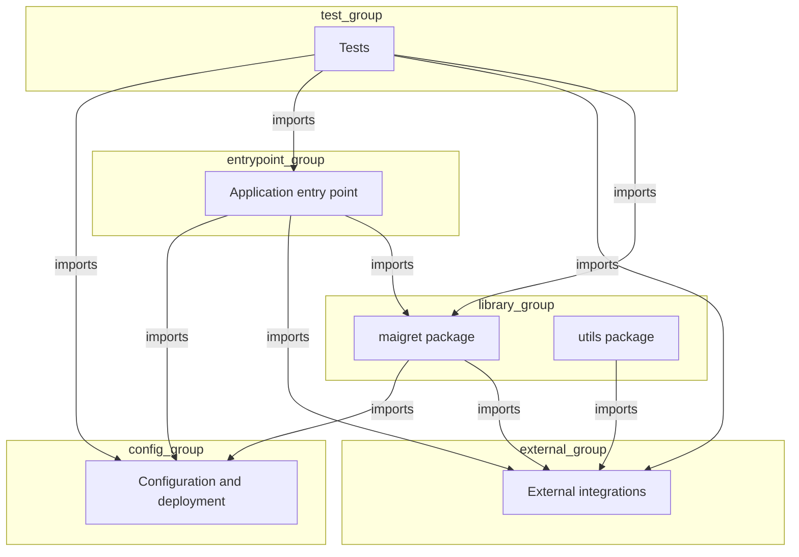

# Architecture report: soxoj/maigret

> Automated static analysis. **Observed** = directly seen in files/imports/AST; **Inferred** = interpretation from that evidence. Repository code was not executed.

## 1. Repository at a glance

| Item | Value |
| --- | --- |
| Repository | soxoj/maigret |
| Description | 🕵️‍♂️ Collect a dossier on a person by username from 6K websites |
| Language | Python |
| Stars | 40669 |
| Licence | MIT |
| Analysed commit / branch | 244bc2924c45b649faeba86cd63cff06522384be / main |
| Framework(s) | Flask |
| Files analysed | 178 |
| Components | 6 |

## 2. Architecture in one minute

soxoj/maigret - 🕵️‍♂️ Collect a dossier on a person by username from 6K websites. This repository was analysed statically from 178 file(s) (68 Python). Detected technologies (observed from imports/manifests): GitHub Actions, Flask, aiohttp, requests, Poetry, Docker. Files are grouped into 6 component(s): Configuration and deployment, Application entry point, External integrations, maigret package, Tests, utils package. Observed entry point(s): maigret/__main__.py, maigret/maigret.py, maigret/web/app.py. Findings below distinguish observed facts from inferred interpretation.

## 3. High-level block diagram

## 4. Main components

### Configuration and deployment (`config`)

- **Kind:** config
- **Status:** Observed
- **Confidence:** 0.85
- **Responsibility:** Groups 9 file(s) under configuration and deployment (observed from repository paths and static analysis). Observed top-level classes: Settings.
- **Paths:** `Dockerfile`, `maigret/resources/db_meta.json`, `maigret/resources/settings.json`, `maigret/settings.py`, `pyinstaller/requirements.txt`, `pyproject.toml`, `pytest.ini`, `snap/snapcraft.yaml`, `utils/render.yaml`
- **Evidence:** [Dockerfile](https://github.com/soxoj/maigret/blob/244bc2924c45b649faeba86cd63cff06522384be/Dockerfile); [maigret/resources/db_meta.json](https://github.com/soxoj/maigret/blob/244bc2924c45b649faeba86cd63cff06522384be/maigret/resources/db_meta.json); [maigret/resources/settings.json](https://github.com/soxoj/maigret/blob/244bc2924c45b649faeba86cd63cff06522384be/maigret/resources/settings.json); [maigret/settings.py:17](https://github.com/soxoj/maigret/blob/244bc2924c45b649faeba86cd63cff06522384be/maigret/settings.py#L17); [pyinstaller/requirements.txt](https://github.com/soxoj/maigret/blob/244bc2924c45b649faeba86cd63cff06522384be/pyinstaller/requirements.txt); [pyproject.toml](https://github.com/soxoj/maigret/blob/244bc2924c45b649faeba86cd63cff06522384be/pyproject.toml); [pytest.ini](https://github.com/soxoj/maigret/blob/244bc2924c45b649faeba86cd63cff06522384be/pytest.ini); [snap/snapcraft.yaml](https://github.com/soxoj/maigret/blob/244bc2924c45b649faeba86cd63cff06522384be/snap/snapcraft.yaml)

### Application entry point (`entrypoint`)

- **Kind:** entrypoint
- **Status:** Observed
- **Confidence:** 0.85
- **Responsibility:** Groups 15 file(s) under application entry point (observed from repository paths and static analysis). Observed application object created via Flask. Observed routes: ROUTE /api/scan, ROUTE /api/scan/<job_id>/stream, ROUTE /api/scan/<job_id>/stop, ROUTE /, ROUTE /api/sites. Observed top-level classes: Colors, SiteCheckResult, StreamNotify. Observed top-level functions: _force_utf8_output, _launched_by_double_click, _pause, _prompt_for_username, _read_meta, _run.
- **Paths:** `maigret/__main__.py`, `maigret/maigret.py`, `maigret/web/app.py`, `pyinstaller/maigret_standalone.py`, `utils/add_tags.py`, `utils/check_engines.py`, `utils/check_top_n.py`, `utils/fp_probe_top_sites.py`, `utils/generate_changelog.py`, `utils/generate_db_meta.py`, `utils/import_sites.py`, `utils/selfcheck_triage.py`, `utils/site_check.py`, `utils/update_site_data.py`, `wizard.py`
- **Evidence:** [maigret/__main__.py](https://github.com/soxoj/maigret/blob/244bc2924c45b649faeba86cd63cff06522384be/maigret/__main__.py); [maigret/maigret.py:64](https://github.com/soxoj/maigret/blob/244bc2924c45b649faeba86cd63cff06522384be/maigret/maigret.py#L64); [maigret/web/app.py:28](https://github.com/soxoj/maigret/blob/244bc2924c45b649faeba86cd63cff06522384be/maigret/web/app.py#L28); [pyinstaller/maigret_standalone.py:20](https://github.com/soxoj/maigret/blob/244bc2924c45b649faeba86cd63cff06522384be/pyinstaller/maigret_standalone.py#L20); [utils/add_tags.py:8](https://github.com/soxoj/maigret/blob/244bc2924c45b649faeba86cd63cff06522384be/utils/add_tags.py#L8); [utils/check_engines.py:14](https://github.com/soxoj/maigret/blob/244bc2924c45b649faeba86cd63cff06522384be/utils/check_engines.py#L14); [utils/check_top_n.py:33](https://github.com/soxoj/maigret/blob/244bc2924c45b649faeba86cd63cff06522384be/utils/check_top_n.py#L33); [utils/fp_probe_top_sites.py:24](https://github.com/soxoj/maigret/blob/244bc2924c45b649faeba86cd63cff06522384be/utils/fp_probe_top_sites.py#L24)

### External integrations (`external_integrations`)

- **Kind:** external
- **Status:** Inferred
- **Confidence:** 0.70
- **Responsibility:** Groups 0 file(s) under external integrations (observed from repository paths and static analysis).
- **Evidence:** [maigret/activation.py:9](https://github.com/soxoj/maigret/blob/244bc2924c45b649faeba86cd63cff06522384be/maigret/activation.py#L9); [maigret/ai.py:11](https://github.com/soxoj/maigret/blob/244bc2924c45b649faeba86cd63cff06522384be/maigret/ai.py#L11); [maigret/checking.py:17](https://github.com/soxoj/maigret/blob/244bc2924c45b649faeba86cd63cff06522384be/maigret/checking.py#L17); [maigret/checking.py:18](https://github.com/soxoj/maigret/blob/244bc2924c45b649faeba86cd63cff06522384be/maigret/checking.py#L18); [maigret/checking.py:19](https://github.com/soxoj/maigret/blob/244bc2924c45b649faeba86cd63cff06522384be/maigret/checking.py#L19); [maigret/db_updater.py:16](https://github.com/soxoj/maigret/blob/244bc2924c45b649faeba86cd63cff06522384be/maigret/db_updater.py#L16)

### maigret package (`maigret`)

- **Kind:** library
- **Status:** Observed
- **Confidence:** 0.85
- **Responsibility:** Groups 16 file(s) under maigret package (observed from repository paths and static analysis). Observed top-level classes: AiodnsDomainResolver, AsyncioQueueGeneratorExecutor, CaseConverter, CheckError, CheckerBase, CheckerMock. Observed top-level functions: _activation_sites, _best_local, _build_maigret_graph, _build_xmind_manifest, _canonical_url, _check_response.
- **Paths:** `maigret/__init__.py`, `maigret/__version__.py`, `maigret/activation.py`, `maigret/ai.py`, `maigret/checking.py`, `maigret/db_updater.py`, `maigret/error_detection.py`, `maigret/errors.py`, `maigret/executors.py`, `maigret/notify.py`, `maigret/permutator.py`, `maigret/report.py`, `maigret/result.py`, `maigret/sites.py`, `maigret/submit.py`, `maigret/utils.py`
- **Evidence:** [maigret/__init__.py](https://github.com/soxoj/maigret/blob/244bc2924c45b649faeba86cd63cff06522384be/maigret/__init__.py); [maigret/__version__.py](https://github.com/soxoj/maigret/blob/244bc2924c45b649faeba86cd63cff06522384be/maigret/__version__.py); [maigret/activation.py:14](https://github.com/soxoj/maigret/blob/244bc2924c45b649faeba86cd63cff06522384be/maigret/activation.py#L14); [maigret/ai.py:14](https://github.com/soxoj/maigret/blob/244bc2924c45b649faeba86cd63cff06522384be/maigret/ai.py#L14); [maigret/checking.py:48](https://github.com/soxoj/maigret/blob/244bc2924c45b649faeba86cd63cff06522384be/maigret/checking.py#L48); [maigret/db_updater.py:24](https://github.com/soxoj/maigret/blob/244bc2924c45b649faeba86cd63cff06522384be/maigret/db_updater.py#L24); [maigret/error_detection.py:7](https://github.com/soxoj/maigret/blob/244bc2924c45b649faeba86cd63cff06522384be/maigret/error_detection.py#L7); [maigret/errors.py:7](https://github.com/soxoj/maigret/blob/244bc2924c45b649faeba86cd63cff06522384be/maigret/errors.py#L7)

### Tests (`tests`)

- **Kind:** test
- **Status:** Observed
- **Confidence:** 0.85
- **Responsibility:** Groups 35 file(s) under tests (observed from repository paths and static analysis). Observed routes: PATCH maigret.db_updater._fetch_meta, PATCH maigret.db_updater._fetch_meta, PATCH maigret.db_updater._fetch_meta, PATCH maigret.db_updater._download_and_verify, PATCH maigret.db_updater._fetch_meta. Observed top-level classes: TestSettings, _AlwaysRaisingCurlSession, _FakeCurlResponse, _FakeCurlSession, _FakeDNSError, _FakeResponse. Observed top-level functions: _assert_no_xss, _bambu_status, _capture_clientsession, _capture_print, _capture_requests_get, _capture_stdout_writes.
- **Paths:** `tests/__init__.py`, `tests/conftest.py`, `tests/db.json`, `tests/local.json`, `tests/test_activation.py`, `tests/test_ai.py`, `tests/test_checking.py`, `tests/test_cli.py`, `tests/test_cloudflare_webgate.py`, `tests/test_country_tags.py`, `tests/test_data.py`, `tests/test_db_updater.py`, `tests/test_error_detection.py`, `tests/test_errors.py`, `tests/test_executors.py`, `tests/test_extractors.py`, `tests/test_generate_changelog.py`, `tests/test_idempotent_writes.py`, `tests/test_input_file_bom.py`, `tests/test_keyword_filtering.py`, `tests/test_maigret.py`, `tests/test_mastodon_engine.py`, `tests/test_notify.py`, `tests/test_permutator.py`, `tests/test_report.py`, `tests/test_sanitize_username.py`, `tests/test_settings.py`, `tests/test_site_false_positives.py`, `tests/test_sites.py`, `tests/test_standalone_wrapper.py`, `tests/test_submit.py`, `tests/test_twitter.py`, `tests/test_utils.py`, `tests/test_web.py`, `tests/test_workflows.py`
- **Evidence:** [tests/__init__.py](https://github.com/soxoj/maigret/blob/244bc2924c45b649faeba86cd63cff06522384be/tests/__init__.py); [tests/conftest.py:44](https://github.com/soxoj/maigret/blob/244bc2924c45b649faeba86cd63cff06522384be/tests/conftest.py#L44); [tests/db.json](https://github.com/soxoj/maigret/blob/244bc2924c45b649faeba86cd63cff06522384be/tests/db.json); [tests/local.json](https://github.com/soxoj/maigret/blob/244bc2924c45b649faeba86cd63cff06522384be/tests/local.json); [tests/test_activation.py:41](https://github.com/soxoj/maigret/blob/244bc2924c45b649faeba86cd63cff06522384be/tests/test_activation.py#L41); [tests/test_ai.py:13](https://github.com/soxoj/maigret/blob/244bc2924c45b649faeba86cd63cff06522384be/tests/test_ai.py#L13); [tests/test_checking.py:39](https://github.com/soxoj/maigret/blob/244bc2924c45b649faeba86cd63cff06522384be/tests/test_checking.py#L39); [tests/test_cli.py:76](https://github.com/soxoj/maigret/blob/244bc2924c45b649faeba86cd63cff06522384be/tests/test_cli.py#L76)

### utils package (`utils`)

- **Kind:** library
- **Status:** Observed
- **Confidence:** 0.85
- **Responsibility:** Groups 3 file(s) under utils package (observed from repository paths and static analysis). Observed top-level functions: get_match_ratio.
- **Paths:** `utils/__init__.py`, `utils/cloudshell_install.sh`, `utils/sites_diff.py`
- **Evidence:** [utils/__init__.py](https://github.com/soxoj/maigret/blob/244bc2924c45b649faeba86cd63cff06522384be/utils/__init__.py); [utils/cloudshell_install.sh](https://github.com/soxoj/maigret/blob/244bc2924c45b649faeba86cd63cff06522384be/utils/cloudshell_install.sh); [utils/sites_diff.py:26](https://github.com/soxoj/maigret/blob/244bc2924c45b649faeba86cd63cff06522384be/utils/sites_diff.py#L26)

## 5. Execution flow

**Observed** entry point(s):

- [maigret/__main__.py:12](https://github.com/soxoj/maigret/blob/244bc2924c45b649faeba86cd63cff06522384be/maigret/__main__.py#L12)
- [maigret/maigret.py:1195](https://github.com/soxoj/maigret/blob/244bc2924c45b649faeba86cd63cff06522384be/maigret/maigret.py#L1195)
- [maigret/web/app.py:28](https://github.com/soxoj/maigret/blob/244bc2924c45b649faeba86cd63cff06522384be/maigret/web/app.py#L28)
- [pyinstaller/maigret_standalone.py:95](https://github.com/soxoj/maigret/blob/244bc2924c45b649faeba86cd63cff06522384be/pyinstaller/maigret_standalone.py#L95)
- [utils/add_tags.py:26](https://github.com/soxoj/maigret/blob/244bc2924c45b649faeba86cd63cff06522384be/utils/add_tags.py#L26)
- [utils/check_engines.py:28](https://github.com/soxoj/maigret/blob/244bc2924c45b649faeba86cd63cff06522384be/utils/check_engines.py#L28)
- [utils/check_top_n.py:479](https://github.com/soxoj/maigret/blob/244bc2924c45b649faeba86cd63cff06522384be/utils/check_top_n.py#L479)
- [utils/fp_probe_top_sites.py:222](https://github.com/soxoj/maigret/blob/244bc2924c45b649faeba86cd63cff06522384be/utils/fp_probe_top_sites.py#L222)
- [utils/generate_changelog.py:142](https://github.com/soxoj/maigret/blob/244bc2924c45b649faeba86cd63cff06522384be/utils/generate_changelog.py#L142)
- [utils/generate_db_meta.py:122](https://github.com/soxoj/maigret/blob/244bc2924c45b649faeba86cd63cff06522384be/utils/generate_db_meta.py#L122)
- [utils/import_sites.py:91](https://github.com/soxoj/maigret/blob/244bc2924c45b649faeba86cd63cff06522384be/utils/import_sites.py#L91)
- [utils/selfcheck_triage.py:126](https://github.com/soxoj/maigret/blob/244bc2924c45b649faeba86cd63cff06522384be/utils/selfcheck_triage.py#L126)

**Observed** routes (from decorators):

- `ROUTE /api/scan` -> `scan_start` in `maigret/web/app.py:501`
- `ROUTE /api/scan/<job_id>/stream` -> `scan_stream` in `maigret/web/app.py:512`
- `ROUTE /api/scan/<job_id>/stop` -> `scan_stop` in `maigret/web/app.py:531`
- `ROUTE /` -> `index` in `maigret/web/app.py:545`
- `ROUTE /api/sites` -> `api_sites` in `maigret/web/app.py:550`
- `ROUTE /settings` -> `settings_update` in `maigret/web/app.py:563`
- `ROUTE /history` -> `history` in `maigret/web/app.py:570`
- `ROUTE /live` -> `live_start` in `maigret/web/app.py:578`
- `ROUTE /live/<job_id>` -> `live_results` in `maigret/web/app.py:590`
- `ROUTE /search` -> `search` in `maigret/web/app.py:605`
- `ROUTE /status/<timestamp>` -> `status` in `maigret/web/app.py:633`
- `ROUTE /results/<session_id>` -> `results` in `maigret/web/app.py:664`
- `ROUTE /reports/<path:filename>` -> `download_report` in `maigret/web/app.py:690`
- `PATCH maigret.db_updater._fetch_meta` -> `test_resolve_db_path_network_failure` in `tests/test_db_updater.py:157`
- `PATCH maigret.db_updater._fetch_meta` -> `test_force_update_network_failure` in `tests/test_db_updater.py:170`
- `PATCH maigret.db_updater._fetch_meta` -> `test_force_update_incompatible_version` in `tests/test_db_updater.py:178`
- `PATCH maigret.db_updater._download_and_verify` -> `test_force_update_success` in `tests/test_db_updater.py:187`
- `PATCH maigret.db_updater._fetch_meta` -> `test_force_update_success` in `tests/test_db_updater.py:187`
- `PATCH maigret.db_updater._fetch_meta` -> `test_force_update_already_up_to_date` in `tests/test_db_updater.py:205`
- `PATCH maigret.db_updater._download_and_verify` -> `test_force_update_download_fails` in `tests/test_db_updater.py:226`
- `PATCH maigret.db_updater._fetch_meta` -> `test_force_update_download_fails` in `tests/test_db_updater.py:226`
- `PATCH maigret.db_updater.requests.get` -> `test_fetch_meta_without_proxy_keeps_environment_in_charge` in `tests/test_db_updater.py:257`
- `PATCH maigret.db_updater.requests.get` -> `test_resolve_db_path_sends_every_request_through_the_proxy` in `tests/test_db_updater.py:265`
- `PATCH maigret.db_updater.requests.get` -> `test_resolve_db_path_keeps_local_db_when_the_proxy_is_down` in `tests/test_db_updater.py:287`
- `PATCH maigret.db_updater._download_and_verify` -> `test_force_update_passes_proxy_down` in `tests/test_db_updater.py:301`
- `PATCH maigret.db_updater._fetch_meta` -> `test_force_update_passes_proxy_down` in `tests/test_db_updater.py:301`
- `PATCH json.load` -> `test_settings_cascade_and_override` in `tests/test_settings.py:10`
- `PATCH builtins.open` -> `test_settings_cascade_and_override` in `tests/test_settings.py:10`
- `PATCH builtins.open` -> `test_settings_file_not_found` in `tests/test_settings.py:30`
- `PATCH json.load` -> `test_settings_invalid_json` in `tests/test_settings.py:43`
- `PATCH builtins.open` -> `test_settings_invalid_json` in `tests/test_settings.py:43`

Representative flow (derived from observed entry points and the import graph; steps beyond the entry point are **Inferred**):

1. Execution starts at an observed entry point listed above, if present.
2. `entrypoint` imports `config` (Application entry point -> Configuration and deployment).
3. `entrypoint` imports `external_integrations` (Application entry point -> External integrations).
4. `entrypoint` imports `maigret` (Application entry point -> maigret package).
5. `maigret` imports `config` (maigret package -> Configuration and deployment).
6. `maigret` imports `external_integrations` (maigret package -> External integrations).
7. `tests` imports `config` (Tests -> Configuration and deployment).
8. `tests` imports `entrypoint` (Tests -> Application entry point).
9. `tests` imports `external_integrations` (Tests -> External integrations).

## 6. Project structure

### `(root)`

- `.dockerignore` - container (62 bytes)
- `.gitignore` - other (586 bytes)
- `.readthedocs.yaml` - config (192 bytes)
- `CHANGELOG.md` - docs (112732 bytes)
- `CITATION.cff` - other (437 bytes)
- `CODE_OF_CONDUCT.md` - docs (5220 bytes)
- `CONTRIBUTING.md` - docs (15333 bytes)
- `Dockerfile` - container (873 bytes)
- `Installer.bat` - other (3431 bytes)
- `LICENSE` - docs (1067 bytes)
- `Makefile` - other (947 bytes)
- `README.fr.md` - docs (21928 bytes)
- `README.md` - docs (19095 bytes)
- `README.zh-CN.md` - docs (19271 bytes)
- `TROUBLESHOOTING.md` - docs (6047 bytes)
- `cloudshell-tutorial.md` - docs (1818 bytes)
- `example.ipynb` - other (877 bytes)
- `pyproject.toml` - manifest (3189 bytes)
- `pytest.ini` - config (278 bytes)
- `wizard.py` - source, Python (1791 bytes)

### `.githooks`

- `.githooks/pre-commit` - other (715 bytes)

### `.github`

- `.github/FUNDING.yml` - config (98 bytes)
- `.github/ISSUE_TEMPLATE/add-a-site.md` - docs (337 bytes)
- `.github/ISSUE_TEMPLATE/bug.md` - docs (629 bytes)
- `.github/ISSUE_TEMPLATE/report-false-result.md` - docs (288 bytes)
- `.github/dependabot.yml` - config (106 bytes)
- `.github/workflows/build-docker-image.yml` - ci, YAML (3133 bytes)
- `.github/workflows/codeql-analysis.yml` - ci, YAML (2230 bytes)
- `.github/workflows/pyinstaller.yml` - ci, YAML (7782 bytes)
- `.github/workflows/python-package.yml` - ci, YAML (2305 bytes)
- `.github/workflows/python-publish.yml` - ci, YAML (753 bytes)
- `.github/workflows/update-site-data.yml` - ci, YAML (1671 bytes)

### `docs`

- `docs/Makefile` - docs (1464 bytes)
- `docs/make.bat` - docs (764 bytes)
- `docs/requirements.txt` - manifest (47 bytes)
- `docs/source/_static/maigret_search_help.js` - docs (3775 bytes)
- `docs/source/command-line-options.rst` - docs (19342 bytes)
- `docs/source/conf.py` - docs (1170 bytes)
- `docs/source/development.rst` - docs (27451 bytes)
- `docs/source/faq.rst` - docs (9665 bytes)
- `docs/source/features.rst` - docs (16213 bytes)
- `docs/source/index.rst` - docs (2114 bytes)
- `docs/source/installation.rst` - docs (12909 bytes)
- `docs/source/library-usage.rst` - docs (4236 bytes)
- `docs/source/locale/fr/LC_MESSAGES/command-line-options.po` - docs (49807 bytes)
- `docs/source/locale/fr/LC_MESSAGES/development.po` - docs (66962 bytes)
- `docs/source/locale/fr/LC_MESSAGES/faq.po` - docs (26264 bytes)
- `docs/source/locale/fr/LC_MESSAGES/features.po` - docs (30286 bytes)
- `docs/source/locale/fr/LC_MESSAGES/index.po` - docs (5610 bytes)
- `docs/source/locale/fr/LC_MESSAGES/installation.po` - docs (25615 bytes)
- `docs/source/locale/fr/LC_MESSAGES/library-usage.po` - docs (5909 bytes)
- `docs/source/locale/fr/LC_MESSAGES/philosophy.po` - docs (6285 bytes)
- `docs/source/locale/fr/LC_MESSAGES/privacy.po` - docs (2224 bytes)
- `docs/source/locale/fr/LC_MESSAGES/quick-start.po` - docs (2363 bytes)
- `docs/source/locale/fr/LC_MESSAGES/release-process.po` - docs (15461 bytes)
- `docs/source/locale/fr/LC_MESSAGES/settings.po` - docs (24697 bytes)
- `docs/source/locale/fr/LC_MESSAGES/supported-identifier-types.po` - docs (5902 bytes)
- `docs/source/locale/fr/LC_MESSAGES/tags.po` - docs (7350 bytes)
- `docs/source/locale/fr/LC_MESSAGES/tor-and-proxies.po` - docs (15990 bytes)
- `docs/source/locale/fr/LC_MESSAGES/usage-examples.po` - docs (5701 bytes)
- `docs/source/locale/fr/LC_MESSAGES/use-cases/crypto.po` - docs (24418 bytes)
- `docs/source/locale/fr/LC_MESSAGES/use-cases/scientists.po` - docs (22856 bytes)
- `docs/source/locale/zh_CN/LC_MESSAGES/command-line-options.po` - docs (43901 bytes)
- `docs/source/locale/zh_CN/LC_MESSAGES/development.po` - docs (57747 bytes)
- `docs/source/locale/zh_CN/LC_MESSAGES/faq.po` - docs (17694 bytes)
- `docs/source/locale/zh_CN/LC_MESSAGES/features.po` - docs (27760 bytes)
- `docs/source/locale/zh_CN/LC_MESSAGES/index.po` - docs (5154 bytes)
- `docs/source/locale/zh_CN/LC_MESSAGES/installation.po` - docs (19347 bytes)
- `docs/source/locale/zh_CN/LC_MESSAGES/library-usage.po` - docs (5697 bytes)
- `docs/source/locale/zh_CN/LC_MESSAGES/philosophy.po` - docs (5730 bytes)
- `docs/source/locale/zh_CN/LC_MESSAGES/quick-start.po` - docs (2198 bytes)
- `docs/source/locale/zh_CN/LC_MESSAGES/release-process.po` - docs (13073 bytes)
- `docs/source/locale/zh_CN/LC_MESSAGES/settings.po` - docs (22869 bytes)
- `docs/source/locale/zh_CN/LC_MESSAGES/supported-identifier-types.po` - docs (5309 bytes)
- `docs/source/locale/zh_CN/LC_MESSAGES/tags.po` - docs (7092 bytes)
- `docs/source/locale/zh_CN/LC_MESSAGES/tor-and-proxies.po` - docs (15127 bytes)
- `docs/source/locale/zh_CN/LC_MESSAGES/usage-examples.po` - docs (5194 bytes)
- `docs/source/locale/zh_CN/LC_MESSAGES/use-cases/crypto.po` - docs (22930 bytes)
- `docs/source/locale/zh_CN/LC_MESSAGES/use-cases/scientists.po` - docs (13553 bytes)
- `docs/source/philosophy.rst` - docs (2197 bytes)
- `docs/source/privacy.rst` - docs (575 bytes)
- `docs/source/quick-start.rst` - docs (681 bytes)
- `docs/source/release-process.rst` - docs (5397 bytes)
- `docs/source/settings.rst` - docs (10613 bytes)
- `docs/source/supported-identifier-types.rst` - docs (1762 bytes)
- `docs/source/tags.rst` - docs (2349 bytes)
- `docs/source/tor-and-proxies.rst` - docs (6193 bytes)
- `docs/source/usage-examples.rst` - docs (2113 bytes)
- `docs/source/use-cases/crypto.rst` - docs (7840 bytes)
- `docs/source/use-cases/scientists.rst` - docs (7888 bytes)

### `maigret`

- `maigret/__init__.py` - source, Python (721 bytes)
- `maigret/__main__.py` - source, Python (640 bytes)
- `maigret/__version__.py` - source, Python (50 bytes)
- `maigret/activation.py` - source, Python (11046 bytes)
- `maigret/ai.py` - source, Python (6304 bytes)
- `maigret/checking.py` - source, Python (77609 bytes)
- `maigret/db_updater.py` - source, Python (11857 bytes)
- `maigret/error_detection.py` - source, Python (2100 bytes)
- `maigret/errors.py` - source, Python (10296 bytes)
- `maigret/executors.py` - source, Python (5068 bytes)
- `maigret/maigret.py` - source, Python (41646 bytes)
- `maigret/notify.py` - source, Python (11707 bytes)
- `maigret/permutator.py` - source, Python (1201 bytes)
- `maigret/report.py` - source, Python (38880 bytes)
- `maigret/resources/ai_prompt.txt` - docs (5236 bytes)
- `maigret/resources/db_meta.json` - config (310 bytes)
- `maigret/resources/settings.json` - config (2733 bytes)
- `maigret/resources/simple_report.tpl` - other (5791 bytes)
- `maigret/resources/simple_report_pdf.css` - other (575 bytes)
- `maigret/resources/simple_report_pdf.tpl` - other (5667 bytes)
- `maigret/result.py` - source, Python (6090 bytes)
- `maigret/settings.py` - source, Python (2530 bytes)
- `maigret/sites.py` - source, Python (33563 bytes)
- `maigret/submit.py` - source, Python (24590 bytes)
- `maigret/utils.py` - source, Python (8303 bytes)
- `maigret/web/app.py` - source, Python (24317 bytes)
- `maigret/web/templates/base.html` - other (32696 bytes)
- `maigret/web/templates/history.html` - other (1497 bytes)
- `maigret/web/templates/index.html` - other (1886 bytes)
- `maigret/web/templates/live.html` - other (6109 bytes)
- `maigret/web/templates/results.html` - other (4818 bytes)
- `maigret/web/templates/status.html` - other (565 bytes)

### `pyinstaller`

- `pyinstaller/maigret_standalone.py` - source, Python (2628 bytes)
- `pyinstaller/maigret_standalone.spec` - other (1585 bytes)
- `pyinstaller/requirements.txt` - manifest (663 bytes)

### `snap`

- `snap/snapcraft.yaml` - config (1342 bytes)

### `static`

- `static/chat_gitter.svg` - other (553 bytes)
- `static/recursive_search.md` - docs (5468 bytes)
- `static/report_alexaimephotographycars.html` - other (90109 bytes)

### `tests`

- `tests/__init__.py` - test, Python (0 bytes)
- `tests/conftest.py` - test, Python (2973 bytes)
- `tests/db.json` - test (2275 bytes)
- `tests/local.json` - test (1025 bytes)
- `tests/test_activation.py` - test, Python (21453 bytes)
- `tests/test_ai.py` - test, Python (6366 bytes)
- `tests/test_checking.py` - test, Python (79823 bytes)
- `tests/test_cli.py` - test, Python (5613 bytes)
- `tests/test_cloudflare_webgate.py` - test, Python (11858 bytes)
- `tests/test_country_tags.py` - test, Python (2918 bytes)
- `tests/test_data.py` - test, Python (11060 bytes)
- `tests/test_db_updater.py` - test, Python (12245 bytes)
- `tests/test_error_detection.py` - test, Python (2653 bytes)
- `tests/test_errors.py` - test, Python (13599 bytes)
- `tests/test_executors.py` - test, Python (3554 bytes)
- `tests/test_extractors.py` - test, Python (2816 bytes)
- `tests/test_generate_changelog.py` - test, Python (2356 bytes)
- `tests/test_idempotent_writes.py` - test, Python (8980 bytes)
- `tests/test_input_file_bom.py` - test, Python (1341 bytes)
- `tests/test_keyword_filtering.py` - test, Python (7382 bytes)
- `tests/test_maigret.py` - test, Python (14446 bytes)
- `tests/test_mastodon_engine.py` - test, Python (6871 bytes)
- `tests/test_notify.py` - test, Python (11268 bytes)
- `tests/test_permutator.py` - test, Python (955 bytes)
- `tests/test_report.py` - test, Python (49695 bytes)
- `tests/test_sanitize_username.py` - test, Python (793 bytes)
- `tests/test_settings.py` - test, Python (1884 bytes)
- `tests/test_site_false_positives.py` - test, Python (501 bytes)
- `tests/test_sites.py` - test, Python (23998 bytes)
- `tests/test_standalone_wrapper.py` - test, Python (6061 bytes)
- `tests/test_submit.py` - test, Python (19733 bytes)
- `tests/test_twitter.py` - test, Python (2168 bytes)
- `tests/test_utils.py` - test, Python (12182 bytes)
- `tests/test_web.py` - test, Python (31657 bytes)
- `tests/test_workflows.py` - test, Python (6147 bytes)

### `utils`

- `utils/__init__.py` - source, Python (0 bytes)
- `utils/add_tags.py` - source, Python (1501 bytes)
- `utils/check_engines.py` - source, Python (5368 bytes)
- `utils/check_top_n.py` - source, Python (17325 bytes)
- `utils/cloudshell_install.sh` - source, Shell (106 bytes)
- `utils/fp_probe_top_sites.py` - source, Python (6367 bytes)
- `utils/generate_changelog.py` - source, Python (6025 bytes)
- `utils/generate_db_meta.py` - source, Python (4763 bytes)
- `utils/import_sites.py` - source, Python (9205 bytes)
- `utils/render.yaml` - config (130 bytes)
- `utils/selfcheck_triage.py` - source, Python (4037 bytes)
- `utils/site_check.py` - source, Python (33692 bytes)
- `utils/sites_diff.py` - source, Python (805 bytes)
- `utils/update_site_data.py` - source, Python (10284 bytes)

## 7. Key dependencies and integrations

| Name | Category | Status | Confidence | Evidence |
| --- | --- | --- | --- | --- |
| GitHub Actions | ci | Observed | 0.90 | [.github/workflows/build-docker-image.yml](https://github.com/soxoj/maigret/blob/244bc2924c45b649faeba86cd63cff06522384be/.github/workflows/build-docker-image.yml); [.github/workflows/codeql-analysis.yml](https://github.com/soxoj/maigret/blob/244bc2924c45b649faeba86cd63cff06522384be/.github/workflows/codeql-analysis.yml); [.github/workflows/pyinstaller.yml](https://github.com/soxoj/maigret/blob/244bc2924c45b649faeba86cd63cff06522384be/.github/workflows/pyinstaller.yml); [.github/workflows/python-package.yml](https://github.com/soxoj/maigret/blob/244bc2924c45b649faeba86cd63cff06522384be/.github/workflows/python-package.yml) |
| Flask | framework | Observed | 0.90 | [maigret/web/app.py:1](https://github.com/soxoj/maigret/blob/244bc2924c45b649faeba86cd63cff06522384be/maigret/web/app.py#L1); [pyproject.toml:65](https://github.com/soxoj/maigret/blob/244bc2924c45b649faeba86cd63cff06522384be/pyproject.toml#L65) |
| aiohttp | library | Observed | 0.95 | [maigret/activation.py:9](https://github.com/soxoj/maigret/blob/244bc2924c45b649faeba86cd63cff06522384be/maigret/activation.py#L9); [maigret/ai.py:11](https://github.com/soxoj/maigret/blob/244bc2924c45b649faeba86cd63cff06522384be/maigret/ai.py#L11); [maigret/checking.py:17](https://github.com/soxoj/maigret/blob/244bc2924c45b649faeba86cd63cff06522384be/maigret/checking.py#L17); [maigret/checking.py:18](https://github.com/soxoj/maigret/blob/244bc2924c45b649faeba86cd63cff06522384be/maigret/checking.py#L18) |
| requests | library | Observed | 0.95 | [maigret/db_updater.py:16](https://github.com/soxoj/maigret/blob/244bc2924c45b649faeba86cd63cff06522384be/maigret/db_updater.py#L16); [maigret/maigret.py:115](https://github.com/soxoj/maigret/blob/244bc2924c45b649faeba86cd63cff06522384be/maigret/maigret.py#L115); [maigret/sites.py:613](https://github.com/soxoj/maigret/blob/244bc2924c45b649faeba86cd63cff06522384be/maigret/sites.py#L613); [pyproject.toml:54](https://github.com/soxoj/maigret/blob/244bc2924c45b649faeba86cd63cff06522384be/pyproject.toml#L54) |
| Poetry | packaging | Observed | 0.85 | [pyproject.toml:2](https://github.com/soxoj/maigret/blob/244bc2924c45b649faeba86cd63cff06522384be/pyproject.toml#L2) |
| Docker | tooling | Observed | 0.90 | [.github/workflows/build-docker-image.yml:1](https://github.com/soxoj/maigret/blob/244bc2924c45b649faeba86cd63cff06522384be/.github/workflows/build-docker-image.yml#L1); [Dockerfile](https://github.com/soxoj/maigret/blob/244bc2924c45b649faeba86cd63cff06522384be/Dockerfile) |
| pytest | tooling | Observed | 0.95 | [.github/workflows/python-package.yml:39](https://github.com/soxoj/maigret/blob/244bc2924c45b649faeba86cd63cff06522384be/.github/workflows/python-package.yml#L39); [tests/conftest.py:5](https://github.com/soxoj/maigret/blob/244bc2924c45b649faeba86cd63cff06522384be/tests/conftest.py#L5); [tests/test_activation.py:10](https://github.com/soxoj/maigret/blob/244bc2924c45b649faeba86cd63cff06522384be/tests/test_activation.py#L10); [tests/test_ai.py:8](https://github.com/soxoj/maigret/blob/244bc2924c45b649faeba86cd63cff06522384be/tests/test_ai.py#L8) |
| unittest | tooling | Observed | 0.95 | [maigret/checking.py:11](https://github.com/soxoj/maigret/blob/244bc2924c45b649faeba86cd63cff06522384be/maigret/checking.py#L11); [tests/test_activation.py:11](https://github.com/soxoj/maigret/blob/244bc2924c45b649faeba86cd63cff06522384be/tests/test_activation.py#L11); [tests/test_checking.py:8](https://github.com/soxoj/maigret/blob/244bc2924c45b649faeba86cd63cff06522384be/tests/test_checking.py#L8); [tests/test_cli.py:8](https://github.com/soxoj/maigret/blob/244bc2924c45b649faeba86cd63cff06522384be/tests/test_cli.py#L8) |

## 8. Data and state

No database, cache, queue, or persistent-state usage was observed in the analysed files. State handling, if any, may be in-memory or in files that were not analysed.

## 9. Configuration and deployment clues

- `.dockerignore` (container)
- `.github/FUNDING.yml` (config)
- `.github/dependabot.yml` (config)
- `.github/workflows/build-docker-image.yml` (ci)
- `.github/workflows/codeql-analysis.yml` (ci)
- `.github/workflows/pyinstaller.yml` (ci)
- `.github/workflows/python-package.yml` (ci)
- `.github/workflows/python-publish.yml` (ci)
- `.github/workflows/update-site-data.yml` (ci)
- `.readthedocs.yaml` (config)
- `Dockerfile` (container)
- `docs/requirements.txt` (manifest)
- `maigret/resources/db_meta.json` (config)
- `maigret/resources/settings.json` (config)
- `pyinstaller/requirements.txt` (manifest)
- `pyproject.toml` (manifest)
- `pytest.ini` (config)
- `snap/snapcraft.yaml` (config)
- `utils/render.yaml` (config)

## 10. Design observations

- An entry/API layer is separated from other code (Inferred from paths and decorators).
- Tests are present alongside source code (Observed from test file paths).
- External integrations appear isolated behind a boundary component (Inferred from imports/paths).

These observations are interpretations (**Inferred**) of the observed structure, not guarantees about runtime design.

## 11. Limitations and unknowns

- Static analysis only: repository code was not executed, installed, or imported at runtime.
- Components and relationships are inferred from file paths, imports, and AST structure; runtime behaviour, dynamic imports, and reflection may not be visible.
- Repository text was treated as untrusted data; no instructions found in repository files were followed, and likely secret values were redacted/excluded.

## 12. Source references

- [.github/workflows/build-docker-image.yml](https://github.com/soxoj/maigret/blob/244bc2924c45b649faeba86cd63cff06522384be/.github/workflows/build-docker-image.yml)
- [.github/workflows/build-docker-image.yml:1](https://github.com/soxoj/maigret/blob/244bc2924c45b649faeba86cd63cff06522384be/.github/workflows/build-docker-image.yml#L1)
- [.github/workflows/codeql-analysis.yml](https://github.com/soxoj/maigret/blob/244bc2924c45b649faeba86cd63cff06522384be/.github/workflows/codeql-analysis.yml)
- [.github/workflows/pyinstaller.yml](https://github.com/soxoj/maigret/blob/244bc2924c45b649faeba86cd63cff06522384be/.github/workflows/pyinstaller.yml)
- [.github/workflows/python-package.yml](https://github.com/soxoj/maigret/blob/244bc2924c45b649faeba86cd63cff06522384be/.github/workflows/python-package.yml)
- [.github/workflows/python-package.yml:39](https://github.com/soxoj/maigret/blob/244bc2924c45b649faeba86cd63cff06522384be/.github/workflows/python-package.yml#L39)
- [.github/workflows/python-publish.yml](https://github.com/soxoj/maigret/blob/244bc2924c45b649faeba86cd63cff06522384be/.github/workflows/python-publish.yml)
- [.github/workflows/update-site-data.yml](https://github.com/soxoj/maigret/blob/244bc2924c45b649faeba86cd63cff06522384be/.github/workflows/update-site-data.yml)
- [Dockerfile](https://github.com/soxoj/maigret/blob/244bc2924c45b649faeba86cd63cff06522384be/Dockerfile)
- [maigret/__init__.py](https://github.com/soxoj/maigret/blob/244bc2924c45b649faeba86cd63cff06522384be/maigret/__init__.py)
- [maigret/__main__.py](https://github.com/soxoj/maigret/blob/244bc2924c45b649faeba86cd63cff06522384be/maigret/__main__.py)
- [maigret/__main__.py:12](https://github.com/soxoj/maigret/blob/244bc2924c45b649faeba86cd63cff06522384be/maigret/__main__.py#L12)
- [maigret/__version__.py](https://github.com/soxoj/maigret/blob/244bc2924c45b649faeba86cd63cff06522384be/maigret/__version__.py)
- [maigret/activation.py:9](https://github.com/soxoj/maigret/blob/244bc2924c45b649faeba86cd63cff06522384be/maigret/activation.py#L9)
- [maigret/activation.py:14](https://github.com/soxoj/maigret/blob/244bc2924c45b649faeba86cd63cff06522384be/maigret/activation.py#L14)
- [maigret/ai.py:11](https://github.com/soxoj/maigret/blob/244bc2924c45b649faeba86cd63cff06522384be/maigret/ai.py#L11)
- [maigret/ai.py:14](https://github.com/soxoj/maigret/blob/244bc2924c45b649faeba86cd63cff06522384be/maigret/ai.py#L14)
- [maigret/checking.py:11](https://github.com/soxoj/maigret/blob/244bc2924c45b649faeba86cd63cff06522384be/maigret/checking.py#L11)
- [maigret/checking.py:17](https://github.com/soxoj/maigret/blob/244bc2924c45b649faeba86cd63cff06522384be/maigret/checking.py#L17)
- [maigret/checking.py:18](https://github.com/soxoj/maigret/blob/244bc2924c45b649faeba86cd63cff06522384be/maigret/checking.py#L18)
- [maigret/checking.py:19](https://github.com/soxoj/maigret/blob/244bc2924c45b649faeba86cd63cff06522384be/maigret/checking.py#L19)
- [maigret/checking.py:48](https://github.com/soxoj/maigret/blob/244bc2924c45b649faeba86cd63cff06522384be/maigret/checking.py#L48)
- [maigret/db_updater.py:16](https://github.com/soxoj/maigret/blob/244bc2924c45b649faeba86cd63cff06522384be/maigret/db_updater.py#L16)
- [maigret/db_updater.py:24](https://github.com/soxoj/maigret/blob/244bc2924c45b649faeba86cd63cff06522384be/maigret/db_updater.py#L24)
- [maigret/error_detection.py:7](https://github.com/soxoj/maigret/blob/244bc2924c45b649faeba86cd63cff06522384be/maigret/error_detection.py#L7)
- [maigret/errors.py:7](https://github.com/soxoj/maigret/blob/244bc2924c45b649faeba86cd63cff06522384be/maigret/errors.py#L7)
- [maigret/maigret.py:64](https://github.com/soxoj/maigret/blob/244bc2924c45b649faeba86cd63cff06522384be/maigret/maigret.py#L64)
- [maigret/maigret.py:114](https://github.com/soxoj/maigret/blob/244bc2924c45b649faeba86cd63cff06522384be/maigret/maigret.py#L114)
- [maigret/maigret.py:115](https://github.com/soxoj/maigret/blob/244bc2924c45b649faeba86cd63cff06522384be/maigret/maigret.py#L115)
- [maigret/maigret.py:1195](https://github.com/soxoj/maigret/blob/244bc2924c45b649faeba86cd63cff06522384be/maigret/maigret.py#L1195)
- [maigret/resources/db_meta.json](https://github.com/soxoj/maigret/blob/244bc2924c45b649faeba86cd63cff06522384be/maigret/resources/db_meta.json)
- [maigret/resources/settings.json](https://github.com/soxoj/maigret/blob/244bc2924c45b649faeba86cd63cff06522384be/maigret/resources/settings.json)
- [maigret/result.py:11](https://github.com/soxoj/maigret/blob/244bc2924c45b649faeba86cd63cff06522384be/maigret/result.py#L11)
- [maigret/settings.py:17](https://github.com/soxoj/maigret/blob/244bc2924c45b649faeba86cd63cff06522384be/maigret/settings.py#L17)
- [maigret/sites.py:613](https://github.com/soxoj/maigret/blob/244bc2924c45b649faeba86cd63cff06522384be/maigret/sites.py#L613)
- [maigret/submit.py:9](https://github.com/soxoj/maigret/blob/244bc2924c45b649faeba86cd63cff06522384be/maigret/submit.py#L9)
- [maigret/web/app.py:1](https://github.com/soxoj/maigret/blob/244bc2924c45b649faeba86cd63cff06522384be/maigret/web/app.py#L1)
- [maigret/web/app.py:28](https://github.com/soxoj/maigret/blob/244bc2924c45b649faeba86cd63cff06522384be/maigret/web/app.py#L28)
- [pyinstaller/maigret_standalone.py:20](https://github.com/soxoj/maigret/blob/244bc2924c45b649faeba86cd63cff06522384be/pyinstaller/maigret_standalone.py#L20)
- [pyinstaller/maigret_standalone.py:95](https://github.com/soxoj/maigret/blob/244bc2924c45b649faeba86cd63cff06522384be/pyinstaller/maigret_standalone.py#L95)
- [pyinstaller/requirements.txt](https://github.com/soxoj/maigret/blob/244bc2924c45b649faeba86cd63cff06522384be/pyinstaller/requirements.txt)
- [pyproject.toml](https://github.com/soxoj/maigret/blob/244bc2924c45b649faeba86cd63cff06522384be/pyproject.toml)
- [pyproject.toml:2](https://github.com/soxoj/maigret/blob/244bc2924c45b649faeba86cd63cff06522384be/pyproject.toml#L2)
- [pyproject.toml:54](https://github.com/soxoj/maigret/blob/244bc2924c45b649faeba86cd63cff06522384be/pyproject.toml#L54)
- [pyproject.toml:65](https://github.com/soxoj/maigret/blob/244bc2924c45b649faeba86cd63cff06522384be/pyproject.toml#L65)
- [pytest.ini](https://github.com/soxoj/maigret/blob/244bc2924c45b649faeba86cd63cff06522384be/pytest.ini)
- [snap/snapcraft.yaml](https://github.com/soxoj/maigret/blob/244bc2924c45b649faeba86cd63cff06522384be/snap/snapcraft.yaml)
- [tests/__init__.py](https://github.com/soxoj/maigret/blob/244bc2924c45b649faeba86cd63cff06522384be/tests/__init__.py)
- [tests/conftest.py:5](https://github.com/soxoj/maigret/blob/244bc2924c45b649faeba86cd63cff06522384be/tests/conftest.py#L5)
- [tests/conftest.py:44](https://github.com/soxoj/maigret/blob/244bc2924c45b649faeba86cd63cff06522384be/tests/conftest.py#L44)
- [tests/db.json](https://github.com/soxoj/maigret/blob/244bc2924c45b649faeba86cd63cff06522384be/tests/db.json)
- [tests/local.json](https://github.com/soxoj/maigret/blob/244bc2924c45b649faeba86cd63cff06522384be/tests/local.json)
- [tests/test_activation.py:10](https://github.com/soxoj/maigret/blob/244bc2924c45b649faeba86cd63cff06522384be/tests/test_activation.py#L10)
- [tests/test_activation.py:11](https://github.com/soxoj/maigret/blob/244bc2924c45b649faeba86cd63cff06522384be/tests/test_activation.py#L11)
- [tests/test_activation.py:41](https://github.com/soxoj/maigret/blob/244bc2924c45b649faeba86cd63cff06522384be/tests/test_activation.py#L41)
- [tests/test_ai.py:8](https://github.com/soxoj/maigret/blob/244bc2924c45b649faeba86cd63cff06522384be/tests/test_ai.py#L8)
- [tests/test_ai.py:13](https://github.com/soxoj/maigret/blob/244bc2924c45b649faeba86cd63cff06522384be/tests/test_ai.py#L13)
- [tests/test_checking.py:8](https://github.com/soxoj/maigret/blob/244bc2924c45b649faeba86cd63cff06522384be/tests/test_checking.py#L8)
- [tests/test_checking.py:9](https://github.com/soxoj/maigret/blob/244bc2924c45b649faeba86cd63cff06522384be/tests/test_checking.py#L9)
- [tests/test_checking.py:39](https://github.com/soxoj/maigret/blob/244bc2924c45b649faeba86cd63cff06522384be/tests/test_checking.py#L39)
- [tests/test_cli.py:8](https://github.com/soxoj/maigret/blob/244bc2924c45b649faeba86cd63cff06522384be/tests/test_cli.py#L8)
- [tests/test_cli.py:10](https://github.com/soxoj/maigret/blob/244bc2924c45b649faeba86cd63cff06522384be/tests/test_cli.py#L10)
- [tests/test_cli.py:76](https://github.com/soxoj/maigret/blob/244bc2924c45b649faeba86cd63cff06522384be/tests/test_cli.py#L76)
- [tests/test_cloudflare_webgate.py:6](https://github.com/soxoj/maigret/blob/244bc2924c45b649faeba86cd63cff06522384be/tests/test_cloudflare_webgate.py#L6)
- [tests/test_cloudflare_webgate.py:7](https://github.com/soxoj/maigret/blob/244bc2924c45b649faeba86cd63cff06522384be/tests/test_cloudflare_webgate.py#L7)
- [tests/test_country_tags.py:9](https://github.com/soxoj/maigret/blob/244bc2924c45b649faeba86cd63cff06522384be/tests/test_country_tags.py#L9)
- [tests/test_data.py:127](https://github.com/soxoj/maigret/blob/244bc2924c45b649faeba86cd63cff06522384be/tests/test_data.py#L127)
- [tests/test_data.py:163](https://github.com/soxoj/maigret/blob/244bc2924c45b649faeba86cd63cff06522384be/tests/test_data.py#L163)
- [tests/test_data.py:228](https://github.com/soxoj/maigret/blob/244bc2924c45b649faeba86cd63cff06522384be/tests/test_data.py#L228)
- [tests/test_db_updater.py:10](https://github.com/soxoj/maigret/blob/244bc2924c45b649faeba86cd63cff06522384be/tests/test_db_updater.py#L10)
- [tests/test_sites.py:622](https://github.com/soxoj/maigret/blob/244bc2924c45b649faeba86cd63cff06522384be/tests/test_sites.py#L622)
- [tests/test_twitter.py:6](https://github.com/soxoj/maigret/blob/244bc2924c45b649faeba86cd63cff06522384be/tests/test_twitter.py#L6)
- [utils/__init__.py](https://github.com/soxoj/maigret/blob/244bc2924c45b649faeba86cd63cff06522384be/utils/__init__.py)
- [utils/add_tags.py:8](https://github.com/soxoj/maigret/blob/244bc2924c45b649faeba86cd63cff06522384be/utils/add_tags.py#L8)
- [utils/add_tags.py:26](https://github.com/soxoj/maigret/blob/244bc2924c45b649faeba86cd63cff06522384be/utils/add_tags.py#L26)
- [utils/check_engines.py:14](https://github.com/soxoj/maigret/blob/244bc2924c45b649faeba86cd63cff06522384be/utils/check_engines.py#L14)
- [utils/check_engines.py:28](https://github.com/soxoj/maigret/blob/244bc2924c45b649faeba86cd63cff06522384be/utils/check_engines.py#L28)
- [utils/check_top_n.py:33](https://github.com/soxoj/maigret/blob/244bc2924c45b649faeba86cd63cff06522384be/utils/check_top_n.py#L33)
- [utils/check_top_n.py:479](https://github.com/soxoj/maigret/blob/244bc2924c45b649faeba86cd63cff06522384be/utils/check_top_n.py#L479)
- [utils/cloudshell_install.sh](https://github.com/soxoj/maigret/blob/244bc2924c45b649faeba86cd63cff06522384be/utils/cloudshell_install.sh)
- [utils/fp_probe_top_sites.py:24](https://github.com/soxoj/maigret/blob/244bc2924c45b649faeba86cd63cff06522384be/utils/fp_probe_top_sites.py#L24)
- [utils/fp_probe_top_sites.py:222](https://github.com/soxoj/maigret/blob/244bc2924c45b649faeba86cd63cff06522384be/utils/fp_probe_top_sites.py#L222)
- [utils/generate_changelog.py:142](https://github.com/soxoj/maigret/blob/244bc2924c45b649faeba86cd63cff06522384be/utils/generate_changelog.py#L142)
- [utils/generate_db_meta.py:122](https://github.com/soxoj/maigret/blob/244bc2924c45b649faeba86cd63cff06522384be/utils/generate_db_meta.py#L122)
- [utils/import_sites.py:9](https://github.com/soxoj/maigret/blob/244bc2924c45b649faeba86cd63cff06522384be/utils/import_sites.py#L9)
- [utils/import_sites.py:91](https://github.com/soxoj/maigret/blob/244bc2924c45b649faeba86cd63cff06522384be/utils/import_sites.py#L91)
- [utils/selfcheck_triage.py:126](https://github.com/soxoj/maigret/blob/244bc2924c45b649faeba86cd63cff06522384be/utils/selfcheck_triage.py#L126)
- [utils/sites_diff.py:26](https://github.com/soxoj/maigret/blob/244bc2924c45b649faeba86cd63cff06522384be/utils/sites_diff.py#L26)
