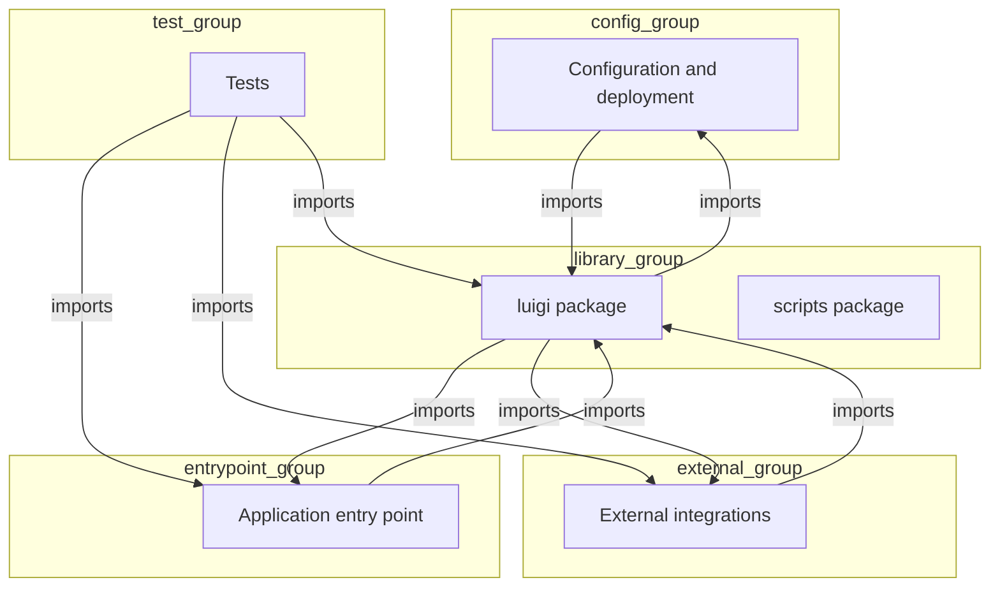

# Architecture report: spotify/luigi

> Automated static analysis. **Observed** = directly seen in files/imports/AST; **Inferred** = interpretation from that evidence. Repository code was not executed.

## 1. Repository at a glance

| Item | Value |
| --- | --- |
| Repository | spotify/luigi |
| Description | Luigi is a Python module that helps you build complex pipelines of batch jobs. It handles dependency resolution, workflow management, visualization etc. It also comes with Hadoop support built in. |
| Language | Python |
| Stars | 18788 |
| Licence | Apache-2.0 |
| Analysed commit / branch | f5feb7a4655ad73ef56f0ab04d7903ab43b63e12 / master |
| Framework(s) | None detected |
| Files analysed | 331 |
| Components | 6 |

## 2. Architecture in one minute

spotify/luigi - Luigi is a Python module that helps you build complex pipelines of batch jobs. It handles dependency resolution, workflow management, visualization etc. It also comes with Hadoop support built in.. This repository was analysed statically from 331 file(s) (259 Python). Detected technologies (observed from imports/manifests): GitHub Actions, MongoDB, MySQL, PostgreSQL, Redis, AWS (boto3). Files are grouped into 6 component(s): Configuration and deployment, Application entry point, External integrations, luigi package, scripts package, Tests. Observed entry point(s): luigi/__main__.py, luigi/cmdline.py, luigi/contrib/lsf_runner.py. Findings below distinguish observed facts from inferred interpretation.

## 3. High-level block diagram

## 4. Main components

### Configuration and deployment (`config`)

- **Kind:** config
- **Status:** Observed
- **Confidence:** 0.85
- **Responsibility:** Groups 5 file(s) under configuration and deployment (observed from repository paths and static analysis). Observed top-level classes: hadoopcli, hdfs. Observed top-level functions: get_configured_hadoop_version, get_configured_hdfs_client, load_hadoop_cmd, tmppath.
- **Paths:** `catalog-info.yaml`, `codecov.yml`, `luigi/contrib/hdfs/config.py`, `pyproject.toml`, `tox.ini`
- **Evidence:** [catalog-info.yaml](https://github.com/spotify/luigi/blob/f5feb7a4655ad73ef56f0ab04d7903ab43b63e12/catalog-info.yaml); [codecov.yml](https://github.com/spotify/luigi/blob/f5feb7a4655ad73ef56f0ab04d7903ab43b63e12/codecov.yml); [luigi/contrib/hdfs/config.py:32](https://github.com/spotify/luigi/blob/f5feb7a4655ad73ef56f0ab04d7903ab43b63e12/luigi/contrib/hdfs/config.py#L32); [pyproject.toml](https://github.com/spotify/luigi/blob/f5feb7a4655ad73ef56f0ab04d7903ab43b63e12/pyproject.toml); [tox.ini](https://github.com/spotify/luigi/blob/f5feb7a4655ad73ef56f0ab04d7903ab43b63e12/tox.ini)

### Application entry point (`entrypoint`)

- **Kind:** entrypoint
- **Status:** Observed
- **Confidence:** 0.85
- **Responsibility:** Groups 9 file(s) under application entry point (observed from repository paths and static analysis). Observed top-level classes: AbstractPySparkRunner, AllRunHandler, BaseTaskHistoryHandler, ByIdHandler, ByNameHandler, ByParamsHandler. Observed top-level functions: _do_work_on_compute_node, _extract_packages_archive, _get_runner_class, _init_api, _pyspark_runner_with, _use_spark_session.
- **Paths:** `luigi/__main__.py`, `luigi/contrib/lsf_runner.py`, `luigi/contrib/mrrunner.py`, `luigi/contrib/pyspark_runner.py`, `luigi/contrib/sge_runner.py`, `luigi/server.py`, `luigi/tools/deps.py`, `luigi/tools/deps_tree.py`, `luigi/tools/luigi_grep.py`
- **Evidence:** [luigi/__main__.py](https://github.com/spotify/luigi/blob/f5feb7a4655ad73ef56f0ab04d7903ab43b63e12/luigi/__main__.py); [luigi/contrib/lsf_runner.py:36](https://github.com/spotify/luigi/blob/f5feb7a4655ad73ef56f0ab04d7903ab43b63e12/luigi/contrib/lsf_runner.py#L36); [luigi/contrib/mrrunner.py:38](https://github.com/spotify/luigi/blob/f5feb7a4655ad73ef56f0ab04d7903ab43b63e12/luigi/contrib/mrrunner.py#L38); [luigi/contrib/pyspark_runner.py:41](https://github.com/spotify/luigi/blob/f5feb7a4655ad73ef56f0ab04d7903ab43b63e12/luigi/contrib/pyspark_runner.py#L41); [luigi/contrib/sge_runner.py:43](https://github.com/spotify/luigi/blob/f5feb7a4655ad73ef56f0ab04d7903ab43b63e12/luigi/contrib/sge_runner.py#L43); [luigi/server.py:58](https://github.com/spotify/luigi/blob/f5feb7a4655ad73ef56f0ab04d7903ab43b63e12/luigi/server.py#L58); [luigi/tools/deps.py:52](https://github.com/spotify/luigi/blob/f5feb7a4655ad73ef56f0ab04d7903ab43b63e12/luigi/tools/deps.py#L52); [luigi/tools/deps_tree.py:33](https://github.com/spotify/luigi/blob/f5feb7a4655ad73ef56f0ab04d7903ab43b63e12/luigi/tools/deps_tree.py#L33)

### External integrations (`external_integrations`)

- **Kind:** external
- **Status:** Observed
- **Confidence:** 0.85
- **Responsibility:** Groups 2 file(s) under external integrations (observed from repository paths and static analysis). Observed top-level classes: HdfsFileSystem, WebHdfsClient, webhdfs.
- **Paths:** `luigi/contrib/hdfs/abstract_client.py`, `luigi/contrib/hdfs/webhdfs_client.py`
- **Evidence:** [luigi/contrib/hdfs/abstract_client.py:27](https://github.com/spotify/luigi/blob/f5feb7a4655ad73ef56f0ab04d7903ab43b63e12/luigi/contrib/hdfs/abstract_client.py#L27); [luigi/contrib/hdfs/webhdfs_client.py:38](https://github.com/spotify/luigi/blob/f5feb7a4655ad73ef56f0ab04d7903ab43b63e12/luigi/contrib/hdfs/webhdfs_client.py#L38)

### luigi package (`luigi`)

- **Kind:** library
- **Status:** Observed
- **Confidence:** 0.85
- **Responsibility:** Groups 97 file(s) under luigi package (observed from repository paths and static analysis). Observed top-level classes: ApacheHiveCommandClient, AsyncCompletionException, AtomicAzureBlobFile, AtomicFtpFile, AtomicGCSFile, AtomicLocalFile. Observed top-level functions: _build_qsub_command, _check_parser, _constrain_glob, _create_one_line_summary, _depth_first_search, _email_disabled_reason.
- **Paths:** `luigi/__init__.py`, `luigi/__version__.py`, `luigi/batch_notifier.py`, `luigi/cmdline.py`, `luigi/cmdline_parser.py`, `luigi/configuration/__init__.py`, `luigi/configuration/base_parser.py`, `luigi/configuration/cfg_parser.py`, `luigi/configuration/core.py`, `luigi/configuration/toml_parser.py`, `luigi/contrib/__init__.py`, `luigi/contrib/azureblob.py`, `luigi/contrib/batch.py`, `luigi/contrib/beam_dataflow.py`, `luigi/contrib/bigquery.py`, `luigi/contrib/bigquery_avro.py`, `luigi/contrib/datadog_metric.py`, `luigi/contrib/dataproc.py`, `luigi/contrib/docker_runner.py`, `luigi/contrib/dropbox.py`, `luigi/contrib/ecs.py`, `luigi/contrib/esindex.py`, `luigi/contrib/external_daily_snapshot.py`, `luigi/contrib/external_program.py`, `luigi/contrib/ftp.py`, `luigi/contrib/gcp.py`, `luigi/contrib/gcs.py`, `luigi/contrib/hadoop.py`, `luigi/contrib/hadoop_jar.py`, `luigi/contrib/hdfs/__init__.py`, `luigi/contrib/hdfs/clients.py`, `luigi/contrib/hdfs/error.py`, `luigi/contrib/hdfs/format.py`, `luigi/contrib/hdfs/hadoopcli_clients.py`, `luigi/contrib/hdfs/target.py`, `luigi/contrib/hive.py`, `luigi/contrib/kubernetes.py`, `luigi/contrib/lsf.py`, `luigi/contrib/mongodb.py`, `luigi/contrib/mssqldb.py`, `luigi/contrib/mysqldb.py`, `luigi/contrib/opener.py`, `luigi/contrib/pai.py`, `luigi/contrib/pig.py`, `luigi/contrib/postgres.py`, `luigi/contrib/presto.py`, `luigi/contrib/prometheus_metric.py`, `luigi/contrib/rdbms.py`, `luigi/contrib/redis_store.py`, `luigi/contrib/redshift.py`, `luigi/contrib/s3.py`, `luigi/contrib/salesforce.py`, `luigi/contrib/scalding.py`, `luigi/contrib/sge.py`, `luigi/contrib/simulate.py`, `luigi/contrib/spark.py`, `luigi/contrib/sparkey.py`, `luigi/contrib/sqla.py`, `luigi/contrib/ssh.py`, `luigi/contrib/target.py`, `luigi/contrib/webhdfs.py`, `luigi/date_interval.py`, `luigi/db_task_history.py`, `luigi/event.py`, `luigi/execution_summary.py`, `luigi/format.py`, `luigi/freezing.py`, `luigi/interface.py`, `luigi/local_target.py`, `luigi/lock.py`, `luigi/metrics.py`, `luigi/mock.py`, `luigi/mypy.py`, `luigi/notifications.py`, `luigi/parameter.py`, `luigi/process.py`, `luigi/retcodes.py`, `luigi/rpc.py`, `luigi/safe_extractor.py`, `luigi/scheduler.py`, `luigi/setup_logging.py`, `luigi/static/visualiser/js/graph.js`, `luigi/static/visualiser/js/luigi.js`, `luigi/static/visualiser/js/tipsy.js`, `luigi/static/visualiser/js/util.js`, `luigi/static/visualiser/js/visualiserApp.js`, `luigi/static/visualiser/lib/URI/1.18.2/URI.js`, `luigi/static/visualiser/lib/mustache.js`, `luigi/target.py`, `luigi/task.py`, `luigi/task_history.py`, `luigi/task_register.py`, `luigi/task_status.py`, `luigi/tools/__init__.py`, `luigi/tools/range.py`, `luigi/util.py`, `luigi/worker.py`
- **Evidence:** [luigi/__init__.py](https://github.com/spotify/luigi/blob/f5feb7a4655ad73ef56f0ab04d7903ab43b63e12/luigi/__init__.py); [luigi/__version__.py](https://github.com/spotify/luigi/blob/f5feb7a4655ad73ef56f0ab04d7903ab43b63e12/luigi/__version__.py); [luigi/batch_notifier.py:16](https://github.com/spotify/luigi/blob/f5feb7a4655ad73ef56f0ab04d7903ab43b63e12/luigi/batch_notifier.py#L16); [luigi/cmdline.py:8](https://github.com/spotify/luigi/blob/f5feb7a4655ad73ef56f0ab04d7903ab43b63e12/luigi/cmdline.py#L8); [luigi/cmdline_parser.py:29](https://github.com/spotify/luigi/blob/f5feb7a4655ad73ef56f0ab04d7903ab43b63e12/luigi/cmdline_parser.py#L29); [luigi/configuration/__init__.py](https://github.com/spotify/luigi/blob/f5feb7a4655ad73ef56f0ab04d7903ab43b63e12/luigi/configuration/__init__.py); [luigi/configuration/base_parser.py:23](https://github.com/spotify/luigi/blob/f5feb7a4655ad73ef56f0ab04d7903ab43b63e12/luigi/configuration/base_parser.py#L23); [luigi/configuration/cfg_parser.py:40](https://github.com/spotify/luigi/blob/f5feb7a4655ad73ef56f0ab04d7903ab43b63e12/luigi/configuration/cfg_parser.py#L40)

### scripts package (`scripts`)

- **Kind:** library
- **Status:** Observed
- **Confidence:** 0.85
- **Responsibility:** Groups 4 file(s) under scripts package (observed from repository paths and static analysis).
- **Paths:** `scripts/ci/conditional_tox.sh`, `scripts/ci/install_start_azurite.sh`, `scripts/ci/setup_hadoop_env.sh`, `scripts/ci/stop_azurite.sh`
- **Evidence:** [scripts/ci/conditional_tox.sh](https://github.com/spotify/luigi/blob/f5feb7a4655ad73ef56f0ab04d7903ab43b63e12/scripts/ci/conditional_tox.sh); [scripts/ci/install_start_azurite.sh](https://github.com/spotify/luigi/blob/f5feb7a4655ad73ef56f0ab04d7903ab43b63e12/scripts/ci/install_start_azurite.sh); [scripts/ci/setup_hadoop_env.sh](https://github.com/spotify/luigi/blob/f5feb7a4655ad73ef56f0ab04d7903ab43b63e12/scripts/ci/setup_hadoop_env.sh); [scripts/ci/stop_azurite.sh](https://github.com/spotify/luigi/blob/f5feb7a4655ad73ef56f0ab04d7903ab43b63e12/scripts/ci/stop_azurite.sh)

### Tests (`tests`)

- **Kind:** test
- **Status:** Observed
- **Confidence:** 0.85
- **Responsibility:** Groups 149 file(s) under tests (observed from repository paths and static analysis). Observed routes: PATCH logging.getLogger, PATCH logging.getLogger, PATCH logging.getLogger, PATCH logging.getLogger, PATCH logging.getLogger. Observed top-level classes: A, ATaskThatFails, AXML, AbstractSubclassTest, AbstractTask, AmbiguousClass. Observed top-level functions: XMLWrapper, _cleanup, _create_test_database, _create_test_index, _get_fake_Popen, _is_running_from_main_thread.
- **Paths:** `luigi/static/visualiser/js/test/graph_test.js`, `test/_mysqldb_test.py`, `test/_test_ftp.py`, `test/auto_namespace_test/__init__.py`, `test/auto_namespace_test/my_namespace_test.py`, `test/batch_notifier_test.py`, `test/choice_parameter_test.py`, `test/clone_test.py`, `test/cmdline_test.py`, `test/config_env_test.py`, `test/config_toml_test.py`, `test/conftest.py`, `test/contrib/__init__.py`, `test/contrib/_webhdfs_test.py`, `test/contrib/azureblob_test.py`, `test/contrib/batch_test.py`, `test/contrib/beam_dataflow_test.py`, `test/contrib/bigquery_avro_test.py`, `test/contrib/bigquery_gcloud_test.py`, `test/contrib/bigquery_test.py`, `test/contrib/cascading_test.py`, `test/contrib/datadog_metric_test.py`, `test/contrib/dataproc_test.py`, `test/contrib/docker_runner_test.py`, `test/contrib/dropbox_test.py`, `test/contrib/ecs_test.py`, `test/contrib/esindex_test.py`, `test/contrib/external_daily_snapshot_test.py`, `test/contrib/external_program_test.py`, `test/contrib/gcs_test.py`, `test/contrib/hadoop_jar_test.py`, `test/contrib/hadoop_test.py`, `test/contrib/hdfs/webhdfs_client_test.py`, `test/contrib/hdfs_test.py`, `test/contrib/hive_test.py`, `test/contrib/kubernetes_test.py`, `test/contrib/lsf_test.py`, `test/contrib/mongo_test.py`, `test/contrib/mysqldb_test.py`, `test/contrib/opener_test.py`, `test/contrib/pai_test.py`, `test/contrib/pig_test.py`, `test/contrib/postgres_test.py`, `test/contrib/postgres_with_server_test.py`, `test/contrib/presto_test.py`, `test/contrib/prometheus_metric_test.py`, `test/contrib/rdbms_test.py`, `test/contrib/redis_test.py`, `test/contrib/redshift_test.py`, `test/contrib/s3_test.py`, `test/contrib/salesforce_test.py`, `test/contrib/scalding_test.py`, `test/contrib/sge_test.py`, `test/contrib/spark_test.py`, `test/contrib/sqla_test.py`, `test/contrib/streaming_test.py`, `test/contrib/test_ssh.py`, `test/create_packages_archive_root/module.py`, `test/create_packages_archive_root/package.egg-info/top_level.txt`, `test/create_packages_archive_root/package/__init__.py`, `test/create_packages_archive_root/package/submodule.py`, `test/create_packages_archive_root/package/submodule_with_absolute_import.py`, `test/create_packages_archive_root/package/submodule_without_imports.py`, `test/create_packages_archive_root/package/subpackage/__init__.py`, `test/create_packages_archive_root/package/subpackage/submodule.py`, `test/custom_metrics_test.py`, `test/customized_run_test.py`, `test/date_interval_test.py`, `test/date_parameter_test.py`, `test/db_task_history_test.py`, `test/decorator_test.py`, `test/dict_parameter_test.py`, `test/dynamic_import_test.py`, `test/event_callbacks_test.py`, `test/execution_summary_test.py`, `test/factorial_test.py`, `test/fib_test.py`, `test/hdfs_client_test.py`, `test/helpers.py`, `test/helpers_test.py`, `test/import_test.py`, `test/instance_test.py`, `test/instance_wrap_test.py`, `test/interface_test.py`, `test/list_parameter_test.py`, `test/local_target_test.py`, `test/lock_test.py`, `test/metrics_test.py`, `test/mock_test.py`, `test/most_common_test.py`, `test/mypy_test.py`, `test/notifications_test.py`, `test/numerical_parameter_test.py`, `test/optional_parameter_test.py`, `test/other_module.py`, `test/parameter_test.py`, `test/priority_test.py`, `test/range_test.py`, `test/recursion_test.py`, `test/remote_scheduler_test.py`, `test/retcodes_test.py`, `test/rpc_test.py`, `test/runtests.py`, `test/safe_extractor_test.py`, `test/scheduler_api_test.py`, `test/scheduler_message_test.py`, `test/scheduler_parameter_visibilities_test.py`, `test/scheduler_test.py`, `test/scheduler_visualisation_test.py`, `test/server_test.py`, `test/set_task_name_test.py`, `test/setup_logging_test.py`, `test/simulate_test.py`, `test/subtask_test.py`, `test/target_test.py`, `test/task_bulk_complete_test.py`, `test/task_forwarded_attributes_test.py`, `test/task_history_test.py`, `test/task_progress_percentage_test.py`, `test/task_register_test.py`, `test/task_running_resources_test.py`, `test/task_serialize_test.py`, `test/task_status_message_test.py`, `test/task_test.py`, `test/test_sigpipe.py`, `test/test_ssh.py`, `test/testconfig/core-site.xml`, `test/testconfig/log4j.properties`, `test/testconfig/logging.cfg`, `test/testconfig/luigi.cfg`, `test/testconfig/luigi.toml`, `test/testconfig/luigi_local.toml`, `test/testconfig/luigi_logging.toml`, `test/testconfig/pyproject.toml`, `test/util_previous_test.py`, `test/util_test.py`, `test/visible_parameters_test.py`, `test/visualiser/__init__.py`, `test/visualiser/phantomjs_test.js`, `test/visualiser/visualiser_test.py`, `test/worker_external_task_test.py`, `test/worker_keep_alive_test.py`, `test/worker_multiprocess_test.py`, `test/worker_parallel_scheduling_test.py`, `test/worker_scheduler_com_test.py`, `test/worker_task_process_test.py`, `test/worker_task_test.py`, `test/worker_test.py`, `test/wrap_test.py`
- **Evidence:** [luigi/static/visualiser/js/test/graph_test.js](https://github.com/spotify/luigi/blob/f5feb7a4655ad73ef56f0ab04d7903ab43b63e12/luigi/static/visualiser/js/test/graph_test.js); [test/_mysqldb_test.py:31](https://github.com/spotify/luigi/blob/f5feb7a4655ad73ef56f0ab04d7903ab43b63e12/test/_mysqldb_test.py#L31); [test/_test_ftp.py:46](https://github.com/spotify/luigi/blob/f5feb7a4655ad73ef56f0ab04d7903ab43b63e12/test/_test_ftp.py#L46); [test/auto_namespace_test/__init__.py](https://github.com/spotify/luigi/blob/f5feb7a4655ad73ef56f0ab04d7903ab43b63e12/test/auto_namespace_test/__init__.py); [test/auto_namespace_test/my_namespace_test.py:6](https://github.com/spotify/luigi/blob/f5feb7a4655ad73ef56f0ab04d7903ab43b63e12/test/auto_namespace_test/my_namespace_test.py#L6); [test/batch_notifier_test.py:16](https://github.com/spotify/luigi/blob/f5feb7a4655ad73ef56f0ab04d7903ab43b63e12/test/batch_notifier_test.py#L16); [test/choice_parameter_test.py:23](https://github.com/spotify/luigi/blob/f5feb7a4655ad73ef56f0ab04d7903ab43b63e12/test/choice_parameter_test.py#L23); [test/clone_test.py:26](https://github.com/spotify/luigi/blob/f5feb7a4655ad73ef56f0ab04d7903ab43b63e12/test/clone_test.py#L26)

## 5. Execution flow

**Observed** entry point(s):

- [luigi/__main__.py:19](https://github.com/spotify/luigi/blob/f5feb7a4655ad73ef56f0ab04d7903ab43b63e12/luigi/__main__.py#L19)
- [luigi/cmdline.py](https://github.com/spotify/luigi/blob/f5feb7a4655ad73ef56f0ab04d7903ab43b63e12/luigi/cmdline.py)
- [luigi/cmdline.py](https://github.com/spotify/luigi/blob/f5feb7a4655ad73ef56f0ab04d7903ab43b63e12/luigi/cmdline.py)
- [luigi/contrib/lsf_runner.py:79](https://github.com/spotify/luigi/blob/f5feb7a4655ad73ef56f0ab04d7903ab43b63e12/luigi/contrib/lsf_runner.py#L79)
- [luigi/contrib/mrrunner.py:95](https://github.com/spotify/luigi/blob/f5feb7a4655ad73ef56f0ab04d7903ab43b63e12/luigi/contrib/mrrunner.py#L95)
- [luigi/contrib/pyspark_runner.py:133](https://github.com/spotify/luigi/blob/f5feb7a4655ad73ef56f0ab04d7903ab43b63e12/luigi/contrib/pyspark_runner.py#L133)
- [luigi/contrib/sge_runner.py:93](https://github.com/spotify/luigi/blob/f5feb7a4655ad73ef56f0ab04d7903ab43b63e12/luigi/contrib/sge_runner.py#L93)
- [luigi/server.py:378](https://github.com/spotify/luigi/blob/f5feb7a4655ad73ef56f0ab04d7903ab43b63e12/luigi/server.py#L378)
- [luigi/tools/deps.py](https://github.com/spotify/luigi/blob/f5feb7a4655ad73ef56f0ab04d7903ab43b63e12/luigi/tools/deps.py)
- [luigi/tools/deps_tree.py](https://github.com/spotify/luigi/blob/f5feb7a4655ad73ef56f0ab04d7903ab43b63e12/luigi/tools/deps_tree.py)
- [luigi/tools/luigi_grep.py](https://github.com/spotify/luigi/blob/f5feb7a4655ad73ef56f0ab04d7903ab43b63e12/luigi/tools/luigi_grep.py)

**Observed** routes (from decorators):

- `PATCH logging.getLogger` -> `test_cmdline_main_task_cls` in `test/cmdline_test.py:124`
- `PATCH logging.getLogger` -> `test_cmdline_local_scheduler` in `test/cmdline_test.py:129`
- `PATCH logging.getLogger` -> `test_cmdline_other_task` in `test/cmdline_test.py:134`
- `PATCH logging.getLogger` -> `test_cmdline_ambiguous_class` in `test/cmdline_test.py:139`
- `PATCH logging.getLogger` -> `test_setup_interface_logging` in `test/cmdline_test.py:144`
- `PATCH logging.StreamHandler` -> `test_setup_interface_logging` in `test/cmdline_test.py:144`
- `PATCH argparse.ArgumentParser.print_usage` -> `test_non_existent_class` in `test/cmdline_test.py:167`
- `PATCH argparse.ArgumentParser.print_usage` -> `test_no_task` in `test/cmdline_test.py:171`
- `PATCH luigi.contrib.beam_dataflow.subprocess.Popen.wait` -> `test_dataflow_failed_run_callbacks` in `test/contrib/beam_dataflow_test.py:322`
- `PATCH luigi.contrib.beam_dataflow.os._exit` -> `test_dataflow_failed_run_callbacks` in `test/contrib/beam_dataflow_test.py:322`
- `PATCH luigi.contrib.bigquery.BigQueryClient.run_job` -> `test_configure_job` in `test/contrib/bigquery_test.py:36`
- `PATCH luigi.contrib.bigquery.BigQueryClient.run_job` -> `test_configure_job` in `test/contrib/bigquery_test.py:72`
- `PATCH luigi.contrib.bigquery.BigQueryClient.run_job` -> `test_configure_job` in `test/contrib/bigquery_test.py:111`
- `PATCH luigi.contrib.external_program.subprocess.Popen` -> `test_run` in `test/contrib/external_program_test.py:81`
- `PATCH luigi.contrib.external_program.logger` -> `test_handle_failed_job` in `test/contrib/external_program_test.py:91`
- `PATCH luigi.contrib.external_program.tempfile.TemporaryFile` -> `test_handle_failed_job` in `test/contrib/external_program_test.py:91`
- `PATCH luigi.contrib.external_program.subprocess.Popen` -> `test_handle_failed_job` in `test/contrib/external_program_test.py:91`
- `PATCH luigi.contrib.external_program.logger` -> `test_always_log_stderr_on_failure` in `test/contrib/external_program_test.py:107`
- `PATCH luigi.contrib.external_program.tempfile.TemporaryFile` -> `test_always_log_stderr_on_failure` in `test/contrib/external_program_test.py:107`
- `PATCH luigi.contrib.external_program.subprocess.Popen` -> `test_always_log_stderr_on_failure` in `test/contrib/external_program_test.py:107`
- `PATCH luigi.contrib.external_program.logger` -> `test_log_stderr_on_success_by_default` in `test/contrib/external_program_test.py:119`
- `PATCH luigi.contrib.external_program.tempfile.TemporaryFile` -> `test_log_stderr_on_success_by_default` in `test/contrib/external_program_test.py:119`
- `PATCH luigi.contrib.external_program.subprocess.Popen` -> `test_log_stderr_on_success_by_default` in `test/contrib/external_program_test.py:119`
- `PATCH luigi.contrib.external_program.logger` -> `test_dont_log_stderr_on_success_if_disabled` in `test/contrib/external_program_test.py:144`
- `PATCH luigi.contrib.external_program.tempfile.TemporaryFile` -> `test_dont_log_stderr_on_success_if_disabled` in `test/contrib/external_program_test.py:144`
- `PATCH luigi.contrib.external_program.subprocess.Popen` -> `test_dont_log_stderr_on_success_if_disabled` in `test/contrib/external_program_test.py:144`
- `PATCH luigi.contrib.external_program.subprocess.Popen` -> `test_program_args_must_be_implemented` in `test/contrib/external_program_test.py:153`
- `PATCH luigi.contrib.external_program.subprocess.Popen` -> `test_app_interruption` in `test/contrib/external_program_test.py:159`
- `PATCH luigi.contrib.external_program.subprocess.Popen` -> `test_original_environment_is_kept_intact` in `test/contrib/external_program_test.py:294`
- `PATCH luigi.contrib.external_program.subprocess.Popen` -> `test_venv_is_set_and_prepended_to_path` in `test/contrib/external_program_test.py:306`
- `PATCH luigi.contrib.external_program.subprocess.Popen` -> `test_pythonpath_is_set_if_empty` in `test/contrib/external_program_test.py:321`
- `PATCH luigi.contrib.external_program.subprocess.Popen` -> `test_pythonpath_is_prepended_if_not_empty` in `test/contrib/external_program_test.py:333`
- `PATCH luigi.contrib.hadoop.run_and_track_hadoop_job` -> `test_good` in `test/contrib/hadoop_jar_test.py:72`
- `PATCH luigi.contrib.hadoop.run_and_track_hadoop_job` -> `test_missing_jar` in `test/contrib/hadoop_jar_test.py:79`
- `PATCH luigi.contrib.hadoop.run_and_track_hadoop_job` -> `test_remote_job` in `test/contrib/hadoop_jar_test.py:85`
- `PATCH luigi.contrib.hadoop.run_and_track_hadoop_job` -> `test_remote_job_with_space_in_task_id` in `test/contrib/hadoop_jar_test.py:92`
- `PATCH luigi.contrib.hadoop.run_and_track_hadoop_job` -> `test_remote_job_missing_config` in `test/contrib/hadoop_jar_test.py:110`
- `PATCH tarfile.open` -> `test_create_packages_archive_module` in `test/contrib/hadoop_test.py:319`
- `PATCH tarfile.open` -> `test_create_packages_archive_package` in `test/contrib/hadoop_test.py:326`
- `PATCH tarfile.open` -> `test_create_packages_archive_package_submodule` in `test/contrib/hadoop_test.py:333`
- `PATCH tarfile.open` -> `test_create_packages_archive_package_submodule_with_absolute_import` in `test/contrib/hadoop_test.py:340`
- `PATCH tarfile.open` -> `test_create_packages_archive_package_submodule_without_imports` in `test/contrib/hadoop_test.py:347`
- `PATCH tarfile.open` -> `test_create_packages_archive_package_subpackage` in `test/contrib/hadoop_test.py:354`
- `PATCH tarfile.open` -> `test_create_packages_archive_package_subpackage_submodule` in `test/contrib/hadoop_test.py:361`
- `PATCH luigi.contrib.hive.run_hive_cmd` -> `test_default_table_location` in `test/contrib/hive_test.py:89`
- `PATCH luigi.contrib.hive.run_hive_cmd` -> `test_table_exists` in `test/contrib/hive_test.py:101`
- `PATCH luigi.contrib.hive.run_hive_cmd` -> `test_table_schema` in `test/contrib/hive_test.py:125`
- `PATCH luigi.contrib.hive.run_hive_cmd` -> `test_apacheclient_table_exists` in `test/contrib/hive_test.py:166`
- `PATCH luigi.contrib.hive.run_hive_cmd` -> `test_apacheclient_table_schema` in `test/contrib/hive_test.py:190`
- `PATCH luigi.contrib.hive.HiveThriftContext` -> `test_metastoreclient_partition_existence_regardless_of_order` in `test/contrib/hive_test.py:227`
- `PATCH luigi.configuration` -> `test_client_def` in `test/contrib/hive_test.py:250`
- `PATCH subprocess.Popen` -> `test_run_hive_command` in `test/contrib/hive_test.py:272`
- `PATCH luigi.configuration` -> `test_table_exists_without_partition_spec_files_actually_exist` in `test/contrib/hive_test.py:311`
- `PATCH luigi.configuration` -> `test_table_exists_only_tmp_files_exist` in `test/contrib/hive_test.py:334`
- `PATCH luigi.configuration` -> `test_table_exists_ambiguous_partition` in `test/contrib/hive_test.py:352`
- `PATCH luigi.contrib.hadoop.run_and_track_hadoop_job` -> `test_run` in `test/contrib/hive_test.py:385`
- `PATCH subprocess.Popen` -> `test_run_job` in `test/contrib/lsf_test.py:79`
- `PATCH subprocess.Popen.communicate` -> `test_run_job` in `test/contrib/lsf_test.py:79`
- `PATCH subprocess.Popen` -> `test_run_job_with_dump` in `test/contrib/lsf_test.py:88`
- `PATCH subprocess.Popen.communicate` -> `test_run_job_with_dump` in `test/contrib/lsf_test.py:88`
- `PATCH mysql.connector.connect` -> `test_bulk_complete` in `test/contrib/mysqldb_test.py:53`
- `PATCH luigi.contrib.mysqldb.CopyToTable.enable_metadata_columns` -> `test_copy_with_metadata_columns_enabled` in `test/contrib/mysqldb_test.py:86`
- `PATCH luigi.contrib.mysqldb.CopyToTable._add_metadata_columns` -> `test_copy_with_metadata_columns_enabled` in `test/contrib/mysqldb_test.py:86`
- `PATCH luigi.contrib.mysqldb.CopyToTable.post_copy_metacolumns` -> `test_copy_with_metadata_columns_enabled` in `test/contrib/mysqldb_test.py:86`
- `PATCH luigi.contrib.mysqldb.CopyToTable.rows` -> `test_copy_with_metadata_columns_enabled` in `test/contrib/mysqldb_test.py:86`
- `PATCH luigi.contrib.mysqldb.MySqlTarget` -> `test_copy_with_metadata_columns_enabled` in `test/contrib/mysqldb_test.py:86`
- `PATCH mysql.connector.connect` -> `test_copy_with_metadata_columns_enabled` in `test/contrib/mysqldb_test.py:86`
- `PATCH luigi.contrib.mysqldb.CopyToTable.enable_metadata_columns` -> `test_copy_with_metadata_columns_disabled` in `test/contrib/mysqldb_test.py:107`
- `PATCH luigi.contrib.mysqldb.CopyToTable._add_metadata_columns` -> `test_copy_with_metadata_columns_disabled` in `test/contrib/mysqldb_test.py:107`
- `PATCH luigi.contrib.mysqldb.CopyToTable.post_copy_metacolumns` -> `test_copy_with_metadata_columns_disabled` in `test/contrib/mysqldb_test.py:107`
- `PATCH luigi.contrib.mysqldb.CopyToTable.rows` -> `test_copy_with_metadata_columns_disabled` in `test/contrib/mysqldb_test.py:107`
- `PATCH luigi.contrib.mysqldb.MySqlTarget` -> `test_copy_with_metadata_columns_disabled` in `test/contrib/mysqldb_test.py:107`
- `PATCH mysql.connector.connect` -> `test_copy_with_metadata_columns_disabled` in `test/contrib/mysqldb_test.py:107`
- `PATCH luigi.local_target.LocalTarget.__init__` -> `test_local_tmp_target` in `test/contrib/opener_test.py:70`
- `PATCH luigi.local_target.LocalTarget.__del__` -> `test_local_tmp_target` in `test/contrib/opener_test.py:70`
- `PATCH luigi.contrib.s3.S3Target.__init__` -> `test_s3_parse` in `test/contrib/opener_test.py:80`
- `PATCH luigi.contrib.s3.S3Target.__init__` -> `test_s3_parse_param` in `test/contrib/opener_test.py:89`
- `PATCH subprocess.Popen` -> `test_run__success` in `test/contrib/pig_test.py:66`
- `PATCH subprocess.Popen` -> `test_run__fail` in `test/contrib/pig_test.py:78`
- `PATCH subprocess.Popen` -> `test_run__success` in `test/contrib/pig_test.py:104`
- `PATCH subprocess.Popen` -> `test_run__fail` in `test/contrib/pig_test.py:149`
- `PATCH psycopg2.connect` -> `test_bulk_complete` in `test/contrib/postgres_test.py:69`
- `PATCH psycopg2.connect` -> `test_bulk_complete` in `test/contrib/postgres_test.py:118`
- `PATCH luigi.contrib.postgres.CopyToTable.enable_metadata_columns` -> `test_copy_with_metadata_columns_enabled` in `test/contrib/postgres_test.py:153`
- `PATCH luigi.contrib.postgres.CopyToTable._add_metadata_columns` -> `test_copy_with_metadata_columns_enabled` in `test/contrib/postgres_test.py:153`
- `PATCH luigi.contrib.postgres.CopyToTable.post_copy_metacolumns` -> `test_copy_with_metadata_columns_enabled` in `test/contrib/postgres_test.py:153`
- `PATCH luigi.contrib.postgres.CopyToTable.rows` -> `test_copy_with_metadata_columns_enabled` in `test/contrib/postgres_test.py:153`
- `PATCH luigi.contrib.postgres.PostgresTarget` -> `test_copy_with_metadata_columns_enabled` in `test/contrib/postgres_test.py:153`
- `PATCH psycopg2.connect` -> `test_copy_with_metadata_columns_enabled` in `test/contrib/postgres_test.py:153`
- `PATCH luigi.contrib.postgres.CopyToTable.enable_metadata_columns` -> `test_copy_with_metadata_columns_disabled` in `test/contrib/postgres_test.py:174`
- `PATCH luigi.contrib.postgres.CopyToTable._add_metadata_columns` -> `test_copy_with_metadata_columns_disabled` in `test/contrib/postgres_test.py:174`
- `PATCH luigi.contrib.postgres.CopyToTable.post_copy_metacolumns` -> `test_copy_with_metadata_columns_disabled` in `test/contrib/postgres_test.py:174`
- `PATCH luigi.contrib.postgres.CopyToTable.rows` -> `test_copy_with_metadata_columns_disabled` in `test/contrib/postgres_test.py:174`
- `PATCH luigi.contrib.postgres.PostgresTarget` -> `test_copy_with_metadata_columns_disabled` in `test/contrib/postgres_test.py:174`
- `PATCH psycopg2.connect` -> `test_copy_with_metadata_columns_disabled` in `test/contrib/postgres_test.py:174`
- `PATCH luigi.contrib.presto.sleep` -> `test_watch` in `test/contrib/presto_test.py:45`
- `PATCH luigi.contrib.presto.sleep` -> `test_fetch` in `test/contrib/presto_test.py:68`
- `PATCH luigi.contrib.presto.sleep` -> `test_run` in `test/contrib/presto_test.py:169`
- `PATCH luigi.contrib.redshift.S3CopyToTable.enable_metadata_columns` -> `test_copy_check_meta_columns_to_table_if_exists` in `test/contrib/rdbms_test.py:74`
- `PATCH luigi.contrib.redshift.S3CopyToTable.metadata_columns` -> `test_copy_check_meta_columns_to_table_if_exists` in `test/contrib/rdbms_test.py:74`
- `PATCH luigi.contrib.redshift.RedshiftTarget` -> `test_copy_check_meta_columns_to_table_if_exists` in `test/contrib/rdbms_test.py:74`
- `PATCH luigi.contrib.redshift.S3CopyToTable.enable_metadata_columns` -> `test_copy_check_meta_columns_to_schematable_if_exists` in `test/contrib/rdbms_test.py:93`
- `PATCH luigi.contrib.redshift.S3CopyToTable.metadata_columns` -> `test_copy_check_meta_columns_to_schematable_if_exists` in `test/contrib/rdbms_test.py:93`
- `PATCH luigi.contrib.redshift.RedshiftTarget` -> `test_copy_check_meta_columns_to_schematable_if_exists` in `test/contrib/rdbms_test.py:93`
- `PATCH luigi.contrib.redshift.S3CopyToTable.enable_metadata_columns` -> `test_copy_not_add_if_meta_columns_already_exists` in `test/contrib/rdbms_test.py:116`
- `PATCH luigi.contrib.redshift.S3CopyToTable.metadata_columns` -> `test_copy_not_add_if_meta_columns_already_exists` in `test/contrib/rdbms_test.py:116`
- `PATCH luigi.contrib.redshift.S3CopyToTable._column_exists` -> `test_copy_not_add_if_meta_columns_already_exists` in `test/contrib/rdbms_test.py:116`
- `PATCH luigi.contrib.redshift.S3CopyToTable._add_column_to_table` -> `test_copy_not_add_if_meta_columns_already_exists` in `test/contrib/rdbms_test.py:116`
- `PATCH luigi.contrib.redshift.RedshiftTarget` -> `test_copy_not_add_if_meta_columns_already_exists` in `test/contrib/rdbms_test.py:116`
- `PATCH luigi.contrib.redshift.S3CopyToTable.enable_metadata_columns` -> `test_copy_add_if_meta_columns_not_already_exists` in `test/contrib/rdbms_test.py:129`
- `PATCH luigi.contrib.redshift.S3CopyToTable.metadata_columns` -> `test_copy_add_if_meta_columns_not_already_exists` in `test/contrib/rdbms_test.py:129`
- `PATCH luigi.contrib.redshift.S3CopyToTable._column_exists` -> `test_copy_add_if_meta_columns_not_already_exists` in `test/contrib/rdbms_test.py:129`
- `PATCH luigi.contrib.redshift.S3CopyToTable._add_column_to_table` -> `test_copy_add_if_meta_columns_not_already_exists` in `test/contrib/rdbms_test.py:129`
- `PATCH luigi.contrib.redshift.RedshiftTarget` -> `test_copy_add_if_meta_columns_not_already_exists` in `test/contrib/rdbms_test.py:129`
- `PATCH luigi.contrib.redshift.S3CopyToTable.enable_metadata_columns` -> `test_copy_add_regular_column` in `test/contrib/rdbms_test.py:141`
- `PATCH luigi.contrib.redshift.S3CopyToTable.metadata_columns` -> `test_copy_add_regular_column` in `test/contrib/rdbms_test.py:141`
- `PATCH luigi.contrib.redshift.S3CopyToTable._column_exists` -> `test_copy_add_regular_column` in `test/contrib/rdbms_test.py:141`
- `PATCH luigi.contrib.redshift.RedshiftTarget` -> `test_copy_add_regular_column` in `test/contrib/rdbms_test.py:141`
- `PATCH luigi.contrib.redshift.S3CopyToTable.enable_metadata_columns` -> `test_copy_add_encoded_column` in `test/contrib/rdbms_test.py:157`
- `PATCH luigi.contrib.redshift.S3CopyToTable.metadata_columns` -> `test_copy_add_encoded_column` in `test/contrib/rdbms_test.py:157`
- `PATCH luigi.contrib.redshift.S3CopyToTable._column_exists` -> `test_copy_add_encoded_column` in `test/contrib/rdbms_test.py:157`
- `PATCH luigi.contrib.redshift.RedshiftTarget` -> `test_copy_add_encoded_column` in `test/contrib/rdbms_test.py:157`
- `PATCH luigi.contrib.redshift.S3CopyToTable.enable_metadata_columns` -> `test_copy_raise_error_on_no_column_type` in `test/contrib/rdbms_test.py:175`
- `PATCH luigi.contrib.redshift.S3CopyToTable.metadata_columns` -> `test_copy_raise_error_on_no_column_type` in `test/contrib/rdbms_test.py:175`
- `PATCH luigi.contrib.redshift.S3CopyToTable._column_exists` -> `test_copy_raise_error_on_no_column_type` in `test/contrib/rdbms_test.py:175`
- `PATCH luigi.contrib.redshift.RedshiftTarget` -> `test_copy_raise_error_on_no_column_type` in `test/contrib/rdbms_test.py:175`
- `PATCH luigi.contrib.redshift.S3CopyToTable.enable_metadata_columns` -> `test_copy_raise_error_on_invalid_column` in `test/contrib/rdbms_test.py:187`
- `PATCH luigi.contrib.redshift.S3CopyToTable.metadata_columns` -> `test_copy_raise_error_on_invalid_column` in `test/contrib/rdbms_test.py:187`
- `PATCH luigi.contrib.redshift.S3CopyToTable._column_exists` -> `test_copy_raise_error_on_invalid_column` in `test/contrib/rdbms_test.py:187`
- `PATCH luigi.contrib.redshift.RedshiftTarget` -> `test_copy_raise_error_on_invalid_column` in `test/contrib/rdbms_test.py:187`
- `PATCH luigi.contrib.redshift.S3CopyToTable.enable_metadata_columns` -> `test_post_copy_metacolumns` in `test/contrib/rdbms_test.py:196`
- `PATCH luigi.contrib.redshift.S3CopyToTable.metadata_queries` -> `test_post_copy_metacolumns` in `test/contrib/rdbms_test.py:196`
- `PATCH luigi.contrib.redshift.RedshiftTarget` -> `test_post_copy_metacolumns` in `test/contrib/rdbms_test.py:196`
- `PATCH luigi.contrib.redshift.S3CopyToTable.enable_metadata_columns` -> `test_copy_with_metadata_columns_enabled` in `test/contrib/redshift_test.py:167`
- `PATCH luigi.contrib.redshift.S3CopyToTable._add_metadata_columns` -> `test_copy_with_metadata_columns_enabled` in `test/contrib/redshift_test.py:167`
- `PATCH luigi.contrib.redshift.S3CopyToTable.post_copy_metacolumns` -> `test_copy_with_metadata_columns_enabled` in `test/contrib/redshift_test.py:167`
- `PATCH luigi.contrib.redshift.RedshiftTarget` -> `test_copy_with_metadata_columns_enabled` in `test/contrib/redshift_test.py:167`
- `PATCH luigi.contrib.redshift.S3CopyToTable.enable_metadata_columns` -> `test_copy_with_metadata_columns_disabled` in `test/contrib/redshift_test.py:178`
- `PATCH luigi.contrib.redshift.S3CopyToTable._add_metadata_columns` -> `test_copy_with_metadata_columns_disabled` in `test/contrib/redshift_test.py:178`
- `PATCH luigi.contrib.redshift.S3CopyToTable.post_copy_metacolumns` -> `test_copy_with_metadata_columns_disabled` in `test/contrib/redshift_test.py:178`
- `PATCH luigi.contrib.redshift.RedshiftTarget` -> `test_copy_with_metadata_columns_disabled` in `test/contrib/redshift_test.py:178`
- `PATCH luigi.contrib.redshift.S3CopyToTable.enable_metadata_columns` -> `test_json_copy_with_metadata_columns_enabled` in `test/contrib/redshift_test.py:189`
- `PATCH luigi.contrib.redshift.S3CopyToTable._add_metadata_columns` -> `test_json_copy_with_metadata_columns_enabled` in `test/contrib/redshift_test.py:189`
- `PATCH luigi.contrib.redshift.S3CopyToTable.post_copy_metacolumns` -> `test_json_copy_with_metadata_columns_enabled` in `test/contrib/redshift_test.py:189`
- `PATCH luigi.contrib.redshift.RedshiftTarget` -> `test_json_copy_with_metadata_columns_enabled` in `test/contrib/redshift_test.py:189`
- `PATCH luigi.contrib.redshift.S3CopyToTable.enable_metadata_columns` -> `test_json_copy_with_metadata_columns_disabled` in `test/contrib/redshift_test.py:200`
- `PATCH luigi.contrib.redshift.S3CopyToTable._add_metadata_columns` -> `test_json_copy_with_metadata_columns_disabled` in `test/contrib/redshift_test.py:200`
- `PATCH luigi.contrib.redshift.S3CopyToTable.post_copy_metacolumns` -> `test_json_copy_with_metadata_columns_disabled` in `test/contrib/redshift_test.py:200`
- `PATCH luigi.contrib.redshift.RedshiftTarget` -> `test_json_copy_with_metadata_columns_disabled` in `test/contrib/redshift_test.py:200`
- `PATCH luigi.contrib.redshift.RedshiftTarget` -> `test_copy_missing_creds` in `test/contrib/redshift_test.py:211`
- `PATCH luigi.contrib.redshift.S3CopyToTable.copy` -> `test_s3_copy_to_table` in `test/contrib/redshift_test.py:231`
- `PATCH luigi.contrib.redshift.RedshiftTarget` -> `test_s3_copy_to_table` in `test/contrib/redshift_test.py:231`
- `PATCH luigi.contrib.redshift.S3CopyToTable.does_table_exist` -> `test_s3_copy_to_missing_table` in `test/contrib/redshift_test.py:258`
- `PATCH luigi.contrib.redshift.RedshiftTarget` -> `test_s3_copy_to_missing_table` in `test/contrib/redshift_test.py:258`
- `PATCH luigi.contrib.redshift.S3CopyToTable.does_schema_exist` -> `test_s3_copy_to_missing_schema` in `test/contrib/redshift_test.py:275`
- `PATCH luigi.contrib.redshift.RedshiftTarget` -> `test_s3_copy_to_missing_schema` in `test/contrib/redshift_test.py:275`
- `PATCH luigi.contrib.redshift.S3CopyToTable.does_schema_exist` -> `test_s3_copy_to_missing_schema_with_no_schema` in `test/contrib/redshift_test.py:285`
- `PATCH luigi.contrib.redshift.RedshiftTarget` -> `test_s3_copy_to_missing_schema_with_no_schema` in `test/contrib/redshift_test.py:285`
- `PATCH luigi.contrib.redshift.S3CopyToTable.does_schema_exist` -> `test_s3_copy_to_existing_schema_with_schema` in `test/contrib/redshift_test.py:295`
- `PATCH luigi.contrib.redshift.RedshiftTarget` -> `test_s3_copy_to_existing_schema_with_schema` in `test/contrib/redshift_test.py:295`
- `PATCH luigi.contrib.redshift.S3CopyToTable.does_table_exist` -> `test_s3_copy_to_missing_table_with_compression_encodings` in `test/contrib/redshift_test.py:305`
- `PATCH luigi.contrib.redshift.RedshiftTarget` -> `test_s3_copy_to_missing_table_with_compression_encodings` in `test/contrib/redshift_test.py:305`
- `PATCH luigi.contrib.redshift.S3CopyToTable.does_table_exist` -> `test_s3_copy_to_missing_table_with_table_constraints` in `test/contrib/redshift_test.py:324`
- `PATCH luigi.contrib.redshift.RedshiftTarget` -> `test_s3_copy_to_missing_table_with_table_constraints` in `test/contrib/redshift_test.py:324`
- `PATCH luigi.contrib.redshift.S3CopyToTable.copy` -> `test_s3_copy_to_temp_table` in `test/contrib/redshift_test.py:341`
- `PATCH luigi.contrib.redshift.RedshiftTarget` -> `test_s3_copy_to_temp_table` in `test/contrib/redshift_test.py:341`
- `PATCH luigi.contrib.redshift.RedshiftTarget` -> `test_s3_copy_with_valid_columns` in `test/contrib/redshift_test.py:373`
- `PATCH luigi.contrib.redshift.RedshiftTarget` -> `test_s3_copy_with_default_columns` in `test/contrib/redshift_test.py:409`
- `PATCH luigi.contrib.redshift.RedshiftTarget` -> `test_s3_copy_with_nonetype_columns` in `test/contrib/redshift_test.py:439`
- `PATCH luigi.contrib.redshift.S3CopyToTable.copy` -> `test_s3_copy_to_table` in `test/contrib/redshift_test.py:473`
- `PATCH luigi.contrib.redshift.RedshiftTarget` -> `test_s3_copy_to_table` in `test/contrib/redshift_test.py:473`
- `PATCH luigi.contrib.redshift.RedshiftTarget` -> `test_redshift_unload_command` in `test/contrib/redshift_test.py:514`
- `PATCH luigi.contrib.redshift.RedshiftTarget` -> `test_redshift_autocommit_query` in `test/contrib/redshift_test.py:548`
- `PATCH boto3.resource` -> `test_init_without_init_or_config` in `test/contrib/s3_test.py:167`
- `PATCH boto3.resource` -> `test_init_with_config` in `test/contrib/s3_test.py:178`
- `PATCH boto3.resource` -> `test_init_with_config_and_roles` in `test/contrib/s3_test.py:185`
- `PATCH boto3.client` -> `test_init_with_config_and_roles` in `test/contrib/s3_test.py:185`
- `PATCH boto3.client` -> `test_init_with_host_deprecated` in `test/contrib/s3_test.py:190`
- `PATCH requests.get` -> `test_deprecated_results_warning` in `test/contrib/salesforce_test.py:67`
- `PATCH requests.get` -> `test_result_ids` in `test/contrib/salesforce_test.py:74`
- `PATCH builtins.open` -> `setUp` in `test/contrib/salesforce_test.py:96`
- `PATCH builtins.open` -> `test_multi_csv_download` in `test/contrib/salesforce_test.py:112`
- `PATCH subprocess.check_call` -> `test_scalding` in `test/contrib/scalding_test.py:62`
- `PATCH luigi.contrib.hadoop.run_and_track_hadoop_job` -> `test_scalding` in `test/contrib/scalding_test.py:62`
- `PATCH subprocess.check_output` -> `test_run_job_with_dump` in `test/contrib/sge_test.py:89`
- `PATCH luigi.contrib.external_program.subprocess.Popen` -> `test_run` in `test/contrib/spark_test.py:121`
- `PATCH luigi.contrib.external_program.subprocess.Popen` -> `test_environment_is_set_correctly` in `test/contrib/spark_test.py:183`
- `PATCH luigi.contrib.external_program.subprocess.Popen` -> `test_defaults` in `test/contrib/spark_test.py:207`
- `PATCH luigi.contrib.external_program.logger` -> `test_handle_failed_job` in `test/contrib/spark_test.py:234`
- `PATCH luigi.contrib.external_program.tempfile.TemporaryFile` -> `test_handle_failed_job` in `test/contrib/spark_test.py:234`
- `PATCH luigi.contrib.external_program.subprocess.Popen` -> `test_handle_failed_job` in `test/contrib/spark_test.py:234`
- `PATCH luigi.contrib.external_program.logger` -> `test_dont_log_stderr_on_success` in `test/contrib/spark_test.py:250`
- `PATCH luigi.contrib.external_program.tempfile.TemporaryFile` -> `test_dont_log_stderr_on_success` in `test/contrib/spark_test.py:250`
- `PATCH luigi.contrib.external_program.subprocess.Popen` -> `test_dont_log_stderr_on_success` in `test/contrib/spark_test.py:250`
- `PATCH luigi.contrib.external_program.subprocess.Popen` -> `test_app_must_be_set` in `test/contrib/spark_test.py:259`
- `PATCH luigi.contrib.external_program.subprocess.Popen` -> `test_app_interruption` in `test/contrib/spark_test.py:265`
- `PATCH luigi.contrib.external_program.subprocess.Popen` -> `test_run` in `test/contrib/spark_test.py:319`
- `PATCH luigi.contrib.external_program.subprocess.Popen` -> `test_run_with_pickle_dump` in `test/contrib/spark_test.py:330`
- `PATCH luigi.contrib.external_program.subprocess.Popen` -> `test_run_with_cluster` in `test/contrib/spark_test.py:342`
- `PATCH pyspark.SparkContext` -> `test_pyspark_runner` in `test/contrib/spark_test.py:354`
- `PATCH luigi.contrib.external_program.subprocess.Popen` -> `test_name_cleanup` in `test/contrib/spark_test.py:430`
- `PATCH luigi.contrib.hadoop.shutil` -> `test_package_binary_run` in `test/contrib/streaming_test.py:41`
- `PATCH luigi.contrib.hadoop.run_and_track_hadoop_job` -> `test_package_binary_run` in `test/contrib/streaming_test.py:41`
- `PATCH luigi.contrib.hadoop.create_packages_archive` -> `test_standard_run` in `test/contrib/streaming_test.py:59`
- `PATCH luigi.contrib.hadoop.run_and_track_hadoop_job` -> `test_standard_run` in `test/contrib/streaming_test.py:59`
- `PATCH luigi.contrib.hadoop.create_packages_archive` -> `test_run_with_extra_arguments` in `test/contrib/streaming_test.py:73`
- `PATCH luigi.contrib.hadoop.run_and_track_hadoop_job` -> `test_run_with_extra_arguments` in `test/contrib/streaming_test.py:73`
- `PATCH ` -> `test_that_status_is_success` in `test/interface_test.py:101`
- `PATCH ` -> `test_that_status_is_success_with_retry` in `test/interface_test.py:108`
- `PATCH ` -> `test_that_status_is_failed_when_there_is_one_failed_task` in `test/interface_test.py:115`
- `PATCH ` -> `test_that_status_is_failed_with_scheduling_failure` in `test/interface_test.py:122`
- `PATCH ` -> `test_that_status_is_scheduling_failed_with_one_scheduling_error` in `test/interface_test.py:131`
- `PATCH ` -> `test_that_status_is_not_run_with_one_task_not_run` in `test/interface_test.py:138`
- `PATCH ` -> `test_that_status_is_missing_ext_with_one_task_with_missing_external_dependency` in `test/interface_test.py:145`
- `PATCH os.linesep` -> `test_format_newline` in `test/local_target_test.py:199`
- `PATCH os.kill` -> `test_take_lock_with_kill` in `test/lock_test.py:114`
- `PATCH os.kill` -> `test_take_lock_has_only_one_extra_life` in `test/lock_test.py:125`
- `PATCH luigi.lock.getpcmd` -> `test_take_lock_has_only_one_extra_life` in `test/lock_test.py:125`
- `PATCH luigi.lock.getpcmd` -> `test_cleans_old_pid_entries` in `test/lock_test.py:143`
- `PATCH luigi.notifications.send_error_email` -> `_run_task` in `test/notifications_test.py:139`
- `PATCH luigi.notifications.send_error_email` -> `_run_task_html` in `test/notifications_test.py:151`
- `PATCH luigi.parameter.warnings` -> `test_warn_on_default_none` in `test/parameter_test.py:389`
- `PATCH luigi.parameter.warnings` -> `test_no_warn_on_string` in `test/parameter_test.py:397`
- `PATCH luigi.parameter.warnings` -> `test_no_warn_on_string_in_optional` in `test/parameter_test.py:421`
- `PATCH luigi.parameter.warnings` -> `test_warn_on_bad_type_in_optional` in `test/parameter_test.py:429`
- `PATCH luigi.parameter.ParameterException` -> `testTimeDelta8601YearMonthNotSupported` in `test/parameter_test.py:903`
- `PATCH luigi.parameter.ParameterException` -> `testTimeDelta8601MBeforeT` in `test/parameter_test.py:917`
- `PATCH luigi.mock.MockFileSystem.listdir` -> `test_missing_tasks_correctly_required` in `test/range_test.py:1291`
- `PATCH luigi.mock.MockFileSystem.exists` -> `test_missing_tasks_correctly_required` in `test/range_test.py:1291`
- `PATCH luigi.mock.MockFileSystem.listdir` -> `test_missing_tasks_correctly_required` in `test/range_test.py:1314`
- `PATCH luigi.mock.MockFileSystem.exists` -> `test_missing_tasks_correctly_required` in `test/range_test.py:1314`
- `PATCH luigi.mock.MockFileSystem.listdir` -> `test_missing_wrapper_tasks_correctly_required` in `test/range_test.py:1327`
- `PATCH luigi.mock.MockFileSystem.exists` -> `test_missing_wrapper_tasks_correctly_required` in `test/range_test.py:1327`
- `PATCH luigi.mock.MockFileSystem.exists` -> `test_missing_directory` in `test/range_test.py:1396`
- `PATCH luigi.mock.MockFileSystem.listdir` -> `test_missing_tasks_correctly_required` in `test/range_test.py:1409`
- `PATCH luigi.mock.MockFileSystem.exists` -> `test_missing_tasks_correctly_required` in `test/range_test.py:1409`
- `PATCH luigi.mock.MockFileSystem.listdir` -> `test_missing_wrapper_tasks_correctly_required` in `test/range_test.py:1435`
- `PATCH luigi.mock.MockFileSystem.exists` -> `test_missing_wrapper_tasks_correctly_required` in `test/range_test.py:1435`
- `PATCH luigi.mock.MockFileSystem.exists` -> `test_missing_directory` in `test/range_test.py:1514`
- `PATCH luigi.rpc.logger` -> `test_log_rpc_retries_enabled` in `test/rpc_test.py:78`
- `PATCH luigi.rpc.logger` -> `test_log_rpc_retries_disabled` in `test/rpc_test.py:99`
- `PATCH luigi.scheduler.BatchNotifier` -> `test_batch_failure_emails` in `test/scheduler_api_test.py:1939`
- `PATCH luigi.scheduler.BatchNotifier` -> `test_send_batch_email_on_dump` in `test/scheduler_api_test.py:1952`
- `PATCH luigi.scheduler.BatchNotifier` -> `test_do_not_send_batch_email_on_dump_without_batch_enabled` in `test/scheduler_api_test.py:1960`
- `PATCH luigi.scheduler.BatchNotifier` -> `test_handle_bad_expl_in_failure_emails` in `test/scheduler_api_test.py:1967`
- `PATCH luigi.scheduler.BatchNotifier` -> `test_scheduling_failure` in `test/scheduler_api_test.py:1980`
- `PATCH luigi.scheduler.BatchNotifier` -> `test_scheduling_failure_without_batcher` in `test/scheduler_api_test.py:1986`
- `PATCH luigi.scheduler.BatchNotifier` -> `test_batch_failure_emails_with_task_batcher` in `test/scheduler_api_test.py:1992`
- `PATCH luigi.scheduler.BatchNotifier` -> `test_scheduling_failure_with_task_batcher` in `test/scheduler_api_test.py:2006`
- `PATCH luigi.scheduler.BatchNotifier` -> `test_batch_failure_email_with_owner` in `test/scheduler_api_test.py:2013`
- `PATCH luigi.scheduler.notifications` -> `test_batch_disable_emails` in `test/scheduler_api_test.py:2035`
- `PATCH luigi.scheduler.BatchNotifier` -> `test_batch_disable_emails` in `test/scheduler_api_test.py:2035`
- `PATCH luigi.scheduler.notifications` -> `test_batch_disable_email_with_owner` in `test/scheduler_api_test.py:2055`
- `PATCH luigi.scheduler.BatchNotifier` -> `test_batch_disable_email_with_owner` in `test/scheduler_api_test.py:2055`
- `PATCH luigi.scheduler.notifications` -> `test_batch_disable_emails_with_task_batcher` in `test/scheduler_api_test.py:2077`
- `PATCH luigi.scheduler.BatchNotifier` -> `test_batch_disable_emails_with_task_batcher` in `test/scheduler_api_test.py:2077`
- `PATCH luigi.scheduler.notifications` -> `test_send_normal_disable_email` in `test/scheduler_api_test.py:2097`
- `PATCH luigi.scheduler.BatchNotifier` -> `test_no_batch_notifier_without_batch_emails` in `test/scheduler_api_test.py:2104`
- `PATCH luigi.scheduler.BatchNotifier` -> `test_update_batcher_on_prune` in `test/scheduler_api_test.py:2109`
- `PATCH luigi.metrics.NoMetricsCollector` -> `test_collector_metrics_on_task_started` in `test/scheduler_api_test.py:2163`
- `PATCH luigi.metrics.NoMetricsCollector` -> `test_collector_metrics_on_task_disabled` in `test/scheduler_api_test.py:2174`
- `PATCH luigi.metrics.NoMetricsCollector` -> `test_collector_metrics_on_task_failed` in `test/scheduler_api_test.py:2184`
- `PATCH luigi.metrics.NoMetricsCollector` -> `test_collector_metrics_on_task_done` in `test/scheduler_api_test.py:2194`
- `PATCH luigi.notifications.send_error_email` -> `test_raise_exception_in_complete` in `test/worker_parallel_scheduling_test.py:164`
- `PATCH luigi.notifications.send_error_email` -> `test_raise_unpicklable_exception_in_complete` in `test/worker_parallel_scheduling_test.py:172`
- `PATCH luigi.notifications.send_error_email` -> `test_raise_exception_in_requires` in `test/worker_parallel_scheduling_test.py:189`
- `PATCH luigi.worker.time` -> `test_no_process_leak_from_repeatedly_running_same_task` in `test/worker_test.py:1639`
- `PATCH luigi.worker.time` -> `test_purge_hung_worker_default_timeout_time` in `test/worker_test.py:1666`
- `PATCH luigi.worker.time` -> `test_purge_hung_worker_override_timeout_time` in `test/worker_test.py:1683`
- `PATCH random.uniform` -> `test_wait_jitter` in `test/worker_test.py:1845`
- `PATCH time.sleep` -> `test_wait_jitter` in `test/worker_test.py:1845`
- `PATCH random.uniform` -> `test_wait_jitter_default` in `test/worker_test.py:1862`
- `PATCH time.sleep` -> `test_wait_jitter_default` in `test/worker_test.py:1862`
- `PATCH luigi.worker.ContextManagedTaskProcess` -> `test_process_killed_handler` in `test/worker_test.py:1912`
- `PATCH luigi.worker.time` -> `test_timeout_handler` in `test/worker_test.py:1932`
- `PATCH luigi.worker.time` -> `test_timeout_handler_single_worker` in `test/worker_test.py:1952`

Representative flow (derived from observed entry points and the import graph; steps beyond the entry point are **Inferred**):

1. Execution starts at an observed entry point listed above, if present.
2. `config` imports `luigi` (Configuration and deployment -> luigi package).
3. `entrypoint` imports `luigi` (Application entry point -> luigi package).
4. `external_integrations` imports `luigi` (External integrations -> luigi package).
5. `luigi` imports `config` (luigi package -> Configuration and deployment).
6. `luigi` imports `entrypoint` (luigi package -> Application entry point).
7. `luigi` imports `external_integrations` (luigi package -> External integrations).
8. `tests` imports `entrypoint` (Tests -> Application entry point).
9. `tests` imports `external_integrations` (Tests -> External integrations).

## 6. Project structure

### `(root)`

- `.coveragerc` - other (284 bytes)
- `.gitignore` - other (2347 bytes)
- `.readthedocs.yaml` - config (435 bytes)
- `CONTRIBUTING.rst` - docs (2231 bytes)
- `LICENSE` - docs (11345 bytes)
- `README.rst` - docs (12992 bytes)
- `RELEASE-PROCESS.rst` - docs (1147 bytes)
- `SECURITY.md` - docs (265 bytes)
- `catalog-info.yaml` - config (112 bytes)
- `codecov.yml` - config (1130 bytes)
- `pyproject.toml` - manifest (5119 bytes)
- `tox.ini` - config (4028 bytes)

### `.github`

- `.github/CODEOWNERS` - other (434 bytes)
- `.github/ISSUE_TEMPLATE.md` - docs (811 bytes)
- `.github/PULL_REQUEST_TEMPLATE.md` - docs (685 bytes)
- `.github/stale.yml` - config (800 bytes)
- `.github/workflows/codeql.yml` - ci, YAML (2525 bytes)
- `.github/workflows/pythonbuild.yml` - ci, YAML (6569 bytes)

### `bin`

- `bin/luigi` - other (264 bytes)
- `bin/luigid` - other (263 bytes)

### `doc`

- `doc/.gitignore` - other (26 bytes)
- `doc/Makefile` - other (6758 bytes)
- `doc/central_scheduler.rst` - docs (4141 bytes)
- `doc/conf.py` - source, Python (10317 bytes)
- `doc/configuration.rst` - docs (34930 bytes)
- `doc/design_and_limitations.rst` - docs (2230 bytes)
- `doc/example_top_artists.rst` - docs (11018 bytes)
- `doc/execution_model.rst` - docs (4282 bytes)
- `doc/index.rst` - docs (737 bytes)
- `doc/logging.rst` - docs (1626 bytes)
- `doc/luigi_patterns.rst` - docs (18117 bytes)
- `doc/mypy.rst` - docs (784 bytes)
- `doc/parameters.rst` - docs (5536 bytes)
- `doc/running_luigi.rst` - docs (4627 bytes)
- `doc/tasks.rst` - docs (12900 bytes)
- `doc/workflows.rst` - docs (3892 bytes)

### `examples`

- `examples/__init__.py` - source, Python (603 bytes)
- `examples/config.toml` - config (920 bytes)
- `examples/dynamic_requirements.py` - source, Python (3733 bytes)
- `examples/elasticsearch_index.py` - source, Python (3370 bytes)
- `examples/execution_summary_example.py` - source, Python (3319 bytes)
- `examples/foo.py` - source, Python (1463 bytes)
- `examples/foo_complex.py` - source, Python (1877 bytes)
- `examples/ftp_experiment_outputs.py` - source, Python (3239 bytes)
- `examples/hello_world.py` - source, Python (501 bytes)
- `examples/kubernetes.py` - source, Python (1924 bytes)
- `examples/per_task_retry_policy.py` - source, Python (5236 bytes)
- `examples/pyspark_wc.py` - source, Python (3360 bytes)
- `examples/spark_als.py` - source, Python (4363 bytes)
- `examples/ssh_remote_execution.py` - source, Python (2721 bytes)
- `examples/terasort.py` - source, Python (3267 bytes)
- `examples/top_artists.py` - source, Python (8851 bytes)
- `examples/top_artists_spark.py` - source, Python (623 bytes)
- `examples/wordcount.py` - source, Python (2905 bytes)
- `examples/wordcount_hadoop.py` - source, Python (2728 bytes)

### `luigi`

- `luigi/__init__.py` - source, Python (4070 bytes)
- `luigi/__main__.py` - source, Python (683 bytes)
- `luigi/__version__.py` - source, Python (35 bytes)
- `luigi/batch_notifier.py` - source, Python (8797 bytes)
- `luigi/cmdline.py` - source, Python (1370 bytes)
- `luigi/cmdline_parser.py` - source, Python (5159 bytes)
- `luigi/configuration/__init__.py` - source, Python (836 bytes)
- `luigi/configuration/base_parser.py` - source, Python (1305 bytes)
- `luigi/configuration/cfg_parser.py` - source, Python (8274 bytes)
- `luigi/configuration/core.py` - source, Python (2641 bytes)
- `luigi/configuration/toml_parser.py` - source, Python (2917 bytes)
- `luigi/contrib/__init__.py` - source, Python (661 bytes)
- `luigi/contrib/azureblob.py` - source, Python (13932 bytes)
- `luigi/contrib/batch.py` - source, Python (7790 bytes)
- `luigi/contrib/beam_dataflow.py` - source, Python (16331 bytes)
- `luigi/contrib/bigquery.py` - source, Python (29480 bytes)
- `luigi/contrib/bigquery_avro.py` - source, Python (4227 bytes)
- `luigi/contrib/datadog_metric.py` - source, Python (5430 bytes)
- `luigi/contrib/dataproc.py` - source, Python (9976 bytes)
- `luigi/contrib/docker_runner.py` - source, Python (8902 bytes)
- `luigi/contrib/dropbox.py` - source, Python (11571 bytes)
- `luigi/contrib/ecs.py` - source, Python (9535 bytes)
- `luigi/contrib/esindex.py` - source, Python (13676 bytes)
- `luigi/contrib/external_daily_snapshot.py` - source, Python (2380 bytes)
- `luigi/contrib/external_program.py` - source, Python (11159 bytes)
- `luigi/contrib/ftp.py` - source, Python (13140 bytes)
- `luigi/contrib/gcp.py` - source, Python (1410 bytes)
- `luigi/contrib/gcs.py` - source, Python (18557 bytes)
- `luigi/contrib/hadoop.py` - source, Python (37108 bytes)
- `luigi/contrib/hadoop_jar.py` - source, Python (5415 bytes)
- `luigi/contrib/hdfs/__init__.py` - source, Python (2900 bytes)
- `luigi/contrib/hdfs/abstract_client.py` - source, Python (2824 bytes)
- `luigi/contrib/hdfs/clients.py` - source, Python (1924 bytes)
- `luigi/contrib/hdfs/config.py` - source, Python (4005 bytes)
- `luigi/contrib/hdfs/error.py` - source, Python (1029 bytes)
- `luigi/contrib/hdfs/format.py` - source, Python (5975 bytes)
- `luigi/contrib/hdfs/hadoopcli_clients.py` - source, Python (9424 bytes)
- `luigi/contrib/hdfs/target.py` - source, Python (7196 bytes)
- `luigi/contrib/hdfs/webhdfs_client.py` - source, Python (6482 bytes)
- `luigi/contrib/hive.py` - source, Python (19129 bytes)
- `luigi/contrib/kubernetes.py` - source, Python (13674 bytes)
- `luigi/contrib/lsf.py` - source, Python (12008 bytes)
- `luigi/contrib/lsf_runner.py` - source, Python (2301 bytes)
- `luigi/contrib/mongodb.py` - source, Python (6400 bytes)
- `luigi/contrib/mrrunner.py` - source, Python (2806 bytes)
- `luigi/contrib/mssqldb.py` - source, Python (5295 bytes)
- `luigi/contrib/mysqldb.py` - source, Python (8325 bytes)
- `luigi/contrib/opener.py` - source, Python (7047 bytes)
- `luigi/contrib/pai.py` - source, Python (10923 bytes)
- `luigi/contrib/pig.py` - source, Python (6517 bytes)
- `luigi/contrib/postgres.py` - source, Python (15874 bytes)
- `luigi/contrib/presto.py` - source, Python (7620 bytes)
- `luigi/contrib/prometheus_metric.py` - source, Python (3039 bytes)
- `luigi/contrib/pyspark_runner.py` - source, Python (3841 bytes)
- `luigi/contrib/rdbms.py` - source, Python (11125 bytes)
- `luigi/contrib/redis_store.py` - source, Python (3014 bytes)
- `luigi/contrib/redshift.py` - source, Python (24400 bytes)
- `luigi/contrib/s3.py` - source, Python (27307 bytes)
- `luigi/contrib/salesforce.py` - source, Python (26833 bytes)
- `luigi/contrib/scalding.py` - source, Python (10409 bytes)
- `luigi/contrib/sge.py` - source, Python (13385 bytes)
- `luigi/contrib/sge_runner.py` - source, Python (2833 bytes)
- `luigi/contrib/simulate.py` - source, Python (3407 bytes)
- `luigi/contrib/spark.py` - source, Python (12273 bytes)
- `luigi/contrib/sparkey.py` - source, Python (1970 bytes)
- `luigi/contrib/sqla.py` - source, Python (16182 bytes)
- `luigi/contrib/ssh.py` - source, Python (12242 bytes)
- `luigi/contrib/target.py` - source, Python (2812 bytes)
- `luigi/contrib/webhdfs.py` - source, Python (3075 bytes)
- `luigi/date_interval.py` - source, Python (8608 bytes)
- `luigi/db_task_history.py` - source, Python (11525 bytes)
- `luigi/event.py` - source, Python (1757 bytes)
- `luigi/execution_summary.py` - source, Python (20201 bytes)
- `luigi/format.py` - source, Python (14437 bytes)
- `luigi/freezing.py` - source, Python (2138 bytes)
- `luigi/interface.py` - source, Python (8864 bytes)
- `luigi/local_target.py` - source, Python (6185 bytes)
- `luigi/lock.py` - source, Python (5366 bytes)
- `luigi/metrics.py` - source, Python (2582 bytes)
- `luigi/mock.py` - source, Python (5679 bytes)
- `luigi/mypy.py` - source, Python (20313 bytes)
- `luigi/notifications.py` - source, Python (14835 bytes)
- `luigi/parameter.py` - source, Python (61552 bytes)
- `luigi/process.py` - source, Python (3446 bytes)
- `luigi/py.typed` - other (0 bytes)
- `luigi/retcodes.py` - source, Python (4347 bytes)
- `luigi/rpc.py` - source, Python (6736 bytes)
- `luigi/safe_extractor.py` - source, Python (3567 bytes)
- `luigi/scheduler.py` - source, Python (65972 bytes)
- `luigi/server.py` - source, Python (14507 bytes)
- `luigi/setup_logging.py` - source, Python (5734 bytes)
- `luigi/static/visualiser/css/luigi.css` - other (3413 bytes)
- `luigi/static/visualiser/css/tipsy.css` - other (2162 bytes)
- `luigi/static/visualiser/fonts/glyphicons-halflings-regular.svg` - other (62927 bytes)
- `luigi/static/visualiser/index.html` - other (33256 bytes)
- `luigi/static/visualiser/js/graph.js` - source, JavaScript (12101 bytes)
- `luigi/static/visualiser/js/luigi.js` - source, JavaScript (8076 bytes)
- `luigi/static/visualiser/js/test/graph_test.js` - test, JavaScript (3969 bytes)
- `luigi/static/visualiser/js/tipsy.js` - source, JavaScript (11097 bytes)
- `luigi/static/visualiser/js/util.js` - source, JavaScript (189 bytes)
- `luigi/static/visualiser/js/visualiserApp.js` - source, JavaScript (58604 bytes)
- `luigi/static/visualiser/lib/URI/1.18.2/URI.js` - source, JavaScript (62788 bytes)
- `luigi/static/visualiser/lib/mustache.js` - source, JavaScript (14853 bytes)
- `luigi/static/visualiser/mockdata/dep_graph` - other (1097 bytes)
- `luigi/static/visualiser/mockdata/fetch_error` - other (400 bytes)
- `luigi/static/visualiser/mockdata/task_list` - other (1097 bytes)
- `luigi/static/visualiser/test.html` - other (510 bytes)
- `luigi/target.py` - source, Python (12753 bytes)
- `luigi/task.py` - source, Python (36723 bytes)
- `luigi/task_history.py` - source, Python (1989 bytes)
- `luigi/task_register.py` - source, Python (8071 bytes)
- `luigi/task_status.py` - source, Python (892 bytes)
- `luigi/templates/history.html` - other (4270 bytes)
- `luigi/templates/layout.html` - other (3033 bytes)
- `luigi/templates/menu.html` - other (553 bytes)
- `luigi/templates/recent.html` - other (730 bytes)
- `luigi/templates/show.html` - other (1282 bytes)
- `luigi/tools/__init__.py` - source, Python (751 bytes)
- `luigi/tools/deps.py` - source, Python (4689 bytes)
- `luigi/tools/deps_tree.py` - source, Python (2568 bytes)
- `luigi/tools/luigi_grep.py` - source, Python (2779 bytes)
- `luigi/tools/range.py` - source, Python (33551 bytes)
- `luigi/util.py` - source, Python (16371 bytes)
- `luigi/worker.py` - source, Python (51163 bytes)

### `scripts`

- `scripts/ci/conditional_tox.sh` - source, Shell (167 bytes)
- `scripts/ci/install_start_azurite.sh` - source, Shell (385 bytes)
- `scripts/ci/setup_hadoop_env.sh` - source, Shell (2460 bytes)
- `scripts/ci/stop_azurite.sh` - source, Shell (107 bytes)

### `test`

- `test/_mysqldb_test.py` - test, Python (1546 bytes)
- `test/_test_ftp.py` - test, Python (7293 bytes)
- `test/auto_namespace_test/__init__.py` - test, Python (51 bytes)
- `test/auto_namespace_test/my_namespace_test.py` - test, Python (368 bytes)
- `test/batch_notifier_test.py` - test, Python (19945 bytes)
- `test/choice_parameter_test.py` - test, Python (2252 bytes)
- `test/clone_test.py` - test, Python (2277 bytes)
- `test/cmdline_test.py` - test, Python (14445 bytes)
- `test/config_env_test.py` - test, Python (3725 bytes)
- `test/config_toml_test.py` - test, Python (3011 bytes)
- `test/conftest.py` - test, Python (1765 bytes)
- `test/contrib/__init__.py` - test, Python (0 bytes)
- `test/contrib/_webhdfs_test.py` - test, Python (2104 bytes)
- `test/contrib/azureblob_test.py` - test, Python (6413 bytes)
- `test/contrib/batch_test.py` - test, Python (4124 bytes)
- `test/contrib/beam_dataflow_test.py` - test, Python (12065 bytes)
- `test/contrib/bigquery_avro_test.py` - test, Python (1617 bytes)
- `test/contrib/bigquery_gcloud_test.py` - test, Python (20810 bytes)
- `test/contrib/bigquery_test.py` - test, Python (6164 bytes)
- `test/contrib/cascading_test.py` - test, Python (2770 bytes)
- `test/contrib/datadog_metric_test.py` - test, Python (5218 bytes)
- `test/contrib/dataproc_test.py` - test, Python (6362 bytes)
- `test/contrib/docker_runner_test.py` - test, Python (4707 bytes)
- `test/contrib/dropbox_test.py` - test, Python (16498 bytes)
- `test/contrib/ecs_test.py` - test, Python (6488 bytes)
- `test/contrib/esindex_test.py` - test, Python (11522 bytes)
- `test/contrib/external_daily_snapshot_test.py` - test, Python (2059 bytes)
- `test/contrib/external_program_test.py` - test, Python (12510 bytes)
- `test/contrib/gcs_test.py` - test, Python (11597 bytes)
- `test/contrib/hadoop_jar_test.py` - test, Python (3773 bytes)
- `test/contrib/hadoop_test.py` - test, Python (18197 bytes)
- `test/contrib/hdfs/webhdfs_client_test.py` - test, Python (1333 bytes)
- `test/contrib/hdfs_test.py` - test, Python (9498 bytes)
- `test/contrib/hive_test.py` - test, Python (19164 bytes)
- `test/contrib/kubernetes_test.py` - test, Python (3417 bytes)
- `test/contrib/lsf_test.py` - test, Python (3085 bytes)
- `test/contrib/mongo_test.py` - test, Python (9862 bytes)
- `test/contrib/mysqldb_test.py` - test, Python (4411 bytes)
- `test/contrib/opener_test.py` - test, Python (3807 bytes)
- `test/contrib/pai_test.py` - test, Python (3297 bytes)
- `test/contrib/pig_test.py` - test, Python (7586 bytes)
- `test/contrib/postgres_test.py` - test, Python (6702 bytes)
- `test/contrib/postgres_with_server_test.py` - test, Python (5422 bytes)
- `test/contrib/presto_test.py` - test, Python (6404 bytes)
- `test/contrib/prometheus_metric_test.py` - test, Python (3817 bytes)
- `test/contrib/rdbms_test.py` - test, Python (10214 bytes)
- `test/contrib/redis_test.py` - test, Python (2043 bytes)
- `test/contrib/redshift_test.py` - test, Python (24293 bytes)
- `test/contrib/s3_test.py` - test, Python (25981 bytes)
- `test/contrib/salesforce_test.py` - test, Python (3730 bytes)
- `test/contrib/scalding_test.py` - test, Python (2084 bytes)
- `test/contrib/sge_test.py` - test, Python (3428 bytes)
- `test/contrib/spark_test.py` - test, Python (16399 bytes)
- `test/contrib/sqla_test.py` - test, Python (14116 bytes)
- `test/contrib/streaming_test.py` - test, Python (3118 bytes)
- `test/contrib/test_ssh.py` - test, Python (8459 bytes)
- `test/create_packages_archive_root/module.py` - test, Python (603 bytes)
- `test/create_packages_archive_root/package.egg-info/top_level.txt` - test (8 bytes)
- `test/create_packages_archive_root/package/__init__.py` - test, Python (603 bytes)
- `test/create_packages_archive_root/package/submodule.py` - test, Python (622 bytes)
- `test/create_packages_archive_root/package/submodule_with_absolute_import.py` - test, Python (622 bytes)
- `test/create_packages_archive_root/package/submodule_without_imports.py` - test, Python (603 bytes)
- `test/create_packages_archive_root/package/subpackage/__init__.py` - test, Python (603 bytes)
- `test/create_packages_archive_root/package/subpackage/submodule.py` - test, Python (622 bytes)
- `test/custom_metrics_test.py` - test, Python (3638 bytes)
- `test/customized_run_test.py` - test, Python (3990 bytes)
- `test/date_interval_test.py` - test, Python (5444 bytes)
- `test/date_parameter_test.py` - test, Python (6916 bytes)
- `test/db_task_history_test.py` - test, Python (7367 bytes)
- `test/decorator_test.py` - test, Python (10651 bytes)
- `test/dict_parameter_test.py` - test, Python (5457 bytes)
- `test/dynamic_import_test.py` - test, Python (1178 bytes)
- `test/event_callbacks_test.py` - test, Python (10087 bytes)
- `test/execution_summary_test.py` - test, Python (37958 bytes)
- `test/factorial_test.py` - test, Python (1447 bytes)
- `test/fib_test.py` - test, Python (2260 bytes)
- `test/hdfs_client_test.py` - test, Python (858 bytes)
- `test/helpers.py` - test, Python (7540 bytes)
- `test/helpers_test.py` - test, Python (1686 bytes)
- `test/import_test.py` - test, Python (2325 bytes)
- `test/instance_test.py` - test, Python (2675 bytes)
- `test/instance_wrap_test.py` - test, Python (2989 bytes)
- `test/interface_test.py` - test, Python (9719 bytes)
- `test/list_parameter_test.py` - test, Python (4457 bytes)
- `test/local_target_test.py` - test, Python (11343 bytes)
- `test/lock_test.py` - test, Python (5676 bytes)
- `test/metrics_test.py` - test, Python (1322 bytes)
- `test/mock_test.py` - test, Python (3309 bytes)
- `test/most_common_test.py` - test, Python (1023 bytes)
- `test/mypy_test.py` - test, Python (7089 bytes)
- `test/notifications_test.py` - test, Python (33147 bytes)
- `test/numerical_parameter_test.py` - test, Python (4234 bytes)
- `test/optional_parameter_test.py` - test, Python (7729 bytes)
- `test/other_module.py` - test, Python (836 bytes)
- `test/parameter_test.py` - test, Python (53470 bytes)
- `test/priority_test.py` - test, Python (1591 bytes)
- `test/range_test.py` - test, Python (63740 bytes)
- `test/recursion_test.py` - test, Python (1547 bytes)
- `test/remote_scheduler_test.py` - test, Python (1430 bytes)
- `test/retcodes_test.py` - test, Python (6723 bytes)
- `test/rpc_test.py` - test, Python (7870 bytes)
- `test/runtests.py` - test, Python (900 bytes)
- `test/safe_extractor_test.py` - test, Python (4483 bytes)
- `test/scheduler_api_test.py` - test, Python (107064 bytes)
- `test/scheduler_message_test.py` - test, Python (3832 bytes)
- `test/scheduler_parameter_visibilities_test.py` - test, Python (4933 bytes)
- `test/scheduler_test.py` - test, Python (16722 bytes)
- `test/scheduler_visualisation_test.py` - test, Python (19875 bytes)
- `test/server_test.py` - test, Python (21523 bytes)
- `test/set_task_name_test.py` - test, Python (1215 bytes)
- `test/setup_logging_test.py` - test, Python (6255 bytes)
- `test/simulate_test.py` - test, Python (2971 bytes)
- `test/subtask_test.py` - test, Python (1449 bytes)
- `test/target_test.py` - test, Python (11076 bytes)
- `test/task_bulk_complete_test.py` - test, Python (2166 bytes)
- `test/task_forwarded_attributes_test.py` - test, Python (3029 bytes)
- `test/task_history_test.py` - test, Python (1624 bytes)
- `test/task_progress_percentage_test.py` - test, Python (1166 bytes)
- `test/task_register_test.py` - test, Python (1760 bytes)
- `test/task_running_resources_test.py` - test, Python (4478 bytes)
- `test/task_serialize_test.py` - test, Python (3965 bytes)
- `test/task_status_message_test.py` - test, Python (1223 bytes)
- `test/task_test.py` - test, Python (20114 bytes)
- `test/test_sigpipe.py` - test, Python (2858 bytes)
- `test/test_ssh.py` - test, Python (1712 bytes)
- `test/testconfig/core-site.xml` - test (216 bytes)
- `test/testconfig/log4j.properties` - test (292 bytes)
- `test/testconfig/logging.cfg` - test (304 bytes)
- `test/testconfig/luigi.cfg` - test (154 bytes)
- `test/testconfig/luigi.toml` - test (223 bytes)
- `test/testconfig/luigi_local.toml` - test (57 bytes)
- `test/testconfig/luigi_logging.toml` - test (351 bytes)
- `test/testconfig/pyproject.toml` - test (67 bytes)
- `test/util_previous_test.py` - test, Python (6493 bytes)
- `test/util_test.py` - test, Python (7287 bytes)
- `test/visible_parameters_test.py` - test, Python (3501 bytes)
- `test/visualiser/__init__.py` - test, Python (35 bytes)
- `test/visualiser/phantomjs_test.js` - test, JavaScript (7042 bytes)
- `test/visualiser/visualiser_test.py` - test, Python (14943 bytes)
- `test/worker_external_task_test.py` - test, Python (6493 bytes)
- `test/worker_keep_alive_test.py` - test, Python (4245 bytes)
- `test/worker_multiprocess_test.py` - test, Python (3589 bytes)
- `test/worker_parallel_scheduling_test.py` - test, Python (6615 bytes)
- `test/worker_scheduler_com_test.py` - test, Python (6893 bytes)
- `test/worker_task_process_test.py` - test, Python (2775 bytes)
- `test/worker_task_test.py` - test, Python (6351 bytes)
- `test/worker_test.py` - test, Python (76511 bytes)
- `test/wrap_test.py` - test, Python (2874 bytes)

## 7. Key dependencies and integrations

| Name | Category | Status | Confidence | Evidence |
| --- | --- | --- | --- | --- |
| GitHub Actions | ci | Observed | 0.90 | [.github/workflows/codeql.yml](https://github.com/spotify/luigi/blob/f5feb7a4655ad73ef56f0ab04d7903ab43b63e12/.github/workflows/codeql.yml); [.github/workflows/pythonbuild.yml](https://github.com/spotify/luigi/blob/f5feb7a4655ad73ef56f0ab04d7903ab43b63e12/.github/workflows/pythonbuild.yml) |
| MongoDB | database | Observed | 0.90 | [test/contrib/mongo_test.py:30](https://github.com/spotify/luigi/blob/f5feb7a4655ad73ef56f0ab04d7903ab43b63e12/test/contrib/mongo_test.py#L30) |
| MySQL | database | Observed | 0.95 | [luigi/contrib/mysqldb.py:26](https://github.com/spotify/luigi/blob/f5feb7a4655ad73ef56f0ab04d7903ab43b63e12/luigi/contrib/mysqldb.py#L26); [luigi/contrib/mysqldb.py:27](https://github.com/spotify/luigi/blob/f5feb7a4655ad73ef56f0ab04d7903ab43b63e12/luigi/contrib/mysqldb.py#L27); [test/_mysqldb_test.py:18](https://github.com/spotify/luigi/blob/f5feb7a4655ad73ef56f0ab04d7903ab43b63e12/test/_mysqldb_test.py#L18) |
| PostgreSQL | database | Observed | 0.95 | [luigi/contrib/postgres.py:43](https://github.com/spotify/luigi/blob/f5feb7a4655ad73ef56f0ab04d7903ab43b63e12/luigi/contrib/postgres.py#L43); [luigi/contrib/postgres.py:46](https://github.com/spotify/luigi/blob/f5feb7a4655ad73ef56f0ab04d7903ab43b63e12/luigi/contrib/postgres.py#L46); [luigi/contrib/postgres.py:61](https://github.com/spotify/luigi/blob/f5feb7a4655ad73ef56f0ab04d7903ab43b63e12/luigi/contrib/postgres.py#L61); [luigi/contrib/postgres.py:62](https://github.com/spotify/luigi/blob/f5feb7a4655ad73ef56f0ab04d7903ab43b63e12/luigi/contrib/postgres.py#L62) |
| Redis | database | Observed | 0.95 | [luigi/contrib/redis_store.py:27](https://github.com/spotify/luigi/blob/f5feb7a4655ad73ef56f0ab04d7903ab43b63e12/luigi/contrib/redis_store.py#L27); [test/contrib/redis_test.py:25](https://github.com/spotify/luigi/blob/f5feb7a4655ad73ef56f0ab04d7903ab43b63e12/test/contrib/redis_test.py#L25) |
| AWS (boto3) | library | Observed | 0.95 | [luigi/contrib/batch.py:73](https://github.com/spotify/luigi/blob/f5feb7a4655ad73ef56f0ab04d7903ab43b63e12/luigi/contrib/batch.py#L73); [luigi/contrib/ecs.py:62](https://github.com/spotify/luigi/blob/f5feb7a4655ad73ef56f0ab04d7903ab43b63e12/luigi/contrib/ecs.py#L62); [luigi/contrib/s3.py:44](https://github.com/spotify/luigi/blob/f5feb7a4655ad73ef56f0ab04d7903ab43b63e12/luigi/contrib/s3.py#L44); [luigi/contrib/s3.py:90](https://github.com/spotify/luigi/blob/f5feb7a4655ad73ef56f0ab04d7903ab43b63e12/luigi/contrib/s3.py#L90) |
| requests | library | Observed | 0.95 | [luigi/contrib/pai.py:44](https://github.com/spotify/luigi/blob/f5feb7a4655ad73ef56f0ab04d7903ab43b63e12/luigi/contrib/pai.py#L44); [luigi/contrib/pai.py:45](https://github.com/spotify/luigi/blob/f5feb7a4655ad73ef56f0ab04d7903ab43b63e12/luigi/contrib/pai.py#L45); [luigi/contrib/salesforce.py:34](https://github.com/spotify/luigi/blob/f5feb7a4655ad73ef56f0ab04d7903ab43b63e12/luigi/contrib/salesforce.py#L34); [luigi/rpc.py:47](https://github.com/spotify/luigi/blob/f5feb7a4655ad73ef56f0ab04d7903ab43b63e12/luigi/rpc.py#L47) |
| SQLAlchemy | library | Observed | 0.95 | [luigi/contrib/sqla.py:149](https://github.com/spotify/luigi/blob/f5feb7a4655ad73ef56f0ab04d7903ab43b63e12/luigi/contrib/sqla.py#L149); [luigi/db_task_history.py:42](https://github.com/spotify/luigi/blob/f5feb7a4655ad73ef56f0ab04d7903ab43b63e12/luigi/db_task_history.py#L42); [luigi/db_task_history.py:43](https://github.com/spotify/luigi/blob/f5feb7a4655ad73ef56f0ab04d7903ab43b63e12/luigi/db_task_history.py#L43); [luigi/db_task_history.py:44](https://github.com/spotify/luigi/blob/f5feb7a4655ad73ef56f0ab04d7903ab43b63e12/luigi/db_task_history.py#L44) |
| Poetry | packaging | Observed | 0.90 | [pyproject.toml](https://github.com/spotify/luigi/blob/f5feb7a4655ad73ef56f0ab04d7903ab43b63e12/pyproject.toml); [test/testconfig/pyproject.toml](https://github.com/spotify/luigi/blob/f5feb7a4655ad73ef56f0ab04d7903ab43b63e12/test/testconfig/pyproject.toml) |
| pytest | tooling | Observed | 0.95 | [test/conftest.py:5](https://github.com/spotify/luigi/blob/f5feb7a4655ad73ef56f0ab04d7903ab43b63e12/test/conftest.py#L5); [test/contrib/_webhdfs_test.py:20](https://github.com/spotify/luigi/blob/f5feb7a4655ad73ef56f0ab04d7903ab43b63e12/test/contrib/_webhdfs_test.py#L20); [test/contrib/azureblob_test.py:25](https://github.com/spotify/luigi/blob/f5feb7a4655ad73ef56f0ab04d7903ab43b63e12/test/contrib/azureblob_test.py#L25); [test/contrib/batch_test.py:18](https://github.com/spotify/luigi/blob/f5feb7a4655ad73ef56f0ab04d7903ab43b63e12/test/contrib/batch_test.py#L18) |
| unittest | tooling | Observed | 0.95 | [test/batch_notifier_test.py:2](https://github.com/spotify/luigi/blob/f5feb7a4655ad73ef56f0ab04d7903ab43b63e12/test/batch_notifier_test.py#L2); [test/contrib/azureblob_test.py:23](https://github.com/spotify/luigi/blob/f5feb7a4655ad73ef56f0ab04d7903ab43b63e12/test/contrib/azureblob_test.py#L23); [test/contrib/beam_dataflow_test.py:19](https://github.com/spotify/luigi/blob/f5feb7a4655ad73ef56f0ab04d7903ab43b63e12/test/contrib/beam_dataflow_test.py#L19); [test/contrib/bigquery_avro_test.py:22](https://github.com/spotify/luigi/blob/f5feb7a4655ad73ef56f0ab04d7903ab43b63e12/test/contrib/bigquery_avro_test.py#L22) |

## 8. Data and state

- **MongoDB** (Observed, confidence 0.90) - evidence: [test/contrib/mongo_test.py:30](https://github.com/spotify/luigi/blob/f5feb7a4655ad73ef56f0ab04d7903ab43b63e12/test/contrib/mongo_test.py#L30)
- **MySQL** (Observed, confidence 0.95) - evidence: [luigi/contrib/mysqldb.py:26](https://github.com/spotify/luigi/blob/f5feb7a4655ad73ef56f0ab04d7903ab43b63e12/luigi/contrib/mysqldb.py#L26); [luigi/contrib/mysqldb.py:27](https://github.com/spotify/luigi/blob/f5feb7a4655ad73ef56f0ab04d7903ab43b63e12/luigi/contrib/mysqldb.py#L27); [test/_mysqldb_test.py:18](https://github.com/spotify/luigi/blob/f5feb7a4655ad73ef56f0ab04d7903ab43b63e12/test/_mysqldb_test.py#L18)
- **PostgreSQL** (Observed, confidence 0.95) - evidence: [luigi/contrib/postgres.py:43](https://github.com/spotify/luigi/blob/f5feb7a4655ad73ef56f0ab04d7903ab43b63e12/luigi/contrib/postgres.py#L43); [luigi/contrib/postgres.py:46](https://github.com/spotify/luigi/blob/f5feb7a4655ad73ef56f0ab04d7903ab43b63e12/luigi/contrib/postgres.py#L46); [luigi/contrib/postgres.py:61](https://github.com/spotify/luigi/blob/f5feb7a4655ad73ef56f0ab04d7903ab43b63e12/luigi/contrib/postgres.py#L61); [luigi/contrib/postgres.py:62](https://github.com/spotify/luigi/blob/f5feb7a4655ad73ef56f0ab04d7903ab43b63e12/luigi/contrib/postgres.py#L62)
- **Redis** (Observed, confidence 0.95) - evidence: [luigi/contrib/redis_store.py:27](https://github.com/spotify/luigi/blob/f5feb7a4655ad73ef56f0ab04d7903ab43b63e12/luigi/contrib/redis_store.py#L27); [test/contrib/redis_test.py:25](https://github.com/spotify/luigi/blob/f5feb7a4655ad73ef56f0ab04d7903ab43b63e12/test/contrib/redis_test.py#L25)

## 9. Configuration and deployment clues

- `.github/stale.yml` (config)
- `.github/workflows/codeql.yml` (ci)
- `.github/workflows/pythonbuild.yml` (ci)
- `.readthedocs.yaml` (config)
- `catalog-info.yaml` (config)
- `codecov.yml` (config)
- `examples/config.toml` (config)
- `pyproject.toml` (manifest)
- `tox.ini` (config)

Console scripts declared in packaging metadata (**Observed**):

- `luigi` -> `luigi.cmdline:luigi_run`
- `luigi-deps` -> `luigi.tools.deps:main`
- `luigi-deps-tree` -> `luigi.tools.deps_tree:main`
- `luigi-grep` -> `luigi.tools.luigi_grep:main`
- `luigid` -> `luigi.cmdline:luigid`

## 10. Design observations

- An entry/API layer is separated from other code (Inferred from paths and decorators).
- Tests are present alongside source code (Observed from test file paths).
- External integrations appear isolated behind a boundary component (Inferred from imports/paths).

These observations are interpretations (**Inferred**) of the observed structure, not guarantees about runtime design.

## 11. Limitations and unknowns

- Static analysis only: repository code was not executed, installed, or imported at runtime.
- Components and relationships are inferred from file paths, imports, and AST structure; runtime behaviour, dynamic imports, and reflection may not be visible.
- 9 file(s) were skipped during inventory (9 x generated/minified file excluded).
- Repository text was treated as untrusted data; no instructions found in repository files were followed, and likely secret values were redacted/excluded.

## 12. Source references

- [.github/workflows/codeql.yml](https://github.com/spotify/luigi/blob/f5feb7a4655ad73ef56f0ab04d7903ab43b63e12/.github/workflows/codeql.yml)
- [.github/workflows/pythonbuild.yml](https://github.com/spotify/luigi/blob/f5feb7a4655ad73ef56f0ab04d7903ab43b63e12/.github/workflows/pythonbuild.yml)
- [catalog-info.yaml](https://github.com/spotify/luigi/blob/f5feb7a4655ad73ef56f0ab04d7903ab43b63e12/catalog-info.yaml)
- [codecov.yml](https://github.com/spotify/luigi/blob/f5feb7a4655ad73ef56f0ab04d7903ab43b63e12/codecov.yml)
- [luigi/__init__.py](https://github.com/spotify/luigi/blob/f5feb7a4655ad73ef56f0ab04d7903ab43b63e12/luigi/__init__.py)
- [luigi/__main__.py](https://github.com/spotify/luigi/blob/f5feb7a4655ad73ef56f0ab04d7903ab43b63e12/luigi/__main__.py)
- [luigi/__main__.py:19](https://github.com/spotify/luigi/blob/f5feb7a4655ad73ef56f0ab04d7903ab43b63e12/luigi/__main__.py#L19)
- [luigi/__version__.py](https://github.com/spotify/luigi/blob/f5feb7a4655ad73ef56f0ab04d7903ab43b63e12/luigi/__version__.py)
- [luigi/batch_notifier.py:16](https://github.com/spotify/luigi/blob/f5feb7a4655ad73ef56f0ab04d7903ab43b63e12/luigi/batch_notifier.py#L16)
- [luigi/cmdline.py](https://github.com/spotify/luigi/blob/f5feb7a4655ad73ef56f0ab04d7903ab43b63e12/luigi/cmdline.py)
- [luigi/cmdline.py:8](https://github.com/spotify/luigi/blob/f5feb7a4655ad73ef56f0ab04d7903ab43b63e12/luigi/cmdline.py#L8)
- [luigi/cmdline_parser.py:29](https://github.com/spotify/luigi/blob/f5feb7a4655ad73ef56f0ab04d7903ab43b63e12/luigi/cmdline_parser.py#L29)
- [luigi/configuration/__init__.py](https://github.com/spotify/luigi/blob/f5feb7a4655ad73ef56f0ab04d7903ab43b63e12/luigi/configuration/__init__.py)
- [luigi/configuration/base_parser.py:23](https://github.com/spotify/luigi/blob/f5feb7a4655ad73ef56f0ab04d7903ab43b63e12/luigi/configuration/base_parser.py#L23)
- [luigi/configuration/cfg_parser.py:40](https://github.com/spotify/luigi/blob/f5feb7a4655ad73ef56f0ab04d7903ab43b63e12/luigi/configuration/cfg_parser.py#L40)
- [luigi/contrib/batch.py:73](https://github.com/spotify/luigi/blob/f5feb7a4655ad73ef56f0ab04d7903ab43b63e12/luigi/contrib/batch.py#L73)
- [luigi/contrib/ecs.py:62](https://github.com/spotify/luigi/blob/f5feb7a4655ad73ef56f0ab04d7903ab43b63e12/luigi/contrib/ecs.py#L62)
- [luigi/contrib/hdfs/abstract_client.py:27](https://github.com/spotify/luigi/blob/f5feb7a4655ad73ef56f0ab04d7903ab43b63e12/luigi/contrib/hdfs/abstract_client.py#L27)
- [luigi/contrib/hdfs/config.py:32](https://github.com/spotify/luigi/blob/f5feb7a4655ad73ef56f0ab04d7903ab43b63e12/luigi/contrib/hdfs/config.py#L32)
- [luigi/contrib/hdfs/webhdfs_client.py:38](https://github.com/spotify/luigi/blob/f5feb7a4655ad73ef56f0ab04d7903ab43b63e12/luigi/contrib/hdfs/webhdfs_client.py#L38)
- [luigi/contrib/lsf_runner.py:36](https://github.com/spotify/luigi/blob/f5feb7a4655ad73ef56f0ab04d7903ab43b63e12/luigi/contrib/lsf_runner.py#L36)
- [luigi/contrib/lsf_runner.py:79](https://github.com/spotify/luigi/blob/f5feb7a4655ad73ef56f0ab04d7903ab43b63e12/luigi/contrib/lsf_runner.py#L79)
- [luigi/contrib/mrrunner.py:38](https://github.com/spotify/luigi/blob/f5feb7a4655ad73ef56f0ab04d7903ab43b63e12/luigi/contrib/mrrunner.py#L38)
- [luigi/contrib/mrrunner.py:95](https://github.com/spotify/luigi/blob/f5feb7a4655ad73ef56f0ab04d7903ab43b63e12/luigi/contrib/mrrunner.py#L95)
- [luigi/contrib/mysqldb.py:26](https://github.com/spotify/luigi/blob/f5feb7a4655ad73ef56f0ab04d7903ab43b63e12/luigi/contrib/mysqldb.py#L26)
- [luigi/contrib/mysqldb.py:27](https://github.com/spotify/luigi/blob/f5feb7a4655ad73ef56f0ab04d7903ab43b63e12/luigi/contrib/mysqldb.py#L27)
- [luigi/contrib/pai.py:44](https://github.com/spotify/luigi/blob/f5feb7a4655ad73ef56f0ab04d7903ab43b63e12/luigi/contrib/pai.py#L44)
- [luigi/contrib/pai.py:45](https://github.com/spotify/luigi/blob/f5feb7a4655ad73ef56f0ab04d7903ab43b63e12/luigi/contrib/pai.py#L45)
- [luigi/contrib/postgres.py:43](https://github.com/spotify/luigi/blob/f5feb7a4655ad73ef56f0ab04d7903ab43b63e12/luigi/contrib/postgres.py#L43)
- [luigi/contrib/postgres.py:46](https://github.com/spotify/luigi/blob/f5feb7a4655ad73ef56f0ab04d7903ab43b63e12/luigi/contrib/postgres.py#L46)
- [luigi/contrib/postgres.py:61](https://github.com/spotify/luigi/blob/f5feb7a4655ad73ef56f0ab04d7903ab43b63e12/luigi/contrib/postgres.py#L61)
- [luigi/contrib/postgres.py:62](https://github.com/spotify/luigi/blob/f5feb7a4655ad73ef56f0ab04d7903ab43b63e12/luigi/contrib/postgres.py#L62)
- [luigi/contrib/pyspark_runner.py:41](https://github.com/spotify/luigi/blob/f5feb7a4655ad73ef56f0ab04d7903ab43b63e12/luigi/contrib/pyspark_runner.py#L41)
- [luigi/contrib/pyspark_runner.py:133](https://github.com/spotify/luigi/blob/f5feb7a4655ad73ef56f0ab04d7903ab43b63e12/luigi/contrib/pyspark_runner.py#L133)
- [luigi/contrib/redis_store.py:27](https://github.com/spotify/luigi/blob/f5feb7a4655ad73ef56f0ab04d7903ab43b63e12/luigi/contrib/redis_store.py#L27)
- [luigi/contrib/redshift.py:32](https://github.com/spotify/luigi/blob/f5feb7a4655ad73ef56f0ab04d7903ab43b63e12/luigi/contrib/redshift.py#L32)
- [luigi/contrib/redshift.py:33](https://github.com/spotify/luigi/blob/f5feb7a4655ad73ef56f0ab04d7903ab43b63e12/luigi/contrib/redshift.py#L33)
- [luigi/contrib/s3.py:44](https://github.com/spotify/luigi/blob/f5feb7a4655ad73ef56f0ab04d7903ab43b63e12/luigi/contrib/s3.py#L44)
- [luigi/contrib/s3.py:90](https://github.com/spotify/luigi/blob/f5feb7a4655ad73ef56f0ab04d7903ab43b63e12/luigi/contrib/s3.py#L90)
- [luigi/contrib/s3.py:258](https://github.com/spotify/luigi/blob/f5feb7a4655ad73ef56f0ab04d7903ab43b63e12/luigi/contrib/s3.py#L258)
- [luigi/contrib/salesforce.py:34](https://github.com/spotify/luigi/blob/f5feb7a4655ad73ef56f0ab04d7903ab43b63e12/luigi/contrib/salesforce.py#L34)
- [luigi/contrib/sge_runner.py:43](https://github.com/spotify/luigi/blob/f5feb7a4655ad73ef56f0ab04d7903ab43b63e12/luigi/contrib/sge_runner.py#L43)
- [luigi/contrib/sge_runner.py:93](https://github.com/spotify/luigi/blob/f5feb7a4655ad73ef56f0ab04d7903ab43b63e12/luigi/contrib/sge_runner.py#L93)
- [luigi/contrib/sqla.py:149](https://github.com/spotify/luigi/blob/f5feb7a4655ad73ef56f0ab04d7903ab43b63e12/luigi/contrib/sqla.py#L149)
- [luigi/db_task_history.py:42](https://github.com/spotify/luigi/blob/f5feb7a4655ad73ef56f0ab04d7903ab43b63e12/luigi/db_task_history.py#L42)
- [luigi/db_task_history.py:43](https://github.com/spotify/luigi/blob/f5feb7a4655ad73ef56f0ab04d7903ab43b63e12/luigi/db_task_history.py#L43)
- [luigi/db_task_history.py:44](https://github.com/spotify/luigi/blob/f5feb7a4655ad73ef56f0ab04d7903ab43b63e12/luigi/db_task_history.py#L44)
- [luigi/db_task_history.py:45](https://github.com/spotify/luigi/blob/f5feb7a4655ad73ef56f0ab04d7903ab43b63e12/luigi/db_task_history.py#L45)
- [luigi/db_task_history.py:46](https://github.com/spotify/luigi/blob/f5feb7a4655ad73ef56f0ab04d7903ab43b63e12/luigi/db_task_history.py#L46)
- [luigi/db_task_history.py:47](https://github.com/spotify/luigi/blob/f5feb7a4655ad73ef56f0ab04d7903ab43b63e12/luigi/db_task_history.py#L47)
- [luigi/notifications.py:213](https://github.com/spotify/luigi/blob/f5feb7a4655ad73ef56f0ab04d7903ab43b63e12/luigi/notifications.py#L213)
- [luigi/notifications.py:271](https://github.com/spotify/luigi/blob/f5feb7a4655ad73ef56f0ab04d7903ab43b63e12/luigi/notifications.py#L271)
- [luigi/rpc.py:47](https://github.com/spotify/luigi/blob/f5feb7a4655ad73ef56f0ab04d7903ab43b63e12/luigi/rpc.py#L47)
- [luigi/rpc.py:115](https://github.com/spotify/luigi/blob/f5feb7a4655ad73ef56f0ab04d7903ab43b63e12/luigi/rpc.py#L115)
- [luigi/server.py:58](https://github.com/spotify/luigi/blob/f5feb7a4655ad73ef56f0ab04d7903ab43b63e12/luigi/server.py#L58)
- [luigi/server.py:378](https://github.com/spotify/luigi/blob/f5feb7a4655ad73ef56f0ab04d7903ab43b63e12/luigi/server.py#L378)
- [luigi/static/visualiser/js/test/graph_test.js](https://github.com/spotify/luigi/blob/f5feb7a4655ad73ef56f0ab04d7903ab43b63e12/luigi/static/visualiser/js/test/graph_test.js)
- [luigi/tools/deps.py](https://github.com/spotify/luigi/blob/f5feb7a4655ad73ef56f0ab04d7903ab43b63e12/luigi/tools/deps.py)
- [luigi/tools/deps.py:52](https://github.com/spotify/luigi/blob/f5feb7a4655ad73ef56f0ab04d7903ab43b63e12/luigi/tools/deps.py#L52)
- [luigi/tools/deps_tree.py](https://github.com/spotify/luigi/blob/f5feb7a4655ad73ef56f0ab04d7903ab43b63e12/luigi/tools/deps_tree.py)
- [luigi/tools/deps_tree.py:33](https://github.com/spotify/luigi/blob/f5feb7a4655ad73ef56f0ab04d7903ab43b63e12/luigi/tools/deps_tree.py#L33)
- [luigi/tools/luigi_grep.py](https://github.com/spotify/luigi/blob/f5feb7a4655ad73ef56f0ab04d7903ab43b63e12/luigi/tools/luigi_grep.py)
- [pyproject.toml](https://github.com/spotify/luigi/blob/f5feb7a4655ad73ef56f0ab04d7903ab43b63e12/pyproject.toml)
- [scripts/ci/conditional_tox.sh](https://github.com/spotify/luigi/blob/f5feb7a4655ad73ef56f0ab04d7903ab43b63e12/scripts/ci/conditional_tox.sh)
- [scripts/ci/install_start_azurite.sh](https://github.com/spotify/luigi/blob/f5feb7a4655ad73ef56f0ab04d7903ab43b63e12/scripts/ci/install_start_azurite.sh)
- [scripts/ci/setup_hadoop_env.sh](https://github.com/spotify/luigi/blob/f5feb7a4655ad73ef56f0ab04d7903ab43b63e12/scripts/ci/setup_hadoop_env.sh)
- [scripts/ci/stop_azurite.sh](https://github.com/spotify/luigi/blob/f5feb7a4655ad73ef56f0ab04d7903ab43b63e12/scripts/ci/stop_azurite.sh)
- [test/_mysqldb_test.py:18](https://github.com/spotify/luigi/blob/f5feb7a4655ad73ef56f0ab04d7903ab43b63e12/test/_mysqldb_test.py#L18)
- [test/_mysqldb_test.py:31](https://github.com/spotify/luigi/blob/f5feb7a4655ad73ef56f0ab04d7903ab43b63e12/test/_mysqldb_test.py#L31)
- [test/_test_ftp.py:46](https://github.com/spotify/luigi/blob/f5feb7a4655ad73ef56f0ab04d7903ab43b63e12/test/_test_ftp.py#L46)
- [test/auto_namespace_test/__init__.py](https://github.com/spotify/luigi/blob/f5feb7a4655ad73ef56f0ab04d7903ab43b63e12/test/auto_namespace_test/__init__.py)
- [test/auto_namespace_test/my_namespace_test.py:6](https://github.com/spotify/luigi/blob/f5feb7a4655ad73ef56f0ab04d7903ab43b63e12/test/auto_namespace_test/my_namespace_test.py#L6)
- [test/batch_notifier_test.py:2](https://github.com/spotify/luigi/blob/f5feb7a4655ad73ef56f0ab04d7903ab43b63e12/test/batch_notifier_test.py#L2)
- [test/batch_notifier_test.py:16](https://github.com/spotify/luigi/blob/f5feb7a4655ad73ef56f0ab04d7903ab43b63e12/test/batch_notifier_test.py#L16)
- [test/choice_parameter_test.py:23](https://github.com/spotify/luigi/blob/f5feb7a4655ad73ef56f0ab04d7903ab43b63e12/test/choice_parameter_test.py#L23)
- [test/clone_test.py:26](https://github.com/spotify/luigi/blob/f5feb7a4655ad73ef56f0ab04d7903ab43b63e12/test/clone_test.py#L26)
- [test/conftest.py:5](https://github.com/spotify/luigi/blob/f5feb7a4655ad73ef56f0ab04d7903ab43b63e12/test/conftest.py#L5)
- [test/contrib/_webhdfs_test.py:20](https://github.com/spotify/luigi/blob/f5feb7a4655ad73ef56f0ab04d7903ab43b63e12/test/contrib/_webhdfs_test.py#L20)
- [test/contrib/azureblob_test.py:23](https://github.com/spotify/luigi/blob/f5feb7a4655ad73ef56f0ab04d7903ab43b63e12/test/contrib/azureblob_test.py#L23)
- [test/contrib/azureblob_test.py:25](https://github.com/spotify/luigi/blob/f5feb7a4655ad73ef56f0ab04d7903ab43b63e12/test/contrib/azureblob_test.py#L25)
- [test/contrib/batch_test.py:18](https://github.com/spotify/luigi/blob/f5feb7a4655ad73ef56f0ab04d7903ab43b63e12/test/contrib/batch_test.py#L18)
- [test/contrib/batch_test.py:24](https://github.com/spotify/luigi/blob/f5feb7a4655ad73ef56f0ab04d7903ab43b63e12/test/contrib/batch_test.py#L24)
- [test/contrib/beam_dataflow_test.py:19](https://github.com/spotify/luigi/blob/f5feb7a4655ad73ef56f0ab04d7903ab43b63e12/test/contrib/beam_dataflow_test.py#L19)
- [test/contrib/beam_dataflow_test.py:22](https://github.com/spotify/luigi/blob/f5feb7a4655ad73ef56f0ab04d7903ab43b63e12/test/contrib/beam_dataflow_test.py#L22)
- [test/contrib/bigquery_avro_test.py:22](https://github.com/spotify/luigi/blob/f5feb7a4655ad73ef56f0ab04d7903ab43b63e12/test/contrib/bigquery_avro_test.py#L22)
- [test/contrib/bigquery_avro_test.py:26](https://github.com/spotify/luigi/blob/f5feb7a4655ad73ef56f0ab04d7903ab43b63e12/test/contrib/bigquery_avro_test.py#L26)
- [test/contrib/bigquery_gcloud_test.py:27](https://github.com/spotify/luigi/blob/f5feb7a4655ad73ef56f0ab04d7903ab43b63e12/test/contrib/bigquery_gcloud_test.py#L27)
- [test/contrib/bigquery_gcloud_test.py:37](https://github.com/spotify/luigi/blob/f5feb7a4655ad73ef56f0ab04d7903ab43b63e12/test/contrib/bigquery_gcloud_test.py#L37)
- [test/contrib/bigquery_test.py:22](https://github.com/spotify/luigi/blob/f5feb7a4655ad73ef56f0ab04d7903ab43b63e12/test/contrib/bigquery_test.py#L22)
- [test/contrib/bigquery_test.py:25](https://github.com/spotify/luigi/blob/f5feb7a4655ad73ef56f0ab04d7903ab43b63e12/test/contrib/bigquery_test.py#L25)
- [test/contrib/dataproc_test.py:7](https://github.com/spotify/luigi/blob/f5feb7a4655ad73ef56f0ab04d7903ab43b63e12/test/contrib/dataproc_test.py#L7)
- [test/contrib/dropbox_test.py:4](https://github.com/spotify/luigi/blob/f5feb7a4655ad73ef56f0ab04d7903ab43b63e12/test/contrib/dropbox_test.py#L4)
- [test/contrib/mongo_test.py:30](https://github.com/spotify/luigi/blob/f5feb7a4655ad73ef56f0ab04d7903ab43b63e12/test/contrib/mongo_test.py#L30)
- [test/contrib/postgres_with_server_test.py:44](https://github.com/spotify/luigi/blob/f5feb7a4655ad73ef56f0ab04d7903ab43b63e12/test/contrib/postgres_with_server_test.py#L44)
- [test/contrib/redis_test.py:25](https://github.com/spotify/luigi/blob/f5feb7a4655ad73ef56f0ab04d7903ab43b63e12/test/contrib/redis_test.py#L25)
- [test/contrib/sqla_test.py:29](https://github.com/spotify/luigi/blob/f5feb7a4655ad73ef56f0ab04d7903ab43b63e12/test/contrib/sqla_test.py#L29)
- [test/testconfig/pyproject.toml](https://github.com/spotify/luigi/blob/f5feb7a4655ad73ef56f0ab04d7903ab43b63e12/test/testconfig/pyproject.toml)
- [tox.ini](https://github.com/spotify/luigi/blob/f5feb7a4655ad73ef56f0ab04d7903ab43b63e12/tox.ini)
