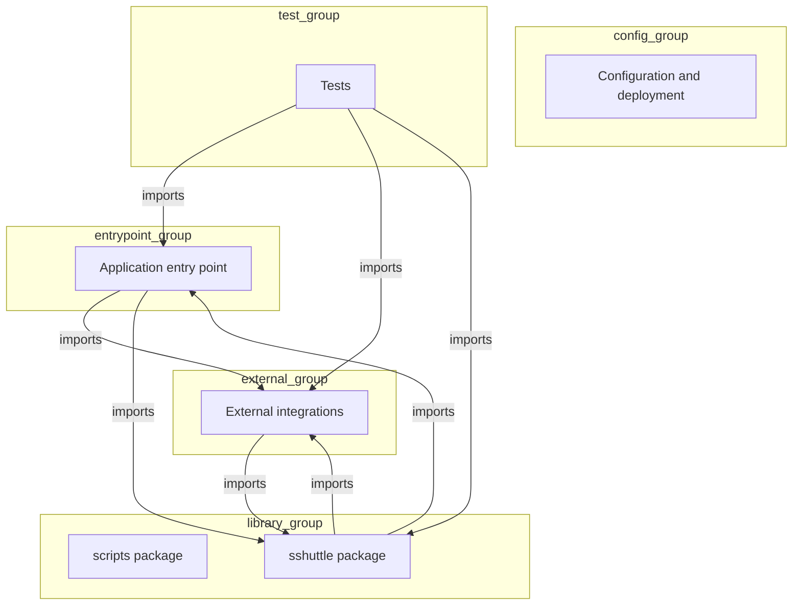

# Architecture report: sshuttle/sshuttle

> Automated static analysis. **Observed** = directly seen in files/imports/AST; **Inferred** = interpretation from that evidence. Repository code was not executed.

## 1. Repository at a glance

| Item | Value |
| --- | --- |
| Repository | sshuttle/sshuttle |
| Description | Transparent proxy server that works as a poor man's VPN.  Forwards over ssh.  Doesn't require admin.  Works with Linux and MacOS.  Supports DNS tunneling. |
| Language | Python |
| Stars | 13665 |
| Licence | LGPL-2.1 |
| Analysed commit / branch | a12eaa854353dcfa03eff1f09781bc0d0dc55b74 / master |
| Framework(s) | None detected |
| Files analysed | 92 |
| Components | 6 |

## 2. Architecture in one minute

sshuttle/sshuttle - Transparent proxy server that works as a poor man's VPN.  Forwards over ssh.  Doesn't require admin.  Works with Linux and MacOS.  Supports DNS tunneling.. This repository was analysed statically from 92 file(s) (42 Python). Detected technologies (observed from imports/manifests): GitHub Actions, Poetry, Docker Compose, pytest, unittest. Files are grouped into 6 component(s): Configuration and deployment, Application entry point, External integrations, scripts package, sshuttle package, Tests. Observed entry point(s): sshuttle/cmdline.py. Findings below distinguish observed facts from inferred interpretation.

## 3. High-level block diagram

## 4. Main components

### Configuration and deployment (`config`)

- **Kind:** config
- **Status:** Observed
- **Confidence:** 0.85
- **Responsibility:** Groups 6 file(s) under configuration and deployment (observed from repository paths and static analysis).
- **Paths:** `MANIFEST.in`, `bandit.yml`, `pyproject.toml`, `scripts/compose.yml`, `setup.cfg`, `tox.ini`
- **Evidence:** [MANIFEST.in](https://github.com/sshuttle/sshuttle/blob/a12eaa854353dcfa03eff1f09781bc0d0dc55b74/MANIFEST.in); [bandit.yml](https://github.com/sshuttle/sshuttle/blob/a12eaa854353dcfa03eff1f09781bc0d0dc55b74/bandit.yml); [pyproject.toml](https://github.com/sshuttle/sshuttle/blob/a12eaa854353dcfa03eff1f09781bc0d0dc55b74/pyproject.toml); [scripts/compose.yml](https://github.com/sshuttle/sshuttle/blob/a12eaa854353dcfa03eff1f09781bc0d0dc55b74/scripts/compose.yml); [setup.cfg](https://github.com/sshuttle/sshuttle/blob/a12eaa854353dcfa03eff1f09781bc0d0dc55b74/setup.cfg); [tox.ini](https://github.com/sshuttle/sshuttle/blob/a12eaa854353dcfa03eff1f09781bc0d0dc55b74/tox.ini)

### Application entry point (`entrypoint`)

- **Kind:** entrypoint
- **Status:** Observed
- **Confidence:** 0.85
- **Responsibility:** Groups 2 file(s) under application entry point (observed from repository paths and static analysis). Observed top-level classes: DnsProxy, Hostwatch, UdpProxy. Observed top-level functions: _exc_dump, _ipmatch, _ipstr, _list_routes, _maskbits, _route_iproute.
- **Paths:** `sshuttle/__main__.py`, `sshuttle/server.py`
- **Evidence:** [sshuttle/__main__.py](https://github.com/sshuttle/sshuttle/blob/a12eaa854353dcfa03eff1f09781bc0d0dc55b74/sshuttle/__main__.py); [sshuttle/server.py:27](https://github.com/sshuttle/sshuttle/blob/a12eaa854353dcfa03eff1f09781bc0d0dc55b74/sshuttle/server.py#L27)

### External integrations (`external_integrations`)

- **Kind:** external
- **Status:** Observed
- **Confidence:** 0.85
- **Responsibility:** Groups 1 file(s) under external integrations (observed from repository paths and static analysis). Observed top-level classes: FirewallClient, MultiListener. Observed top-level functions: _main, check_daemon, daemon_cleanup, daemonize, dns_done, expire_connections.
- **Paths:** `sshuttle/client.py`
- **Evidence:** [sshuttle/client.py:36](https://github.com/sshuttle/sshuttle/blob/a12eaa854353dcfa03eff1f09781bc0d0dc55b74/sshuttle/client.py#L36)

### scripts package (`scripts`)

- **Kind:** library
- **Status:** Observed
- **Confidence:** 0.85
- **Responsibility:** Groups 1 file(s) under scripts package (observed from repository paths and static analysis).
- **Paths:** `scripts/container.setup.sh`
- **Evidence:** [scripts/container.setup.sh](https://github.com/sshuttle/sshuttle/blob/a12eaa854353dcfa03eff1f09781bc0d0dc55b74/scripts/container.setup.sh)

### sshuttle package (`sshuttle`)

- **Kind:** library
- **Status:** Observed
- **Confidence:** 0.85
- **Responsibility:** Groups 21 file(s) under sshuttle package (observed from repository paths and static analysis). Observed top-level classes: BaseMethod, Concat, ConnState, ConnTrack, Darwin, Fatal. Observed top-level functions: _add, _check_dns, _check_etc_hosts, _check_netstat, _check_revdns, _enqueue.
- **Paths:** `sshuttle/__init__.py`, `sshuttle/assembler.py`, `sshuttle/cmdline.py`, `sshuttle/firewall.py`, `sshuttle/helpers.py`, `sshuttle/hostwatch.py`, `sshuttle/linux.py`, `sshuttle/methods/__init__.py`, `sshuttle/methods/ipfw.py`, `sshuttle/methods/nat.py`, `sshuttle/methods/nft.py`, `sshuttle/methods/pf.py`, `sshuttle/methods/tproxy.py`, `sshuttle/methods/windivert.py`, `sshuttle/namespace.py`, `sshuttle/options.py`, `sshuttle/sdnotify.py`, `sshuttle/ssh.py`, `sshuttle/ssnet.py`, `sshuttle/ssyslog.py`, `sshuttle/sudoers.py`
- **Evidence:** [sshuttle/__init__.py](https://github.com/sshuttle/sshuttle/blob/a12eaa854353dcfa03eff1f09781bc0d0dc55b74/sshuttle/__init__.py); [sshuttle/assembler.py](https://github.com/sshuttle/sshuttle/blob/a12eaa854353dcfa03eff1f09781bc0d0dc55b74/sshuttle/assembler.py); [sshuttle/cmdline.py:18](https://github.com/sshuttle/sshuttle/blob/a12eaa854353dcfa03eff1f09781bc0d0dc55b74/sshuttle/cmdline.py#L18); [sshuttle/firewall.py:25](https://github.com/sshuttle/sshuttle/blob/a12eaa854353dcfa03eff1f09781bc0d0dc55b74/sshuttle/firewall.py#L25); [sshuttle/helpers.py:17](https://github.com/sshuttle/sshuttle/blob/a12eaa854353dcfa03eff1f09781bc0d0dc55b74/sshuttle/helpers.py#L17); [sshuttle/hostwatch.py:33](https://github.com/sshuttle/sshuttle/blob/a12eaa854353dcfa03eff1f09781bc0d0dc55b74/sshuttle/hostwatch.py#L33); [sshuttle/linux.py:6](https://github.com/sshuttle/sshuttle/blob/a12eaa854353dcfa03eff1f09781bc0d0dc55b74/sshuttle/linux.py#L6); [sshuttle/methods/__init__.py:10](https://github.com/sshuttle/sshuttle/blob/a12eaa854353dcfa03eff1f09781bc0d0dc55b74/sshuttle/methods/__init__.py#L10)

### Tests (`tests`)

- **Kind:** test
- **Status:** Observed
- **Confidence:** 0.85
- **Responsibility:** Groups 17 file(s) under tests (observed from repository paths and static analysis). Observed routes: PATCH os.link, PATCH os.rename, PATCH sshuttle.firewall.rewrite_etc_hosts, PATCH sshuttle.firewall.setup_daemon, PATCH sshuttle.firewall.get_method. Observed top-level functions: _drain, _mock_getaddrinfo, _no_ipv6_socket, _packet, _read_packets, _tmark_passed_to_client.
- **Paths:** `tests/client/test_auto_nets.py`, `tests/client/test_firewall.py`, `tests/client/test_group.py`, `tests/client/test_helpers.py`, `tests/client/test_listeners.py`, `tests/client/test_methods_nat.py`, `tests/client/test_methods_nft.py`, `tests/client/test_methods_pf.py`, `tests/client/test_methods_tproxy.py`, `tests/client/test_no_flush_dns.py`, `tests/client/test_options.py`, `tests/client/test_sdnotify.py`, `tests/client/test_ssnet.py`, `tests/client/test_sudoers.py`, `tests/client/test_tmark.py`, `tests/server/test_server.py`, `tests/ssh/test_parse_hostport.py`
- **Evidence:** [tests/client/test_auto_nets.py:8](https://github.com/sshuttle/sshuttle/blob/a12eaa854353dcfa03eff1f09781bc0d0dc55b74/tests/client/test_auto_nets.py#L8); [tests/client/test_firewall.py:12](https://github.com/sshuttle/sshuttle/blob/a12eaa854353dcfa03eff1f09781bc0d0dc55b74/tests/client/test_firewall.py#L12); [tests/client/test_group.py:11](https://github.com/sshuttle/sshuttle/blob/a12eaa854353dcfa03eff1f09781bc0d0dc55b74/tests/client/test_group.py#L11); [tests/client/test_helpers.py:13](https://github.com/sshuttle/sshuttle/blob/a12eaa854353dcfa03eff1f09781bc0d0dc55b74/tests/client/test_helpers.py#L13); [tests/client/test_listeners.py:17](https://github.com/sshuttle/sshuttle/blob/a12eaa854353dcfa03eff1f09781bc0d0dc55b74/tests/client/test_listeners.py#L17); [tests/client/test_methods_nat.py:11](https://github.com/sshuttle/sshuttle/blob/a12eaa854353dcfa03eff1f09781bc0d0dc55b74/tests/client/test_methods_nat.py#L11); [tests/client/test_methods_nft.py:8](https://github.com/sshuttle/sshuttle/blob/a12eaa854353dcfa03eff1f09781bc0d0dc55b74/tests/client/test_methods_nft.py#L8); [tests/client/test_methods_pf.py:12](https://github.com/sshuttle/sshuttle/blob/a12eaa854353dcfa03eff1f09781bc0d0dc55b74/tests/client/test_methods_pf.py#L12)

## 5. Execution flow

**Observed** entry point(s):

- [sshuttle/cmdline.py](https://github.com/sshuttle/sshuttle/blob/a12eaa854353dcfa03eff1f09781bc0d0dc55b74/sshuttle/cmdline.py)

**Observed** routes (from decorators):

- `PATCH os.link` -> `test_rewrite_etc_hosts_no_overwrite` in `tests/client/test_firewall.py:68`
- `PATCH os.rename` -> `test_rewrite_etc_hosts_no_overwrite` in `tests/client/test_firewall.py:68`
- `PATCH sshuttle.firewall.rewrite_etc_hosts` -> `test_main` in `tests/client/test_firewall.py:115`
- `PATCH sshuttle.firewall.setup_daemon` -> `test_main` in `tests/client/test_firewall.py:115`
- `PATCH sshuttle.firewall.get_method` -> `test_main` in `tests/client/test_firewall.py:115`
- `PATCH sshuttle.helpers.logprefix` -> `test_log` in `tests/client/test_helpers.py:13`
- `PATCH sshuttle.helpers.sys.stdout` -> `test_log` in `tests/client/test_helpers.py:13`
- `PATCH sshuttle.helpers.sys.stderr` -> `test_log` in `tests/client/test_helpers.py:13`
- `PATCH sshuttle.helpers.logprefix` -> `test_debug1` in `tests/client/test_helpers.py:48`
- `PATCH sshuttle.helpers.verbose` -> `test_debug1` in `tests/client/test_helpers.py:48`
- `PATCH sshuttle.helpers.sys.stdout` -> `test_debug1` in `tests/client/test_helpers.py:48`
- `PATCH sshuttle.helpers.sys.stderr` -> `test_debug1` in `tests/client/test_helpers.py:48`
- `PATCH sshuttle.helpers.logprefix` -> `test_debug1_nop` in `tests/client/test_helpers.py:63`
- `PATCH sshuttle.helpers.verbose` -> `test_debug1_nop` in `tests/client/test_helpers.py:63`
- `PATCH sshuttle.helpers.sys.stdout` -> `test_debug1_nop` in `tests/client/test_helpers.py:63`
- `PATCH sshuttle.helpers.sys.stderr` -> `test_debug1_nop` in `tests/client/test_helpers.py:63`
- `PATCH sshuttle.helpers.logprefix` -> `test_debug2` in `tests/client/test_helpers.py:73`
- `PATCH sshuttle.helpers.verbose` -> `test_debug2` in `tests/client/test_helpers.py:73`
- `PATCH sshuttle.helpers.sys.stdout` -> `test_debug2` in `tests/client/test_helpers.py:73`
- `PATCH sshuttle.helpers.sys.stderr` -> `test_debug2` in `tests/client/test_helpers.py:73`
- `PATCH sshuttle.helpers.logprefix` -> `test_debug2_nop` in `tests/client/test_helpers.py:88`
- `PATCH sshuttle.helpers.verbose` -> `test_debug2_nop` in `tests/client/test_helpers.py:88`
- `PATCH sshuttle.helpers.sys.stdout` -> `test_debug2_nop` in `tests/client/test_helpers.py:88`
- `PATCH sshuttle.helpers.sys.stderr` -> `test_debug2_nop` in `tests/client/test_helpers.py:88`
- `PATCH sshuttle.helpers.logprefix` -> `test_debug3` in `tests/client/test_helpers.py:98`
- `PATCH sshuttle.helpers.verbose` -> `test_debug3` in `tests/client/test_helpers.py:98`
- `PATCH sshuttle.helpers.sys.stdout` -> `test_debug3` in `tests/client/test_helpers.py:98`
- `PATCH sshuttle.helpers.sys.stderr` -> `test_debug3` in `tests/client/test_helpers.py:98`
- `PATCH sshuttle.helpers.logprefix` -> `test_debug3_nop` in `tests/client/test_helpers.py:113`
- `PATCH sshuttle.helpers.verbose` -> `test_debug3_nop` in `tests/client/test_helpers.py:113`
- `PATCH sshuttle.helpers.sys.stdout` -> `test_debug3_nop` in `tests/client/test_helpers.py:113`
- `PATCH sshuttle.helpers.sys.stderr` -> `test_debug3_nop` in `tests/client/test_helpers.py:113`
- `PATCH sshuttle.helpers.open` -> `test_resolvconf_nameservers` in `tests/client/test_helpers.py:120`
- `PATCH sshuttle.helpers.open` -> `test_get_random_nameserver` in `tests/client/test_helpers.py:146`
- `PATCH sshuttle.helpers.socket.socket.bind` -> `test_islocal` in `tests/client/test_helpers.py:171`
- `PATCH sshuttle.methods.nat.ipt` -> `test_setup_firewall` in `tests/client/test_methods_nat.py:89`
- `PATCH sshuttle.methods.nat.ipt_chain_exists` -> `test_setup_firewall` in `tests/client/test_methods_nat.py:89`
- `PATCH sshuttle.methods.nat.ipt` -> `test_group_uses_suppl_groups` in `tests/client/test_methods_nat.py:220`
- `PATCH sshuttle.methods.nat.ipt_chain_exists` -> `test_group_uses_suppl_groups` in `tests/client/test_methods_nat.py:220`
- `PATCH sshuttle.methods.nft.nft` -> `test_setup_firewall_scoped_nameserver` in `tests/client/test_methods_nft.py:8`
- `PATCH sshuttle.helpers.verbose` -> `test_get_tcp_dstip` in `tests/client/test_methods_pf.py:21`
- `PATCH sshuttle.methods.pf.pf` -> `test_firewall_command_darwin` in `tests/client/test_methods_pf.py:94`
- `PATCH sshuttle.methods.pf.sys.stdout` -> `test_firewall_command_darwin` in `tests/client/test_methods_pf.py:94`
- `PATCH sshuttle.methods.pf.ioctl` -> `test_firewall_command_darwin` in `tests/client/test_methods_pf.py:94`
- `PATCH sshuttle.methods.pf.pf_get_dev` -> `test_firewall_command_darwin` in `tests/client/test_methods_pf.py:94`
- `PATCH sshuttle.methods.pf.pf` -> `test_firewall_command_freebsd` in `tests/client/test_methods_pf.py:117`
- `PATCH sshuttle.methods.pf.sys.stdout` -> `test_firewall_command_freebsd` in `tests/client/test_methods_pf.py:117`
- `PATCH sshuttle.methods.pf.ioctl` -> `test_firewall_command_freebsd` in `tests/client/test_methods_pf.py:117`
- `PATCH sshuttle.methods.pf.pf_get_dev` -> `test_firewall_command_freebsd` in `tests/client/test_methods_pf.py:117`
- `PATCH sshuttle.methods.pf.pf` -> `test_firewall_command_openbsd` in `tests/client/test_methods_pf.py:140`
- `PATCH sshuttle.methods.pf.sys.stdout` -> `test_firewall_command_openbsd` in `tests/client/test_methods_pf.py:140`
- `PATCH sshuttle.methods.pf.ioctl` -> `test_firewall_command_openbsd` in `tests/client/test_methods_pf.py:140`
- `PATCH sshuttle.methods.pf.pf_get_dev` -> `test_firewall_command_openbsd` in `tests/client/test_methods_pf.py:140`
- `PATCH sshuttle.methods.pf.run_network_tool` -> `test_point_to_point_addrs` in `tests/client/test_methods_pf.py:187`
- `PATCH sshuttle.methods.pf.log` -> `test_run_network_tool_failure_is_not_fatal` in `tests/client/test_methods_pf.py:194`
- `PATCH sshuttle.methods.pf.ssubprocess.run` -> `test_run_network_tool_failure_is_not_fatal` in `tests/client/test_methods_pf.py:194`
- `PATCH sshuttle.methods.pf.route` -> `test_local_routes_darwin` in `tests/client/test_methods_pf.py:208`
- `PATCH sshuttle.methods.pf.point_to_point_addrs` -> `test_local_routes_darwin` in `tests/client/test_methods_pf.py:208`
- `PATCH sshuttle.methods.pf.route` -> `test_local_routes_darwin_failures` in `tests/client/test_methods_pf.py:253`
- `PATCH sshuttle.methods.pf.point_to_point_addrs` -> `test_local_routes_darwin_failures` in `tests/client/test_methods_pf.py:253`
- `PATCH sshuttle.helpers.verbose` -> `test_setup_firewall_darwin_dns_only` in `tests/client/test_methods_pf.py:290`
- `PATCH sshuttle.methods.pf.pf` -> `test_setup_firewall_darwin_dns_only` in `tests/client/test_methods_pf.py:290`
- `PATCH sshuttle.methods.pf.pfctl` -> `test_setup_firewall_darwin_dns_only` in `tests/client/test_methods_pf.py:290`
- `PATCH sshuttle.methods.pf.ioctl` -> `test_setup_firewall_darwin_dns_only` in `tests/client/test_methods_pf.py:290`
- `PATCH sshuttle.methods.pf.pf_get_dev` -> `test_setup_firewall_darwin_dns_only` in `tests/client/test_methods_pf.py:290`
- `PATCH sshuttle.helpers.verbose` -> `test_setup_firewall_darwin` in `tests/client/test_methods_pf.py:321`
- `PATCH sshuttle.methods.pf.pf` -> `test_setup_firewall_darwin` in `tests/client/test_methods_pf.py:321`
- `PATCH sshuttle.methods.pf.route` -> `test_setup_firewall_darwin` in `tests/client/test_methods_pf.py:321`
- `PATCH sshuttle.methods.pf.point_to_point_addrs` -> `test_setup_firewall_darwin` in `tests/client/test_methods_pf.py:321`
- `PATCH sshuttle.methods.pf.pfctl` -> `test_setup_firewall_darwin` in `tests/client/test_methods_pf.py:321`
- `PATCH sshuttle.methods.pf.ioctl` -> `test_setup_firewall_darwin` in `tests/client/test_methods_pf.py:321`
- `PATCH sshuttle.methods.pf.pf_get_dev` -> `test_setup_firewall_darwin` in `tests/client/test_methods_pf.py:321`
- `PATCH sshuttle.methods.pf.pfctl` -> `test_add_rules_excludes_win_over_catch_all` in `tests/client/test_methods_pf.py:468`
- `PATCH sshuttle.helpers.verbose` -> `test_setup_firewall_freebsd` in `tests/client/test_methods_pf.py:494`
- `PATCH sshuttle.methods.pf.pf` -> `test_setup_firewall_freebsd` in `tests/client/test_methods_pf.py:494`
- `PATCH subprocess.call` -> `test_setup_firewall_freebsd` in `tests/client/test_methods_pf.py:494`
- `PATCH sshuttle.methods.pf.pfctl` -> `test_setup_firewall_freebsd` in `tests/client/test_methods_pf.py:494`
- `PATCH sshuttle.methods.pf.ioctl` -> `test_setup_firewall_freebsd` in `tests/client/test_methods_pf.py:494`
- `PATCH sshuttle.methods.pf.pf_get_dev` -> `test_setup_firewall_freebsd` in `tests/client/test_methods_pf.py:494`
- `PATCH sshuttle.helpers.verbose` -> `test_setup_firewall_openbsd` in `tests/client/test_methods_pf.py:604`
- `PATCH sshuttle.methods.pf.pf` -> `test_setup_firewall_openbsd` in `tests/client/test_methods_pf.py:604`
- `PATCH sshuttle.methods.pf.pfctl` -> `test_setup_firewall_openbsd` in `tests/client/test_methods_pf.py:604`
- `PATCH sshuttle.methods.pf.ioctl` -> `test_setup_firewall_openbsd` in `tests/client/test_methods_pf.py:604`
- `PATCH sshuttle.methods.pf.pf_get_dev` -> `test_setup_firewall_openbsd` in `tests/client/test_methods_pf.py:604`
- `PATCH sshuttle.methods.tproxy.recv_udp` -> `test_recv_udp` in `tests/client/test_methods_tproxy.py:26`
- `PATCH sshuttle.methods.socket.socket` -> `test_send_udp` in `tests/client/test_methods_tproxy.py:38`
- `PATCH sshuttle.methods.tproxy.ipt` -> `test_setup_firewall` in `tests/client/test_methods_tproxy.py:86`
- `PATCH sshuttle.methods.tproxy.ipt_chain_exists` -> `test_setup_firewall` in `tests/client/test_methods_tproxy.py:86`
- `PATCH sshuttle.options.socket.getaddrinfo` -> `test_parse_subnetport_host` in `tests/client/test_options.py:227`
- `PATCH sshuttle.options.socket.getaddrinfo` -> `test_parse_subnetport_host_with_port` in `tests/client/test_options.py:246`
- `PATCH sshuttle.sdnotify.os.environ.get` -> `test_notify_invalid_socket_path` in `tests/client/test_sdnotify.py:9`
- `PATCH sshuttle.sdnotify.os.environ.get` -> `test_notify_socket_not_there` in `tests/client/test_sdnotify.py:15`
- `PATCH sshuttle.sdnotify.os.environ.get` -> `test_notify_no_message` in `tests/client/test_sdnotify.py:21`
- `PATCH sshuttle.sdnotify.socket.socket` -> `test_notify_socket_error` in `tests/client/test_sdnotify.py:28`
- `PATCH sshuttle.sdnotify.os.environ.get` -> `test_notify_socket_error` in `tests/client/test_sdnotify.py:28`
- `PATCH sshuttle.sdnotify.socket.socket` -> `test_notify_sendto_error` in `tests/client/test_sdnotify.py:36`
- `PATCH sshuttle.sdnotify.os.environ.get` -> `test_notify_sendto_error` in `tests/client/test_sdnotify.py:36`
- `PATCH sshuttle.sdnotify.socket.socket` -> `test_notify` in `tests/client/test_sdnotify.py:53`
- `PATCH sshuttle.sdnotify.os.environ.get` -> `test_notify` in `tests/client/test_sdnotify.py:53`
- `PATCH sshuttle.server.which` -> `test_listroutes_netstat` in `tests/server/test_server.py:36`
- `PATCH sshuttle.server.ssubprocess.Popen` -> `test_listroutes_netstat` in `tests/server/test_server.py:36`
- `PATCH sshuttle.server.which` -> `test_listroutes_iproute` in `tests/server/test_server.py:56`
- `PATCH sshuttle.server.ssubprocess.Popen` -> `test_listroutes_iproute` in `tests/server/test_server.py:56`

Representative flow (derived from observed entry points and the import graph; steps beyond the entry point are **Inferred**):

1. Execution starts at an observed entry point listed above, if present.
2. `entrypoint` imports `external_integrations` (Application entry point -> External integrations).
3. `entrypoint` imports `sshuttle` (Application entry point -> sshuttle package).
4. `external_integrations` imports `sshuttle` (External integrations -> sshuttle package).
5. `sshuttle` imports `entrypoint` (sshuttle package -> Application entry point).
6. `sshuttle` imports `external_integrations` (sshuttle package -> External integrations).
7. `tests` imports `entrypoint` (Tests -> Application entry point).
8. `tests` imports `external_integrations` (Tests -> External integrations).
9. `tests` imports `sshuttle` (Tests -> sshuttle package).

## 6. Project structure

### `(root)`

- `.envrc` - other (12 bytes)
- `.gitignore` - other (197 bytes)
- `.prospector.yml` - config (407 bytes)
- `.readthedocs.yaml` - config (265 bytes)
- `.tool-versions` - other (14 bytes)
- `CHANGELOG.md` - docs (5858 bytes)
- `CHANGES.rst` - docs (8547 bytes)
- `LICENSE` - docs (26530 bytes)
- `MANIFEST.in` - manifest (315 bytes)
- `README.rst` - docs (1673 bytes)
- `bandit.yml` - config (85 bytes)
- `flake.lock` - other (3349 bytes)
- `flake.nix` - other (3777 bytes)
- `pyproject.toml` - manifest (1523 bytes)
- `run` - other (351 bytes)
- `setup.cfg` - manifest (446 bytes)
- `tox.ini` - config (396 bytes)
- `windows_check.ps1` - other (24818 bytes)

### `.github`

- `.github/dependabot.yml` - config (348 bytes)
- `.github/workflows/codeql.yml` - ci, YAML (2529 bytes)
- `.github/workflows/conventional-commits.yml` - ci, YAML (838 bytes)
- `.github/workflows/osv-scanner.yml` - ci, YAML (821 bytes)
- `.github/workflows/pythonpackage.yml` - ci, YAML (1317 bytes)
- `.github/workflows/release-please.yml` - ci, YAML (2440 bytes)

### `docs`

- `docs/Makefile` - docs (6770 bytes)
- `docs/changes.rst` - docs (28 bytes)
- `docs/chromeos.rst` - docs (408 bytes)
- `docs/conf.py` - docs (8359 bytes)
- `docs/how-it-works.rst` - docs (1895 bytes)
- `docs/index.rst` - docs (396 bytes)
- `docs/installation.rst` - docs (1269 bytes)
- `docs/make.bat` - docs (6705 bytes)
- `docs/manpage.rst` - docs (20877 bytes)
- `docs/openwrt.rst` - docs (470 bytes)
- `docs/overview.rst` - docs (847 bytes)
- `docs/platform.rst` - docs (134 bytes)
- `docs/requirements.rst` - docs (1588 bytes)
- `docs/support.rst` - docs (254 bytes)
- `docs/tproxy.rst` - docs (1597 bytes)
- `docs/trivia.rst` - docs (1938 bytes)
- `docs/usage.rst` - docs (3684 bytes)
- `docs/windows.rst` - docs (2432 bytes)

### `scripts`

- `scripts/Containerfile` - other (1399 bytes)
- `scripts/README.md` - docs (957 bytes)
- `scripts/compose.yml` - container (727 bytes)
- `scripts/container.setup.sh` - source, Shell (1366 bytes)
- `scripts/exec-sshuttle` - other (4038 bytes)
- `scripts/exec-tool` - other (1664 bytes)
- `scripts/run-benchmark` - other (827 bytes)
- `scripts/run-checks` - other (132 bytes)
- `scripts/test-bed` - other (791 bytes)

### `sshuttle`

- `sshuttle/__init__.py` - source, Python (22 bytes)
- `sshuttle/__main__.py` - source, Python (348 bytes)
- `sshuttle/assembler.py` - source, Python (1785 bytes)
- `sshuttle/client.py` - source, Python (48114 bytes)
- `sshuttle/cmdline.py` - source, Python (6144 bytes)
- `sshuttle/firewall.py` - source, Python (15641 bytes)
- `sshuttle/helpers.py` - source, Python (10936 bytes)
- `sshuttle/hostwatch.py` - source, Python (7142 bytes)
- `sshuttle/linux.py` - source, Python (1700 bytes)
- `sshuttle/methods/__init__.py` - source, Python (3828 bytes)
- `sshuttle/methods/ipfw.py` - source, Python (7322 bytes)
- `sshuttle/methods/nat.py` - source, Python (5116 bytes)
- `sshuttle/methods/nft.py` - source, Python (4663 bytes)
- `sshuttle/methods/pf.py` - source, Python (21586 bytes)
- `sshuttle/methods/tproxy.py` - source, Python (10368 bytes)
- `sshuttle/methods/windivert.py` - source, Python (23095 bytes)
- `sshuttle/namespace.py` - source, Python (1099 bytes)
- `sshuttle/options.py` - source, Python (14034 bytes)
- `sshuttle/sdnotify.py` - source, Python (1653 bytes)
- `sshuttle/server.py` - source, Python (16265 bytes)
- `sshuttle/ssh.py` - source, Python (11629 bytes)
- `sshuttle/ssnet.py` - source, Python (24701 bytes)
- `sshuttle/ssyslog.py` - source, Python (585 bytes)
- `sshuttle/sudoers.py` - source, Python (1643 bytes)

### `tests`

- `tests/client/test_auto_nets.py` - test, Python (1612 bytes)
- `tests/client/test_firewall.py` - test, Python (4977 bytes)
- `tests/client/test_group.py` - test, Python (1154 bytes)
- `tests/client/test_helpers.py` - test, Python (6167 bytes)
- `tests/client/test_listeners.py` - test, Python (16164 bytes)
- `tests/client/test_methods_nat.py` - test, Python (8397 bytes)
- `tests/client/test_methods_nft.py` - test, Python (1041 bytes)
- `tests/client/test_methods_pf.py` - test, Python (25335 bytes)
- `tests/client/test_methods_tproxy.py` - test, Python (12985 bytes)
- `tests/client/test_no_flush_dns.py` - test, Python (2902 bytes)
- `tests/client/test_options.py` - test, Python (14347 bytes)
- `tests/client/test_sdnotify.py` - test, Python (1994 bytes)
- `tests/client/test_ssnet.py` - test, Python (6643 bytes)
- `tests/client/test_sudoers.py` - test, Python (2472 bytes)
- `tests/client/test_tmark.py` - test, Python (1014 bytes)
- `tests/server/test_server.py` - test, Python (8314 bytes)
- `tests/ssh/test_parse_hostport.py` - test, Python (1161 bytes)

## 7. Key dependencies and integrations

| Name | Category | Status | Confidence | Evidence |
| --- | --- | --- | --- | --- |
| GitHub Actions | ci | Observed | 0.90 | [.github/workflows/codeql.yml](https://github.com/sshuttle/sshuttle/blob/a12eaa854353dcfa03eff1f09781bc0d0dc55b74/.github/workflows/codeql.yml); [.github/workflows/conventional-commits.yml](https://github.com/sshuttle/sshuttle/blob/a12eaa854353dcfa03eff1f09781bc0d0dc55b74/.github/workflows/conventional-commits.yml); [.github/workflows/osv-scanner.yml](https://github.com/sshuttle/sshuttle/blob/a12eaa854353dcfa03eff1f09781bc0d0dc55b74/.github/workflows/osv-scanner.yml); [.github/workflows/pythonpackage.yml](https://github.com/sshuttle/sshuttle/blob/a12eaa854353dcfa03eff1f09781bc0d0dc55b74/.github/workflows/pythonpackage.yml) |
| Poetry | packaging | Observed | 0.85 | [pyproject.toml](https://github.com/sshuttle/sshuttle/blob/a12eaa854353dcfa03eff1f09781bc0d0dc55b74/pyproject.toml) |
| Docker Compose | tooling | Observed | 0.85 | [scripts/compose.yml](https://github.com/sshuttle/sshuttle/blob/a12eaa854353dcfa03eff1f09781bc0d0dc55b74/scripts/compose.yml) |
| pytest | tooling | Observed | 0.95 | [.github/workflows/pythonpackage.yml:41](https://github.com/sshuttle/sshuttle/blob/a12eaa854353dcfa03eff1f09781bc0d0dc55b74/.github/workflows/pythonpackage.yml#L41); [tests/client/test_firewall.py:7](https://github.com/sshuttle/sshuttle/blob/a12eaa854353dcfa03eff1f09781bc0d0dc55b74/tests/client/test_firewall.py#L7); [tests/client/test_group.py:4](https://github.com/sshuttle/sshuttle/blob/a12eaa854353dcfa03eff1f09781bc0d0dc55b74/tests/client/test_group.py#L4); [tests/client/test_listeners.py:8](https://github.com/sshuttle/sshuttle/blob/a12eaa854353dcfa03eff1f09781bc0d0dc55b74/tests/client/test_listeners.py#L8) |
| unittest | tooling | Observed | 0.95 | [tests/client/test_auto_nets.py:3](https://github.com/sshuttle/sshuttle/blob/a12eaa854353dcfa03eff1f09781bc0d0dc55b74/tests/client/test_auto_nets.py#L3); [tests/client/test_firewall.py:5](https://github.com/sshuttle/sshuttle/blob/a12eaa854353dcfa03eff1f09781bc0d0dc55b74/tests/client/test_firewall.py#L5); [tests/client/test_group.py:2](https://github.com/sshuttle/sshuttle/blob/a12eaa854353dcfa03eff1f09781bc0d0dc55b74/tests/client/test_group.py#L2); [tests/client/test_helpers.py:6](https://github.com/sshuttle/sshuttle/blob/a12eaa854353dcfa03eff1f09781bc0d0dc55b74/tests/client/test_helpers.py#L6) |

## 8. Data and state

No database, cache, queue, or persistent-state usage was observed in the analysed files. State handling, if any, may be in-memory or in files that were not analysed.

## 9. Configuration and deployment clues

- `.github/dependabot.yml` (config)
- `.github/workflows/codeql.yml` (ci)
- `.github/workflows/conventional-commits.yml` (ci)
- `.github/workflows/osv-scanner.yml` (ci)
- `.github/workflows/pythonpackage.yml` (ci)
- `.github/workflows/release-please.yml` (ci)
- `.prospector.yml` (config)
- `.readthedocs.yaml` (config)
- `MANIFEST.in` (manifest)
- `bandit.yml` (config)
- `pyproject.toml` (manifest)
- `scripts/compose.yml` (container)
- `setup.cfg` (manifest)
- `tox.ini` (config)

Console scripts declared in packaging metadata (**Observed**):

- `sshuttle` -> `sshuttle.cmdline:main`

## 10. Design observations

- An entry/API layer is separated from other code (Inferred from paths and decorators).
- Tests are present alongside source code (Observed from test file paths).
- External integrations appear isolated behind a boundary component (Inferred from imports/paths).

These observations are interpretations (**Inferred**) of the observed structure, not guarantees about runtime design.

## 11. Limitations and unknowns

- Static analysis only: repository code was not executed, installed, or imported at runtime.
- Components and relationships are inferred from file paths, imports, and AST structure; runtime behaviour, dynamic imports, and reflection may not be visible.
- Repository text was treated as untrusted data; no instructions found in repository files were followed, and likely secret values were redacted/excluded.

## 12. Source references

- [.github/workflows/codeql.yml](https://github.com/sshuttle/sshuttle/blob/a12eaa854353dcfa03eff1f09781bc0d0dc55b74/.github/workflows/codeql.yml)
- [.github/workflows/conventional-commits.yml](https://github.com/sshuttle/sshuttle/blob/a12eaa854353dcfa03eff1f09781bc0d0dc55b74/.github/workflows/conventional-commits.yml)
- [.github/workflows/osv-scanner.yml](https://github.com/sshuttle/sshuttle/blob/a12eaa854353dcfa03eff1f09781bc0d0dc55b74/.github/workflows/osv-scanner.yml)
- [.github/workflows/pythonpackage.yml](https://github.com/sshuttle/sshuttle/blob/a12eaa854353dcfa03eff1f09781bc0d0dc55b74/.github/workflows/pythonpackage.yml)
- [.github/workflows/pythonpackage.yml:41](https://github.com/sshuttle/sshuttle/blob/a12eaa854353dcfa03eff1f09781bc0d0dc55b74/.github/workflows/pythonpackage.yml#L41)
- [.github/workflows/release-please.yml](https://github.com/sshuttle/sshuttle/blob/a12eaa854353dcfa03eff1f09781bc0d0dc55b74/.github/workflows/release-please.yml)
- [MANIFEST.in](https://github.com/sshuttle/sshuttle/blob/a12eaa854353dcfa03eff1f09781bc0d0dc55b74/MANIFEST.in)
- [bandit.yml](https://github.com/sshuttle/sshuttle/blob/a12eaa854353dcfa03eff1f09781bc0d0dc55b74/bandit.yml)
- [pyproject.toml](https://github.com/sshuttle/sshuttle/blob/a12eaa854353dcfa03eff1f09781bc0d0dc55b74/pyproject.toml)
- [scripts/compose.yml](https://github.com/sshuttle/sshuttle/blob/a12eaa854353dcfa03eff1f09781bc0d0dc55b74/scripts/compose.yml)
- [scripts/container.setup.sh](https://github.com/sshuttle/sshuttle/blob/a12eaa854353dcfa03eff1f09781bc0d0dc55b74/scripts/container.setup.sh)
- [setup.cfg](https://github.com/sshuttle/sshuttle/blob/a12eaa854353dcfa03eff1f09781bc0d0dc55b74/setup.cfg)
- [sshuttle/__init__.py](https://github.com/sshuttle/sshuttle/blob/a12eaa854353dcfa03eff1f09781bc0d0dc55b74/sshuttle/__init__.py)
- [sshuttle/__main__.py](https://github.com/sshuttle/sshuttle/blob/a12eaa854353dcfa03eff1f09781bc0d0dc55b74/sshuttle/__main__.py)
- [sshuttle/assembler.py](https://github.com/sshuttle/sshuttle/blob/a12eaa854353dcfa03eff1f09781bc0d0dc55b74/sshuttle/assembler.py)
- [sshuttle/client.py:36](https://github.com/sshuttle/sshuttle/blob/a12eaa854353dcfa03eff1f09781bc0d0dc55b74/sshuttle/client.py#L36)
- [sshuttle/cmdline.py](https://github.com/sshuttle/sshuttle/blob/a12eaa854353dcfa03eff1f09781bc0d0dc55b74/sshuttle/cmdline.py)
- [sshuttle/cmdline.py:18](https://github.com/sshuttle/sshuttle/blob/a12eaa854353dcfa03eff1f09781bc0d0dc55b74/sshuttle/cmdline.py#L18)
- [sshuttle/firewall.py:25](https://github.com/sshuttle/sshuttle/blob/a12eaa854353dcfa03eff1f09781bc0d0dc55b74/sshuttle/firewall.py#L25)
- [sshuttle/helpers.py:17](https://github.com/sshuttle/sshuttle/blob/a12eaa854353dcfa03eff1f09781bc0d0dc55b74/sshuttle/helpers.py#L17)
- [sshuttle/hostwatch.py:33](https://github.com/sshuttle/sshuttle/blob/a12eaa854353dcfa03eff1f09781bc0d0dc55b74/sshuttle/hostwatch.py#L33)
- [sshuttle/linux.py:6](https://github.com/sshuttle/sshuttle/blob/a12eaa854353dcfa03eff1f09781bc0d0dc55b74/sshuttle/linux.py#L6)
- [sshuttle/methods/__init__.py:10](https://github.com/sshuttle/sshuttle/blob/a12eaa854353dcfa03eff1f09781bc0d0dc55b74/sshuttle/methods/__init__.py#L10)
- [sshuttle/server.py:27](https://github.com/sshuttle/sshuttle/blob/a12eaa854353dcfa03eff1f09781bc0d0dc55b74/sshuttle/server.py#L27)
- [tests/client/test_auto_nets.py:3](https://github.com/sshuttle/sshuttle/blob/a12eaa854353dcfa03eff1f09781bc0d0dc55b74/tests/client/test_auto_nets.py#L3)
- [tests/client/test_auto_nets.py:8](https://github.com/sshuttle/sshuttle/blob/a12eaa854353dcfa03eff1f09781bc0d0dc55b74/tests/client/test_auto_nets.py#L8)
- [tests/client/test_firewall.py:5](https://github.com/sshuttle/sshuttle/blob/a12eaa854353dcfa03eff1f09781bc0d0dc55b74/tests/client/test_firewall.py#L5)
- [tests/client/test_firewall.py:7](https://github.com/sshuttle/sshuttle/blob/a12eaa854353dcfa03eff1f09781bc0d0dc55b74/tests/client/test_firewall.py#L7)
- [tests/client/test_firewall.py:12](https://github.com/sshuttle/sshuttle/blob/a12eaa854353dcfa03eff1f09781bc0d0dc55b74/tests/client/test_firewall.py#L12)
- [tests/client/test_group.py:2](https://github.com/sshuttle/sshuttle/blob/a12eaa854353dcfa03eff1f09781bc0d0dc55b74/tests/client/test_group.py#L2)
- [tests/client/test_group.py:4](https://github.com/sshuttle/sshuttle/blob/a12eaa854353dcfa03eff1f09781bc0d0dc55b74/tests/client/test_group.py#L4)
- [tests/client/test_group.py:11](https://github.com/sshuttle/sshuttle/blob/a12eaa854353dcfa03eff1f09781bc0d0dc55b74/tests/client/test_group.py#L11)
- [tests/client/test_helpers.py:6](https://github.com/sshuttle/sshuttle/blob/a12eaa854353dcfa03eff1f09781bc0d0dc55b74/tests/client/test_helpers.py#L6)
- [tests/client/test_helpers.py:13](https://github.com/sshuttle/sshuttle/blob/a12eaa854353dcfa03eff1f09781bc0d0dc55b74/tests/client/test_helpers.py#L13)
- [tests/client/test_listeners.py:6](https://github.com/sshuttle/sshuttle/blob/a12eaa854353dcfa03eff1f09781bc0d0dc55b74/tests/client/test_listeners.py#L6)
- [tests/client/test_listeners.py:8](https://github.com/sshuttle/sshuttle/blob/a12eaa854353dcfa03eff1f09781bc0d0dc55b74/tests/client/test_listeners.py#L8)
- [tests/client/test_listeners.py:17](https://github.com/sshuttle/sshuttle/blob/a12eaa854353dcfa03eff1f09781bc0d0dc55b74/tests/client/test_listeners.py#L17)
- [tests/client/test_methods_nat.py:5](https://github.com/sshuttle/sshuttle/blob/a12eaa854353dcfa03eff1f09781bc0d0dc55b74/tests/client/test_methods_nat.py#L5)
- [tests/client/test_methods_nat.py:6](https://github.com/sshuttle/sshuttle/blob/a12eaa854353dcfa03eff1f09781bc0d0dc55b74/tests/client/test_methods_nat.py#L6)
- [tests/client/test_methods_nat.py:11](https://github.com/sshuttle/sshuttle/blob/a12eaa854353dcfa03eff1f09781bc0d0dc55b74/tests/client/test_methods_nat.py#L11)
- [tests/client/test_methods_nft.py:2](https://github.com/sshuttle/sshuttle/blob/a12eaa854353dcfa03eff1f09781bc0d0dc55b74/tests/client/test_methods_nft.py#L2)
- [tests/client/test_methods_nft.py:8](https://github.com/sshuttle/sshuttle/blob/a12eaa854353dcfa03eff1f09781bc0d0dc55b74/tests/client/test_methods_nft.py#L8)
- [tests/client/test_methods_pf.py:4](https://github.com/sshuttle/sshuttle/blob/a12eaa854353dcfa03eff1f09781bc0d0dc55b74/tests/client/test_methods_pf.py#L4)
- [tests/client/test_methods_pf.py:5](https://github.com/sshuttle/sshuttle/blob/a12eaa854353dcfa03eff1f09781bc0d0dc55b74/tests/client/test_methods_pf.py#L5)
- [tests/client/test_methods_pf.py:12](https://github.com/sshuttle/sshuttle/blob/a12eaa854353dcfa03eff1f09781bc0d0dc55b74/tests/client/test_methods_pf.py#L12)
- [tests/client/test_no_flush_dns.py:4](https://github.com/sshuttle/sshuttle/blob/a12eaa854353dcfa03eff1f09781bc0d0dc55b74/tests/client/test_no_flush_dns.py#L4)
- [tests/client/test_options.py:10](https://github.com/sshuttle/sshuttle/blob/a12eaa854353dcfa03eff1f09781bc0d0dc55b74/tests/client/test_options.py#L10)
- [tox.ini](https://github.com/sshuttle/sshuttle/blob/a12eaa854353dcfa03eff1f09781bc0d0dc55b74/tox.ini)
