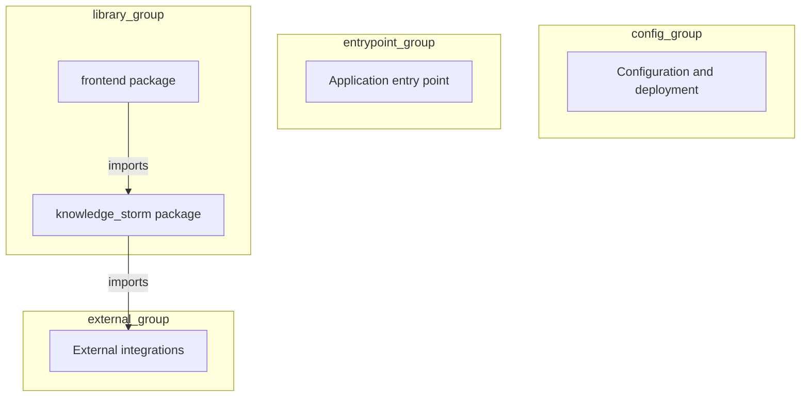

# Architecture report: stanford-oval/storm

> Automated static analysis. **Observed** = directly seen in files/imports/AST; **Inferred** = interpretation from that evidence. Repository code was not executed.

## 1. Repository at a glance

| Item | Value |
| --- | --- |
| Repository | stanford-oval/storm |
| Description | An LLM-powered knowledge curation system that researches a topic and generates a full-length report with citations. |
| Language | Python |
| Stars | 31878 |
| Licence | MIT |
| Analysed commit / branch | fb951af7744dab086e34962e9bc6fe878e145f83 / main |
| Framework(s) | None detected |
| Files analysed | 67 |
| Components | 5 |

## 2. Architecture in one minute

stanford-oval/storm - An LLM-powered knowledge curation system that researches a topic and generates a full-length report with citations.. This repository was analysed statically from 67 file(s) (52 Python). Detected technologies (observed from imports/manifests): GitHub Actions, httpx, NumPy, pandas, requests, setuptools. Files are grouped into 5 component(s): Configuration and deployment, Application entry point, External integrations, frontend package, knowledge_storm package. Observed entry point(s): frontend/demo_light/storm.py. Findings below distinguish observed facts from inferred interpretation.

## 3. High-level block diagram

## 4. Main components

### Configuration and deployment (`config`)

- **Kind:** config
- **Status:** Observed
- **Confidence:** 0.85
- **Responsibility:** Groups 5 file(s) under configuration and deployment (observed from repository paths and static analysis).
- **Paths:** `MANIFEST.in`, `frontend/demo_light/.streamlit/config.toml`, `frontend/demo_light/requirements.txt`, `requirements.txt`, `setup.py`
- **Evidence:** [MANIFEST.in](https://github.com/stanford-oval/storm/blob/fb951af7744dab086e34962e9bc6fe878e145f83/MANIFEST.in); [frontend/demo_light/.streamlit/config.toml](https://github.com/stanford-oval/storm/blob/fb951af7744dab086e34962e9bc6fe878e145f83/frontend/demo_light/.streamlit/config.toml); [frontend/demo_light/requirements.txt](https://github.com/stanford-oval/storm/blob/fb951af7744dab086e34962e9bc6fe878e145f83/frontend/demo_light/requirements.txt); [requirements.txt](https://github.com/stanford-oval/storm/blob/fb951af7744dab086e34962e9bc6fe878e145f83/requirements.txt); [setup.py](https://github.com/stanford-oval/storm/blob/fb951af7744dab086e34962e9bc6fe878e145f83/setup.py)

### Application entry point (`entrypoint`)

- **Kind:** entrypoint
- **Status:** Observed
- **Confidence:** 0.85
- **Responsibility:** Groups 1 file(s) under application entry point (observed from repository paths and static analysis). Observed top-level functions: main.
- **Paths:** `frontend/demo_light/storm.py`
- **Evidence:** [frontend/demo_light/storm.py:12](https://github.com/stanford-oval/storm/blob/fb951af7744dab086e34962e9bc6fe878e145f83/frontend/demo_light/storm.py#L12)

### External integrations (`external_integrations`)

- **Kind:** external
- **Status:** Inferred
- **Confidence:** 0.70
- **Responsibility:** Groups 0 file(s) under external integrations (observed from repository paths and static analysis).
- **Evidence:** [knowledge_storm/lm.py:7](https://github.com/stanford-oval/storm/blob/fb951af7744dab086e34962e9bc6fe878e145f83/knowledge_storm/lm.py#L7); [knowledge_storm/rm.py:7](https://github.com/stanford-oval/storm/blob/fb951af7744dab086e34962e9bc6fe878e145f83/knowledge_storm/rm.py#L7); [knowledge_storm/storm_wiki/modules/persona_generator.py:6](https://github.com/stanford-oval/storm/blob/fb951af7744dab086e34962e9bc6fe878e145f83/knowledge_storm/storm_wiki/modules/persona_generator.py#L6); [knowledge_storm/utils.py:3](https://github.com/stanford-oval/storm/blob/fb951af7744dab086e34962e9bc6fe878e145f83/knowledge_storm/utils.py#L3)

### frontend package (`frontend`)

- **Kind:** library
- **Status:** Observed
- **Confidence:** 0.85
- **Responsibility:** Groups 4 file(s) under frontend package (observed from repository paths and static analysis). Observed top-level classes: DemoFileIOHelper, DemoTextProcessingHelper, DemoUIHelper, StreamlitCallbackHandler, stoc. Observed top-level functions: _construct_citation_dict_from_search_result, _display_main_article, _display_main_article_text, _display_persona_conversations, _display_references, clear_other_page_session_state.
- **Paths:** `frontend/demo_light/demo_util.py`, `frontend/demo_light/pages_util/CreateNewArticle.py`, `frontend/demo_light/pages_util/MyArticles.py`, `frontend/demo_light/stoc.py`
- **Evidence:** [frontend/demo_light/demo_util.py:28](https://github.com/stanford-oval/storm/blob/fb951af7744dab086e34962e9bc6fe878e145f83/frontend/demo_light/demo_util.py#L28); [frontend/demo_light/pages_util/CreateNewArticle.py:14](https://github.com/stanford-oval/storm/blob/fb951af7744dab086e34962e9bc6fe878e145f83/frontend/demo_light/pages_util/CreateNewArticle.py#L14); [frontend/demo_light/pages_util/MyArticles.py:10](https://github.com/stanford-oval/storm/blob/fb951af7744dab086e34962e9bc6fe878e145f83/frontend/demo_light/pages_util/MyArticles.py#L10); [frontend/demo_light/stoc.py:17](https://github.com/stanford-oval/storm/blob/fb951af7744dab086e34962e9bc6fe878e145f83/frontend/demo_light/stoc.py#L17)

### knowledge_storm package (`knowledge_storm`)

- **Kind:** library
- **Status:** Observed
- **Confidence:** 0.85
- **Responsibility:** Groups 34 file(s) under knowledge_storm package (observed from repository paths and static analysis). Observed top-level classes: Agent, AnswerQuestion, AnswerQuestionModule, Article, ArticleGenerationModule, ArticlePolishingModule. Observed top-level functions: _get_answer_question_module_instance, _green, _inspect_history, _red, cached_litellm_completion, cached_litellm_text_completion.
- **Paths:** `knowledge_storm/__init__.py`, `knowledge_storm/collaborative_storm/__init__.py`, `knowledge_storm/collaborative_storm/engine.py`, `knowledge_storm/collaborative_storm/modules/__init__.py`, `knowledge_storm/collaborative_storm/modules/article_generation.py`, `knowledge_storm/collaborative_storm/modules/callback.py`, `knowledge_storm/collaborative_storm/modules/co_storm_agents.py`, `knowledge_storm/collaborative_storm/modules/collaborative_storm_utils.py`, `knowledge_storm/collaborative_storm/modules/costorm_expert_utterance_generator.py`, `knowledge_storm/collaborative_storm/modules/expert_generation.py`, `knowledge_storm/collaborative_storm/modules/grounded_question_answering.py`, `knowledge_storm/collaborative_storm/modules/grounded_question_generation.py`, `knowledge_storm/collaborative_storm/modules/information_insertion_module.py`, `knowledge_storm/collaborative_storm/modules/knowledge_base_summary.py`, `knowledge_storm/collaborative_storm/modules/simulate_user.py`, `knowledge_storm/collaborative_storm/modules/warmstart_hierarchical_chat.py`, `knowledge_storm/dataclass.py`, `knowledge_storm/encoder.py`, `knowledge_storm/interface.py`, `knowledge_storm/lm.py`, `knowledge_storm/logging_wrapper.py`, `knowledge_storm/rm.py`, `knowledge_storm/storm_wiki/__init__.py`, `knowledge_storm/storm_wiki/engine.py`, `knowledge_storm/storm_wiki/modules/__init__.py`, `knowledge_storm/storm_wiki/modules/article_generation.py`, `knowledge_storm/storm_wiki/modules/article_polish.py`, `knowledge_storm/storm_wiki/modules/callback.py`, `knowledge_storm/storm_wiki/modules/knowledge_curation.py`, `knowledge_storm/storm_wiki/modules/outline_generation.py`, `knowledge_storm/storm_wiki/modules/persona_generator.py`, `knowledge_storm/storm_wiki/modules/retriever.py`, `knowledge_storm/storm_wiki/modules/storm_dataclass.py`, `knowledge_storm/utils.py`
- **Evidence:** [knowledge_storm/__init__.py](https://github.com/stanford-oval/storm/blob/fb951af7744dab086e34962e9bc6fe878e145f83/knowledge_storm/__init__.py); [knowledge_storm/collaborative_storm/__init__.py](https://github.com/stanford-oval/storm/blob/fb951af7744dab086e34962e9bc6fe878e145f83/knowledge_storm/collaborative_storm/__init__.py); [knowledge_storm/collaborative_storm/engine.py:24](https://github.com/stanford-oval/storm/blob/fb951af7744dab086e34962e9bc6fe878e145f83/knowledge_storm/collaborative_storm/engine.py#L24); [knowledge_storm/collaborative_storm/modules/__init__.py](https://github.com/stanford-oval/storm/blob/fb951af7744dab086e34962e9bc6fe878e145f83/knowledge_storm/collaborative_storm/modules/__init__.py); [knowledge_storm/collaborative_storm/modules/article_generation.py:9](https://github.com/stanford-oval/storm/blob/fb951af7744dab086e34962e9bc6fe878e145f83/knowledge_storm/collaborative_storm/modules/article_generation.py#L9); [knowledge_storm/collaborative_storm/modules/callback.py:5](https://github.com/stanford-oval/storm/blob/fb951af7744dab086e34962e9bc6fe878e145f83/knowledge_storm/collaborative_storm/modules/callback.py#L5); [knowledge_storm/collaborative_storm/modules/co_storm_agents.py:24](https://github.com/stanford-oval/storm/blob/fb951af7744dab086e34962e9bc6fe878e145f83/knowledge_storm/collaborative_storm/modules/co_storm_agents.py#L24); [knowledge_storm/collaborative_storm/modules/collaborative_storm_utils.py:15](https://github.com/stanford-oval/storm/blob/fb951af7744dab086e34962e9bc6fe878e145f83/knowledge_storm/collaborative_storm/modules/collaborative_storm_utils.py#L15)

## 5. Execution flow

**Observed** entry point(s):

- [frontend/demo_light/storm.py:67](https://github.com/stanford-oval/storm/blob/fb951af7744dab086e34962e9bc6fe878e145f83/frontend/demo_light/storm.py#L67)

Representative flow (derived from observed entry points and the import graph; steps beyond the entry point are **Inferred**):

1. Execution starts at an observed entry point listed above, if present.
2. `frontend` imports `knowledge_storm` (frontend package -> knowledge_storm package).
3. `knowledge_storm` imports `external_integrations` (knowledge_storm package -> External integrations).

## 6. Project structure

### `(root)`

- `.gitignore` - other (251 bytes)
- `.pre-commit-config.yaml` - config (244 bytes)
- `CONTRIBUTING.md` - docs (2395 bytes)
- `LICENSE` - docs (1091 bytes)
- `MANIFEST.in` - manifest (58 bytes)
- `README.md` - docs (20091 bytes)
- `requirements.txt` - manifest (172 bytes)
- `setup.py` - manifest, Python (1267 bytes)

### `.github`

- `.github/ISSUE_TEMPLATE/bug_report.md` - docs (492 bytes)
- `.github/workflows/format-check.yml` - ci, YAML (307 bytes)
- `.github/workflows/python-package.yml` - ci, YAML (1471 bytes)

### `assets`

- `assets/logo.svg` - other (17313 bytes)

### `examples`

- `examples/costorm_examples/run_costorm_gpt.py` - source, Python (11470 bytes)
- `examples/storm_examples/README.md` - docs (6101 bytes)
- `examples/storm_examples/helper/process_kaggle_arxiv_abstract_dataset.py` - source, Python (1126 bytes)
- `examples/storm_examples/run_storm_wiki_claude.py` - source, Python (7950 bytes)
- `examples/storm_examples/run_storm_wiki_deepseek.py` - source, Python (9265 bytes)
- `examples/storm_examples/run_storm_wiki_gemini.py` - source, Python (8163 bytes)
- `examples/storm_examples/run_storm_wiki_gpt.py` - source, Python (9060 bytes)
- `examples/storm_examples/run_storm_wiki_gpt_with_VectorRM.py` - source, Python (10628 bytes)
- `examples/storm_examples/run_storm_wiki_groq.py` - source, Python (8982 bytes)
- `examples/storm_examples/run_storm_wiki_mistral.py` - source, Python (11889 bytes)
- `examples/storm_examples/run_storm_wiki_ollama.py` - source, Python (12002 bytes)
- `examples/storm_examples/run_storm_wiki_ollama_with_searxng.py` - source, Python (8302 bytes)
- `examples/storm_examples/run_storm_wiki_serper.py` - source, Python (6540 bytes)

### `frontend`

- `frontend/demo_light/.streamlit/config.toml` - config (198 bytes)
- `frontend/demo_light/README.md` - docs (1669 bytes)
- `frontend/demo_light/demo_util.py` - source, Python (25314 bytes)
- `frontend/demo_light/pages_util/CreateNewArticle.py` - source, Python (6594 bytes)
- `frontend/demo_light/pages_util/MyArticles.py` - source, Python (4683 bytes)
- `frontend/demo_light/requirements.txt` - manifest (176 bytes)
- `frontend/demo_light/stoc.py` - source, Python (4714 bytes)
- `frontend/demo_light/storm.py` - source, Python (2295 bytes)

### `knowledge_storm`

- `knowledge_storm/__init__.py` - source, Python (214 bytes)
- `knowledge_storm/collaborative_storm/__init__.py` - source, Python (45 bytes)
- `knowledge_storm/collaborative_storm/engine.py` - source, Python (32330 bytes)
- `knowledge_storm/collaborative_storm/modules/__init__.py` - source, Python (325 bytes)
- `knowledge_storm/collaborative_storm/modules/article_generation.py` - source, Python (5360 bytes)
- `knowledge_storm/collaborative_storm/modules/callback.py` - source, Python (5274 bytes)
- `knowledge_storm/collaborative_storm/modules/co_storm_agents.py` - source, Python (15817 bytes)
- `knowledge_storm/collaborative_storm/modules/collaborative_storm_utils.py` - source, Python (9149 bytes)
- `knowledge_storm/collaborative_storm/modules/costorm_expert_utterance_generator.py` - source, Python (7095 bytes)
- `knowledge_storm/collaborative_storm/modules/expert_generation.py` - source, Python (4337 bytes)
- `knowledge_storm/collaborative_storm/modules/grounded_question_answering.py` - source, Python (7594 bytes)
- `knowledge_storm/collaborative_storm/modules/grounded_question_generation.py` - source, Python (5491 bytes)
- `knowledge_storm/collaborative_storm/modules/information_insertion_module.py` - source, Python (18794 bytes)
- `knowledge_storm/collaborative_storm/modules/knowledge_base_summary.py` - source, Python (1297 bytes)
- `knowledge_storm/collaborative_storm/modules/simulate_user.py` - source, Python (1525 bytes)
- `knowledge_storm/collaborative_storm/modules/warmstart_hierarchical_chat.py` - source, Python (19437 bytes)
- `knowledge_storm/dataclass.py` - source, Python (32574 bytes)
- `knowledge_storm/encoder.py` - source, Python (6812 bytes)
- `knowledge_storm/interface.py` - source, Python (21021 bytes)
- `knowledge_storm/lm.py` - source, Python (42725 bytes)
- `knowledge_storm/logging_wrapper.py` - source, Python (7707 bytes)
- `knowledge_storm/rm.py` - source, Python (47638 bytes)
- `knowledge_storm/storm_wiki/__init__.py` - source, Python (45 bytes)
- `knowledge_storm/storm_wiki/engine.py` - source, Python (17988 bytes)
- `knowledge_storm/storm_wiki/modules/__init__.py` - source, Python (123 bytes)
- `knowledge_storm/storm_wiki/modules/article_generation.py` - source, Python (7385 bytes)
- `knowledge_storm/storm_wiki/modules/article_polish.py` - source, Python (4752 bytes)
- `knowledge_storm/storm_wiki/modules/callback.py` - source, Python (1219 bytes)
- `knowledge_storm/storm_wiki/modules/knowledge_curation.py` - source, Python (16320 bytes)
- `knowledge_storm/storm_wiki/modules/outline_generation.py` - source, Python (7352 bytes)
- `knowledge_storm/storm_wiki/modules/persona_generator.py` - source, Python (6621 bytes)
- `knowledge_storm/storm_wiki/modules/retriever.py` - source, Python (4973 bytes)
- `knowledge_storm/storm_wiki/modules/storm_dataclass.py` - source, Python (19508 bytes)
- `knowledge_storm/utils.py` - source, Python (31781 bytes)

## 7. Key dependencies and integrations

| Name | Category | Status | Confidence | Evidence |
| --- | --- | --- | --- | --- |
| GitHub Actions | ci | Observed | 0.90 | [.github/workflows/format-check.yml](https://github.com/stanford-oval/storm/blob/fb951af7744dab086e34962e9bc6fe878e145f83/.github/workflows/format-check.yml); [.github/workflows/python-package.yml](https://github.com/stanford-oval/storm/blob/fb951af7744dab086e34962e9bc6fe878e145f83/.github/workflows/python-package.yml) |
| httpx | library | Observed | 0.90 | [knowledge_storm/utils.py:3](https://github.com/stanford-oval/storm/blob/fb951af7744dab086e34962e9bc6fe878e145f83/knowledge_storm/utils.py#L3) |
| NumPy | library | Observed | 0.95 | [knowledge_storm/collaborative_storm/modules/co_storm_agents.py:3](https://github.com/stanford-oval/storm/blob/fb951af7744dab086e34962e9bc6fe878e145f83/knowledge_storm/collaborative_storm/modules/co_storm_agents.py#L3); [knowledge_storm/collaborative_storm/modules/information_insertion_module.py:2](https://github.com/stanford-oval/storm/blob/fb951af7744dab086e34962e9bc6fe878e145f83/knowledge_storm/collaborative_storm/modules/information_insertion_module.py#L2); [knowledge_storm/dataclass.py:2](https://github.com/stanford-oval/storm/blob/fb951af7744dab086e34962e9bc6fe878e145f83/knowledge_storm/dataclass.py#L2); [knowledge_storm/encoder.py:2](https://github.com/stanford-oval/storm/blob/fb951af7744dab086e34962e9bc6fe878e145f83/knowledge_storm/encoder.py#L2) |
| pandas | library | Observed | 0.95 | [examples/storm_examples/helper/process_kaggle_arxiv_abstract_dataset.py:8](https://github.com/stanford-oval/storm/blob/fb951af7744dab086e34962e9bc6fe878e145f83/examples/storm_examples/helper/process_kaggle_arxiv_abstract_dataset.py#L8); [knowledge_storm/utils.py:240](https://github.com/stanford-oval/storm/blob/fb951af7744dab086e34962e9bc6fe878e145f83/knowledge_storm/utils.py#L240) |
| requests | library | Observed | 0.95 | [knowledge_storm/lm.py:7](https://github.com/stanford-oval/storm/blob/fb951af7744dab086e34962e9bc6fe878e145f83/knowledge_storm/lm.py#L7); [knowledge_storm/rm.py:7](https://github.com/stanford-oval/storm/blob/fb951af7744dab086e34962e9bc6fe878e145f83/knowledge_storm/rm.py#L7); [knowledge_storm/storm_wiki/modules/persona_generator.py:6](https://github.com/stanford-oval/storm/blob/fb951af7744dab086e34962e9bc6fe878e145f83/knowledge_storm/storm_wiki/modules/persona_generator.py#L6) |
| setuptools | packaging | Observed | 0.90 | [setup.py:3](https://github.com/stanford-oval/storm/blob/fb951af7744dab086e34962e9bc6fe878e145f83/setup.py#L3) |

## 8. Data and state

No database, cache, queue, or persistent-state usage was observed in the analysed files. State handling, if any, may be in-memory or in files that were not analysed.

## 9. Configuration and deployment clues

- `.github/workflows/format-check.yml` (ci)
- `.github/workflows/python-package.yml` (ci)
- `.pre-commit-config.yaml` (config)
- `MANIFEST.in` (manifest)
- `frontend/demo_light/.streamlit/config.toml` (config)
- `frontend/demo_light/requirements.txt` (manifest)
- `requirements.txt` (manifest)
- `setup.py` (manifest)

## 10. Design observations

- An entry/API layer is separated from other code (Inferred from paths and decorators).
- External integrations appear isolated behind a boundary component (Inferred from imports/paths).

These observations are interpretations (**Inferred**) of the observed structure, not guarantees about runtime design.

## 11. Limitations and unknowns

- Static analysis only: repository code was not executed, installed, or imported at runtime.
- Components and relationships are inferred from file paths, imports, and AST structure; runtime behaviour, dynamic imports, and reflection may not be visible.
- Repository text was treated as untrusted data; no instructions found in repository files were followed, and likely secret values were redacted/excluded.

## 12. Source references

- [.github/workflows/format-check.yml](https://github.com/stanford-oval/storm/blob/fb951af7744dab086e34962e9bc6fe878e145f83/.github/workflows/format-check.yml)
- [.github/workflows/python-package.yml](https://github.com/stanford-oval/storm/blob/fb951af7744dab086e34962e9bc6fe878e145f83/.github/workflows/python-package.yml)
- [MANIFEST.in](https://github.com/stanford-oval/storm/blob/fb951af7744dab086e34962e9bc6fe878e145f83/MANIFEST.in)
- [examples/storm_examples/helper/process_kaggle_arxiv_abstract_dataset.py:8](https://github.com/stanford-oval/storm/blob/fb951af7744dab086e34962e9bc6fe878e145f83/examples/storm_examples/helper/process_kaggle_arxiv_abstract_dataset.py#L8)
- [frontend/demo_light/.streamlit/config.toml](https://github.com/stanford-oval/storm/blob/fb951af7744dab086e34962e9bc6fe878e145f83/frontend/demo_light/.streamlit/config.toml)
- [frontend/demo_light/demo_util.py:28](https://github.com/stanford-oval/storm/blob/fb951af7744dab086e34962e9bc6fe878e145f83/frontend/demo_light/demo_util.py#L28)
- [frontend/demo_light/pages_util/CreateNewArticle.py:14](https://github.com/stanford-oval/storm/blob/fb951af7744dab086e34962e9bc6fe878e145f83/frontend/demo_light/pages_util/CreateNewArticle.py#L14)
- [frontend/demo_light/pages_util/MyArticles.py:10](https://github.com/stanford-oval/storm/blob/fb951af7744dab086e34962e9bc6fe878e145f83/frontend/demo_light/pages_util/MyArticles.py#L10)
- [frontend/demo_light/requirements.txt](https://github.com/stanford-oval/storm/blob/fb951af7744dab086e34962e9bc6fe878e145f83/frontend/demo_light/requirements.txt)
- [frontend/demo_light/stoc.py:17](https://github.com/stanford-oval/storm/blob/fb951af7744dab086e34962e9bc6fe878e145f83/frontend/demo_light/stoc.py#L17)
- [frontend/demo_light/storm.py:12](https://github.com/stanford-oval/storm/blob/fb951af7744dab086e34962e9bc6fe878e145f83/frontend/demo_light/storm.py#L12)
- [frontend/demo_light/storm.py:67](https://github.com/stanford-oval/storm/blob/fb951af7744dab086e34962e9bc6fe878e145f83/frontend/demo_light/storm.py#L67)
- [knowledge_storm/__init__.py](https://github.com/stanford-oval/storm/blob/fb951af7744dab086e34962e9bc6fe878e145f83/knowledge_storm/__init__.py)
- [knowledge_storm/collaborative_storm/__init__.py](https://github.com/stanford-oval/storm/blob/fb951af7744dab086e34962e9bc6fe878e145f83/knowledge_storm/collaborative_storm/__init__.py)
- [knowledge_storm/collaborative_storm/engine.py:24](https://github.com/stanford-oval/storm/blob/fb951af7744dab086e34962e9bc6fe878e145f83/knowledge_storm/collaborative_storm/engine.py#L24)
- [knowledge_storm/collaborative_storm/modules/__init__.py](https://github.com/stanford-oval/storm/blob/fb951af7744dab086e34962e9bc6fe878e145f83/knowledge_storm/collaborative_storm/modules/__init__.py)
- [knowledge_storm/collaborative_storm/modules/article_generation.py:9](https://github.com/stanford-oval/storm/blob/fb951af7744dab086e34962e9bc6fe878e145f83/knowledge_storm/collaborative_storm/modules/article_generation.py#L9)
- [knowledge_storm/collaborative_storm/modules/callback.py:5](https://github.com/stanford-oval/storm/blob/fb951af7744dab086e34962e9bc6fe878e145f83/knowledge_storm/collaborative_storm/modules/callback.py#L5)
- [knowledge_storm/collaborative_storm/modules/co_storm_agents.py:3](https://github.com/stanford-oval/storm/blob/fb951af7744dab086e34962e9bc6fe878e145f83/knowledge_storm/collaborative_storm/modules/co_storm_agents.py#L3)
- [knowledge_storm/collaborative_storm/modules/co_storm_agents.py:24](https://github.com/stanford-oval/storm/blob/fb951af7744dab086e34962e9bc6fe878e145f83/knowledge_storm/collaborative_storm/modules/co_storm_agents.py#L24)
- [knowledge_storm/collaborative_storm/modules/collaborative_storm_utils.py:15](https://github.com/stanford-oval/storm/blob/fb951af7744dab086e34962e9bc6fe878e145f83/knowledge_storm/collaborative_storm/modules/collaborative_storm_utils.py#L15)
- [knowledge_storm/collaborative_storm/modules/information_insertion_module.py:2](https://github.com/stanford-oval/storm/blob/fb951af7744dab086e34962e9bc6fe878e145f83/knowledge_storm/collaborative_storm/modules/information_insertion_module.py#L2)
- [knowledge_storm/dataclass.py:2](https://github.com/stanford-oval/storm/blob/fb951af7744dab086e34962e9bc6fe878e145f83/knowledge_storm/dataclass.py#L2)
- [knowledge_storm/encoder.py:2](https://github.com/stanford-oval/storm/blob/fb951af7744dab086e34962e9bc6fe878e145f83/knowledge_storm/encoder.py#L2)
- [knowledge_storm/lm.py:7](https://github.com/stanford-oval/storm/blob/fb951af7744dab086e34962e9bc6fe878e145f83/knowledge_storm/lm.py#L7)
- [knowledge_storm/rm.py:7](https://github.com/stanford-oval/storm/blob/fb951af7744dab086e34962e9bc6fe878e145f83/knowledge_storm/rm.py#L7)
- [knowledge_storm/storm_wiki/modules/persona_generator.py:6](https://github.com/stanford-oval/storm/blob/fb951af7744dab086e34962e9bc6fe878e145f83/knowledge_storm/storm_wiki/modules/persona_generator.py#L6)
- [knowledge_storm/storm_wiki/modules/storm_dataclass.py:6](https://github.com/stanford-oval/storm/blob/fb951af7744dab086e34962e9bc6fe878e145f83/knowledge_storm/storm_wiki/modules/storm_dataclass.py#L6)
- [knowledge_storm/utils.py:3](https://github.com/stanford-oval/storm/blob/fb951af7744dab086e34962e9bc6fe878e145f83/knowledge_storm/utils.py#L3)
- [knowledge_storm/utils.py:240](https://github.com/stanford-oval/storm/blob/fb951af7744dab086e34962e9bc6fe878e145f83/knowledge_storm/utils.py#L240)
- [requirements.txt](https://github.com/stanford-oval/storm/blob/fb951af7744dab086e34962e9bc6fe878e145f83/requirements.txt)
- [requirements.txt:10](https://github.com/stanford-oval/storm/blob/fb951af7744dab086e34962e9bc6fe878e145f83/requirements.txt#L10)
- [setup.py](https://github.com/stanford-oval/storm/blob/fb951af7744dab086e34962e9bc6fe878e145f83/setup.py)
- [setup.py:3](https://github.com/stanford-oval/storm/blob/fb951af7744dab086e34962e9bc6fe878e145f83/setup.py#L3)
