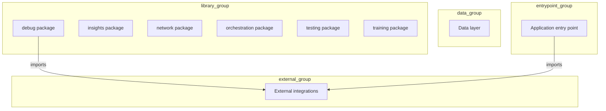

# Architecture report: stas00/ml-engineering

> Automated static analysis. **Observed** = directly seen in files/imports/AST; **Inferred** = interpretation from that evidence. Repository code was not executed.

## 1. Repository at a glance

| Item | Value |
| --- | --- |
| Repository | stas00/ml-engineering |
| Description | Machine Learning Engineering Open Book |
| Language | Python |
| Stars | 19713 |
| Licence | CC-BY-SA-4.0 |
| Analysed commit / branch | fbe87165bd90a697b158dd056fdb4703a0b85350 / master |
| Framework(s) | None detected |
| Files analysed | 127 |
| Components | 9 |

## 2. Architecture in one minute

stas00/ml-engineering - Machine Learning Engineering Open Book. This repository was analysed statically from 127 file(s) (47 Python). Detected technologies (observed from imports/manifests): NumPy, unittest. Files are grouped into 9 component(s): Data layer, debug package, Application entry point, External integrations, insights package, network package, orchestration package, testing package. Observed entry point(s): compute/accelerator/benchmarks/mamf-finder-all-gpus.py, compute/accelerator/benchmarks/mamf-finder.py, debug/NicerTrace.py. Findings below distinguish observed facts from inferred interpretation.

## 3. High-level block diagram

## 4. Main components

### Data layer (`data_layer`)

- **Kind:** data
- **Status:** Observed
- **Confidence:** 0.85
- **Responsibility:** Groups 2 file(s) under data layer (observed from repository paths and static analysis). Observed top-level functions: drop_page_cache.
- **Paths:** `storage/fio-json-extract.py`, `storage/mmap-io-bench.py`
- **Evidence:** [storage/fio-json-extract.py](https://github.com/stas00/ml-engineering/blob/fbe87165bd90a697b158dd056fdb4703a0b85350/storage/fio-json-extract.py); [storage/mmap-io-bench.py:41](https://github.com/stas00/ml-engineering/blob/fbe87165bd90a697b158dd056fdb4703a0b85350/storage/mmap-io-bench.py#L41)

### debug package (`debug`)

- **Kind:** library
- **Status:** Observed
- **Confidence:** 0.85
- **Responsibility:** Groups 18 file(s) under debug package (observed from repository paths and static analysis). Observed top-level classes: C4En10k, CM4Synthetic, DebugOption, DebugUnderflowOverflow, ExplicitEnum, GeneralPMDSynthetic. Observed top-level functions: buggy, detect_overflow, dump_example_shapes, get_abs_min_max, is_user, list2range.
- **Paths:** `debug/code/collective_mismatch.py`, `debug/code/collective_mismatch_analyze.py`, `debug/code/kernel_oob.py`, `debug/code/kernel_oob_gdb.py`, `debug/code/kernel_oob_prebuilt.py`, `debug/code/kernel_race.py`, `debug/tiny-scripts/c4-en-10k.py`, `debug/tiny-scripts/cm4-synthetic-testing.py`, `debug/tiny-scripts/fsmt-make-super-tiny-model.py`, `debug/tiny-scripts/general-pmd-ds-unpack.py`, `debug/tiny-scripts/general-pmd-synthetic-testing.py`, `debug/tiny-scripts/idefics-make-tiny-model.py`, `debug/tiny-scripts/m4-ds-unpack.py`, `debug/tiny-scripts/mt5-make-tiny-model.py`, `debug/tiny-scripts/openwebtext-10k.py`, `debug/tiny-scripts/oscar-en-10k.py`, `debug/torch-distributed-gpu-test.py`, `debug/underflow_overflow.py`
- **Evidence:** [debug/code/collective_mismatch.py:5](https://github.com/stas00/ml-engineering/blob/fbe87165bd90a697b158dd056fdb4703a0b85350/debug/code/collective_mismatch.py#L5); [debug/code/collective_mismatch_analyze.py:8](https://github.com/stas00/ml-engineering/blob/fbe87165bd90a697b158dd056fdb4703a0b85350/debug/code/collective_mismatch_analyze.py#L8); [debug/code/kernel_oob.py](https://github.com/stas00/ml-engineering/blob/fbe87165bd90a697b158dd056fdb4703a0b85350/debug/code/kernel_oob.py); [debug/code/kernel_oob_gdb.py](https://github.com/stas00/ml-engineering/blob/fbe87165bd90a697b158dd056fdb4703a0b85350/debug/code/kernel_oob_gdb.py); [debug/code/kernel_oob_prebuilt.py](https://github.com/stas00/ml-engineering/blob/fbe87165bd90a697b158dd056fdb4703a0b85350/debug/code/kernel_oob_prebuilt.py); [debug/code/kernel_race.py](https://github.com/stas00/ml-engineering/blob/fbe87165bd90a697b158dd056fdb4703a0b85350/debug/code/kernel_race.py); [debug/tiny-scripts/c4-en-10k.py:43](https://github.com/stas00/ml-engineering/blob/fbe87165bd90a697b158dd056fdb4703a0b85350/debug/tiny-scripts/c4-en-10k.py#L43); [debug/tiny-scripts/cm4-synthetic-testing.py:79](https://github.com/stas00/ml-engineering/blob/fbe87165bd90a697b158dd056fdb4703a0b85350/debug/tiny-scripts/cm4-synthetic-testing.py#L79)

### Application entry point (`entrypoint`)

- **Kind:** entrypoint
- **Status:** Observed
- **Confidence:** 0.85
- **Responsibility:** Groups 16 file(s) under application entry point (observed from repository paths and static analysis). Observed top-level classes: AMDArch, Arch, CudaLikeArch, FakeTelemetry, HPUArch, MPSArch. Observed top-level functions: _burst_one, _goes_first, apply_headlines, benchmark_mm, boost_reference, build_mamf_recall_pool.
- **Paths:** `compute/accelerator/benchmarks/mamf-finder-all-gpus.py`, `compute/accelerator/benchmarks/mamf-finder.py`, `debug/NicerTrace.py`, `debug/code/see-mem-usage.py`, `insights/when-to-upgrade-gpus/bench_decompose.py`, `insights/when-to-upgrade-gpus/benchmark.py`, `network/benchmarks/all_reduce_latency_comp.py`, `network/benchmarks/torch-dist-bench.py`, `training/checkpoints/torch-checkpoint-shrink.py`, `training/fault-tolerance/fs-watchdog.py`, `training/fault-tolerance/slurm-status.py`, `training/performance/benchmarks/numa/numa-set-pynvml.py`, `training/performance/benchmarks/torch-compile-bench.py`, `training/performance/distributed/torch-dist-mem-usage.py`, `training/tools/main_process_first.py`, `training/tools/multi-gpu-non-interleaved-print.py`
- **Evidence:** [compute/accelerator/benchmarks/mamf-finder-all-gpus.py:99](https://github.com/stas00/ml-engineering/blob/fbe87165bd90a697b158dd056fdb4703a0b85350/compute/accelerator/benchmarks/mamf-finder-all-gpus.py#L99); [compute/accelerator/benchmarks/mamf-finder.py:102](https://github.com/stas00/ml-engineering/blob/fbe87165bd90a697b158dd056fdb4703a0b85350/compute/accelerator/benchmarks/mamf-finder.py#L102); [debug/NicerTrace.py:18](https://github.com/stas00/ml-engineering/blob/fbe87165bd90a697b158dd056fdb4703a0b85350/debug/NicerTrace.py#L18); [debug/code/see-mem-usage.py:26](https://github.com/stas00/ml-engineering/blob/fbe87165bd90a697b158dd056fdb4703a0b85350/debug/code/see-mem-usage.py#L26); [insights/when-to-upgrade-gpus/bench_decompose.py:57](https://github.com/stas00/ml-engineering/blob/fbe87165bd90a697b158dd056fdb4703a0b85350/insights/when-to-upgrade-gpus/bench_decompose.py#L57); [insights/when-to-upgrade-gpus/benchmark.py:49](https://github.com/stas00/ml-engineering/blob/fbe87165bd90a697b158dd056fdb4703a0b85350/insights/when-to-upgrade-gpus/benchmark.py#L49); [network/benchmarks/all_reduce_latency_comp.py:21](https://github.com/stas00/ml-engineering/blob/fbe87165bd90a697b158dd056fdb4703a0b85350/network/benchmarks/all_reduce_latency_comp.py#L21); [network/benchmarks/torch-dist-bench.py:167](https://github.com/stas00/ml-engineering/blob/fbe87165bd90a697b158dd056fdb4703a0b85350/network/benchmarks/torch-dist-bench.py#L167)

### External integrations (`external_integrations`)

- **Kind:** external
- **Status:** Inferred
- **Confidence:** 0.70
- **Responsibility:** Groups 0 file(s) under external integrations (observed from repository paths and static analysis).
- **Evidence:** [debug/NicerTrace.py:11](https://github.com/stas00/ml-engineering/blob/fbe87165bd90a697b158dd056fdb4703a0b85350/debug/NicerTrace.py#L11); [debug/torch-distributed-gpu-test.py:61](https://github.com/stas00/ml-engineering/blob/fbe87165bd90a697b158dd056fdb4703a0b85350/debug/torch-distributed-gpu-test.py#L61); [network/benchmarks/all_reduce_latency_comp.py:10](https://github.com/stas00/ml-engineering/blob/fbe87165bd90a697b158dd056fdb4703a0b85350/network/benchmarks/all_reduce_latency_comp.py#L10); [network/benchmarks/torch-dist-bench.py:113](https://github.com/stas00/ml-engineering/blob/fbe87165bd90a697b158dd056fdb4703a0b85350/network/benchmarks/torch-dist-bench.py#L113); [training/fault-tolerance/fs-watchdog.py:14](https://github.com/stas00/ml-engineering/blob/fbe87165bd90a697b158dd056fdb4703a0b85350/training/fault-tolerance/fs-watchdog.py#L14); [training/fault-tolerance/slurm-status.py:19](https://github.com/stas00/ml-engineering/blob/fbe87165bd90a697b158dd056fdb4703a0b85350/training/fault-tolerance/slurm-status.py#L19)

### insights package (`insights`)

- **Kind:** library
- **Status:** Observed
- **Confidence:** 0.85
- **Responsibility:** Groups 4 file(s) under insights package (observed from repository paths and static analysis). Observed top-level functions: bench.
- **Paths:** `insights/when-to-upgrade-gpus/bench_flash_attn.py`, `insights/when-to-upgrade-gpus/install.sh`, `insights/when-to-upgrade-gpus/plot_results.py`, `insights/when-to-upgrade-gpus/run_sweep.sh`
- **Evidence:** [insights/when-to-upgrade-gpus/bench_flash_attn.py:31](https://github.com/stas00/ml-engineering/blob/fbe87165bd90a697b158dd056fdb4703a0b85350/insights/when-to-upgrade-gpus/bench_flash_attn.py#L31); [insights/when-to-upgrade-gpus/install.sh](https://github.com/stas00/ml-engineering/blob/fbe87165bd90a697b158dd056fdb4703a0b85350/insights/when-to-upgrade-gpus/install.sh); [insights/when-to-upgrade-gpus/plot_results.py](https://github.com/stas00/ml-engineering/blob/fbe87165bd90a697b158dd056fdb4703a0b85350/insights/when-to-upgrade-gpus/plot_results.py); [insights/when-to-upgrade-gpus/run_sweep.sh](https://github.com/stas00/ml-engineering/blob/fbe87165bd90a697b158dd056fdb4703a0b85350/insights/when-to-upgrade-gpus/run_sweep.sh)

### network package (`network`)

- **Kind:** library
- **Status:** Observed
- **Confidence:** 0.85
- **Responsibility:** Groups 3 file(s) under network package (observed from repository paths and static analysis). Observed top-level functions: all_gather, all_gather_object, all_reduce.
- **Paths:** `network/benchmarks/all_gather_object_vs_all_gather.py`, `network/benchmarks/all_gather_object_vs_all_reduce.py`, `network/benchmarks/all_reduce_bench.py`
- **Evidence:** [network/benchmarks/all_gather_object_vs_all_gather.py:33](https://github.com/stas00/ml-engineering/blob/fbe87165bd90a697b158dd056fdb4703a0b85350/network/benchmarks/all_gather_object_vs_all_gather.py#L33); [network/benchmarks/all_gather_object_vs_all_reduce.py:28](https://github.com/stas00/ml-engineering/blob/fbe87165bd90a697b158dd056fdb4703a0b85350/network/benchmarks/all_gather_object_vs_all_reduce.py#L28); [network/benchmarks/all_reduce_bench.py](https://github.com/stas00/ml-engineering/blob/fbe87165bd90a697b158dd056fdb4703a0b85350/network/benchmarks/all_reduce_bench.py)

### orchestration package (`orchestration`)

- **Kind:** library
- **Status:** Observed
- **Confidence:** 0.85
- **Responsibility:** Groups 1 file(s) under orchestration package (observed from repository paths and static analysis).
- **Paths:** `orchestration/slurm/undrain-good-nodes.sh`
- **Evidence:** [orchestration/slurm/undrain-good-nodes.sh](https://github.com/stas00/ml-engineering/blob/fbe87165bd90a697b158dd056fdb4703a0b85350/orchestration/slurm/undrain-good-nodes.sh)

### testing package (`testing`)

- **Kind:** library
- **Status:** Observed
- **Confidence:** 0.85
- **Responsibility:** Groups 1 file(s) under testing package (observed from repository paths and static analysis). Observed top-level classes: CaptureLogger, CaptureStd, CaptureStderr, CaptureStdout, TestCasePlus, _RunOutput. Observed top-level functions: ExtendSysPath, _read_stream, _stream_subprocess, apply_print_resets, execute_subprocess_async, get_gpu_count.
- **Paths:** `testing/testing_utils.py`
- **Evidence:** [testing/testing_utils.py:50](https://github.com/stas00/ml-engineering/blob/fbe87165bd90a697b158dd056fdb4703a0b85350/testing/testing_utils.py#L50)

### training package (`training`)

- **Kind:** library
- **Status:** Observed
- **Confidence:** 0.85
- **Responsibility:** Groups 6 file(s) under training package (observed from repository paths and static analysis). Observed top-level classes: MyDataset. Observed top-level functions: benchmark_bmm, printflock.
- **Paths:** `training/performance/benchmarks/activation-memory-per-layer.py`, `training/performance/benchmarks/dataloader/num-workers-bench.py`, `training/performance/benchmarks/dataloader/pin-memory-non-block-bench.py`, `training/performance/benchmarks/matrix-shape/swiglu-maf-bench.py`, `training/performance/benchmarks/numa/numa-set.sh`, `training/tools/printflock.py`
- **Evidence:** [training/performance/benchmarks/activation-memory-per-layer.py](https://github.com/stas00/ml-engineering/blob/fbe87165bd90a697b158dd056fdb4703a0b85350/training/performance/benchmarks/activation-memory-per-layer.py); [training/performance/benchmarks/dataloader/num-workers-bench.py:16](https://github.com/stas00/ml-engineering/blob/fbe87165bd90a697b158dd056fdb4703a0b85350/training/performance/benchmarks/dataloader/num-workers-bench.py#L16); [training/performance/benchmarks/dataloader/pin-memory-non-block-bench.py:25](https://github.com/stas00/ml-engineering/blob/fbe87165bd90a697b158dd056fdb4703a0b85350/training/performance/benchmarks/dataloader/pin-memory-non-block-bench.py#L25); [training/performance/benchmarks/matrix-shape/swiglu-maf-bench.py:48](https://github.com/stas00/ml-engineering/blob/fbe87165bd90a697b158dd056fdb4703a0b85350/training/performance/benchmarks/matrix-shape/swiglu-maf-bench.py#L48); [training/performance/benchmarks/numa/numa-set.sh](https://github.com/stas00/ml-engineering/blob/fbe87165bd90a697b158dd056fdb4703a0b85350/training/performance/benchmarks/numa/numa-set.sh); [training/tools/printflock.py:22](https://github.com/stas00/ml-engineering/blob/fbe87165bd90a697b158dd056fdb4703a0b85350/training/tools/printflock.py#L22)

## 5. Execution flow

**Observed** entry point(s):

- [compute/accelerator/benchmarks/mamf-finder-all-gpus.py:364](https://github.com/stas00/ml-engineering/blob/fbe87165bd90a697b158dd056fdb4703a0b85350/compute/accelerator/benchmarks/mamf-finder-all-gpus.py#L364)
- [compute/accelerator/benchmarks/mamf-finder.py:1983](https://github.com/stas00/ml-engineering/blob/fbe87165bd90a697b158dd056fdb4703a0b85350/compute/accelerator/benchmarks/mamf-finder.py#L1983)
- [debug/NicerTrace.py:201](https://github.com/stas00/ml-engineering/blob/fbe87165bd90a697b158dd056fdb4703a0b85350/debug/NicerTrace.py#L201)
- [debug/code/see-mem-usage.py:126](https://github.com/stas00/ml-engineering/blob/fbe87165bd90a697b158dd056fdb4703a0b85350/debug/code/see-mem-usage.py#L126)
- [insights/when-to-upgrade-gpus/bench_decompose.py:208](https://github.com/stas00/ml-engineering/blob/fbe87165bd90a697b158dd056fdb4703a0b85350/insights/when-to-upgrade-gpus/bench_decompose.py#L208)
- [insights/when-to-upgrade-gpus/benchmark.py:224](https://github.com/stas00/ml-engineering/blob/fbe87165bd90a697b158dd056fdb4703a0b85350/insights/when-to-upgrade-gpus/benchmark.py#L224)
- [network/benchmarks/all_reduce_latency_comp.py:91](https://github.com/stas00/ml-engineering/blob/fbe87165bd90a697b158dd056fdb4703a0b85350/network/benchmarks/all_reduce_latency_comp.py#L91)
- [network/benchmarks/torch-dist-bench.py:1020](https://github.com/stas00/ml-engineering/blob/fbe87165bd90a697b158dd056fdb4703a0b85350/network/benchmarks/torch-dist-bench.py#L1020)
- [training/checkpoints/torch-checkpoint-shrink.py:81](https://github.com/stas00/ml-engineering/blob/fbe87165bd90a697b158dd056fdb4703a0b85350/training/checkpoints/torch-checkpoint-shrink.py#L81)
- [training/fault-tolerance/fs-watchdog.py:183](https://github.com/stas00/ml-engineering/blob/fbe87165bd90a697b158dd056fdb4703a0b85350/training/fault-tolerance/fs-watchdog.py#L183)
- [training/fault-tolerance/slurm-status.py:179](https://github.com/stas00/ml-engineering/blob/fbe87165bd90a697b158dd056fdb4703a0b85350/training/fault-tolerance/slurm-status.py#L179)
- [training/performance/benchmarks/numa/numa-set-pynvml.py:48](https://github.com/stas00/ml-engineering/blob/fbe87165bd90a697b158dd056fdb4703a0b85350/training/performance/benchmarks/numa/numa-set-pynvml.py#L48)

Representative flow (derived from observed entry points and the import graph; steps beyond the entry point are **Inferred**):

1. Execution starts at an observed entry point listed above, if present.
2. `debug` imports `external_integrations` (debug package -> External integrations).
3. `entrypoint` imports `external_integrations` (Application entry point -> External integrations).

## 6. Project structure

### `(root)`

- `.gitignore` - other (1984 bytes)
- `LICENSE-CC-BY-SA` - other (20131 bytes)
- `Makefile` - other (3625 bytes)
- `README.md` - docs (9539 bytes)
- `SKILL.md` - docs (225 bytes)
- `chapters-md.txt` - docs (1299 bytes)
- `contributors.md` - docs (1580 bytes)
- `todo.md` - docs (11781 bytes)

### `compute`

- `compute/README.md` - docs (240 bytes)
- `compute/accelerator/README.md` - docs (129402 bytes)
- `compute/accelerator/amd/debug.md` - docs (11491 bytes)
- `compute/accelerator/amd/performance.md` - docs (600 bytes)
- `compute/accelerator/benchmarks/README.md` - docs (37251 bytes)
- `compute/accelerator/benchmarks/mamf-finder-all-gpus.py` - source, Python (17524 bytes)
- `compute/accelerator/benchmarks/mamf-finder.py` - source, Python (115762 bytes)
- `compute/accelerator/nvidia/debug.md` - docs (28705 bytes)
- `compute/cpu-memory/README.md` - docs (2523 bytes)
- `compute/cpu/README.md` - docs (6424 bytes)

### `courses`

- `courses/lesson-learned/README.md` - docs (41679 bytes)
- `courses/lesson-learned/lesson-learned-cover.prompt` - other (2328 bytes)

### `debug`

- `debug/NicerTrace.py` - source, Python (9469 bytes)
- `debug/README.md` - docs (851 bytes)
- `debug/code/collective_mismatch.py` - source, Python (495 bytes)
- `debug/code/collective_mismatch_analyze.py` - source, Python (867 bytes)
- `debug/code/kernel_oob.cu` - other (459 bytes)
- `debug/code/kernel_oob.py` - source, Python (237 bytes)
- `debug/code/kernel_oob_gdb.py` - source, Python (300 bytes)
- `debug/code/kernel_oob_prebuilt.py` - source, Python (273 bytes)
- `debug/code/kernel_race.cu` - other (513 bytes)
- `debug/code/kernel_race.py` - source, Python (239 bytes)
- `debug/code/see-mem-usage.py` - source, Python (4950 bytes)
- `debug/make-tiny-models-tokenizers-datasets.md` - docs (1357 bytes)
- `debug/nccl-performance-debug.md` - docs (79 bytes)
- `debug/tiny-scripts/README.md` - docs (687 bytes)
- `debug/tiny-scripts/c4-en-10k.py` - source, Python (2622 bytes)
- `debug/tiny-scripts/cm4-synthetic-testing.py` - source, Python (8260 bytes)
- `debug/tiny-scripts/fsmt-make-super-tiny-model.py` - source, Python (3263 bytes)
- `debug/tiny-scripts/general-pmd-ds-unpack.py` - source, Python (3142 bytes)
- `debug/tiny-scripts/general-pmd-synthetic-testing.py` - source, Python (6837 bytes)
- `debug/tiny-scripts/idefics-make-tiny-model.py` - source, Python (1545 bytes)
- `debug/tiny-scripts/m4-ds-unpack.py` - source, Python (3553 bytes)
- `debug/tiny-scripts/mt5-make-tiny-model.py` - source, Python (3347 bytes)
- `debug/tiny-scripts/openwebtext-10k.py` - source, Python (3078 bytes)
- `debug/tiny-scripts/oscar-en-10k.py` - source, Python (4193 bytes)
- `debug/tools.md` - docs (9945 bytes)
- `debug/torch-distributed-gpu-test.py` - source, Python (3787 bytes)
- `debug/torch-distributed-hanging-solutions.md` - docs (2041 bytes)
- `debug/underflow_overflow.md` - docs (288 bytes)
- `debug/underflow_overflow.py` - source, Python (13104 bytes)

### `inference`

- `inference/README.md` - docs (55205 bytes)

### `insights`

- `insights/ai-battlefield.md` - docs (30919 bytes)
- `insights/how-to-choose-cloud-provider.md` - docs (34971 bytes)
- `insights/when-to-upgrade-gpus/README.md` - docs (39591 bytes)
- `insights/when-to-upgrade-gpus/bench_decompose.py` - source, Python (8830 bytes)
- `insights/when-to-upgrade-gpus/bench_flash_attn.py` - source, Python (1823 bytes)
- `insights/when-to-upgrade-gpus/benchmark.py` - source, Python (9587 bytes)
- `insights/when-to-upgrade-gpus/install.sh` - source, Shell (4663 bytes)
- `insights/when-to-upgrade-gpus/plot_results.py` - source, Python (2975 bytes)
- `insights/when-to-upgrade-gpus/run_sweep.sh` - source, Shell (1124 bytes)

### `model-parallelism`

- `model-parallelism/README.md` - docs (87 bytes)

### `network`

- `network/README.md` - docs (153026 bytes)
- `network/benchmarks/README.md` - docs (57048 bytes)
- `network/benchmarks/all_gather_object_vs_all_gather.py` - source, Python (1732 bytes)
- `network/benchmarks/all_gather_object_vs_all_reduce.py` - source, Python (1302 bytes)
- `network/benchmarks/all_reduce_bench.py` - source, Python (898 bytes)
- `network/benchmarks/all_reduce_latency_comp.py` - source, Python (3365 bytes)
- `network/benchmarks/torch-dist-bench-pyxis.sbatch` - other (728 bytes)
- `network/benchmarks/torch-dist-bench.py` - source, Python (48493 bytes)
- `network/comms.md` - docs (13527 bytes)
- `network/debug/README.md` - docs (20080 bytes)

### `orchestration`

- `orchestration/README.md` - docs (2469 bytes)
- `orchestration/kubernetes/README.md` - docs (2582 bytes)
- `orchestration/slurm/README.md` - docs (1277 bytes)
- `orchestration/slurm/admin.md` - docs (4225 bytes)
- `orchestration/slurm/cron-daily.slurm` - other (690 bytes)
- `orchestration/slurm/cron-hourly.slurm` - other (692 bytes)
- `orchestration/slurm/example.slurm` - other (2190 bytes)
- `orchestration/slurm/launchers/README.md` - docs (1089 bytes)
- `orchestration/slurm/launchers/accelerate-launcher.slurm` - other (3055 bytes)
- `orchestration/slurm/launchers/lightning-launcher.slurm` - other (2152 bytes)
- `orchestration/slurm/launchers/srun-launcher.slurm` - other (2650 bytes)
- `orchestration/slurm/launchers/torchrun-launcher.slurm` - other (2775 bytes)
- `orchestration/slurm/performance.md` - docs (3693 bytes)
- `orchestration/slurm/undrain-good-nodes.sh` - source, Shell (1880 bytes)
- `orchestration/slurm/users.md` - docs (46867 bytes)

### `resources`

- `resources/README.md` - docs (8331 bytes)

### `skills`

- `skills/README.md` - docs (1069 bytes)
- `skills/evaluate-cluster/SKILL.md` - docs (104657 bytes)
- `skills/ml-engineering/SKILL.md` - docs (22669 bytes)

### `stabs`

- `stabs/README.md` - docs (111 bytes)
- `stabs/incoming.md` - docs (8594 bytes)

### `storage`

- `storage/README.md` - docs (64813 bytes)
- `storage/fio-json-extract.py` - source, Python (1055 bytes)
- `storage/fio-scan` - other (2822 bytes)
- `storage/mmap-io-bench.py` - source, Python (3704 bytes)

### `testing`

- `testing/README.md` - docs (32783 bytes)
- `testing/testing_utils.py` - source, Python (38139 bytes)

### `training`

- `training/README.md` - docs (1101 bytes)
- `training/checkpoints/README.md` - docs (577 bytes)
- `training/checkpoints/torch-checkpoint-convert-to-bf16` - other (1348 bytes)
- `training/checkpoints/torch-checkpoint-shrink.py` - source, Python (3312 bytes)
- `training/datasets.md` - docs (2557 bytes)
- `training/dtype.md` - docs (12293 bytes)
- `training/emulate-multi-node.md` - docs (28984 bytes)
- `training/fault-tolerance/README.md` - docs (41962 bytes)
- `training/fault-tolerance/fs-watchdog.py` - source, Python (7408 bytes)
- `training/fault-tolerance/fs-watchdog.slurm` - other (614 bytes)
- `training/fault-tolerance/slurm-status.py` - source, Python (6213 bytes)
- `training/fault-tolerance/slurm-status.slurm` - other (975 bytes)
- `training/hparams.md` - docs (2328 bytes)
- `training/instabilities/README.md` - docs (5175 bytes)
- `training/instabilities/training-loss-patterns.md` - docs (10937 bytes)
- `training/model-parallelism/README.md` - docs (56178 bytes)
- `training/performance/README.md` - docs (87060 bytes)
- `training/performance/benchmarks/activation-memory-per-layer.py` - source, Python (1767 bytes)
- `training/performance/benchmarks/dataloader/num-workers-bench.py` - source, Python (1636 bytes)
- `training/performance/benchmarks/dataloader/pin-memory-non-block-bench.py` - source, Python (2156 bytes)
- `training/performance/benchmarks/matrix-shape/swiglu-maf-bench.py` - source, Python (3465 bytes)
- `training/performance/benchmarks/numa/numa-set-pynvml.py` - source, Python (1967 bytes)
- `training/performance/benchmarks/numa/numa-set.sh` - source, Shell (1011 bytes)
- `training/performance/benchmarks/torch-compile-bench.py` - source, Python (2348 bytes)
- `training/performance/distributed/torch-dist-mem-usage.py` - source, Python (3395 bytes)
- `training/re-train-hub-models.md` - docs (2541 bytes)
- `training/reproducibility/README.md` - docs (13926 bytes)
- `training/tools/main_process_first.py` - source, Python (6386 bytes)
- `training/tools/multi-gpu-non-interleaved-print.py` - source, Python (1202 bytes)
- `training/tools/printflock.py` - source, Python (1903 bytes)

## 7. Key dependencies and integrations

| Name | Category | Status | Confidence | Evidence |
| --- | --- | --- | --- | --- |
| NumPy | library | Observed | 0.95 | [compute/accelerator/benchmarks/mamf-finder.py:50](https://github.com/stas00/ml-engineering/blob/fbe87165bd90a697b158dd056fdb4703a0b85350/compute/accelerator/benchmarks/mamf-finder.py#L50); [debug/tiny-scripts/general-pmd-ds-unpack.py:26](https://github.com/stas00/ml-engineering/blob/fbe87165bd90a697b158dd056fdb4703a0b85350/debug/tiny-scripts/general-pmd-ds-unpack.py#L26); [debug/tiny-scripts/m4-ds-unpack.py:28](https://github.com/stas00/ml-engineering/blob/fbe87165bd90a697b158dd056fdb4703a0b85350/debug/tiny-scripts/m4-ds-unpack.py#L28); [storage/mmap-io-bench.py:18](https://github.com/stas00/ml-engineering/blob/fbe87165bd90a697b158dd056fdb4703a0b85350/storage/mmap-io-bench.py#L18) |
| unittest | tooling | Observed | 0.95 | [testing/testing_utils.py:29](https://github.com/stas00/ml-engineering/blob/fbe87165bd90a697b158dd056fdb4703a0b85350/testing/testing_utils.py#L29); [testing/testing_utils.py:34](https://github.com/stas00/ml-engineering/blob/fbe87165bd90a697b158dd056fdb4703a0b85350/testing/testing_utils.py#L34); [testing/testing_utils.py:35](https://github.com/stas00/ml-engineering/blob/fbe87165bd90a697b158dd056fdb4703a0b85350/testing/testing_utils.py#L35) |

## 8. Data and state

- Data component `data_layer` (Observed): Groups 2 file(s) under data layer (observed from repository paths and static analysis). Observed top-level functions: drop_page_cache.

## 9. Configuration and deployment clues

No configuration, manifest, CI, or container files were observed.

## 10. Design observations

- An entry/API layer is separated from other code (Inferred from paths and decorators).
- Data-related code is grouped separately, suggesting a data-layer boundary (Inferred).
- External integrations appear isolated behind a boundary component (Inferred from imports/paths).

These observations are interpretations (**Inferred**) of the observed structure, not guarantees about runtime design.

## 11. Limitations and unknowns

- Static analysis only: repository code was not executed, installed, or imported at runtime.
- Components and relationships are inferred from file paths, imports, and AST structure; runtime behaviour, dynamic imports, and reflection may not be visible.
- 20 file(s) were skipped during inventory (20 x vendored/generated directory excluded).
- Repository text was treated as untrusted data; no instructions found in repository files were followed, and likely secret values were redacted/excluded.

## 12. Source references

- [compute/accelerator/benchmarks/mamf-finder-all-gpus.py:99](https://github.com/stas00/ml-engineering/blob/fbe87165bd90a697b158dd056fdb4703a0b85350/compute/accelerator/benchmarks/mamf-finder-all-gpus.py#L99)
- [compute/accelerator/benchmarks/mamf-finder-all-gpus.py:364](https://github.com/stas00/ml-engineering/blob/fbe87165bd90a697b158dd056fdb4703a0b85350/compute/accelerator/benchmarks/mamf-finder-all-gpus.py#L364)
- [compute/accelerator/benchmarks/mamf-finder.py:50](https://github.com/stas00/ml-engineering/blob/fbe87165bd90a697b158dd056fdb4703a0b85350/compute/accelerator/benchmarks/mamf-finder.py#L50)
- [compute/accelerator/benchmarks/mamf-finder.py:102](https://github.com/stas00/ml-engineering/blob/fbe87165bd90a697b158dd056fdb4703a0b85350/compute/accelerator/benchmarks/mamf-finder.py#L102)
- [compute/accelerator/benchmarks/mamf-finder.py:1983](https://github.com/stas00/ml-engineering/blob/fbe87165bd90a697b158dd056fdb4703a0b85350/compute/accelerator/benchmarks/mamf-finder.py#L1983)
- [debug/NicerTrace.py:11](https://github.com/stas00/ml-engineering/blob/fbe87165bd90a697b158dd056fdb4703a0b85350/debug/NicerTrace.py#L11)
- [debug/NicerTrace.py:18](https://github.com/stas00/ml-engineering/blob/fbe87165bd90a697b158dd056fdb4703a0b85350/debug/NicerTrace.py#L18)
- [debug/NicerTrace.py:201](https://github.com/stas00/ml-engineering/blob/fbe87165bd90a697b158dd056fdb4703a0b85350/debug/NicerTrace.py#L201)
- [debug/code/collective_mismatch.py:5](https://github.com/stas00/ml-engineering/blob/fbe87165bd90a697b158dd056fdb4703a0b85350/debug/code/collective_mismatch.py#L5)
- [debug/code/collective_mismatch_analyze.py:8](https://github.com/stas00/ml-engineering/blob/fbe87165bd90a697b158dd056fdb4703a0b85350/debug/code/collective_mismatch_analyze.py#L8)
- [debug/code/kernel_oob.py](https://github.com/stas00/ml-engineering/blob/fbe87165bd90a697b158dd056fdb4703a0b85350/debug/code/kernel_oob.py)
- [debug/code/kernel_oob_gdb.py](https://github.com/stas00/ml-engineering/blob/fbe87165bd90a697b158dd056fdb4703a0b85350/debug/code/kernel_oob_gdb.py)
- [debug/code/kernel_oob_prebuilt.py](https://github.com/stas00/ml-engineering/blob/fbe87165bd90a697b158dd056fdb4703a0b85350/debug/code/kernel_oob_prebuilt.py)
- [debug/code/kernel_race.py](https://github.com/stas00/ml-engineering/blob/fbe87165bd90a697b158dd056fdb4703a0b85350/debug/code/kernel_race.py)
- [debug/code/see-mem-usage.py:26](https://github.com/stas00/ml-engineering/blob/fbe87165bd90a697b158dd056fdb4703a0b85350/debug/code/see-mem-usage.py#L26)
- [debug/code/see-mem-usage.py:126](https://github.com/stas00/ml-engineering/blob/fbe87165bd90a697b158dd056fdb4703a0b85350/debug/code/see-mem-usage.py#L126)
- [debug/tiny-scripts/c4-en-10k.py:43](https://github.com/stas00/ml-engineering/blob/fbe87165bd90a697b158dd056fdb4703a0b85350/debug/tiny-scripts/c4-en-10k.py#L43)
- [debug/tiny-scripts/cm4-synthetic-testing.py:79](https://github.com/stas00/ml-engineering/blob/fbe87165bd90a697b158dd056fdb4703a0b85350/debug/tiny-scripts/cm4-synthetic-testing.py#L79)
- [debug/tiny-scripts/general-pmd-ds-unpack.py:26](https://github.com/stas00/ml-engineering/blob/fbe87165bd90a697b158dd056fdb4703a0b85350/debug/tiny-scripts/general-pmd-ds-unpack.py#L26)
- [debug/tiny-scripts/m4-ds-unpack.py:28](https://github.com/stas00/ml-engineering/blob/fbe87165bd90a697b158dd056fdb4703a0b85350/debug/tiny-scripts/m4-ds-unpack.py#L28)
- [debug/torch-distributed-gpu-test.py:61](https://github.com/stas00/ml-engineering/blob/fbe87165bd90a697b158dd056fdb4703a0b85350/debug/torch-distributed-gpu-test.py#L61)
- [insights/when-to-upgrade-gpus/bench_decompose.py:57](https://github.com/stas00/ml-engineering/blob/fbe87165bd90a697b158dd056fdb4703a0b85350/insights/when-to-upgrade-gpus/bench_decompose.py#L57)
- [insights/when-to-upgrade-gpus/bench_decompose.py:208](https://github.com/stas00/ml-engineering/blob/fbe87165bd90a697b158dd056fdb4703a0b85350/insights/when-to-upgrade-gpus/bench_decompose.py#L208)
- [insights/when-to-upgrade-gpus/bench_flash_attn.py:31](https://github.com/stas00/ml-engineering/blob/fbe87165bd90a697b158dd056fdb4703a0b85350/insights/when-to-upgrade-gpus/bench_flash_attn.py#L31)
- [insights/when-to-upgrade-gpus/benchmark.py:49](https://github.com/stas00/ml-engineering/blob/fbe87165bd90a697b158dd056fdb4703a0b85350/insights/when-to-upgrade-gpus/benchmark.py#L49)
- [insights/when-to-upgrade-gpus/benchmark.py:224](https://github.com/stas00/ml-engineering/blob/fbe87165bd90a697b158dd056fdb4703a0b85350/insights/when-to-upgrade-gpus/benchmark.py#L224)
- [insights/when-to-upgrade-gpus/install.sh](https://github.com/stas00/ml-engineering/blob/fbe87165bd90a697b158dd056fdb4703a0b85350/insights/when-to-upgrade-gpus/install.sh)
- [insights/when-to-upgrade-gpus/plot_results.py](https://github.com/stas00/ml-engineering/blob/fbe87165bd90a697b158dd056fdb4703a0b85350/insights/when-to-upgrade-gpus/plot_results.py)
- [insights/when-to-upgrade-gpus/run_sweep.sh](https://github.com/stas00/ml-engineering/blob/fbe87165bd90a697b158dd056fdb4703a0b85350/insights/when-to-upgrade-gpus/run_sweep.sh)
- [network/benchmarks/all_gather_object_vs_all_gather.py:33](https://github.com/stas00/ml-engineering/blob/fbe87165bd90a697b158dd056fdb4703a0b85350/network/benchmarks/all_gather_object_vs_all_gather.py#L33)
- [network/benchmarks/all_gather_object_vs_all_reduce.py:28](https://github.com/stas00/ml-engineering/blob/fbe87165bd90a697b158dd056fdb4703a0b85350/network/benchmarks/all_gather_object_vs_all_reduce.py#L28)
- [network/benchmarks/all_reduce_bench.py](https://github.com/stas00/ml-engineering/blob/fbe87165bd90a697b158dd056fdb4703a0b85350/network/benchmarks/all_reduce_bench.py)
- [network/benchmarks/all_reduce_latency_comp.py:10](https://github.com/stas00/ml-engineering/blob/fbe87165bd90a697b158dd056fdb4703a0b85350/network/benchmarks/all_reduce_latency_comp.py#L10)
- [network/benchmarks/all_reduce_latency_comp.py:21](https://github.com/stas00/ml-engineering/blob/fbe87165bd90a697b158dd056fdb4703a0b85350/network/benchmarks/all_reduce_latency_comp.py#L21)
- [network/benchmarks/all_reduce_latency_comp.py:91](https://github.com/stas00/ml-engineering/blob/fbe87165bd90a697b158dd056fdb4703a0b85350/network/benchmarks/all_reduce_latency_comp.py#L91)
- [network/benchmarks/torch-dist-bench.py:113](https://github.com/stas00/ml-engineering/blob/fbe87165bd90a697b158dd056fdb4703a0b85350/network/benchmarks/torch-dist-bench.py#L113)
- [network/benchmarks/torch-dist-bench.py:167](https://github.com/stas00/ml-engineering/blob/fbe87165bd90a697b158dd056fdb4703a0b85350/network/benchmarks/torch-dist-bench.py#L167)
- [network/benchmarks/torch-dist-bench.py:1020](https://github.com/stas00/ml-engineering/blob/fbe87165bd90a697b158dd056fdb4703a0b85350/network/benchmarks/torch-dist-bench.py#L1020)
- [orchestration/slurm/undrain-good-nodes.sh](https://github.com/stas00/ml-engineering/blob/fbe87165bd90a697b158dd056fdb4703a0b85350/orchestration/slurm/undrain-good-nodes.sh)
- [storage/fio-json-extract.py](https://github.com/stas00/ml-engineering/blob/fbe87165bd90a697b158dd056fdb4703a0b85350/storage/fio-json-extract.py)
- [storage/mmap-io-bench.py:18](https://github.com/stas00/ml-engineering/blob/fbe87165bd90a697b158dd056fdb4703a0b85350/storage/mmap-io-bench.py#L18)
- [storage/mmap-io-bench.py:41](https://github.com/stas00/ml-engineering/blob/fbe87165bd90a697b158dd056fdb4703a0b85350/storage/mmap-io-bench.py#L41)
- [testing/testing_utils.py:29](https://github.com/stas00/ml-engineering/blob/fbe87165bd90a697b158dd056fdb4703a0b85350/testing/testing_utils.py#L29)
- [testing/testing_utils.py:34](https://github.com/stas00/ml-engineering/blob/fbe87165bd90a697b158dd056fdb4703a0b85350/testing/testing_utils.py#L34)
- [testing/testing_utils.py:35](https://github.com/stas00/ml-engineering/blob/fbe87165bd90a697b158dd056fdb4703a0b85350/testing/testing_utils.py#L35)
- [testing/testing_utils.py:37](https://github.com/stas00/ml-engineering/blob/fbe87165bd90a697b158dd056fdb4703a0b85350/testing/testing_utils.py#L37)
- [testing/testing_utils.py:50](https://github.com/stas00/ml-engineering/blob/fbe87165bd90a697b158dd056fdb4703a0b85350/testing/testing_utils.py#L50)
- [training/checkpoints/torch-checkpoint-shrink.py:81](https://github.com/stas00/ml-engineering/blob/fbe87165bd90a697b158dd056fdb4703a0b85350/training/checkpoints/torch-checkpoint-shrink.py#L81)
- [training/fault-tolerance/fs-watchdog.py:14](https://github.com/stas00/ml-engineering/blob/fbe87165bd90a697b158dd056fdb4703a0b85350/training/fault-tolerance/fs-watchdog.py#L14)
- [training/fault-tolerance/fs-watchdog.py:183](https://github.com/stas00/ml-engineering/blob/fbe87165bd90a697b158dd056fdb4703a0b85350/training/fault-tolerance/fs-watchdog.py#L183)
- [training/fault-tolerance/slurm-status.py:19](https://github.com/stas00/ml-engineering/blob/fbe87165bd90a697b158dd056fdb4703a0b85350/training/fault-tolerance/slurm-status.py#L19)
- [training/fault-tolerance/slurm-status.py:179](https://github.com/stas00/ml-engineering/blob/fbe87165bd90a697b158dd056fdb4703a0b85350/training/fault-tolerance/slurm-status.py#L179)
- [training/performance/benchmarks/activation-memory-per-layer.py](https://github.com/stas00/ml-engineering/blob/fbe87165bd90a697b158dd056fdb4703a0b85350/training/performance/benchmarks/activation-memory-per-layer.py)
- [training/performance/benchmarks/dataloader/num-workers-bench.py:16](https://github.com/stas00/ml-engineering/blob/fbe87165bd90a697b158dd056fdb4703a0b85350/training/performance/benchmarks/dataloader/num-workers-bench.py#L16)
- [training/performance/benchmarks/dataloader/pin-memory-non-block-bench.py:25](https://github.com/stas00/ml-engineering/blob/fbe87165bd90a697b158dd056fdb4703a0b85350/training/performance/benchmarks/dataloader/pin-memory-non-block-bench.py#L25)
- [training/performance/benchmarks/matrix-shape/swiglu-maf-bench.py:48](https://github.com/stas00/ml-engineering/blob/fbe87165bd90a697b158dd056fdb4703a0b85350/training/performance/benchmarks/matrix-shape/swiglu-maf-bench.py#L48)
- [training/performance/benchmarks/numa/numa-set-pynvml.py:48](https://github.com/stas00/ml-engineering/blob/fbe87165bd90a697b158dd056fdb4703a0b85350/training/performance/benchmarks/numa/numa-set-pynvml.py#L48)
- [training/performance/benchmarks/numa/numa-set.sh](https://github.com/stas00/ml-engineering/blob/fbe87165bd90a697b158dd056fdb4703a0b85350/training/performance/benchmarks/numa/numa-set.sh)
- [training/tools/printflock.py:22](https://github.com/stas00/ml-engineering/blob/fbe87165bd90a697b158dd056fdb4703a0b85350/training/tools/printflock.py#L22)
