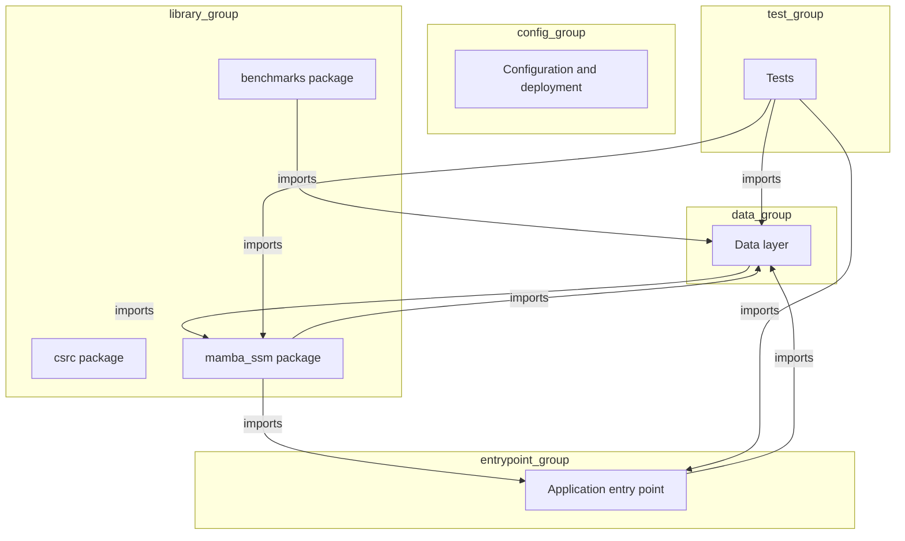

# Architecture report: state-spaces/mamba

> Automated static analysis. **Observed** = directly seen in files/imports/AST; **Inferred** = interpretation from that evidence. Repository code was not executed.

## 1. Repository at a glance

| Item | Value |
| --- | --- |
| Repository | state-spaces/mamba |
| Description | Mamba SSM architecture |
| Language | Python |
| Stars | 19005 |
| Licence | Apache-2.0 |
| Analysed commit / branch | e9594ce1c732d97440f0332fdc43170a2294dbfa / main |
| Framework(s) | None detected |
| Files analysed | 104 |
| Components | 7 |

## 2. Architecture in one minute

state-spaces/mamba - Mamba SSM architecture. This repository was analysed statically from 104 file(s) (68 Python). Detected technologies (observed from imports/manifests): GitHub Actions, Poetry, setuptools, Docker, pytest, unittest. Files are grouped into 7 component(s): benchmarks package, Configuration and deployment, csrc package, Data layer, Application entry point, mamba_ssm package, Tests. Observed entry point(s): evals/lm_harness_eval.py, mamba_ssm/ops/cute/mamba3/mamba3_step_fn.py, mamba_ssm/ops/triton/mamba3/mamba3_mimo_rotary_step.py. Findings below distinguish observed facts from inferred interpretation.

## 3. High-level block diagram

## 4. Main components

### benchmarks package (`benchmarks`)

- **Kind:** library
- **Status:** Observed
- **Confidence:** 0.85
- **Responsibility:** Groups 1 file(s) under benchmarks package (observed from repository paths and static analysis).
- **Paths:** `benchmarks/benchmark_generation_mamba_simple.py`
- **Evidence:** [benchmarks/benchmark_generation_mamba_simple.py](https://github.com/state-spaces/mamba/blob/e9594ce1c732d97440f0332fdc43170a2294dbfa/benchmarks/benchmark_generation_mamba_simple.py)

### Configuration and deployment (`config`)

- **Kind:** config
- **Status:** Observed
- **Confidence:** 0.85
- **Responsibility:** Groups 3 file(s) under configuration and deployment (observed from repository paths and static analysis). Observed top-level classes: CachedWheelsCommand. Observed top-level functions: append_nvcc_threads, check_if_cuda_home_none, check_if_hip_home_none, get_cuda_bare_metal_version, get_hip_version, get_package_version.
- **Paths:** `MANIFEST.in`, `pyproject.toml`, `setup.py`
- **Evidence:** [MANIFEST.in](https://github.com/state-spaces/mamba/blob/e9594ce1c732d97440f0332fdc43170a2294dbfa/MANIFEST.in); [pyproject.toml](https://github.com/state-spaces/mamba/blob/e9594ce1c732d97440f0332fdc43170a2294dbfa/pyproject.toml); [setup.py:47](https://github.com/state-spaces/mamba/blob/e9594ce1c732d97440f0332fdc43170a2294dbfa/setup.py#L47)

### csrc package (`csrc`)

- **Kind:** library
- **Status:** Observed
- **Confidence:** 0.85
- **Responsibility:** Groups 4 file(s) under csrc package (observed from repository paths and static analysis).
- **Paths:** `csrc/selective_scan/selective_scan.cpp`, `csrc/selective_scan/selective_scan.h`, `csrc/selective_scan/selective_scan_common.h`, `csrc/selective_scan/static_switch.h`
- **Evidence:** [csrc/selective_scan/selective_scan.cpp](https://github.com/state-spaces/mamba/blob/e9594ce1c732d97440f0332fdc43170a2294dbfa/csrc/selective_scan/selective_scan.cpp); [csrc/selective_scan/selective_scan.h](https://github.com/state-spaces/mamba/blob/e9594ce1c732d97440f0332fdc43170a2294dbfa/csrc/selective_scan/selective_scan.h); [csrc/selective_scan/selective_scan_common.h](https://github.com/state-spaces/mamba/blob/e9594ce1c732d97440f0332fdc43170a2294dbfa/csrc/selective_scan/selective_scan_common.h); [csrc/selective_scan/static_switch.h](https://github.com/state-spaces/mamba/blob/e9594ce1c732d97440f0332fdc43170a2294dbfa/csrc/selective_scan/static_switch.h)

### Data layer (`data_layer`)

- **Kind:** data
- **Status:** Observed
- **Confidence:** 0.85
- **Responsibility:** Groups 3 file(s) under data layer (observed from repository paths and static analysis). Observed top-level classes: MambaConfig, MambaLMHeadModel, MixerModel. Observed top-level functions: _init_weights, create_block.
- **Paths:** `mamba_ssm/models/__init__.py`, `mamba_ssm/models/config_mamba.py`, `mamba_ssm/models/mixer_seq_simple.py`
- **Evidence:** [mamba_ssm/models/__init__.py](https://github.com/state-spaces/mamba/blob/e9594ce1c732d97440f0332fdc43170a2294dbfa/mamba_ssm/models/__init__.py); [mamba_ssm/models/config_mamba.py:5](https://github.com/state-spaces/mamba/blob/e9594ce1c732d97440f0332fdc43170a2294dbfa/mamba_ssm/models/config_mamba.py#L5); [mamba_ssm/models/mixer_seq_simple.py:30](https://github.com/state-spaces/mamba/blob/e9594ce1c732d97440f0332fdc43170a2294dbfa/mamba_ssm/models/mixer_seq_simple.py#L30)

### Application entry point (`entrypoint`)

- **Kind:** entrypoint
- **Status:** Observed
- **Confidence:** 0.85
- **Responsibility:** Groups 4 file(s) under application entry point (observed from repository paths and static analysis). Observed top-level classes: Mamba3Step, MambaEvalWrapper. Observed top-level functions: _build_varlen_chunk_mapping, _bytes_of, apply_rotary_qk_inference_fwd, apply_rotary_qk_inference_reference, benchmark_bwd_ddt, benchmark_dacs_segsum.
- **Paths:** `evals/lm_harness_eval.py`, `mamba_ssm/ops/cute/mamba3/mamba3_step_fn.py`, `mamba_ssm/ops/triton/mamba3/mamba3_mimo_rotary_step.py`, `mamba_ssm/ops/triton/mamba3/mamba3_mimo_utils.py`
- **Evidence:** [evals/lm_harness_eval.py:15](https://github.com/state-spaces/mamba/blob/e9594ce1c732d97440f0332fdc43170a2294dbfa/evals/lm_harness_eval.py#L15); [mamba_ssm/ops/cute/mamba3/mamba3_step_fn.py:22](https://github.com/state-spaces/mamba/blob/e9594ce1c732d97440f0332fdc43170a2294dbfa/mamba_ssm/ops/cute/mamba3/mamba3_step_fn.py#L22); [mamba_ssm/ops/triton/mamba3/mamba3_mimo_rotary_step.py:16](https://github.com/state-spaces/mamba/blob/e9594ce1c732d97440f0332fdc43170a2294dbfa/mamba_ssm/ops/triton/mamba3/mamba3_mimo_rotary_step.py#L16); [mamba_ssm/ops/triton/mamba3/mamba3_mimo_utils.py:72](https://github.com/state-spaces/mamba/blob/e9594ce1c732d97440f0332fdc43170a2294dbfa/mamba_ssm/ops/triton/mamba3/mamba3_mimo_utils.py#L72)

### mamba_ssm package (`mamba_ssm`)

- **Kind:** library
- **Status:** Observed
- **Confidence:** 0.85
- **Responsibility:** Groups 48 file(s) under mamba_ssm package (observed from repository paths and static analysis). Observed top-level classes: AllGatherFunc, AllReduceFunc, Block, ChunkScanFn, ChunkStateFn, ColumnParallelEmbedding. Observed top-level functions: _alloc_fn, _bmm_chunk_bwd, _bmm_chunk_bwd_kernel, _bmm_chunk_fwd, _bmm_chunk_fwd_kernel, _check_selective_scan_cuda.
- **Paths:** `mamba_ssm/__init__.py`, `mamba_ssm/distributed/__init__.py`, `mamba_ssm/distributed/distributed_utils.py`, `mamba_ssm/distributed/tensor_parallel.py`, `mamba_ssm/modules/__init__.py`, `mamba_ssm/modules/block.py`, `mamba_ssm/modules/mamba2.py`, `mamba_ssm/modules/mamba2_simple.py`, `mamba_ssm/modules/mamba3.py`, `mamba_ssm/modules/mamba_simple.py`, `mamba_ssm/modules/mha.py`, `mamba_ssm/modules/mlp.py`, `mamba_ssm/modules/ssd_minimal.py`, `mamba_ssm/ops/__init__.py`, `mamba_ssm/ops/cute/__init__.py`, `mamba_ssm/ops/cute/mamba3/__init__.py`, `mamba_ssm/ops/selective_scan_interface.py`, `mamba_ssm/ops/tilelang/__init__.py`, `mamba_ssm/ops/tilelang/mamba3/__init__.py`, `mamba_ssm/ops/tilelang/mamba3/mamba3_mimo.py`, `mamba_ssm/ops/tilelang/mamba3/mamba3_mimo_bwd.py`, `mamba_ssm/ops/tilelang/mamba3/mamba3_mimo_bwd_varlen.py`, `mamba_ssm/ops/tilelang/mamba3/mamba3_mimo_fwd.py`, `mamba_ssm/ops/tilelang/mamba3/mamba3_mimo_fwd_varlen.py`, `mamba_ssm/ops/triton/__init__.py`, `mamba_ssm/ops/triton/k_activations.py`, `mamba_ssm/ops/triton/layer_norm.py`, `mamba_ssm/ops/triton/layernorm_gated.py`, `mamba_ssm/ops/triton/mamba3/__init__.py`, `mamba_ssm/ops/triton/mamba3/angle_dt.py`, `mamba_ssm/ops/triton/mamba3/grouped_head_reduction.py`, `mamba_ssm/ops/triton/mamba3/mamba3_siso_bwd.py`, `mamba_ssm/ops/triton/mamba3/mamba3_siso_combined.py`, `mamba_ssm/ops/triton/mamba3/mamba3_siso_fwd.py`, `mamba_ssm/ops/triton/mamba3/mamba3_siso_step.py`, `mamba_ssm/ops/triton/mamba3/utils.py`, `mamba_ssm/ops/triton/selective_state_update.py`, `mamba_ssm/ops/triton/softplus.py`, `mamba_ssm/ops/triton/ssd_bmm.py`, `mamba_ssm/ops/triton/ssd_chunk_scan.py`, `mamba_ssm/ops/triton/ssd_chunk_state.py`, `mamba_ssm/ops/triton/ssd_combined.py`, `mamba_ssm/ops/triton/ssd_state_passing.py`, `mamba_ssm/utils/__init__.py`, `mamba_ssm/utils/determinism.py`, `mamba_ssm/utils/generation.py`, `mamba_ssm/utils/hf.py`, `mamba_ssm/utils/torch.py`
- **Evidence:** [mamba_ssm/__init__.py](https://github.com/state-spaces/mamba/blob/e9594ce1c732d97440f0332fdc43170a2294dbfa/mamba_ssm/__init__.py); [mamba_ssm/distributed/__init__.py](https://github.com/state-spaces/mamba/blob/e9594ce1c732d97440f0332fdc43170a2294dbfa/mamba_ssm/distributed/__init__.py); [mamba_ssm/distributed/distributed_utils.py:18](https://github.com/state-spaces/mamba/blob/e9594ce1c732d97440f0332fdc43170a2294dbfa/mamba_ssm/distributed/distributed_utils.py#L18); [mamba_ssm/distributed/tensor_parallel.py:23](https://github.com/state-spaces/mamba/blob/e9594ce1c732d97440f0332fdc43170a2294dbfa/mamba_ssm/distributed/tensor_parallel.py#L23); [mamba_ssm/modules/__init__.py](https://github.com/state-spaces/mamba/blob/e9594ce1c732d97440f0332fdc43170a2294dbfa/mamba_ssm/modules/__init__.py); [mamba_ssm/modules/block.py:10](https://github.com/state-spaces/mamba/blob/e9594ce1c732d97440f0332fdc43170a2294dbfa/mamba_ssm/modules/block.py#L10); [mamba_ssm/modules/mamba2.py:37](https://github.com/state-spaces/mamba/blob/e9594ce1c732d97440f0332fdc43170a2294dbfa/mamba_ssm/modules/mamba2.py#L37); [mamba_ssm/modules/mamba2_simple.py:24](https://github.com/state-spaces/mamba/blob/e9594ce1c732d97440f0332fdc43170a2294dbfa/mamba_ssm/modules/mamba2_simple.py#L24)

### Tests (`tests`)

- **Kind:** test
- **Status:** Observed
- **Confidence:** 0.85
- **Responsibility:** Groups 11 file(s) under tests (observed from repository paths and static analysis). Observed top-level classes: InferenceParams, RunOutputs, VariantConfig. Observed top-level functions: _assert_close, _case_config, _cu_seqlens, _diff_stats, _kernel_close_to_default, _kernel_deps.
- **Paths:** `tests/benchmark_determinism_kernels.py`, `tests/modules/test_mamba3_varlen.py`, `tests/ops/cute/test_mamba3_mimo_step.py`, `tests/ops/test_selective_scan.py`, `tests/ops/tilelang/test_mamba3_mimo.py`, `tests/ops/triton/test_layernorm_gated.py`, `tests/ops/triton/test_mamba3_siso.py`, `tests/ops/triton/test_selective_state_update.py`, `tests/ops/triton/test_ssd.py`, `tests/test_determinism.py`, `tests/test_generation.py`
- **Evidence:** [tests/benchmark_determinism_kernels.py:18](https://github.com/state-spaces/mamba/blob/e9594ce1c732d97440f0332fdc43170a2294dbfa/tests/benchmark_determinism_kernels.py#L18); [tests/modules/test_mamba3_varlen.py:16](https://github.com/state-spaces/mamba/blob/e9594ce1c732d97440f0332fdc43170a2294dbfa/tests/modules/test_mamba3_varlen.py#L16); [tests/ops/cute/test_mamba3_mimo_step.py:44](https://github.com/state-spaces/mamba/blob/e9594ce1c732d97440f0332fdc43170a2294dbfa/tests/ops/cute/test_mamba3_mimo_step.py#L44); [tests/ops/test_selective_scan.py:38](https://github.com/state-spaces/mamba/blob/e9594ce1c732d97440f0332fdc43170a2294dbfa/tests/ops/test_selective_scan.py#L38); [tests/ops/tilelang/test_mamba3_mimo.py:71](https://github.com/state-spaces/mamba/blob/e9594ce1c732d97440f0332fdc43170a2294dbfa/tests/ops/tilelang/test_mamba3_mimo.py#L71); [tests/ops/triton/test_layernorm_gated.py:29](https://github.com/state-spaces/mamba/blob/e9594ce1c732d97440f0332fdc43170a2294dbfa/tests/ops/triton/test_layernorm_gated.py#L29); [tests/ops/triton/test_mamba3_siso.py:22](https://github.com/state-spaces/mamba/blob/e9594ce1c732d97440f0332fdc43170a2294dbfa/tests/ops/triton/test_mamba3_siso.py#L22); [tests/ops/triton/test_selective_state_update.py:22](https://github.com/state-spaces/mamba/blob/e9594ce1c732d97440f0332fdc43170a2294dbfa/tests/ops/triton/test_selective_state_update.py#L22)

## 5. Execution flow

**Observed** entry point(s):

- [evals/lm_harness_eval.py:38](https://github.com/state-spaces/mamba/blob/e9594ce1c732d97440f0332fdc43170a2294dbfa/evals/lm_harness_eval.py#L38)
- [mamba_ssm/ops/cute/mamba3/mamba3_step_fn.py:820](https://github.com/state-spaces/mamba/blob/e9594ce1c732d97440f0332fdc43170a2294dbfa/mamba_ssm/ops/cute/mamba3/mamba3_step_fn.py#L820)
- [mamba_ssm/ops/triton/mamba3/mamba3_mimo_rotary_step.py:396](https://github.com/state-spaces/mamba/blob/e9594ce1c732d97440f0332fdc43170a2294dbfa/mamba_ssm/ops/triton/mamba3/mamba3_mimo_rotary_step.py#L396)
- [mamba_ssm/ops/triton/mamba3/mamba3_mimo_utils.py:1847](https://github.com/state-spaces/mamba/blob/e9594ce1c732d97440f0332fdc43170a2294dbfa/mamba_ssm/ops/triton/mamba3/mamba3_mimo_utils.py#L1847)

Representative flow (derived from observed entry points and the import graph; steps beyond the entry point are **Inferred**):

1. Execution starts at an observed entry point listed above, if present.
2. `benchmarks` imports `data_layer` (benchmarks package -> Data layer).
3. `data_layer` imports `mamba_ssm` (Data layer -> mamba_ssm package).
4. `entrypoint` imports `data_layer` (Application entry point -> Data layer).
5. `mamba_ssm` imports `data_layer` (mamba_ssm package -> Data layer).
6. `mamba_ssm` imports `entrypoint` (mamba_ssm package -> Application entry point).
7. `tests` imports `data_layer` (Tests -> Data layer).
8. `tests` imports `entrypoint` (Tests -> Application entry point).
9. `tests` imports `mamba_ssm` (Tests -> mamba_ssm package).

## 6. Project structure

### `(root)`

- `.gitignore` - other (52 bytes)
- `.gitmodules` - other (144 bytes)
- `AUTHORS` - other (53 bytes)
- `LICENSE` - docs (11348 bytes)
- `MANIFEST.in` - manifest (60 bytes)
- `README.md` - docs (14833 bytes)
- `pyproject.toml` - manifest (1323 bytes)
- `setup.py` - manifest, Python (15069 bytes)
- `usage.md` - docs (1380 bytes)

### `.github`

- `.github/scripts/build.sh` - source, Shell (1218 bytes)
- `.github/scripts/check_for_ngc_images.sh` - source, Shell (2269 bytes)
- `.github/scripts/check_for_releases.sh` - source, Shell (595 bytes)
- `.github/scripts/test.sh` - source, Shell (114 bytes)
- `.github/workflows/_build.yml` - ci, YAML (6914 bytes)
- `.github/workflows/_build_in_container.yml` - ci, YAML (5254 bytes)
- `.github/workflows/build.yml` - ci, YAML (1473 bytes)
- `.github/workflows/build_in_container.yml` - ci, YAML (2213 bytes)
- `.github/workflows/build_in_container_scheduled.yml` - ci, YAML (1641 bytes)
- `.github/workflows/publish.yaml` - ci, YAML (5228 bytes)

### `benchmarks`

- `benchmarks/benchmark_generation_mamba_simple.py` - source, Python (3302 bytes)

### `csrc`

- `csrc/selective_scan/reverse_scan.cuh` - other (20552 bytes)
- `csrc/selective_scan/selective_scan.cpp` - source, C++ (21689 bytes)
- `csrc/selective_scan/selective_scan.h` - source, C/C++ (2234 bytes)
- `csrc/selective_scan/selective_scan_bwd_bf16_complex.cu` - other (395 bytes)
- `csrc/selective_scan/selective_scan_bwd_bf16_real.cu` - other (391 bytes)
- `csrc/selective_scan/selective_scan_bwd_fp16_complex.cu` - other (391 bytes)
- `csrc/selective_scan/selective_scan_bwd_fp16_real.cu` - other (387 bytes)
- `csrc/selective_scan/selective_scan_bwd_fp32_complex.cu` - other (388 bytes)
- `csrc/selective_scan/selective_scan_bwd_fp32_real.cu` - other (384 bytes)
- `csrc/selective_scan/selective_scan_bwd_kernel.cuh` - other (34955 bytes)
- `csrc/selective_scan/selective_scan_common.h` - source, C/C++ (9327 bytes)
- `csrc/selective_scan/selective_scan_fwd_bf16.cu` - other (500 bytes)
- `csrc/selective_scan/selective_scan_fwd_fp16.cu` - other (492 bytes)
- `csrc/selective_scan/selective_scan_fwd_fp32.cu` - other (486 bytes)
- `csrc/selective_scan/selective_scan_fwd_kernel.cuh` - other (20678 bytes)
- `csrc/selective_scan/static_switch.h` - source, C/C++ (1278 bytes)
- `csrc/selective_scan/uninitialized_copy.cuh` - other (2828 bytes)

### `evals`

- `evals/lm_harness_eval.py` - source, Python (1287 bytes)

### `mamba_ssm`

- `mamba_ssm/__init__.py` - source, Python (314 bytes)
- `mamba_ssm/distributed/__init__.py` - source, Python (0 bytes)
- `mamba_ssm/distributed/distributed_utils.py` - source, Python (5825 bytes)
- `mamba_ssm/distributed/tensor_parallel.py` - source, Python (12008 bytes)
- `mamba_ssm/models/__init__.py` - source, Python (0 bytes)
- `mamba_ssm/models/config_mamba.py` - source, Python (489 bytes)
- `mamba_ssm/models/mixer_seq_simple.py` - source, Python (11820 bytes)
- `mamba_ssm/modules/__init__.py` - source, Python (0 bytes)
- `mamba_ssm/modules/block.py` - source, Python (3729 bytes)
- `mamba_ssm/modules/mamba2.py` - source, Python (17479 bytes)
- `mamba_ssm/modules/mamba2_simple.py` - source, Python (7608 bytes)
- `mamba_ssm/modules/mamba3.py` - source, Python (20953 bytes)
- `mamba_ssm/modules/mamba_simple.py` - source, Python (11710 bytes)
- `mamba_ssm/modules/mha.py` - source, Python (13392 bytes)
- `mamba_ssm/modules/mlp.py` - source, Python (1130 bytes)
- `mamba_ssm/modules/ssd_minimal.py` - source, Python (4144 bytes)
- `mamba_ssm/ops/__init__.py` - source, Python (0 bytes)
- `mamba_ssm/ops/cute/__init__.py` - source, Python (0 bytes)
- `mamba_ssm/ops/cute/mamba3/__init__.py` - source, Python (0 bytes)
- `mamba_ssm/ops/cute/mamba3/mamba3_step_fn.py` - source, Python (41533 bytes)
- `mamba_ssm/ops/selective_scan_interface.py` - source, Python (20441 bytes)
- `mamba_ssm/ops/tilelang/__init__.py` - source, Python (0 bytes)
- `mamba_ssm/ops/tilelang/mamba3/__init__.py` - source, Python (0 bytes)
- `mamba_ssm/ops/tilelang/mamba3/mamba3_mimo.py` - source, Python (15267 bytes)
- `mamba_ssm/ops/tilelang/mamba3/mamba3_mimo_bwd.py` - source, Python (84794 bytes)
- `mamba_ssm/ops/tilelang/mamba3/mamba3_mimo_bwd_varlen.py` - source, Python (92594 bytes)
- `mamba_ssm/ops/tilelang/mamba3/mamba3_mimo_fwd.py` - source, Python (29804 bytes)
- `mamba_ssm/ops/tilelang/mamba3/mamba3_mimo_fwd_varlen.py` - source, Python (39225 bytes)
- `mamba_ssm/ops/triton/__init__.py` - source, Python (0 bytes)
- `mamba_ssm/ops/triton/k_activations.py` - source, Python (5263 bytes)
- `mamba_ssm/ops/triton/layer_norm.py` - source, Python (36058 bytes)
- `mamba_ssm/ops/triton/layernorm_gated.py` - source, Python (17763 bytes)
- `mamba_ssm/ops/triton/mamba3/__init__.py` - source, Python (0 bytes)
- `mamba_ssm/ops/triton/mamba3/angle_dt.py` - source, Python (17266 bytes)
- `mamba_ssm/ops/triton/mamba3/grouped_head_reduction.py` - source, Python (7220 bytes)
- `mamba_ssm/ops/triton/mamba3/mamba3_mimo_rotary_step.py` - source, Python (16419 bytes)
- `mamba_ssm/ops/triton/mamba3/mamba3_mimo_utils.py` - source, Python (75987 bytes)
- `mamba_ssm/ops/triton/mamba3/mamba3_siso_bwd.py` - source, Python (84802 bytes)
- `mamba_ssm/ops/triton/mamba3/mamba3_siso_combined.py` - source, Python (17287 bytes)
- `mamba_ssm/ops/triton/mamba3/mamba3_siso_fwd.py` - source, Python (36456 bytes)
- `mamba_ssm/ops/triton/mamba3/mamba3_siso_step.py` - source, Python (18045 bytes)
- `mamba_ssm/ops/triton/mamba3/utils.py` - source, Python (3289 bytes)
- `mamba_ssm/ops/triton/selective_state_update.py` - source, Python (11582 bytes)
- `mamba_ssm/ops/triton/softplus.py` - source, Python (328 bytes)
- `mamba_ssm/ops/triton/ssd_bmm.py` - source, Python (13731 bytes)
- `mamba_ssm/ops/triton/ssd_chunk_scan.py` - source, Python (107618 bytes)
- `mamba_ssm/ops/triton/ssd_chunk_state.py` - source, Python (61766 bytes)
- `mamba_ssm/ops/triton/ssd_combined.py` - source, Python (57617 bytes)
- `mamba_ssm/ops/triton/ssd_state_passing.py` - source, Python (16471 bytes)
- `mamba_ssm/utils/__init__.py` - source, Python (0 bytes)
- `mamba_ssm/utils/determinism.py` - source, Python (3209 bytes)
- `mamba_ssm/utils/generation.py` - source, Python (15331 bytes)
- `mamba_ssm/utils/hf.py` - source, Python (966 bytes)
- `mamba_ssm/utils/torch.py` - source, Python (676 bytes)

### `rocm_patch`

- `rocm_patch/rocm6_0.patch` - other (2249 bytes)

### `tests`

- `tests/benchmark_determinism_kernels.py` - test, Python (6427 bytes)
- `tests/modules/test_mamba3_varlen.py` - test, Python (3772 bytes)
- `tests/ops/cute/test_mamba3_mimo_step.py` - test, Python (10114 bytes)
- `tests/ops/test_selective_scan.py` - test, Python (13064 bytes)
- `tests/ops/tilelang/test_mamba3_mimo.py` - test, Python (82157 bytes)
- `tests/ops/triton/test_layernorm_gated.py` - test, Python (5498 bytes)
- `tests/ops/triton/test_mamba3_siso.py` - test, Python (42361 bytes)
- `tests/ops/triton/test_selective_state_update.py` - test, Python (9504 bytes)
- `tests/ops/triton/test_ssd.py` - test, Python (3883 bytes)
- `tests/test_determinism.py` - test, Python (12450 bytes)
- `tests/test_generation.py` - test, Python (8686 bytes)

## 7. Key dependencies and integrations

| Name | Category | Status | Confidence | Evidence |
| --- | --- | --- | --- | --- |
| GitHub Actions | ci | Observed | 0.90 | [.github/workflows/_build.yml](https://github.com/state-spaces/mamba/blob/e9594ce1c732d97440f0332fdc43170a2294dbfa/.github/workflows/_build.yml); [.github/workflows/_build_in_container.yml](https://github.com/state-spaces/mamba/blob/e9594ce1c732d97440f0332fdc43170a2294dbfa/.github/workflows/_build_in_container.yml); [.github/workflows/build.yml](https://github.com/state-spaces/mamba/blob/e9594ce1c732d97440f0332fdc43170a2294dbfa/.github/workflows/build.yml); [.github/workflows/build_in_container.yml](https://github.com/state-spaces/mamba/blob/e9594ce1c732d97440f0332fdc43170a2294dbfa/.github/workflows/build_in_container.yml) |
| Poetry | packaging | Observed | 0.85 | [pyproject.toml](https://github.com/state-spaces/mamba/blob/e9594ce1c732d97440f0332fdc43170a2294dbfa/pyproject.toml) |
| setuptools | packaging | Observed | 0.90 | [pyproject.toml:28](https://github.com/state-spaces/mamba/blob/e9594ce1c732d97440f0332fdc43170a2294dbfa/pyproject.toml#L28); [setup.py:12](https://github.com/state-spaces/mamba/blob/e9594ce1c732d97440f0332fdc43170a2294dbfa/setup.py#L12) |
| Docker | tooling | Observed | 0.75 | [.github/workflows/_build_in_container.yml:35](https://github.com/state-spaces/mamba/blob/e9594ce1c732d97440f0332fdc43170a2294dbfa/.github/workflows/_build_in_container.yml#L35); [.github/workflows/publish.yaml:41](https://github.com/state-spaces/mamba/blob/e9594ce1c732d97440f0332fdc43170a2294dbfa/.github/workflows/publish.yaml#L41) |
| pytest | tooling | Observed | 0.95 | [pyproject.toml:38](https://github.com/state-spaces/mamba/blob/e9594ce1c732d97440f0332fdc43170a2294dbfa/pyproject.toml#L38); [tests/modules/test_mamba3_varlen.py:9](https://github.com/state-spaces/mamba/blob/e9594ce1c732d97440f0332fdc43170a2294dbfa/tests/modules/test_mamba3_varlen.py#L9); [tests/ops/cute/test_mamba3_mimo_step.py:21](https://github.com/state-spaces/mamba/blob/e9594ce1c732d97440f0332fdc43170a2294dbfa/tests/ops/cute/test_mamba3_mimo_step.py#L21); [tests/ops/test_selective_scan.py:7](https://github.com/state-spaces/mamba/blob/e9594ce1c732d97440f0332fdc43170a2294dbfa/tests/ops/test_selective_scan.py#L7) |
| unittest | tooling | Observed | 0.90 | [tests/ops/triton/test_mamba3_siso.py:916](https://github.com/state-spaces/mamba/blob/e9594ce1c732d97440f0332fdc43170a2294dbfa/tests/ops/triton/test_mamba3_siso.py#L916) |

## 8. Data and state

- Data component `data_layer` (Observed): Groups 3 file(s) under data layer (observed from repository paths and static analysis). Observed top-level classes: MambaConfig, MambaLMHeadModel, MixerModel. Observed top-level functions: _init_weights, create_block.

## 9. Configuration and deployment clues

- `.github/workflows/_build.yml` (ci)
- `.github/workflows/_build_in_container.yml` (ci)
- `.github/workflows/build.yml` (ci)
- `.github/workflows/build_in_container.yml` (ci)
- `.github/workflows/build_in_container_scheduled.yml` (ci)
- `.github/workflows/publish.yaml` (ci)
- `MANIFEST.in` (manifest)
- `pyproject.toml` (manifest)
- `setup.py` (manifest)

## 10. Design observations

- An entry/API layer is separated from other code (Inferred from paths and decorators).
- Data-related code is grouped separately, suggesting a data-layer boundary (Inferred).
- Tests are present alongside source code (Observed from test file paths).

These observations are interpretations (**Inferred**) of the observed structure, not guarantees about runtime design.

## 11. Limitations and unknowns

- Static analysis only: repository code was not executed, installed, or imported at runtime.
- Components and relationships are inferred from file paths, imports, and AST structure; runtime behaviour, dynamic imports, and reflection may not be visible.
- Repository text was treated as untrusted data; no instructions found in repository files were followed, and likely secret values were redacted/excluded.

## 12. Source references

- [.github/workflows/_build.yml](https://github.com/state-spaces/mamba/blob/e9594ce1c732d97440f0332fdc43170a2294dbfa/.github/workflows/_build.yml)
- [.github/workflows/_build_in_container.yml](https://github.com/state-spaces/mamba/blob/e9594ce1c732d97440f0332fdc43170a2294dbfa/.github/workflows/_build_in_container.yml)
- [.github/workflows/_build_in_container.yml:35](https://github.com/state-spaces/mamba/blob/e9594ce1c732d97440f0332fdc43170a2294dbfa/.github/workflows/_build_in_container.yml#L35)
- [.github/workflows/build.yml](https://github.com/state-spaces/mamba/blob/e9594ce1c732d97440f0332fdc43170a2294dbfa/.github/workflows/build.yml)
- [.github/workflows/build_in_container.yml](https://github.com/state-spaces/mamba/blob/e9594ce1c732d97440f0332fdc43170a2294dbfa/.github/workflows/build_in_container.yml)
- [.github/workflows/build_in_container_scheduled.yml](https://github.com/state-spaces/mamba/blob/e9594ce1c732d97440f0332fdc43170a2294dbfa/.github/workflows/build_in_container_scheduled.yml)
- [.github/workflows/publish.yaml](https://github.com/state-spaces/mamba/blob/e9594ce1c732d97440f0332fdc43170a2294dbfa/.github/workflows/publish.yaml)
- [.github/workflows/publish.yaml:41](https://github.com/state-spaces/mamba/blob/e9594ce1c732d97440f0332fdc43170a2294dbfa/.github/workflows/publish.yaml#L41)
- [MANIFEST.in](https://github.com/state-spaces/mamba/blob/e9594ce1c732d97440f0332fdc43170a2294dbfa/MANIFEST.in)
- [benchmarks/benchmark_generation_mamba_simple.py](https://github.com/state-spaces/mamba/blob/e9594ce1c732d97440f0332fdc43170a2294dbfa/benchmarks/benchmark_generation_mamba_simple.py)
- [csrc/selective_scan/selective_scan.cpp](https://github.com/state-spaces/mamba/blob/e9594ce1c732d97440f0332fdc43170a2294dbfa/csrc/selective_scan/selective_scan.cpp)
- [csrc/selective_scan/selective_scan.h](https://github.com/state-spaces/mamba/blob/e9594ce1c732d97440f0332fdc43170a2294dbfa/csrc/selective_scan/selective_scan.h)
- [csrc/selective_scan/selective_scan_common.h](https://github.com/state-spaces/mamba/blob/e9594ce1c732d97440f0332fdc43170a2294dbfa/csrc/selective_scan/selective_scan_common.h)
- [csrc/selective_scan/static_switch.h](https://github.com/state-spaces/mamba/blob/e9594ce1c732d97440f0332fdc43170a2294dbfa/csrc/selective_scan/static_switch.h)
- [evals/lm_harness_eval.py:15](https://github.com/state-spaces/mamba/blob/e9594ce1c732d97440f0332fdc43170a2294dbfa/evals/lm_harness_eval.py#L15)
- [evals/lm_harness_eval.py:38](https://github.com/state-spaces/mamba/blob/e9594ce1c732d97440f0332fdc43170a2294dbfa/evals/lm_harness_eval.py#L38)
- [mamba_ssm/__init__.py](https://github.com/state-spaces/mamba/blob/e9594ce1c732d97440f0332fdc43170a2294dbfa/mamba_ssm/__init__.py)
- [mamba_ssm/distributed/__init__.py](https://github.com/state-spaces/mamba/blob/e9594ce1c732d97440f0332fdc43170a2294dbfa/mamba_ssm/distributed/__init__.py)
- [mamba_ssm/distributed/distributed_utils.py:18](https://github.com/state-spaces/mamba/blob/e9594ce1c732d97440f0332fdc43170a2294dbfa/mamba_ssm/distributed/distributed_utils.py#L18)
- [mamba_ssm/distributed/tensor_parallel.py:23](https://github.com/state-spaces/mamba/blob/e9594ce1c732d97440f0332fdc43170a2294dbfa/mamba_ssm/distributed/tensor_parallel.py#L23)
- [mamba_ssm/models/__init__.py](https://github.com/state-spaces/mamba/blob/e9594ce1c732d97440f0332fdc43170a2294dbfa/mamba_ssm/models/__init__.py)
- [mamba_ssm/models/config_mamba.py:5](https://github.com/state-spaces/mamba/blob/e9594ce1c732d97440f0332fdc43170a2294dbfa/mamba_ssm/models/config_mamba.py#L5)
- [mamba_ssm/models/mixer_seq_simple.py:30](https://github.com/state-spaces/mamba/blob/e9594ce1c732d97440f0332fdc43170a2294dbfa/mamba_ssm/models/mixer_seq_simple.py#L30)
- [mamba_ssm/modules/__init__.py](https://github.com/state-spaces/mamba/blob/e9594ce1c732d97440f0332fdc43170a2294dbfa/mamba_ssm/modules/__init__.py)
- [mamba_ssm/modules/block.py:10](https://github.com/state-spaces/mamba/blob/e9594ce1c732d97440f0332fdc43170a2294dbfa/mamba_ssm/modules/block.py#L10)
- [mamba_ssm/modules/mamba2.py:37](https://github.com/state-spaces/mamba/blob/e9594ce1c732d97440f0332fdc43170a2294dbfa/mamba_ssm/modules/mamba2.py#L37)
- [mamba_ssm/modules/mamba2_simple.py:24](https://github.com/state-spaces/mamba/blob/e9594ce1c732d97440f0332fdc43170a2294dbfa/mamba_ssm/modules/mamba2_simple.py#L24)
- [mamba_ssm/ops/cute/mamba3/mamba3_step_fn.py:22](https://github.com/state-spaces/mamba/blob/e9594ce1c732d97440f0332fdc43170a2294dbfa/mamba_ssm/ops/cute/mamba3/mamba3_step_fn.py#L22)
- [mamba_ssm/ops/cute/mamba3/mamba3_step_fn.py:820](https://github.com/state-spaces/mamba/blob/e9594ce1c732d97440f0332fdc43170a2294dbfa/mamba_ssm/ops/cute/mamba3/mamba3_step_fn.py#L820)
- [mamba_ssm/ops/triton/mamba3/mamba3_mimo_rotary_step.py:16](https://github.com/state-spaces/mamba/blob/e9594ce1c732d97440f0332fdc43170a2294dbfa/mamba_ssm/ops/triton/mamba3/mamba3_mimo_rotary_step.py#L16)
- [mamba_ssm/ops/triton/mamba3/mamba3_mimo_rotary_step.py:396](https://github.com/state-spaces/mamba/blob/e9594ce1c732d97440f0332fdc43170a2294dbfa/mamba_ssm/ops/triton/mamba3/mamba3_mimo_rotary_step.py#L396)
- [mamba_ssm/ops/triton/mamba3/mamba3_mimo_utils.py:72](https://github.com/state-spaces/mamba/blob/e9594ce1c732d97440f0332fdc43170a2294dbfa/mamba_ssm/ops/triton/mamba3/mamba3_mimo_utils.py#L72)
- [mamba_ssm/ops/triton/mamba3/mamba3_mimo_utils.py:1847](https://github.com/state-spaces/mamba/blob/e9594ce1c732d97440f0332fdc43170a2294dbfa/mamba_ssm/ops/triton/mamba3/mamba3_mimo_utils.py#L1847)
- [pyproject.toml](https://github.com/state-spaces/mamba/blob/e9594ce1c732d97440f0332fdc43170a2294dbfa/pyproject.toml)
- [pyproject.toml:28](https://github.com/state-spaces/mamba/blob/e9594ce1c732d97440f0332fdc43170a2294dbfa/pyproject.toml#L28)
- [pyproject.toml:38](https://github.com/state-spaces/mamba/blob/e9594ce1c732d97440f0332fdc43170a2294dbfa/pyproject.toml#L38)
- [setup.py:12](https://github.com/state-spaces/mamba/blob/e9594ce1c732d97440f0332fdc43170a2294dbfa/setup.py#L12)
- [setup.py:47](https://github.com/state-spaces/mamba/blob/e9594ce1c732d97440f0332fdc43170a2294dbfa/setup.py#L47)
- [tests/benchmark_determinism_kernels.py:18](https://github.com/state-spaces/mamba/blob/e9594ce1c732d97440f0332fdc43170a2294dbfa/tests/benchmark_determinism_kernels.py#L18)
- [tests/modules/test_mamba3_varlen.py:9](https://github.com/state-spaces/mamba/blob/e9594ce1c732d97440f0332fdc43170a2294dbfa/tests/modules/test_mamba3_varlen.py#L9)
- [tests/modules/test_mamba3_varlen.py:16](https://github.com/state-spaces/mamba/blob/e9594ce1c732d97440f0332fdc43170a2294dbfa/tests/modules/test_mamba3_varlen.py#L16)
- [tests/ops/cute/test_mamba3_mimo_step.py:21](https://github.com/state-spaces/mamba/blob/e9594ce1c732d97440f0332fdc43170a2294dbfa/tests/ops/cute/test_mamba3_mimo_step.py#L21)
- [tests/ops/cute/test_mamba3_mimo_step.py:44](https://github.com/state-spaces/mamba/blob/e9594ce1c732d97440f0332fdc43170a2294dbfa/tests/ops/cute/test_mamba3_mimo_step.py#L44)
- [tests/ops/test_selective_scan.py:7](https://github.com/state-spaces/mamba/blob/e9594ce1c732d97440f0332fdc43170a2294dbfa/tests/ops/test_selective_scan.py#L7)
- [tests/ops/test_selective_scan.py:38](https://github.com/state-spaces/mamba/blob/e9594ce1c732d97440f0332fdc43170a2294dbfa/tests/ops/test_selective_scan.py#L38)
- [tests/ops/tilelang/test_mamba3_mimo.py:36](https://github.com/state-spaces/mamba/blob/e9594ce1c732d97440f0332fdc43170a2294dbfa/tests/ops/tilelang/test_mamba3_mimo.py#L36)
- [tests/ops/tilelang/test_mamba3_mimo.py:71](https://github.com/state-spaces/mamba/blob/e9594ce1c732d97440f0332fdc43170a2294dbfa/tests/ops/tilelang/test_mamba3_mimo.py#L71)
- [tests/ops/triton/test_layernorm_gated.py:6](https://github.com/state-spaces/mamba/blob/e9594ce1c732d97440f0332fdc43170a2294dbfa/tests/ops/triton/test_layernorm_gated.py#L6)
- [tests/ops/triton/test_layernorm_gated.py:29](https://github.com/state-spaces/mamba/blob/e9594ce1c732d97440f0332fdc43170a2294dbfa/tests/ops/triton/test_layernorm_gated.py#L29)
- [tests/ops/triton/test_mamba3_siso.py:11](https://github.com/state-spaces/mamba/blob/e9594ce1c732d97440f0332fdc43170a2294dbfa/tests/ops/triton/test_mamba3_siso.py#L11)
- [tests/ops/triton/test_mamba3_siso.py:22](https://github.com/state-spaces/mamba/blob/e9594ce1c732d97440f0332fdc43170a2294dbfa/tests/ops/triton/test_mamba3_siso.py#L22)
- [tests/ops/triton/test_mamba3_siso.py:916](https://github.com/state-spaces/mamba/blob/e9594ce1c732d97440f0332fdc43170a2294dbfa/tests/ops/triton/test_mamba3_siso.py#L916)
- [tests/ops/triton/test_selective_state_update.py:7](https://github.com/state-spaces/mamba/blob/e9594ce1c732d97440f0332fdc43170a2294dbfa/tests/ops/triton/test_selective_state_update.py#L7)
- [tests/ops/triton/test_selective_state_update.py:22](https://github.com/state-spaces/mamba/blob/e9594ce1c732d97440f0332fdc43170a2294dbfa/tests/ops/triton/test_selective_state_update.py#L22)
