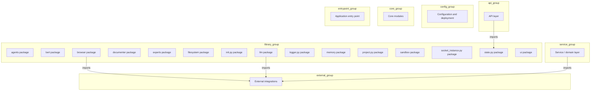

# Architecture report: stitionai/devika

> Automated static analysis. **Observed** = directly seen in files/imports/AST; **Inferred** = interpretation from that evidence. Repository code was not executed.

## 1. Repository at a glance

| Item | Value |
| --- | --- |
| Repository | stitionai/devika |
| Description | Devika is the first open-source implementation of an Agentic Software Engineer. Initially started as an open-source alternative to Devin. |
| Language | Python |
| Stars | 19546 |
| Licence | MIT |
| Analysed commit / branch | 80bb343cbe4a4e5f5a0ba08d2524920139baceb6 / main |
| Framework(s) | Flask, Svelte |
| Files analysed | 155 |
| Components | 21 |

## 2. Architecture in one minute

stitionai/devika - Devika is the first open-source implementation of an Agentic Software Engineer. Initially started as an open-source alternative to Devin.. This repository was analysed statically from 155 file(s) (70 Python). Detected technologies (observed from imports/manifests): Flask, Svelte, requests, Tailwind CSS, Docker Compose, Vite. Files are grouped into 21 component(s): agents package, API layer, bert package, browser package, Configuration and deployment, Core modules, documenter package, Application entry point. Observed entry point(s): devika.py. Findings below distinguish observed facts from inferred interpretation.

## 3. High-level block diagram

## 4. Main components

### agents package (`agents`)

- **Kind:** library
- **Status:** Observed
- **Confidence:** 0.85
- **Responsibility:** Groups 26 file(s) under agents package (observed from repository paths and static analysis). Observed top-level classes: Action, Agent, Answer, Coder, Decision, Feature.
- **Paths:** `src/agents/__init__.py`, `src/agents/action/__init__.py`, `src/agents/action/action.py`, `src/agents/agent.py`, `src/agents/answer/__init__.py`, `src/agents/answer/answer.py`, `src/agents/coder/__init__.py`, `src/agents/coder/coder.py`, `src/agents/decision/__init__.py`, `src/agents/decision/decision.py`, `src/agents/feature/__init__.py`, `src/agents/feature/feature.py`, `src/agents/formatter/__init__.py`, `src/agents/formatter/formatter.py`, `src/agents/internal_monologue/__init__.py`, `src/agents/internal_monologue/internal_monologue.py`, `src/agents/patcher/__init__.py`, `src/agents/patcher/patcher.py`, `src/agents/planner/__init__.py`, `src/agents/planner/planner.py`, `src/agents/reporter/__init__.py`, `src/agents/reporter/reporter.py`, `src/agents/researcher/__init__.py`, `src/agents/researcher/researcher.py`, `src/agents/runner/__init__.py`, `src/agents/runner/runner.py`
- **Evidence:** [src/agents/__init__.py](https://github.com/stitionai/devika/blob/80bb343cbe4a4e5f5a0ba08d2524920139baceb6/src/agents/__init__.py); [src/agents/action/__init__.py](https://github.com/stitionai/devika/blob/80bb343cbe4a4e5f5a0ba08d2524920139baceb6/src/agents/action/__init__.py); [src/agents/action/action.py:11](https://github.com/stitionai/devika/blob/80bb343cbe4a4e5f5a0ba08d2524920139baceb6/src/agents/action/action.py#L11); [src/agents/agent.py:36](https://github.com/stitionai/devika/blob/80bb343cbe4a4e5f5a0ba08d2524920139baceb6/src/agents/agent.py#L36); [src/agents/answer/__init__.py](https://github.com/stitionai/devika/blob/80bb343cbe4a4e5f5a0ba08d2524920139baceb6/src/agents/answer/__init__.py); [src/agents/answer/answer.py:11](https://github.com/stitionai/devika/blob/80bb343cbe4a4e5f5a0ba08d2524920139baceb6/src/agents/answer/answer.py#L11); [src/agents/coder/__init__.py](https://github.com/stitionai/devika/blob/80bb343cbe4a4e5f5a0ba08d2524920139baceb6/src/agents/coder/__init__.py); [src/agents/coder/coder.py:16](https://github.com/stitionai/devika/blob/80bb343cbe4a4e5f5a0ba08d2524920139baceb6/src/agents/coder/coder.py#L16)

### API layer (`api_layer`)

- **Kind:** api
- **Status:** Observed
- **Confidence:** 0.85
- **Responsibility:** Groups 6 file(s) under api layer (observed from repository paths and static analysis). Observed routes: ROUTE /api/get-project-files, ROUTE /api/create-project, ROUTE /api/delete-project, ROUTE /api/download-project, ROUTE /api/download-project-pdf. Observed top-level functions: create_project, delete_project, download_project, download_project_pdf, project_files.
- **Paths:** `src/apis/project.py`, `ui/src/routes/+layout.js`, `ui/src/routes/+layout.svelte`, `ui/src/routes/+page.svelte`, `ui/src/routes/logs/+page.svelte`, `ui/src/routes/settings/+page.svelte`
- **Evidence:** [src/apis/project.py:20](https://github.com/stitionai/devika/blob/80bb343cbe4a4e5f5a0ba08d2524920139baceb6/src/apis/project.py#L20); [ui/src/routes/+layout.js](https://github.com/stitionai/devika/blob/80bb343cbe4a4e5f5a0ba08d2524920139baceb6/ui/src/routes/%2Blayout.js); [ui/src/routes/+layout.svelte](https://github.com/stitionai/devika/blob/80bb343cbe4a4e5f5a0ba08d2524920139baceb6/ui/src/routes/%2Blayout.svelte); [ui/src/routes/+page.svelte](https://github.com/stitionai/devika/blob/80bb343cbe4a4e5f5a0ba08d2524920139baceb6/ui/src/routes/%2Bpage.svelte); [ui/src/routes/logs/+page.svelte](https://github.com/stitionai/devika/blob/80bb343cbe4a4e5f5a0ba08d2524920139baceb6/ui/src/routes/logs/%2Bpage.svelte); [ui/src/routes/settings/+page.svelte](https://github.com/stitionai/devika/blob/80bb343cbe4a4e5f5a0ba08d2524920139baceb6/ui/src/routes/settings/%2Bpage.svelte)

### bert package (`bert`)

- **Kind:** library
- **Status:** Observed
- **Confidence:** 0.85
- **Responsibility:** Groups 1 file(s) under bert package (observed from repository paths and static analysis). Observed top-level classes: SentenceBert.
- **Paths:** `src/bert/sentence.py`
- **Evidence:** [src/bert/sentence.py:3](https://github.com/stitionai/devika/blob/80bb343cbe4a4e5f5a0ba08d2524920139baceb6/src/bert/sentence.py#L3)

### browser package (`browser`)

- **Kind:** library
- **Status:** Observed
- **Confidence:** 0.85
- **Responsibility:** Groups 4 file(s) under browser package (observed from repository paths and static analysis). Observed top-level classes: BingSearch, Browser, Crawler, DuckDuckGoSearch, GoogleSearch. Observed top-level functions: start_interaction.
- **Paths:** `src/browser/__init__.py`, `src/browser/browser.py`, `src/browser/interaction.py`, `src/browser/search.py`
- **Evidence:** [src/browser/__init__.py](https://github.com/stitionai/devika/blob/80bb343cbe4a4e5f5a0ba08d2524920139baceb6/src/browser/__init__.py); [src/browser/browser.py:14](https://github.com/stitionai/devika/blob/80bb343cbe4a4e5f5a0ba08d2524920139baceb6/src/browser/browser.py#L14); [src/browser/interaction.py:157](https://github.com/stitionai/devika/blob/80bb343cbe4a4e5f5a0ba08d2524920139baceb6/src/browser/interaction.py#L157); [src/browser/search.py:10](https://github.com/stitionai/devika/blob/80bb343cbe4a4e5f5a0ba08d2524920139baceb6/src/browser/search.py#L10)

### Configuration and deployment (`config`)

- **Kind:** config
- **Status:** Observed
- **Confidence:** 0.85
- **Responsibility:** Groups 6 file(s) under configuration and deployment (observed from repository paths and static analysis). Observed top-level classes: Config.
- **Paths:** `docker-compose.yaml`, `requirements.txt`, `sample.config.toml`, `src/config.py`, `ui/components.json`, `ui/package.json`
- **Evidence:** [docker-compose.yaml](https://github.com/stitionai/devika/blob/80bb343cbe4a4e5f5a0ba08d2524920139baceb6/docker-compose.yaml); [requirements.txt](https://github.com/stitionai/devika/blob/80bb343cbe4a4e5f5a0ba08d2524920139baceb6/requirements.txt); [sample.config.toml](https://github.com/stitionai/devika/blob/80bb343cbe4a4e5f5a0ba08d2524920139baceb6/sample.config.toml); [src/config.py:5](https://github.com/stitionai/devika/blob/80bb343cbe4a4e5f5a0ba08d2524920139baceb6/src/config.py#L5); [ui/components.json](https://github.com/stitionai/devika/blob/80bb343cbe4a4e5f5a0ba08d2524920139baceb6/ui/components.json); [ui/package.json](https://github.com/stitionai/devika/blob/80bb343cbe4a4e5f5a0ba08d2524920139baceb6/ui/package.json)

### Core modules (`core`)

- **Kind:** core
- **Status:** Observed
- **Confidence:** 0.85
- **Responsibility:** Groups 1 file(s) under core modules (observed from repository paths and static analysis).
- **Paths:** `setup.sh`
- **Evidence:** [setup.sh](https://github.com/stitionai/devika/blob/80bb343cbe4a4e5f5a0ba08d2524920139baceb6/setup.sh)

### documenter package (`documenter`)

- **Kind:** library
- **Status:** Observed
- **Confidence:** 0.85
- **Responsibility:** Groups 3 file(s) under documenter package (observed from repository paths and static analysis). Observed top-level classes: PDF.
- **Paths:** `src/documenter/graphwiz.py`, `src/documenter/pdf.py`, `src/documenter/uml.py`
- **Evidence:** [src/documenter/graphwiz.py](https://github.com/stitionai/devika/blob/80bb343cbe4a4e5f5a0ba08d2524920139baceb6/src/documenter/graphwiz.py); [src/documenter/pdf.py:8](https://github.com/stitionai/devika/blob/80bb343cbe4a4e5f5a0ba08d2524920139baceb6/src/documenter/pdf.py#L8); [src/documenter/uml.py](https://github.com/stitionai/devika/blob/80bb343cbe4a4e5f5a0ba08d2524920139baceb6/src/documenter/uml.py)

### Application entry point (`entrypoint`)

- **Kind:** entrypoint
- **Status:** Observed
- **Confidence:** 0.85
- **Responsibility:** Groups 1 file(s) under application entry point (observed from repository paths and static analysis). Observed application object created via Flask. Observed routes: ROUTE /api/data, ROUTE /api/messages, ROUTE /api/is-agent-active, ROUTE /api/get-agent-state, ROUTE /api/get-browser-snapshot. Observed top-level functions: browser_snapshot, calculate_tokens, data, get_agent_state, get_browser_session, get_messages.
- **Paths:** `devika.py`
- **Evidence:** [devika.py:28](https://github.com/stitionai/devika/blob/80bb343cbe4a4e5f5a0ba08d2524920139baceb6/devika.py#L28)

### experts package (`experts`)

- **Kind:** library
- **Status:** Observed
- **Confidence:** 0.85
- **Responsibility:** Groups 7 file(s) under experts package (observed from repository paths and static analysis).
- **Paths:** `src/experts/chemistry.py`, `src/experts/game-dev.py`, `src/experts/math.py`, `src/experts/medical.py`, `src/experts/physics.py`, `src/experts/stackoverflow.py`, `src/experts/web-design.py`
- **Evidence:** [src/experts/chemistry.py](https://github.com/stitionai/devika/blob/80bb343cbe4a4e5f5a0ba08d2524920139baceb6/src/experts/chemistry.py); [src/experts/game-dev.py](https://github.com/stitionai/devika/blob/80bb343cbe4a4e5f5a0ba08d2524920139baceb6/src/experts/game-dev.py); [src/experts/math.py](https://github.com/stitionai/devika/blob/80bb343cbe4a4e5f5a0ba08d2524920139baceb6/src/experts/math.py); [src/experts/medical.py](https://github.com/stitionai/devika/blob/80bb343cbe4a4e5f5a0ba08d2524920139baceb6/src/experts/medical.py); [src/experts/physics.py](https://github.com/stitionai/devika/blob/80bb343cbe4a4e5f5a0ba08d2524920139baceb6/src/experts/physics.py); [src/experts/stackoverflow.py](https://github.com/stitionai/devika/blob/80bb343cbe4a4e5f5a0ba08d2524920139baceb6/src/experts/stackoverflow.py); [src/experts/web-design.py](https://github.com/stitionai/devika/blob/80bb343cbe4a4e5f5a0ba08d2524920139baceb6/src/experts/web-design.py)

### External integrations (`external_integrations`)

- **Kind:** external
- **Status:** Observed
- **Confidence:** 0.85
- **Responsibility:** Groups 7 file(s) under external integrations (observed from repository paths and static analysis). Observed top-level classes: Claude, Gemini, Groq, LMStudio, MistralAi, Ollama.
- **Paths:** `src/llm/claude_client.py`, `src/llm/gemini_client.py`, `src/llm/groq_client.py`, `src/llm/lm_studio_client.py`, `src/llm/mistral_client.py`, `src/llm/ollama_client.py`, `src/llm/openai_client.py`
- **Evidence:** [src/llm/claude_client.py:5](https://github.com/stitionai/devika/blob/80bb343cbe4a4e5f5a0ba08d2524920139baceb6/src/llm/claude_client.py#L5); [src/llm/gemini_client.py:6](https://github.com/stitionai/devika/blob/80bb343cbe4a4e5f5a0ba08d2524920139baceb6/src/llm/gemini_client.py#L6); [src/llm/groq_client.py:6](https://github.com/stitionai/devika/blob/80bb343cbe4a4e5f5a0ba08d2524920139baceb6/src/llm/groq_client.py#L6); [src/llm/lm_studio_client.py:8](https://github.com/stitionai/devika/blob/80bb343cbe4a4e5f5a0ba08d2524920139baceb6/src/llm/lm_studio_client.py#L8); [src/llm/mistral_client.py:7](https://github.com/stitionai/devika/blob/80bb343cbe4a4e5f5a0ba08d2524920139baceb6/src/llm/mistral_client.py#L7); [src/llm/ollama_client.py:8](https://github.com/stitionai/devika/blob/80bb343cbe4a4e5f5a0ba08d2524920139baceb6/src/llm/ollama_client.py#L8); [src/llm/openai_client.py:6](https://github.com/stitionai/devika/blob/80bb343cbe4a4e5f5a0ba08d2524920139baceb6/src/llm/openai_client.py#L6)

### filesystem package (`filesystem`)

- **Kind:** library
- **Status:** Observed
- **Confidence:** 0.85
- **Responsibility:** Groups 2 file(s) under filesystem package (observed from repository paths and static analysis). Observed top-level classes: ReadCode.
- **Paths:** `src/filesystem/__init__.py`, `src/filesystem/read_code.py`
- **Evidence:** [src/filesystem/__init__.py](https://github.com/stitionai/devika/blob/80bb343cbe4a4e5f5a0ba08d2524920139baceb6/src/filesystem/__init__.py); [src/filesystem/read_code.py:9](https://github.com/stitionai/devika/blob/80bb343cbe4a4e5f5a0ba08d2524920139baceb6/src/filesystem/read_code.py#L9)

### init.py package (`init_py`)

- **Kind:** library
- **Status:** Observed
- **Confidence:** 0.85
- **Responsibility:** Groups 1 file(s) under init.py package (observed from repository paths and static analysis). Observed top-level functions: init_devika.
- **Paths:** `src/init.py`
- **Evidence:** [src/init.py:6](https://github.com/stitionai/devika/blob/80bb343cbe4a4e5f5a0ba08d2524920139baceb6/src/init.py#L6)

### llm package (`llm`)

- **Kind:** library
- **Status:** Observed
- **Confidence:** 0.85
- **Responsibility:** Groups 2 file(s) under llm package (observed from repository paths and static analysis). Observed top-level classes: LLM.
- **Paths:** `src/llm/__init__.py`, `src/llm/llm.py`
- **Evidence:** [src/llm/__init__.py](https://github.com/stitionai/devika/blob/80bb343cbe4a4e5f5a0ba08d2524920139baceb6/src/llm/__init__.py); [src/llm/llm.py:28](https://github.com/stitionai/devika/blob/80bb343cbe4a4e5f5a0ba08d2524920139baceb6/src/llm/llm.py#L28)

### logger.py package (`logger_py`)

- **Kind:** library
- **Status:** Observed
- **Confidence:** 0.85
- **Responsibility:** Groups 1 file(s) under logger.py package (observed from repository paths and static analysis). Observed top-level classes: Logger. Observed top-level functions: route_logger.
- **Paths:** `src/logger.py`
- **Evidence:** [src/logger.py:9](https://github.com/stitionai/devika/blob/80bb343cbe4a4e5f5a0ba08d2524920139baceb6/src/logger.py#L9)

### memory package (`memory`)

- **Kind:** library
- **Status:** Observed
- **Confidence:** 0.85
- **Responsibility:** Groups 3 file(s) under memory package (observed from repository paths and static analysis). Observed top-level classes: Knowledge, KnowledgeBase.
- **Paths:** `src/memory/__init__.py`, `src/memory/knowledge_base.py`, `src/memory/rag.py`
- **Evidence:** [src/memory/__init__.py](https://github.com/stitionai/devika/blob/80bb343cbe4a4e5f5a0ba08d2524920139baceb6/src/memory/__init__.py); [src/memory/knowledge_base.py:10](https://github.com/stitionai/devika/blob/80bb343cbe4a4e5f5a0ba08d2524920139baceb6/src/memory/knowledge_base.py#L10); [src/memory/rag.py](https://github.com/stitionai/devika/blob/80bb343cbe4a4e5f5a0ba08d2524920139baceb6/src/memory/rag.py)

### project.py package (`project_py`)

- **Kind:** library
- **Status:** Observed
- **Confidence:** 0.85
- **Responsibility:** Groups 1 file(s) under project.py package (observed from repository paths and static analysis). Observed top-level classes: ProjectManager, Projects.
- **Paths:** `src/project.py`
- **Evidence:** [src/project.py:11](https://github.com/stitionai/devika/blob/80bb343cbe4a4e5f5a0ba08d2524920139baceb6/src/project.py#L11)

### sandbox package (`sandbox`)

- **Kind:** library
- **Status:** Observed
- **Confidence:** 0.85
- **Responsibility:** Groups 2 file(s) under sandbox package (observed from repository paths and static analysis).
- **Paths:** `src/sandbox/code_runner.py`, `src/sandbox/firejail.py`
- **Evidence:** [src/sandbox/code_runner.py](https://github.com/stitionai/devika/blob/80bb343cbe4a4e5f5a0ba08d2524920139baceb6/src/sandbox/code_runner.py); [src/sandbox/firejail.py](https://github.com/stitionai/devika/blob/80bb343cbe4a4e5f5a0ba08d2524920139baceb6/src/sandbox/firejail.py)

### Service / domain layer (`service_layer`)

- **Kind:** service
- **Status:** Observed
- **Confidence:** 0.85
- **Responsibility:** Groups 5 file(s) under service / domain layer (observed from repository paths and static analysis). Observed top-level classes: Git, GitHub, InvalidResponseError, Netlify. Observed top-level functions: retry_wrapper, validate_responses.
- **Paths:** `src/services/__init__.py`, `src/services/git.py`, `src/services/github.py`, `src/services/netlify.py`, `src/services/utils.py`
- **Evidence:** [src/services/__init__.py](https://github.com/stitionai/devika/blob/80bb343cbe4a4e5f5a0ba08d2524920139baceb6/src/services/__init__.py); [src/services/git.py:3](https://github.com/stitionai/devika/blob/80bb343cbe4a4e5f5a0ba08d2524920139baceb6/src/services/git.py#L3); [src/services/github.py:5](https://github.com/stitionai/devika/blob/80bb343cbe4a4e5f5a0ba08d2524920139baceb6/src/services/github.py#L5); [src/services/netlify.py:6](https://github.com/stitionai/devika/blob/80bb343cbe4a4e5f5a0ba08d2524920139baceb6/src/services/netlify.py#L6); [src/services/utils.py:9](https://github.com/stitionai/devika/blob/80bb343cbe4a4e5f5a0ba08d2524920139baceb6/src/services/utils.py#L9)

### socket_instance.py package (`socket_instance_py`)

- **Kind:** library
- **Status:** Observed
- **Confidence:** 0.85
- **Responsibility:** Groups 1 file(s) under socket_instance.py package (observed from repository paths and static analysis). Observed top-level functions: emit_agent.
- **Paths:** `src/socket_instance.py`
- **Evidence:** [src/socket_instance.py:9](https://github.com/stitionai/devika/blob/80bb343cbe4a4e5f5a0ba08d2524920139baceb6/src/socket_instance.py#L9)

### state.py package (`state_py`)

- **Kind:** library
- **Status:** Observed
- **Confidence:** 0.85
- **Responsibility:** Groups 1 file(s) under state.py package (observed from repository paths and static analysis). Observed top-level classes: AgentState, AgentStateModel.
- **Paths:** `src/state.py`
- **Evidence:** [src/state.py:10](https://github.com/stitionai/devika/blob/80bb343cbe4a4e5f5a0ba08d2524920139baceb6/src/state.py#L10)

### ui package (`ui`)

- **Kind:** library
- **Status:** Observed
- **Confidence:** 0.85
- **Responsibility:** Groups 35 file(s) under ui package (observed from repository paths and static analysis).
- **Paths:** `ui/postcss.config.cjs`, `ui/src/lib/api.js`, `ui/src/lib/components/BrowserWidget.svelte`, `ui/src/lib/components/ControlPanel.svelte`, `ui/src/lib/components/EditorWidget.svelte`, `ui/src/lib/components/MessageContainer.svelte`, `ui/src/lib/components/MessageInput.svelte`, `ui/src/lib/components/MonacoEditor.js`, `ui/src/lib/components/Sidebar.svelte`, `ui/src/lib/components/TerminalWidget.svelte`, `ui/src/lib/components/ui/Seperator.svelte`, `ui/src/lib/components/ui/SidebarButton.svelte`, `ui/src/lib/components/ui/resizable/index.js`, `ui/src/lib/components/ui/resizable/resizable-handle.svelte`, `ui/src/lib/components/ui/resizable/resizable-pane-group.svelte`, `ui/src/lib/components/ui/select/index.js`, `ui/src/lib/components/ui/select/select-content.svelte`, `ui/src/lib/components/ui/select/select-item.svelte`, `ui/src/lib/components/ui/select/select-label.svelte`, `ui/src/lib/components/ui/select/select-separator.svelte`, `ui/src/lib/components/ui/select/select-trigger.svelte`, `ui/src/lib/components/ui/sonner/index.js`, `ui/src/lib/components/ui/sonner/sonner.svelte`, `ui/src/lib/components/ui/tabs/index.js`, `ui/src/lib/components/ui/tabs/tabs-content.svelte`, `ui/src/lib/components/ui/tabs/tabs-list.svelte`, `ui/src/lib/components/ui/tabs/tabs-trigger.svelte`, `ui/src/lib/icons.js`, `ui/src/lib/sockets.js`, `ui/src/lib/store.js`, `ui/src/lib/token.js`, `ui/src/lib/utils.js`, `ui/svelte.config.js`, `ui/tailwind.config.js`, `ui/vite.config.js`
- **Evidence:** [ui/postcss.config.cjs](https://github.com/stitionai/devika/blob/80bb343cbe4a4e5f5a0ba08d2524920139baceb6/ui/postcss.config.cjs); [ui/src/lib/api.js](https://github.com/stitionai/devika/blob/80bb343cbe4a4e5f5a0ba08d2524920139baceb6/ui/src/lib/api.js); [ui/src/lib/components/BrowserWidget.svelte](https://github.com/stitionai/devika/blob/80bb343cbe4a4e5f5a0ba08d2524920139baceb6/ui/src/lib/components/BrowserWidget.svelte); [ui/src/lib/components/ControlPanel.svelte](https://github.com/stitionai/devika/blob/80bb343cbe4a4e5f5a0ba08d2524920139baceb6/ui/src/lib/components/ControlPanel.svelte); [ui/src/lib/components/EditorWidget.svelte](https://github.com/stitionai/devika/blob/80bb343cbe4a4e5f5a0ba08d2524920139baceb6/ui/src/lib/components/EditorWidget.svelte); [ui/src/lib/components/MessageContainer.svelte](https://github.com/stitionai/devika/blob/80bb343cbe4a4e5f5a0ba08d2524920139baceb6/ui/src/lib/components/MessageContainer.svelte); [ui/src/lib/components/MessageInput.svelte](https://github.com/stitionai/devika/blob/80bb343cbe4a4e5f5a0ba08d2524920139baceb6/ui/src/lib/components/MessageInput.svelte); [ui/src/lib/components/MonacoEditor.js](https://github.com/stitionai/devika/blob/80bb343cbe4a4e5f5a0ba08d2524920139baceb6/ui/src/lib/components/MonacoEditor.js)

## 5. Execution flow

**Observed** entry point(s):

- [devika.py:28](https://github.com/stitionai/devika/blob/80bb343cbe4a4e5f5a0ba08d2524920139baceb6/devika.py#L28)

**Observed** routes (from decorators):

- `ROUTE /api/data` -> `data` in `devika.py:61`
- `ROUTE /api/messages` -> `get_messages` in `devika.py:69`
- `ROUTE /api/is-agent-active` -> `is_agent_active` in `devika.py:107`
- `ROUTE /api/get-agent-state` -> `get_agent_state` in `devika.py:116`
- `ROUTE /api/get-browser-snapshot` -> `browser_snapshot` in `devika.py:125`
- `ROUTE /api/get-browser-session` -> `get_browser_session` in `devika.py:132`
- `ROUTE /api/get-terminal-session` -> `get_terminal_session` in `devika.py:144`
- `ROUTE /api/run-code` -> `run_code` in `devika.py:156`
- `ROUTE /api/calculate-tokens` -> `calculate_tokens` in `devika.py:166`
- `ROUTE /api/token-usage` -> `token_usage` in `devika.py:175`
- `ROUTE /api/logs` -> `real_time_logs` in `devika.py:182`
- `ROUTE /api/settings` -> `set_settings` in `devika.py:189`
- `ROUTE /api/settings` -> `get_settings` in `devika.py:197`
- `ROUTE /api/status` -> `status` in `devika.py:204`
- `ROUTE /api/get-project-files` -> `project_files` in `src/apis/project.py:20`
- `ROUTE /api/create-project` -> `create_project` in `src/apis/project.py:27`
- `ROUTE /api/delete-project` -> `delete_project` in `src/apis/project.py:36`
- `ROUTE /api/download-project` -> `download_project` in `src/apis/project.py:46`
- `ROUTE /api/download-project-pdf` -> `download_project_pdf` in `src/apis/project.py:55`

Representative flow (derived from observed entry points and the import graph; steps beyond the entry point are **Inferred**):

1. Execution starts at an observed entry point listed above, if present.
2. `api_layer` imports `state_py` (API layer -> state.py package).
3. `browser` imports `external_integrations` (browser package -> External integrations).
4. `llm` imports `external_integrations` (llm package -> External integrations).
5. `service_layer` imports `external_integrations` (Service / domain layer -> External integrations).

## 6. Project structure

### `(root)`

- `.gitignore` - other (3099 bytes)
- `ARCHITECTURE.md` - docs (12743 bytes)
- `CONTRIBUTING.md` - docs (2088 bytes)
- `LICENSE` - docs (1064 bytes)
- `Makefile` - other (798 bytes)
- `README.md` - docs (8119 bytes)
- `ROADMAP.md` - docs (519 bytes)
- `app.dockerfile` - other (869 bytes)
- `devika.dockerfile` - other (1220 bytes)
- `devika.py` - source, Python (6366 bytes)
- `docker-compose.yaml` - container (1216 bytes)
- `requirements.txt` - manifest (339 bytes)
- `sample.config.toml` - config (841 bytes)
- `setup.sh` - source, Shell (119 bytes)

### `.github`

- `.github/ISSUE_TEMPLATE/bug_report.md` - docs (884 bytes)
- `.github/ISSUE_TEMPLATE/feature_request.md` - docs (601 bytes)
- `.github/ISSUE_TEMPLATE/issue.md` - docs (885 bytes)
- `.github/pull_request_template.md` - docs (987 bytes)

### `benchmarks`

- `benchmarks/BENCHMARKS.md` - docs (0 bytes)
- `benchmarks/SWE-bench.md` - docs (12 bytes)

### `docs`

- `docs/Installation/ollama.md` - docs (1396 bytes)
- `docs/Installation/search_engine.md` - docs (2324 bytes)
- `docs/architecture/ARCHITECTURE.md` - docs (12743 bytes)
- `docs/architecture/README.md` - docs (1679 bytes)
- `docs/architecture/UNDER_THE_HOOD.md` - docs (5083 bytes)

### `src`

- `src/agents/__init__.py` - source, Python (251 bytes)
- `src/agents/action/__init__.py` - source, Python (26 bytes)
- `src/agents/action/action.py` - source, Python (1205 bytes)
- `src/agents/action/prompt.jinja2` - other (1127 bytes)
- `src/agents/agent.py` - source, Python (14170 bytes)
- `src/agents/answer/__init__.py` - source, Python (26 bytes)
- `src/agents/answer/answer.py` - source, Python (1252 bytes)
- `src/agents/answer/prompt.jinja2` - other (656 bytes)
- `src/agents/coder/__init__.py` - source, Python (24 bytes)
- `src/agents/coder/coder.py` - source, Python (4616 bytes)
- `src/agents/coder/prompt.jinja2` - other (2226 bytes)
- `src/agents/decision/__init__.py` - source, Python (30 bytes)
- `src/agents/decision/decision.py` - source, Python (1037 bytes)
- `src/agents/decision/prompt.jinja2` - other (2680 bytes)
- `src/agents/feature/__init__.py` - source, Python (28 bytes)
- `src/agents/feature/feature.py` - source, Python (4201 bytes)
- `src/agents/feature/prompt.jinja2` - other (1727 bytes)
- `src/agents/formatter/__init__.py` - source, Python (32 bytes)
- `src/agents/formatter/formatter.py` - source, Python (696 bytes)
- `src/agents/formatter/prompt.jinja2` - other (767 bytes)
- `src/agents/internal_monologue/__init__.py` - source, Python (49 bytes)
- `src/agents/internal_monologue/internal_monologue.py` - source, Python (1137 bytes)
- `src/agents/internal_monologue/prompt.jinja2` - other (609 bytes)
- `src/agents/patcher/__init__.py` - source, Python (28 bytes)
- `src/agents/patcher/patcher.py` - source, Python (4433 bytes)
- `src/agents/patcher/prompt.jinja2` - other (1965 bytes)
- `src/agents/planner/__init__.py` - source, Python (28 bytes)
- `src/agents/planner/planner.py` - source, Python (2664 bytes)
- `src/agents/planner/prompt.jinja2` - other (1782 bytes)
- `src/agents/reporter/__init__.py` - source, Python (30 bytes)
- `src/agents/reporter/prompt.jinja2` - other (1020 bytes)
- `src/agents/reporter/reporter.py` - source, Python (1197 bytes)
- `src/agents/researcher/__init__.py` - source, Python (34 bytes)
- `src/agents/researcher/prompt.jinja2` - other (2171 bytes)
- `src/agents/researcher/researcher.py` - source, Python (1545 bytes)
- `src/agents/runner/__init__.py` - source, Python (26 bytes)
- `src/agents/runner/prompt.jinja2` - other (1159 bytes)
- `src/agents/runner/rerunner.jinja2` - other (2010 bytes)
- `src/agents/runner/runner.py` - source, Python (8008 bytes)
- `src/apis/project.py` - source, Python (2008 bytes)
- `src/bert/sentence.py` - source, Python (477 bytes)
- `src/browser/__init__.py` - source, Python (71 bytes)
- `src/browser/browser.py` - source, Python (3030 bytes)
- `src/browser/interaction.py` - source, Python (17267 bytes)
- `src/browser/search.py` - source, Python (5677 bytes)
- `src/config.py` - source, Python (6284 bytes)
- `src/documenter/graphwiz.py` - source, Python (0 bytes)
- `src/documenter/pdf.py` - source, Python (659 bytes)
- `src/documenter/uml.py` - source, Python (0 bytes)
- `src/experts/__UNIMPLEMENTED__` - other (0 bytes)
- `src/experts/chemistry.py` - source, Python (156 bytes)
- `src/experts/game-dev.py` - source, Python (53 bytes)
- `src/experts/math.py` - source, Python (56 bytes)
- `src/experts/medical.py` - source, Python (26 bytes)
- `src/experts/physics.py` - source, Python (30 bytes)
- `src/experts/stackoverflow.py` - source, Python (51 bytes)
- `src/experts/web-design.py` - source, Python (48 bytes)
- `src/filesystem/__init__.py` - source, Python (31 bytes)
- `src/filesystem/read_code.py` - source, Python (1124 bytes)
- `src/init.py` - source, Python (1023 bytes)
- `src/llm/__init__.py` - source, Python (20 bytes)
- `src/llm/claude_client.py` - source, Python (644 bytes)
- `src/llm/gemini_client.py` - source, Python (1581 bytes)
- `src/llm/groq_client.py` - source, Python (619 bytes)
- `src/llm/llm.py` - source, Python (5669 bytes)
- `src/llm/lm_studio_client.py` - source, Python (960 bytes)
- `src/llm/mistral_client.py` - source, Python (999 bytes)
- `src/llm/ollama_client.py` - source, Python (751 bytes)
- `src/llm/openai_client.py` - source, Python (689 bytes)
- `src/logger.py` - source, Python (2486 bytes)
- `src/memory/__init__.py` - source, Python (41 bytes)
- `src/memory/knowledge_base.py` - source, Python (1070 bytes)
- `src/memory/rag.py` - source, Python (50 bytes)
- `src/project.py` - source, Python (7265 bytes)
- `src/sandbox/code_runner.py` - source, Python (0 bytes)
- `src/sandbox/firejail.py` - source, Python (0 bytes)
- `src/services/__init__.py` - source, Python (76 bytes)
- `src/services/git.py` - source, Python (504 bytes)
- `src/services/github.py` - source, Python (438 bytes)
- `src/services/netlify.py` - source, Python (704 bytes)
- `src/services/utils.py` - source, Python (2770 bytes)
- `src/socket_instance.py` - source, Python (476 bytes)
- `src/state.py` - source, Python (7765 bytes)

### `ui`

- `ui/.gitignore` - other (154 bytes)
- `ui/components.json` - config (275 bytes)
- `ui/package.json` - manifest (1023 bytes)
- `ui/postcss.config.cjs` - source, JavaScript (323 bytes)
- `ui/src/app.html` - other (504 bytes)
- `ui/src/app.pcss` - other (2939 bytes)
- `ui/src/lib/api.js` - source, JavaScript (4329 bytes)
- `ui/src/lib/components/BrowserWidget.svelte` - source, Svelte (1688 bytes)
- `ui/src/lib/components/ControlPanel.svelte` - source, Svelte (9554 bytes)
- `ui/src/lib/components/EditorWidget.svelte` - source, Svelte (3246 bytes)
- `ui/src/lib/components/MessageContainer.svelte` - source, Svelte (3108 bytes)
- `ui/src/lib/components/MessageInput.svelte` - source, Svelte (3768 bytes)
- `ui/src/lib/components/MonacoEditor.js` - source, JavaScript (4292 bytes)
- `ui/src/lib/components/Sidebar.svelte` - source, Svelte (724 bytes)
- `ui/src/lib/components/TerminalWidget.svelte` - source, Svelte (3043 bytes)
- `ui/src/lib/components/ui/Seperator.svelte` - source, Svelte (259 bytes)
- `ui/src/lib/components/ui/SidebarButton.svelte` - source, Svelte (779 bytes)
- `ui/src/lib/components/ui/resizable/index.js` - source, JavaScript (267 bytes)
- `ui/src/lib/components/ui/resizable/resizable-handle.svelte` - source, Svelte (1062 bytes)
- `ui/src/lib/components/ui/resizable/resizable-pane-group.svelte` - source, Svelte (463 bytes)
- `ui/src/lib/components/ui/select/index.js` - source, JavaScript (737 bytes)
- `ui/src/lib/components/ui/select/select-content.svelte` - source, Svelte (836 bytes)
- `ui/src/lib/components/ui/select/select-item.svelte` - source, Svelte (982 bytes)
- `ui/src/lib/components/ui/select/select-label.svelte` - source, Svelte (314 bytes)
- `ui/src/lib/components/ui/select/select-separator.svelte` - source, Svelte (268 bytes)
- `ui/src/lib/components/ui/select/select-trigger.svelte` - source, Svelte (749 bytes)
- `ui/src/lib/components/ui/sonner/index.js` - source, JavaScript (54 bytes)
- `ui/src/lib/components/ui/sonner/sonner.svelte` - source, Svelte (653 bytes)
- `ui/src/lib/components/ui/tabs/index.js` - source, JavaScript (347 bytes)
- `ui/src/lib/components/ui/tabs/tabs-content.svelte` - source, Svelte (439 bytes)
- `ui/src/lib/components/ui/tabs/tabs-list.svelte` - source, Svelte (367 bytes)
- `ui/src/lib/components/ui/tabs/tabs-trigger.svelte` - source, Svelte (700 bytes)
- `ui/src/lib/icons.js` - source, JavaScript (7392 bytes)
- `ui/src/lib/sockets.js` - source, JavaScript (2260 bytes)
- `ui/src/lib/store.js` - source, JavaScript (1528 bytes)
- `ui/src/lib/token.js` - source, JavaScript (323 bytes)
- `ui/src/lib/utils.js` - source, JavaScript (1247 bytes)
- `ui/src/routes/+layout.js` - source, JavaScript (25 bytes)
- `ui/src/routes/+layout.svelte` - source, Svelte (342 bytes)
- `ui/src/routes/+page.svelte` - source, Svelte (1816 bytes)
- `ui/src/routes/logs/+page.svelte` - source, Svelte (1909 bytes)
- `ui/src/routes/settings/+page.svelte` - source, Svelte (11655 bytes)
- `ui/static/assets/devika-avatar.svg` - other (1576 bytes)
- `ui/static/assets/user-avatar.svg` - other (914 bytes)
- `ui/svelte.config.js` - source, JavaScript (580 bytes)
- `ui/tailwind.config.js` - source, JavaScript (2129 bytes)
- `ui/vite.config.js` - source, JavaScript (296 bytes)

## 7. Key dependencies and integrations

| Name | Category | Status | Confidence | Evidence |
| --- | --- | --- | --- | --- |
| Flask | framework | Observed | 0.95 | [devika.py:11](https://github.com/stitionai/devika/blob/80bb343cbe4a4e5f5a0ba08d2524920139baceb6/devika.py#L11); [requirements.txt:1](https://github.com/stitionai/devika/blob/80bb343cbe4a4e5f5a0ba08d2524920139baceb6/requirements.txt#L1); [src/apis/project.py:1](https://github.com/stitionai/devika/blob/80bb343cbe4a4e5f5a0ba08d2524920139baceb6/src/apis/project.py#L1); [src/logger.py:4](https://github.com/stitionai/devika/blob/80bb343cbe4a4e5f5a0ba08d2524920139baceb6/src/logger.py#L4) |
| Svelte | framework | Observed | 0.85 | [ui/package.json:13](https://github.com/stitionai/devika/blob/80bb343cbe4a4e5f5a0ba08d2524920139baceb6/ui/package.json#L13) |
| requests | library | Observed | 0.95 | [requirements.txt:5](https://github.com/stitionai/devika/blob/80bb343cbe4a4e5f5a0ba08d2524920139baceb6/requirements.txt#L5); [src/browser/search.py:1](https://github.com/stitionai/devika/blob/80bb343cbe4a4e5f5a0ba08d2524920139baceb6/src/browser/search.py#L1); [src/services/github.py:1](https://github.com/stitionai/devika/blob/80bb343cbe4a4e5f5a0ba08d2524920139baceb6/src/services/github.py#L1) |
| Tailwind CSS | library | Observed | 0.85 | [ui/package.json:21](https://github.com/stitionai/devika/blob/80bb343cbe4a4e5f5a0ba08d2524920139baceb6/ui/package.json#L21) |
| Docker Compose | tooling | Observed | 0.85 | [docker-compose.yaml](https://github.com/stitionai/devika/blob/80bb343cbe4a4e5f5a0ba08d2524920139baceb6/docker-compose.yaml) |
| Vite | tooling | Observed | 0.85 | [ui/package.json:6](https://github.com/stitionai/devika/blob/80bb343cbe4a4e5f5a0ba08d2524920139baceb6/ui/package.json#L6) |

## 8. Data and state

No database, cache, queue, or persistent-state usage was observed in the analysed files. State handling, if any, may be in-memory or in files that were not analysed.

## 9. Configuration and deployment clues

- `docker-compose.yaml` (container)
- `requirements.txt` (manifest)
- `sample.config.toml` (config)
- `ui/components.json` (config)
- `ui/package.json` (manifest)

## 10. Design observations

- An entry/API layer is separated from other code (Inferred from paths and decorators).
- Service/domain code is distinct from entry and data code, suggesting layered separation (Inferred).
- External integrations appear isolated behind a boundary component (Inferred from imports/paths).

These observations are interpretations (**Inferred**) of the observed structure, not guarantees about runtime design.

## 11. Limitations and unknowns

- Static analysis only: repository code was not executed, installed, or imported at runtime.
- Components and relationships are inferred from file paths, imports, and AST structure; runtime behaviour, dynamic imports, and reflection may not be visible.
- 1 file(s) were skipped during inventory (1 x likely secret file excluded).
- Repository text was treated as untrusted data; no instructions found in repository files were followed, and likely secret values were redacted/excluded.

## 12. Source references

- [devika.py:11](https://github.com/stitionai/devika/blob/80bb343cbe4a4e5f5a0ba08d2524920139baceb6/devika.py#L11)
- [devika.py:28](https://github.com/stitionai/devika/blob/80bb343cbe4a4e5f5a0ba08d2524920139baceb6/devika.py#L28)
- [docker-compose.yaml](https://github.com/stitionai/devika/blob/80bb343cbe4a4e5f5a0ba08d2524920139baceb6/docker-compose.yaml)
- [requirements.txt](https://github.com/stitionai/devika/blob/80bb343cbe4a4e5f5a0ba08d2524920139baceb6/requirements.txt)
- [requirements.txt:1](https://github.com/stitionai/devika/blob/80bb343cbe4a4e5f5a0ba08d2524920139baceb6/requirements.txt#L1)
- [requirements.txt:5](https://github.com/stitionai/devika/blob/80bb343cbe4a4e5f5a0ba08d2524920139baceb6/requirements.txt#L5)
- [sample.config.toml](https://github.com/stitionai/devika/blob/80bb343cbe4a4e5f5a0ba08d2524920139baceb6/sample.config.toml)
- [setup.sh](https://github.com/stitionai/devika/blob/80bb343cbe4a4e5f5a0ba08d2524920139baceb6/setup.sh)
- [src/agents/__init__.py](https://github.com/stitionai/devika/blob/80bb343cbe4a4e5f5a0ba08d2524920139baceb6/src/agents/__init__.py)
- [src/agents/action/__init__.py](https://github.com/stitionai/devika/blob/80bb343cbe4a4e5f5a0ba08d2524920139baceb6/src/agents/action/__init__.py)
- [src/agents/action/action.py:11](https://github.com/stitionai/devika/blob/80bb343cbe4a4e5f5a0ba08d2524920139baceb6/src/agents/action/action.py#L11)
- [src/agents/agent.py:36](https://github.com/stitionai/devika/blob/80bb343cbe4a4e5f5a0ba08d2524920139baceb6/src/agents/agent.py#L36)
- [src/agents/answer/__init__.py](https://github.com/stitionai/devika/blob/80bb343cbe4a4e5f5a0ba08d2524920139baceb6/src/agents/answer/__init__.py)
- [src/agents/answer/answer.py:11](https://github.com/stitionai/devika/blob/80bb343cbe4a4e5f5a0ba08d2524920139baceb6/src/agents/answer/answer.py#L11)
- [src/agents/coder/__init__.py](https://github.com/stitionai/devika/blob/80bb343cbe4a4e5f5a0ba08d2524920139baceb6/src/agents/coder/__init__.py)
- [src/agents/coder/coder.py:16](https://github.com/stitionai/devika/blob/80bb343cbe4a4e5f5a0ba08d2524920139baceb6/src/agents/coder/coder.py#L16)
- [src/apis/project.py:1](https://github.com/stitionai/devika/blob/80bb343cbe4a4e5f5a0ba08d2524920139baceb6/src/apis/project.py#L1)
- [src/apis/project.py:20](https://github.com/stitionai/devika/blob/80bb343cbe4a4e5f5a0ba08d2524920139baceb6/src/apis/project.py#L20)
- [src/bert/sentence.py:3](https://github.com/stitionai/devika/blob/80bb343cbe4a4e5f5a0ba08d2524920139baceb6/src/bert/sentence.py#L3)
- [src/browser/__init__.py](https://github.com/stitionai/devika/blob/80bb343cbe4a4e5f5a0ba08d2524920139baceb6/src/browser/__init__.py)
- [src/browser/browser.py:14](https://github.com/stitionai/devika/blob/80bb343cbe4a4e5f5a0ba08d2524920139baceb6/src/browser/browser.py#L14)
- [src/browser/interaction.py:157](https://github.com/stitionai/devika/blob/80bb343cbe4a4e5f5a0ba08d2524920139baceb6/src/browser/interaction.py#L157)
- [src/browser/search.py:1](https://github.com/stitionai/devika/blob/80bb343cbe4a4e5f5a0ba08d2524920139baceb6/src/browser/search.py#L1)
- [src/browser/search.py:10](https://github.com/stitionai/devika/blob/80bb343cbe4a4e5f5a0ba08d2524920139baceb6/src/browser/search.py#L10)
- [src/config.py:5](https://github.com/stitionai/devika/blob/80bb343cbe4a4e5f5a0ba08d2524920139baceb6/src/config.py#L5)
- [src/documenter/graphwiz.py](https://github.com/stitionai/devika/blob/80bb343cbe4a4e5f5a0ba08d2524920139baceb6/src/documenter/graphwiz.py)
- [src/documenter/pdf.py:8](https://github.com/stitionai/devika/blob/80bb343cbe4a4e5f5a0ba08d2524920139baceb6/src/documenter/pdf.py#L8)
- [src/documenter/uml.py](https://github.com/stitionai/devika/blob/80bb343cbe4a4e5f5a0ba08d2524920139baceb6/src/documenter/uml.py)
- [src/experts/chemistry.py](https://github.com/stitionai/devika/blob/80bb343cbe4a4e5f5a0ba08d2524920139baceb6/src/experts/chemistry.py)
- [src/experts/game-dev.py](https://github.com/stitionai/devika/blob/80bb343cbe4a4e5f5a0ba08d2524920139baceb6/src/experts/game-dev.py)
- [src/experts/math.py](https://github.com/stitionai/devika/blob/80bb343cbe4a4e5f5a0ba08d2524920139baceb6/src/experts/math.py)
- [src/experts/medical.py](https://github.com/stitionai/devika/blob/80bb343cbe4a4e5f5a0ba08d2524920139baceb6/src/experts/medical.py)
- [src/experts/physics.py](https://github.com/stitionai/devika/blob/80bb343cbe4a4e5f5a0ba08d2524920139baceb6/src/experts/physics.py)
- [src/experts/stackoverflow.py](https://github.com/stitionai/devika/blob/80bb343cbe4a4e5f5a0ba08d2524920139baceb6/src/experts/stackoverflow.py)
- [src/experts/web-design.py](https://github.com/stitionai/devika/blob/80bb343cbe4a4e5f5a0ba08d2524920139baceb6/src/experts/web-design.py)
- [src/filesystem/__init__.py](https://github.com/stitionai/devika/blob/80bb343cbe4a4e5f5a0ba08d2524920139baceb6/src/filesystem/__init__.py)
- [src/filesystem/read_code.py:9](https://github.com/stitionai/devika/blob/80bb343cbe4a4e5f5a0ba08d2524920139baceb6/src/filesystem/read_code.py#L9)
- [src/init.py:6](https://github.com/stitionai/devika/blob/80bb343cbe4a4e5f5a0ba08d2524920139baceb6/src/init.py#L6)
- [src/llm/__init__.py](https://github.com/stitionai/devika/blob/80bb343cbe4a4e5f5a0ba08d2524920139baceb6/src/llm/__init__.py)
- [src/llm/claude_client.py:5](https://github.com/stitionai/devika/blob/80bb343cbe4a4e5f5a0ba08d2524920139baceb6/src/llm/claude_client.py#L5)
- [src/llm/gemini_client.py:6](https://github.com/stitionai/devika/blob/80bb343cbe4a4e5f5a0ba08d2524920139baceb6/src/llm/gemini_client.py#L6)
- [src/llm/groq_client.py:6](https://github.com/stitionai/devika/blob/80bb343cbe4a4e5f5a0ba08d2524920139baceb6/src/llm/groq_client.py#L6)
- [src/llm/llm.py:28](https://github.com/stitionai/devika/blob/80bb343cbe4a4e5f5a0ba08d2524920139baceb6/src/llm/llm.py#L28)
- [src/llm/lm_studio_client.py:8](https://github.com/stitionai/devika/blob/80bb343cbe4a4e5f5a0ba08d2524920139baceb6/src/llm/lm_studio_client.py#L8)
- [src/llm/mistral_client.py:7](https://github.com/stitionai/devika/blob/80bb343cbe4a4e5f5a0ba08d2524920139baceb6/src/llm/mistral_client.py#L7)
- [src/llm/ollama_client.py:8](https://github.com/stitionai/devika/blob/80bb343cbe4a4e5f5a0ba08d2524920139baceb6/src/llm/ollama_client.py#L8)
- [src/llm/openai_client.py:6](https://github.com/stitionai/devika/blob/80bb343cbe4a4e5f5a0ba08d2524920139baceb6/src/llm/openai_client.py#L6)
- [src/logger.py:4](https://github.com/stitionai/devika/blob/80bb343cbe4a4e5f5a0ba08d2524920139baceb6/src/logger.py#L4)
- [src/logger.py:9](https://github.com/stitionai/devika/blob/80bb343cbe4a4e5f5a0ba08d2524920139baceb6/src/logger.py#L9)
- [src/memory/__init__.py](https://github.com/stitionai/devika/blob/80bb343cbe4a4e5f5a0ba08d2524920139baceb6/src/memory/__init__.py)
- [src/memory/knowledge_base.py:10](https://github.com/stitionai/devika/blob/80bb343cbe4a4e5f5a0ba08d2524920139baceb6/src/memory/knowledge_base.py#L10)
- [src/memory/rag.py](https://github.com/stitionai/devika/blob/80bb343cbe4a4e5f5a0ba08d2524920139baceb6/src/memory/rag.py)
- [src/project.py:11](https://github.com/stitionai/devika/blob/80bb343cbe4a4e5f5a0ba08d2524920139baceb6/src/project.py#L11)
- [src/sandbox/code_runner.py](https://github.com/stitionai/devika/blob/80bb343cbe4a4e5f5a0ba08d2524920139baceb6/src/sandbox/code_runner.py)
- [src/sandbox/firejail.py](https://github.com/stitionai/devika/blob/80bb343cbe4a4e5f5a0ba08d2524920139baceb6/src/sandbox/firejail.py)
- [src/services/__init__.py](https://github.com/stitionai/devika/blob/80bb343cbe4a4e5f5a0ba08d2524920139baceb6/src/services/__init__.py)
- [src/services/git.py:3](https://github.com/stitionai/devika/blob/80bb343cbe4a4e5f5a0ba08d2524920139baceb6/src/services/git.py#L3)
- [src/services/github.py:1](https://github.com/stitionai/devika/blob/80bb343cbe4a4e5f5a0ba08d2524920139baceb6/src/services/github.py#L1)
- [src/services/github.py:5](https://github.com/stitionai/devika/blob/80bb343cbe4a4e5f5a0ba08d2524920139baceb6/src/services/github.py#L5)
- [src/services/netlify.py:6](https://github.com/stitionai/devika/blob/80bb343cbe4a4e5f5a0ba08d2524920139baceb6/src/services/netlify.py#L6)
- [src/services/utils.py:9](https://github.com/stitionai/devika/blob/80bb343cbe4a4e5f5a0ba08d2524920139baceb6/src/services/utils.py#L9)
- [src/socket_instance.py:9](https://github.com/stitionai/devika/blob/80bb343cbe4a4e5f5a0ba08d2524920139baceb6/src/socket_instance.py#L9)
- [src/state.py:10](https://github.com/stitionai/devika/blob/80bb343cbe4a4e5f5a0ba08d2524920139baceb6/src/state.py#L10)
- [ui/components.json](https://github.com/stitionai/devika/blob/80bb343cbe4a4e5f5a0ba08d2524920139baceb6/ui/components.json)
- [ui/package.json](https://github.com/stitionai/devika/blob/80bb343cbe4a4e5f5a0ba08d2524920139baceb6/ui/package.json)
- [ui/package.json:6](https://github.com/stitionai/devika/blob/80bb343cbe4a4e5f5a0ba08d2524920139baceb6/ui/package.json#L6)
- [ui/package.json:13](https://github.com/stitionai/devika/blob/80bb343cbe4a4e5f5a0ba08d2524920139baceb6/ui/package.json#L13)
- [ui/package.json:21](https://github.com/stitionai/devika/blob/80bb343cbe4a4e5f5a0ba08d2524920139baceb6/ui/package.json#L21)
- [ui/postcss.config.cjs](https://github.com/stitionai/devika/blob/80bb343cbe4a4e5f5a0ba08d2524920139baceb6/ui/postcss.config.cjs)
- [ui/src/lib/api.js](https://github.com/stitionai/devika/blob/80bb343cbe4a4e5f5a0ba08d2524920139baceb6/ui/src/lib/api.js)
- [ui/src/lib/components/BrowserWidget.svelte](https://github.com/stitionai/devika/blob/80bb343cbe4a4e5f5a0ba08d2524920139baceb6/ui/src/lib/components/BrowserWidget.svelte)
- [ui/src/lib/components/ControlPanel.svelte](https://github.com/stitionai/devika/blob/80bb343cbe4a4e5f5a0ba08d2524920139baceb6/ui/src/lib/components/ControlPanel.svelte)
- [ui/src/lib/components/EditorWidget.svelte](https://github.com/stitionai/devika/blob/80bb343cbe4a4e5f5a0ba08d2524920139baceb6/ui/src/lib/components/EditorWidget.svelte)
- [ui/src/lib/components/MessageContainer.svelte](https://github.com/stitionai/devika/blob/80bb343cbe4a4e5f5a0ba08d2524920139baceb6/ui/src/lib/components/MessageContainer.svelte)
- [ui/src/lib/components/MessageInput.svelte](https://github.com/stitionai/devika/blob/80bb343cbe4a4e5f5a0ba08d2524920139baceb6/ui/src/lib/components/MessageInput.svelte)
- [ui/src/lib/components/MonacoEditor.js](https://github.com/stitionai/devika/blob/80bb343cbe4a4e5f5a0ba08d2524920139baceb6/ui/src/lib/components/MonacoEditor.js)
- [ui/src/routes/+layout.js](https://github.com/stitionai/devika/blob/80bb343cbe4a4e5f5a0ba08d2524920139baceb6/ui/src/routes/%2Blayout.js)
- [ui/src/routes/+layout.svelte](https://github.com/stitionai/devika/blob/80bb343cbe4a4e5f5a0ba08d2524920139baceb6/ui/src/routes/%2Blayout.svelte)
- [ui/src/routes/+page.svelte](https://github.com/stitionai/devika/blob/80bb343cbe4a4e5f5a0ba08d2524920139baceb6/ui/src/routes/%2Bpage.svelte)
- [ui/src/routes/logs/+page.svelte](https://github.com/stitionai/devika/blob/80bb343cbe4a4e5f5a0ba08d2524920139baceb6/ui/src/routes/logs/%2Bpage.svelte)
- [ui/src/routes/settings/+page.svelte](https://github.com/stitionai/devika/blob/80bb343cbe4a4e5f5a0ba08d2524920139baceb6/ui/src/routes/settings/%2Bpage.svelte)
