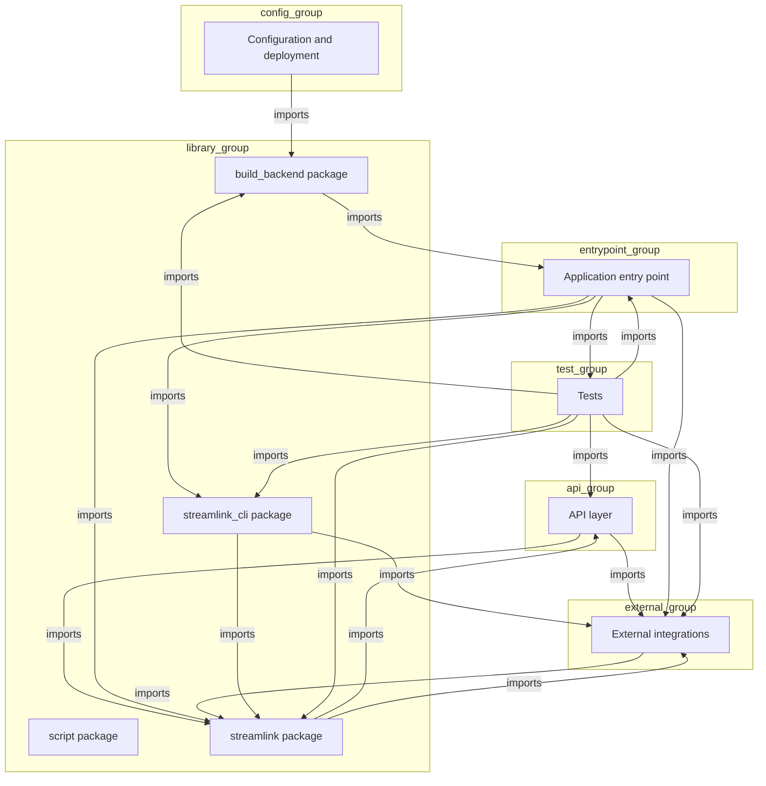

# Architecture report: streamlink/streamlink

> Automated static analysis. **Observed** = directly seen in files/imports/AST; **Inferred** = interpretation from that evidence. Repository code was not executed.

## 1. Repository at a glance

| Item | Value |
| --- | --- |
| Repository | streamlink/streamlink |
| Description | Streamlink is a CLI utility which pipes video streams from various services into a video player |
| Language | Python |
| Stars | 11921 |
| Licence | BSD-2-Clause |
| Analysed commit / branch | 5896d42b0066295d6305c39df0d36f9feb27e483 / master |
| Framework(s) | None detected |
| Files analysed | 664 |
| Components | 9 |

## 2. Architecture in one minute

streamlink/streamlink - Streamlink is a CLI utility which pipes video streams from various services into a video player. This repository was analysed statically from 664 file(s) (525 Python). Detected technologies (observed from imports/manifests): GitHub Actions, requests, Poetry, setuptools, pytest, unittest. Files are grouped into 9 component(s): API layer, build_backend package, Configuration and deployment, Application entry point, External integrations, script package, streamlink package, streamlink_cli package. Observed entry point(s): build_backend/plugins_json.py, script/build-shell-completions.py, script/generate-cdp.py. Findings below distinguish observed facts from inferred interpretation.

## 3. High-level block diagram

## 4. Main components

### API layer (`api_layer`)

- **Kind:** api
- **Status:** Observed
- **Confidence:** 0.85
- **Responsibility:** Groups 6 file(s) under api layer (observed from repository paths and static analysis). Observed top-level classes: AWSWAF, WebsocketClient.
- **Paths:** `src/streamlink/plugin/api/__init__.py`, `src/streamlink/plugin/api/useragents.py`, `src/streamlink/plugin/api/validate.py`, `src/streamlink/plugin/api/webbrowser/__init__.py`, `src/streamlink/plugin/api/webbrowser/aws_waf.py`, `src/streamlink/plugin/api/websocket.py`
- **Evidence:** [src/streamlink/plugin/api/__init__.py](https://github.com/streamlink/streamlink/blob/5896d42b0066295d6305c39df0d36f9feb27e483/src/streamlink/plugin/api/__init__.py); [src/streamlink/plugin/api/useragents.py](https://github.com/streamlink/streamlink/blob/5896d42b0066295d6305c39df0d36f9feb27e483/src/streamlink/plugin/api/useragents.py); [src/streamlink/plugin/api/validate.py](https://github.com/streamlink/streamlink/blob/5896d42b0066295d6305c39df0d36f9feb27e483/src/streamlink/plugin/api/validate.py); [src/streamlink/plugin/api/webbrowser/__init__.py](https://github.com/streamlink/streamlink/blob/5896d42b0066295d6305c39df0d36f9feb27e483/src/streamlink/plugin/api/webbrowser/__init__.py); [src/streamlink/plugin/api/webbrowser/aws_waf.py:23](https://github.com/streamlink/streamlink/blob/5896d42b0066295d6305c39df0d36f9feb27e483/src/streamlink/plugin/api/webbrowser/aws_waf.py#L23); [src/streamlink/plugin/api/websocket.py:42](https://github.com/streamlink/streamlink/blob/5896d42b0066295d6305c39df0d36f9feb27e483/src/streamlink/plugin/api/websocket.py#L42)

### build_backend package (`build_backend`)

- **Kind:** library
- **Status:** Observed
- **Confidence:** 0.85
- **Responsibility:** Groups 3 file(s) under build_backend package (observed from repository paths and static analysis). Observed top-level classes: Proxy, StreamlinkBuildPyCommand. Observed top-level functions: _filter_cmd_option_args, get_requires_for_build_wheel, onbuild, update_file.
- **Paths:** `build_backend/__init__.py`, `build_backend/commands.py`, `build_backend/onbuild.py`
- **Evidence:** [build_backend/__init__.py:20](https://github.com/streamlink/streamlink/blob/5896d42b0066295d6305c39df0d36f9feb27e483/build_backend/__init__.py#L20); [build_backend/commands.py:18](https://github.com/streamlink/streamlink/blob/5896d42b0066295d6305c39df0d36f9feb27e483/build_backend/commands.py#L18); [build_backend/onbuild.py:24](https://github.com/streamlink/streamlink/blob/5896d42b0066295d6305c39df0d36f9feb27e483/build_backend/onbuild.py#L24)

### Configuration and deployment (`config`)

- **Kind:** config
- **Status:** Observed
- **Confidence:** 0.85
- **Responsibility:** Groups 3 file(s) under configuration and deployment (observed from repository paths and static analysis). Observed top-level functions: is_wheel_for_windows.
- **Paths:** `MANIFEST.in`, `pyproject.toml`, `setup.py`
- **Evidence:** [MANIFEST.in](https://github.com/streamlink/streamlink/blob/5896d42b0066295d6305c39df0d36f9feb27e483/MANIFEST.in); [pyproject.toml](https://github.com/streamlink/streamlink/blob/5896d42b0066295d6305c39df0d36f9feb27e483/pyproject.toml); [setup.py:37](https://github.com/streamlink/streamlink/blob/5896d42b0066295d6305c39df0d36f9feb27e483/setup.py#L37)

### Application entry point (`entrypoint`)

- **Kind:** entrypoint
- **Status:** Observed
- **Confidence:** 0.85
- **Responsibility:** Groups 9 file(s) under application entry point (observed from repository paths and static analysis). Observed top-level classes: Author, CdpCommand, CdpDomain, CdpEvent, CdpItems, CdpParameter. Observed top-level functions: build, can_handle_url, check_file_output, check_version_wrapper, close_output, create_http_server.
- **Paths:** `build_backend/plugins_json.py`, `script/build-shell-completions.py`, `script/generate-cdp.py`, `script/github-release.py`, `script/test-plugin-urls.py`, `script/update-user-agents.py`, `src/streamlink/__main__.py`, `src/streamlink_cli/__main__.py`, `src/streamlink_cli/main.py`
- **Evidence:** [build_backend/plugins_json.py:30](https://github.com/streamlink/streamlink/blob/5896d42b0066295d6305c39df0d36f9feb27e483/build_backend/plugins_json.py#L30); [script/build-shell-completions.py:28](https://github.com/streamlink/streamlink/blob/5896d42b0066295d6305c39df0d36f9feb27e483/script/build-shell-completions.py#L28); [script/generate-cdp.py:153](https://github.com/streamlink/streamlink/blob/5896d42b0066295d6305c39df0d36f9feb27e483/script/generate-cdp.py#L153); [script/github-release.py:54](https://github.com/streamlink/streamlink/blob/5896d42b0066295d6305c39df0d36f9feb27e483/script/github-release.py#L54); [script/test-plugin-urls.py:30](https://github.com/streamlink/streamlink/blob/5896d42b0066295d6305c39df0d36f9feb27e483/script/test-plugin-urls.py#L30); [script/update-user-agents.py:46](https://github.com/streamlink/streamlink/blob/5896d42b0066295d6305c39df0d36f9feb27e483/script/update-user-agents.py#L46); [src/streamlink/__main__.py](https://github.com/streamlink/streamlink/blob/5896d42b0066295d6305c39df0d36f9feb27e483/src/streamlink/__main__.py); [src/streamlink_cli/__main__.py](https://github.com/streamlink/streamlink/blob/5896d42b0066295d6305c39df0d36f9feb27e483/src/streamlink_cli/__main__.py)

### External integrations (`external_integrations`)

- **Kind:** external
- **Status:** Observed
- **Confidence:** 0.85
- **Responsibility:** Groups 1 file(s) under external integrations (observed from repository paths and static analysis). Observed top-level classes: CDPClient, CDPClientSession, CMRequestProxy, RequestPausedHandler.
- **Paths:** `src/streamlink/webbrowser/cdp/client.py`
- **Evidence:** [src/streamlink/webbrowser/cdp/client.py:30](https://github.com/streamlink/streamlink/blob/5896d42b0066295d6305c39df0d36f9feb27e483/src/streamlink/webbrowser/cdp/client.py#L30)

### script package (`script`)

- **Kind:** library
- **Status:** Observed
- **Confidence:** 0.85
- **Responsibility:** Groups 2 file(s) under script package (observed from repository paths and static analysis).
- **Paths:** `script/build-and-sign.sh`, `script/deploy-docs.sh`
- **Evidence:** [script/build-and-sign.sh](https://github.com/streamlink/streamlink/blob/5896d42b0066295d6305c39df0d36f9feb27e483/script/build-and-sign.sh); [script/deploy-docs.sh](https://github.com/streamlink/streamlink/blob/5896d42b0066295d6305c39df0d36f9feb27e483/script/deploy-docs.sh)

### streamlink package (`streamlink`)

- **Kind:** library
- **Status:** Observed
- **Confidence:** 0.85
- **Responsibility:** Groups 221 file(s) under streamlink package (observed from repository paths and static analysis). Observed top-level classes: ARDMediathek, AbemaTV, AbemaTVHLSStream, AbemaTVHLSStreamReader, AbemaTVHLSStreamWriter, AbemaTVLicenseAdapter. Observed top-level functions: _atomic, _factory_find_free_port, _filter_socket_options, _get_child, _get_deprecation_stacklevel_offset, _get_version.
- **Paths:** `src/streamlink/__init__.py`, `src/streamlink/_version.py`, `src/streamlink/api.py`, `src/streamlink/buffers.py`, `src/streamlink/cache.py`, `src/streamlink/compat.py`, `src/streamlink/exceptions.py`, `src/streamlink/logger.py`, `src/streamlink/options.py`, `src/streamlink/packages/__init__.py`, `src/streamlink/packages/requests_file.py`, `src/streamlink/plugin/__init__.py`, `src/streamlink/plugin/plugin.py`, `src/streamlink/plugins/__init__.py`, `src/streamlink/plugins/abematv.py`, `src/streamlink/plugins/adultswim.py`, `src/streamlink/plugins/albavision.py`, `src/streamlink/plugins/aloula.py`, `src/streamlink/plugins/app17.py`, `src/streamlink/plugins/ard_mediathek.py`, `src/streamlink/plugins/artetv.py`, `src/streamlink/plugins/atpchallenger.py`, `src/streamlink/plugins/atresplayer.py`, `src/streamlink/plugins/bbciplayer.py`, `src/streamlink/plugins/bfmtv.py`, `src/streamlink/plugins/bigo.py`, `src/streamlink/plugins/bilibili.py`, `src/streamlink/plugins/blasttv.py`, `src/streamlink/plugins/blazetv.py`, `src/streamlink/plugins/bloomberg.py`, `src/streamlink/plugins/brightcove.py`, `src/streamlink/plugins/btv.py`, `src/streamlink/plugins/cbsnews.py`, `src/streamlink/plugins/cdnbg.py`, `src/streamlink/plugins/ceskatelevize.py`, `src/streamlink/plugins/chzzk.py`, `src/streamlink/plugins/cinergroup.py`, `src/streamlink/plugins/clubbingtv.py`, `src/streamlink/plugins/cmmedia.py`, `src/streamlink/plugins/cnbce.py`, `src/streamlink/plugins/cnews.py`, `src/streamlink/plugins/dailymotion.py`, `src/streamlink/plugins/dash.py`, `src/streamlink/plugins/delfi.py`, `src/streamlink/plugins/deutschewelle.py`, `src/streamlink/plugins/dlive.py`, `src/streamlink/plugins/dogan.py`, `src/streamlink/plugins/dogus.py`, `src/streamlink/plugins/douyin.py`, `src/streamlink/plugins/douyu.py`, `src/streamlink/plugins/drdk.py`, `src/streamlink/plugins/earthcam.py`, `src/streamlink/plugins/euronews.py`, `src/streamlink/plugins/facebook.py`, `src/streamlink/plugins/filmon.py`, `src/streamlink/plugins/goltelevision.py`, `src/streamlink/plugins/goodgame.py`, `src/streamlink/plugins/googledrive.py`, `src/streamlink/plugins/gulli.py`, `src/streamlink/plugins/hiplayer.py`, `src/streamlink/plugins/hls.py`, `src/streamlink/plugins/http.py`, `src/streamlink/plugins/htv.py`, `src/streamlink/plugins/huajiao.py`, `src/streamlink/plugins/huya.py`, `src/streamlink/plugins/invintus.py`, `src/streamlink/plugins/kick.py`, `src/streamlink/plugins/kugou.py`, `src/streamlink/plugins/livestream.py`, `src/streamlink/plugins/lnk.py`, `src/streamlink/plugins/lrt.py`, `src/streamlink/plugins/ltv_lsm_lv.py`, `src/streamlink/plugins/mangomolo.py`, `src/streamlink/plugins/mdstrm.py`, `src/streamlink/plugins/mediaklikk.py`, `src/streamlink/plugins/mediavitrina.py`, `src/streamlink/plugins/mixcloud.py`, `src/streamlink/plugins/mjunoon.py`, `src/streamlink/plugins/mrtmk.py`, `src/streamlink/plugins/n13tv.py`, `src/streamlink/plugins/nasaplus.py`, `src/streamlink/plugins/nicolive.py`, `src/streamlink/plugins/nimotv.py`, `src/streamlink/plugins/nos.py`, `src/streamlink/plugins/nowtvtr.py`, `src/streamlink/plugins/nrk.py`, `src/streamlink/plugins/okru.py`, `src/streamlink/plugins/olympicchannel.py`, `src/streamlink/plugins/oneplusone.py`, `src/streamlink/plugins/onetv.py`, `src/streamlink/plugins/openrectv.py`, `src/streamlink/plugins/pandalive.py`, `src/streamlink/plugins/piaulizaportal.py`, `src/streamlink/plugins/picarto.py`, `src/streamlink/plugins/pixiv.py`, `src/streamlink/plugins/pluto.py`, `src/streamlink/plugins/pluzz.py`, `src/streamlink/plugins/radiko.py`, `src/streamlink/plugins/raiplay.py`, `src/streamlink/plugins/reuters.py`, `src/streamlink/plugins/rtpa.py`, `src/streamlink/plugins/rtpplay.py`, `src/streamlink/plugins/rtve.py`, `src/streamlink/plugins/rtvs.py`, `src/streamlink/plugins/ruv.py`, `src/streamlink/plugins/sbscokr.py`, `src/streamlink/plugins/showroom.py`, `src/streamlink/plugins/soop.py`, `src/streamlink/plugins/sportal.py`, `src/streamlink/plugins/sportschau.py`, `src/streamlink/plugins/ssh101.py`, `src/streamlink/plugins/stadium.py`, `src/streamlink/plugins/steam.py`, `src/streamlink/plugins/streann.py`, `src/streamlink/plugins/stv.py`, `src/streamlink/plugins/svtplay.py`, `src/streamlink/plugins/swisstxt.py`, `src/streamlink/plugins/telefe.py`, `src/streamlink/plugins/telemadrid.py`, `src/streamlink/plugins/tf1.py`, `src/streamlink/plugins/tiktok.py`, `src/streamlink/plugins/turkuvaz.py`, `src/streamlink/plugins/tv360.py`, `src/streamlink/plugins/tv3cat.py`, `src/streamlink/plugins/tv5monde.py`, `src/streamlink/plugins/tv8.py`, `src/streamlink/plugins/tv999.py`, `src/streamlink/plugins/tvazteca.py`, `src/streamlink/plugins/tvibo.py`, `src/streamlink/plugins/tviplayer.py`, `src/streamlink/plugins/tvp.py`, `src/streamlink/plugins/tvtoya.py`, `src/streamlink/plugins/twitcasting.py`, `src/streamlink/plugins/twitch.py`, `src/streamlink/plugins/ustreamtv.py`, `src/streamlink/plugins/ustvnow.py`, `src/streamlink/plugins/vidio.py`, `src/streamlink/plugins/vimeo.py`, `src/streamlink/plugins/vinhlongtv.py`, `src/streamlink/plugins/vk.py`, `src/streamlink/plugins/vkvideolive.py`, `src/streamlink/plugins/welt.py`, `src/streamlink/plugins/wwenetwork.py`, `src/streamlink/plugins/youtube.py`, `src/streamlink/plugins/youtvua.py`, `src/streamlink/plugins/yupptv.py`, `src/streamlink/plugins/zattoo.py`, `src/streamlink/plugins/zdf_mediathek.py`, `src/streamlink/plugins/zeenews.py`, `src/streamlink/session/__init__.py`, `src/streamlink/session/http.py`, `src/streamlink/session/http_useragents.py`, `src/streamlink/session/options.py`, `src/streamlink/session/plugins.py`, `src/streamlink/session/session.py`, `src/streamlink/stream/__init__.py`, `src/streamlink/stream/dash/__init__.py`, `src/streamlink/stream/dash/dash.py`, `src/streamlink/stream/dash/manifest.py`, `src/streamlink/stream/dash/segment.py`, `src/streamlink/stream/ffmpegmux.py`, `src/streamlink/stream/file.py`, `src/streamlink/stream/filtered.py`, `src/streamlink/stream/hls/__init__.py`, `src/streamlink/stream/hls/hls.py`, `src/streamlink/stream/hls/m3u8.py`, `src/streamlink/stream/hls/segment.py`, `src/streamlink/stream/http.py`, `src/streamlink/stream/segmented/__init__.py`, `src/streamlink/stream/segmented/segment.py`, `src/streamlink/stream/segmented/segmented.py`, `src/streamlink/stream/stream.py`, `src/streamlink/stream/wrappers.py`, `src/streamlink/user_input.py`, `src/streamlink/utils/__init__.py`, `src/streamlink/utils/args.py`, `src/streamlink/utils/cache.py`, `src/streamlink/utils/crypto.py`, `src/streamlink/utils/data.py`, `src/streamlink/utils/dataclass.py`, `src/streamlink/utils/formatter.py`, `src/streamlink/utils/id3v2.py`, `src/streamlink/utils/l10n.py`, `src/streamlink/utils/module.py`, `src/streamlink/utils/named_pipe.py`, `src/streamlink/utils/num.py`, `src/streamlink/utils/parse.py`, `src/streamlink/utils/path.py`, `src/streamlink/utils/processoutput.py`, `src/streamlink/utils/random.py`, `src/streamlink/utils/socket.py`, `src/streamlink/utils/thread.py`, `src/streamlink/utils/times.py`, `src/streamlink/utils/url.py`, `src/streamlink/validate/__init__.py`, `src/streamlink/validate/_exception.py`, `src/streamlink/validate/_schemas.py`, `src/streamlink/validate/_validate.py`, `src/streamlink/validate/_validators.py`, `src/streamlink/webbrowser/__init__.py`, `src/streamlink/webbrowser/cdp/__init__.py`, `src/streamlink/webbrowser/cdp/connection.py`, `src/streamlink/webbrowser/cdp/devtools/__init__.py`, `src/streamlink/webbrowser/cdp/devtools/browser.py`, `src/streamlink/webbrowser/cdp/devtools/debugger.py`, `src/streamlink/webbrowser/cdp/devtools/dom.py`, `src/streamlink/webbrowser/cdp/devtools/emulation.py`, `src/streamlink/webbrowser/cdp/devtools/fetch.py`, `src/streamlink/webbrowser/cdp/devtools/input_.py`, `src/streamlink/webbrowser/cdp/devtools/inspector.py`, `src/streamlink/webbrowser/cdp/devtools/io.py`, `src/streamlink/webbrowser/cdp/devtools/network.py`, `src/streamlink/webbrowser/cdp/devtools/page.py`, `src/streamlink/webbrowser/cdp/devtools/runtime.py`, `src/streamlink/webbrowser/cdp/devtools/security.py`, `src/streamlink/webbrowser/cdp/devtools/target.py`, `src/streamlink/webbrowser/cdp/devtools/util.py`, `src/streamlink/webbrowser/cdp/exceptions.py`, `src/streamlink/webbrowser/chromium.py`, `src/streamlink/webbrowser/exceptions.py`, `src/streamlink/webbrowser/webbrowser.py`
- **Evidence:** [src/streamlink/__init__.py](https://github.com/streamlink/streamlink/blob/5896d42b0066295d6305c39df0d36f9feb27e483/src/streamlink/__init__.py); [src/streamlink/_version.py:5](https://github.com/streamlink/streamlink/blob/5896d42b0066295d6305c39df0d36f9feb27e483/src/streamlink/_version.py#L5); [src/streamlink/api.py:4](https://github.com/streamlink/streamlink/blob/5896d42b0066295d6305c39df0d36f9feb27e483/src/streamlink/api.py#L4); [src/streamlink/buffers.py:6](https://github.com/streamlink/streamlink/blob/5896d42b0066295d6305c39df0d36f9feb27e483/src/streamlink/buffers.py#L6); [src/streamlink/cache.py:38](https://github.com/streamlink/streamlink/blob/5896d42b0066295d6305c39df0d36f9feb27e483/src/streamlink/cache.py#L38); [src/streamlink/compat.py:52](https://github.com/streamlink/streamlink/blob/5896d42b0066295d6305c39df0d36f9feb27e483/src/streamlink/compat.py#L52); [src/streamlink/exceptions.py:1](https://github.com/streamlink/streamlink/blob/5896d42b0066295d6305c39df0d36f9feb27e483/src/streamlink/exceptions.py#L1); [src/streamlink/logger.py:53](https://github.com/streamlink/streamlink/blob/5896d42b0066295d6305c39df0d36f9feb27e483/src/streamlink/logger.py#L53)

### streamlink_cli package (`streamlink_cli`)

- **Kind:** library
- **Status:** Observed
- **Confidence:** 0.85
- **Responsibility:** Groups 27 file(s) under streamlink_cli package (observed from repository paths and static analysis). Observed top-level classes: ArgumentParser, CONSOLE_SCREEN_BUFFER_INFO, COORD, ConsoleOutput, ConsoleOutputStream, ConsoleOutputStreamANSI. Observed top-level functions: _exit, _find_default_player_darwin, _find_default_player_other, _find_default_player_win32, _get_width, _noop.
- **Paths:** `src/streamlink_cli/__init__.py`, `src/streamlink_cli/_parser.py`, `src/streamlink_cli/argparser.py`, `src/streamlink_cli/compat.py`, `src/streamlink_cli/console/__init__.py`, `src/streamlink_cli/console/console.py`, `src/streamlink_cli/console/progress.py`, `src/streamlink_cli/console/stream.py`, `src/streamlink_cli/console/stream_wrapper.py`, `src/streamlink_cli/console/terminal.py`, `src/streamlink_cli/console/user_input.py`, `src/streamlink_cli/console/windows.py`, `src/streamlink_cli/constants.py`, `src/streamlink_cli/exceptions.py`, `src/streamlink_cli/output/__init__.py`, `src/streamlink_cli/output/abc.py`, `src/streamlink_cli/output/file.py`, `src/streamlink_cli/output/http.py`, `src/streamlink_cli/output/player.py`, `src/streamlink_cli/setup_args.py`, `src/streamlink_cli/show_matchers.py`, `src/streamlink_cli/streamrunner.py`, `src/streamlink_cli/utils/__init__.py`, `src/streamlink_cli/utils/formatter.py`, `src/streamlink_cli/utils/path.py`, `src/streamlink_cli/utils/player.py`, `src/streamlink_cli/utils/versioncheck.py`
- **Evidence:** [src/streamlink_cli/__init__.py:7](https://github.com/streamlink/streamlink/blob/5896d42b0066295d6305c39df0d36f9feb27e483/src/streamlink_cli/__init__.py#L7); [src/streamlink_cli/_parser.py:10](https://github.com/streamlink/streamlink/blob/5896d42b0066295d6305c39df0d36f9feb27e483/src/streamlink_cli/_parser.py#L10); [src/streamlink_cli/argparser.py:40](https://github.com/streamlink/streamlink/blob/5896d42b0066295d6305c39df0d36f9feb27e483/src/streamlink_cli/argparser.py#L40); [src/streamlink_cli/compat.py](https://github.com/streamlink/streamlink/blob/5896d42b0066295d6305c39df0d36f9feb27e483/src/streamlink_cli/compat.py); [src/streamlink_cli/console/__init__.py](https://github.com/streamlink/streamlink/blob/5896d42b0066295d6305c39df0d36f9feb27e483/src/streamlink_cli/console/__init__.py); [src/streamlink_cli/console/console.py:17](https://github.com/streamlink/streamlink/blob/5896d42b0066295d6305c39df0d36f9feb27e483/src/streamlink_cli/console/console.py#L17); [src/streamlink_cli/console/progress.py:26](https://github.com/streamlink/streamlink/blob/5896d42b0066295d6305c39df0d36f9feb27e483/src/streamlink_cli/console/progress.py#L26); [src/streamlink_cli/console/stream.py:17](https://github.com/streamlink/streamlink/blob/5896d42b0066295d6305c39df0d36f9feb27e483/src/streamlink_cli/console/stream.py#L17)

### Tests (`tests`)

- **Kind:** test
- **Status:** Observed
- **Confidence:** 0.85
- **Responsibility:** Groups 297 file(s) under tests (observed from repository paths and static analysis). Observed routes: PATCH streamlink.plugins.kick.log, PATCH streamlink.plugins.kick.log, PATCH streamlink.plugins.kick.log, PATCH streamlink.plugins.twitch.log, PATCH streamlink.plugins.twitch.log. Observed top-level classes: BigoSegment, ConstantOrSequenceOfConstants, CustomConstructorOnePlugin, CustomConstructorTwoPlugin, EncryptedBase, EqSimpleCData. Observed top-level functions: _args, _atexit_register, _caplog, _check_test_condition, _clear_threadname_counters, _config_files.
- **Paths:** `build_backend/test_build_backend.py`, `build_backend/test_onbuild.py`, `build_backend/test_plugins_json.py`, `tests/__init__.py`, `tests/cli/__init__.py`, `tests/cli/console/__init__.py`, `tests/cli/console/test_console.py`, `tests/cli/console/test_progress.py`, `tests/cli/console/test_stream.py`, `tests/cli/console/test_stream_wrapper.py`, `tests/cli/console/test_terminal.py`, `tests/cli/console/test_windows.py`, `tests/cli/main/__init__.py`, `tests/cli/main/conftest.py`, `tests/cli/main/test_can_handle_url.py`, `tests/cli/main/test_check_file_output.py`, `tests/cli/main/test_create_output.py`, `tests/cli/main/test_formatter.py`, `tests/cli/main/test_handle_url.py`, `tests/cli/main/test_logging.py`, `tests/cli/main/test_main.py`, `tests/cli/main/test_output_stream.py`, `tests/cli/main/test_output_stream_passthrough.py`, `tests/cli/main/test_player_argv.py`, `tests/cli/main/test_resolve_stream_name.py`, `tests/cli/main/test_setup_args.py`, `tests/cli/main/test_setup_config_args.py`, `tests/cli/main/test_setup_plugins.py`, `tests/cli/main/test_setup_session_options.py`, `tests/cli/main/test_show_matchers.py`, `tests/cli/main/test_version_check.py`, `tests/cli/output/__init__.py`, `tests/cli/output/test_file.py`, `tests/cli/output/test_player.py`, `tests/cli/test_argparser.py`, `tests/cli/test_compat.py`, `tests/cli/test_streamrunner.py`, `tests/cli/utils/__init__.py`, `tests/cli/utils/test_formatter.py`, `tests/cli/utils/test_path.py`, `tests/cli/utils/test_player.py`, `tests/cli/utils/test_versioncheck.py`, `tests/conftest.py`, `tests/mixins/__init__.py`, `tests/mixins/stream_hls.py`, `tests/plugin/__init__.py`, `tests/plugin/override/testplugin.py`, `tests/plugin/testplugin.py`, `tests/plugin/testplugin_invalid.py`, `tests/plugin/testplugin_missing.py`, `tests/plugins/__init__.py`, `tests/plugins/conftest.py`, `tests/plugins/test_abematv.py`, `tests/plugins/test_adultswim.py`, `tests/plugins/test_albavision.py`, `tests/plugins/test_aloula.py`, `tests/plugins/test_app17.py`, `tests/plugins/test_ard_mediathek.py`, `tests/plugins/test_artetv.py`, `tests/plugins/test_atpchallenger.py`, `tests/plugins/test_atresplayer.py`, `tests/plugins/test_bbciplayer.py`, `tests/plugins/test_bfmtv.py`, `tests/plugins/test_bigo.py`, `tests/plugins/test_bilibili.py`, `tests/plugins/test_blasttv.py`, `tests/plugins/test_blazetv.py`, `tests/plugins/test_bloomberg.py`, `tests/plugins/test_brightcove.py`, `tests/plugins/test_btv.py`, `tests/plugins/test_cbsnews.py`, `tests/plugins/test_cdnbg.py`, `tests/plugins/test_ceskatelevize.py`, `tests/plugins/test_chzzk.py`, `tests/plugins/test_cinergroup.py`, `tests/plugins/test_clubbingtv.py`, `tests/plugins/test_cmmedia.py`, `tests/plugins/test_cnbce.py`, `tests/plugins/test_cnews.py`, `tests/plugins/test_dailymotion.py`, `tests/plugins/test_dash.py`, `tests/plugins/test_delfi.py`, `tests/plugins/test_deutschewelle.py`, `tests/plugins/test_dlive.py`, `tests/plugins/test_dogan.py`, `tests/plugins/test_dogus.py`, `tests/plugins/test_douyin.py`, `tests/plugins/test_douyu.py`, `tests/plugins/test_drdk.py`, `tests/plugins/test_earthcam.py`, `tests/plugins/test_euronews.py`, `tests/plugins/test_facebook.py`, `tests/plugins/test_filmon.py`, `tests/plugins/test_goltelevision.py`, `tests/plugins/test_goodgame.py`, `tests/plugins/test_googledrive.py`, `tests/plugins/test_gulli.py`, `tests/plugins/test_hiplayer.py`, `tests/plugins/test_hls.py`, `tests/plugins/test_http.py`, `tests/plugins/test_htv.py`, `tests/plugins/test_huajiao.py`, `tests/plugins/test_huya.py`, `tests/plugins/test_invintus.py`, `tests/plugins/test_kick.py`, `tests/plugins/test_kugou.py`, `tests/plugins/test_livestream.py`, `tests/plugins/test_lnk.py`, `tests/plugins/test_lrt.py`, `tests/plugins/test_ltv_lsm_lv.py`, `tests/plugins/test_mangomolo.py`, `tests/plugins/test_mdstrm.py`, `tests/plugins/test_mediaklikk.py`, `tests/plugins/test_mediavitrina.py`, `tests/plugins/test_mixcloud.py`, `tests/plugins/test_mjunoon.py`, `tests/plugins/test_mrtmk.py`, `tests/plugins/test_n13tv.py`, `tests/plugins/test_nasaplus.py`, `tests/plugins/test_nicolive.py`, `tests/plugins/test_nimotv.py`, `tests/plugins/test_nos.py`, `tests/plugins/test_nowtvtr.py`, `tests/plugins/test_nrk.py`, `tests/plugins/test_okru.py`, `tests/plugins/test_olympicchannel.py`, `tests/plugins/test_oneplusone.py`, `tests/plugins/test_onetv.py`, `tests/plugins/test_openrectv.py`, `tests/plugins/test_pandalive.py`, `tests/plugins/test_piaulizaportal.py`, `tests/plugins/test_picarto.py`, `tests/plugins/test_pixiv.py`, `tests/plugins/test_pluto.py`, `tests/plugins/test_pluzz.py`, `tests/plugins/test_radiko.py`, `tests/plugins/test_raiplay.py`, `tests/plugins/test_reuters.py`, `tests/plugins/test_rtpa.py`, `tests/plugins/test_rtpplay.py`, `tests/plugins/test_rtve.py`, `tests/plugins/test_rtvs.py`, `tests/plugins/test_ruv.py`, `tests/plugins/test_sbscokr.py`, `tests/plugins/test_showroom.py`, `tests/plugins/test_soop.py`, `tests/plugins/test_sportal.py`, `tests/plugins/test_sportschau.py`, `tests/plugins/test_ssh101.py`, `tests/plugins/test_stadium.py`, `tests/plugins/test_steam.py`, `tests/plugins/test_streann.py`, `tests/plugins/test_stv.py`, `tests/plugins/test_svtplay.py`, `tests/plugins/test_swisstxt.py`, `tests/plugins/test_telefe.py`, `tests/plugins/test_telemadrid.py`, `tests/plugins/test_tf1.py`, `tests/plugins/test_tiktok.py`, `tests/plugins/test_turkuvaz.py`, `tests/plugins/test_tv360.py`, `tests/plugins/test_tv3cat.py`, `tests/plugins/test_tv5monde.py`, `tests/plugins/test_tv8.py`, `tests/plugins/test_tv999.py`, `tests/plugins/test_tvazteca.py`, `tests/plugins/test_tvibo.py`, `tests/plugins/test_tviplayer.py`, `tests/plugins/test_tvp.py`, `tests/plugins/test_tvtoya.py`, `tests/plugins/test_twitcasting.py`, `tests/plugins/test_twitch.py`, `tests/plugins/test_ustreamtv.py`, `tests/plugins/test_ustvnow.py`, `tests/plugins/test_vidio.py`, `tests/plugins/test_vimeo.py`, `tests/plugins/test_vinhlongtv.py`, `tests/plugins/test_vk.py`, `tests/plugins/test_vkvideolive.py`, `tests/plugins/test_welt.py`, `tests/plugins/test_wwenetwork.py`, `tests/plugins/test_youtube.py`, `tests/plugins/test_youtvua.py`, `tests/plugins/test_yupptv.py`, `tests/plugins/test_zattoo.py`, `tests/plugins/test_zdf_mediathek.py`, `tests/plugins/test_zeenews.py`, `tests/resources/__init__.py`, `tests/resources/cli/config/custom`, `tests/resources/cli/config/primary`, `tests/resources/cli/config/primary.testplugin`, `tests/resources/cli/config/secondary`, `tests/resources/cli/config/secondary.testplugin`, `tests/resources/dash/test_1.mpd`, `tests/resources/dash/test_10.mpd`, `tests/resources/dash/test_11_static.mpd`, `tests/resources/dash/test_2.mpd`, `tests/resources/dash/test_3.mpd`, `tests/resources/dash/test_8.mpd`, `tests/resources/dash/test_9.mpd`, `tests/resources/dash/test_attribute_namespaces.mpd`, `tests/resources/dash/test_baseurl_nested.mpd`, `tests/resources/dash/test_baseurl_scheme_mismatch.mpd`, `tests/resources/dash/test_baseurl_urljoin.mpd`, `tests/resources/dash/test_dynamic_no_publish_time_timeline_with_start.mpd`, `tests/resources/dash/test_dynamic_no_publish_time_timeline_without_start.mpd`, `tests/resources/dash/test_dynamic_segment_list_no_duration.mpd`, `tests/resources/dash/test_dynamic_segment_list_p1.mpd`, `tests/resources/dash/test_dynamic_segment_list_p2.mpd`, `tests/resources/dash/test_dynamic_segment_list_p3.mpd`, `tests/resources/dash/test_dynamic_segment_list_p4.mpd`, `tests/resources/dash/test_dynamic_segment_list_p5.mpd`, `tests/resources/dash/test_dynamic_timeline_continued_p1.mpd`, `tests/resources/dash/test_dynamic_timeline_continued_p2.mpd`, `tests/resources/dash/test_location_scheme_mismatch.mpd`, `tests/resources/dash/test_no_segment_list_or_template.mpd`, `tests/resources/dash/test_period_selection.mpd`, `tests/resources/dash/test_segment_list.mpd`, `tests/resources/dash/test_segment_scheme_mismatch.mpd`, `tests/resources/dash/test_segments_byterange.mpd`, `tests/resources/dash/test_segments_dynamic_number.mpd`, `tests/resources/dash/test_static_no_publish_time.mpd`, `tests/resources/dash/test_suggested_presentation_delay.mpd`, `tests/resources/dash/test_timeline_gap.mpd`, `tests/resources/dash/test_timeline_ids.mpd`, `tests/resources/hls/test_1.m3u8`, `tests/resources/hls/test_date.m3u8`, `tests/resources/hls/test_master.m3u8`, `tests/resources/hls/test_media_language.m3u8`, `tests/resources/hls/test_media_language_special.m3u8`, `tests/resources/hls/test_multivariant_bandwidth.m3u8`, `tests/resources/hls/test_multivariant_twitch_usher_v2.m3u8`, `tests/resources/hls/test_simple_media.m3u8`, `tests/resources/hls/test_simple_multivariant.m3u8`, `tests/session/__init__.py`, `tests/session/test_http.py`, `tests/session/test_options.py`, `tests/session/test_plugins.py`, `tests/session/test_session.py`, `tests/stream/__init__.py`, `tests/stream/conftest.py`, `tests/stream/dash/__init__.py`, `tests/stream/dash/test_dash.py`, `tests/stream/dash/test_manifest.py`, `tests/stream/hls/__init__.py`, `tests/stream/hls/test_hls.py`, `tests/stream/hls/test_hls_filtered.py`, `tests/stream/hls/test_m3u8.py`, `tests/stream/test_ffmpegmux.py`, `tests/stream/test_file.py`, `tests/stream/test_init.py`, `tests/stream/test_segmented.py`, `tests/stream/test_stream_json.py`, `tests/stream/test_stream_to_url.py`, `tests/stream/test_stream_wrappers.py`, `tests/test_api_websocket.py`, `tests/test_buffers.py`, `tests/test_cache.py`, `tests/test_compat.py`, `tests/test_logger.py`, `tests/test_options.py`, `tests/test_plugin.py`, `tests/test_plugin_userinput.py`, `tests/test_plugins.py`, `tests/test_streamlink_api.py`, `tests/test_validate.py`, `tests/testutils/__init__.py`, `tests/testutils/handshake.py`, `tests/testutils/test_handshake.py`, `tests/utils/__init__.py`, `tests/utils/test_args.py`, `tests/utils/test_cache.py`, `tests/utils/test_crypto.py`, `tests/utils/test_data.py`, `tests/utils/test_dataclass.py`, `tests/utils/test_formatter.py`, `tests/utils/test_id3v2.py`, `tests/utils/test_init.py`, `tests/utils/test_l10n.py`, `tests/utils/test_module.py`, `tests/utils/test_named_pipe.py`, `tests/utils/test_num.py`, `tests/utils/test_parse.py`, `tests/utils/test_path.py`, `tests/utils/test_processoutput.py`, `tests/utils/test_random.py`, `tests/utils/test_thread.py`, `tests/utils/test_times.py`, `tests/utils/test_url.py`, `tests/webbrowser/__init__.py`, `tests/webbrowser/cdp/__init__.py`, `tests/webbrowser/cdp/conftest.py`, `tests/webbrowser/cdp/test_client.py`, `tests/webbrowser/cdp/test_connection.py`, `tests/webbrowser/conftest.py`, `tests/webbrowser/test_chromium.py`, `tests/webbrowser/test_webbrowser.py`
- **Evidence:** [build_backend/test_build_backend.py:42](https://github.com/streamlink/streamlink/blob/5896d42b0066295d6305c39df0d36f9feb27e483/build_backend/test_build_backend.py#L42); [build_backend/test_onbuild.py:22](https://github.com/streamlink/streamlink/blob/5896d42b0066295d6305c39df0d36f9feb27e483/build_backend/test_onbuild.py#L22); [build_backend/test_plugins_json.py:31](https://github.com/streamlink/streamlink/blob/5896d42b0066295d6305c39df0d36f9feb27e483/build_backend/test_plugins_json.py#L31); [tests/__init__.py](https://github.com/streamlink/streamlink/blob/5896d42b0066295d6305c39df0d36f9feb27e483/tests/__init__.py); [tests/cli/__init__.py](https://github.com/streamlink/streamlink/blob/5896d42b0066295d6305c39df0d36f9feb27e483/tests/cli/__init__.py); [tests/cli/console/__init__.py](https://github.com/streamlink/streamlink/blob/5896d42b0066295d6305c39df0d36f9feb27e483/tests/cli/console/__init__.py); [tests/cli/console/test_console.py:15](https://github.com/streamlink/streamlink/blob/5896d42b0066295d6305c39df0d36f9feb27e483/tests/cli/console/test_console.py#L15); [tests/cli/console/test_progress.py:15](https://github.com/streamlink/streamlink/blob/5896d42b0066295d6305c39df0d36f9feb27e483/tests/cli/console/test_progress.py#L15)

## 5. Execution flow

**Observed** entry point(s):

- [build_backend/plugins_json.py:491](https://github.com/streamlink/streamlink/blob/5896d42b0066295d6305c39df0d36f9feb27e483/build_backend/plugins_json.py#L491)
- [script/build-shell-completions.py:73](https://github.com/streamlink/streamlink/blob/5896d42b0066295d6305c39df0d36f9feb27e483/script/build-shell-completions.py#L73)
- [script/generate-cdp.py:1056](https://github.com/streamlink/streamlink/blob/5896d42b0066295d6305c39df0d36f9feb27e483/script/generate-cdp.py#L1056)
- [script/github-release.py:578](https://github.com/streamlink/streamlink/blob/5896d42b0066295d6305c39df0d36f9feb27e483/script/github-release.py#L578)
- [script/test-plugin-urls.py:248](https://github.com/streamlink/streamlink/blob/5896d42b0066295d6305c39df0d36f9feb27e483/script/test-plugin-urls.py#L248)
- [script/update-user-agents.py:126](https://github.com/streamlink/streamlink/blob/5896d42b0066295d6305c39df0d36f9feb27e483/script/update-user-agents.py#L126)
- [setup.py:76](https://github.com/streamlink/streamlink/blob/5896d42b0066295d6305c39df0d36f9feb27e483/setup.py#L76)
- [src/streamlink/__main__.py:1](https://github.com/streamlink/streamlink/blob/5896d42b0066295d6305c39df0d36f9feb27e483/src/streamlink/__main__.py#L1)
- [src/streamlink_cli/__main__.py:1](https://github.com/streamlink/streamlink/blob/5896d42b0066295d6305c39df0d36f9feb27e483/src/streamlink_cli/__main__.py#L1)
- [src/streamlink_cli/main.py](https://github.com/streamlink/streamlink/blob/5896d42b0066295d6305c39df0d36f9feb27e483/src/streamlink_cli/main.py)
- [src/streamlink_cli/main.py](https://github.com/streamlink/streamlink/blob/5896d42b0066295d6305c39df0d36f9feb27e483/src/streamlink_cli/main.py)

**Observed** routes (from decorators):

- `PATCH streamlink.plugins.kick.log` -> `test_hls_low_latency_has_prefetch` in `tests/plugins/test_kick.py:67`
- `PATCH streamlink.plugins.kick.log` -> `test_hls_no_low_latency_has_prefetch` in `tests/plugins/test_kick.py:89`
- `PATCH streamlink.plugins.kick.log` -> `test_hls_low_latency_no_prefetch` in `tests/plugins/test_kick.py:110`
- `PATCH streamlink.plugins.twitch.log` -> `test_hls_has_preroll` in `tests/plugins/test_twitch.py:299`
- `PATCH streamlink.plugins.twitch.log` -> `test_hls_has_midroll` in `tests/plugins/test_twitch.py:325`
- `PATCH streamlink.plugins.twitch.log` -> `test_hls_has_preroll_and_midroll` in `tests/plugins/test_twitch.py:351`
- `PATCH streamlink.plugins.twitch.log` -> `test_hls_low_latency_has_prefetch` in `tests/plugins/test_twitch.py:404`
- `PATCH streamlink.plugins.twitch.log` -> `test_hls_no_low_latency_has_prefetch` in `tests/plugins/test_twitch.py:427`
- `PATCH streamlink.plugins.twitch.log` -> `test_hls_low_latency_no_prefetch` in `tests/plugins/test_twitch.py:450`
- `PATCH streamlink.plugins.twitch.log` -> `test_hls_low_latency_has_prefetch_has_preroll` in `tests/plugins/test_twitch.py:470`
- `PATCH streamlink.plugins.twitch.log` -> `test_hls_low_latency_has_prefetch_no_preroll_with_prefetch_ads` in `tests/plugins/test_twitch.py:493`
- `PATCH streamlink.plugins.twitch.log` -> `test_hls_low_latency_no_prefetch_has_preroll` in `tests/plugins/test_twitch.py:536`
- `PATCH streamlink.stream.hls.hls.log` -> `test_hls_prefetch_after_discontinuity` in `tests/plugins/test_twitch.py:573`
- `PATCH streamlink.stream.hls.hls.log` -> `test_hls_ignored_discontinuity` in `tests/plugins/test_twitch.py:590`
- `PATCH streamlink.stream.hls.hls.parse_m3u8` -> `test_is_master` in `tests/stream/hls/test_hls.py:1785`
- `PATCH streamlink.stream.hls.hls.parse_m3u8` -> `test_iframes_only` in `tests/stream/hls/test_hls.py:1800`
- `PATCH streamlink.stream.hls.HLSStreamWriter.should_filter_segment` -> `test_filtered_logging` in `tests/stream/hls/test_hls_filtered.py:56`
- `PATCH streamlink.stream.hls.HLSStreamWriter.should_filter_segment` -> `test_filtered_timeout` in `tests/stream/hls/test_hls_filtered.py:110`
- `PATCH streamlink.stream.hls.HLSStreamWriter.should_filter_segment` -> `test_filtered_no_timeout` in `tests/stream/hls/test_hls_filtered.py:125`
- `PATCH streamlink.stream.hls.HLSStreamWriter.should_filter_segment` -> `test_filtered_closed` in `tests/stream/hls/test_hls_filtered.py:153`

Representative flow (derived from observed entry points and the import graph; steps beyond the entry point are **Inferred**):

1. Execution starts at an observed entry point listed above, if present.
2. `api_layer` imports `external_integrations` (API layer -> External integrations).
3. `api_layer` imports `streamlink` (API layer -> streamlink package).
4. `build_backend` imports `entrypoint` (build_backend package -> Application entry point).
5. `config` imports `build_backend` (Configuration and deployment -> build_backend package).
6. `entrypoint` imports `external_integrations` (Application entry point -> External integrations).
7. `entrypoint` imports `streamlink` (Application entry point -> streamlink package).
8. `entrypoint` imports `streamlink_cli` (Application entry point -> streamlink_cli package).
9. `entrypoint` imports `tests` (Application entry point -> Tests).

## 6. Project structure

### `(root)`

- `.codecov.yml` - config (1610 bytes)
- `.editorconfig` - config (403 bytes)
- `.git-blame-ignore-revs` - other (946 bytes)
- `.gitattributes` - other (19 bytes)
- `.gitignore` - other (191 bytes)
- `.readthedocs.yml` - config (404 bytes)
- `AUTHORS` - other (221 bytes)
- `CHANGELOG.md` - docs (150224 bytes)
- `CODE_OF_CONDUCT.md` - docs (705 bytes)
- `CONTRIBUTING.md` - docs (15734 bytes)
- `LICENSE` - docs (1350 bytes)
- `MANIFEST.in` - manifest (358 bytes)
- `README.md` - docs (4396 bytes)
- `SECURITY.md` - docs (2717 bytes)
- `icon.svg` - other (18593 bytes)
- `pyproject.toml` - manifest (9944 bytes)
- `setup.py` - manifest, Python (3361 bytes)
- `signing.key.enc` - other (1106 bytes)

### `.github`

- `.github/DISCUSSION_TEMPLATE/general.yml` - config (2668 bytes)
- `.github/DISCUSSION_TEMPLATE/q-a.yml` - config (2668 bytes)
- `.github/FUNDING.yml` - config (86 bytes)
- `.github/ISSUE_TEMPLATE/1_plugin_issue.yml` - config (5352 bytes)
- `.github/ISSUE_TEMPLATE/2_bug_report.yml` - config (5153 bytes)
- `.github/ISSUE_TEMPLATE/3_plugin_request.yml` - config (4077 bytes)
- `.github/ISSUE_TEMPLATE/4_feature_request.yml` - config (3123 bytes)
- `.github/ISSUE_TEMPLATE/config.yml` - config (752 bytes)
- `.github/dependabot.yml` - config (1248 bytes)
- `.github/pull_request_template.md` - docs (734 bytes)
- `.github/release_template.md` - docs (963 bytes)
- `.github/workflows/docs.yml` - ci, YAML (976 bytes)
- `.github/workflows/lint.yml` - ci, YAML (3606 bytes)
- `.github/workflows/preview-build.yml` - ci, YAML (1865 bytes)
- `.github/workflows/release.yml` - ci, YAML (2505 bytes)
- `.github/workflows/scripts/fetch-tags.sh` - ci, YAML (1021 bytes)
- `.github/workflows/scripts/install-temp-dependencies.sh` - ci, YAML (1027 bytes)
- `.github/workflows/scripts/lint-git-commit-msg-format.awk` - ci, YAML (1635 bytes)
- `.github/workflows/scripts/lint-git-common.awk` - ci, YAML (501 bytes)
- `.github/workflows/scripts/lint-git-linear-history.awk` - ci, YAML (179 bytes)
- `.github/workflows/test.yml` - ci, YAML (5264 bytes)
- `.github/workflows/useragents.yml` - ci, YAML (1413 bytes)

### `build_backend`

- `build_backend/__init__.py` - source, Python (4007 bytes)
- `build_backend/commands.py` - source, Python (904 bytes)
- `build_backend/onbuild.py` - source, Python (3737 bytes)
- `build_backend/plugins_json.py` - source, Python (16693 bytes)
- `build_backend/test_build_backend.py` - test, Python (1437 bytes)
- `build_backend/test_onbuild.py` - test, Python (3681 bytes)
- `build_backend/test_plugins_json.py` - test, Python (42249 bytes)

### `docs`

- `docs/Makefile` - docs (6345 bytes)
- `docs/_man.rst` - docs (1398 bytes)
- `docs/_static/github-lockup-dark.svg` - docs (3088 bytes)
- `docs/_static/github-lockup-light.svg` - docs (3088 bytes)
- `docs/_static/icon-ffmpeg.svg` - docs (2350 bytes)
- `docs/_static/icon-python.svg` - docs (1562 bytes)
- `docs/_static/jetbrains-mono-black.svg` - docs (4335 bytes)
- `docs/_static/jetbrains-mono-white.svg` - docs (3583 bytes)
- `docs/_static/site.webmanifest` - docs (311 bytes)
- `docs/_static/styles/custom.css` - docs (8150 bytes)
- `docs/_templates/base.html` - docs (1004 bytes)
- `docs/_templates/page.html` - docs (306 bytes)
- `docs/_templates/sidebar/brand.html` - docs (908 bytes)
- `docs/_templates/sidebar/github-buttons.html` - docs (519 bytes)
- `docs/acknowledgements.rst` - docs (1157 bytes)
- `docs/api.rst` - docs (259 bytes)
- `docs/api/cache.rst` - docs (64 bytes)
- `docs/api/exceptions.rst` - docs (488 bytes)
- `docs/api/options.rst` - docs (145 bytes)
- `docs/api/plugin.rst` - docs (307 bytes)
- `docs/api/session.rst` - docs (363 bytes)
- `docs/api/stream.rst` - docs (377 bytes)
- `docs/api/streamlink.rst` - docs (60 bytes)
- `docs/api/validate.rst` - docs (11514 bytes)
- `docs/api/webbrowser.rst` - docs (742 bytes)
- `docs/api_guide.rst` - docs (100 bytes)
- `docs/api_guide/quickstart.rst` - docs (6333 bytes)
- `docs/api_guide/validate.rst` - docs (17621 bytes)
- `docs/applications.rst` - docs (859 bytes)
- `docs/cli.rst` - docs (514 bytes)
- `docs/cli/config.rst` - docs (3732 bytes)
- `docs/cli/metadata.rst` - docs (3179 bytes)
- `docs/cli/plugin-sideloading.rst` - docs (2939 bytes)
- `docs/cli/plugins.rst` - docs (78 bytes)
- `docs/cli/plugins/twitch.rst` - docs (11901 bytes)
- `docs/cli/protocols.rst` - docs (3053 bytes)
- `docs/cli/proxy.rst` - docs (1106 bytes)
- `docs/cli/tutorial.rst` - docs (6900 bytes)
- `docs/conf.py` - docs (4913 bytes)
- `docs/deprecations.rst` - docs (13518 bytes)
- `docs/developing.rst` - docs (11464 bytes)
- `docs/docutils.conf` - docs (43 bytes)
- `docs/index.rst` - docs (2695 bytes)
- `docs/install.rst` - docs (26002 bytes)
- `docs/migrations.rst` - docs (16903 bytes)
- `docs/players.rst` - docs (4248 bytes)
- `docs/plugins.rst` - docs (775 bytes)
- `docs/sphinxext/ext_argparse.py` - docs (6647 bytes)
- `docs/sphinxext/ext_github.py` - docs (2087 bytes)
- `docs/sphinxext/ext_html_template_vars.py` - docs (572 bytes)
- `docs/sphinxext/ext_plugins.py` - docs (9147 bytes)
- `docs/sphinxext/ext_releaseref.py` - docs (774 bytes)
- `docs/support.rst` - docs (684 bytes)
- `docs/thirdparty.rst` - docs (3404 bytes)

### `script`

- `script/build-and-sign.sh` - source, Shell (2281 bytes)
- `script/build-shell-completions.py` - source, Python (2121 bytes)
- `script/deploy-docs.sh` - source, Shell (2327 bytes)
- `script/generate-cdp.py` - source, Python (34158 bytes)
- `script/github-release.py` - source, Python (19639 bytes)
- `script/test-plugin-urls.py` - source, Python (7371 bytes)
- `script/update-user-agents.py` - source, Python (4437 bytes)

### `src`

- `src/streamlink/__init__.py` - source, Python (734 bytes)
- `src/streamlink/__main__.py` - source, Python (80 bytes)
- `src/streamlink/_version.py` - source, Python (609 bytes)
- `src/streamlink/api.py` - source, Python (630 bytes)
- `src/streamlink/buffers.py` - source, Python (3936 bytes)
- `src/streamlink/cache.py` - source, Python (6930 bytes)
- `src/streamlink/compat.py` - source, Python (3754 bytes)
- `src/streamlink/exceptions.py` - source, Python (1567 bytes)
- `src/streamlink/logger.py` - source, Python (10524 bytes)
- `src/streamlink/options.py` - source, Python (11423 bytes)
- `src/streamlink/packages/__init__.py` - source, Python (0 bytes)
- `src/streamlink/packages/requests_file.py` - source, Python (6194 bytes)
- `src/streamlink/plugin/__init__.py` - source, Python (568 bytes)
- `src/streamlink/plugin/api/__init__.py` - source, Python (0 bytes)
- `src/streamlink/plugin/api/useragents.py` - source, Python (137 bytes)
- `src/streamlink/plugin/api/validate.py` - source, Python (122 bytes)
- `src/streamlink/plugin/api/webbrowser/__init__.py` - source, Python (159 bytes)
- `src/streamlink/plugin/api/webbrowser/aws_waf.py` - source, Python (3107 bytes)
- `src/streamlink/plugin/api/websocket.py` - source, Python (7867 bytes)
- `src/streamlink/plugin/plugin.py` - source, Python (28183 bytes)
- `src/streamlink/plugins/__init__.py` - source, Python (0 bytes)
- `src/streamlink/plugins/abematv.py` - source, Python (9353 bytes)
- `src/streamlink/plugins/adultswim.py` - source, Python (6771 bytes)
- `src/streamlink/plugins/albavision.py` - source, Python (6637 bytes)
- `src/streamlink/plugins/aloula.py` - source, Python (4673 bytes)
- `src/streamlink/plugins/app17.py` - source, Python (2204 bytes)
- `src/streamlink/plugins/ard_mediathek.py` - source, Python (4791 bytes)
- `src/streamlink/plugins/artetv.py` - source, Python (2497 bytes)
- `src/streamlink/plugins/atpchallenger.py` - source, Python (877 bytes)
- `src/streamlink/plugins/atresplayer.py` - source, Python (4837 bytes)
- `src/streamlink/plugins/bbciplayer.py` - source, Python (8586 bytes)
- `src/streamlink/plugins/bfmtv.py` - source, Python (4134 bytes)
- `src/streamlink/plugins/bigo.py` - source, Python (6654 bytes)
- `src/streamlink/plugins/bilibili.py` - source, Python (8461 bytes)
- `src/streamlink/plugins/blasttv.py` - source, Python (3749 bytes)
- `src/streamlink/plugins/blazetv.py` - source, Python (5166 bytes)
- `src/streamlink/plugins/bloomberg.py` - source, Python (5402 bytes)
- `src/streamlink/plugins/brightcove.py` - source, Python (3825 bytes)
- `src/streamlink/plugins/btv.py` - source, Python (3180 bytes)
- `src/streamlink/plugins/cbsnews.py` - source, Python (1475 bytes)
- `src/streamlink/plugins/cdnbg.py` - source, Python (5390 bytes)
- `src/streamlink/plugins/ceskatelevize.py` - source, Python (4626 bytes)
- `src/streamlink/plugins/chzzk.py` - source, Python (11686 bytes)
- `src/streamlink/plugins/cinergroup.py` - source, Python (3024 bytes)
- `src/streamlink/plugins/clubbingtv.py` - source, Python (2548 bytes)
- `src/streamlink/plugins/cmmedia.py` - source, Python (4445 bytes)
- `src/streamlink/plugins/cnbce.py` - source, Python (1119 bytes)
- `src/streamlink/plugins/cnews.py` - source, Python (1543 bytes)
- `src/streamlink/plugins/dailymotion.py` - source, Python (6348 bytes)
- `src/streamlink/plugins/dash.py` - source, Python (1719 bytes)
- `src/streamlink/plugins/delfi.py` - source, Python (4671 bytes)
- `src/streamlink/plugins/deutschewelle.py` - source, Python (3603 bytes)
- `src/streamlink/plugins/dlive.py` - source, Python (5651 bytes)
- `src/streamlink/plugins/dogan.py` - source, Python (5487 bytes)
- `src/streamlink/plugins/dogus.py` - source, Python (2040 bytes)
- `src/streamlink/plugins/douyin.py` - source, Python (3816 bytes)
- `src/streamlink/plugins/douyu.py` - source, Python (8082 bytes)
- `src/streamlink/plugins/drdk.py` - source, Python (1717 bytes)
- `src/streamlink/plugins/earthcam.py` - source, Python (2565 bytes)
- `src/streamlink/plugins/euronews.py` - source, Python (5111 bytes)
- `src/streamlink/plugins/facebook.py` - source, Python (4399 bytes)
- `src/streamlink/plugins/filmon.py` - source, Python (5933 bytes)
- `src/streamlink/plugins/goltelevision.py` - source, Python (2289 bytes)
- `src/streamlink/plugins/goodgame.py` - source, Python (3750 bytes)
- `src/streamlink/plugins/googledrive.py` - source, Python (1172 bytes)
- `src/streamlink/plugins/gulli.py` - source, Python (1354 bytes)
- `src/streamlink/plugins/hiplayer.py` - source, Python (2905 bytes)
- `src/streamlink/plugins/hls.py` - source, Python (1322 bytes)
- `src/streamlink/plugins/http.py` - source, Python (979 bytes)
- `src/streamlink/plugins/htv.py` - source, Python (3077 bytes)
- `src/streamlink/plugins/huajiao.py` - source, Python (2763 bytes)
- `src/streamlink/plugins/huya.py` - source, Python (6337 bytes)
- `src/streamlink/plugins/invintus.py` - source, Python (1688 bytes)
- `src/streamlink/plugins/kick.py` - source, Python (14157 bytes)
- `src/streamlink/plugins/kugou.py` - source, Python (2979 bytes)
- `src/streamlink/plugins/livestream.py` - source, Python (4565 bytes)
- `src/streamlink/plugins/lnk.py` - source, Python (2060 bytes)
- `src/streamlink/plugins/lrt.py` - source, Python (2749 bytes)
- `src/streamlink/plugins/ltv_lsm_lv.py` - source, Python (2956 bytes)
- `src/streamlink/plugins/mangomolo.py` - source, Python (1759 bytes)
- `src/streamlink/plugins/mdstrm.py` - source, Python (5511 bytes)
- `src/streamlink/plugins/mediaklikk.py` - source, Python (3230 bytes)
- `src/streamlink/plugins/mediavitrina.py` - source, Python (4201 bytes)
- `src/streamlink/plugins/mixcloud.py` - source, Python (2490 bytes)
- `src/streamlink/plugins/mjunoon.py` - source, Python (5490 bytes)
- `src/streamlink/plugins/mrtmk.py` - source, Python (1553 bytes)
- `src/streamlink/plugins/n13tv.py` - source, Python (4775 bytes)
- `src/streamlink/plugins/nasaplus.py` - source, Python (1107 bytes)
- `src/streamlink/plugins/nicolive.py` - source, Python (13261 bytes)
- `src/streamlink/plugins/nimotv.py` - source, Python (4755 bytes)
- `src/streamlink/plugins/nos.py` - source, Python (2357 bytes)
- `src/streamlink/plugins/nowtvtr.py` - source, Python (788 bytes)
- `src/streamlink/plugins/nrk.py` - source, Python (3922 bytes)
- `src/streamlink/plugins/okru.py` - source, Python (4687 bytes)
- `src/streamlink/plugins/olympicchannel.py` - source, Python (2330 bytes)
- `src/streamlink/plugins/oneplusone.py` - source, Python (4163 bytes)
- `src/streamlink/plugins/onetv.py` - source, Python (1863 bytes)
- `src/streamlink/plugins/openrectv.py` - source, Python (6073 bytes)
- `src/streamlink/plugins/pandalive.py` - source, Python (4562 bytes)
- `src/streamlink/plugins/piaulizaportal.py` - source, Python (2396 bytes)
- `src/streamlink/plugins/picarto.py` - source, Python (5612 bytes)
- `src/streamlink/plugins/pixiv.py` - source, Python (6366 bytes)
- `src/streamlink/plugins/pluto.py` - source, Python (12713 bytes)
- `src/streamlink/plugins/pluzz.py` - source, Python (5230 bytes)
- `src/streamlink/plugins/radiko.py` - source, Python (3936 bytes)
- `src/streamlink/plugins/raiplay.py` - source, Python (6464 bytes)
- `src/streamlink/plugins/reuters.py` - source, Python (3279 bytes)
- `src/streamlink/plugins/rtpa.py` - source, Python (990 bytes)
- `src/streamlink/plugins/rtpplay.py` - source, Python (2450 bytes)
- `src/streamlink/plugins/rtve.py` - source, Python (6919 bytes)
- `src/streamlink/plugins/rtvs.py` - source, Python (1855 bytes)
- `src/streamlink/plugins/ruv.py` - source, Python (3276 bytes)
- `src/streamlink/plugins/sbscokr.py` - source, Python (3345 bytes)
- `src/streamlink/plugins/showroom.py` - source, Python (3013 bytes)
- `src/streamlink/plugins/soop.py` - source, Python (10415 bytes)
- `src/streamlink/plugins/sportal.py` - source, Python (895 bytes)
- `src/streamlink/plugins/sportschau.py` - source, Python (2506 bytes)
- `src/streamlink/plugins/ssh101.py` - source, Python (1079 bytes)
- `src/streamlink/plugins/stadium.py` - source, Python (2636 bytes)
- `src/streamlink/plugins/steam.py` - source, Python (9055 bytes)
- `src/streamlink/plugins/streann.py` - source, Python (6035 bytes)
- `src/streamlink/plugins/stv.py` - source, Python (1162 bytes)
- `src/streamlink/plugins/svtplay.py` - source, Python (5425 bytes)
- `src/streamlink/plugins/swisstxt.py` - source, Python (1384 bytes)
- `src/streamlink/plugins/telefe.py` - source, Python (2669 bytes)
- `src/streamlink/plugins/telemadrid.py` - source, Python (1004 bytes)
- `src/streamlink/plugins/tf1.py` - source, Python (6674 bytes)
- `src/streamlink/plugins/tiktok.py` - source, Python (9744 bytes)
- `src/streamlink/plugins/turkuvaz.py` - source, Python (4919 bytes)
- `src/streamlink/plugins/tv360.py` - source, Python (819 bytes)
- `src/streamlink/plugins/tv3cat.py` - source, Python (3672 bytes)
- `src/streamlink/plugins/tv5monde.py` - source, Python (3310 bytes)
- `src/streamlink/plugins/tv8.py` - source, Python (1282 bytes)
- `src/streamlink/plugins/tv999.py` - source, Python (1191 bytes)
- `src/streamlink/plugins/tvazteca.py` - source, Python (24917 bytes)
- `src/streamlink/plugins/tvibo.py` - source, Python (912 bytes)
- `src/streamlink/plugins/tviplayer.py` - source, Python (2640 bytes)
- `src/streamlink/plugins/tvp.py` - source, Python (8199 bytes)
- `src/streamlink/plugins/tvtoya.py` - source, Python (1509 bytes)
- `src/streamlink/plugins/twitcasting.py` - source, Python (5937 bytes)
- `src/streamlink/plugins/twitch.py` - source, Python (40474 bytes)
- `src/streamlink/plugins/ustreamtv.py` - source, Python (19755 bytes)
- `src/streamlink/plugins/ustvnow.py` - source, Python (5873 bytes)
- `src/streamlink/plugins/vidio.py` - source, Python (6693 bytes)
- `src/streamlink/plugins/vimeo.py` - source, Python (11758 bytes)
- `src/streamlink/plugins/vinhlongtv.py` - source, Python (2055 bytes)
- `src/streamlink/plugins/vk.py` - source, Python (5104 bytes)
- `src/streamlink/plugins/vkvideolive.py` - source, Python (4260 bytes)
- `src/streamlink/plugins/welt.py` - source, Python (2209 bytes)
- `src/streamlink/plugins/wwenetwork.py` - source, Python (5912 bytes)
- `src/streamlink/plugins/youtube.py` - source, Python (16208 bytes)
- `src/streamlink/plugins/youtvua.py` - source, Python (2819 bytes)
- `src/streamlink/plugins/yupptv.py` - source, Python (3806 bytes)
- `src/streamlink/plugins/zattoo.py` - source, Python (13721 bytes)
- `src/streamlink/plugins/zdf_mediathek.py` - source, Python (9210 bytes)
- `src/streamlink/plugins/zeenews.py` - source, Python (890 bytes)
- `src/streamlink/py.typed` - other (0 bytes)
- `src/streamlink/session/__init__.py` - source, Python (50 bytes)
- `src/streamlink/session/http.py` - source, Python (19198 bytes)
- `src/streamlink/session/http.pyi` - other (9242 bytes)
- `src/streamlink/session/http_useragents.py` - source, Python (1432 bytes)
- `src/streamlink/session/options.py` - source, Python (18037 bytes)
- `src/streamlink/session/plugins.py` - source, Python (13520 bytes)
- `src/streamlink/session/session.py` - source, Python (7574 bytes)
- `src/streamlink/stream/__init__.py` - source, Python (861 bytes)
- `src/streamlink/stream/dash/__init__.py` - source, Python (225 bytes)
- `src/streamlink/stream/dash/dash.py` - source, Python (16450 bytes)
- `src/streamlink/stream/dash/manifest.py` - source, Python (38176 bytes)
- `src/streamlink/stream/dash/segment.py` - source, Python (1111 bytes)
- `src/streamlink/stream/ffmpegmux.py` - source, Python (11782 bytes)
- `src/streamlink/stream/file.py` - source, Python (1174 bytes)
- `src/streamlink/stream/filtered.py` - source, Python (1454 bytes)
- `src/streamlink/stream/hls/__init__.py` - source, Python (430 bytes)
- `src/streamlink/stream/hls/hls.py` - source, Python (36819 bytes)
- `src/streamlink/stream/hls/m3u8.py` - source, Python (23080 bytes)
- `src/streamlink/stream/hls/segment.py` - source, Python (8161 bytes)
- `src/streamlink/stream/http.py` - source, Python (2355 bytes)
- `src/streamlink/stream/segmented/__init__.py` - source, Python (174 bytes)
- `src/streamlink/stream/segmented/segment.py` - source, Python (545 bytes)
- `src/streamlink/stream/segmented/segmented.py` - source, Python (11466 bytes)
- `src/streamlink/stream/stream.py` - source, Python (1785 bytes)
- `src/streamlink/stream/wrappers.py` - source, Python (2740 bytes)
- `src/streamlink/user_input.py` - source, Python (850 bytes)
- `src/streamlink/utils/__init__.py` - source, Python (1188 bytes)
- `src/streamlink/utils/args.py` - source, Python (3108 bytes)
- `src/streamlink/utils/cache.py` - source, Python (757 bytes)
- `src/streamlink/utils/crypto.py` - source, Python (2486 bytes)
- `src/streamlink/utils/data.py` - source, Python (587 bytes)
- `src/streamlink/utils/dataclass.py` - source, Python (2395 bytes)
- `src/streamlink/utils/formatter.py` - source, Python (2237 bytes)
- `src/streamlink/utils/id3v2.py` - source, Python (11060 bytes)
- `src/streamlink/utils/l10n.py` - source, Python (5983 bytes)
- `src/streamlink/utils/module.py` - source, Python (1272 bytes)
- `src/streamlink/utils/named_pipe.py` - source, Python (3423 bytes)
- `src/streamlink/utils/num.py` - source, Python (1207 bytes)
- `src/streamlink/utils/parse.py` - source, Python (3777 bytes)
- `src/streamlink/utils/path.py` - source, Python (513 bytes)
- `src/streamlink/utils/processoutput.py` - source, Python (4223 bytes)
- `src/streamlink/utils/random.py` - source, Python (533 bytes)
- `src/streamlink/utils/socket.py` - source, Python (896 bytes)
- `src/streamlink/utils/thread.py` - source, Python (1295 bytes)
- `src/streamlink/utils/times.py` - source, Python (3557 bytes)
- `src/streamlink/utils/url.py` - source, Python (5755 bytes)
- `src/streamlink/validate/__init__.py` - source, Python (1470 bytes)
- `src/streamlink/validate/_exception.py` - source, Python (2394 bytes)
- `src/streamlink/validate/_schemas.py` - source, Python (13304 bytes)
- `src/streamlink/validate/_validate.py` - source, Python (11803 bytes)
- `src/streamlink/validate/_validators.py` - source, Python (24748 bytes)
- `src/streamlink/webbrowser/__init__.py` - source, Python (317 bytes)
- `src/streamlink/webbrowser/cdp/__init__.py` - source, Python (206 bytes)
- `src/streamlink/webbrowser/cdp/client.py` - source, Python (21985 bytes)
- `src/streamlink/webbrowser/cdp/connection.py` - source, Python (14068 bytes)
- `src/streamlink/webbrowser/cdp/devtools/__init__.py` - source, Python (1017 bytes)
- `src/streamlink/webbrowser/cdp/devtools/browser.py` - source, Python (25061 bytes)
- `src/streamlink/webbrowser/cdp/devtools/debugger.py` - source, Python (50823 bytes)
- `src/streamlink/webbrowser/cdp/devtools/dom.py` - source, Python (66363 bytes)
- `src/streamlink/webbrowser/cdp/devtools/emulation.py` - source, Python (50321 bytes)
- `src/streamlink/webbrowser/cdp/devtools/fetch.py` - source, Python (19941 bytes)
- `src/streamlink/webbrowser/cdp/devtools/input_.py` - source, Python (27129 bytes)
- `src/streamlink/webbrowser/cdp/devtools/inspector.py` - source, Python (1807 bytes)
- `src/streamlink/webbrowser/cdp/devtools/io.py` - source, Python (3058 bytes)
- `src/streamlink/webbrowser/cdp/devtools/network.py` - source, Python (157731 bytes)
- `src/streamlink/webbrowser/cdp/devtools/page.py` - source, Python (129770 bytes)
- `src/streamlink/webbrowser/cdp/devtools/runtime.py` - source, Python (60108 bytes)
- `src/streamlink/webbrowser/cdp/devtools/security.py` - source, Python (17181 bytes)
- `src/streamlink/webbrowser/cdp/devtools/target.py` - source, Python (26708 bytes)
- `src/streamlink/webbrowser/cdp/devtools/util.py` - source, Python (1330 bytes)
- `src/streamlink/webbrowser/cdp/exceptions.py` - source, Python (105 bytes)
- `src/streamlink/webbrowser/chromium.py` - source, Python (8841 bytes)
- `src/streamlink/webbrowser/exceptions.py` - source, Python (101 bytes)
- `src/streamlink/webbrowser/webbrowser.py` - source, Python (5535 bytes)
- `src/streamlink_cli/__init__.py` - source, Python (399 bytes)
- `src/streamlink_cli/__main__.py` - source, Python (80 bytes)
- `src/streamlink_cli/_parser.py` - source, Python (445 bytes)
- `src/streamlink_cli/argparser.py` - source, Python (60985 bytes)
- `src/streamlink_cli/compat.py` - source, Python (411 bytes)
- `src/streamlink_cli/console/__init__.py` - source, Python (191 bytes)
- `src/streamlink_cli/console/console.py` - source, Python (4942 bytes)
- `src/streamlink_cli/console/progress.py` - source, Python (8381 bytes)
- `src/streamlink_cli/console/stream.py` - source, Python (5447 bytes)
- `src/streamlink_cli/console/stream_wrapper.py` - source, Python (1147 bytes)
- `src/streamlink_cli/console/stream_wrapper.pyi` - other (425 bytes)
- `src/streamlink_cli/console/terminal.py` - source, Python (1872 bytes)
- `src/streamlink_cli/console/user_input.py` - source, Python (649 bytes)
- `src/streamlink_cli/console/windows.py` - source, Python (6775 bytes)
- `src/streamlink_cli/constants.py` - source, Python (1874 bytes)
- `src/streamlink_cli/exceptions.py` - source, Python (239 bytes)
- `src/streamlink_cli/main.py` - source, Python (36953 bytes)
- `src/streamlink_cli/output/__init__.py` - source, Python (199 bytes)
- `src/streamlink_cli/output/abc.py` - source, Python (673 bytes)
- `src/streamlink_cli/output/file.py` - source, Python (1220 bytes)
- `src/streamlink_cli/output/http.py` - source, Python (3692 bytes)
- `src/streamlink_cli/output/player.py` - source, Python (12078 bytes)
- `src/streamlink_cli/py.typed` - other (0 bytes)
- `src/streamlink_cli/setup_args.py` - source, Python (2289 bytes)
- `src/streamlink_cli/show_matchers.py` - source, Python (2516 bytes)
- `src/streamlink_cli/streamrunner.py` - source, Python (4589 bytes)
- `src/streamlink_cli/utils/__init__.py` - source, Python (718 bytes)
- `src/streamlink_cli/utils/formatter.py` - source, Python (761 bytes)
- `src/streamlink_cli/utils/path.py` - source, Python (2285 bytes)
- `src/streamlink_cli/utils/player.py` - source, Python (1771 bytes)
- `src/streamlink_cli/utils/versioncheck.py` - source, Python (2265 bytes)

### `tests`

- `tests/__init__.py` - test, Python (950 bytes)
- `tests/cli/__init__.py` - test, Python (0 bytes)
- `tests/cli/console/__init__.py` - test, Python (0 bytes)
- `tests/cli/console/test_console.py` - test, Python (14919 bytes)
- `tests/cli/console/test_progress.py` - test, Python (14180 bytes)
- `tests/cli/console/test_stream.py` - test, Python (16917 bytes)
- `tests/cli/console/test_stream_wrapper.py` - test, Python (1681 bytes)
- `tests/cli/console/test_terminal.py` - test, Python (1423 bytes)
- `tests/cli/console/test_windows.py` - test, Python (6554 bytes)
- `tests/cli/main/__init__.py` - test, Python (0 bytes)
- `tests/cli/main/conftest.py` - test, Python (3600 bytes)
- `tests/cli/main/test_can_handle_url.py` - test, Python (2573 bytes)
- `tests/cli/main/test_check_file_output.py` - test, Python (5858 bytes)
- `tests/cli/main/test_create_output.py` - test, Python (9421 bytes)
- `tests/cli/main/test_formatter.py` - test, Python (1783 bytes)
- `tests/cli/main/test_handle_url.py` - test, Python (21992 bytes)
- `tests/cli/main/test_logging.py` - test, Python (25678 bytes)
- `tests/cli/main/test_main.py` - test, Python (913 bytes)
- `tests/cli/main/test_output_stream.py` - test, Python (6279 bytes)
- `tests/cli/main/test_output_stream_passthrough.py` - test, Python (983 bytes)
- `tests/cli/main/test_player_argv.py` - test, Python (5425 bytes)
- `tests/cli/main/test_resolve_stream_name.py` - test, Python (1300 bytes)
- `tests/cli/main/test_setup_args.py` - test, Python (10624 bytes)
- `tests/cli/main/test_setup_config_args.py` - test, Python (7833 bytes)
- `tests/cli/main/test_setup_plugins.py` - test, Python (3312 bytes)
- `tests/cli/main/test_setup_session_options.py` - test, Python (1436 bytes)
- `tests/cli/main/test_show_matchers.py` - test, Python (3980 bytes)
- `tests/cli/main/test_version_check.py` - test, Python (1413 bytes)
- `tests/cli/output/__init__.py` - test, Python (0 bytes)
- `tests/cli/output/test_file.py` - test, Python (2749 bytes)
- `tests/cli/output/test_player.py` - test, Python (18005 bytes)
- `tests/cli/test_argparser.py` - test, Python (20881 bytes)
- `tests/cli/test_compat.py` - test, Python (986 bytes)
- `tests/cli/test_streamrunner.py` - test, Python (21390 bytes)
- `tests/cli/utils/__init__.py` - test, Python (0 bytes)
- `tests/cli/utils/test_formatter.py` - test, Python (3534 bytes)
- `tests/cli/utils/test_path.py` - test, Python (6584 bytes)
- `tests/cli/utils/test_player.py` - test, Python (6076 bytes)
- `tests/cli/utils/test_versioncheck.py` - test, Python (7769 bytes)
- `tests/conftest.py` - test, Python (4936 bytes)
- `tests/mixins/__init__.py` - test, Python (0 bytes)
- `tests/mixins/stream_hls.py` - test, Python (11375 bytes)
- `tests/plugin/__init__.py` - test, Python (0 bytes)
- `tests/plugin/override/testplugin.py` - test, Python (193 bytes)
- `tests/plugin/testplugin.py` - test, Python (2205 bytes)
- `tests/plugin/testplugin_invalid.py` - test, Python (123 bytes)
- `tests/plugin/testplugin_missing.py` - test, Python (194 bytes)
- `tests/plugins/__init__.py` - test, Python (6482 bytes)
- `tests/plugins/conftest.py` - test, Python (2989 bytes)
- `tests/plugins/test_abematv.py` - test, Python (1143 bytes)
- `tests/plugins/test_adultswim.py` - test, Python (616 bytes)
- `tests/plugins/test_albavision.py` - test, Python (2998 bytes)
- `tests/plugins/test_aloula.py` - test, Python (1345 bytes)
- `tests/plugins/test_app17.py` - test, Python (325 bytes)
- `tests/plugins/test_ard_mediathek.py` - test, Python (2210 bytes)
- `tests/plugins/test_artetv.py` - test, Python (1845 bytes)
- `tests/plugins/test_atpchallenger.py` - test, Python (568 bytes)
- `tests/plugins/test_atresplayer.py` - test, Python (1280 bytes)
- `tests/plugins/test_bbciplayer.py` - test, Python (746 bytes)
- `tests/plugins/test_bfmtv.py` - test, Python (1171 bytes)
- `tests/plugins/test_bigo.py` - test, Python (7177 bytes)
- `tests/plugins/test_bilibili.py` - test, Python (302 bytes)
- `tests/plugins/test_blasttv.py` - test, Python (1393 bytes)
- `tests/plugins/test_blazetv.py` - test, Python (718 bytes)
- `tests/plugins/test_bloomberg.py` - test, Python (865 bytes)
- `tests/plugins/test_brightcove.py` - test, Python (386 bytes)
- `tests/plugins/test_btv.py` - test, Python (299 bytes)
- `tests/plugins/test_cbsnews.py` - test, Python (918 bytes)
- `tests/plugins/test_cdnbg.py` - test, Python (1527 bytes)
- `tests/plugins/test_ceskatelevize.py` - test, Python (826 bytes)
- `tests/plugins/test_chzzk.py` - test, Python (470 bytes)
- `tests/plugins/test_cinergroup.py` - test, Python (886 bytes)
- `tests/plugins/test_clubbingtv.py` - test, Python (430 bytes)
- `tests/plugins/test_cmmedia.py` - test, Python (581 bytes)
- `tests/plugins/test_cnbce.py` - test, Python (241 bytes)
- `tests/plugins/test_cnews.py` - test, Python (449 bytes)
- `tests/plugins/test_dailymotion.py` - test, Python (773 bytes)
- `tests/plugins/test_dash.py` - test, Python (4957 bytes)
- `tests/plugins/test_delfi.py` - test, Python (945 bytes)
- `tests/plugins/test_deutschewelle.py` - test, Python (1088 bytes)
- `tests/plugins/test_dlive.py` - test, Python (859 bytes)
- `tests/plugins/test_dogan.py` - test, Python (966 bytes)
- `tests/plugins/test_dogus.py` - test, Python (461 bytes)
- `tests/plugins/test_douyin.py` - test, Python (343 bytes)
- `tests/plugins/test_douyu.py` - test, Python (627 bytes)
- `tests/plugins/test_drdk.py` - test, Python (539 bytes)
- `tests/plugins/test_earthcam.py` - test, Python (352 bytes)
- `tests/plugins/test_euronews.py` - test, Python (1714 bytes)
- `tests/plugins/test_facebook.py` - test, Python (1090 bytes)
- `tests/plugins/test_filmon.py` - test, Python (2789 bytes)
- `tests/plugins/test_goltelevision.py` - test, Python (632 bytes)
- `tests/plugins/test_goodgame.py` - test, Python (829 bytes)
- `tests/plugins/test_googledrive.py` - test, Python (283 bytes)
- `tests/plugins/test_gulli.py` - test, Python (1052 bytes)
- `tests/plugins/test_hiplayer.py` - test, Python (258 bytes)
- `tests/plugins/test_hls.py` - test, Python (6066 bytes)
- `tests/plugins/test_http.py` - test, Python (3400 bytes)
- `tests/plugins/test_htv.py` - test, Python (883 bytes)
- `tests/plugins/test_huajiao.py` - test, Python (297 bytes)
- `tests/plugins/test_huya.py` - test, Python (329 bytes)
- `tests/plugins/test_invintus.py` - test, Python (618 bytes)
- `tests/plugins/test_kick.py` - test, Python (5300 bytes)
- `tests/plugins/test_kugou.py` - test, Python (517 bytes)
- `tests/plugins/test_livestream.py` - test, Python (2162 bytes)
- `tests/plugins/test_lnk.py` - test, Python (571 bytes)
- `tests/plugins/test_lrt.py` - test, Python (740 bytes)
- `tests/plugins/test_ltv_lsm_lv.py` - test, Python (787 bytes)
- `tests/plugins/test_mangomolo.py` - test, Python (1099 bytes)
- `tests/plugins/test_mdstrm.py` - test, Python (715 bytes)
- `tests/plugins/test_mediaklikk.py` - test, Python (773 bytes)
- `tests/plugins/test_mediavitrina.py` - test, Python (2993 bytes)
- `tests/plugins/test_mixcloud.py` - test, Python (738 bytes)
- `tests/plugins/test_mjunoon.py` - test, Python (471 bytes)
- `tests/plugins/test_mrtmk.py` - test, Python (442 bytes)
- `tests/plugins/test_n13tv.py` - test, Python (1116 bytes)
- `tests/plugins/test_nasaplus.py` - test, Python (518 bytes)
- `tests/plugins/test_nicolive.py` - test, Python (1147 bytes)
- `tests/plugins/test_nimotv.py` - test, Python (457 bytes)
- `tests/plugins/test_nos.py` - test, Python (987 bytes)
- `tests/plugins/test_nowtvtr.py` - test, Python (465 bytes)
- `tests/plugins/test_nrk.py` - test, Python (859 bytes)
- `tests/plugins/test_okru.py` - test, Python (489 bytes)
- `tests/plugins/test_olympicchannel.py` - test, Python (1385 bytes)
- `tests/plugins/test_oneplusone.py` - test, Python (717 bytes)
- `tests/plugins/test_onetv.py` - test, Python (886 bytes)
- `tests/plugins/test_openrectv.py` - test, Python (382 bytes)
- `tests/plugins/test_pandalive.py` - test, Python (382 bytes)
- `tests/plugins/test_piaulizaportal.py` - test, Python (808 bytes)
- `tests/plugins/test_picarto.py` - test, Python (929 bytes)
- `tests/plugins/test_pixiv.py` - test, Python (387 bytes)
- `tests/plugins/test_pluto.py` - test, Python (1770 bytes)
- `tests/plugins/test_pluzz.py` - test, Python (1443 bytes)
- `tests/plugins/test_radiko.py` - test, Python (475 bytes)
- `tests/plugins/test_raiplay.py` - test, Python (848 bytes)
- `tests/plugins/test_reuters.py` - test, Python (736 bytes)
- `tests/plugins/test_rtpa.py` - test, Python (322 bytes)
- `tests/plugins/test_rtpplay.py` - test, Python (3101 bytes)
- `tests/plugins/test_rtve.py` - test, Python (3492 bytes)
- `tests/plugins/test_rtvs.py` - test, Python (692 bytes)
- `tests/plugins/test_ruv.py` - test, Python (861 bytes)
- `tests/plugins/test_sbscokr.py` - test, Python (551 bytes)
- `tests/plugins/test_showroom.py` - test, Python (550 bytes)
- `tests/plugins/test_soop.py` - test, Python (3439 bytes)
- `tests/plugins/test_sportal.py` - test, Python (374 bytes)
- `tests/plugins/test_sportschau.py` - test, Python (582 bytes)
- `tests/plugins/test_ssh101.py` - test, Python (508 bytes)
- `tests/plugins/test_stadium.py` - test, Python (434 bytes)
- `tests/plugins/test_steam.py` - test, Python (548 bytes)
- `tests/plugins/test_streann.py` - test, Python (1850 bytes)
- `tests/plugins/test_stv.py` - test, Python (263 bytes)
- `tests/plugins/test_svtplay.py` - test, Python (937 bytes)
- `tests/plugins/test_swisstxt.py` - test, Python (1009 bytes)
- `tests/plugins/test_telefe.py` - test, Python (640 bytes)
- `tests/plugins/test_telemadrid.py` - test, Python (431 bytes)
- `tests/plugins/test_tf1.py` - test, Python (1023 bytes)
- `tests/plugins/test_tiktok.py` - test, Python (4054 bytes)
- `tests/plugins/test_turkuvaz.py` - test, Python (2582 bytes)
- `tests/plugins/test_tv360.py` - test, Python (239 bytes)
- `tests/plugins/test_tv3cat.py` - test, Python (1320 bytes)
- `tests/plugins/test_tv5monde.py` - test, Python (709 bytes)
- `tests/plugins/test_tv8.py` - test, Python (234 bytes)
- `tests/plugins/test_tv999.py` - test, Python (447 bytes)
- `tests/plugins/test_tvazteca.py` - test, Python (909 bytes)
- `tests/plugins/test_tvibo.py` - test, Python (342 bytes)
- `tests/plugins/test_tviplayer.py` - test, Python (502 bytes)
- `tests/plugins/test_tvp.py` - test, Python (1856 bytes)
- `tests/plugins/test_tvtoya.py` - test, Python (496 bytes)
- `tests/plugins/test_twitcasting.py` - test, Python (269 bytes)
- `tests/plugins/test_twitch.py` - test, Python (50565 bytes)
- `tests/plugins/test_ustreamtv.py` - test, Python (2100 bytes)
- `tests/plugins/test_ustvnow.py` - test, Python (1364 bytes)
- `tests/plugins/test_vidio.py` - test, Python (415 bytes)
- `tests/plugins/test_vimeo.py` - test, Python (722 bytes)
- `tests/plugins/test_vinhlongtv.py` - test, Python (759 bytes)
- `tests/plugins/test_vk.py` - test, Python (4021 bytes)
- `tests/plugins/test_vkvideolive.py` - test, Python (818 bytes)
- `tests/plugins/test_welt.py` - test, Python (639 bytes)
- `tests/plugins/test_wwenetwork.py` - test, Python (413 bytes)
- `tests/plugins/test_youtube.py` - test, Python (3511 bytes)
- `tests/plugins/test_youtvua.py` - test, Python (517 bytes)
- `tests/plugins/test_yupptv.py` - test, Python (459 bytes)
- `tests/plugins/test_zattoo.py` - test, Python (2063 bytes)
- `tests/plugins/test_zdf_mediathek.py` - test, Python (1168 bytes)
- `tests/plugins/test_zeenews.py` - test, Python (300 bytes)
- `tests/resources/__init__.py` - test, Python (1057 bytes)
- `tests/resources/cli/config/custom` - test (0 bytes)
- `tests/resources/cli/config/primary` - test (0 bytes)
- `tests/resources/cli/config/primary.testplugin` - test (0 bytes)
- `tests/resources/cli/config/secondary` - test (0 bytes)
- `tests/resources/cli/config/secondary.testplugin` - test (0 bytes)
- `tests/resources/dash/test_1.mpd` - test (4060 bytes)
- `tests/resources/dash/test_10.mpd` - test (4152 bytes)
- `tests/resources/dash/test_11_static.mpd` - test (9187 bytes)
- `tests/resources/dash/test_2.mpd` - test (6153 bytes)
- `tests/resources/dash/test_3.mpd` - test (2675 bytes)
- `tests/resources/dash/test_8.mpd` - test (2062 bytes)
- `tests/resources/dash/test_9.mpd` - test (2612 bytes)
- `tests/resources/dash/test_attribute_namespaces.mpd` - test (1317 bytes)
- `tests/resources/dash/test_baseurl_nested.mpd` - test (2482 bytes)
- `tests/resources/dash/test_baseurl_scheme_mismatch.mpd` - test (1396 bytes)
- `tests/resources/dash/test_baseurl_urljoin.mpd` - test (4434 bytes)
- `tests/resources/dash/test_dynamic_no_publish_time_timeline_with_start.mpd` - test (1018 bytes)
- `tests/resources/dash/test_dynamic_no_publish_time_timeline_without_start.mpd` - test (998 bytes)
- `tests/resources/dash/test_dynamic_segment_list_no_duration.mpd` - test (1531 bytes)
- `tests/resources/dash/test_dynamic_segment_list_p1.mpd` - test (1547 bytes)
- `tests/resources/dash/test_dynamic_segment_list_p2.mpd` - test (1506 bytes)
- `tests/resources/dash/test_dynamic_segment_list_p3.mpd` - test (1508 bytes)
- `tests/resources/dash/test_dynamic_segment_list_p4.mpd` - test (1508 bytes)
- `tests/resources/dash/test_dynamic_segment_list_p5.mpd` - test (1508 bytes)
- `tests/resources/dash/test_dynamic_timeline_continued_p1.mpd` - test (1272 bytes)
- `tests/resources/dash/test_dynamic_timeline_continued_p2.mpd` - test (1272 bytes)
- `tests/resources/dash/test_location_scheme_mismatch.mpd` - test (1292 bytes)
- `tests/resources/dash/test_no_segment_list_or_template.mpd` - test (2909 bytes)
- `tests/resources/dash/test_period_selection.mpd` - test (2180 bytes)
- `tests/resources/dash/test_segment_list.mpd` - test (2049 bytes)
- `tests/resources/dash/test_segment_scheme_mismatch.mpd` - test (1598 bytes)
- `tests/resources/dash/test_segments_byterange.mpd` - test (1678 bytes)
- `tests/resources/dash/test_segments_dynamic_number.mpd` - test (3047 bytes)
- `tests/resources/dash/test_static_no_publish_time.mpd` - test (3874 bytes)
- `tests/resources/dash/test_suggested_presentation_delay.mpd` - test (1442 bytes)
- `tests/resources/dash/test_timeline_gap.mpd` - test (694 bytes)
- `tests/resources/dash/test_timeline_ids.mpd` - test (1966 bytes)
- `tests/resources/hls/test_1.m3u8` - test (2308 bytes)
- `tests/resources/hls/test_date.m3u8` - test (1227 bytes)
- `tests/resources/hls/test_master.m3u8` - test (1459 bytes)
- `tests/resources/hls/test_media_language.m3u8` - test (672 bytes)
- `tests/resources/hls/test_media_language_special.m3u8` - test (888 bytes)
- `tests/resources/hls/test_multivariant_bandwidth.m3u8` - test (1230 bytes)
- `tests/resources/hls/test_multivariant_twitch_usher_v2.m3u8` - test (2651 bytes)
- `tests/resources/hls/test_simple_media.m3u8` - test (167 bytes)
- `tests/resources/hls/test_simple_multivariant.m3u8` - test (451 bytes)
- `tests/session/__init__.py` - test, Python (0 bytes)
- `tests/session/test_http.py` - test, Python (34751 bytes)
- `tests/session/test_options.py` - test, Python (13026 bytes)
- `tests/session/test_plugins.py` - test, Python (25420 bytes)
- `tests/session/test_session.py` - test, Python (9144 bytes)
- `tests/stream/__init__.py` - test, Python (0 bytes)
- `tests/stream/conftest.py` - test, Python (379 bytes)
- `tests/stream/dash/__init__.py` - test, Python (0 bytes)
- `tests/stream/dash/test_dash.py` - test, Python (31538 bytes)
- `tests/stream/dash/test_manifest.py` - test, Python (45723 bytes)
- `tests/stream/hls/__init__.py` - test, Python (0 bytes)
- `tests/stream/hls/test_hls.py` - test, Python (85291 bytes)
- `tests/stream/hls/test_hls_filtered.py` - test, Python (8431 bytes)
- `tests/stream/hls/test_m3u8.py` - test, Python (24538 bytes)
- `tests/stream/test_ffmpegmux.py` - test, Python (27052 bytes)
- `tests/stream/test_file.py` - test, Python (1297 bytes)
- `tests/stream/test_init.py` - test, Python (736 bytes)
- `tests/stream/test_segmented.py` - test, Python (2372 bytes)
- `tests/stream/test_stream_json.py` - test, Python (4551 bytes)
- `tests/stream/test_stream_to_url.py` - test, Python (4076 bytes)
- `tests/stream/test_stream_wrappers.py` - test, Python (565 bytes)
- `tests/test_api_websocket.py` - test, Python (10108 bytes)
- `tests/test_buffers.py` - test, Python (8097 bytes)
- `tests/test_cache.py` - test, Python (19297 bytes)
- `tests/test_compat.py` - test, Python (5152 bytes)
- `tests/test_logger.py` - test, Python (19293 bytes)
- `tests/test_options.py` - test, Python (12180 bytes)
- `tests/test_plugin.py` - test, Python (23226 bytes)
- `tests/test_plugin_userinput.py` - test, Python (2712 bytes)
- `tests/test_plugins.py` - test, Python (9159 bytes)
- `tests/test_streamlink_api.py` - test, Python (1288 bytes)
- `tests/test_validate.py` - test, Python (58950 bytes)
- `tests/testutils/__init__.py` - test, Python (0 bytes)
- `tests/testutils/handshake.py` - test, Python (3153 bytes)
- `tests/testutils/test_handshake.py` - test, Python (6794 bytes)
- `tests/utils/__init__.py` - test, Python (0 bytes)
- `tests/utils/test_args.py` - test, Python (8299 bytes)
- `tests/utils/test_cache.py` - test, Python (1195 bytes)
- `tests/utils/test_crypto.py` - test, Python (1739 bytes)
- `tests/utils/test_data.py` - test, Python (615 bytes)
- `tests/utils/test_dataclass.py` - test, Python (2649 bytes)
- `tests/utils/test_formatter.py` - test, Python (3050 bytes)
- `tests/utils/test_id3v2.py` - test, Python (12530 bytes)
- `tests/utils/test_init.py` - test, Python (802 bytes)
- `tests/utils/test_l10n.py` - test, Python (6562 bytes)
- `tests/utils/test_module.py` - test, Python (2203 bytes)
- `tests/utils/test_named_pipe.py` - test, Python (7294 bytes)
- `tests/utils/test_num.py` - test, Python (4684 bytes)
- `tests/utils/test_parse.py` - test, Python (7030 bytes)
- `tests/utils/test_path.py` - test, Python (2614 bytes)
- `tests/utils/test_processoutput.py` - test, Python (14386 bytes)
- `tests/utils/test_random.py` - test, Python (2174 bytes)
- `tests/utils/test_thread.py` - test, Python (2509 bytes)
- `tests/utils/test_times.py` - test, Python (9831 bytes)
- `tests/utils/test_url.py` - test, Python (7037 bytes)
- `tests/webbrowser/__init__.py` - test, Python (0 bytes)
- `tests/webbrowser/cdp/__init__.py` - test, Python (839 bytes)
- `tests/webbrowser/cdp/conftest.py` - test, Python (689 bytes)
- `tests/webbrowser/cdp/test_client.py` - test, Python (46393 bytes)
- `tests/webbrowser/cdp/test_connection.py` - test, Python (32438 bytes)
- `tests/webbrowser/conftest.py` - test, Python (2781 bytes)
- `tests/webbrowser/test_chromium.py` - test, Python (9606 bytes)
- `tests/webbrowser/test_webbrowser.py` - test, Python (7054 bytes)

## 7. Key dependencies and integrations

| Name | Category | Status | Confidence | Evidence |
| --- | --- | --- | --- | --- |
| GitHub Actions | ci | Observed | 0.90 | [.github/workflows/docs.yml](https://github.com/streamlink/streamlink/blob/5896d42b0066295d6305c39df0d36f9feb27e483/.github/workflows/docs.yml); [.github/workflows/lint.yml](https://github.com/streamlink/streamlink/blob/5896d42b0066295d6305c39df0d36f9feb27e483/.github/workflows/lint.yml); [.github/workflows/preview-build.yml](https://github.com/streamlink/streamlink/blob/5896d42b0066295d6305c39df0d36f9feb27e483/.github/workflows/preview-build.yml); [.github/workflows/release.yml](https://github.com/streamlink/streamlink/blob/5896d42b0066295d6305c39df0d36f9feb27e483/.github/workflows/release.yml) |
| requests | library | Observed | 0.95 | [pyproject.toml:65](https://github.com/streamlink/streamlink/blob/5896d42b0066295d6305c39df0d36f9feb27e483/pyproject.toml#L65); [script/generate-cdp.py:45](https://github.com/streamlink/streamlink/blob/5896d42b0066295d6305c39df0d36f9feb27e483/script/generate-cdp.py#L45); [script/github-release.py:19](https://github.com/streamlink/streamlink/blob/5896d42b0066295d6305c39df0d36f9feb27e483/script/github-release.py#L19); [script/update-user-agents.py:15](https://github.com/streamlink/streamlink/blob/5896d42b0066295d6305c39df0d36f9feb27e483/script/update-user-agents.py#L15) |
| Poetry | packaging | Observed | 0.85 | [pyproject.toml](https://github.com/streamlink/streamlink/blob/5896d42b0066295d6305c39df0d36f9feb27e483/pyproject.toml) |
| setuptools | packaging | Observed | 0.95 | [build_backend/__init__.py:7](https://github.com/streamlink/streamlink/blob/5896d42b0066295d6305c39df0d36f9feb27e483/build_backend/__init__.py#L7); [build_backend/__init__.py:13](https://github.com/streamlink/streamlink/blob/5896d42b0066295d6305c39df0d36f9feb27e483/build_backend/__init__.py#L13); [build_backend/__init__.py:14](https://github.com/streamlink/streamlink/blob/5896d42b0066295d6305c39df0d36f9feb27e483/build_backend/__init__.py#L14); [build_backend/commands.py:6](https://github.com/streamlink/streamlink/blob/5896d42b0066295d6305c39df0d36f9feb27e483/build_backend/commands.py#L6) |
| pytest | tooling | Observed | 0.95 | [.github/workflows/test.yml:77](https://github.com/streamlink/streamlink/blob/5896d42b0066295d6305c39df0d36f9feb27e483/.github/workflows/test.yml#L77); [build_backend/test_build_backend.py:1](https://github.com/streamlink/streamlink/blob/5896d42b0066295d6305c39df0d36f9feb27e483/build_backend/test_build_backend.py#L1); [build_backend/test_onbuild.py:5](https://github.com/streamlink/streamlink/blob/5896d42b0066295d6305c39df0d36f9feb27e483/build_backend/test_onbuild.py#L5); [build_backend/test_plugins_json.py:9](https://github.com/streamlink/streamlink/blob/5896d42b0066295d6305c39df0d36f9feb27e483/build_backend/test_plugins_json.py#L9) |
| unittest | tooling | Observed | 0.95 | [tests/cli/console/test_console.py:6](https://github.com/streamlink/streamlink/blob/5896d42b0066295d6305c39df0d36f9feb27e483/tests/cli/console/test_console.py#L6); [tests/cli/console/test_progress.py:6](https://github.com/streamlink/streamlink/blob/5896d42b0066295d6305c39df0d36f9feb27e483/tests/cli/console/test_progress.py#L6); [tests/cli/console/test_stream.py:6](https://github.com/streamlink/streamlink/blob/5896d42b0066295d6305c39df0d36f9feb27e483/tests/cli/console/test_stream.py#L6); [tests/cli/console/test_windows.py:10](https://github.com/streamlink/streamlink/blob/5896d42b0066295d6305c39df0d36f9feb27e483/tests/cli/console/test_windows.py#L10) |

## 8. Data and state

No database, cache, queue, or persistent-state usage was observed in the analysed files. State handling, if any, may be in-memory or in files that were not analysed.

## 9. Configuration and deployment clues

- `.codecov.yml` (config)
- `.editorconfig` (config)
- `.github/DISCUSSION_TEMPLATE/general.yml` (config)
- `.github/DISCUSSION_TEMPLATE/q-a.yml` (config)
- `.github/FUNDING.yml` (config)
- `.github/ISSUE_TEMPLATE/1_plugin_issue.yml` (config)
- `.github/ISSUE_TEMPLATE/2_bug_report.yml` (config)
- `.github/ISSUE_TEMPLATE/3_plugin_request.yml` (config)
- `.github/ISSUE_TEMPLATE/4_feature_request.yml` (config)
- `.github/ISSUE_TEMPLATE/config.yml` (config)
- `.github/dependabot.yml` (config)
- `.github/workflows/docs.yml` (ci)
- `.github/workflows/lint.yml` (ci)
- `.github/workflows/preview-build.yml` (ci)
- `.github/workflows/release.yml` (ci)
- `.github/workflows/scripts/fetch-tags.sh` (ci)
- `.github/workflows/scripts/install-temp-dependencies.sh` (ci)
- `.github/workflows/scripts/lint-git-commit-msg-format.awk` (ci)
- `.github/workflows/scripts/lint-git-common.awk` (ci)
- `.github/workflows/scripts/lint-git-linear-history.awk` (ci)
- `.github/workflows/test.yml` (ci)
- `.github/workflows/useragents.yml` (ci)
- `.readthedocs.yml` (config)
- `MANIFEST.in` (manifest)
- `pyproject.toml` (manifest)
- `setup.py` (manifest)

Console scripts declared in packaging metadata (**Observed**):

- `streamlink` -> `streamlink_cli.main:main`
- `streamlinkw` -> `streamlink_cli.main:main`

## 10. Design observations

- An entry/API layer is separated from other code (Inferred from paths and decorators).
- Tests are present alongside source code (Observed from test file paths).
- External integrations appear isolated behind a boundary component (Inferred from imports/paths).

These observations are interpretations (**Inferred**) of the observed structure, not guarantees about runtime design.

## 11. Limitations and unknowns

- Static analysis only: repository code was not executed, installed, or imported at runtime.
- Components and relationships are inferred from file paths, imports, and AST structure; runtime behaviour, dynamic imports, and reflection may not be visible.
- Repository text was treated as untrusted data; no instructions found in repository files were followed, and likely secret values were redacted/excluded.

## 12. Source references

- [.github/workflows/docs.yml](https://github.com/streamlink/streamlink/blob/5896d42b0066295d6305c39df0d36f9feb27e483/.github/workflows/docs.yml)
- [.github/workflows/lint.yml](https://github.com/streamlink/streamlink/blob/5896d42b0066295d6305c39df0d36f9feb27e483/.github/workflows/lint.yml)
- [.github/workflows/preview-build.yml](https://github.com/streamlink/streamlink/blob/5896d42b0066295d6305c39df0d36f9feb27e483/.github/workflows/preview-build.yml)
- [.github/workflows/release.yml](https://github.com/streamlink/streamlink/blob/5896d42b0066295d6305c39df0d36f9feb27e483/.github/workflows/release.yml)
- [.github/workflows/scripts/fetch-tags.sh](https://github.com/streamlink/streamlink/blob/5896d42b0066295d6305c39df0d36f9feb27e483/.github/workflows/scripts/fetch-tags.sh)
- [.github/workflows/scripts/install-temp-dependencies.sh](https://github.com/streamlink/streamlink/blob/5896d42b0066295d6305c39df0d36f9feb27e483/.github/workflows/scripts/install-temp-dependencies.sh)
- [.github/workflows/scripts/lint-git-commit-msg-format.awk](https://github.com/streamlink/streamlink/blob/5896d42b0066295d6305c39df0d36f9feb27e483/.github/workflows/scripts/lint-git-commit-msg-format.awk)
- [.github/workflows/scripts/lint-git-common.awk](https://github.com/streamlink/streamlink/blob/5896d42b0066295d6305c39df0d36f9feb27e483/.github/workflows/scripts/lint-git-common.awk)
- [.github/workflows/test.yml:77](https://github.com/streamlink/streamlink/blob/5896d42b0066295d6305c39df0d36f9feb27e483/.github/workflows/test.yml#L77)
- [MANIFEST.in](https://github.com/streamlink/streamlink/blob/5896d42b0066295d6305c39df0d36f9feb27e483/MANIFEST.in)
- [build_backend/__init__.py:7](https://github.com/streamlink/streamlink/blob/5896d42b0066295d6305c39df0d36f9feb27e483/build_backend/__init__.py#L7)
- [build_backend/__init__.py:13](https://github.com/streamlink/streamlink/blob/5896d42b0066295d6305c39df0d36f9feb27e483/build_backend/__init__.py#L13)
- [build_backend/__init__.py:14](https://github.com/streamlink/streamlink/blob/5896d42b0066295d6305c39df0d36f9feb27e483/build_backend/__init__.py#L14)
- [build_backend/__init__.py:20](https://github.com/streamlink/streamlink/blob/5896d42b0066295d6305c39df0d36f9feb27e483/build_backend/__init__.py#L20)
- [build_backend/commands.py:6](https://github.com/streamlink/streamlink/blob/5896d42b0066295d6305c39df0d36f9feb27e483/build_backend/commands.py#L6)
- [build_backend/commands.py:7](https://github.com/streamlink/streamlink/blob/5896d42b0066295d6305c39df0d36f9feb27e483/build_backend/commands.py#L7)
- [build_backend/commands.py:18](https://github.com/streamlink/streamlink/blob/5896d42b0066295d6305c39df0d36f9feb27e483/build_backend/commands.py#L18)
- [build_backend/onbuild.py:24](https://github.com/streamlink/streamlink/blob/5896d42b0066295d6305c39df0d36f9feb27e483/build_backend/onbuild.py#L24)
- [build_backend/plugins_json.py:30](https://github.com/streamlink/streamlink/blob/5896d42b0066295d6305c39df0d36f9feb27e483/build_backend/plugins_json.py#L30)
- [build_backend/plugins_json.py:491](https://github.com/streamlink/streamlink/blob/5896d42b0066295d6305c39df0d36f9feb27e483/build_backend/plugins_json.py#L491)
- [build_backend/test_build_backend.py:1](https://github.com/streamlink/streamlink/blob/5896d42b0066295d6305c39df0d36f9feb27e483/build_backend/test_build_backend.py#L1)
- [build_backend/test_build_backend.py:2](https://github.com/streamlink/streamlink/blob/5896d42b0066295d6305c39df0d36f9feb27e483/build_backend/test_build_backend.py#L2)
- [build_backend/test_build_backend.py:42](https://github.com/streamlink/streamlink/blob/5896d42b0066295d6305c39df0d36f9feb27e483/build_backend/test_build_backend.py#L42)
- [build_backend/test_onbuild.py:5](https://github.com/streamlink/streamlink/blob/5896d42b0066295d6305c39df0d36f9feb27e483/build_backend/test_onbuild.py#L5)
- [build_backend/test_onbuild.py:22](https://github.com/streamlink/streamlink/blob/5896d42b0066295d6305c39df0d36f9feb27e483/build_backend/test_onbuild.py#L22)
- [build_backend/test_plugins_json.py:9](https://github.com/streamlink/streamlink/blob/5896d42b0066295d6305c39df0d36f9feb27e483/build_backend/test_plugins_json.py#L9)
- [build_backend/test_plugins_json.py:31](https://github.com/streamlink/streamlink/blob/5896d42b0066295d6305c39df0d36f9feb27e483/build_backend/test_plugins_json.py#L31)
- [pyproject.toml](https://github.com/streamlink/streamlink/blob/5896d42b0066295d6305c39df0d36f9feb27e483/pyproject.toml)
- [pyproject.toml:3](https://github.com/streamlink/streamlink/blob/5896d42b0066295d6305c39df0d36f9feb27e483/pyproject.toml#L3)
- [pyproject.toml:65](https://github.com/streamlink/streamlink/blob/5896d42b0066295d6305c39df0d36f9feb27e483/pyproject.toml#L65)
- [script/build-and-sign.sh](https://github.com/streamlink/streamlink/blob/5896d42b0066295d6305c39df0d36f9feb27e483/script/build-and-sign.sh)
- [script/build-shell-completions.py:28](https://github.com/streamlink/streamlink/blob/5896d42b0066295d6305c39df0d36f9feb27e483/script/build-shell-completions.py#L28)
- [script/build-shell-completions.py:73](https://github.com/streamlink/streamlink/blob/5896d42b0066295d6305c39df0d36f9feb27e483/script/build-shell-completions.py#L73)
- [script/deploy-docs.sh](https://github.com/streamlink/streamlink/blob/5896d42b0066295d6305c39df0d36f9feb27e483/script/deploy-docs.sh)
- [script/generate-cdp.py:45](https://github.com/streamlink/streamlink/blob/5896d42b0066295d6305c39df0d36f9feb27e483/script/generate-cdp.py#L45)
- [script/generate-cdp.py:153](https://github.com/streamlink/streamlink/blob/5896d42b0066295d6305c39df0d36f9feb27e483/script/generate-cdp.py#L153)
- [script/generate-cdp.py:1056](https://github.com/streamlink/streamlink/blob/5896d42b0066295d6305c39df0d36f9feb27e483/script/generate-cdp.py#L1056)
- [script/github-release.py:19](https://github.com/streamlink/streamlink/blob/5896d42b0066295d6305c39df0d36f9feb27e483/script/github-release.py#L19)
- [script/github-release.py:54](https://github.com/streamlink/streamlink/blob/5896d42b0066295d6305c39df0d36f9feb27e483/script/github-release.py#L54)
- [script/github-release.py:578](https://github.com/streamlink/streamlink/blob/5896d42b0066295d6305c39df0d36f9feb27e483/script/github-release.py#L578)
- [script/test-plugin-urls.py:30](https://github.com/streamlink/streamlink/blob/5896d42b0066295d6305c39df0d36f9feb27e483/script/test-plugin-urls.py#L30)
- [script/test-plugin-urls.py:248](https://github.com/streamlink/streamlink/blob/5896d42b0066295d6305c39df0d36f9feb27e483/script/test-plugin-urls.py#L248)
- [script/update-user-agents.py:15](https://github.com/streamlink/streamlink/blob/5896d42b0066295d6305c39df0d36f9feb27e483/script/update-user-agents.py#L15)
- [script/update-user-agents.py:46](https://github.com/streamlink/streamlink/blob/5896d42b0066295d6305c39df0d36f9feb27e483/script/update-user-agents.py#L46)
- [script/update-user-agents.py:126](https://github.com/streamlink/streamlink/blob/5896d42b0066295d6305c39df0d36f9feb27e483/script/update-user-agents.py#L126)
- [setup.py:37](https://github.com/streamlink/streamlink/blob/5896d42b0066295d6305c39df0d36f9feb27e483/setup.py#L37)
- [setup.py:76](https://github.com/streamlink/streamlink/blob/5896d42b0066295d6305c39df0d36f9feb27e483/setup.py#L76)
- [setup.py:80](https://github.com/streamlink/streamlink/blob/5896d42b0066295d6305c39df0d36f9feb27e483/setup.py#L80)
- [src/streamlink/__init__.py](https://github.com/streamlink/streamlink/blob/5896d42b0066295d6305c39df0d36f9feb27e483/src/streamlink/__init__.py)
- [src/streamlink/__main__.py](https://github.com/streamlink/streamlink/blob/5896d42b0066295d6305c39df0d36f9feb27e483/src/streamlink/__main__.py)
- [src/streamlink/__main__.py:1](https://github.com/streamlink/streamlink/blob/5896d42b0066295d6305c39df0d36f9feb27e483/src/streamlink/__main__.py#L1)
- [src/streamlink/_version.py:5](https://github.com/streamlink/streamlink/blob/5896d42b0066295d6305c39df0d36f9feb27e483/src/streamlink/_version.py#L5)
- [src/streamlink/api.py:4](https://github.com/streamlink/streamlink/blob/5896d42b0066295d6305c39df0d36f9feb27e483/src/streamlink/api.py#L4)
- [src/streamlink/buffers.py:6](https://github.com/streamlink/streamlink/blob/5896d42b0066295d6305c39df0d36f9feb27e483/src/streamlink/buffers.py#L6)
- [src/streamlink/cache.py:38](https://github.com/streamlink/streamlink/blob/5896d42b0066295d6305c39df0d36f9feb27e483/src/streamlink/cache.py#L38)
- [src/streamlink/compat.py:16](https://github.com/streamlink/streamlink/blob/5896d42b0066295d6305c39df0d36f9feb27e483/src/streamlink/compat.py#L16)
- [src/streamlink/compat.py:52](https://github.com/streamlink/streamlink/blob/5896d42b0066295d6305c39df0d36f9feb27e483/src/streamlink/compat.py#L52)
- [src/streamlink/exceptions.py:1](https://github.com/streamlink/streamlink/blob/5896d42b0066295d6305c39df0d36f9feb27e483/src/streamlink/exceptions.py#L1)
- [src/streamlink/logger.py:53](https://github.com/streamlink/streamlink/blob/5896d42b0066295d6305c39df0d36f9feb27e483/src/streamlink/logger.py#L53)
- [src/streamlink/packages/requests_file.py:27](https://github.com/streamlink/streamlink/blob/5896d42b0066295d6305c39df0d36f9feb27e483/src/streamlink/packages/requests_file.py#L27)
- [src/streamlink/packages/requests_file.py:28](https://github.com/streamlink/streamlink/blob/5896d42b0066295d6305c39df0d36f9feb27e483/src/streamlink/packages/requests_file.py#L28)
- [src/streamlink/plugin/api/__init__.py](https://github.com/streamlink/streamlink/blob/5896d42b0066295d6305c39df0d36f9feb27e483/src/streamlink/plugin/api/__init__.py)
- [src/streamlink/plugin/api/useragents.py](https://github.com/streamlink/streamlink/blob/5896d42b0066295d6305c39df0d36f9feb27e483/src/streamlink/plugin/api/useragents.py)
- [src/streamlink/plugin/api/validate.py](https://github.com/streamlink/streamlink/blob/5896d42b0066295d6305c39df0d36f9feb27e483/src/streamlink/plugin/api/validate.py)
- [src/streamlink/plugin/api/webbrowser/__init__.py](https://github.com/streamlink/streamlink/blob/5896d42b0066295d6305c39df0d36f9feb27e483/src/streamlink/plugin/api/webbrowser/__init__.py)
- [src/streamlink/plugin/api/webbrowser/aws_waf.py:8](https://github.com/streamlink/streamlink/blob/5896d42b0066295d6305c39df0d36f9feb27e483/src/streamlink/plugin/api/webbrowser/aws_waf.py#L8)
- [src/streamlink/plugin/api/webbrowser/aws_waf.py:23](https://github.com/streamlink/streamlink/blob/5896d42b0066295d6305c39df0d36f9feb27e483/src/streamlink/plugin/api/webbrowser/aws_waf.py#L23)
- [src/streamlink/plugin/api/websocket.py:42](https://github.com/streamlink/streamlink/blob/5896d42b0066295d6305c39df0d36f9feb27e483/src/streamlink/plugin/api/websocket.py#L42)
- [src/streamlink/webbrowser/cdp/client.py:30](https://github.com/streamlink/streamlink/blob/5896d42b0066295d6305c39df0d36f9feb27e483/src/streamlink/webbrowser/cdp/client.py#L30)
- [src/streamlink_cli/__init__.py:7](https://github.com/streamlink/streamlink/blob/5896d42b0066295d6305c39df0d36f9feb27e483/src/streamlink_cli/__init__.py#L7)
- [src/streamlink_cli/__main__.py](https://github.com/streamlink/streamlink/blob/5896d42b0066295d6305c39df0d36f9feb27e483/src/streamlink_cli/__main__.py)
- [src/streamlink_cli/__main__.py:1](https://github.com/streamlink/streamlink/blob/5896d42b0066295d6305c39df0d36f9feb27e483/src/streamlink_cli/__main__.py#L1)
- [src/streamlink_cli/_parser.py:10](https://github.com/streamlink/streamlink/blob/5896d42b0066295d6305c39df0d36f9feb27e483/src/streamlink_cli/_parser.py#L10)
- [src/streamlink_cli/argparser.py:40](https://github.com/streamlink/streamlink/blob/5896d42b0066295d6305c39df0d36f9feb27e483/src/streamlink_cli/argparser.py#L40)
- [src/streamlink_cli/compat.py](https://github.com/streamlink/streamlink/blob/5896d42b0066295d6305c39df0d36f9feb27e483/src/streamlink_cli/compat.py)
- [src/streamlink_cli/console/__init__.py](https://github.com/streamlink/streamlink/blob/5896d42b0066295d6305c39df0d36f9feb27e483/src/streamlink_cli/console/__init__.py)
- [src/streamlink_cli/console/console.py:17](https://github.com/streamlink/streamlink/blob/5896d42b0066295d6305c39df0d36f9feb27e483/src/streamlink_cli/console/console.py#L17)
- [src/streamlink_cli/console/progress.py:26](https://github.com/streamlink/streamlink/blob/5896d42b0066295d6305c39df0d36f9feb27e483/src/streamlink_cli/console/progress.py#L26)
- [src/streamlink_cli/console/stream.py:17](https://github.com/streamlink/streamlink/blob/5896d42b0066295d6305c39df0d36f9feb27e483/src/streamlink_cli/console/stream.py#L17)
- [src/streamlink_cli/main.py](https://github.com/streamlink/streamlink/blob/5896d42b0066295d6305c39df0d36f9feb27e483/src/streamlink_cli/main.py)
- [tests/__init__.py](https://github.com/streamlink/streamlink/blob/5896d42b0066295d6305c39df0d36f9feb27e483/tests/__init__.py)
- [tests/__init__.py:4](https://github.com/streamlink/streamlink/blob/5896d42b0066295d6305c39df0d36f9feb27e483/tests/__init__.py#L4)
- [tests/cli/__init__.py](https://github.com/streamlink/streamlink/blob/5896d42b0066295d6305c39df0d36f9feb27e483/tests/cli/__init__.py)
- [tests/cli/console/__init__.py](https://github.com/streamlink/streamlink/blob/5896d42b0066295d6305c39df0d36f9feb27e483/tests/cli/console/__init__.py)
- [tests/cli/console/test_console.py:6](https://github.com/streamlink/streamlink/blob/5896d42b0066295d6305c39df0d36f9feb27e483/tests/cli/console/test_console.py#L6)
- [tests/cli/console/test_console.py:8](https://github.com/streamlink/streamlink/blob/5896d42b0066295d6305c39df0d36f9feb27e483/tests/cli/console/test_console.py#L8)
- [tests/cli/console/test_console.py:15](https://github.com/streamlink/streamlink/blob/5896d42b0066295d6305c39df0d36f9feb27e483/tests/cli/console/test_console.py#L15)
- [tests/cli/console/test_progress.py:6](https://github.com/streamlink/streamlink/blob/5896d42b0066295d6305c39df0d36f9feb27e483/tests/cli/console/test_progress.py#L6)
- [tests/cli/console/test_progress.py:9](https://github.com/streamlink/streamlink/blob/5896d42b0066295d6305c39df0d36f9feb27e483/tests/cli/console/test_progress.py#L9)
- [tests/cli/console/test_progress.py:15](https://github.com/streamlink/streamlink/blob/5896d42b0066295d6305c39df0d36f9feb27e483/tests/cli/console/test_progress.py#L15)
- [tests/cli/console/test_stream.py:6](https://github.com/streamlink/streamlink/blob/5896d42b0066295d6305c39df0d36f9feb27e483/tests/cli/console/test_stream.py#L6)
- [tests/cli/console/test_stream.py:8](https://github.com/streamlink/streamlink/blob/5896d42b0066295d6305c39df0d36f9feb27e483/tests/cli/console/test_stream.py#L8)
- [tests/cli/console/test_windows.py:10](https://github.com/streamlink/streamlink/blob/5896d42b0066295d6305c39df0d36f9feb27e483/tests/cli/console/test_windows.py#L10)
- [tests/cli/main/conftest.py:4](https://github.com/streamlink/streamlink/blob/5896d42b0066295d6305c39df0d36f9feb27e483/tests/cli/main/conftest.py#L4)
- [tests/cli/main/test_check_file_output.py:4](https://github.com/streamlink/streamlink/blob/5896d42b0066295d6305c39df0d36f9feb27e483/tests/cli/main/test_check_file_output.py#L4)
- [tests/cli/main/test_create_output.py:3](https://github.com/streamlink/streamlink/blob/5896d42b0066295d6305c39df0d36f9feb27e483/tests/cli/main/test_create_output.py#L3)
- [tests/cli/main/test_formatter.py:2](https://github.com/streamlink/streamlink/blob/5896d42b0066295d6305c39df0d36f9feb27e483/tests/cli/main/test_formatter.py#L2)
