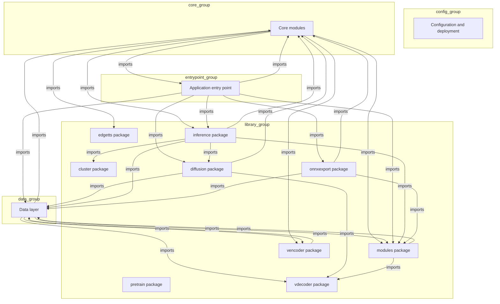

# Architecture report: svc-develop-team/so-vits-svc

> Automated static analysis. **Observed** = directly seen in files/imports/AST; **Inferred** = interpretation from that evidence. Repository code was not executed.

## 1. Repository at a glance

| Item | Value |
| --- | --- |
| Repository | svc-develop-team/so-vits-svc |
| Description | SoftVC VITS Singing Voice Conversion |
| Language | Python |
| Stars | 28037 |
| Licence | AGPL-3.0 |
| Analysed commit / branch | 730930d337d171479eadf305f96cbed4bb393e77 / 4.1-Stable |
| Framework(s) | Flask, Starlette |
| Files analysed | 160 |
| Components | 13 |

## 2. Architecture in one minute

svc-develop-team/so-vits-svc - SoftVC VITS Singing Voice Conversion. This repository was analysed statically from 160 file(s) (126 Python). Detected technologies (observed from imports/manifests): GitHub Actions, Flask, Starlette, NumPy, requests. Files are grouped into 13 component(s): cluster package, Configuration and deployment, Core modules, Data layer, diffusion package, edgetts package, Application entry point, inference package. Observed entry point(s): cluster/train_cluster.py, compress_model.py, diffusion/onnx_export.py. Findings below distinguish observed facts from inferred interpretation.

## 3. High-level block diagram

## 4. Main components

### cluster package (`cluster`)

- **Kind:** library
- **Status:** Observed
- **Confidence:** 0.85
- **Responsibility:** Groups 2 file(s) under cluster package (observed from repository paths and static analysis). Observed top-level classes: KMeansGPU. Observed top-level functions: _kpp, get_center, get_cluster_center_result, get_cluster_model, get_cluster_result.
- **Paths:** `cluster/__init__.py`, `cluster/kmeans.py`
- **Evidence:** [cluster/__init__.py:5](https://github.com/svc-develop-team/so-vits-svc/blob/730930d337d171479eadf305f96cbed4bb393e77/cluster/__init__.py#L5); [cluster/kmeans.py:10](https://github.com/svc-develop-team/so-vits-svc/blob/730930d337d171479eadf305f96cbed4bb393e77/cluster/kmeans.py#L10)

### Configuration and deployment (`config`)

- **Kind:** config
- **Status:** Observed
- **Confidence:** 0.85
- **Responsibility:** Groups 8 file(s) under configuration and deployment (observed from repository paths and static analysis).
- **Paths:** `configs/config.json`, `configs/diffusion.yaml`, `configs_template/config_template.json`, `configs_template/config_tiny_template.json`, `configs_template/diffusion_template.yaml`, `requirements.txt`, `requirements_onnx_encoder.txt`, `requirements_win.txt`
- **Evidence:** [configs/config.json](https://github.com/svc-develop-team/so-vits-svc/blob/730930d337d171479eadf305f96cbed4bb393e77/configs/config.json); [configs/diffusion.yaml](https://github.com/svc-develop-team/so-vits-svc/blob/730930d337d171479eadf305f96cbed4bb393e77/configs/diffusion.yaml); [configs_template/config_template.json](https://github.com/svc-develop-team/so-vits-svc/blob/730930d337d171479eadf305f96cbed4bb393e77/configs_template/config_template.json); [configs_template/config_tiny_template.json](https://github.com/svc-develop-team/so-vits-svc/blob/730930d337d171479eadf305f96cbed4bb393e77/configs_template/config_tiny_template.json); [configs_template/diffusion_template.yaml](https://github.com/svc-develop-team/so-vits-svc/blob/730930d337d171479eadf305f96cbed4bb393e77/configs_template/diffusion_template.yaml); [requirements.txt](https://github.com/svc-develop-team/so-vits-svc/blob/730930d337d171479eadf305f96cbed4bb393e77/requirements.txt); [requirements_onnx_encoder.txt](https://github.com/svc-develop-team/so-vits-svc/blob/730930d337d171479eadf305f96cbed4bb393e77/requirements_onnx_encoder.txt); [requirements_win.txt](https://github.com/svc-develop-team/so-vits-svc/blob/730930d337d171479eadf305f96cbed4bb393e77/requirements_win.txt)

### Core modules (`core`)

- **Kind:** core
- **Status:** Observed
- **Confidence:** 0.85
- **Responsibility:** Groups 5 file(s) under core modules (observed from repository paths and static analysis). Observed top-level classes: HParams, InferHParams, TextAudioCollate, TextAudioSpeakerLoader, Volume_Extractor. Observed top-level functions: change_rms, check_git_hash, clean_checkpoints, debug_change, f0_to_coarse, get_content.
- **Paths:** `data_utils.py`, `export_index_for_onnx.py`, `spkmix.py`, `utils.py`, `webUI.py`
- **Evidence:** [data_utils.py:18](https://github.com/svc-develop-team/so-vits-svc/blob/730930d337d171479eadf305f96cbed4bb393e77/data_utils.py#L18); [export_index_for_onnx.py](https://github.com/svc-develop-team/so-vits-svc/blob/730930d337d171479eadf305f96cbed4bb393e77/export_index_for_onnx.py); [spkmix.py](https://github.com/svc-develop-team/so-vits-svc/blob/730930d337d171479eadf305f96cbed4bb393e77/spkmix.py); [utils.py:31](https://github.com/svc-develop-team/so-vits-svc/blob/730930d337d171479eadf305f96cbed4bb393e77/utils.py#L31); [webUI.py:43](https://github.com/svc-develop-team/so-vits-svc/blob/730930d337d171479eadf305f96cbed4bb393e77/webUI.py#L43)

### Data layer (`data_layer`)

- **Kind:** data
- **Status:** Observed
- **Confidence:** 0.85
- **Responsibility:** Groups 8 file(s) under data layer (observed from repository paths and static analysis). Observed top-level classes: AudioEncoder, Conv1d, DiscriminatorP, DiscriminatorS, DotDict, E2E. Observed top-level functions: _init_hubert_pretrain_model, discriminator_loss, feature_loss, generator_loss, hubert_base, hubert_large.
- **Paths:** `models.py`, `modules/F0Predictor/fcpe/model.py`, `modules/F0Predictor/rmvpe/model.py`, `vdecoder/hifigan/models.py`, `vdecoder/hifiganwithsnake/models.py`, `vdecoder/nsf_hifigan/models.py`, `vencoder/dphubert/model.py`, `vencoder/whisper/model.py`
- **Evidence:** [models.py:15](https://github.com/svc-develop-team/so-vits-svc/blob/730930d337d171479eadf305f96cbed4bb393e77/models.py#L15); [modules/F0Predictor/fcpe/model.py:12](https://github.com/svc-develop-team/so-vits-svc/blob/730930d337d171479eadf305f96cbed4bb393e77/modules/F0Predictor/fcpe/model.py#L12); [modules/F0Predictor/rmvpe/model.py:9](https://github.com/svc-develop-team/so-vits-svc/blob/730930d337d171479eadf305f96cbed4bb393e77/modules/F0Predictor/rmvpe/model.py#L9); [vdecoder/hifigan/models.py:17](https://github.com/svc-develop-team/so-vits-svc/blob/730930d337d171479eadf305f96cbed4bb393e77/vdecoder/hifigan/models.py#L17); [vdecoder/hifiganwithsnake/models.py:19](https://github.com/svc-develop-team/so-vits-svc/blob/730930d337d171479eadf305f96cbed4bb393e77/vdecoder/hifiganwithsnake/models.py#L19); [vdecoder/nsf_hifigan/models.py:17](https://github.com/svc-develop-team/so-vits-svc/blob/730930d337d171479eadf305f96cbed4bb393e77/vdecoder/nsf_hifigan/models.py#L17); [vencoder/dphubert/model.py:19](https://github.com/svc-develop-team/so-vits-svc/blob/730930d337d171479eadf305f96cbed4bb393e77/vencoder/dphubert/model.py#L19); [vencoder/whisper/model.py:14](https://github.com/svc-develop-team/so-vits-svc/blob/730930d337d171479eadf305f96cbed4bb393e77/vencoder/whisper/model.py#L14)

### diffusion package (`diffusion`)

- **Kind:** library
- **Status:** Observed
- **Confidence:** 0.85
- **Responsibility:** Groups 14 file(s) under diffusion package (observed from repository paths and static analysis). Observed top-level classes: AfterDiffusion, AudioDataset, Conv1d, DPM_Solver, DiffGtMel, DiffNet. Observed top-level functions: convert_tensor_to_numpy, cosine_beta_schedule, default, exists, expand_dims, extract.
- **Paths:** `diffusion/__init__.py`, `diffusion/data_loaders.py`, `diffusion/diffusion.py`, `diffusion/diffusion_onnx.py`, `diffusion/dpm_solver_pytorch.py`, `diffusion/infer_gt_mel.py`, `diffusion/logger/__init__.py`, `diffusion/logger/saver.py`, `diffusion/logger/utils.py`, `diffusion/solver.py`, `diffusion/uni_pc.py`, `diffusion/unit2mel.py`, `diffusion/vocoder.py`, `diffusion/wavenet.py`
- **Evidence:** [diffusion/__init__.py](https://github.com/svc-develop-team/so-vits-svc/blob/730930d337d171479eadf305f96cbed4bb393e77/diffusion/__init__.py); [diffusion/data_loaders.py:13](https://github.com/svc-develop-team/so-vits-svc/blob/730930d337d171479eadf305f96cbed4bb393e77/diffusion/data_loaders.py#L13); [diffusion/diffusion.py:12](https://github.com/svc-develop-team/so-vits-svc/blob/730930d337d171479eadf305f96cbed4bb393e77/diffusion/diffusion.py#L12); [diffusion/diffusion_onnx.py:14](https://github.com/svc-develop-team/so-vits-svc/blob/730930d337d171479eadf305f96cbed4bb393e77/diffusion/diffusion_onnx.py#L14); [diffusion/dpm_solver_pytorch.py:4](https://github.com/svc-develop-team/so-vits-svc/blob/730930d337d171479eadf305f96cbed4bb393e77/diffusion/dpm_solver_pytorch.py#L4); [diffusion/infer_gt_mel.py:7](https://github.com/svc-develop-team/so-vits-svc/blob/730930d337d171479eadf305f96cbed4bb393e77/diffusion/infer_gt_mel.py#L7); [diffusion/logger/__init__.py](https://github.com/svc-develop-team/so-vits-svc/blob/730930d337d171479eadf305f96cbed4bb393e77/diffusion/logger/__init__.py); [diffusion/logger/saver.py:15](https://github.com/svc-develop-team/so-vits-svc/blob/730930d337d171479eadf305f96cbed4bb393e77/diffusion/logger/saver.py#L15)

### edgetts package (`edgetts`)

- **Kind:** library
- **Status:** Observed
- **Confidence:** 0.85
- **Responsibility:** Groups 1 file(s) under edgetts package (observed from repository paths and static analysis).
- **Paths:** `edgetts/tts_voices.py`
- **Evidence:** [edgetts/tts_voices.py](https://github.com/svc-develop-team/so-vits-svc/blob/730930d337d171479eadf305f96cbed4bb393e77/edgetts/tts_voices.py)

### Application entry point (`entrypoint`)

- **Kind:** entrypoint
- **Status:** Observed
- **Confidence:** 0.85
- **Responsibility:** Groups 16 file(s) under application entry point (observed from repository paths and static analysis). Observed application object created via Flask. Observed routes: ROUTE /voiceChangeModel, ROUTE /wav2wav. Observed top-level classes: DotDict, Unit2Mel. Observed top-level functions: OnnxExport, _main, copyStateDict, evaluate, get_wav_duration, load_model_vocoder.
- **Paths:** `cluster/train_cluster.py`, `compress_model.py`, `diffusion/onnx_export.py`, `edgetts/tts.py`, `flask_api.py`, `flask_api_full_song.py`, `inference_main.py`, `onnx_export.py`, `onnx_export_old.py`, `preprocess_flist_config.py`, `preprocess_hubert_f0.py`, `resample.py`, `train.py`, `train_diff.py`, `train_index.py`, `wav_upload.py`
- **Evidence:** [cluster/train_cluster.py:16](https://github.com/svc-develop-team/so-vits-svc/blob/730930d337d171479eadf305f96cbed4bb393e77/cluster/train_cluster.py#L16); [compress_model.py:9](https://github.com/svc-develop-team/so-vits-svc/blob/730930d337d171479eadf305f96cbed4bb393e77/compress_model.py#L9); [diffusion/onnx_export.py:11](https://github.com/svc-develop-team/so-vits-svc/blob/730930d337d171479eadf305f96cbed4bb393e77/diffusion/onnx_export.py#L11); [edgetts/tts.py:21](https://github.com/svc-develop-team/so-vits-svc/blob/730930d337d171479eadf305f96cbed4bb393e77/edgetts/tts.py#L21); [flask_api.py:12](https://github.com/svc-develop-team/so-vits-svc/blob/730930d337d171479eadf305f96cbed4bb393e77/flask_api.py#L12); [flask_api_full_song.py:9](https://github.com/svc-develop-team/so-vits-svc/blob/730930d337d171479eadf305f96cbed4bb393e77/flask_api_full_song.py#L9); [inference_main.py:14](https://github.com/svc-develop-team/so-vits-svc/blob/730930d337d171479eadf305f96cbed4bb393e77/inference_main.py#L14); [onnx_export.py:11](https://github.com/svc-develop-team/so-vits-svc/blob/730930d337d171479eadf305f96cbed4bb393e77/onnx_export.py#L11)

### inference package (`inference`)

- **Kind:** library
- **Status:** Observed
- **Confidence:** 0.85
- **Responsibility:** Groups 4 file(s) under inference package (observed from repository paths and static analysis). Observed top-level classes: F0FilterException, RealTimeVC, Slicer, Svc, VitsSvc. Observed top-level functions: chunks2audio, clean_pitch, cut, f0_to_pitch, fill_a_to_b, format_wav.
- **Paths:** `inference/__init__.py`, `inference/infer_tool.py`, `inference/infer_tool_grad.py`, `inference/slicer.py`
- **Evidence:** [inference/__init__.py](https://github.com/svc-develop-team/so-vits-svc/blob/730930d337d171479eadf305f96cbed4bb393e77/inference/__init__.py); [inference/infer_tool.py:28](https://github.com/svc-develop-team/so-vits-svc/blob/730930d337d171479eadf305f96cbed4bb393e77/inference/infer_tool.py#L28); [inference/infer_tool_grad.py:19](https://github.com/svc-develop-team/so-vits-svc/blob/730930d337d171479eadf305f96cbed4bb393e77/inference/infer_tool_grad.py#L19); [inference/slicer.py:6](https://github.com/svc-develop-team/so-vits-svc/blob/730930d337d171479eadf305f96cbed4bb393e77/inference/slicer.py#L6)

### modules package (`modules`)

- **Kind:** library
- **Status:** Observed
- **Confidence:** 0.85
- **Responsibility:** Groups 27 file(s) under modules package (observed from repository paths and static analysis). Observed top-level classes: BasePitchExtractor, BiGRU, BiLSTM, ConformerConvModule, ConvBlockRes, ConvReluNorm. Observed top-level functions: add_timing_signal_1d, calc_same_padding, cast_tuple, cat_timing_signal_1d, clip_grad_value_, convert_pad_shape.
- **Paths:** `modules/DSConv.py`, `modules/F0Predictor/CrepeF0Predictor.py`, `modules/F0Predictor/DioF0Predictor.py`, `modules/F0Predictor/F0Predictor.py`, `modules/F0Predictor/FCPEF0Predictor.py`, `modules/F0Predictor/HarvestF0Predictor.py`, `modules/F0Predictor/PMF0Predictor.py`, `modules/F0Predictor/RMVPEF0Predictor.py`, `modules/F0Predictor/__init__.py`, `modules/F0Predictor/crepe.py`, `modules/F0Predictor/fcpe/__init__.py`, `modules/F0Predictor/fcpe/nvSTFT.py`, `modules/F0Predictor/fcpe/pcmer.py`, `modules/F0Predictor/rmvpe/__init__.py`, `modules/F0Predictor/rmvpe/constants.py`, `modules/F0Predictor/rmvpe/deepunet.py`, `modules/F0Predictor/rmvpe/inference.py`, `modules/F0Predictor/rmvpe/seq.py`, `modules/F0Predictor/rmvpe/spec.py`, `modules/F0Predictor/rmvpe/utils.py`, `modules/__init__.py`, `modules/attentions.py`, `modules/commons.py`, `modules/enhancer.py`, `modules/losses.py`, `modules/mel_processing.py`, `modules/modules.py`
- **Evidence:** [modules/DSConv.py:5](https://github.com/svc-develop-team/so-vits-svc/blob/730930d337d171479eadf305f96cbed4bb393e77/modules/DSConv.py#L5); [modules/F0Predictor/CrepeF0Predictor.py:7](https://github.com/svc-develop-team/so-vits-svc/blob/730930d337d171479eadf305f96cbed4bb393e77/modules/F0Predictor/CrepeF0Predictor.py#L7); [modules/F0Predictor/DioF0Predictor.py:7](https://github.com/svc-develop-team/so-vits-svc/blob/730930d337d171479eadf305f96cbed4bb393e77/modules/F0Predictor/DioF0Predictor.py#L7); [modules/F0Predictor/F0Predictor.py:1](https://github.com/svc-develop-team/so-vits-svc/blob/730930d337d171479eadf305f96cbed4bb393e77/modules/F0Predictor/F0Predictor.py#L1); [modules/F0Predictor/FCPEF0Predictor.py:12](https://github.com/svc-develop-team/so-vits-svc/blob/730930d337d171479eadf305f96cbed4bb393e77/modules/F0Predictor/FCPEF0Predictor.py#L12); [modules/F0Predictor/HarvestF0Predictor.py:7](https://github.com/svc-develop-team/so-vits-svc/blob/730930d337d171479eadf305f96cbed4bb393e77/modules/F0Predictor/HarvestF0Predictor.py#L7); [modules/F0Predictor/PMF0Predictor.py:7](https://github.com/svc-develop-team/so-vits-svc/blob/730930d337d171479eadf305f96cbed4bb393e77/modules/F0Predictor/PMF0Predictor.py#L7); [modules/F0Predictor/RMVPEF0Predictor.py:12](https://github.com/svc-develop-team/so-vits-svc/blob/730930d337d171479eadf305f96cbed4bb393e77/modules/F0Predictor/RMVPEF0Predictor.py#L12)

### onnxexport package (`onnxexport`)

- **Kind:** library
- **Status:** Observed
- **Confidence:** 0.85
- **Responsibility:** Groups 2 file(s) under onnxexport package (observed from repository paths and static analysis). Observed top-level classes: DiscriminatorP, DiscriminatorS, Encoder, F0Decoder, ResidualCouplingBlock, SynthesizerTrn.
- **Paths:** `onnxexport/model_onnx.py`, `onnxexport/model_onnx_speaker_mix.py`
- **Evidence:** [onnxexport/model_onnx.py:16](https://github.com/svc-develop-team/so-vits-svc/blob/730930d337d171479eadf305f96cbed4bb393e77/onnxexport/model_onnx.py#L16); [onnxexport/model_onnx_speaker_mix.py:12](https://github.com/svc-develop-team/so-vits-svc/blob/730930d337d171479eadf305f96cbed4bb393e77/onnxexport/model_onnx_speaker_mix.py#L12)

### pretrain package (`pretrain`)

- **Kind:** library
- **Status:** Observed
- **Confidence:** 0.85
- **Responsibility:** Groups 2 file(s) under pretrain package (observed from repository paths and static analysis). Observed top-level functions: download_dict, get_speech_encoder.
- **Paths:** `pretrain/__init__.py`, `pretrain/meta.py`
- **Evidence:** [pretrain/__init__.py](https://github.com/svc-develop-team/so-vits-svc/blob/730930d337d171479eadf305f96cbed4bb393e77/pretrain/__init__.py); [pretrain/meta.py:1](https://github.com/svc-develop-team/so-vits-svc/blob/730930d337d171479eadf305f96cbed4bb393e77/pretrain/meta.py#L1)

### vdecoder package (`vdecoder`)

- **Kind:** library
- **Status:** Observed
- **Confidence:** 0.85
- **Responsibility:** Groups 14 file(s) under vdecoder package (observed from repository paths and static analysis). Observed top-level classes: Activation1d, AttrDict, DownSample1d, LowPassFilter1d, Mish, STFT. Observed top-level functions: apply_weight_norm, build_env, del_old_checkpoints, dynamic_range_compression, dynamic_range_compression_torch, dynamic_range_decompression.
- **Paths:** `vdecoder/__init__.py`, `vdecoder/hifigan/env.py`, `vdecoder/hifigan/nvSTFT.py`, `vdecoder/hifigan/utils.py`, `vdecoder/hifiganwithsnake/alias/__init__.py`, `vdecoder/hifiganwithsnake/alias/act.py`, `vdecoder/hifiganwithsnake/alias/filter.py`, `vdecoder/hifiganwithsnake/alias/resample.py`, `vdecoder/hifiganwithsnake/env.py`, `vdecoder/hifiganwithsnake/nvSTFT.py`, `vdecoder/hifiganwithsnake/utils.py`, `vdecoder/nsf_hifigan/env.py`, `vdecoder/nsf_hifigan/nvSTFT.py`, `vdecoder/nsf_hifigan/utils.py`
- **Evidence:** [vdecoder/__init__.py](https://github.com/svc-develop-team/so-vits-svc/blob/730930d337d171479eadf305f96cbed4bb393e77/vdecoder/__init__.py); [vdecoder/hifigan/env.py:5](https://github.com/svc-develop-team/so-vits-svc/blob/730930d337d171479eadf305f96cbed4bb393e77/vdecoder/hifigan/env.py#L5); [vdecoder/hifigan/nvSTFT.py:12](https://github.com/svc-develop-team/so-vits-svc/blob/730930d337d171479eadf305f96cbed4bb393e77/vdecoder/hifigan/nvSTFT.py#L12); [vdecoder/hifigan/utils.py:10](https://github.com/svc-develop-team/so-vits-svc/blob/730930d337d171479eadf305f96cbed4bb393e77/vdecoder/hifigan/utils.py#L10); [vdecoder/hifiganwithsnake/alias/__init__.py](https://github.com/svc-develop-team/so-vits-svc/blob/730930d337d171479eadf305f96cbed4bb393e77/vdecoder/hifiganwithsnake/alias/__init__.py); [vdecoder/hifiganwithsnake/alias/act.py:13](https://github.com/svc-develop-team/so-vits-svc/blob/730930d337d171479eadf305f96cbed4bb393e77/vdecoder/hifiganwithsnake/alias/act.py#L13); [vdecoder/hifiganwithsnake/alias/filter.py:29](https://github.com/svc-develop-team/so-vits-svc/blob/730930d337d171479eadf305f96cbed4bb393e77/vdecoder/hifiganwithsnake/alias/filter.py#L29); [vdecoder/hifiganwithsnake/alias/resample.py:10](https://github.com/svc-develop-team/so-vits-svc/blob/730930d337d171479eadf305f96cbed4bb393e77/vdecoder/hifiganwithsnake/alias/resample.py#L10)

### vencoder package (`vencoder`)

- **Kind:** library
- **Status:** Observed
- **Confidence:** 0.85
- **Responsibility:** Groups 31 file(s) under vencoder package (observed from repository paths and static analysis). Observed top-level classes: ApplyTimestampRules, BeamSearchDecoder, CNHubertLarge, ContentVec256L12_Onnx, ContentVec256L9, ContentVec256L9_Onnx. Observed top-level functions: _build, _compute_mask, _get_config, _get_config_wavlm, _get_encoder, _get_feature_extractor.
- **Paths:** `vencoder/CNHubertLarge.py`, `vencoder/ContentVec256L12_Onnx.py`, `vencoder/ContentVec256L9.py`, `vencoder/ContentVec256L9_Onnx.py`, `vencoder/ContentVec768L12.py`, `vencoder/ContentVec768L12_Onnx.py`, `vencoder/ContentVec768L9_Onnx.py`, `vencoder/DPHubert.py`, `vencoder/HubertSoft.py`, `vencoder/HubertSoft_Onnx.py`, `vencoder/WavLMBasePlus.py`, `vencoder/WhisperPPG.py`, `vencoder/WhisperPPGLarge.py`, `vencoder/__init__.py`, `vencoder/dphubert/__init__.py`, `vencoder/dphubert/components.py`, `vencoder/dphubert/hardconcrete.py`, `vencoder/dphubert/pruning_utils.py`, `vencoder/dphubert/utils/__init__.py`, `vencoder/dphubert/utils/import_huggingface_wavlm.py`, `vencoder/encoder.py`, `vencoder/hubert/__init__.py`, `vencoder/hubert/hubert_model.py`, `vencoder/hubert/hubert_model_onnx.py`, `vencoder/wavlm/WavLM.py`, `vencoder/wavlm/modules.py`, `vencoder/whisper/__init__.py`, `vencoder/whisper/audio.py`, `vencoder/whisper/decoding.py`, `vencoder/whisper/tokenizer.py`, `vencoder/whisper/utils.py`
- **Evidence:** [vencoder/CNHubertLarge.py:7](https://github.com/svc-develop-team/so-vits-svc/blob/730930d337d171479eadf305f96cbed4bb393e77/vencoder/CNHubertLarge.py#L7); [vencoder/ContentVec256L12_Onnx.py:7](https://github.com/svc-develop-team/so-vits-svc/blob/730930d337d171479eadf305f96cbed4bb393e77/vencoder/ContentVec256L12_Onnx.py#L7); [vencoder/ContentVec256L9.py:7](https://github.com/svc-develop-team/so-vits-svc/blob/730930d337d171479eadf305f96cbed4bb393e77/vencoder/ContentVec256L9.py#L7); [vencoder/ContentVec256L9_Onnx.py:7](https://github.com/svc-develop-team/so-vits-svc/blob/730930d337d171479eadf305f96cbed4bb393e77/vencoder/ContentVec256L9_Onnx.py#L7); [vencoder/ContentVec768L12.py:7](https://github.com/svc-develop-team/so-vits-svc/blob/730930d337d171479eadf305f96cbed4bb393e77/vencoder/ContentVec768L12.py#L7); [vencoder/ContentVec768L12_Onnx.py:7](https://github.com/svc-develop-team/so-vits-svc/blob/730930d337d171479eadf305f96cbed4bb393e77/vencoder/ContentVec768L12_Onnx.py#L7); [vencoder/ContentVec768L9_Onnx.py:7](https://github.com/svc-develop-team/so-vits-svc/blob/730930d337d171479eadf305f96cbed4bb393e77/vencoder/ContentVec768L9_Onnx.py#L7); [vencoder/DPHubert.py:7](https://github.com/svc-develop-team/so-vits-svc/blob/730930d337d171479eadf305f96cbed4bb393e77/vencoder/DPHubert.py#L7)

## 5. Execution flow

**Observed** entry point(s):

- [cluster/train_cluster.py:54](https://github.com/svc-develop-team/so-vits-svc/blob/730930d337d171479eadf305f96cbed4bb393e77/cluster/train_cluster.py#L54)
- [compress_model.py:51](https://github.com/svc-develop-team/so-vits-svc/blob/730930d337d171479eadf305f96cbed4bb393e77/compress_model.py#L51)
- [diffusion/onnx_export.py:224](https://github.com/svc-develop-team/so-vits-svc/blob/730930d337d171479eadf305f96cbed4bb393e77/diffusion/onnx_export.py#L224)
- [edgetts/tts.py:38](https://github.com/svc-develop-team/so-vits-svc/blob/730930d337d171479eadf305f96cbed4bb393e77/edgetts/tts.py#L38)
- [flask_api.py:12](https://github.com/svc-develop-team/so-vits-svc/blob/730930d337d171479eadf305f96cbed4bb393e77/flask_api.py#L12)
- [flask_api_full_song.py:9](https://github.com/svc-develop-team/so-vits-svc/blob/730930d337d171479eadf305f96cbed4bb393e77/flask_api_full_song.py#L9)
- [inference_main.py:154](https://github.com/svc-develop-team/so-vits-svc/blob/730930d337d171479eadf305f96cbed4bb393e77/inference_main.py#L154)
- [onnx_export.py:140](https://github.com/svc-develop-team/so-vits-svc/blob/730930d337d171479eadf305f96cbed4bb393e77/onnx_export.py#L140)
- [onnx_export_old.py:55](https://github.com/svc-develop-team/so-vits-svc/blob/730930d337d171479eadf305f96cbed4bb393e77/onnx_export_old.py#L55)
- [preprocess_flist_config.py:28](https://github.com/svc-develop-team/so-vits-svc/blob/730930d337d171479eadf305f96cbed4bb393e77/preprocess_flist_config.py#L28)
- [preprocess_hubert_f0.py:130](https://github.com/svc-develop-team/so-vits-svc/blob/730930d337d171479eadf305f96cbed4bb393e77/preprocess_hubert_f0.py#L130)
- [resample.py:88](https://github.com/svc-develop-team/so-vits-svc/blob/730930d337d171479eadf305f96cbed4bb393e77/resample.py#L88)

**Observed** routes (from decorators):

- `ROUTE /voiceChangeModel` -> `voice_change_model` in `flask_api.py:20`
- `ROUTE /wav2wav` -> `wav2wav` in `flask_api_full_song.py:13`

Representative flow (derived from observed entry points and the import graph; steps beyond the entry point are **Inferred**):

1. Execution starts at an observed entry point listed above, if present.
2. `core` imports `edgetts` (Core modules -> edgetts package).
3. `core` imports `entrypoint` (Core modules -> Application entry point).
4. `core` imports `inference` (Core modules -> inference package).
5. `core` imports `modules` (Core modules -> modules package).
6. `core` imports `vencoder` (Core modules -> vencoder package).
7. `data_layer` imports `core` (Data layer -> Core modules).
8. `data_layer` imports `modules` (Data layer -> modules package).
9. `data_layer` imports `vdecoder` (Data layer -> vdecoder package).

## 6. Project structure

### `(root)`

- `.gitattributes` - other (19 bytes)
- `.gitignore` - other (2508 bytes)
- `.ruff.toml` - config (101 bytes)
- `LICENSE` - docs (34523 bytes)
- `README.md` - docs (38137 bytes)
- `README_zh_CN.md` - docs (32683 bytes)
- `compress_model.py` - source, Python (2359 bytes)
- `data_utils.py` - source, Python (7039 bytes)
- `export_index_for_onnx.py` - source, Python (411 bytes)
- `flask_api.py` - source, Python (2564 bytes)
- `flask_api_full_song.py` - source, Python (2132 bytes)
- `inference_main.py` - source, Python (9350 bytes)
- `models.py` - source, Python (20466 bytes)
- `onnx_export.py` - source, Python (4302 bytes)
- `onnx_export_old.py` - source, Python (2181 bytes)
- `preprocess_flist_config.py` - source, Python (4906 bytes)
- `preprocess_hubert_f0.py` - source, Python (6870 bytes)
- `requirements.txt` - manifest (336 bytes)
- `requirements_onnx_encoder.txt` - manifest (373 bytes)
- `requirements_win.txt` - manifest (425 bytes)
- `resample.py` - source, Python (3332 bytes)
- `sovits4_for_colab.ipynb` - other (25362 bytes)
- `spkmix.py` - source, Python (773 bytes)
- `train.py` - source, Python (14210 bytes)
- `train_diff.py` - source, Python (2592 bytes)
- `train_index.py` - source, Python (873 bytes)
- `utils.py` - source, Python (20720 bytes)
- `wav_upload.py` - source, Python (918 bytes)
- `webUI.py` - source, Python (24468 bytes)

### `.github`

- `.github/ISSUE_TEMPLATE/ask_for_help.yaml` - config (3841 bytes)
- `.github/ISSUE_TEMPLATE/ask_for_help_en_US.yaml` - config (4070 bytes)
- `.github/ISSUE_TEMPLATE/bug_report.yaml` - config (2140 bytes)
- `.github/ISSUE_TEMPLATE/bug_report_en_US.yaml` - config (2264 bytes)
- `.github/ISSUE_TEMPLATE/config.yml` - config (346 bytes)
- `.github/ISSUE_TEMPLATE/default.md` - docs (348 bytes)
- `.github/workflows/reviewdog.yml` - ci, YAML (373 bytes)
- `.github/workflows/ruff.yml` - ci, YAML (162 bytes)

### `cluster`

- `cluster/__init__.py` - source, Python (883 bytes)
- `cluster/kmeans.py` - source, Python (7842 bytes)
- `cluster/train_cluster.py` - source, Python (3057 bytes)

### `configs`

- `configs/config.json` - config (0 bytes)
- `configs/diffusion.yaml` - config (0 bytes)

### `configs_template`

- `configs_template/config_template.json` - config (1845 bytes)
- `configs_template/config_tiny_template.json` - config (1843 bytes)
- `configs_template/diffusion_template.yaml` - config (1638 bytes)

### `dataset_raw`

- `dataset_raw/wav_structure.txt` - docs (331 bytes)

### `diffusion`

- `diffusion/__init__.py` - source, Python (0 bytes)
- `diffusion/data_loaders.py` - source, Python (10916 bytes)
- `diffusion/diffusion.py` - source, Python (17014 bytes)
- `diffusion/diffusion_onnx.py` - source, Python (24620 bytes)
- `diffusion/dpm_solver_pytorch.py` - source, Python (68247 bytes)
- `diffusion/how to export onnx.md` - docs (201 bytes)
- `diffusion/infer_gt_mel.py` - source, Python (3062 bytes)
- `diffusion/logger/__init__.py` - source, Python (0 bytes)
- `diffusion/logger/saver.py` - source, Python (4091 bytes)
- `diffusion/logger/utils.py` - source, Python (3738 bytes)
- `diffusion/onnx_export.py` - source, Python (9091 bytes)
- `diffusion/solver.py` - source, Python (7270 bytes)
- `diffusion/uni_pc.py` - source, Python (32119 bytes)
- `diffusion/unit2mel.py` - source, Python (6452 bytes)
- `diffusion/vocoder.py` - source, Python (3370 bytes)
- `diffusion/wavenet.py` - source, Python (3794 bytes)

### `edgetts`

- `edgetts/tts.py` - source, Python (1524 bytes)
- `edgetts/tts_voices.py` - source, Python (10773 bytes)

### `filelists`

- `filelists/test.txt` - docs (124 bytes)
- `filelists/train.txt` - docs (465 bytes)
- `filelists/val.txt` - docs (124 bytes)

### `inference`

- `inference/__init__.py` - source, Python (0 bytes)
- `inference/infer_tool.py` - source, Python (25169 bytes)
- `inference/infer_tool_grad.py` - source, Python (5574 bytes)
- `inference/slicer.py` - source, Python (6704 bytes)

### `logs`

- `logs/44k/diffusion/put_diffusion_pretrained_model_here` - other (0 bytes)
- `logs/44k/put_pretrained_model_here` - other (0 bytes)

### `modules`

- `modules/DSConv.py` - source, Python (3010 bytes)
- `modules/F0Predictor/CrepeF0Predictor.py` - source, Python (1392 bytes)
- `modules/F0Predictor/DioF0Predictor.py` - source, Python (2665 bytes)
- `modules/F0Predictor/F0Predictor.py` - source, Python (421 bytes)
- `modules/F0Predictor/FCPEF0Predictor.py` - source, Python (4113 bytes)
- `modules/F0Predictor/HarvestF0Predictor.py` - source, Python (2524 bytes)
- `modules/F0Predictor/PMF0Predictor.py` - source, Python (2717 bytes)
- `modules/F0Predictor/RMVPEF0Predictor.py` - source, Python (3953 bytes)
- `modules/F0Predictor/__init__.py` - source, Python (0 bytes)
- `modules/F0Predictor/crepe.py` - source, Python (11377 bytes)
- `modules/F0Predictor/fcpe/__init__.py` - source, Python (124 bytes)
- `modules/F0Predictor/fcpe/model.py` - source, Python (10524 bytes)
- `modules/F0Predictor/fcpe/nvSTFT.py` - source, Python (5443 bytes)
- `modules/F0Predictor/fcpe/pcmer.py` - source, Python (13862 bytes)
- `modules/F0Predictor/rmvpe/__init__.py` - source, Python (283 bytes)
- `modules/F0Predictor/rmvpe/constants.py` - source, Python (139 bytes)
- `modules/F0Predictor/rmvpe/deepunet.py` - source, Python (7429 bytes)
- `modules/F0Predictor/rmvpe/inference.py` - source, Python (2478 bytes)
- `modules/F0Predictor/rmvpe/model.py` - source, Python (2538 bytes)
- `modules/F0Predictor/rmvpe/seq.py` - source, Python (648 bytes)
- `modules/F0Predictor/rmvpe/spec.py` - source, Python (2329 bytes)
- `modules/F0Predictor/rmvpe/utils.py` - source, Python (3716 bytes)
- `modules/__init__.py` - source, Python (0 bytes)
- `modules/attentions.py` - source, Python (14178 bytes)
- `modules/commons.py` - source, Python (5696 bytes)
- `modules/enhancer.py` - source, Python (4356 bytes)
- `modules/losses.py` - source, Python (1276 bytes)
- `modules/mel_processing.py` - source, Python (2685 bytes)
- `modules/modules.py` - source, Python (12197 bytes)

### `onnxexport`

- `onnxexport/model_onnx.py` - source, Python (12211 bytes)
- `onnxexport/model_onnx_speaker_mix.py` - source, Python (13830 bytes)

### `pretrain`

- `pretrain/__init__.py` - source, Python (0 bytes)
- `pretrain/meta.py` - source, Python (1671 bytes)
- `pretrain/nsf_hifigan/put_nsf_hifigan_ckpt_here` - other (0 bytes)
- `pretrain/put_hubert_ckpt_here` - other (0 bytes)

### `raw`

- `raw/put_raw_wav_here` - other (0 bytes)

### `trained`

- `trained/put_trained_checkpoints_here` - other (0 bytes)

### `vdecoder`

- `vdecoder/__init__.py` - source, Python (0 bytes)
- `vdecoder/hifigan/env.py` - source, Python (394 bytes)
- `vdecoder/hifigan/models.py` - source, Python (21795 bytes)
- `vdecoder/hifigan/nvSTFT.py` - source, Python (4420 bytes)
- `vdecoder/hifigan/utils.py` - source, Python (1866 bytes)
- `vdecoder/hifiganwithsnake/alias/__init__.py` - source, Python (242 bytes)
- `vdecoder/hifiganwithsnake/alias/act.py` - source, Python (4470 bytes)
- `vdecoder/hifiganwithsnake/alias/filter.py` - source, Python (4177 bytes)
- `vdecoder/hifiganwithsnake/alias/resample.py` - source, Python (3226 bytes)
- `vdecoder/hifiganwithsnake/env.py` - source, Python (394 bytes)
- `vdecoder/hifiganwithsnake/models.py` - source, Python (22768 bytes)
- `vdecoder/hifiganwithsnake/nvSTFT.py` - source, Python (4420 bytes)
- `vdecoder/hifiganwithsnake/utils.py` - source, Python (1866 bytes)
- `vdecoder/nsf_hifigan/env.py` - source, Python (394 bytes)
- `vdecoder/nsf_hifigan/models.py` - source, Python (16432 bytes)
- `vdecoder/nsf_hifigan/nvSTFT.py` - source, Python (5357 bytes)
- `vdecoder/nsf_hifigan/utils.py` - source, Python (1883 bytes)

### `vencoder`

- `vencoder/CNHubertLarge.py` - source, Python (1245 bytes)
- `vencoder/ContentVec256L12_Onnx.py` - source, Python (1175 bytes)
- `vencoder/ContentVec256L9.py` - source, Python (1330 bytes)
- `vencoder/ContentVec256L9_Onnx.py` - source, Python (1242 bytes)
- `vencoder/ContentVec768L12.py` - source, Python (1284 bytes)
- `vencoder/ContentVec768L12_Onnx.py` - source, Python (1187 bytes)
- `vencoder/ContentVec768L9_Onnx.py` - source, Python (1185 bytes)
- `vencoder/DPHubert.py` - source, Python (1041 bytes)
- `vencoder/HubertSoft.py` - source, Python (977 bytes)
- `vencoder/HubertSoft_Onnx.py` - source, Python (1176 bytes)
- `vencoder/WavLMBasePlus.py` - source, Python (1215 bytes)
- `vencoder/WhisperPPG.py` - source, Python (1198 bytes)
- `vencoder/WhisperPPGLarge.py` - source, Python (1236 bytes)
- `vencoder/__init__.py` - source, Python (0 bytes)
- `vencoder/dphubert/__init__.py` - source, Python (0 bytes)
- `vencoder/dphubert/components.py` - source, Python (58641 bytes)
- `vencoder/dphubert/hardconcrete.py` - source, Python (4060 bytes)
- `vencoder/dphubert/model.py` - source, Python (38745 bytes)
- `vencoder/dphubert/pruning_utils.py` - source, Python (1869 bytes)
- `vencoder/dphubert/utils/__init__.py` - source, Python (0 bytes)
- `vencoder/dphubert/utils/import_huggingface_wavlm.py` - source, Python (5564 bytes)
- `vencoder/encoder.py` - source, Python (364 bytes)
- `vencoder/hubert/__init__.py` - source, Python (0 bytes)
- `vencoder/hubert/hubert_model.py` - source, Python (7329 bytes)
- `vencoder/hubert/hubert_model_onnx.py` - source, Python (7160 bytes)
- `vencoder/wavlm/WavLM.py` - source, Python (27546 bytes)
- `vencoder/wavlm/modules.py` - source, Python (31947 bytes)
- `vencoder/whisper/__init__.py` - source, Python (0 bytes)
- `vencoder/whisper/audio.py` - source, Python (4062 bytes)
- `vencoder/whisper/decoding.py` - source, Python (30156 bytes)
- `vencoder/whisper/model.py` - source, Python (9661 bytes)
- `vencoder/whisper/tokenizer.py` - source, Python (9836 bytes)
- `vencoder/whisper/utils.py` - source, Python (5226 bytes)

## 7. Key dependencies and integrations

| Name | Category | Status | Confidence | Evidence |
| --- | --- | --- | --- | --- |
| GitHub Actions | ci | Observed | 0.90 | [.github/workflows/reviewdog.yml](https://github.com/svc-develop-team/so-vits-svc/blob/730930d337d171479eadf305f96cbed4bb393e77/.github/workflows/reviewdog.yml); [.github/workflows/ruff.yml](https://github.com/svc-develop-team/so-vits-svc/blob/730930d337d171479eadf305f96cbed4bb393e77/.github/workflows/ruff.yml) |
| Flask | framework | Observed | 0.95 | [flask_api.py:7](https://github.com/svc-develop-team/so-vits-svc/blob/730930d337d171479eadf305f96cbed4bb393e77/flask_api.py#L7); [flask_api_full_song.py:5](https://github.com/svc-develop-team/so-vits-svc/blob/730930d337d171479eadf305f96cbed4bb393e77/flask_api_full_song.py#L5); [requirements.txt:2](https://github.com/svc-develop-team/so-vits-svc/blob/730930d337d171479eadf305f96cbed4bb393e77/requirements.txt#L2); [requirements_onnx_encoder.txt:1](https://github.com/svc-develop-team/so-vits-svc/blob/730930d337d171479eadf305f96cbed4bb393e77/requirements_onnx_encoder.txt#L1) |
| Starlette | framework | Observed | 0.85 | [requirements_win.txt:16](https://github.com/svc-develop-team/so-vits-svc/blob/730930d337d171479eadf305f96cbed4bb393e77/requirements_win.txt#L16) |
| NumPy | library | Observed | 0.95 | [cluster/kmeans.py:3](https://github.com/svc-develop-team/so-vits-svc/blob/730930d337d171479eadf305f96cbed4bb393e77/cluster/kmeans.py#L3); [cluster/train_cluster.py:7](https://github.com/svc-develop-team/so-vits-svc/blob/730930d337d171479eadf305f96cbed4bb393e77/cluster/train_cluster.py#L7); [data_utils.py:4](https://github.com/svc-develop-team/so-vits-svc/blob/730930d337d171479eadf305f96cbed4bb393e77/data_utils.py#L4); [diffusion/data_loaders.py:5](https://github.com/svc-develop-team/so-vits-svc/blob/730930d337d171479eadf305f96cbed4bb393e77/diffusion/data_loaders.py#L5) |
| requests | library | Observed | 0.85 | [requirements_win.txt:12](https://github.com/svc-develop-team/so-vits-svc/blob/730930d337d171479eadf305f96cbed4bb393e77/requirements_win.txt#L12) |

## 8. Data and state

- Data component `data_layer` (Observed): Groups 8 file(s) under data layer (observed from repository paths and static analysis). Observed top-level classes: AudioEncoder, Conv1d, DiscriminatorP, DiscriminatorS, DotDict, E2E. Observed top-level functions: _init_hubert_pretrain_model, discriminator_loss, feature_loss, generator_loss, hubert…

## 9. Configuration and deployment clues

- `.github/ISSUE_TEMPLATE/ask_for_help.yaml` (config)
- `.github/ISSUE_TEMPLATE/ask_for_help_en_US.yaml` (config)
- `.github/ISSUE_TEMPLATE/bug_report.yaml` (config)
- `.github/ISSUE_TEMPLATE/bug_report_en_US.yaml` (config)
- `.github/ISSUE_TEMPLATE/config.yml` (config)
- `.github/workflows/reviewdog.yml` (ci)
- `.github/workflows/ruff.yml` (ci)
- `.ruff.toml` (config)
- `configs/config.json` (config)
- `configs/diffusion.yaml` (config)
- `configs_template/config_template.json` (config)
- `configs_template/config_tiny_template.json` (config)
- `configs_template/diffusion_template.yaml` (config)
- `requirements.txt` (manifest)
- `requirements_onnx_encoder.txt` (manifest)
- `requirements_win.txt` (manifest)

## 10. Design observations

- An entry/API layer is separated from other code (Inferred from paths and decorators).
- Data-related code is grouped separately, suggesting a data-layer boundary (Inferred).

These observations are interpretations (**Inferred**) of the observed structure, not guarantees about runtime design.

## 11. Limitations and unknowns

- Static analysis only: repository code was not executed, installed, or imported at runtime.
- Components and relationships are inferred from file paths, imports, and AST structure; runtime behaviour, dynamic imports, and reflection may not be visible.
- Repository text was treated as untrusted data; no instructions found in repository files were followed, and likely secret values were redacted/excluded.
- The GitHub repository was marked archived at selection time.

## 12. Source references

- [.github/workflows/reviewdog.yml](https://github.com/svc-develop-team/so-vits-svc/blob/730930d337d171479eadf305f96cbed4bb393e77/.github/workflows/reviewdog.yml)
- [.github/workflows/ruff.yml](https://github.com/svc-develop-team/so-vits-svc/blob/730930d337d171479eadf305f96cbed4bb393e77/.github/workflows/ruff.yml)
- [cluster/__init__.py:5](https://github.com/svc-develop-team/so-vits-svc/blob/730930d337d171479eadf305f96cbed4bb393e77/cluster/__init__.py#L5)
- [cluster/kmeans.py:3](https://github.com/svc-develop-team/so-vits-svc/blob/730930d337d171479eadf305f96cbed4bb393e77/cluster/kmeans.py#L3)
- [cluster/kmeans.py:10](https://github.com/svc-develop-team/so-vits-svc/blob/730930d337d171479eadf305f96cbed4bb393e77/cluster/kmeans.py#L10)
- [cluster/train_cluster.py:7](https://github.com/svc-develop-team/so-vits-svc/blob/730930d337d171479eadf305f96cbed4bb393e77/cluster/train_cluster.py#L7)
- [cluster/train_cluster.py:16](https://github.com/svc-develop-team/so-vits-svc/blob/730930d337d171479eadf305f96cbed4bb393e77/cluster/train_cluster.py#L16)
- [cluster/train_cluster.py:54](https://github.com/svc-develop-team/so-vits-svc/blob/730930d337d171479eadf305f96cbed4bb393e77/cluster/train_cluster.py#L54)
- [compress_model.py:9](https://github.com/svc-develop-team/so-vits-svc/blob/730930d337d171479eadf305f96cbed4bb393e77/compress_model.py#L9)
- [compress_model.py:51](https://github.com/svc-develop-team/so-vits-svc/blob/730930d337d171479eadf305f96cbed4bb393e77/compress_model.py#L51)
- [configs/config.json](https://github.com/svc-develop-team/so-vits-svc/blob/730930d337d171479eadf305f96cbed4bb393e77/configs/config.json)
- [configs/diffusion.yaml](https://github.com/svc-develop-team/so-vits-svc/blob/730930d337d171479eadf305f96cbed4bb393e77/configs/diffusion.yaml)
- [configs_template/config_template.json](https://github.com/svc-develop-team/so-vits-svc/blob/730930d337d171479eadf305f96cbed4bb393e77/configs_template/config_template.json)
- [configs_template/config_tiny_template.json](https://github.com/svc-develop-team/so-vits-svc/blob/730930d337d171479eadf305f96cbed4bb393e77/configs_template/config_tiny_template.json)
- [configs_template/diffusion_template.yaml](https://github.com/svc-develop-team/so-vits-svc/blob/730930d337d171479eadf305f96cbed4bb393e77/configs_template/diffusion_template.yaml)
- [data_utils.py:4](https://github.com/svc-develop-team/so-vits-svc/blob/730930d337d171479eadf305f96cbed4bb393e77/data_utils.py#L4)
- [data_utils.py:18](https://github.com/svc-develop-team/so-vits-svc/blob/730930d337d171479eadf305f96cbed4bb393e77/data_utils.py#L18)
- [diffusion/__init__.py](https://github.com/svc-develop-team/so-vits-svc/blob/730930d337d171479eadf305f96cbed4bb393e77/diffusion/__init__.py)
- [diffusion/data_loaders.py:5](https://github.com/svc-develop-team/so-vits-svc/blob/730930d337d171479eadf305f96cbed4bb393e77/diffusion/data_loaders.py#L5)
- [diffusion/data_loaders.py:13](https://github.com/svc-develop-team/so-vits-svc/blob/730930d337d171479eadf305f96cbed4bb393e77/diffusion/data_loaders.py#L13)
- [diffusion/diffusion.py:5](https://github.com/svc-develop-team/so-vits-svc/blob/730930d337d171479eadf305f96cbed4bb393e77/diffusion/diffusion.py#L5)
- [diffusion/diffusion.py:12](https://github.com/svc-develop-team/so-vits-svc/blob/730930d337d171479eadf305f96cbed4bb393e77/diffusion/diffusion.py#L12)
- [diffusion/diffusion_onnx.py:6](https://github.com/svc-develop-team/so-vits-svc/blob/730930d337d171479eadf305f96cbed4bb393e77/diffusion/diffusion_onnx.py#L6)
- [diffusion/diffusion_onnx.py:14](https://github.com/svc-develop-team/so-vits-svc/blob/730930d337d171479eadf305f96cbed4bb393e77/diffusion/diffusion_onnx.py#L14)
- [diffusion/dpm_solver_pytorch.py:4](https://github.com/svc-develop-team/so-vits-svc/blob/730930d337d171479eadf305f96cbed4bb393e77/diffusion/dpm_solver_pytorch.py#L4)
- [diffusion/infer_gt_mel.py:7](https://github.com/svc-develop-team/so-vits-svc/blob/730930d337d171479eadf305f96cbed4bb393e77/diffusion/infer_gt_mel.py#L7)
- [diffusion/logger/__init__.py](https://github.com/svc-develop-team/so-vits-svc/blob/730930d337d171479eadf305f96cbed4bb393e77/diffusion/logger/__init__.py)
- [diffusion/logger/saver.py:15](https://github.com/svc-develop-team/so-vits-svc/blob/730930d337d171479eadf305f96cbed4bb393e77/diffusion/logger/saver.py#L15)
- [diffusion/onnx_export.py:3](https://github.com/svc-develop-team/so-vits-svc/blob/730930d337d171479eadf305f96cbed4bb393e77/diffusion/onnx_export.py#L3)
- [diffusion/onnx_export.py:11](https://github.com/svc-develop-team/so-vits-svc/blob/730930d337d171479eadf305f96cbed4bb393e77/diffusion/onnx_export.py#L11)
- [diffusion/onnx_export.py:224](https://github.com/svc-develop-team/so-vits-svc/blob/730930d337d171479eadf305f96cbed4bb393e77/diffusion/onnx_export.py#L224)
- [diffusion/solver.py:4](https://github.com/svc-develop-team/so-vits-svc/blob/730930d337d171479eadf305f96cbed4bb393e77/diffusion/solver.py#L4)
- [edgetts/tts.py:21](https://github.com/svc-develop-team/so-vits-svc/blob/730930d337d171479eadf305f96cbed4bb393e77/edgetts/tts.py#L21)
- [edgetts/tts.py:38](https://github.com/svc-develop-team/so-vits-svc/blob/730930d337d171479eadf305f96cbed4bb393e77/edgetts/tts.py#L38)
- [edgetts/tts_voices.py](https://github.com/svc-develop-team/so-vits-svc/blob/730930d337d171479eadf305f96cbed4bb393e77/edgetts/tts_voices.py)
- [export_index_for_onnx.py](https://github.com/svc-develop-team/so-vits-svc/blob/730930d337d171479eadf305f96cbed4bb393e77/export_index_for_onnx.py)
- [flask_api.py:7](https://github.com/svc-develop-team/so-vits-svc/blob/730930d337d171479eadf305f96cbed4bb393e77/flask_api.py#L7)
- [flask_api.py:12](https://github.com/svc-develop-team/so-vits-svc/blob/730930d337d171479eadf305f96cbed4bb393e77/flask_api.py#L12)
- [flask_api_full_song.py:5](https://github.com/svc-develop-team/so-vits-svc/blob/730930d337d171479eadf305f96cbed4bb393e77/flask_api_full_song.py#L5)
- [flask_api_full_song.py:9](https://github.com/svc-develop-team/so-vits-svc/blob/730930d337d171479eadf305f96cbed4bb393e77/flask_api_full_song.py#L9)
- [inference/__init__.py](https://github.com/svc-develop-team/so-vits-svc/blob/730930d337d171479eadf305f96cbed4bb393e77/inference/__init__.py)
- [inference/infer_tool.py:28](https://github.com/svc-develop-team/so-vits-svc/blob/730930d337d171479eadf305f96cbed4bb393e77/inference/infer_tool.py#L28)
- [inference/infer_tool_grad.py:19](https://github.com/svc-develop-team/so-vits-svc/blob/730930d337d171479eadf305f96cbed4bb393e77/inference/infer_tool_grad.py#L19)
- [inference/slicer.py:6](https://github.com/svc-develop-team/so-vits-svc/blob/730930d337d171479eadf305f96cbed4bb393e77/inference/slicer.py#L6)
- [inference_main.py:14](https://github.com/svc-develop-team/so-vits-svc/blob/730930d337d171479eadf305f96cbed4bb393e77/inference_main.py#L14)
- [inference_main.py:154](https://github.com/svc-develop-team/so-vits-svc/blob/730930d337d171479eadf305f96cbed4bb393e77/inference_main.py#L154)
- [models.py:15](https://github.com/svc-develop-team/so-vits-svc/blob/730930d337d171479eadf305f96cbed4bb393e77/models.py#L15)
- [modules/DSConv.py:5](https://github.com/svc-develop-team/so-vits-svc/blob/730930d337d171479eadf305f96cbed4bb393e77/modules/DSConv.py#L5)
- [modules/F0Predictor/CrepeF0Predictor.py:7](https://github.com/svc-develop-team/so-vits-svc/blob/730930d337d171479eadf305f96cbed4bb393e77/modules/F0Predictor/CrepeF0Predictor.py#L7)
- [modules/F0Predictor/DioF0Predictor.py:7](https://github.com/svc-develop-team/so-vits-svc/blob/730930d337d171479eadf305f96cbed4bb393e77/modules/F0Predictor/DioF0Predictor.py#L7)
- [modules/F0Predictor/F0Predictor.py:1](https://github.com/svc-develop-team/so-vits-svc/blob/730930d337d171479eadf305f96cbed4bb393e77/modules/F0Predictor/F0Predictor.py#L1)
- [modules/F0Predictor/FCPEF0Predictor.py:12](https://github.com/svc-develop-team/so-vits-svc/blob/730930d337d171479eadf305f96cbed4bb393e77/modules/F0Predictor/FCPEF0Predictor.py#L12)
- [modules/F0Predictor/HarvestF0Predictor.py:7](https://github.com/svc-develop-team/so-vits-svc/blob/730930d337d171479eadf305f96cbed4bb393e77/modules/F0Predictor/HarvestF0Predictor.py#L7)
- [modules/F0Predictor/PMF0Predictor.py:7](https://github.com/svc-develop-team/so-vits-svc/blob/730930d337d171479eadf305f96cbed4bb393e77/modules/F0Predictor/PMF0Predictor.py#L7)
- [modules/F0Predictor/RMVPEF0Predictor.py:12](https://github.com/svc-develop-team/so-vits-svc/blob/730930d337d171479eadf305f96cbed4bb393e77/modules/F0Predictor/RMVPEF0Predictor.py#L12)
- [modules/F0Predictor/fcpe/model.py:12](https://github.com/svc-develop-team/so-vits-svc/blob/730930d337d171479eadf305f96cbed4bb393e77/modules/F0Predictor/fcpe/model.py#L12)
- [modules/F0Predictor/rmvpe/model.py:9](https://github.com/svc-develop-team/so-vits-svc/blob/730930d337d171479eadf305f96cbed4bb393e77/modules/F0Predictor/rmvpe/model.py#L9)
- [onnx_export.py:11](https://github.com/svc-develop-team/so-vits-svc/blob/730930d337d171479eadf305f96cbed4bb393e77/onnx_export.py#L11)
- [onnx_export.py:140](https://github.com/svc-develop-team/so-vits-svc/blob/730930d337d171479eadf305f96cbed4bb393e77/onnx_export.py#L140)
- [onnx_export_old.py:55](https://github.com/svc-develop-team/so-vits-svc/blob/730930d337d171479eadf305f96cbed4bb393e77/onnx_export_old.py#L55)
- [onnxexport/model_onnx.py:16](https://github.com/svc-develop-team/so-vits-svc/blob/730930d337d171479eadf305f96cbed4bb393e77/onnxexport/model_onnx.py#L16)
- [onnxexport/model_onnx_speaker_mix.py:12](https://github.com/svc-develop-team/so-vits-svc/blob/730930d337d171479eadf305f96cbed4bb393e77/onnxexport/model_onnx_speaker_mix.py#L12)
- [preprocess_flist_config.py:28](https://github.com/svc-develop-team/so-vits-svc/blob/730930d337d171479eadf305f96cbed4bb393e77/preprocess_flist_config.py#L28)
- [preprocess_hubert_f0.py:130](https://github.com/svc-develop-team/so-vits-svc/blob/730930d337d171479eadf305f96cbed4bb393e77/preprocess_hubert_f0.py#L130)
- [pretrain/__init__.py](https://github.com/svc-develop-team/so-vits-svc/blob/730930d337d171479eadf305f96cbed4bb393e77/pretrain/__init__.py)
- [pretrain/meta.py:1](https://github.com/svc-develop-team/so-vits-svc/blob/730930d337d171479eadf305f96cbed4bb393e77/pretrain/meta.py#L1)
- [requirements.txt](https://github.com/svc-develop-team/so-vits-svc/blob/730930d337d171479eadf305f96cbed4bb393e77/requirements.txt)
- [requirements.txt:2](https://github.com/svc-develop-team/so-vits-svc/blob/730930d337d171479eadf305f96cbed4bb393e77/requirements.txt#L2)
- [requirements_onnx_encoder.txt](https://github.com/svc-develop-team/so-vits-svc/blob/730930d337d171479eadf305f96cbed4bb393e77/requirements_onnx_encoder.txt)
- [requirements_onnx_encoder.txt:1](https://github.com/svc-develop-team/so-vits-svc/blob/730930d337d171479eadf305f96cbed4bb393e77/requirements_onnx_encoder.txt#L1)
- [requirements_win.txt](https://github.com/svc-develop-team/so-vits-svc/blob/730930d337d171479eadf305f96cbed4bb393e77/requirements_win.txt)
- [requirements_win.txt:4](https://github.com/svc-develop-team/so-vits-svc/blob/730930d337d171479eadf305f96cbed4bb393e77/requirements_win.txt#L4)
- [requirements_win.txt:12](https://github.com/svc-develop-team/so-vits-svc/blob/730930d337d171479eadf305f96cbed4bb393e77/requirements_win.txt#L12)
- [requirements_win.txt:16](https://github.com/svc-develop-team/so-vits-svc/blob/730930d337d171479eadf305f96cbed4bb393e77/requirements_win.txt#L16)
- [resample.py:88](https://github.com/svc-develop-team/so-vits-svc/blob/730930d337d171479eadf305f96cbed4bb393e77/resample.py#L88)
- [spkmix.py](https://github.com/svc-develop-team/so-vits-svc/blob/730930d337d171479eadf305f96cbed4bb393e77/spkmix.py)
- [utils.py:31](https://github.com/svc-develop-team/so-vits-svc/blob/730930d337d171479eadf305f96cbed4bb393e77/utils.py#L31)
- [vdecoder/__init__.py](https://github.com/svc-develop-team/so-vits-svc/blob/730930d337d171479eadf305f96cbed4bb393e77/vdecoder/__init__.py)
- [vdecoder/hifigan/env.py:5](https://github.com/svc-develop-team/so-vits-svc/blob/730930d337d171479eadf305f96cbed4bb393e77/vdecoder/hifigan/env.py#L5)
- [vdecoder/hifigan/models.py:17](https://github.com/svc-develop-team/so-vits-svc/blob/730930d337d171479eadf305f96cbed4bb393e77/vdecoder/hifigan/models.py#L17)
- [vdecoder/hifigan/nvSTFT.py:12](https://github.com/svc-develop-team/so-vits-svc/blob/730930d337d171479eadf305f96cbed4bb393e77/vdecoder/hifigan/nvSTFT.py#L12)
- [vdecoder/hifigan/utils.py:10](https://github.com/svc-develop-team/so-vits-svc/blob/730930d337d171479eadf305f96cbed4bb393e77/vdecoder/hifigan/utils.py#L10)
- [vdecoder/hifiganwithsnake/alias/__init__.py](https://github.com/svc-develop-team/so-vits-svc/blob/730930d337d171479eadf305f96cbed4bb393e77/vdecoder/hifiganwithsnake/alias/__init__.py)
- [vdecoder/hifiganwithsnake/alias/act.py:13](https://github.com/svc-develop-team/so-vits-svc/blob/730930d337d171479eadf305f96cbed4bb393e77/vdecoder/hifiganwithsnake/alias/act.py#L13)
- [vdecoder/hifiganwithsnake/alias/filter.py:29](https://github.com/svc-develop-team/so-vits-svc/blob/730930d337d171479eadf305f96cbed4bb393e77/vdecoder/hifiganwithsnake/alias/filter.py#L29)
- [vdecoder/hifiganwithsnake/alias/resample.py:10](https://github.com/svc-develop-team/so-vits-svc/blob/730930d337d171479eadf305f96cbed4bb393e77/vdecoder/hifiganwithsnake/alias/resample.py#L10)
- [vdecoder/hifiganwithsnake/models.py:19](https://github.com/svc-develop-team/so-vits-svc/blob/730930d337d171479eadf305f96cbed4bb393e77/vdecoder/hifiganwithsnake/models.py#L19)
- [vdecoder/nsf_hifigan/models.py:17](https://github.com/svc-develop-team/so-vits-svc/blob/730930d337d171479eadf305f96cbed4bb393e77/vdecoder/nsf_hifigan/models.py#L17)
- [vencoder/CNHubertLarge.py:7](https://github.com/svc-develop-team/so-vits-svc/blob/730930d337d171479eadf305f96cbed4bb393e77/vencoder/CNHubertLarge.py#L7)
- [vencoder/ContentVec256L12_Onnx.py:7](https://github.com/svc-develop-team/so-vits-svc/blob/730930d337d171479eadf305f96cbed4bb393e77/vencoder/ContentVec256L12_Onnx.py#L7)
- [vencoder/ContentVec256L9.py:7](https://github.com/svc-develop-team/so-vits-svc/blob/730930d337d171479eadf305f96cbed4bb393e77/vencoder/ContentVec256L9.py#L7)
- [vencoder/ContentVec256L9_Onnx.py:7](https://github.com/svc-develop-team/so-vits-svc/blob/730930d337d171479eadf305f96cbed4bb393e77/vencoder/ContentVec256L9_Onnx.py#L7)
- [vencoder/ContentVec768L12.py:7](https://github.com/svc-develop-team/so-vits-svc/blob/730930d337d171479eadf305f96cbed4bb393e77/vencoder/ContentVec768L12.py#L7)
- [vencoder/ContentVec768L12_Onnx.py:7](https://github.com/svc-develop-team/so-vits-svc/blob/730930d337d171479eadf305f96cbed4bb393e77/vencoder/ContentVec768L12_Onnx.py#L7)
- [vencoder/ContentVec768L9_Onnx.py:7](https://github.com/svc-develop-team/so-vits-svc/blob/730930d337d171479eadf305f96cbed4bb393e77/vencoder/ContentVec768L9_Onnx.py#L7)
- [vencoder/DPHubert.py:7](https://github.com/svc-develop-team/so-vits-svc/blob/730930d337d171479eadf305f96cbed4bb393e77/vencoder/DPHubert.py#L7)
- [vencoder/dphubert/model.py:19](https://github.com/svc-develop-team/so-vits-svc/blob/730930d337d171479eadf305f96cbed4bb393e77/vencoder/dphubert/model.py#L19)
- [vencoder/whisper/model.py:14](https://github.com/svc-develop-team/so-vits-svc/blob/730930d337d171479eadf305f96cbed4bb393e77/vencoder/whisper/model.py#L14)
- [webUI.py:43](https://github.com/svc-develop-team/so-vits-svc/blob/730930d337d171479eadf305f96cbed4bb393e77/webUI.py#L43)
