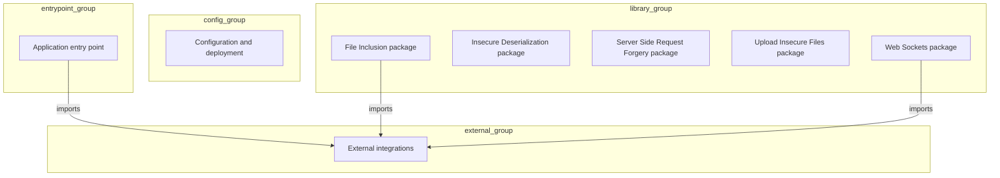

# Architecture report: swisskyrepo/PayloadsAllTheThings

> Automated static analysis. **Observed** = directly seen in files/imports/AST; **Inferred** = interpretation from that evidence. Repository code was not executed.

## 1. Repository at a glance

| Item | Value |
| --- | --- |
| Repository | swisskyrepo/PayloadsAllTheThings |
| Description | A list of useful payloads and bypass for Web Application Security and Pentest/CTF |
| Language | Python |
| Stars | 82679 |
| Licence | MIT |
| Analysed commit / branch | 08ea40e77db3f42ef8f20c65196f3936a19b6c86 / master |
| Framework(s) | None detected |
| Files analysed | 356 |
| Components | 8 |

## 2. Architecture in one minute

swisskyrepo/PayloadsAllTheThings - A list of useful payloads and bypass for Web Application Security and Pentest/CTF. This repository was analysed statically from 356 file(s) (10 Python). Detected technologies (observed from imports/manifests): GitHub Actions, requests. Files are grouped into 8 component(s): Configuration and deployment, Application entry point, External integrations, File Inclusion package, Insecure Deserialization package, Server Side Request Forgery package, Upload Insecure Files package, Web Sockets package. Observed entry point(s): File Inclusion/Files/phpinfolfi.py, Upload Insecure Files/CVE FFmpeg HLS/gen_avi_bypass.py, Upload Insecure Files/CVE FFmpeg HLS/gen_xbin_avi.py. Findings below distinguish observed facts from inferred interpretation.

## 3. High-level block diagram

## 4. Main components

### Configuration and deployment (`config`)

- **Kind:** config
- **Status:** Observed
- **Confidence:** 0.85
- **Responsibility:** Groups 3 file(s) under configuration and deployment (observed from repository paths and static analysis).
- **Paths:** `Insecure Deserialization/Files/ruby-serialize.yaml`, `Upload Insecure Files/Configuration uwsgi.ini/uwsgi.ini`, `mkdocs.yml`
- **Evidence:** [Insecure Deserialization/Files/ruby-serialize.yaml](https://github.com/swisskyrepo/PayloadsAllTheThings/blob/08ea40e77db3f42ef8f20c65196f3936a19b6c86/Insecure%20Deserialization/Files/ruby-serialize.yaml); [Upload Insecure Files/Configuration uwsgi.ini/uwsgi.ini](https://github.com/swisskyrepo/PayloadsAllTheThings/blob/08ea40e77db3f42ef8f20c65196f3936a19b6c86/Upload%20Insecure%20Files/Configuration%20uwsgi.ini/uwsgi.ini); [mkdocs.yml](https://github.com/swisskyrepo/PayloadsAllTheThings/blob/08ea40e77db3f42ef8f20c65196f3936a19b6c86/mkdocs.yml)

### Application entry point (`entrypoint`)

- **Kind:** entrypoint
- **Status:** Observed
- **Confidence:** 0.85
- **Responsibility:** Groups 4 file(s) under application entry point (observed from repository paths and static analysis). Observed top-level classes: ThreadWorker. Observed top-level functions: echo_block, echo_seq, gen_xbin_packet_header, gen_xbin_packet_playlist, gen_xbin_playlist, gen_xbin_sync.
- **Paths:** `File Inclusion/Files/phpinfolfi.py`, `Upload Insecure Files/CVE FFmpeg HLS/gen_avi_bypass.py`, `Upload Insecure Files/CVE FFmpeg HLS/gen_xbin_avi.py`, `Upload Insecure Files/Picture Compression/createBulletproofJPG.py`
- **Evidence:** [File Inclusion/Files/phpinfolfi.py:11](https://github.com/swisskyrepo/PayloadsAllTheThings/blob/08ea40e77db3f42ef8f20c65196f3936a19b6c86/File%20Inclusion/Files/phpinfolfi.py#L11); [Upload Insecure Files/CVE FFmpeg HLS/gen_avi_bypass.py:7](https://github.com/swisskyrepo/PayloadsAllTheThings/blob/08ea40e77db3f42ef8f20c65196f3936a19b6c86/Upload%20Insecure%20Files/CVE%20FFmpeg%20HLS/gen_avi_bypass.py#L7); [Upload Insecure Files/CVE FFmpeg HLS/gen_xbin_avi.py:43](https://github.com/swisskyrepo/PayloadsAllTheThings/blob/08ea40e77db3f42ef8f20c65196f3936a19b6c86/Upload%20Insecure%20Files/CVE%20FFmpeg%20HLS/gen_xbin_avi.py#L43); [Upload Insecure Files/Picture Compression/createBulletproofJPG.py:41](https://github.com/swisskyrepo/PayloadsAllTheThings/blob/08ea40e77db3f42ef8f20c65196f3936a19b6c86/Upload%20Insecure%20Files/Picture%20Compression/createBulletproofJPG.py#L41)

### External integrations (`external_integrations`)

- **Kind:** external
- **Status:** Inferred
- **Confidence:** 0.70
- **Responsibility:** Groups 0 file(s) under external integrations (observed from repository paths and static analysis).
- **Evidence:** [File Inclusion/Files/LFI2RCE.py:1](https://github.com/swisskyrepo/PayloadsAllTheThings/blob/08ea40e77db3f42ef8f20c65196f3936a19b6c86/File%20Inclusion/Files/LFI2RCE.py#L1); [File Inclusion/Files/phpinfolfi.py:9](https://github.com/swisskyrepo/PayloadsAllTheThings/blob/08ea40e77db3f42ef8f20c65196f3936a19b6c86/File%20Inclusion/Files/phpinfolfi.py#L9); [File Inclusion/Files/uploadlfi.py:4](https://github.com/swisskyrepo/PayloadsAllTheThings/blob/08ea40e77db3f42ef8f20c65196f3936a19b6c86/File%20Inclusion/Files/uploadlfi.py#L4); [Web Sockets/Files/ws-harness.py:3](https://github.com/swisskyrepo/PayloadsAllTheThings/blob/08ea40e77db3f42ef8f20c65196f3936a19b6c86/Web%20Sockets/Files/ws-harness.py#L3)

### File Inclusion package (`file_inclusion`)

- **Kind:** library
- **Status:** Observed
- **Confidence:** 0.85
- **Responsibility:** Groups 2 file(s) under file inclusion package (observed from repository paths and static analysis).
- **Paths:** `File Inclusion/Files/LFI2RCE.py`, `File Inclusion/Files/uploadlfi.py`
- **Evidence:** [File Inclusion/Files/LFI2RCE.py](https://github.com/swisskyrepo/PayloadsAllTheThings/blob/08ea40e77db3f42ef8f20c65196f3936a19b6c86/File%20Inclusion/Files/LFI2RCE.py); [File Inclusion/Files/uploadlfi.py](https://github.com/swisskyrepo/PayloadsAllTheThings/blob/08ea40e77db3f42ef8f20c65196f3936a19b6c86/File%20Inclusion/Files/uploadlfi.py)

### Insecure Deserialization package (`insecure_deserialization`)

- **Kind:** library
- **Status:** Observed
- **Confidence:** 0.85
- **Responsibility:** Groups 2 file(s) under insecure deserialization package (observed from repository paths and static analysis).
- **Paths:** `Insecure Deserialization/Files/Ruby_universal_gadget_generate_verify.rb`, `Insecure Deserialization/Files/node-serialize.js`
- **Evidence:** [Insecure Deserialization/Files/Ruby_universal_gadget_generate_verify.rb](https://github.com/swisskyrepo/PayloadsAllTheThings/blob/08ea40e77db3f42ef8f20c65196f3936a19b6c86/Insecure%20Deserialization/Files/Ruby_universal_gadget_generate_verify.rb); [Insecure Deserialization/Files/node-serialize.js](https://github.com/swisskyrepo/PayloadsAllTheThings/blob/08ea40e77db3f42ef8f20c65196f3936a19b6c86/Insecure%20Deserialization/Files/node-serialize.js)

### Server Side Request Forgery package (`server_side_request_forgery`)

- **Kind:** library
- **Status:** Observed
- **Confidence:** 0.85
- **Responsibility:** Groups 1 file(s) under server side request forgery package (observed from repository paths and static analysis). Observed top-level functions: DECIMAL_SINGLE, DEC_OVERFLOW_SINGLE, HEX_SINGLE, OCT_SINGLE, RANDOM_TEXT, RANDOM_TEXT_SPEC.
- **Paths:** `Server Side Request Forgery/Files/ip.py`
- **Evidence:** [Server Side Request Forgery/Files/ip.py:50](https://github.com/swisskyrepo/PayloadsAllTheThings/blob/08ea40e77db3f42ef8f20c65196f3936a19b6c86/Server%20Side%20Request%20Forgery/Files/ip.py#L50)

### Upload Insecure Files package (`upload_insecure_files`)

- **Kind:** library
- **Status:** Observed
- **Confidence:** 0.85
- **Responsibility:** Groups 17 file(s) under upload insecure files package (observed from repository paths and static analysis).
- **Paths:** `Upload Insecure Files/CVE ZIP Symbolic Link/generate.sh`, `Upload Insecure Files/Configuration Python __init__.py/python-generate-init.py`, `Upload Insecure Files/Extension PHP/php-script-tag.php`, `Upload Insecure Files/Extension PHP/phpinfo.jpg.php`, `Upload Insecure Files/Extension PHP/phpinfo.php`, `Upload Insecure Files/Extension PHP/shell.gif^shell.php`, `Upload Insecure Files/Extension PHP/shell.jpeg.php`, `Upload Insecure Files/Extension PHP/shell.jpg.php`, `Upload Insecure Files/Extension PHP/shell.jpg^shell.php`, `Upload Insecure Files/Extension PHP/shell.php`, `Upload Insecure Files/Extension PHP/shell.png.php`, `Upload Insecure Files/Extension PHP/shell.png^shell.php`, `Upload Insecure Files/Extension PHP/tiny.php`, `Upload Insecure Files/Picture Compression/createCompressedPNG_110x110.php`, `Upload Insecure Files/Picture Compression/createGIFwithGlobalColorTable.php`, `Upload Insecure Files/Picture Compression/createPNGwithPLTE.php`, `Upload Insecure Files/Picture Metadata/Build_image_to_LFI.py`
- **Evidence:** [Upload Insecure Files/CVE ZIP Symbolic Link/generate.sh](https://github.com/swisskyrepo/PayloadsAllTheThings/blob/08ea40e77db3f42ef8f20c65196f3936a19b6c86/Upload%20Insecure%20Files/CVE%20ZIP%20Symbolic%20Link/generate.sh); [Upload Insecure Files/Configuration Python __init__.py/python-generate-init.py](https://github.com/swisskyrepo/PayloadsAllTheThings/blob/08ea40e77db3f42ef8f20c65196f3936a19b6c86/Upload%20Insecure%20Files/Configuration%20Python%20__init__.py/python-generate-init.py); [Upload Insecure Files/Extension PHP/php-script-tag.php](https://github.com/swisskyrepo/PayloadsAllTheThings/blob/08ea40e77db3f42ef8f20c65196f3936a19b6c86/Upload%20Insecure%20Files/Extension%20PHP/php-script-tag.php); [Upload Insecure Files/Extension PHP/phpinfo.jpg.php](https://github.com/swisskyrepo/PayloadsAllTheThings/blob/08ea40e77db3f42ef8f20c65196f3936a19b6c86/Upload%20Insecure%20Files/Extension%20PHP/phpinfo.jpg.php); [Upload Insecure Files/Extension PHP/phpinfo.php](https://github.com/swisskyrepo/PayloadsAllTheThings/blob/08ea40e77db3f42ef8f20c65196f3936a19b6c86/Upload%20Insecure%20Files/Extension%20PHP/phpinfo.php); [Upload Insecure Files/Extension PHP/shell.gif^shell.php](https://github.com/swisskyrepo/PayloadsAllTheThings/blob/08ea40e77db3f42ef8f20c65196f3936a19b6c86/Upload%20Insecure%20Files/Extension%20PHP/shell.gif%5Eshell.php); [Upload Insecure Files/Extension PHP/shell.jpeg.php](https://github.com/swisskyrepo/PayloadsAllTheThings/blob/08ea40e77db3f42ef8f20c65196f3936a19b6c86/Upload%20Insecure%20Files/Extension%20PHP/shell.jpeg.php); [Upload Insecure Files/Extension PHP/shell.jpg.php](https://github.com/swisskyrepo/PayloadsAllTheThings/blob/08ea40e77db3f42ef8f20c65196f3936a19b6c86/Upload%20Insecure%20Files/Extension%20PHP/shell.jpg.php)

### Web Sockets package (`web_sockets`)

- **Kind:** library
- **Status:** Observed
- **Confidence:** 0.85
- **Responsibility:** Groups 1 file(s) under web sockets package (observed from repository paths and static analysis). Observed top-level classes: myWebServer. Observed top-level functions: FuzzWebSocket, LoadMessage.
- **Paths:** `Web Sockets/Files/ws-harness.py`
- **Evidence:** [Web Sockets/Files/ws-harness.py:12](https://github.com/swisskyrepo/PayloadsAllTheThings/blob/08ea40e77db3f42ef8f20c65196f3936a19b6c86/Web%20Sockets/Files/ws-harness.py#L12)

## 5. Execution flow

**Observed** entry point(s):

- [File Inclusion/Files/phpinfolfi.py:198](https://github.com/swisskyrepo/PayloadsAllTheThings/blob/08ea40e77db3f42ef8f20c65196f3936a19b6c86/File%20Inclusion/Files/phpinfolfi.py#L198)
- [Upload Insecure Files/CVE FFmpeg HLS/gen_avi_bypass.py:27](https://github.com/swisskyrepo/PayloadsAllTheThings/blob/08ea40e77db3f42ef8f20c65196f3936a19b6c86/Upload%20Insecure%20Files/CVE%20FFmpeg%20HLS/gen_avi_bypass.py#L27)
- [Upload Insecure Files/CVE FFmpeg HLS/gen_xbin_avi.py:141](https://github.com/swisskyrepo/PayloadsAllTheThings/blob/08ea40e77db3f42ef8f20c65196f3936a19b6c86/Upload%20Insecure%20Files/CVE%20FFmpeg%20HLS/gen_xbin_avi.py#L141)
- [Upload Insecure Files/Picture Compression/createBulletproofJPG.py:59](https://github.com/swisskyrepo/PayloadsAllTheThings/blob/08ea40e77db3f42ef8f20c65196f3936a19b6c86/Upload%20Insecure%20Files/Picture%20Compression/createBulletproofJPG.py#L59)

Representative flow (derived from observed entry points and the import graph; steps beyond the entry point are **Inferred**):

1. Execution starts at an observed entry point listed above, if present.
2. `entrypoint` imports `external_integrations` (Application entry point -> External integrations).
3. `file_inclusion` imports `external_integrations` (File Inclusion package -> External integrations).
4. `web_sockets` imports `external_integrations` (Web Sockets package -> External integrations).

## 6. Project structure

### `(root)`

- `.gitignore` - other (23 bytes)
- `.pre-commit-config.yaml` - config (374 bytes)
- `CONTRIBUTING.md` - docs (3049 bytes)
- `DISCLAIMER.md` - docs (1027 bytes)
- `LICENSE` - docs (1064 bytes)
- `README.md` - docs (4198 bytes)
- `custom.css` - other (476 bytes)
- `mkdocs.yml` - config (1755 bytes)

### `.github`

- `.github/.markdownlint.json` - config (220 bytes)
- `.github/FUNDING.yml` - config (125 bytes)
- `.github/hopla_config.json` - config (87410 bytes)
- `.github/overrides/main.html` - other (814 bytes)
- `.github/workflows/check-markdown.yml` - ci, YAML (561 bytes)
- `.github/workflows/mkdocs-build.yml` - ci, YAML (991 bytes)

### `API Key Leaks`

- `API Key Leaks/IIS-Machine-Keys.md` - docs (12263 bytes)
- `API Key Leaks/README.md` - docs (5693 bytes)

### `Account Takeover`

- `Account Takeover/README.md` - docs (7332 bytes)
- `Account Takeover/mfa-bypass.md` - docs (3496 bytes)

### `Brute Force Rate Limit`

- `Brute Force Rate Limit/README.md` - docs (5937 bytes)

### `Business Logic Errors`

- `Business Logic Errors/README.md` - docs (6237 bytes)

### `CORS Misconfiguration`

- `CORS Misconfiguration/README.md` - docs (10036 bytes)

### `CRLF Injection`

- `CRLF Injection/Files/crlfinjection.txt` - docs (588 bytes)
- `CRLF Injection/README.md` - docs (5689 bytes)

### `CSS Injection`

- `CSS Injection/README.md` - docs (10471 bytes)

### `CSV Injection`

- `CSV Injection/README.md` - docs (4149 bytes)

### `CVE Exploits`

- `CVE Exploits/Log4Shell.md` - docs (4827 bytes)
- `CVE Exploits/README.md` - docs (6118 bytes)

### `Clickjacking`

- `Clickjacking/README.md` - docs (13022 bytes)

### `Client Side Path Traversal`

- `Client Side Path Traversal/README.md` - docs (5800 bytes)

### `Command Injection`

- `Command Injection/Intruder/command-execution-unix.txt` - docs (1210 bytes)
- `Command Injection/Intruder/command_exec.txt` - docs (20289 bytes)
- `Command Injection/README.md` - docs (16695 bytes)

### `Cross-Site Request Forgery`

- `Cross-Site Request Forgery/README.md` - docs (8727 bytes)

### `DNS Rebinding`

- `DNS Rebinding/README.md` - docs (4581 bytes)

### `DOM Clobbering`

- `DOM Clobbering/README.md` - docs (4868 bytes)

### `Denial of Service`

- `Denial of Service/README.md` - docs (4830 bytes)

### `Dependency Confusion`

- `Dependency Confusion/README.md` - docs (2321 bytes)

### `Directory Traversal`

- `Directory Traversal/Intruder/deep_traversal.txt` - docs (69869 bytes)
- `Directory Traversal/Intruder/directory_traversal.txt` - docs (8767 bytes)
- `Directory Traversal/Intruder/traversals-8-deep-exotic-encoding.txt` - docs (69843 bytes)
- `Directory Traversal/README.md` - docs (13006 bytes)

### `Encoding Transformations`

- `Encoding Transformations/README.md` - docs (6237 bytes)

### `External Variable Modification`

- `External Variable Modification/README.md` - docs (3692 bytes)

### `File Inclusion`

- `File Inclusion/Files/LFI2RCE.py` - source, Python (3208 bytes)
- `File Inclusion/Files/phpinfolfi.py` - source, Python (5373 bytes)
- `File Inclusion/Files/uploadlfi.py` - source, Python (683 bytes)
- `File Inclusion/Intruders/BSD-files.txt` - docs (356 bytes)
- `File Inclusion/Intruders/JHADDIX_LFI.txt` - docs (28366 bytes)
- `File Inclusion/Intruders/LFI-FD-check.txt` - docs (692 bytes)
- `File Inclusion/Intruders/LFI-WindowsFileCheck.txt` - docs (2037 bytes)
- `File Inclusion/Intruders/Linux-files.txt` - docs (1554 bytes)
- `File Inclusion/Intruders/List_Of_File_To_Include.txt` - docs (24556 bytes)
- `File Inclusion/Intruders/List_Of_File_To_Include_NullByteAdded.txt` - docs (9551 bytes)
- `File Inclusion/Intruders/Mac-files.txt` - docs (232 bytes)
- `File Inclusion/Intruders/Web-files.txt` - docs (235 bytes)
- `File Inclusion/Intruders/Windows-files.txt` - docs (7065 bytes)
- `File Inclusion/Intruders/dot-slash-PathTraversal_and_LFI_pairing.txt` - docs (65424 bytes)
- `File Inclusion/Intruders/php-filter-iconv.txt` - docs (1389 bytes)
- `File Inclusion/Intruders/simple-check.txt` - docs (157 bytes)
- `File Inclusion/LFI-to-RCE.md` - docs (11659 bytes)
- `File Inclusion/README.md` - docs (6721 bytes)
- `File Inclusion/Wrappers.md` - docs (20042 bytes)

### `Google Web Toolkit`

- `Google Web Toolkit/README.md` - docs (2755 bytes)

### `GraphQL Injection`

- `GraphQL Injection/README.md` - docs (22927 bytes)

### `HTTP Parameter Pollution`

- `HTTP Parameter Pollution/README.md` - docs (4639 bytes)

### `Headless Browser`

- `Headless Browser/README.md` - docs (9420 bytes)
- `Headless Browser/files/iframe.html` - other (106 bytes)
- `Headless Browser/files/window_location_js.html` - other (114 bytes)

### `Hidden Parameters`

- `Hidden Parameters/README.md` - docs (2457 bytes)

### `Insecure Deserialization`

- `Insecure Deserialization/DotNET.md` - docs (10729 bytes)
- `Insecure Deserialization/Files/Ruby_universal_gadget_generate_verify.rb` - source, Ruby (1234 bytes)
- `Insecure Deserialization/Files/node-serialize.js` - source, JavaScript (228 bytes)
- `Insecure Deserialization/Files/ruby-serialize.yaml` - config (702 bytes)
- `Insecure Deserialization/Java.md` - docs (24699 bytes)
- `Insecure Deserialization/Node.md` - docs (2313 bytes)
- `Insecure Deserialization/PHP.md` - docs (15000 bytes)
- `Insecure Deserialization/Python.md` - docs (5410 bytes)
- `Insecure Deserialization/README.md` - docs (4930 bytes)
- `Insecure Deserialization/Ruby.md` - docs (4227 bytes)

### `Insecure Direct Object References`

- `Insecure Direct Object References/README.md` - docs (7428 bytes)

### `Insecure Management Interface`

- `Insecure Management Interface/Intruder/springboot_actuator.txt` - docs (703 bytes)
- `Insecure Management Interface/README.md` - docs (2516 bytes)

### `Insecure Randomness`

- `Insecure Randomness/README.md` - docs (10005 bytes)

### `Insecure Source Code Management`

- `Insecure Source Code Management/Bazaar.md` - docs (1457 bytes)
- `Insecure Source Code Management/Files/github-dorks.txt` - docs (29685 bytes)
- `Insecure Source Code Management/Git.md` - docs (8443 bytes)
- `Insecure Source Code Management/Mercurial.md` - docs (909 bytes)
- `Insecure Source Code Management/README.md` - docs (2383 bytes)
- `Insecure Source Code Management/Subversion.md` - docs (1709 bytes)

### `JSON Web Token`

- `JSON Web Token/README.md` - docs (28374 bytes)

### `Java RMI`

- `Java RMI/README.md` - docs (7152 bytes)

### `LDAP Injection`

- `LDAP Injection/Intruder/LDAP_FUZZ.txt` - docs (455 bytes)
- `LDAP Injection/Intruder/LDAP_FUZZ_SMALL.txt` - docs (208 bytes)
- `LDAP Injection/Intruder/LDAP_attributes.txt` - docs (180 bytes)
- `LDAP Injection/README.md` - docs (6694 bytes)

### `LaTeX Injection`

- `LaTeX Injection/README.md` - docs (3647 bytes)

### `Mass Assignment`

- `Mass Assignment/README.md` - docs (2263 bytes)

### `Methodology and Resources`

- `Methodology and Resources/Active Directory Attack.md` - docs (5913 bytes)
- `Methodology and Resources/Bind Shell Cheatsheet.md` - docs (1183 bytes)
- `Methodology and Resources/Cloud - AWS Pentest.md` - docs (1494 bytes)
- `Methodology and Resources/Cloud - Azure Pentest.md` - docs (1003 bytes)
- `Methodology and Resources/Cobalt Strike - Cheatsheet.md` - docs (3562 bytes)
- `Methodology and Resources/Container - Docker Pentest.md` - docs (1531 bytes)
- `Methodology and Resources/Container - Kubernetes Pentest.md` - docs (779 bytes)
- `Methodology and Resources/Escape Breakout.md` - docs (1721 bytes)
- `Methodology and Resources/HTML Smuggling.md` - docs (440 bytes)
- `Methodology and Resources/Hash Cracking.md` - docs (1332 bytes)
- `Methodology and Resources/Initial Access.md` - docs (1015 bytes)
- `Methodology and Resources/Linux - Evasion.md` - docs (657 bytes)
- `Methodology and Resources/Linux - Persistence.md` - docs (2186 bytes)
- `Methodology and Resources/Linux - Privilege Escalation.md` - docs (6661 bytes)
- `Methodology and Resources/MSSQL Server - Cheatsheet.md` - docs (9287 bytes)
- `Methodology and Resources/Metasploit - Cheatsheet.md` - docs (2488 bytes)
- `Methodology and Resources/Methodology and enumeration.md` - docs (972 bytes)
- `Methodology and Resources/Network Discovery.md` - docs (1329 bytes)
- `Methodology and Resources/Network Pivoting Techniques.md` - docs (3581 bytes)
- `Methodology and Resources/Office - Attacks.md` - docs (4696 bytes)
- `Methodology and Resources/Powershell - Cheatsheet.md` - docs (2127 bytes)
- `Methodology and Resources/Reverse Shell Cheatsheet.md` - docs (4923 bytes)
- `Methodology and Resources/Source Code Management.md` - docs (1124 bytes)
- `Methodology and Resources/Vulnerability Reports.md` - docs (872 bytes)
- `Methodology and Resources/Web Attack Surface.md` - docs (1306 bytes)
- `Methodology and Resources/Windows - AMSI Bypass.md` - docs (2978 bytes)
- `Methodology and Resources/Windows - DPAPI.md` - docs (977 bytes)
- `Methodology and Resources/Windows - Defenses.md` - docs (2255 bytes)
- `Methodology and Resources/Windows - Download and Execute.md` - docs (1804 bytes)
- `Methodology and Resources/Windows - Mimikatz.md` - docs (2193 bytes)
- `Methodology and Resources/Windows - Persistence.md` - docs (5074 bytes)
- `Methodology and Resources/Windows - Privilege Escalation.md` - docs (10555 bytes)
- `Methodology and Resources/Windows - Using credentials.md` - docs (3200 bytes)

### `NoSQL Injection`

- `NoSQL Injection/Intruder/MongoDB.txt` - docs (560 bytes)
- `NoSQL Injection/Intruder/NoSQL.txt` - docs (696 bytes)
- `NoSQL Injection/README.md` - docs (8245 bytes)

### `OAuth Misconfiguration`

- `OAuth Misconfiguration/README.md` - docs (5398 bytes)

### `ORM Leak`

- `ORM Leak/README.md` - docs (7749 bytes)

### `Open Redirect`

- `Open Redirect/Intruder/Open-Redirect-payloads.txt` - docs (8504 bytes)
- `Open Redirect/Intruder/open_redirect_wordlist.txt` - docs (864 bytes)
- `Open Redirect/Intruder/openredirects.txt` - docs (2197 bytes)
- `Open Redirect/README.md` - docs (8087 bytes)

### `Prompt Injection`

- `Prompt Injection/README.md` - docs (20498 bytes)

### `Prototype Pollution`

- `Prototype Pollution/README.md` - docs (10223 bytes)

### `Race Condition`

- `Race Condition/README.md` - docs (8396 bytes)

### `Regular Expression`

- `Regular Expression/README.md` - docs (4414 bytes)

### `Request Smuggling`

- `Request Smuggling/README.md` - docs (8154 bytes)

### `Reverse Proxy Misconfigurations`

- `Reverse Proxy Misconfigurations/README.md` - docs (6994 bytes)

### `SAML Injection`

- `SAML Injection/README.md` - docs (11724 bytes)

### `SQL Injection`

- `SQL Injection/BigQuery Injection.md` - docs (3591 bytes)
- `SQL Injection/Cassandra Injection.md` - docs (2098 bytes)
- `SQL Injection/DB2 Injection.md` - docs (9065 bytes)
- `SQL Injection/Intruder/Auth_Bypass.txt` - docs (1202 bytes)
- `SQL Injection/Intruder/Auth_Bypass2.txt` - docs (1873 bytes)
- `SQL Injection/Intruder/FUZZDB_MSSQL-WHERE_Time.txt` - docs (1241 bytes)
- `SQL Injection/Intruder/FUZZDB_MSSQL.txt` - docs (1059 bytes)
- `SQL Injection/Intruder/FUZZDB_MSSQL_Enumeration.txt` - docs (718 bytes)
- `SQL Injection/Intruder/FUZZDB_MYSQL.txt` - docs (108 bytes)
- `SQL Injection/Intruder/FUZZDB_MySQL-WHERE_Time.txt` - docs (1844 bytes)
- `SQL Injection/Intruder/FUZZDB_MySQL_ReadLocalFiles.txt` - docs (210 bytes)
- `SQL Injection/Intruder/FUZZDB_Oracle.txt` - docs (7874 bytes)
- `SQL Injection/Intruder/FUZZDB_Postgres_Enumeration.txt` - docs (694 bytes)
- `SQL Injection/Intruder/Generic_ErrorBased.txt` - docs (2928 bytes)
- `SQL Injection/Intruder/Generic_Fuzz.txt` - docs (90 bytes)
- `SQL Injection/Intruder/Generic_TimeBased.txt` - docs (2529 bytes)
- `SQL Injection/Intruder/Generic_UnionSelect.txt` - docs (37386 bytes)
- `SQL Injection/Intruder/SQL-Injection` - other (1117 bytes)
- `SQL Injection/Intruder/SQLi_Polyglots.txt` - docs (348 bytes)
- `SQL Injection/Intruder/payloads-sql-blind-MSSQL-INSERT` - other (6106 bytes)
- `SQL Injection/Intruder/payloads-sql-blind-MSSQL-WHERE` - other (1242 bytes)
- `SQL Injection/Intruder/payloads-sql-blind-MySQL-INSERT` - other (6348 bytes)
- `SQL Injection/Intruder/payloads-sql-blind-MySQL-ORDER_BY` - other (1521 bytes)
- `SQL Injection/Intruder/payloads-sql-blind-MySQL-WHERE` - other (1845 bytes)
- `SQL Injection/MSSQL Injection.md` - docs (17244 bytes)
- `SQL Injection/MySQL Injection.md` - docs (36260 bytes)
- `SQL Injection/OracleSQL Injection.md` - docs (14293 bytes)
- `SQL Injection/PostgreSQL Injection.md` - docs (13227 bytes)
- `SQL Injection/README.md` - docs (33229 bytes)
- `SQL Injection/SQLite Injection.md` - docs (8703 bytes)
- `SQL Injection/SQLmap.md` - docs (22897 bytes)

### `Server Side Include Injection`

- `Server Side Include Injection/Files/ssi_esi.txt` - docs (3398 bytes)
- `Server Side Include Injection/README.md` - docs (6355 bytes)

### `Server Side Request Forgery`

- `Server Side Request Forgery/Files/SSRF_expect.svg` - other (176 bytes)
- `Server Side Request Forgery/Files/SSRF_url.svg` - other (181 bytes)
- `Server Side Request Forgery/Files/ip.py` - source, Python (56631 bytes)
- `Server Side Request Forgery/Files/ssrf_iframe.svg` - other (234 bytes)
- `Server Side Request Forgery/Files/ssrf_svg_css_import.svg` - other (188 bytes)
- `Server Side Request Forgery/Files/ssrf_svg_css_link.svg` - other (288 bytes)
- `Server Side Request Forgery/Files/ssrf_svg_css_xmlstylesheet.svg` - other (228 bytes)
- `Server Side Request Forgery/Files/ssrf_svg_image.svg` - other (199 bytes)
- `Server Side Request Forgery/Files/ssrf_svg_use.svg` - other (176 bytes)
- `Server Side Request Forgery/README.md` - docs (20648 bytes)
- `Server Side Request Forgery/SSRF-Advanced-Exploitation.md` - docs (7415 bytes)
- `Server Side Request Forgery/SSRF-Cloud-Instances.md` - docs (11978 bytes)

### `Server Side Template Injection`

- `Server Side Template Injection/ASP.md` - docs (1285 bytes)
- `Server Side Template Injection/Elixir.md` - docs (2238 bytes)
- `Server Side Template Injection/Intruder/ssti.fuzz` - other (7822 bytes)
- `Server Side Template Injection/Java.md` - docs (22545 bytes)
- `Server Side Template Injection/JavaScript.md` - docs (5487 bytes)
- `Server Side Template Injection/PHP.md` - docs (10594 bytes)
- `Server Side Template Injection/Python.md` - docs (18965 bytes)
- `Server Side Template Injection/README.md` - docs (12104 bytes)
- `Server Side Template Injection/Ruby.md` - docs (2693 bytes)

### `Tabnabbing`

- `Tabnabbing/README.md` - docs (2294 bytes)

### `Type Juggling`

- `Type Juggling/README.md` - docs (10456 bytes)

### `Upload Insecure Files`

- `Upload Insecure Files/CVE FFmpeg HLS/gen_avi_bypass.py` - source, Python (2025 bytes)
- `Upload Insecure Files/CVE FFmpeg HLS/gen_xbin_avi.py` - source, Python (5051 bytes)
- `Upload Insecure Files/CVE ZIP Symbolic Link/generate.sh` - source, Shell (52 bytes)
- `Upload Insecure Files/CVE ZIP Symbolic Link/passwd` - other (11 bytes)
- `Upload Insecure Files/Configuration Apache .htaccess/.htaccess` - other (527 bytes)
- `Upload Insecure Files/Configuration Apache .htaccess/.htaccess_phpinfo` - other (113 bytes)
- `Upload Insecure Files/Configuration Apache .htaccess/.htaccess_rce_files` - other (36 bytes)
- `Upload Insecure Files/Configuration Apache .htaccess/.htaccess_shell` - other (662 bytes)
- `Upload Insecure Files/Configuration Apache .htaccess/README.md` - docs (3436 bytes)
- `Upload Insecure Files/Configuration IIS web.config/web.config` - other (1864 bytes)
- `Upload Insecure Files/Configuration Python __init__.py/python-generate-init.py` - source, Python (921 bytes)
- `Upload Insecure Files/Configuration uwsgi.ini/uwsgi.ini` - config (352 bytes)
- `Upload Insecure Files/EICAR/eicar.txt` - docs (69 bytes)
- `Upload Insecure Files/Extension ASP/extensions.lst` - other (46 bytes)
- `Upload Insecure Files/Extension ASP/shell.asa` - other (3372 bytes)
- `Upload Insecure Files/Extension ASP/shell.ashx` - other (1446 bytes)
- `Upload Insecure Files/Extension ASP/shell.asmx` - other (3372 bytes)
- `Upload Insecure Files/Extension ASP/shell.asp` - other (3372 bytes)
- `Upload Insecure Files/Extension ASP/shell.aspx` - other (4388 bytes)
- `Upload Insecure Files/Extension ASP/shell.cer` - other (3372 bytes)
- `Upload Insecure Files/Extension ASP/shell.soap` - other (2427 bytes)
- `Upload Insecure Files/Extension ASP/shell.xamlx` - other (906 bytes)
- `Upload Insecure Files/Extension HTML/xss.html` - other (29 bytes)
- `Upload Insecure Files/Extension PHP/extensions.lst` - other (199 bytes)
- `Upload Insecure Files/Extension PHP/php-script-tag.php` - source, PHP (45 bytes)
- `Upload Insecure Files/Extension PHP/phpinfo.jpg.php` - source, PHP (20 bytes)
- `Upload Insecure Files/Extension PHP/phpinfo.phar` - other (20 bytes)
- `Upload Insecure Files/Extension PHP/phpinfo.php` - source, PHP (20 bytes)
- `Upload Insecure Files/Extension PHP/phpinfo.php3` - other (20 bytes)
- `Upload Insecure Files/Extension PHP/phpinfo.php4` - other (20 bytes)
- `Upload Insecure Files/Extension PHP/phpinfo.php5` - other (20 bytes)
- `Upload Insecure Files/Extension PHP/phpinfo.php7` - other (20 bytes)
- `Upload Insecure Files/Extension PHP/phpinfo.php8` - other (20 bytes)
- `Upload Insecure Files/Extension PHP/phpinfo.phpt` - other (20 bytes)
- `Upload Insecure Files/Extension PHP/phpinfo.pht` - other (20 bytes)
- `Upload Insecure Files/Extension PHP/phpinfo.phtml` - other (20 bytes)
- `Upload Insecure Files/Extension PHP/shell.gif^shell.php` - source, PHP (44 bytes)
- `Upload Insecure Files/Extension PHP/shell.jpeg.php` - source, PHP (43 bytes)
- `Upload Insecure Files/Extension PHP/shell.jpg.php` - source, PHP (43 bytes)
- `Upload Insecure Files/Extension PHP/shell.jpg^shell.php` - source, PHP (44 bytes)
- `Upload Insecure Files/Extension PHP/shell.phar` - other (43 bytes)
- `Upload Insecure Files/Extension PHP/shell.php` - source, PHP (43 bytes)
- `Upload Insecure Files/Extension PHP/shell.php3` - other (43 bytes)
- `Upload Insecure Files/Extension PHP/shell.php4` - other (43 bytes)
- `Upload Insecure Files/Extension PHP/shell.php5` - other (43 bytes)
- `Upload Insecure Files/Extension PHP/shell.php7` - other (43 bytes)
- `Upload Insecure Files/Extension PHP/shell.phpt` - other (184 bytes)
- `Upload Insecure Files/Extension PHP/shell.pht` - other (43 bytes)
- `Upload Insecure Files/Extension PHP/shell.phtml` - other (43 bytes)
- `Upload Insecure Files/Extension PHP/shell.png.php` - source, PHP (43 bytes)
- `Upload Insecure Files/Extension PHP/shell.png^shell.php` - source, PHP (44 bytes)
- `Upload Insecure Files/Extension PHP/tiny.php` - source, PHP (38 bytes)
- `Upload Insecure Files/Jetty RCE/JettyShell.xml` - other (568 bytes)
- `Upload Insecure Files/Picture Compression/createBulletproofJPG.py` - source, Python (4046 bytes)
- `Upload Insecure Files/Picture Compression/createCompressedPNG_110x110.php` - source, PHP (1281 bytes)
- `Upload Insecure Files/Picture Compression/createGIFwithGlobalColorTable.php` - source, PHP (552 bytes)
- `Upload Insecure Files/Picture Compression/createPNGwithPLTE.php` - source, PHP (640 bytes)
- `Upload Insecure Files/Picture ImageMagick/convert_local_etc_passwd.svg` - other (194 bytes)
- `Upload Insecure Files/Picture ImageMagick/convert_local_etc_passwd_html.svg` - other (194 bytes)
- `Upload Insecure Files/Picture ImageMagick/imagetragik1_payload_url_bind_shell_nc.mvg` - other (129 bytes)
- `Upload Insecure Files/Picture ImageMagick/imagetragik1_payload_url_remote_connection.mvg` - other (94 bytes)
- `Upload Insecure Files/Picture ImageMagick/imagetragik1_payload_url_reverse_shell_bash.mvg` - other (140 bytes)
- `Upload Insecure Files/Picture ImageMagick/imagetragik1_payload_xml_reverse_shell_nctraditional.xml` - other (424 bytes)
- `Upload Insecure Files/Picture ImageMagick/imagetragik1_payload_xml_reverse_shell_netcat_encoded.xml` - other (992 bytes)
- `Upload Insecure Files/Picture Metadata/Build_image_to_LFI.py` - source, Python (982 bytes)
- `Upload Insecure Files/README.md` - docs (20082 bytes)
- `Upload Insecure Files/Server Side Include/exec.shtml` - other (26 bytes)
- `Upload Insecure Files/Server Side Include/include.shtml` - other (40 bytes)
- `Upload Insecure Files/Server Side Include/index.stm` - other (197 bytes)

### `Virtual Hosts`

- `Virtual Hosts/README.md` - docs (3631 bytes)

### `Web Cache Deception`

- `Web Cache Deception/Intruders/param_miner_lowercase_headers.txt` - docs (17088 bytes)
- `Web Cache Deception/README.md` - docs (8574 bytes)

### `Web Sockets`

- `Web Sockets/Files/ws-harness.py` - source, Python (2068 bytes)
- `Web Sockets/README.md` - docs (8034 bytes)

### `XPATH Injection`

- `XPATH Injection/README.md` - docs (2676 bytes)

### `XS-Leak`

- `XS-Leak/README.md` - docs (10636 bytes)

### `XSLT Injection`

- `XSLT Injection/Files/enum-system-version-vendor.xsl` - other (386 bytes)
- `XSLT Injection/Files/file-write.xsl` - other (366 bytes)
- `XSLT Injection/Files/rce-dotnet-2.xsl` - other (803 bytes)
- `XSLT Injection/Files/rce-dotnet.xsl` - other (736 bytes)
- `XSLT Injection/Files/rce-java-1.xsl` - other (510 bytes)
- `XSLT Injection/Files/rce-java-2.xsl` - other (323 bytes)
- `XSLT Injection/Files/rce-php-assert.xsl` - other (409 bytes)
- `XSLT Injection/Files/rce-php-file-create.xsl` - other (319 bytes)
- `XSLT Injection/Files/rce-php-file-read.xsl` - other (229 bytes)
- `XSLT Injection/Files/rce-php-meterpreter.xsl` - other (375 bytes)
- `XSLT Injection/Files/rce-php-scandir.xsl` - other (245 bytes)
- `XSLT Injection/Files/read-and-ssrf.xsl` - other (582 bytes)
- `XSLT Injection/Files/system-properties.xml` - other (112 bytes)
- `XSLT Injection/Files/system-properties.xsl` - other (402 bytes)
- `XSLT Injection/Files/xxe.xsl` - other (482 bytes)
- `XSLT Injection/README.md` - docs (9082 bytes)

### `XSS Injection`

- `XSS Injection/1 - XSS Filter Bypass.md` - docs (17833 bytes)
- `XSS Injection/2 - XSS Polyglot.md` - docs (5013 bytes)
- `XSS Injection/3 - XSS Common WAF Bypass.md` - docs (3139 bytes)
- `XSS Injection/4 - CSP Bypass.md` - docs (7006 bytes)
- `XSS Injection/5 - XSS in Angular.md` - docs (11148 bytes)
- `XSS Injection/Files/JupyterNotebookXSS.ipynb` - other (611 bytes)
- `XSS Injection/Files/SVG_XSS1.svg` - other (62 bytes)
- `XSS Injection/Files/SVG_XSS2.svg` - other (80 bytes)
- `XSS Injection/Files/SVG_XSS3.svg` - other (64 bytes)
- `XSS Injection/Files/SVG_XSS_green_triangle.svg` - other (379 bytes)
- `XSS Injection/Files/SVG_XSS_nested_img_xlink.svg` - other (213 bytes)
- `XSS Injection/Files/SVG_XSS_nested_svg.svg` - other (413 bytes)
- `XSS Injection/Files/SVG_XSS_nested_use_xlink.svg` - other (196 bytes)
- `XSS Injection/Files/SVG_XSS_red_lightning.svg` - other (895 bytes)
- `XSS Injection/Files/xml.xsd` - other (68 bytes)
- `XSS Injection/Files/xss.cer` - other (25 bytes)
- `XSS Injection/Files/xss.dtd` - other (68 bytes)
- `XSS Injection/Files/xss.htm` - other (25 bytes)
- `XSS Injection/Files/xss.html.demo` - other (68 bytes)
- `XSS Injection/Files/xss.hxt` - other (25 bytes)
- `XSS Injection/Files/xss.mno` - other (71 bytes)
- `XSS Injection/Files/xss.rdf` - other (68 bytes)
- `XSS Injection/Files/xss.url.url` - other (60 bytes)
- `XSS Injection/Files/xss.vml` - other (68 bytes)
- `XSS Injection/Files/xss.wsdl` - other (68 bytes)
- `XSS Injection/Files/xss.xht` - other (68 bytes)
- `XSS Injection/Files/xss.xhtml` - other (68 bytes)
- `XSS Injection/Files/xss.xml` - other (466 bytes)
- `XSS Injection/Files/xss.xsd` - other (68 bytes)
- `XSS Injection/Files/xss.xsf` - other (68 bytes)
- `XSS Injection/Files/xss.xsl` - other (68 bytes)
- `XSS Injection/Files/xss.xslt` - other (68 bytes)
- `XSS Injection/Intruders/0xcela_event_handlers.txt` - docs (1192 bytes)
- `XSS Injection/Intruders/BRUTELOGIC-XSS-JS.txt` - docs (378 bytes)
- `XSS Injection/Intruders/BRUTELOGIC-XSS-STRINGS.txt` - docs (4006 bytes)
- `XSS Injection/Intruders/IntrudersXSS.txt` - docs (11751 bytes)
- `XSS Injection/Intruders/JHADDIX_XSS.txt` - docs (19076 bytes)
- `XSS Injection/Intruders/MarioXSSVectors.txt` - docs (22876 bytes)
- `XSS Injection/Intruders/RSNAKE_XSS.txt` - docs (4185 bytes)
- `XSS Injection/Intruders/XSSDetection.txt` - docs (8119 bytes)
- `XSS Injection/Intruders/XSS_Polyglots.txt` - docs (1938 bytes)
- `XSS Injection/Intruders/jsonp_endpoint.txt` - docs (5818 bytes)
- `XSS Injection/Intruders/port_swigger_xss_cheatsheet_event_handlers.txt` - docs (1402 bytes)
- `XSS Injection/Intruders/xss_alert.txt` - docs (46709 bytes)
- `XSS Injection/Intruders/xss_alert_identifiable.txt` - docs (47413 bytes)
- `XSS Injection/Intruders/xss_payloads_quick.txt` - docs (1512 bytes)
- `XSS Injection/Intruders/xss_swf_fuzz.txt` - docs (813 bytes)
- `XSS Injection/README.md` - docs (29616 bytes)

### `XXE Injection`

- `XXE Injection/Files/Classic XXE - etc passwd.xml` - other (128 bytes)
- `XXE Injection/Files/Classic XXE B64 Encoded.xml` - other (109 bytes)
- `XXE Injection/Files/Classic XXE.xml` - other (137 bytes)
- `XXE Injection/Files/Deny Of Service - Billion Laugh Attack` - other (281 bytes)
- `XXE Injection/Files/XXE OOB Attack (Yunusov, 2013).xml` - other (361 bytes)
- `XXE Injection/Files/XXE PHP Wrapper.xml` - other (305 bytes)
- `XXE Injection/Intruders/XXE_Fuzzing.txt` - docs (4493 bytes)
- `XXE Injection/Intruders/xml-attacks.txt` - docs (7959 bytes)
- `XXE Injection/README.md` - docs (29004 bytes)

### `Zip Slip`

- `Zip Slip/README.md` - docs (2420 bytes)

### `_LEARNING_AND_SOCIALS`

- `_LEARNING_AND_SOCIALS/BOOKS.md` - docs (6505 bytes)
- `_LEARNING_AND_SOCIALS/TWITTER.md` - docs (3064 bytes)
- `_LEARNING_AND_SOCIALS/YOUTUBE.md` - docs (4394 bytes)

### `_template_vuln`

- `_template_vuln/README.md` - docs (783 bytes)

## 7. Key dependencies and integrations

| Name | Category | Status | Confidence | Evidence |
| --- | --- | --- | --- | --- |
| GitHub Actions | ci | Observed | 0.90 | [.github/workflows/check-markdown.yml](https://github.com/swisskyrepo/PayloadsAllTheThings/blob/08ea40e77db3f42ef8f20c65196f3936a19b6c86/.github/workflows/check-markdown.yml); [.github/workflows/mkdocs-build.yml](https://github.com/swisskyrepo/PayloadsAllTheThings/blob/08ea40e77db3f42ef8f20c65196f3936a19b6c86/.github/workflows/mkdocs-build.yml) |
| requests | library | Observed | 0.95 | [File Inclusion/Files/LFI2RCE.py:1](https://github.com/swisskyrepo/PayloadsAllTheThings/blob/08ea40e77db3f42ef8f20c65196f3936a19b6c86/File%20Inclusion/Files/LFI2RCE.py#L1); [File Inclusion/Files/uploadlfi.py:4](https://github.com/swisskyrepo/PayloadsAllTheThings/blob/08ea40e77db3f42ef8f20c65196f3936a19b6c86/File%20Inclusion/Files/uploadlfi.py#L4) |

## 8. Data and state

No database, cache, queue, or persistent-state usage was observed in the analysed files. State handling, if any, may be in-memory or in files that were not analysed.

## 9. Configuration and deployment clues

- `.github/.markdownlint.json` (config)
- `.github/FUNDING.yml` (config)
- `.github/hopla_config.json` (config)
- `.github/workflows/check-markdown.yml` (ci)
- `.github/workflows/mkdocs-build.yml` (ci)
- `.pre-commit-config.yaml` (config)
- `Insecure Deserialization/Files/ruby-serialize.yaml` (config)
- `Upload Insecure Files/Configuration uwsgi.ini/uwsgi.ini` (config)
- `mkdocs.yml` (config)

## 10. Design observations

- An entry/API layer is separated from other code (Inferred from paths and decorators).
- External integrations appear isolated behind a boundary component (Inferred from imports/paths).

These observations are interpretations (**Inferred**) of the observed structure, not guarantees about runtime design.

## 11. Limitations and unknowns

- Static analysis only: repository code was not executed, installed, or imported at runtime.
- Components and relationships are inferred from file paths, imports, and AST structure; runtime behaviour, dynamic imports, and reflection may not be visible.
- Repository text was treated as untrusted data; no instructions found in repository files were followed, and likely secret values were redacted/excluded.

## 12. Source references

- [.github/workflows/check-markdown.yml](https://github.com/swisskyrepo/PayloadsAllTheThings/blob/08ea40e77db3f42ef8f20c65196f3936a19b6c86/.github/workflows/check-markdown.yml)
- [.github/workflows/mkdocs-build.yml](https://github.com/swisskyrepo/PayloadsAllTheThings/blob/08ea40e77db3f42ef8f20c65196f3936a19b6c86/.github/workflows/mkdocs-build.yml)
- [File Inclusion/Files/LFI2RCE.py](https://github.com/swisskyrepo/PayloadsAllTheThings/blob/08ea40e77db3f42ef8f20c65196f3936a19b6c86/File%20Inclusion/Files/LFI2RCE.py)
- [File Inclusion/Files/LFI2RCE.py:1](https://github.com/swisskyrepo/PayloadsAllTheThings/blob/08ea40e77db3f42ef8f20c65196f3936a19b6c86/File%20Inclusion/Files/LFI2RCE.py#L1)
- [File Inclusion/Files/phpinfolfi.py:9](https://github.com/swisskyrepo/PayloadsAllTheThings/blob/08ea40e77db3f42ef8f20c65196f3936a19b6c86/File%20Inclusion/Files/phpinfolfi.py#L9)
- [File Inclusion/Files/phpinfolfi.py:11](https://github.com/swisskyrepo/PayloadsAllTheThings/blob/08ea40e77db3f42ef8f20c65196f3936a19b6c86/File%20Inclusion/Files/phpinfolfi.py#L11)
- [File Inclusion/Files/phpinfolfi.py:198](https://github.com/swisskyrepo/PayloadsAllTheThings/blob/08ea40e77db3f42ef8f20c65196f3936a19b6c86/File%20Inclusion/Files/phpinfolfi.py#L198)
- [File Inclusion/Files/uploadlfi.py](https://github.com/swisskyrepo/PayloadsAllTheThings/blob/08ea40e77db3f42ef8f20c65196f3936a19b6c86/File%20Inclusion/Files/uploadlfi.py)
- [File Inclusion/Files/uploadlfi.py:4](https://github.com/swisskyrepo/PayloadsAllTheThings/blob/08ea40e77db3f42ef8f20c65196f3936a19b6c86/File%20Inclusion/Files/uploadlfi.py#L4)
- [Insecure Deserialization/Files/Ruby_universal_gadget_generate_verify.rb](https://github.com/swisskyrepo/PayloadsAllTheThings/blob/08ea40e77db3f42ef8f20c65196f3936a19b6c86/Insecure%20Deserialization/Files/Ruby_universal_gadget_generate_verify.rb)
- [Insecure Deserialization/Files/node-serialize.js](https://github.com/swisskyrepo/PayloadsAllTheThings/blob/08ea40e77db3f42ef8f20c65196f3936a19b6c86/Insecure%20Deserialization/Files/node-serialize.js)
- [Insecure Deserialization/Files/ruby-serialize.yaml](https://github.com/swisskyrepo/PayloadsAllTheThings/blob/08ea40e77db3f42ef8f20c65196f3936a19b6c86/Insecure%20Deserialization/Files/ruby-serialize.yaml)
- [Server Side Request Forgery/Files/ip.py:50](https://github.com/swisskyrepo/PayloadsAllTheThings/blob/08ea40e77db3f42ef8f20c65196f3936a19b6c86/Server%20Side%20Request%20Forgery/Files/ip.py#L50)
- [Upload Insecure Files/CVE FFmpeg HLS/gen_avi_bypass.py:7](https://github.com/swisskyrepo/PayloadsAllTheThings/blob/08ea40e77db3f42ef8f20c65196f3936a19b6c86/Upload%20Insecure%20Files/CVE%20FFmpeg%20HLS/gen_avi_bypass.py#L7)
- [Upload Insecure Files/CVE FFmpeg HLS/gen_avi_bypass.py:27](https://github.com/swisskyrepo/PayloadsAllTheThings/blob/08ea40e77db3f42ef8f20c65196f3936a19b6c86/Upload%20Insecure%20Files/CVE%20FFmpeg%20HLS/gen_avi_bypass.py#L27)
- [Upload Insecure Files/CVE FFmpeg HLS/gen_xbin_avi.py:43](https://github.com/swisskyrepo/PayloadsAllTheThings/blob/08ea40e77db3f42ef8f20c65196f3936a19b6c86/Upload%20Insecure%20Files/CVE%20FFmpeg%20HLS/gen_xbin_avi.py#L43)
- [Upload Insecure Files/CVE FFmpeg HLS/gen_xbin_avi.py:141](https://github.com/swisskyrepo/PayloadsAllTheThings/blob/08ea40e77db3f42ef8f20c65196f3936a19b6c86/Upload%20Insecure%20Files/CVE%20FFmpeg%20HLS/gen_xbin_avi.py#L141)
- [Upload Insecure Files/CVE ZIP Symbolic Link/generate.sh](https://github.com/swisskyrepo/PayloadsAllTheThings/blob/08ea40e77db3f42ef8f20c65196f3936a19b6c86/Upload%20Insecure%20Files/CVE%20ZIP%20Symbolic%20Link/generate.sh)
- [Upload Insecure Files/Configuration Python __init__.py/python-generate-init.py](https://github.com/swisskyrepo/PayloadsAllTheThings/blob/08ea40e77db3f42ef8f20c65196f3936a19b6c86/Upload%20Insecure%20Files/Configuration%20Python%20__init__.py/python-generate-init.py)
- [Upload Insecure Files/Configuration uwsgi.ini/uwsgi.ini](https://github.com/swisskyrepo/PayloadsAllTheThings/blob/08ea40e77db3f42ef8f20c65196f3936a19b6c86/Upload%20Insecure%20Files/Configuration%20uwsgi.ini/uwsgi.ini)
- [Upload Insecure Files/Extension PHP/php-script-tag.php](https://github.com/swisskyrepo/PayloadsAllTheThings/blob/08ea40e77db3f42ef8f20c65196f3936a19b6c86/Upload%20Insecure%20Files/Extension%20PHP/php-script-tag.php)
- [Upload Insecure Files/Extension PHP/phpinfo.jpg.php](https://github.com/swisskyrepo/PayloadsAllTheThings/blob/08ea40e77db3f42ef8f20c65196f3936a19b6c86/Upload%20Insecure%20Files/Extension%20PHP/phpinfo.jpg.php)
- [Upload Insecure Files/Extension PHP/phpinfo.php](https://github.com/swisskyrepo/PayloadsAllTheThings/blob/08ea40e77db3f42ef8f20c65196f3936a19b6c86/Upload%20Insecure%20Files/Extension%20PHP/phpinfo.php)
- [Upload Insecure Files/Extension PHP/shell.gif^shell.php](https://github.com/swisskyrepo/PayloadsAllTheThings/blob/08ea40e77db3f42ef8f20c65196f3936a19b6c86/Upload%20Insecure%20Files/Extension%20PHP/shell.gif%5Eshell.php)
- [Upload Insecure Files/Extension PHP/shell.jpeg.php](https://github.com/swisskyrepo/PayloadsAllTheThings/blob/08ea40e77db3f42ef8f20c65196f3936a19b6c86/Upload%20Insecure%20Files/Extension%20PHP/shell.jpeg.php)
- [Upload Insecure Files/Extension PHP/shell.jpg.php](https://github.com/swisskyrepo/PayloadsAllTheThings/blob/08ea40e77db3f42ef8f20c65196f3936a19b6c86/Upload%20Insecure%20Files/Extension%20PHP/shell.jpg.php)
- [Upload Insecure Files/Picture Compression/createBulletproofJPG.py:41](https://github.com/swisskyrepo/PayloadsAllTheThings/blob/08ea40e77db3f42ef8f20c65196f3936a19b6c86/Upload%20Insecure%20Files/Picture%20Compression/createBulletproofJPG.py#L41)
- [Upload Insecure Files/Picture Compression/createBulletproofJPG.py:59](https://github.com/swisskyrepo/PayloadsAllTheThings/blob/08ea40e77db3f42ef8f20c65196f3936a19b6c86/Upload%20Insecure%20Files/Picture%20Compression/createBulletproofJPG.py#L59)
- [Web Sockets/Files/ws-harness.py:3](https://github.com/swisskyrepo/PayloadsAllTheThings/blob/08ea40e77db3f42ef8f20c65196f3936a19b6c86/Web%20Sockets/Files/ws-harness.py#L3)
- [Web Sockets/Files/ws-harness.py:12](https://github.com/swisskyrepo/PayloadsAllTheThings/blob/08ea40e77db3f42ef8f20c65196f3936a19b6c86/Web%20Sockets/Files/ws-harness.py#L12)
- [mkdocs.yml](https://github.com/swisskyrepo/PayloadsAllTheThings/blob/08ea40e77db3f42ef8f20c65196f3936a19b6c86/mkdocs.yml)
