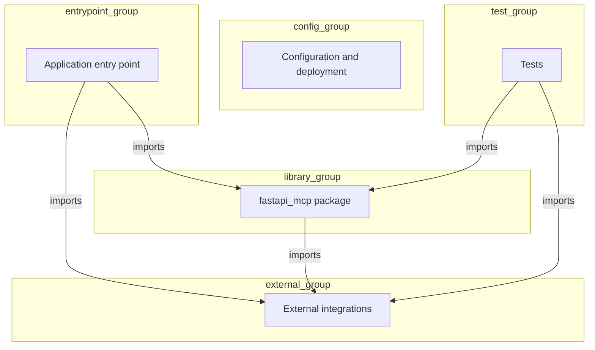

# Architecture report: tadata-org/fastapi_mcp

> Automated static analysis. **Observed** = directly seen in files/imports/AST; **Inferred** = interpretation from that evidence. Repository code was not executed.

## 1. Repository at a glance

| Item | Value |
| --- | --- |
| Repository | tadata-org/fastapi_mcp |
| Description | Expose your FastAPI endpoints as Model Context Protocol (MCP) tools, with Auth! |
| Language | Python |
| Stars | 12031 |
| Licence | MIT |
| Analysed commit / branch | e5cad13cabfc725bbcb047e526816d887d96da62 / main |
| Framework(s) | FastAPI, Typer |
| Files analysed | 80 |
| Components | 5 |

## 2. Architecture in one minute

tadata-org/fastapi_mcp - Expose your FastAPI endpoints as Model Context Protocol (MCP) tools, with Auth!. This repository was analysed statically from 80 file(s) (44 Python). Detected technologies (observed from imports/manifests): GitHub Actions, FastAPI, Typer, httpx, Pydantic, requests. Files are grouped into 5 component(s): Configuration and deployment, Application entry point, External integrations, fastapi_mcp package, Tests. Findings below distinguish observed facts from inferred interpretation.

## 3. High-level block diagram

## 4. Main components

### Configuration and deployment (`config`)

- **Kind:** config
- **Status:** Observed
- **Confidence:** 0.85
- **Responsibility:** Groups 4 file(s) under configuration and deployment (observed from repository paths and static analysis).
- **Paths:** `MANIFEST.in`, `mypy.ini`, `pyproject.toml`, `pytest.ini`
- **Evidence:** [MANIFEST.in](https://github.com/tadata-org/fastapi_mcp/blob/e5cad13cabfc725bbcb047e526816d887d96da62/MANIFEST.in); [mypy.ini](https://github.com/tadata-org/fastapi_mcp/blob/e5cad13cabfc725bbcb047e526816d887d96da62/mypy.ini); [pyproject.toml](https://github.com/tadata-org/fastapi_mcp/blob/e5cad13cabfc725bbcb047e526816d887d96da62/pyproject.toml); [pytest.ini](https://github.com/tadata-org/fastapi_mcp/blob/e5cad13cabfc725bbcb047e526816d887d96da62/pytest.ini)

### Application entry point (`entrypoint`)

- **Kind:** entrypoint
- **Status:** Observed
- **Confidence:** 0.85
- **Responsibility:** Groups 1 file(s) under application entry point (observed from repository paths and static analysis). Observed top-level classes: FastApiMCP.
- **Paths:** `fastapi_mcp/server.py`
- **Evidence:** [fastapi_mcp/server.py:22](https://github.com/tadata-org/fastapi_mcp/blob/e5cad13cabfc725bbcb047e526816d887d96da62/fastapi_mcp/server.py#L22)

### External integrations (`external_integrations`)

- **Kind:** external
- **Status:** Inferred
- **Confidence:** 0.70
- **Responsibility:** Groups 0 file(s) under external integrations (observed from repository paths and static analysis).
- **Evidence:** [examples/07_configure_http_timeout_example.py:9](https://github.com/tadata-org/fastapi_mcp/blob/e5cad13cabfc725bbcb047e526816d887d96da62/examples/07_configure_http_timeout_example.py#L9); [examples/shared/auth.py:6](https://github.com/tadata-org/fastapi_mcp/blob/e5cad13cabfc725bbcb047e526816d887d96da62/examples/shared/auth.py#L6); [fastapi_mcp/auth/proxy.py:4](https://github.com/tadata-org/fastapi_mcp/blob/e5cad13cabfc725bbcb047e526816d887d96da62/fastapi_mcp/auth/proxy.py#L4); [fastapi_mcp/server.py:2](https://github.com/tadata-org/fastapi_mcp/blob/e5cad13cabfc725bbcb047e526816d887d96da62/fastapi_mcp/server.py#L2); [tests/test_http_real_transport.py:2](https://github.com/tadata-org/fastapi_mcp/blob/e5cad13cabfc725bbcb047e526816d887d96da62/tests/test_http_real_transport.py#L2); [tests/test_http_real_transport.py:13](https://github.com/tadata-org/fastapi_mcp/blob/e5cad13cabfc725bbcb047e526816d887d96da62/tests/test_http_real_transport.py#L13)

### fastapi_mcp package (`fastapi_mcp`)

- **Kind:** library
- **Status:** Observed
- **Confidence:** 0.85
- **Responsibility:** Groups 11 file(s) under fastapi_mcp package (observed from repository paths and static analysis). Observed top-level classes: AuthConfig, BaseType, ClientRegistrationRequest, ClientRegistrationResponse, FastApiHttpSessionManager, FastApiSseTransport. Observed top-level functions: clean_schema_for_display, convert_openapi_to_mcp_tools, generate_example_from_schema, get_single_param_type_from_schema, resolve_schema_references, setup_oauth_authorize_proxy.
- **Paths:** `fastapi_mcp/__init__.py`, `fastapi_mcp/auth/__init__.py`, `fastapi_mcp/auth/proxy.py`, `fastapi_mcp/openapi/__init__.py`, `fastapi_mcp/openapi/convert.py`, `fastapi_mcp/openapi/utils.py`, `fastapi_mcp/transport/__init__.py`, `fastapi_mcp/transport/http.py`, `fastapi_mcp/transport/sse.py`, `fastapi_mcp/types.py`, `fastapi_mcp/utils/__init__.py`
- **Evidence:** [fastapi_mcp/__init__.py](https://github.com/tadata-org/fastapi_mcp/blob/e5cad13cabfc725bbcb047e526816d887d96da62/fastapi_mcp/__init__.py); [fastapi_mcp/auth/__init__.py](https://github.com/tadata-org/fastapi_mcp/blob/e5cad13cabfc725bbcb047e526816d887d96da62/fastapi_mcp/auth/__init__.py); [fastapi_mcp/auth/proxy.py:22](https://github.com/tadata-org/fastapi_mcp/blob/e5cad13cabfc725bbcb047e526816d887d96da62/fastapi_mcp/auth/proxy.py#L22); [fastapi_mcp/openapi/__init__.py](https://github.com/tadata-org/fastapi_mcp/blob/e5cad13cabfc725bbcb047e526816d887d96da62/fastapi_mcp/openapi/__init__.py); [fastapi_mcp/openapi/convert.py:17](https://github.com/tadata-org/fastapi_mcp/blob/e5cad13cabfc725bbcb047e526816d887d96da62/fastapi_mcp/openapi/convert.py#L17); [fastapi_mcp/openapi/utils.py:4](https://github.com/tadata-org/fastapi_mcp/blob/e5cad13cabfc725bbcb047e526816d887d96da62/fastapi_mcp/openapi/utils.py#L4); [fastapi_mcp/transport/__init__.py](https://github.com/tadata-org/fastapi_mcp/blob/e5cad13cabfc725bbcb047e526816d887d96da62/fastapi_mcp/transport/__init__.py); [fastapi_mcp/transport/http.py:12](https://github.com/tadata-org/fastapi_mcp/blob/e5cad13cabfc725bbcb047e526816d887d96da62/fastapi_mcp/transport/http.py#L12)

### Tests (`tests`)

- **Kind:** test
- **Status:** Observed
- **Confidence:** 0.85
- **Responsibility:** Groups 17 file(s) under tests (observed from repository paths and static analysis). Observed application object created via FastAPI. Observed top-level classes: Address, Customer, CustomerTier, ErrorResponse, Item, OrderItem. Observed top-level functions: complex_fastapi_app, example_address, example_customer, example_order_item, example_order_request, example_order_response.
- **Paths:** `tests/__init__.py`, `tests/conftest.py`, `tests/fixtures/complex_app.py`, `tests/fixtures/conftest.py`, `tests/fixtures/example_data.py`, `tests/fixtures/simple_app.py`, `tests/fixtures/types.py`, `tests/test_basic_functionality.py`, `tests/test_configuration.py`, `tests/test_http_real_transport.py`, `tests/test_mcp_complex_app.py`, `tests/test_mcp_execute_api_tool.py`, `tests/test_mcp_simple_app.py`, `tests/test_openapi_conversion.py`, `tests/test_sse_mock_transport.py`, `tests/test_sse_real_transport.py`, `tests/test_types_validation.py`
- **Evidence:** [tests/__init__.py](https://github.com/tadata-org/fastapi_mcp/blob/e5cad13cabfc725bbcb047e526816d887d96da62/tests/__init__.py); [tests/conftest.py:16](https://github.com/tadata-org/fastapi_mcp/blob/e5cad13cabfc725bbcb047e526816d887d96da62/tests/conftest.py#L16); [tests/fixtures/complex_app.py:20](https://github.com/tadata-org/fastapi_mcp/blob/e5cad13cabfc725bbcb047e526816d887d96da62/tests/fixtures/complex_app.py#L20); [tests/fixtures/conftest.py:11](https://github.com/tadata-org/fastapi_mcp/blob/e5cad13cabfc725bbcb047e526816d887d96da62/tests/fixtures/conftest.py#L11); [tests/fixtures/example_data.py:24](https://github.com/tadata-org/fastapi_mcp/blob/e5cad13cabfc725bbcb047e526816d887d96da62/tests/fixtures/example_data.py#L24); [tests/fixtures/simple_app.py:11](https://github.com/tadata-org/fastapi_mcp/blob/e5cad13cabfc725bbcb047e526816d887d96da62/tests/fixtures/simple_app.py#L11); [tests/fixtures/types.py:9](https://github.com/tadata-org/fastapi_mcp/blob/e5cad13cabfc725bbcb047e526816d887d96da62/tests/fixtures/types.py#L9); [tests/test_basic_functionality.py:7](https://github.com/tadata-org/fastapi_mcp/blob/e5cad13cabfc725bbcb047e526816d887d96da62/tests/test_basic_functionality.py#L7)

## 5. Execution flow

No entry point was observed; the startup flow below is therefore limited.

**Observed** routes (from decorators):

- `GET /new/endpoint/` -> `new_endpoint` in `examples/05_reregister_tools_example.py:18`
- `GET /private` -> `private` in `examples/08_auth_example_token_passthrough.py:41`
- `GET /api/public` -> `public` in `examples/09_auth_example_auth0.py:104`
- `GET /api/protected` -> `protected` in `examples/09_auth_example_auth0.py:109`
- `GET /items/` -> `list_items` in `examples/shared/apps/items.py:25`
- `GET /items/{item_id}` -> `read_item` in `examples/shared/apps/items.py:35`
- `POST /items/` -> `create_item` in `examples/shared/apps/items.py:47`
- `PUT /items/{item_id}` -> `update_item` in `examples/shared/apps/items.py:58`
- `DELETE /items/{item_id}` -> `delete_item` in `examples/shared/apps/items.py:73`
- `GET /items/search/` -> `search_items` in `examples/shared/apps/items.py:87`

Representative flow (derived from observed entry points and the import graph; steps beyond the entry point are **Inferred**):

1. Execution starts at an observed entry point listed above, if present.
2. `entrypoint` imports `external_integrations` (Application entry point -> External integrations).
3. `entrypoint` imports `fastapi_mcp` (Application entry point -> fastapi_mcp package).
4. `fastapi_mcp` imports `external_integrations` (fastapi_mcp package -> External integrations).
5. `tests` imports `external_integrations` (Tests -> External integrations).
6. `tests` imports `fastapi_mcp` (Tests -> fastapi_mcp package).

## 6. Project structure

### `(root)`

- `.coveragerc` - other (208 bytes)
- `.cursorignore` - other (56 bytes)
- `.gitignore` - other (2006 bytes)
- `.pre-commit-config.yaml` - config (358 bytes)
- `.python-version` - other (4 bytes)
- `CHANGELOG.md` - docs (6472 bytes)
- `CONTRIBUTING.md` - docs (4041 bytes)
- `LICENSE` - docs (1068 bytes)
- `MANIFEST.in` - manifest (221 bytes)
- `README.md` - docs (4572 bytes)
- `README_zh-CN.md` - docs (8935 bytes)
- `mypy.ini` - config (7 bytes)
- `pyproject.toml` - manifest (2145 bytes)
- `pytest.ini` - config (247 bytes)

### `.github`

- `.github/ISSUE_TEMPLATE/bug_report.md` - docs (341 bytes)
- `.github/ISSUE_TEMPLATE/documentation.md` - docs (150 bytes)
- `.github/ISSUE_TEMPLATE/feature_request.md` - docs (604 bytes)
- `.github/codecov.yml` - config (164 bytes)
- `.github/dependabot.yml` - config (383 bytes)
- `.github/pull_request_template.md` - docs (225 bytes)
- `.github/workflows/ci.yml` - ci, YAML (1971 bytes)
- `.github/workflows/release.yml` - ci, YAML (832 bytes)

### `docs`

- `docs/advanced/asgi.mdx` - docs (754 bytes)
- `docs/advanced/auth.mdx` - docs (7954 bytes)
- `docs/advanced/deploy.mdx` - docs (785 bytes)
- `docs/advanced/refresh.mdx` - docs (624 bytes)
- `docs/advanced/transport.mdx` - docs (2069 bytes)
- `docs/configurations/customization.mdx` - docs (3076 bytes)
- `docs/configurations/tool-naming.mdx` - docs (956 bytes)
- `docs/docs.json` - config (2051 bytes)
- `docs/getting-started/FAQ.mdx` - docs (2822 bytes)
- `docs/getting-started/best-practices.mdx` - docs (1935 bytes)
- `docs/getting-started/installation.mdx` - docs (385 bytes)
- `docs/getting-started/quickstart.mdx` - docs (2318 bytes)
- `docs/getting-started/welcome.mdx` - docs (1351 bytes)

### `examples`

- `examples/01_basic_usage_example.py` - source, Python (379 bytes)
- `examples/02_full_schema_description_example.py` - source, Python (752 bytes)
- `examples/03_custom_exposed_endpoints_example.py` - source, Python (2617 bytes)
- `examples/04_separate_server_example.py` - source, Python (882 bytes)
- `examples/05_reregister_tools_example.py` - source, Python (809 bytes)
- `examples/06_custom_mcp_router_example.py` - source, Python (633 bytes)
- `examples/07_configure_http_timeout_example.py` - source, Python (552 bytes)
- `examples/08_auth_example_token_passthrough.py` - source, Python (1289 bytes)
- `examples/09_auth_example_auth0.py` - source, Python (4308 bytes)
- `examples/README.md` - docs (781 bytes)
- `examples/__init__.py` - source, Python (0 bytes)
- `examples/shared/__init__.py` - source, Python (0 bytes)
- `examples/shared/apps/__init__.py` - source, Python (0 bytes)
- `examples/shared/apps/items.py` - source, Python (3875 bytes)
- `examples/shared/auth.py` - source, Python (1727 bytes)
- `examples/shared/setup.py` - manifest, Python (1076 bytes)

### `fastapi_mcp`

- `fastapi_mcp/__init__.py` - source, Python (501 bytes)
- `fastapi_mcp/auth/__init__.py` - source, Python (0 bytes)
- `fastapi_mcp/auth/proxy.py` - source, Python (9523 bytes)
- `fastapi_mcp/openapi/__init__.py` - source, Python (0 bytes)
- `fastapi_mcp/openapi/convert.py` - source, Python (12376 bytes)
- `fastapi_mcp/openapi/utils.py` - source, Python (5451 bytes)
- `fastapi_mcp/server.py` - source, Python (26501 bytes)
- `fastapi_mcp/transport/__init__.py` - source, Python (0 bytes)
- `fastapi_mcp/transport/http.py` - source, Python (5311 bytes)
- `fastapi_mcp/transport/sse.py` - source, Python (5056 bytes)
- `fastapi_mcp/types.py` - source, Python (11698 bytes)
- `fastapi_mcp/utils/__init__.py` - source, Python (0 bytes)

### `tests`

- `tests/__init__.py` - test, Python (0 bytes)
- `tests/conftest.py` - test, Python (1491 bytes)
- `tests/fixtures/complex_app.py` - test, Python (5463 bytes)
- `tests/fixtures/conftest.py` - test, Python (418 bytes)
- `tests/fixtures/example_data.py` - test, Python (3747 bytes)
- `tests/fixtures/simple_app.py` - test, Python (3109 bytes)
- `tests/fixtures/types.py` - test, Python (4106 bytes)
- `tests/test_basic_functionality.py` - test, Python (2527 bytes)
- `tests/test_configuration.py` - test, Python (28617 bytes)
- `tests/test_http_real_transport.py` - test, Python (14898 bytes)
- `tests/test_mcp_complex_app.py` - test, Python (8333 bytes)
- `tests/test_mcp_execute_api_tool.py` - test, Python (6106 bytes)
- `tests/test_mcp_simple_app.py` - test, Python (17663 bytes)
- `tests/test_openapi_conversion.py` - test, Python (17092 bytes)
- `tests/test_sse_mock_transport.py` - test, Python (7654 bytes)
- `tests/test_sse_real_transport.py` - test, Python (6456 bytes)
- `tests/test_types_validation.py` - test, Python (3760 bytes)

## 7. Key dependencies and integrations

| Name | Category | Status | Confidence | Evidence |
| --- | --- | --- | --- | --- |
| GitHub Actions | ci | Observed | 0.90 | [.github/workflows/ci.yml](https://github.com/tadata-org/fastapi_mcp/blob/e5cad13cabfc725bbcb047e526816d887d96da62/.github/workflows/ci.yml); [.github/workflows/release.yml](https://github.com/tadata-org/fastapi_mcp/blob/e5cad13cabfc725bbcb047e526816d887d96da62/.github/workflows/release.yml) |
| FastAPI | framework | Observed | 0.95 | [examples/04_separate_server_example.py:6](https://github.com/tadata-org/fastapi_mcp/blob/e5cad13cabfc725bbcb047e526816d887d96da62/examples/04_separate_server_example.py#L6); [examples/06_custom_mcp_router_example.py:8](https://github.com/tadata-org/fastapi_mcp/blob/e5cad13cabfc725bbcb047e526816d887d96da62/examples/06_custom_mcp_router_example.py#L8); [examples/08_auth_example_token_passthrough.py:28](https://github.com/tadata-org/fastapi_mcp/blob/e5cad13cabfc725bbcb047e526816d887d96da62/examples/08_auth_example_token_passthrough.py#L28); [examples/08_auth_example_token_passthrough.py:29](https://github.com/tadata-org/fastapi_mcp/blob/e5cad13cabfc725bbcb047e526816d887d96da62/examples/08_auth_example_token_passthrough.py#L29) |
| Typer | framework | Observed | 0.85 | [pyproject.toml:30](https://github.com/tadata-org/fastapi_mcp/blob/e5cad13cabfc725bbcb047e526816d887d96da62/pyproject.toml#L30) |
| httpx | library | Observed | 0.95 | [examples/07_configure_http_timeout_example.py:9](https://github.com/tadata-org/fastapi_mcp/blob/e5cad13cabfc725bbcb047e526816d887d96da62/examples/07_configure_http_timeout_example.py#L9); [examples/shared/auth.py:6](https://github.com/tadata-org/fastapi_mcp/blob/e5cad13cabfc725bbcb047e526816d887d96da62/examples/shared/auth.py#L6); [fastapi_mcp/auth/proxy.py:4](https://github.com/tadata-org/fastapi_mcp/blob/e5cad13cabfc725bbcb047e526816d887d96da62/fastapi_mcp/auth/proxy.py#L4); [fastapi_mcp/server.py:2](https://github.com/tadata-org/fastapi_mcp/blob/e5cad13cabfc725bbcb047e526816d887d96da62/fastapi_mcp/server.py#L2) |
| Pydantic | library | Observed | 0.95 | [examples/shared/apps/items.py:6](https://github.com/tadata-org/fastapi_mcp/blob/e5cad13cabfc725bbcb047e526816d887d96da62/examples/shared/apps/items.py#L6); [examples/shared/setup.py:3](https://github.com/tadata-org/fastapi_mcp/blob/e5cad13cabfc725bbcb047e526816d887d96da62/examples/shared/setup.py#L3); [fastapi_mcp/transport/sse.py:9](https://github.com/tadata-org/fastapi_mcp/blob/e5cad13cabfc725bbcb047e526816d887d96da62/fastapi_mcp/transport/sse.py#L9); [fastapi_mcp/types.py:4](https://github.com/tadata-org/fastapi_mcp/blob/e5cad13cabfc725bbcb047e526816d887d96da62/fastapi_mcp/types.py#L4) |
| requests | library | Observed | 0.85 | [pyproject.toml:37](https://github.com/tadata-org/fastapi_mcp/blob/e5cad13cabfc725bbcb047e526816d887d96da62/pyproject.toml#L37) |
| Uvicorn | library | Observed | 0.95 | [examples/01_basic_usage_example.py:16](https://github.com/tadata-org/fastapi_mcp/blob/e5cad13cabfc725bbcb047e526816d887d96da62/examples/01_basic_usage_example.py#L16); [examples/02_full_schema_description_example.py:24](https://github.com/tadata-org/fastapi_mcp/blob/e5cad13cabfc725bbcb047e526816d887d96da62/examples/02_full_schema_description_example.py#L24); [examples/03_custom_exposed_endpoints_example.py:63](https://github.com/tadata-org/fastapi_mcp/blob/e5cad13cabfc725bbcb047e526816d887d96da62/examples/03_custom_exposed_endpoints_example.py#L63); [examples/04_separate_server_example.py:32](https://github.com/tadata-org/fastapi_mcp/blob/e5cad13cabfc725bbcb047e526816d887d96da62/examples/04_separate_server_example.py#L32) |
| Poetry | packaging | Observed | 0.85 | [pyproject.toml](https://github.com/tadata-org/fastapi_mcp/blob/e5cad13cabfc725bbcb047e526816d887d96da62/pyproject.toml) |
| pytest | tooling | Observed | 0.95 | [.github/workflows/ci.yml:81](https://github.com/tadata-org/fastapi_mcp/blob/e5cad13cabfc725bbcb047e526816d887d96da62/.github/workflows/ci.yml#L81); [tests/conftest.py:3](https://github.com/tadata-org/fastapi_mcp/blob/e5cad13cabfc725bbcb047e526816d887d96da62/tests/conftest.py#L3); [tests/fixtures/complex_app.py:5](https://github.com/tadata-org/fastapi_mcp/blob/e5cad13cabfc725bbcb047e526816d887d96da62/tests/fixtures/complex_app.py#L5); [tests/fixtures/example_data.py:4](https://github.com/tadata-org/fastapi_mcp/blob/e5cad13cabfc725bbcb047e526816d887d96da62/tests/fixtures/example_data.py#L4) |
| unittest | tooling | Observed | 0.95 | [tests/test_mcp_execute_api_tool.py:2](https://github.com/tadata-org/fastapi_mcp/blob/e5cad13cabfc725bbcb047e526816d887d96da62/tests/test_mcp_execute_api_tool.py#L2); [tests/test_mcp_simple_app.py:254](https://github.com/tadata-org/fastapi_mcp/blob/e5cad13cabfc725bbcb047e526816d887d96da62/tests/test_mcp_simple_app.py#L254); [tests/test_mcp_simple_app.py:332](https://github.com/tadata-org/fastapi_mcp/blob/e5cad13cabfc725bbcb047e526816d887d96da62/tests/test_mcp_simple_app.py#L332); [tests/test_mcp_simple_app.py:376](https://github.com/tadata-org/fastapi_mcp/blob/e5cad13cabfc725bbcb047e526816d887d96da62/tests/test_mcp_simple_app.py#L376) |

## 8. Data and state

No database, cache, queue, or persistent-state usage was observed in the analysed files. State handling, if any, may be in-memory or in files that were not analysed.

## 9. Configuration and deployment clues

- `.github/codecov.yml` (config)
- `.github/dependabot.yml` (config)
- `.github/workflows/ci.yml` (ci)
- `.github/workflows/release.yml` (ci)
- `.pre-commit-config.yaml` (config)
- `MANIFEST.in` (manifest)
- `docs/docs.json` (config)
- `examples/shared/setup.py` (manifest)
- `mypy.ini` (config)
- `pyproject.toml` (manifest)
- `pytest.ini` (config)

## 10. Design observations

- An entry/API layer is separated from other code (Inferred from paths and decorators).
- Tests are present alongside source code (Observed from test file paths).
- External integrations appear isolated behind a boundary component (Inferred from imports/paths).

These observations are interpretations (**Inferred**) of the observed structure, not guarantees about runtime design.

## 11. Limitations and unknowns

- Static analysis only: repository code was not executed, installed, or imported at runtime.
- Components and relationships are inferred from file paths, imports, and AST structure; runtime behaviour, dynamic imports, and reflection may not be visible.
- 1 file(s) were skipped during inventory (1 x lockfile excluded).
- No clear application entry point was observed in the analysed files.
- Repository text was treated as untrusted data; no instructions found in repository files were followed, and likely secret values were redacted/excluded.

## 12. Source references

- [.github/workflows/ci.yml](https://github.com/tadata-org/fastapi_mcp/blob/e5cad13cabfc725bbcb047e526816d887d96da62/.github/workflows/ci.yml)
- [.github/workflows/ci.yml:81](https://github.com/tadata-org/fastapi_mcp/blob/e5cad13cabfc725bbcb047e526816d887d96da62/.github/workflows/ci.yml#L81)
- [.github/workflows/release.yml](https://github.com/tadata-org/fastapi_mcp/blob/e5cad13cabfc725bbcb047e526816d887d96da62/.github/workflows/release.yml)
- [MANIFEST.in](https://github.com/tadata-org/fastapi_mcp/blob/e5cad13cabfc725bbcb047e526816d887d96da62/MANIFEST.in)
- [examples/01_basic_usage_example.py:16](https://github.com/tadata-org/fastapi_mcp/blob/e5cad13cabfc725bbcb047e526816d887d96da62/examples/01_basic_usage_example.py#L16)
- [examples/02_full_schema_description_example.py:24](https://github.com/tadata-org/fastapi_mcp/blob/e5cad13cabfc725bbcb047e526816d887d96da62/examples/02_full_schema_description_example.py#L24)
- [examples/03_custom_exposed_endpoints_example.py:63](https://github.com/tadata-org/fastapi_mcp/blob/e5cad13cabfc725bbcb047e526816d887d96da62/examples/03_custom_exposed_endpoints_example.py#L63)
- [examples/04_separate_server_example.py:6](https://github.com/tadata-org/fastapi_mcp/blob/e5cad13cabfc725bbcb047e526816d887d96da62/examples/04_separate_server_example.py#L6)
- [examples/04_separate_server_example.py:32](https://github.com/tadata-org/fastapi_mcp/blob/e5cad13cabfc725bbcb047e526816d887d96da62/examples/04_separate_server_example.py#L32)
- [examples/05_reregister_tools_example.py:27](https://github.com/tadata-org/fastapi_mcp/blob/e5cad13cabfc725bbcb047e526816d887d96da62/examples/05_reregister_tools_example.py#L27)
- [examples/06_custom_mcp_router_example.py:8](https://github.com/tadata-org/fastapi_mcp/blob/e5cad13cabfc725bbcb047e526816d887d96da62/examples/06_custom_mcp_router_example.py#L8)
- [examples/06_custom_mcp_router_example.py:24](https://github.com/tadata-org/fastapi_mcp/blob/e5cad13cabfc725bbcb047e526816d887d96da62/examples/06_custom_mcp_router_example.py#L24)
- [examples/07_configure_http_timeout_example.py:9](https://github.com/tadata-org/fastapi_mcp/blob/e5cad13cabfc725bbcb047e526816d887d96da62/examples/07_configure_http_timeout_example.py#L9)
- [examples/07_configure_http_timeout_example.py:21](https://github.com/tadata-org/fastapi_mcp/blob/e5cad13cabfc725bbcb047e526816d887d96da62/examples/07_configure_http_timeout_example.py#L21)
- [examples/08_auth_example_token_passthrough.py:28](https://github.com/tadata-org/fastapi_mcp/blob/e5cad13cabfc725bbcb047e526816d887d96da62/examples/08_auth_example_token_passthrough.py#L28)
- [examples/08_auth_example_token_passthrough.py:29](https://github.com/tadata-org/fastapi_mcp/blob/e5cad13cabfc725bbcb047e526816d887d96da62/examples/08_auth_example_token_passthrough.py#L29)
- [examples/08_auth_example_token_passthrough.py:59](https://github.com/tadata-org/fastapi_mcp/blob/e5cad13cabfc725bbcb047e526816d887d96da62/examples/08_auth_example_token_passthrough.py#L59)
- [examples/09_auth_example_auth0.py:1](https://github.com/tadata-org/fastapi_mcp/blob/e5cad13cabfc725bbcb047e526816d887d96da62/examples/09_auth_example_auth0.py#L1)
- [examples/shared/apps/items.py:5](https://github.com/tadata-org/fastapi_mcp/blob/e5cad13cabfc725bbcb047e526816d887d96da62/examples/shared/apps/items.py#L5)
- [examples/shared/apps/items.py:6](https://github.com/tadata-org/fastapi_mcp/blob/e5cad13cabfc725bbcb047e526816d887d96da62/examples/shared/apps/items.py#L6)
- [examples/shared/auth.py:6](https://github.com/tadata-org/fastapi_mcp/blob/e5cad13cabfc725bbcb047e526816d887d96da62/examples/shared/auth.py#L6)
- [examples/shared/setup.py:3](https://github.com/tadata-org/fastapi_mcp/blob/e5cad13cabfc725bbcb047e526816d887d96da62/examples/shared/setup.py#L3)
- [fastapi_mcp/__init__.py](https://github.com/tadata-org/fastapi_mcp/blob/e5cad13cabfc725bbcb047e526816d887d96da62/fastapi_mcp/__init__.py)
- [fastapi_mcp/auth/__init__.py](https://github.com/tadata-org/fastapi_mcp/blob/e5cad13cabfc725bbcb047e526816d887d96da62/fastapi_mcp/auth/__init__.py)
- [fastapi_mcp/auth/proxy.py:2](https://github.com/tadata-org/fastapi_mcp/blob/e5cad13cabfc725bbcb047e526816d887d96da62/fastapi_mcp/auth/proxy.py#L2)
- [fastapi_mcp/auth/proxy.py:3](https://github.com/tadata-org/fastapi_mcp/blob/e5cad13cabfc725bbcb047e526816d887d96da62/fastapi_mcp/auth/proxy.py#L3)
- [fastapi_mcp/auth/proxy.py:4](https://github.com/tadata-org/fastapi_mcp/blob/e5cad13cabfc725bbcb047e526816d887d96da62/fastapi_mcp/auth/proxy.py#L4)
- [fastapi_mcp/auth/proxy.py:22](https://github.com/tadata-org/fastapi_mcp/blob/e5cad13cabfc725bbcb047e526816d887d96da62/fastapi_mcp/auth/proxy.py#L22)
- [fastapi_mcp/openapi/__init__.py](https://github.com/tadata-org/fastapi_mcp/blob/e5cad13cabfc725bbcb047e526816d887d96da62/fastapi_mcp/openapi/__init__.py)
- [fastapi_mcp/openapi/convert.py:17](https://github.com/tadata-org/fastapi_mcp/blob/e5cad13cabfc725bbcb047e526816d887d96da62/fastapi_mcp/openapi/convert.py#L17)
- [fastapi_mcp/openapi/utils.py:4](https://github.com/tadata-org/fastapi_mcp/blob/e5cad13cabfc725bbcb047e526816d887d96da62/fastapi_mcp/openapi/utils.py#L4)
- [fastapi_mcp/server.py:2](https://github.com/tadata-org/fastapi_mcp/blob/e5cad13cabfc725bbcb047e526816d887d96da62/fastapi_mcp/server.py#L2)
- [fastapi_mcp/server.py:22](https://github.com/tadata-org/fastapi_mcp/blob/e5cad13cabfc725bbcb047e526816d887d96da62/fastapi_mcp/server.py#L22)
- [fastapi_mcp/transport/__init__.py](https://github.com/tadata-org/fastapi_mcp/blob/e5cad13cabfc725bbcb047e526816d887d96da62/fastapi_mcp/transport/__init__.py)
- [fastapi_mcp/transport/http.py:12](https://github.com/tadata-org/fastapi_mcp/blob/e5cad13cabfc725bbcb047e526816d887d96da62/fastapi_mcp/transport/http.py#L12)
- [fastapi_mcp/transport/sse.py:9](https://github.com/tadata-org/fastapi_mcp/blob/e5cad13cabfc725bbcb047e526816d887d96da62/fastapi_mcp/transport/sse.py#L9)
- [fastapi_mcp/types.py:4](https://github.com/tadata-org/fastapi_mcp/blob/e5cad13cabfc725bbcb047e526816d887d96da62/fastapi_mcp/types.py#L4)
- [fastapi_mcp/types.py:11](https://github.com/tadata-org/fastapi_mcp/blob/e5cad13cabfc725bbcb047e526816d887d96da62/fastapi_mcp/types.py#L11)
- [mypy.ini](https://github.com/tadata-org/fastapi_mcp/blob/e5cad13cabfc725bbcb047e526816d887d96da62/mypy.ini)
- [pyproject.toml](https://github.com/tadata-org/fastapi_mcp/blob/e5cad13cabfc725bbcb047e526816d887d96da62/pyproject.toml)
- [pyproject.toml:30](https://github.com/tadata-org/fastapi_mcp/blob/e5cad13cabfc725bbcb047e526816d887d96da62/pyproject.toml#L30)
- [pyproject.toml:33](https://github.com/tadata-org/fastapi_mcp/blob/e5cad13cabfc725bbcb047e526816d887d96da62/pyproject.toml#L33)
- [pyproject.toml:36](https://github.com/tadata-org/fastapi_mcp/blob/e5cad13cabfc725bbcb047e526816d887d96da62/pyproject.toml#L36)
- [pyproject.toml:37](https://github.com/tadata-org/fastapi_mcp/blob/e5cad13cabfc725bbcb047e526816d887d96da62/pyproject.toml#L37)
- [pytest.ini](https://github.com/tadata-org/fastapi_mcp/blob/e5cad13cabfc725bbcb047e526816d887d96da62/pytest.ini)
- [tests/__init__.py](https://github.com/tadata-org/fastapi_mcp/blob/e5cad13cabfc725bbcb047e526816d887d96da62/tests/__init__.py)
- [tests/conftest.py:3](https://github.com/tadata-org/fastapi_mcp/blob/e5cad13cabfc725bbcb047e526816d887d96da62/tests/conftest.py#L3)
- [tests/conftest.py:16](https://github.com/tadata-org/fastapi_mcp/blob/e5cad13cabfc725bbcb047e526816d887d96da62/tests/conftest.py#L16)
- [tests/fixtures/complex_app.py:5](https://github.com/tadata-org/fastapi_mcp/blob/e5cad13cabfc725bbcb047e526816d887d96da62/tests/fixtures/complex_app.py#L5)
- [tests/fixtures/complex_app.py:20](https://github.com/tadata-org/fastapi_mcp/blob/e5cad13cabfc725bbcb047e526816d887d96da62/tests/fixtures/complex_app.py#L20)
- [tests/fixtures/conftest.py:11](https://github.com/tadata-org/fastapi_mcp/blob/e5cad13cabfc725bbcb047e526816d887d96da62/tests/fixtures/conftest.py#L11)
- [tests/fixtures/example_data.py:4](https://github.com/tadata-org/fastapi_mcp/blob/e5cad13cabfc725bbcb047e526816d887d96da62/tests/fixtures/example_data.py#L4)
- [tests/fixtures/example_data.py:24](https://github.com/tadata-org/fastapi_mcp/blob/e5cad13cabfc725bbcb047e526816d887d96da62/tests/fixtures/example_data.py#L24)
- [tests/fixtures/simple_app.py:4](https://github.com/tadata-org/fastapi_mcp/blob/e5cad13cabfc725bbcb047e526816d887d96da62/tests/fixtures/simple_app.py#L4)
- [tests/fixtures/simple_app.py:11](https://github.com/tadata-org/fastapi_mcp/blob/e5cad13cabfc725bbcb047e526816d887d96da62/tests/fixtures/simple_app.py#L11)
- [tests/fixtures/types.py:6](https://github.com/tadata-org/fastapi_mcp/blob/e5cad13cabfc725bbcb047e526816d887d96da62/tests/fixtures/types.py#L6)
- [tests/fixtures/types.py:9](https://github.com/tadata-org/fastapi_mcp/blob/e5cad13cabfc725bbcb047e526816d887d96da62/tests/fixtures/types.py#L9)
- [tests/test_basic_functionality.py:7](https://github.com/tadata-org/fastapi_mcp/blob/e5cad13cabfc725bbcb047e526816d887d96da62/tests/test_basic_functionality.py#L7)
- [tests/test_configuration.py:2](https://github.com/tadata-org/fastapi_mcp/blob/e5cad13cabfc725bbcb047e526816d887d96da62/tests/test_configuration.py#L2)
- [tests/test_http_real_transport.py:2](https://github.com/tadata-org/fastapi_mcp/blob/e5cad13cabfc725bbcb047e526816d887d96da62/tests/test_http_real_transport.py#L2)
- [tests/test_http_real_transport.py:12](https://github.com/tadata-org/fastapi_mcp/blob/e5cad13cabfc725bbcb047e526816d887d96da62/tests/test_http_real_transport.py#L12)
- [tests/test_http_real_transport.py:13](https://github.com/tadata-org/fastapi_mcp/blob/e5cad13cabfc725bbcb047e526816d887d96da62/tests/test_http_real_transport.py#L13)
- [tests/test_mcp_complex_app.py:3](https://github.com/tadata-org/fastapi_mcp/blob/e5cad13cabfc725bbcb047e526816d887d96da62/tests/test_mcp_complex_app.py#L3)
- [tests/test_mcp_execute_api_tool.py:2](https://github.com/tadata-org/fastapi_mcp/blob/e5cad13cabfc725bbcb047e526816d887d96da62/tests/test_mcp_execute_api_tool.py#L2)
- [tests/test_mcp_simple_app.py:254](https://github.com/tadata-org/fastapi_mcp/blob/e5cad13cabfc725bbcb047e526816d887d96da62/tests/test_mcp_simple_app.py#L254)
- [tests/test_mcp_simple_app.py:332](https://github.com/tadata-org/fastapi_mcp/blob/e5cad13cabfc725bbcb047e526816d887d96da62/tests/test_mcp_simple_app.py#L332)
- [tests/test_mcp_simple_app.py:376](https://github.com/tadata-org/fastapi_mcp/blob/e5cad13cabfc725bbcb047e526816d887d96da62/tests/test_mcp_simple_app.py#L376)
- [tests/test_sse_mock_transport.py:4](https://github.com/tadata-org/fastapi_mcp/blob/e5cad13cabfc725bbcb047e526816d887d96da62/tests/test_sse_mock_transport.py#L4)
- [tests/test_sse_mock_transport.py:7](https://github.com/tadata-org/fastapi_mcp/blob/e5cad13cabfc725bbcb047e526816d887d96da62/tests/test_sse_mock_transport.py#L7)
- [tests/test_sse_real_transport.py:18](https://github.com/tadata-org/fastapi_mcp/blob/e5cad13cabfc725bbcb047e526816d887d96da62/tests/test_sse_real_transport.py#L18)
