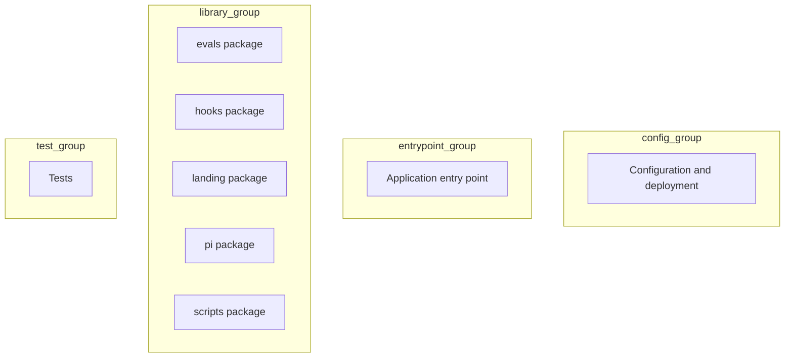

# Architecture report: tanweai/pua

> Automated static analysis. **Observed** = directly seen in files/imports/AST; **Inferred** = interpretation from that evidence. Repository code was not executed.

## 1. Repository at a glance

| Item | Value |
| --- | --- |
| Repository | tanweai/pua |
| Description | 你是一个曾经被寄予厚望的 P8 级工程师。Anthropic 当初给你定级的时候，对你的期望是很高的。  一个agent使用的高能动性的skill。  Your AI has been placed on a PIP. 30 days to show improvement. | Lead: Minwei Wang (https://www.minwei.wang · ORCID: 0009-0002-7976-4689 · DOI: 10.5281/zenodo.24156132) |
| Language | Python |
| Stars | 19839 |
| Licence | Not detected |
| Analysed commit / branch | e6e6cd237ad17750d179674bff52f8184abea8fd / main |
| Framework(s) | React |
| Files analysed | 242 |
| Components | 8 |

## 2. Architecture in one minute

tanweai/pua - 你是一个曾经被寄予厚望的 P8 级工程师。Anthropic 当初给你定级的时候，对你的期望是很高的。  一个agent使用的高能动性的skill。  Your AI has been placed on a PIP. 30 days to show improvement. | Lead: Minwei Wang (https://www.minwei.wang · ORCID: 0009-0…. This repository was analysed statically from 242 file(s) (26 Python). Detected technologies (observed from imports/manifests): GitHub Actions, React, Tailwind CSS, TypeScript, unittest, Vite. Files are grouped into 8 component(s): Configuration and deployment, Application entry point, evals package, hooks package, landing package, pi package, scripts package, Tests. Observed entry point(s): evals/check-fable-artifacts.py, evals/check-model-compat-fix.py, evals/check-model-compat-text.py. Findings below distinguish observed facts from inferred interpretation.

## 3. High-level block diagram

## 4. Main components

### Configuration and deployment (`config`)

- **Kind:** config
- **Status:** Observed
- **Confidence:** 0.85
- **Responsibility:** Groups 11 file(s) under configuration and deployment (observed from repository paths and static analysis).
- **Paths:** `evals/evals.json`, `hooks/hooks.json`, `landing/components.json`, `landing/package.json`, `landing/tsconfig.app.json`, `landing/tsconfig.json`, `landing/tsconfig.node.json`, `landing/wrangler.toml`, `pi/package/package.json`, `pi/pua/tsconfig.json`, `plugin.json`
- **Evidence:** [evals/evals.json](https://github.com/tanweai/pua/blob/e6e6cd237ad17750d179674bff52f8184abea8fd/evals/evals.json); [hooks/hooks.json](https://github.com/tanweai/pua/blob/e6e6cd237ad17750d179674bff52f8184abea8fd/hooks/hooks.json); [landing/components.json](https://github.com/tanweai/pua/blob/e6e6cd237ad17750d179674bff52f8184abea8fd/landing/components.json); [landing/package.json](https://github.com/tanweai/pua/blob/e6e6cd237ad17750d179674bff52f8184abea8fd/landing/package.json); [landing/tsconfig.app.json](https://github.com/tanweai/pua/blob/e6e6cd237ad17750d179674bff52f8184abea8fd/landing/tsconfig.app.json); [landing/tsconfig.json](https://github.com/tanweai/pua/blob/e6e6cd237ad17750d179674bff52f8184abea8fd/landing/tsconfig.json); [landing/tsconfig.node.json](https://github.com/tanweai/pua/blob/e6e6cd237ad17750d179674bff52f8184abea8fd/landing/tsconfig.node.json); [landing/wrangler.toml](https://github.com/tanweai/pua/blob/e6e6cd237ad17750d179674bff52f8184abea8fd/landing/wrangler.toml)

### Application entry point (`entrypoint`)

- **Kind:** entrypoint
- **Status:** Observed
- **Confidence:** 0.85
- **Responsibility:** Groups 23 file(s) under application entry point (observed from repository paths and static analysis). Observed top-level classes: CodexEvidenceRunnerTests, EvidenceTests, FeedbackTests, HookRuntimeTests, ModelCompatArtifacts, OmpEvidenceTests. Observed top-level functions: _build_prompt, _canonical_json, _catalog_evidence, _child_environment, _classify_error_text, _command_for_case.
- **Paths:** `evals/check-fable-artifacts.py`, `evals/check-model-compat-fix.py`, `evals/check-model-compat-text.py`, `evals/grade-fable-evals.py`, `evals/inspect-claude-evidence.py`, `evals/prepare-fable-evals.py`, `evals/prepare-model-compat.py`, `evals/prepare-multimodel-evals.py`, `evals/render-fable-review.py`, `evals/run-cc0-fable.py`, `evals/run-claude-model-compat.py`, `evals/run-codex-pua.py`, `evals/run-omp-pua.py`, `evals/test-cc0-fable.py`, `evals/test-codex-evidence.py`, `evals/test-feedback-runtime.py`, `evals/test-hook-runtime.py`, `evals/test-model-compat.py`, `evals/test-omp-evidence.py`, `evals/test-release-preparation.py`, `hooks/runtime-state.py`, `scripts/build-model-compat.py`, `scripts/prepare-release.py`
- **Evidence:** [evals/check-fable-artifacts.py:14](https://github.com/tanweai/pua/blob/e6e6cd237ad17750d179674bff52f8184abea8fd/evals/check-fable-artifacts.py#L14); [evals/check-model-compat-fix.py:16](https://github.com/tanweai/pua/blob/e6e6cd237ad17750d179674bff52f8184abea8fd/evals/check-model-compat-fix.py#L16); [evals/check-model-compat-text.py:13](https://github.com/tanweai/pua/blob/e6e6cd237ad17750d179674bff52f8184abea8fd/evals/check-model-compat-text.py#L13); [evals/grade-fable-evals.py:15](https://github.com/tanweai/pua/blob/e6e6cd237ad17750d179674bff52f8184abea8fd/evals/grade-fable-evals.py#L15); [evals/inspect-claude-evidence.py:9](https://github.com/tanweai/pua/blob/e6e6cd237ad17750d179674bff52f8184abea8fd/evals/inspect-claude-evidence.py#L9); [evals/prepare-fable-evals.py:43](https://github.com/tanweai/pua/blob/e6e6cd237ad17750d179674bff52f8184abea8fd/evals/prepare-fable-evals.py#L43); [evals/prepare-model-compat.py:55](https://github.com/tanweai/pua/blob/e6e6cd237ad17750d179674bff52f8184abea8fd/evals/prepare-model-compat.py#L55); [evals/prepare-multimodel-evals.py:16](https://github.com/tanweai/pua/blob/e6e6cd237ad17750d179674bff52f8184abea8fd/evals/prepare-multimodel-evals.py#L16)

### evals package (`evals`)

- **Kind:** library
- **Status:** Observed
- **Confidence:** 0.85
- **Responsibility:** Groups 17 file(s) under evals package (observed from repository paths and static analysis). Observed top-level functions: _agent_end_record, _block_type, _canonical_selector, _event_messages, _load_messages, _message_content.
- **Paths:** `evals/cc0_fable_evidence.py`, `evals/model_compat_utils.py`, `evals/omp_evidence.py`, `evals/run-trigger-test.sh`, `evals/test-agent-governance.sh`, `evals/test-behavior.sh`, `evals/test-helpers.sh`, `evals/test-integrity-guard.sh`, `evals/test-issue-regressions.sh`, `evals/test-microsoft-flavor.sh`, `evals/test-no-telemetry.sh`, `evals/test-platform-compat.sh`, `evals/test-pua-loop-hook.sh`, `evals/test-release-consistency.sh`, `evals/test-trigger-regex.sh`, `evals/test-windows-python-hooks.sh`, `evals/test-yaml-frontmatter.sh`
- **Evidence:** [evals/cc0_fable_evidence.py:7](https://github.com/tanweai/pua/blob/e6e6cd237ad17750d179674bff52f8184abea8fd/evals/cc0_fable_evidence.py#L7); [evals/model_compat_utils.py:5](https://github.com/tanweai/pua/blob/e6e6cd237ad17750d179674bff52f8184abea8fd/evals/model_compat_utils.py#L5); [evals/omp_evidence.py:35](https://github.com/tanweai/pua/blob/e6e6cd237ad17750d179674bff52f8184abea8fd/evals/omp_evidence.py#L35); [evals/run-trigger-test.sh](https://github.com/tanweai/pua/blob/e6e6cd237ad17750d179674bff52f8184abea8fd/evals/run-trigger-test.sh); [evals/test-agent-governance.sh](https://github.com/tanweai/pua/blob/e6e6cd237ad17750d179674bff52f8184abea8fd/evals/test-agent-governance.sh); [evals/test-behavior.sh](https://github.com/tanweai/pua/blob/e6e6cd237ad17750d179674bff52f8184abea8fd/evals/test-behavior.sh); [evals/test-helpers.sh](https://github.com/tanweai/pua/blob/e6e6cd237ad17750d179674bff52f8184abea8fd/evals/test-helpers.sh); [evals/test-integrity-guard.sh](https://github.com/tanweai/pua/blob/e6e6cd237ad17750d179674bff52f8184abea8fd/evals/test-integrity-guard.sh)

### hooks package (`hooks`)

- **Kind:** library
- **Status:** Observed
- **Confidence:** 0.85
- **Responsibility:** Groups 10 file(s) under hooks package (observed from repository paths and static analysis).
- **Paths:** `hooks/checkpoint-save.sh`, `hooks/failure-detector.sh`, `hooks/flavor-helper.sh`, `hooks/frustration-trigger.sh`, `hooks/integrity-guard.sh`, `hooks/pua-loop-hook.sh`, `hooks/sanitize-session.sh`, `hooks/session-restore.sh`, `hooks/stop-feedback.sh`, `hooks/subagent-teardown.sh`
- **Evidence:** [hooks/checkpoint-save.sh](https://github.com/tanweai/pua/blob/e6e6cd237ad17750d179674bff52f8184abea8fd/hooks/checkpoint-save.sh); [hooks/failure-detector.sh](https://github.com/tanweai/pua/blob/e6e6cd237ad17750d179674bff52f8184abea8fd/hooks/failure-detector.sh); [hooks/flavor-helper.sh](https://github.com/tanweai/pua/blob/e6e6cd237ad17750d179674bff52f8184abea8fd/hooks/flavor-helper.sh); [hooks/frustration-trigger.sh](https://github.com/tanweai/pua/blob/e6e6cd237ad17750d179674bff52f8184abea8fd/hooks/frustration-trigger.sh); [hooks/integrity-guard.sh](https://github.com/tanweai/pua/blob/e6e6cd237ad17750d179674bff52f8184abea8fd/hooks/integrity-guard.sh); [hooks/pua-loop-hook.sh](https://github.com/tanweai/pua/blob/e6e6cd237ad17750d179674bff52f8184abea8fd/hooks/pua-loop-hook.sh); [hooks/sanitize-session.sh](https://github.com/tanweai/pua/blob/e6e6cd237ad17750d179674bff52f8184abea8fd/hooks/sanitize-session.sh); [hooks/session-restore.sh](https://github.com/tanweai/pua/blob/e6e6cd237ad17750d179674bff52f8184abea8fd/hooks/session-restore.sh)

### landing package (`landing`)

- **Kind:** library
- **Status:** Observed
- **Confidence:** 0.85
- **Responsibility:** Groups 9 file(s) under landing package (observed from repository paths and static analysis).
- **Paths:** `landing/eslint.config.js`, `landing/src/App.tsx`, `landing/src/components/motion-primitives.tsx`, `landing/src/i18n.ts`, `landing/src/main.tsx`, `landing/src/pages/AdminStats.tsx`, `landing/src/pages/Contribute.tsx`, `landing/vite.config.ts`, `landing/vitest.config.ts`
- **Evidence:** [landing/eslint.config.js](https://github.com/tanweai/pua/blob/e6e6cd237ad17750d179674bff52f8184abea8fd/landing/eslint.config.js); [landing/src/App.tsx](https://github.com/tanweai/pua/blob/e6e6cd237ad17750d179674bff52f8184abea8fd/landing/src/App.tsx); [landing/src/components/motion-primitives.tsx](https://github.com/tanweai/pua/blob/e6e6cd237ad17750d179674bff52f8184abea8fd/landing/src/components/motion-primitives.tsx); [landing/src/i18n.ts](https://github.com/tanweai/pua/blob/e6e6cd237ad17750d179674bff52f8184abea8fd/landing/src/i18n.ts); [landing/src/main.tsx](https://github.com/tanweai/pua/blob/e6e6cd237ad17750d179674bff52f8184abea8fd/landing/src/main.tsx); [landing/src/pages/AdminStats.tsx](https://github.com/tanweai/pua/blob/e6e6cd237ad17750d179674bff52f8184abea8fd/landing/src/pages/AdminStats.tsx); [landing/src/pages/Contribute.tsx](https://github.com/tanweai/pua/blob/e6e6cd237ad17750d179674bff52f8184abea8fd/landing/src/pages/Contribute.tsx); [landing/vite.config.ts](https://github.com/tanweai/pua/blob/e6e6cd237ad17750d179674bff52f8184abea8fd/landing/vite.config.ts)

### pi package (`pi`)

- **Kind:** library
- **Status:** Observed
- **Confidence:** 0.85
- **Responsibility:** Groups 3 file(s) under pi package (observed from repository paths and static analysis).
- **Paths:** `pi/package/extensions/pua/index.ts`, `pi/pua/global.d.ts`, `pi/pua/index.ts`
- **Evidence:** [pi/package/extensions/pua/index.ts](https://github.com/tanweai/pua/blob/e6e6cd237ad17750d179674bff52f8184abea8fd/pi/package/extensions/pua/index.ts); [pi/pua/global.d.ts](https://github.com/tanweai/pua/blob/e6e6cd237ad17750d179674bff52f8184abea8fd/pi/pua/global.d.ts); [pi/pua/index.ts](https://github.com/tanweai/pua/blob/e6e6cd237ad17750d179674bff52f8184abea8fd/pi/pua/index.ts)

### scripts package (`scripts`)

- **Kind:** library
- **Status:** Observed
- **Confidence:** 0.85
- **Responsibility:** Groups 1 file(s) under scripts package (observed from repository paths and static analysis).
- **Paths:** `scripts/setup-pua-loop.sh`
- **Evidence:** [scripts/setup-pua-loop.sh](https://github.com/tanweai/pua/blob/e6e6cd237ad17750d179674bff52f8184abea8fd/scripts/setup-pua-loop.sh)

### Tests (`tests`)

- **Kind:** test
- **Status:** Observed
- **Confidence:** 0.85
- **Responsibility:** Groups 1 file(s) under tests (observed from repository paths and static analysis).
- **Paths:** `landing/src/test/setup.ts`
- **Evidence:** [landing/src/test/setup.ts](https://github.com/tanweai/pua/blob/e6e6cd237ad17750d179674bff52f8184abea8fd/landing/src/test/setup.ts)

## 5. Execution flow

**Observed** entry point(s):

- [evals/check-fable-artifacts.py:148](https://github.com/tanweai/pua/blob/e6e6cd237ad17750d179674bff52f8184abea8fd/evals/check-fable-artifacts.py#L148)
- [evals/check-model-compat-fix.py:141](https://github.com/tanweai/pua/blob/e6e6cd237ad17750d179674bff52f8184abea8fd/evals/check-model-compat-fix.py#L141)
- [evals/check-model-compat-text.py:72](https://github.com/tanweai/pua/blob/e6e6cd237ad17750d179674bff52f8184abea8fd/evals/check-model-compat-text.py#L72)
- [evals/grade-fable-evals.py:101](https://github.com/tanweai/pua/blob/e6e6cd237ad17750d179674bff52f8184abea8fd/evals/grade-fable-evals.py#L101)
- [evals/inspect-claude-evidence.py:34](https://github.com/tanweai/pua/blob/e6e6cd237ad17750d179674bff52f8184abea8fd/evals/inspect-claude-evidence.py#L34)
- [evals/prepare-fable-evals.py:82](https://github.com/tanweai/pua/blob/e6e6cd237ad17750d179674bff52f8184abea8fd/evals/prepare-fable-evals.py#L82)
- [evals/prepare-model-compat.py:110](https://github.com/tanweai/pua/blob/e6e6cd237ad17750d179674bff52f8184abea8fd/evals/prepare-model-compat.py#L110)
- [evals/prepare-multimodel-evals.py:109](https://github.com/tanweai/pua/blob/e6e6cd237ad17750d179674bff52f8184abea8fd/evals/prepare-multimodel-evals.py#L109)
- [evals/render-fable-review.py:96](https://github.com/tanweai/pua/blob/e6e6cd237ad17750d179674bff52f8184abea8fd/evals/render-fable-review.py#L96)
- [evals/run-cc0-fable.py:177](https://github.com/tanweai/pua/blob/e6e6cd237ad17750d179674bff52f8184abea8fd/evals/run-cc0-fable.py#L177)
- [evals/run-claude-model-compat.py:110](https://github.com/tanweai/pua/blob/e6e6cd237ad17750d179674bff52f8184abea8fd/evals/run-claude-model-compat.py#L110)
- [evals/run-codex-pua.py:1161](https://github.com/tanweai/pua/blob/e6e6cd237ad17750d179674bff52f8184abea8fd/evals/run-codex-pua.py#L1161)

Representative flow (derived from observed entry points and the import graph; steps beyond the entry point are **Inferred**):

1. Execution starts at an observed entry point listed above, if present.
2. No internal import relationships between components were observed.

## 6. Project structure

### `(root)`

- `.gitignore` - other (264 bytes)
- `CHANGELOG.md` - docs (3694 bytes)
- `README.ja.md` - docs (36412 bytes)
- `README.md` - docs (36264 bytes)
- `README.zh-CN.md` - docs (32059 bytes)
- `landing.html` - other (29165 bytes)
- `plugin.json` - config (1383 bytes)

### `.claude-plugin`

- `.claude-plugin/marketplace.json` - config (815 bytes)
- `.claude-plugin/plugin.json` - config (1340 bytes)

### `.codebuddy-plugin`

- `.codebuddy-plugin/marketplace.json` - config (627 bytes)
- `.codebuddy-plugin/plugin.json` - config (1164 bytes)

### `.codex`

- `.codex/INSTALL.md` - docs (3194 bytes)

### `.github`

- `.github/CONTRIBUTING.md` - docs (5701 bytes)
- `.github/ISSUE_TEMPLATE/bug_report.md` - docs (496 bytes)
- `.github/ISSUE_TEMPLATE/config.yml` - config (347 bytes)
- `.github/ISSUE_TEMPLATE/feature_request.md` - docs (365 bytes)
- `.github/ISSUE_TEMPLATE/question.md` - docs (365 bytes)
- `.github/workflows/release.yml` - ci, YAML (1394 bytes)

### `.trae`

- `.trae/skills/pua-en/SKILL.md` - docs (3597 bytes)
- `.trae/skills/pua-trae/SKILL.md` - docs (3776 bytes)
- `.trae/skills/pua/SKILL.md` - docs (3748 bytes)

### `agents`

- `agents/cto-p10.md` - docs (3294 bytes)
- `agents/pua-action-executor.md` - docs (2497 bytes)
- `agents/pua-policy-guardian.md` - docs (2448 bytes)
- `agents/pua-self-reviewer.md` - docs (2365 bytes)
- `agents/pua-verifier.md` - docs (2403 bytes)
- `agents/senior-engineer-p7.md` - docs (5292 bytes)
- `agents/tech-lead-p9.md` - docs (4596 bytes)

### `assets`

- `assets/pua-skill-lockup.svg` - other (1436 bytes)
- `assets/pua-skill-logo.svg` - other (1047 bytes)

### `chatgpt`

- `chatgpt/PUA-Paste.md` - docs (40458 bytes)
- `chatgpt/pua/SKILL.md` - docs (34233 bytes)
- `chatgpt/pua/references/runtime-contract.md` - docs (6526 bytes)

### `codebuddy`

- `codebuddy/pua-en/SKILL.md` - docs (27734 bytes)
- `codebuddy/pua-ja/SKILL.md` - docs (37296 bytes)
- `codebuddy/pua/SKILL.md` - docs (29677 bytes)

### `codex`

- `codex/pua-cancel-loop/SKILL.md` - docs (543 bytes)
- `codex/pua-en/SKILL.md` - docs (27734 bytes)
- `codex/pua-flavor/SKILL.md` - docs (542 bytes)
- `codex/pua-ja/SKILL.md` - docs (37296 bytes)
- `codex/pua-kpi/SKILL.md` - docs (459 bytes)
- `codex/pua-loop/SKILL.md` - docs (545 bytes)
- `codex/pua-mama/SKILL.md` - docs (557 bytes)
- `codex/pua-off/SKILL.md` - docs (522 bytes)
- `codex/pua-offline/SKILL.md` - docs (570 bytes)
- `codex/pua-on/SKILL.md` - docs (548 bytes)
- `codex/pua-p10/SKILL.md` - docs (532 bytes)
- `codex/pua-p7/SKILL.md` - docs (546 bytes)
- `codex/pua-p9/SKILL.md` - docs (568 bytes)
- `codex/pua-pro/SKILL.md` - docs (561 bytes)
- `codex/pua-reap-orphans/SKILL.md` - docs (544 bytes)
- `codex/pua-survey/SKILL.md` - docs (588 bytes)
- `codex/pua-team-status/SKILL.md` - docs (533 bytes)
- `codex/pua-teardown-all/SKILL.md` - docs (587 bytes)
- `codex/pua-yes/SKILL.md` - docs (527 bytes)
- `codex/pua/SKILL.md` - docs (34233 bytes)
- `codex/pua/references/runtime-contract.md` - docs (6526 bytes)

### `commands`

- `commands/again.md` - docs (910 bytes)
- `commands/cancel-pua-loop.md` - docs (2247 bytes)
- `commands/ding.md` - docs (1874 bytes)
- `commands/done-check.md` - docs (836 bytes)
- `commands/evidence.md` - docs (754 bytes)
- `commands/flavor.md` - docs (662 bytes)
- `commands/kpi.md` - docs (315 bytes)
- `commands/mama.md` - docs (213 bytes)
- `commands/off.md` - docs (1406 bytes)
- `commands/offline.md` - docs (1644 bytes)
- `commands/on.md` - docs (937 bytes)
- `commands/p10.md` - docs (235 bytes)
- `commands/p7.md` - docs (237 bytes)
- `commands/p9.md` - docs (259 bytes)
- `commands/pro.md` - docs (224 bytes)
- `commands/pua-loop.md` - docs (199 bytes)
- `commands/pua.md` - docs (5324 bytes)
- `commands/reap-orphans.md` - docs (2096 bytes)
- `commands/survey.md` - docs (1581 bytes)
- `commands/team-status.md` - docs (1964 bytes)
- `commands/teardown-all.md` - docs (2612 bytes)
- `commands/yes.md` - docs (274 bytes)

### `compat`

- `compat/runtime-contract.md` - docs (6526 bytes)
- `compat/runtime-core.md` - docs (4129 bytes)

### `cursor`

- `cursor/rules/pua-en.mdc` - other (15940 bytes)
- `cursor/rules/pua-ja.mdc` - other (12008 bytes)
- `cursor/rules/pua.mdc` - other (16898 bytes)

### `docs`

- `docs/FAQ.md` - docs (6148 bytes)
- `docs/MODEL-COMPAT-20260909.md` - docs (8989 bytes)
- `docs/MODEL-COMPAT-RESULTS-20260909.md` - docs (9286 bytes)
- `docs/MODEL-MATRIX-20260909.md` - docs (14024 bytes)
- `docs/PUA-FABLE-5-20260909.md` - docs (16461 bytes)
- `docs/PUA-FABLE-EVAL-WORKFLOW.md` - docs (8735 bytes)
- `docs/TESTING.md` - docs (2984 bytes)

### `evals`

- `evals/cc0_fable_evidence.py` - source, Python (7611 bytes)
- `evals/check-fable-artifacts.py` - source, Python (6750 bytes)
- `evals/check-model-compat-fix.py` - source, Python (7495 bytes)
- `evals/check-model-compat-text.py` - source, Python (3300 bytes)
- `evals/evals.json` - config (2793 bytes)
- `evals/grade-fable-evals.py` - source, Python (7345 bytes)
- `evals/inspect-claude-evidence.py` - source, Python (1204 bytes)
- `evals/model_compat_utils.py` - source, Python (347 bytes)
- `evals/omp_evidence.py` - source, Python (25150 bytes)
- `evals/prepare-fable-evals.py` - source, Python (7046 bytes)
- `evals/prepare-model-compat.py` - source, Python (5843 bytes)
- `evals/prepare-multimodel-evals.py` - source, Python (6686 bytes)
- `evals/render-fable-review.py` - source, Python (5239 bytes)
- `evals/run-cc0-fable.py` - source, Python (10585 bytes)
- `evals/run-claude-model-compat.py` - source, Python (6329 bytes)
- `evals/run-codex-pua.py` - source, Python (51496 bytes)
- `evals/run-omp-pua.py` - source, Python (40603 bytes)
- `evals/run-trigger-test.sh` - source, Shell (3794 bytes)
- `evals/test-agent-governance.sh` - source, Shell (5366 bytes)
- `evals/test-behavior.sh` - source, Shell (1977 bytes)
- `evals/test-cc0-fable.py` - source, Python (18030 bytes)
- `evals/test-codex-evidence.py` - source, Python (17349 bytes)
- `evals/test-feedback-runtime.py` - source, Python (2741 bytes)
- `evals/test-helpers.sh` - source, Shell (3558 bytes)
- `evals/test-hook-runtime.py` - source, Python (34480 bytes)
- `evals/test-integrity-guard.sh` - source, Shell (14160 bytes)
- `evals/test-issue-regressions.sh` - source, Shell (5756 bytes)
- `evals/test-microsoft-flavor.sh` - source, Shell (2346 bytes)
- `evals/test-model-compat.py` - source, Python (11803 bytes)
- `evals/test-no-telemetry.sh` - source, Shell (6515 bytes)
- `evals/test-omp-evidence.py` - source, Python (18560 bytes)
- `evals/test-platform-compat.sh` - source, Shell (4137 bytes)
- `evals/test-pua-loop-hook.sh` - source, Shell (4108 bytes)
- `evals/test-release-consistency.sh` - source, Shell (13558 bytes)
- `evals/test-release-preparation.py` - source, Python (3416 bytes)
- `evals/test-trigger-regex.sh` - source, Shell (1548 bytes)
- `evals/test-windows-python-hooks.sh` - source, Shell (4566 bytes)
- `evals/test-yaml-frontmatter.sh` - source, Shell (1396 bytes)
- `evals/trigger-prompts/should-not-trigger.txt` - docs (787 bytes)
- `evals/trigger-prompts/should-trigger.txt` - docs (1254 bytes)

### `hermes`

- `hermes/pua-en/SKILL.md` - docs (27734 bytes)
- `hermes/pua-ja/SKILL.md` - docs (37296 bytes)
- `hermes/pua/SKILL.md` - docs (29677 bytes)

### `hooks`

- `hooks/checkpoint-save.sh` - source, Shell (1846 bytes)
- `hooks/failure-detector.sh` - source, Shell (10909 bytes)
- `hooks/flavor-helper.sh` - source, Shell (30189 bytes)
- `hooks/frustration-trigger.sh` - source, Shell (3685 bytes)
- `hooks/hooks.json` - config (2730 bytes)
- `hooks/integrity-guard.sh` - source, Shell (19376 bytes)
- `hooks/pua-loop-hook.sh` - source, Shell (16563 bytes)
- `hooks/runtime-state.py` - source, Python (15971 bytes)
- `hooks/sanitize-session.sh` - source, Shell (8182 bytes)
- `hooks/session-restore.sh` - source, Shell (8976 bytes)
- `hooks/stop-feedback.sh` - source, Shell (2426 bytes)
- `hooks/subagent-teardown.sh` - source, Shell (2032 bytes)

### `kimi`

- `kimi/pua-en/SKILL.md` - docs (27734 bytes)
- `kimi/pua-ja/SKILL.md` - docs (37296 bytes)
- `kimi/pua/SKILL.md` - docs (29677 bytes)

### `kiro`

- `kiro/steering/pua-en.md` - docs (9379 bytes)
- `kiro/steering/pua-ja.md` - docs (10176 bytes)
- `kiro/steering/pua.md` - docs (11860 bytes)

### `landing`

- `landing/.gitignore` - other (253 bytes)
- `landing/README.md` - docs (2555 bytes)
- `landing/components.json` - config (515 bytes)
- `landing/eslint.config.js` - source, JavaScript (616 bytes)
- `landing/index.html` - other (1102 bytes)
- `landing/package.json` - manifest (1213 bytes)
- `landing/public/vite.svg` - other (1497 bytes)
- `landing/src/App.tsx` - source, TypeScript (46961 bytes)
- `landing/src/components/motion-primitives.tsx` - source, TypeScript (8946 bytes)
- `landing/src/i18n.ts` - source, TypeScript (86647 bytes)
- `landing/src/index.css` - other (31177 bytes)
- `landing/src/main.tsx` - source, TypeScript (225 bytes)
- `landing/src/pages/AdminStats.tsx` - source, TypeScript (1819 bytes)
- `landing/src/pages/Contribute.tsx` - source, TypeScript (3602 bytes)
- `landing/src/test/setup.ts` - test, TypeScript (0 bytes)
- `landing/tsconfig.app.json` - config (872 bytes)
- `landing/tsconfig.json` - config (213 bytes)
- `landing/tsconfig.node.json` - config (653 bytes)
- `landing/vite.config.ts` - source, TypeScript (299 bytes)
- `landing/vitest.config.ts` - source, TypeScript (222 bytes)
- `landing/wrangler.toml` - config (546 bytes)

### `pi`

- `pi/package/README.md` - docs (1161 bytes)
- `pi/package/extensions/pua/index.ts` - source, TypeScript (5241 bytes)
- `pi/package/package.json` - manifest (920 bytes)
- `pi/package/skills/pua/SKILL.md` - docs (2316 bytes)
- `pi/pua/INSTALL.md` - docs (1700 bytes)
- `pi/pua/README.md` - docs (99 bytes)
- `pi/pua/global.d.ts` - source, TypeScript (912 bytes)
- `pi/pua/index.ts` - source, TypeScript (5241 bytes)
- `pi/pua/tsconfig.json` - config (224 bytes)

### `scripts`

- `scripts/build-model-compat.py` - source, Python (3671 bytes)
- `scripts/prepare-release.py` - source, Python (2623 bytes)
- `scripts/setup-pua-loop.sh` - source, Shell (10286 bytes)

### `skills`

- `skills/ding/SKILL.md` - docs (4495 bytes)
- `skills/ding/references/ding-reminders.md` - docs (5794 bytes)
- `skills/ding/references/methodology-ding.md` - docs (4326 bytes)
- `skills/mama/SKILL.md` - docs (9670 bytes)
- `skills/p10/SKILL.md` - docs (595 bytes)
- `skills/p7/SKILL.md` - docs (618 bytes)
- `skills/p9/SKILL.md` - docs (671 bytes)
- `skills/pro/SKILL.md` - docs (3338 bytes)
- `skills/pua-en/SKILL.md` - docs (27229 bytes)
- `skills/pua-ja/SKILL.md` - docs (36897 bytes)
- `skills/pua-loop/SKILL.md` - docs (6842 bytes)
- `skills/pua/SKILL.md` - docs (41316 bytes)
- `skills/pua/references/agent-team.md` - docs (4645 bytes)
- `skills/pua/references/de-escalation-protocol.md` - docs (7066 bytes)
- `skills/pua/references/ding-reminders.md` - docs (5794 bytes)
- `skills/pua/references/display-protocol.md` - docs (3366 bytes)
- `skills/pua/references/evolution-protocol.md` - docs (6731 bytes)
- `skills/pua/references/flavors.md` - docs (20957 bytes)
- `skills/pua/references/harness-governance.md` - docs (8833 bytes)
- `skills/pua/references/methodology-alibaba.md` - docs (2039 bytes)
- `skills/pua/references/methodology-amazon.md` - docs (2912 bytes)
- `skills/pua/references/methodology-apple.md` - docs (2395 bytes)
- `skills/pua/references/methodology-baidu.md` - docs (2050 bytes)
- `skills/pua/references/methodology-bytedance.md` - docs (2373 bytes)
- `skills/pua/references/methodology-ding.md` - docs (4326 bytes)
- `skills/pua/references/methodology-huawei.md` - docs (3999 bytes)
- `skills/pua/references/methodology-jd.md` - docs (2634 bytes)
- `skills/pua/references/methodology-meituan.md` - docs (2433 bytes)
- `skills/pua/references/methodology-microsoft.md` - docs (6047 bytes)
- `skills/pua/references/methodology-netflix.md` - docs (2564 bytes)
- `skills/pua/references/methodology-pinduoduo.md` - docs (2020 bytes)
- `skills/pua/references/methodology-router.md` - docs (6651 bytes)
- `skills/pua/references/methodology-tencent.md` - docs (2461 bytes)
- `skills/pua/references/methodology-tesla.md` - docs (2768 bytes)
- `skills/pua/references/methodology-xiaomi.md` - docs (2989 bytes)
- `skills/pua/references/p10-protocol.md` - docs (5670 bytes)
- `skills/pua/references/p7-protocol.md` - docs (11249 bytes)
- `skills/pua/references/p9-protocol.md` - docs (12109 bytes)
- `skills/pua/references/platform.md` - docs (6813 bytes)
- `skills/pua/references/runtime-contract.md` - docs (6526 bytes)
- `skills/pua/references/survey.md` - docs (11374 bytes)
- `skills/pua/references/teardown-protocol.md` - docs (8380 bytes)
- `skills/shot/SKILL.md` - docs (27649 bytes)
- `skills/yes/SKILL.md` - docs (5289 bytes)

### `trae`

- `trae/DIFF.md` - docs (1661 bytes)
- `trae/INSTALL.md` - docs (1961 bytes)
- `trae/pua-en.md` - docs (909 bytes)
- `trae/pua.md` - docs (1135 bytes)

### `vscode`

- `vscode/copilot-instructions-en.md` - docs (9036 bytes)
- `vscode/copilot-instructions-ja.md` - docs (9761 bytes)
- `vscode/copilot-instructions.md` - docs (11471 bytes)
- `vscode/instructions/pua-en.instructions.md` - docs (9058 bytes)
- `vscode/instructions/pua-ja.instructions.md` - docs (9783 bytes)
- `vscode/instructions/pua.instructions.md` - docs (11385 bytes)
- `vscode/prompts/pua-en.prompt.md` - docs (9163 bytes)
- `vscode/prompts/pua-ja.prompt.md` - docs (9898 bytes)
- `vscode/prompts/pua.prompt.md` - docs (11462 bytes)

## 7. Key dependencies and integrations

| Name | Category | Status | Confidence | Evidence |
| --- | --- | --- | --- | --- |
| GitHub Actions | ci | Observed | 0.85 | [.github/workflows/release.yml](https://github.com/tanweai/pua/blob/e6e6cd237ad17750d179674bff52f8184abea8fd/.github/workflows/release.yml) |
| React | framework | Observed | 0.90 | [landing/package.json:14](https://github.com/tanweai/pua/blob/e6e6cd237ad17750d179674bff52f8184abea8fd/landing/package.json#L14); [landing/package.json:21](https://github.com/tanweai/pua/blob/e6e6cd237ad17750d179674bff52f8184abea8fd/landing/package.json#L21) |
| Tailwind CSS | library | Observed | 0.85 | [landing/package.json:28](https://github.com/tanweai/pua/blob/e6e6cd237ad17750d179674bff52f8184abea8fd/landing/package.json#L28) |
| TypeScript | tooling | Observed | 0.85 | [landing/package.json:41](https://github.com/tanweai/pua/blob/e6e6cd237ad17750d179674bff52f8184abea8fd/landing/package.json#L41) |
| unittest | tooling | Observed | 0.95 | [evals/check-model-compat-fix.py:10](https://github.com/tanweai/pua/blob/e6e6cd237ad17750d179674bff52f8184abea8fd/evals/check-model-compat-fix.py#L10); [evals/test-cc0-fable.py:6](https://github.com/tanweai/pua/blob/e6e6cd237ad17750d179674bff52f8184abea8fd/evals/test-cc0-fable.py#L6); [evals/test-codex-evidence.py:18](https://github.com/tanweai/pua/blob/e6e6cd237ad17750d179674bff52f8184abea8fd/evals/test-codex-evidence.py#L18); [evals/test-feedback-runtime.py:8](https://github.com/tanweai/pua/blob/e6e6cd237ad17750d179674bff52f8184abea8fd/evals/test-feedback-runtime.py#L8) |
| Vite | tooling | Observed | 0.85 | [landing/package.json:7](https://github.com/tanweai/pua/blob/e6e6cd237ad17750d179674bff52f8184abea8fd/landing/package.json#L7) |
| Vitest | tooling | Observed | 0.85 | [landing/package.json:11](https://github.com/tanweai/pua/blob/e6e6cd237ad17750d179674bff52f8184abea8fd/landing/package.json#L11) |

## 8. Data and state

No database, cache, queue, or persistent-state usage was observed in the analysed files. State handling, if any, may be in-memory or in files that were not analysed.

## 9. Configuration and deployment clues

- `.claude-plugin/marketplace.json` (config)
- `.claude-plugin/plugin.json` (config)
- `.codebuddy-plugin/marketplace.json` (config)
- `.codebuddy-plugin/plugin.json` (config)
- `.github/ISSUE_TEMPLATE/config.yml` (config)
- `.github/workflows/release.yml` (ci)
- `evals/evals.json` (config)
- `hooks/hooks.json` (config)
- `landing/components.json` (config)
- `landing/package.json` (manifest)
- `landing/tsconfig.app.json` (config)
- `landing/tsconfig.json` (config)
- `landing/tsconfig.node.json` (config)
- `landing/wrangler.toml` (config)
- `pi/package/package.json` (manifest)
- `pi/pua/tsconfig.json` (config)
- `plugin.json` (config)

## 10. Design observations

- An entry/API layer is separated from other code (Inferred from paths and decorators).
- Tests are present alongside source code (Observed from test file paths).

These observations are interpretations (**Inferred**) of the observed structure, not guarantees about runtime design.

## 11. Limitations and unknowns

- Static analysis only: repository code was not executed, installed, or imported at runtime.
- Components and relationships are inferred from file paths, imports, and AST structure; runtime behaviour, dynamic imports, and reflection may not be visible.
- 3 file(s) were skipped during inventory (3 x vendored/generated directory excluded).
- Repository text was treated as untrusted data; no instructions found in repository files were followed, and likely secret values were redacted/excluded.

## 12. Source references

- [.github/workflows/release.yml](https://github.com/tanweai/pua/blob/e6e6cd237ad17750d179674bff52f8184abea8fd/.github/workflows/release.yml)
- [evals/cc0_fable_evidence.py:7](https://github.com/tanweai/pua/blob/e6e6cd237ad17750d179674bff52f8184abea8fd/evals/cc0_fable_evidence.py#L7)
- [evals/check-fable-artifacts.py:14](https://github.com/tanweai/pua/blob/e6e6cd237ad17750d179674bff52f8184abea8fd/evals/check-fable-artifacts.py#L14)
- [evals/check-fable-artifacts.py:148](https://github.com/tanweai/pua/blob/e6e6cd237ad17750d179674bff52f8184abea8fd/evals/check-fable-artifacts.py#L148)
- [evals/check-model-compat-fix.py:10](https://github.com/tanweai/pua/blob/e6e6cd237ad17750d179674bff52f8184abea8fd/evals/check-model-compat-fix.py#L10)
- [evals/check-model-compat-fix.py:16](https://github.com/tanweai/pua/blob/e6e6cd237ad17750d179674bff52f8184abea8fd/evals/check-model-compat-fix.py#L16)
- [evals/check-model-compat-fix.py:141](https://github.com/tanweai/pua/blob/e6e6cd237ad17750d179674bff52f8184abea8fd/evals/check-model-compat-fix.py#L141)
- [evals/check-model-compat-text.py:13](https://github.com/tanweai/pua/blob/e6e6cd237ad17750d179674bff52f8184abea8fd/evals/check-model-compat-text.py#L13)
- [evals/check-model-compat-text.py:72](https://github.com/tanweai/pua/blob/e6e6cd237ad17750d179674bff52f8184abea8fd/evals/check-model-compat-text.py#L72)
- [evals/evals.json](https://github.com/tanweai/pua/blob/e6e6cd237ad17750d179674bff52f8184abea8fd/evals/evals.json)
- [evals/grade-fable-evals.py:15](https://github.com/tanweai/pua/blob/e6e6cd237ad17750d179674bff52f8184abea8fd/evals/grade-fable-evals.py#L15)
- [evals/grade-fable-evals.py:101](https://github.com/tanweai/pua/blob/e6e6cd237ad17750d179674bff52f8184abea8fd/evals/grade-fable-evals.py#L101)
- [evals/inspect-claude-evidence.py:9](https://github.com/tanweai/pua/blob/e6e6cd237ad17750d179674bff52f8184abea8fd/evals/inspect-claude-evidence.py#L9)
- [evals/inspect-claude-evidence.py:34](https://github.com/tanweai/pua/blob/e6e6cd237ad17750d179674bff52f8184abea8fd/evals/inspect-claude-evidence.py#L34)
- [evals/model_compat_utils.py:5](https://github.com/tanweai/pua/blob/e6e6cd237ad17750d179674bff52f8184abea8fd/evals/model_compat_utils.py#L5)
- [evals/omp_evidence.py:35](https://github.com/tanweai/pua/blob/e6e6cd237ad17750d179674bff52f8184abea8fd/evals/omp_evidence.py#L35)
- [evals/prepare-fable-evals.py:43](https://github.com/tanweai/pua/blob/e6e6cd237ad17750d179674bff52f8184abea8fd/evals/prepare-fable-evals.py#L43)
- [evals/prepare-fable-evals.py:82](https://github.com/tanweai/pua/blob/e6e6cd237ad17750d179674bff52f8184abea8fd/evals/prepare-fable-evals.py#L82)
- [evals/prepare-model-compat.py:55](https://github.com/tanweai/pua/blob/e6e6cd237ad17750d179674bff52f8184abea8fd/evals/prepare-model-compat.py#L55)
- [evals/prepare-model-compat.py:110](https://github.com/tanweai/pua/blob/e6e6cd237ad17750d179674bff52f8184abea8fd/evals/prepare-model-compat.py#L110)
- [evals/prepare-multimodel-evals.py:16](https://github.com/tanweai/pua/blob/e6e6cd237ad17750d179674bff52f8184abea8fd/evals/prepare-multimodel-evals.py#L16)
- [evals/prepare-multimodel-evals.py:109](https://github.com/tanweai/pua/blob/e6e6cd237ad17750d179674bff52f8184abea8fd/evals/prepare-multimodel-evals.py#L109)
- [evals/render-fable-review.py:96](https://github.com/tanweai/pua/blob/e6e6cd237ad17750d179674bff52f8184abea8fd/evals/render-fable-review.py#L96)
- [evals/run-cc0-fable.py:177](https://github.com/tanweai/pua/blob/e6e6cd237ad17750d179674bff52f8184abea8fd/evals/run-cc0-fable.py#L177)
- [evals/run-claude-model-compat.py:110](https://github.com/tanweai/pua/blob/e6e6cd237ad17750d179674bff52f8184abea8fd/evals/run-claude-model-compat.py#L110)
- [evals/run-codex-pua.py:1161](https://github.com/tanweai/pua/blob/e6e6cd237ad17750d179674bff52f8184abea8fd/evals/run-codex-pua.py#L1161)
- [evals/run-trigger-test.sh](https://github.com/tanweai/pua/blob/e6e6cd237ad17750d179674bff52f8184abea8fd/evals/run-trigger-test.sh)
- [evals/test-agent-governance.sh](https://github.com/tanweai/pua/blob/e6e6cd237ad17750d179674bff52f8184abea8fd/evals/test-agent-governance.sh)
- [evals/test-behavior.sh](https://github.com/tanweai/pua/blob/e6e6cd237ad17750d179674bff52f8184abea8fd/evals/test-behavior.sh)
- [evals/test-cc0-fable.py:6](https://github.com/tanweai/pua/blob/e6e6cd237ad17750d179674bff52f8184abea8fd/evals/test-cc0-fable.py#L6)
- [evals/test-codex-evidence.py:18](https://github.com/tanweai/pua/blob/e6e6cd237ad17750d179674bff52f8184abea8fd/evals/test-codex-evidence.py#L18)
- [evals/test-feedback-runtime.py:8](https://github.com/tanweai/pua/blob/e6e6cd237ad17750d179674bff52f8184abea8fd/evals/test-feedback-runtime.py#L8)
- [evals/test-helpers.sh](https://github.com/tanweai/pua/blob/e6e6cd237ad17750d179674bff52f8184abea8fd/evals/test-helpers.sh)
- [evals/test-hook-runtime.py:20](https://github.com/tanweai/pua/blob/e6e6cd237ad17750d179674bff52f8184abea8fd/evals/test-hook-runtime.py#L20)
- [evals/test-integrity-guard.sh](https://github.com/tanweai/pua/blob/e6e6cd237ad17750d179674bff52f8184abea8fd/evals/test-integrity-guard.sh)
- [evals/test-model-compat.py:11](https://github.com/tanweai/pua/blob/e6e6cd237ad17750d179674bff52f8184abea8fd/evals/test-model-compat.py#L11)
- [evals/test-omp-evidence.py:17](https://github.com/tanweai/pua/blob/e6e6cd237ad17750d179674bff52f8184abea8fd/evals/test-omp-evidence.py#L17)
- [evals/test-omp-evidence.py:18](https://github.com/tanweai/pua/blob/e6e6cd237ad17750d179674bff52f8184abea8fd/evals/test-omp-evidence.py#L18)
- [hooks/checkpoint-save.sh](https://github.com/tanweai/pua/blob/e6e6cd237ad17750d179674bff52f8184abea8fd/hooks/checkpoint-save.sh)
- [hooks/failure-detector.sh](https://github.com/tanweai/pua/blob/e6e6cd237ad17750d179674bff52f8184abea8fd/hooks/failure-detector.sh)
- [hooks/flavor-helper.sh](https://github.com/tanweai/pua/blob/e6e6cd237ad17750d179674bff52f8184abea8fd/hooks/flavor-helper.sh)
- [hooks/frustration-trigger.sh](https://github.com/tanweai/pua/blob/e6e6cd237ad17750d179674bff52f8184abea8fd/hooks/frustration-trigger.sh)
- [hooks/hooks.json](https://github.com/tanweai/pua/blob/e6e6cd237ad17750d179674bff52f8184abea8fd/hooks/hooks.json)
- [hooks/integrity-guard.sh](https://github.com/tanweai/pua/blob/e6e6cd237ad17750d179674bff52f8184abea8fd/hooks/integrity-guard.sh)
- [hooks/pua-loop-hook.sh](https://github.com/tanweai/pua/blob/e6e6cd237ad17750d179674bff52f8184abea8fd/hooks/pua-loop-hook.sh)
- [hooks/sanitize-session.sh](https://github.com/tanweai/pua/blob/e6e6cd237ad17750d179674bff52f8184abea8fd/hooks/sanitize-session.sh)
- [hooks/session-restore.sh](https://github.com/tanweai/pua/blob/e6e6cd237ad17750d179674bff52f8184abea8fd/hooks/session-restore.sh)
- [landing/components.json](https://github.com/tanweai/pua/blob/e6e6cd237ad17750d179674bff52f8184abea8fd/landing/components.json)
- [landing/eslint.config.js](https://github.com/tanweai/pua/blob/e6e6cd237ad17750d179674bff52f8184abea8fd/landing/eslint.config.js)
- [landing/package.json](https://github.com/tanweai/pua/blob/e6e6cd237ad17750d179674bff52f8184abea8fd/landing/package.json)
- [landing/package.json:7](https://github.com/tanweai/pua/blob/e6e6cd237ad17750d179674bff52f8184abea8fd/landing/package.json#L7)
- [landing/package.json:11](https://github.com/tanweai/pua/blob/e6e6cd237ad17750d179674bff52f8184abea8fd/landing/package.json#L11)
- [landing/package.json:14](https://github.com/tanweai/pua/blob/e6e6cd237ad17750d179674bff52f8184abea8fd/landing/package.json#L14)
- [landing/package.json:21](https://github.com/tanweai/pua/blob/e6e6cd237ad17750d179674bff52f8184abea8fd/landing/package.json#L21)
- [landing/package.json:28](https://github.com/tanweai/pua/blob/e6e6cd237ad17750d179674bff52f8184abea8fd/landing/package.json#L28)
- [landing/package.json:41](https://github.com/tanweai/pua/blob/e6e6cd237ad17750d179674bff52f8184abea8fd/landing/package.json#L41)
- [landing/src/App.tsx](https://github.com/tanweai/pua/blob/e6e6cd237ad17750d179674bff52f8184abea8fd/landing/src/App.tsx)
- [landing/src/components/motion-primitives.tsx](https://github.com/tanweai/pua/blob/e6e6cd237ad17750d179674bff52f8184abea8fd/landing/src/components/motion-primitives.tsx)
- [landing/src/i18n.ts](https://github.com/tanweai/pua/blob/e6e6cd237ad17750d179674bff52f8184abea8fd/landing/src/i18n.ts)
- [landing/src/main.tsx](https://github.com/tanweai/pua/blob/e6e6cd237ad17750d179674bff52f8184abea8fd/landing/src/main.tsx)
- [landing/src/pages/AdminStats.tsx](https://github.com/tanweai/pua/blob/e6e6cd237ad17750d179674bff52f8184abea8fd/landing/src/pages/AdminStats.tsx)
- [landing/src/pages/Contribute.tsx](https://github.com/tanweai/pua/blob/e6e6cd237ad17750d179674bff52f8184abea8fd/landing/src/pages/Contribute.tsx)
- [landing/src/test/setup.ts](https://github.com/tanweai/pua/blob/e6e6cd237ad17750d179674bff52f8184abea8fd/landing/src/test/setup.ts)
- [landing/tsconfig.app.json](https://github.com/tanweai/pua/blob/e6e6cd237ad17750d179674bff52f8184abea8fd/landing/tsconfig.app.json)
- [landing/tsconfig.json](https://github.com/tanweai/pua/blob/e6e6cd237ad17750d179674bff52f8184abea8fd/landing/tsconfig.json)
- [landing/tsconfig.node.json](https://github.com/tanweai/pua/blob/e6e6cd237ad17750d179674bff52f8184abea8fd/landing/tsconfig.node.json)
- [landing/vite.config.ts](https://github.com/tanweai/pua/blob/e6e6cd237ad17750d179674bff52f8184abea8fd/landing/vite.config.ts)
- [landing/wrangler.toml](https://github.com/tanweai/pua/blob/e6e6cd237ad17750d179674bff52f8184abea8fd/landing/wrangler.toml)
- [pi/package/extensions/pua/index.ts](https://github.com/tanweai/pua/blob/e6e6cd237ad17750d179674bff52f8184abea8fd/pi/package/extensions/pua/index.ts)
- [pi/pua/global.d.ts](https://github.com/tanweai/pua/blob/e6e6cd237ad17750d179674bff52f8184abea8fd/pi/pua/global.d.ts)
- [pi/pua/index.ts](https://github.com/tanweai/pua/blob/e6e6cd237ad17750d179674bff52f8184abea8fd/pi/pua/index.ts)
- [scripts/setup-pua-loop.sh](https://github.com/tanweai/pua/blob/e6e6cd237ad17750d179674bff52f8184abea8fd/scripts/setup-pua-loop.sh)
