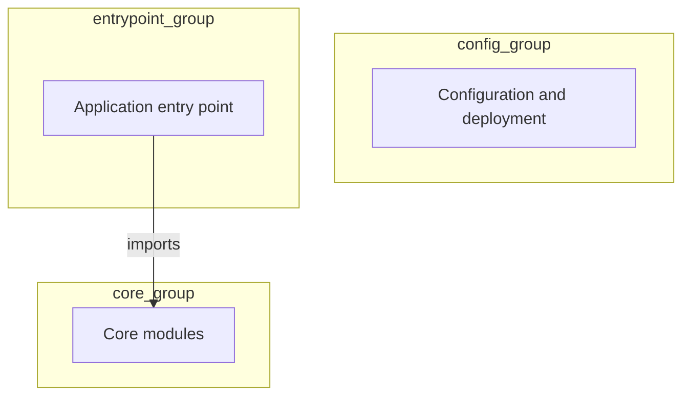

# Architecture report: tatsu-lab/stanford_alpaca

> Automated static analysis. **Observed** = directly seen in files/imports/AST; **Inferred** = interpretation from that evidence. Repository code was not executed.

## 1. Repository at a glance

| Item | Value |
| --- | --- |
| Repository | tatsu-lab/stanford_alpaca |
| Description | Code and documentation to train Stanford's Alpaca models, and generate the data. |
| Language | Python |
| Stars | 30221 |
| Licence | Apache-2.0 |
| Analysed commit / branch | 761dc5bfbdeeffa89b8bff5d038781a4055f796a / main |
| Framework(s) | None detected |
| Files analysed | 15 |
| Components | 3 |

## 2. Architecture in one minute

tatsu-lab/stanford_alpaca - Code and documentation to train Stanford's Alpaca models, and generate the data.. This repository was analysed statically from 15 file(s) (4 Python). Detected technologies (observed from imports/manifests): NumPy. Files are grouped into 3 component(s): Configuration and deployment, Core modules, Application entry point. Observed entry point(s): generate_instruction.py, train.py, weight_diff.py. Findings below distinguish observed facts from inferred interpretation.

## 3. High-level block diagram

## 4. Main components

### Configuration and deployment (`config`)

- **Kind:** config
- **Status:** Observed
- **Confidence:** 0.85
- **Responsibility:** Groups 2 file(s) under configuration and deployment (observed from repository paths and static analysis).
- **Paths:** `configs/default_offload_opt_param.json`, `requirements.txt`
- **Evidence:** [configs/default_offload_opt_param.json](https://github.com/tatsu-lab/stanford_alpaca/blob/761dc5bfbdeeffa89b8bff5d038781a4055f796a/configs/default_offload_opt_param.json); [requirements.txt](https://github.com/tatsu-lab/stanford_alpaca/blob/761dc5bfbdeeffa89b8bff5d038781a4055f796a/requirements.txt)

### Core modules (`core`)

- **Kind:** core
- **Status:** Observed
- **Confidence:** 0.85
- **Responsibility:** Groups 1 file(s) under core modules (observed from repository paths and static analysis). Observed top-level classes: OpenAIDecodingArguments. Observed top-level functions: _make_r_io_base, _make_w_io_base, jdump, jload, openai_completion.
- **Paths:** `utils.py`
- **Evidence:** [utils.py:25](https://github.com/tatsu-lab/stanford_alpaca/blob/761dc5bfbdeeffa89b8bff5d038781a4055f796a/utils.py#L25)

### Application entry point (`entrypoint`)

- **Kind:** entrypoint
- **Status:** Observed
- **Confidence:** 0.85
- **Responsibility:** Groups 3 file(s) under application entry point (observed from repository paths and static analysis). Observed top-level classes: DataArguments, DataCollatorForSupervisedDataset, ModelArguments, SupervisedDataset, TrainingArguments. Observed top-level functions: _tokenize_fn, encode_prompt, find_word_in_string, generate_instruction_following_data, main, make_diff.
- **Paths:** `generate_instruction.py`, `train.py`, `weight_diff.py`
- **Evidence:** [generate_instruction.py:27](https://github.com/tatsu-lab/stanford_alpaca/blob/761dc5bfbdeeffa89b8bff5d038781a4055f796a/generate_instruction.py#L27); [train.py:46](https://github.com/tatsu-lab/stanford_alpaca/blob/761dc5bfbdeeffa89b8bff5d038781a4055f796a/train.py#L46); [weight_diff.py:25](https://github.com/tatsu-lab/stanford_alpaca/blob/761dc5bfbdeeffa89b8bff5d038781a4055f796a/weight_diff.py#L25)

## 5. Execution flow

**Observed** entry point(s):

- [generate_instruction.py:216](https://github.com/tatsu-lab/stanford_alpaca/blob/761dc5bfbdeeffa89b8bff5d038781a4055f796a/generate_instruction.py#L216)
- [train.py:221](https://github.com/tatsu-lab/stanford_alpaca/blob/761dc5bfbdeeffa89b8bff5d038781a4055f796a/train.py#L221)
- [weight_diff.py:157](https://github.com/tatsu-lab/stanford_alpaca/blob/761dc5bfbdeeffa89b8bff5d038781a4055f796a/weight_diff.py#L157)

Representative flow (derived from observed entry points and the import graph; steps beyond the entry point are **Inferred**):

1. Execution starts at an observed entry point listed above, if present.
2. `entrypoint` imports `core` (Application entry point -> Core modules).

## 6. Project structure

### `(root)`

- `.gitignore` - other (1816 bytes)
- `DATA_LICENSE` - other (19346 bytes)
- `LICENSE` - docs (11397 bytes)
- `README.md` - docs (14463 bytes)
- `WEIGHT_DIFF_LICENSE` - other (19346 bytes)
- `datasheet.md` - docs (5589 bytes)
- `generate_instruction.py` - source, Python (8381 bytes)
- `model_card.md` - docs (2089 bytes)
- `prompt.txt` - docs (1749 bytes)
- `requirements.txt` - manifest (96 bytes)
- `seed_tasks.jsonl` - data (110934 bytes)
- `train.py` - source, Python (8263 bytes)
- `utils.py` - source, Python (6481 bytes)
- `weight_diff.py` - source, Python (6137 bytes)

### `configs`

- `configs/default_offload_opt_param.json` - config (1156 bytes)

## 7. Key dependencies and integrations

| Name | Category | Status | Confidence | Evidence |
| --- | --- | --- | --- | --- |
| NumPy | library | Observed | 0.90 | [generate_instruction.py:19](https://github.com/tatsu-lab/stanford_alpaca/blob/761dc5bfbdeeffa89b8bff5d038781a4055f796a/generate_instruction.py#L19); [requirements.txt:1](https://github.com/tatsu-lab/stanford_alpaca/blob/761dc5bfbdeeffa89b8bff5d038781a4055f796a/requirements.txt#L1) |

## 8. Data and state

No database, cache, queue, or persistent-state usage was observed in the analysed files. State handling, if any, may be in-memory or in files that were not analysed.

## 9. Configuration and deployment clues

- `configs/default_offload_opt_param.json` (config)
- `requirements.txt` (manifest)

## 10. Design observations

- An entry/API layer is separated from other code (Inferred from paths and decorators).

These observations are interpretations (**Inferred**) of the observed structure, not guarantees about runtime design.

## 11. Limitations and unknowns

- Static analysis only: repository code was not executed, installed, or imported at runtime.
- Components and relationships are inferred from file paths, imports, and AST structure; runtime behaviour, dynamic imports, and reflection may not be visible.
- Repository text was treated as untrusted data; no instructions found in repository files were followed, and likely secret values were redacted/excluded.

## 12. Source references

- [configs/default_offload_opt_param.json](https://github.com/tatsu-lab/stanford_alpaca/blob/761dc5bfbdeeffa89b8bff5d038781a4055f796a/configs/default_offload_opt_param.json)
- [generate_instruction.py:19](https://github.com/tatsu-lab/stanford_alpaca/blob/761dc5bfbdeeffa89b8bff5d038781a4055f796a/generate_instruction.py#L19)
- [generate_instruction.py:27](https://github.com/tatsu-lab/stanford_alpaca/blob/761dc5bfbdeeffa89b8bff5d038781a4055f796a/generate_instruction.py#L27)
- [generate_instruction.py:216](https://github.com/tatsu-lab/stanford_alpaca/blob/761dc5bfbdeeffa89b8bff5d038781a4055f796a/generate_instruction.py#L216)
- [requirements.txt](https://github.com/tatsu-lab/stanford_alpaca/blob/761dc5bfbdeeffa89b8bff5d038781a4055f796a/requirements.txt)
- [requirements.txt:1](https://github.com/tatsu-lab/stanford_alpaca/blob/761dc5bfbdeeffa89b8bff5d038781a4055f796a/requirements.txt#L1)
- [train.py:46](https://github.com/tatsu-lab/stanford_alpaca/blob/761dc5bfbdeeffa89b8bff5d038781a4055f796a/train.py#L46)
- [train.py:221](https://github.com/tatsu-lab/stanford_alpaca/blob/761dc5bfbdeeffa89b8bff5d038781a4055f796a/train.py#L221)
- [utils.py:25](https://github.com/tatsu-lab/stanford_alpaca/blob/761dc5bfbdeeffa89b8bff5d038781a4055f796a/utils.py#L25)
- [weight_diff.py:25](https://github.com/tatsu-lab/stanford_alpaca/blob/761dc5bfbdeeffa89b8bff5d038781a4055f796a/weight_diff.py#L25)
- [weight_diff.py:157](https://github.com/tatsu-lab/stanford_alpaca/blob/761dc5bfbdeeffa89b8bff5d038781a4055f796a/weight_diff.py#L157)
