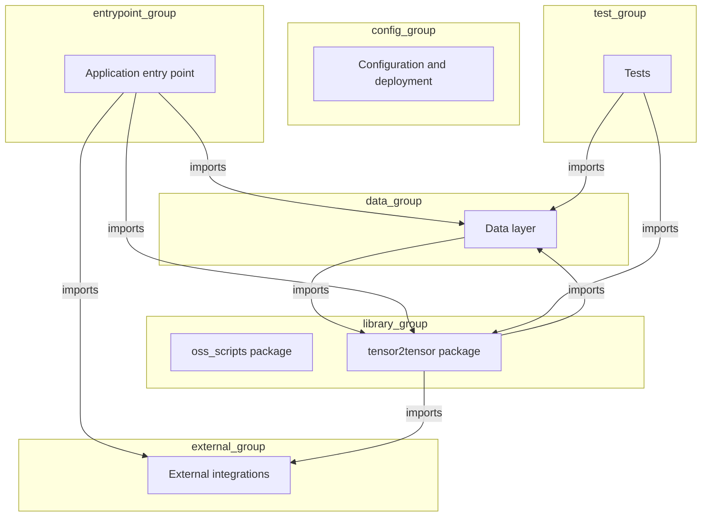

# Architecture report: tensorflow/tensor2tensor

> Automated static analysis. **Observed** = directly seen in files/imports/AST; **Inferred** = interpretation from that evidence. Repository code was not executed.

## 1. Repository at a glance

| Item | Value |
| --- | --- |
| Repository | tensorflow/tensor2tensor |
| Description | Library of deep learning models and datasets designed to make deep learning more accessible and accelerate ML research. |
| Language | Python |
| Stars | 17471 |
| Licence | Apache-2.0 |
| Analysed commit / branch | bafdc1b67730430d38d6ab802cbd51f9d053ba2e / master |
| Framework(s) | Flask |
| Files analysed | 545 |
| Components | 7 |

## 2. Architecture in one minute

tensorflow/tensor2tensor - Library of deep learning models and datasets designed to make deep learning more accessible and accelerate ML research.. This repository was analysed statically from 545 file(s) (452 Python). Detected technologies (observed from imports/manifests): Flask, aiohttp, Gunicorn, NumPy, requests, setuptools. Files are grouped into 7 component(s): Configuration and deployment, Data layer, Application entry point, External integrations, oss_scripts package, tensor2tensor package, Tests. Observed entry point(s): tensor2tensor/bin/build_vocab.py, tensor2tensor/bin/make_tf_configs.py, tensor2tensor/bin/t2t_attack.py. Findings below distinguish observed facts from inferred interpretation.

## 3. High-level block diagram

## 4. Main components

### Configuration and deployment (`config`)

- **Kind:** config
- **Status:** Observed
- **Confidence:** 0.85
- **Responsibility:** Groups 5 file(s) under configuration and deployment (observed from repository paths and static analysis).
- **Paths:** `floyd.yml`, `setup.py`, `tensor2tensor/insights/polymer/bower.json`, `tensor2tensor/test_data/example_usr_dir/requirements.txt`, `tensor2tensor/test_data/transformer_test_ckpt/hparams.json`
- **Evidence:** [floyd.yml](https://github.com/tensorflow/tensor2tensor/blob/bafdc1b67730430d38d6ab802cbd51f9d053ba2e/floyd.yml); [setup.py](https://github.com/tensorflow/tensor2tensor/blob/bafdc1b67730430d38d6ab802cbd51f9d053ba2e/setup.py); [tensor2tensor/insights/polymer/bower.json](https://github.com/tensorflow/tensor2tensor/blob/bafdc1b67730430d38d6ab802cbd51f9d053ba2e/tensor2tensor/insights/polymer/bower.json); [tensor2tensor/test_data/example_usr_dir/requirements.txt](https://github.com/tensorflow/tensor2tensor/blob/bafdc1b67730430d38d6ab802cbd51f9d053ba2e/tensor2tensor/test_data/example_usr_dir/requirements.txt); [tensor2tensor/test_data/transformer_test_ckpt/hparams.json](https://github.com/tensorflow/tensor2tensor/blob/bafdc1b67730430d38d6ab802cbd51f9d053ba2e/tensor2tensor/test_data/transformer_test_ckpt/hparams.json)

### Data layer (`data_layer`)

- **Kind:** data
- **Status:** Observed
- **Confidence:** 0.85
- **Responsibility:** Groups 78 file(s) under data layer (observed from repository paths and static analysis). Observed top-level classes: AbstractGAN, AddCombiner, Aligned, AttendToEncoderLayerBase, AttendToEncoderTopDownLayer, AttentionLM. Observed top-level functions: _add_attend_to_encoder_cache, _apply_layer_norm, _apply_nas_branch, _capped_double_heads, _dropout_lstm_cell, _ffn_layer_multi_inputs.
- **Paths:** `tensor2tensor/models/__init__.py`, `tensor2tensor/models/basic.py`, `tensor2tensor/models/bytenet.py`, `tensor2tensor/models/distillation.py`, `tensor2tensor/models/evolved_transformer.py`, `tensor2tensor/models/image_transformer.py`, `tensor2tensor/models/image_transformer_2d.py`, `tensor2tensor/models/lstm.py`, `tensor2tensor/models/mtf_image_transformer.py`, `tensor2tensor/models/mtf_resnet.py`, `tensor2tensor/models/mtf_transformer.py`, `tensor2tensor/models/mtf_transformer2.py`, `tensor2tensor/models/neural_architecture_search/__init__.py`, `tensor2tensor/models/neural_architecture_search/nas_layers.py`, `tensor2tensor/models/neural_architecture_search/nas_model.py`, `tensor2tensor/models/neural_assistant.py`, `tensor2tensor/models/neural_gpu.py`, `tensor2tensor/models/research/__init__.py`, `tensor2tensor/models/research/adafactor_experiments.py`, `tensor2tensor/models/research/aligned.py`, `tensor2tensor/models/research/attention_lm.py`, `tensor2tensor/models/research/attention_lm_moe.py`, `tensor2tensor/models/research/autoencoders.py`, `tensor2tensor/models/research/cycle_gan.py`, `tensor2tensor/models/research/gene_expression.py`, `tensor2tensor/models/research/glow.py`, `tensor2tensor/models/research/glow_init_hook.py`, `tensor2tensor/models/research/glow_ops.py`, `tensor2tensor/models/research/lm_experiments.py`, `tensor2tensor/models/research/moe.py`, `tensor2tensor/models/research/moe_experiments.py`, `tensor2tensor/models/research/multiquery_paper.py`, `tensor2tensor/models/research/neural_stack.py`, `tensor2tensor/models/research/residual_shuffle_exchange.py`, `tensor2tensor/models/research/rl.py`, `tensor2tensor/models/research/shuffle_network.py`, `tensor2tensor/models/research/similarity_transformer.py`, `tensor2tensor/models/research/super_lm.py`, `tensor2tensor/models/research/transformer_aux.py`, `tensor2tensor/models/research/transformer_moe.py`, `tensor2tensor/models/research/transformer_nat.py`, `tensor2tensor/models/research/transformer_parallel.py`, `tensor2tensor/models/research/transformer_revnet.py`, `tensor2tensor/models/research/transformer_seq2edits.py`, `tensor2tensor/models/research/transformer_sketch.py`, `tensor2tensor/models/research/transformer_symshard.py`, `tensor2tensor/models/research/transformer_vae.py`, `tensor2tensor/models/research/transformer_vae_flow_prior.py`, `tensor2tensor/models/research/transformer_vae_flow_prior_ops.py`, `tensor2tensor/models/research/universal_transformer.py`, `tensor2tensor/models/research/universal_transformer_util.py`, `tensor2tensor/models/research/vqa_attention.py`, `tensor2tensor/models/research/vqa_recurrent_self_attention.py`, `tensor2tensor/models/research/vqa_self_attention.py`, `tensor2tensor/models/resnet.py`, `tensor2tensor/models/revnet.py`, `tensor2tensor/models/shake_shake.py`, `tensor2tensor/models/slicenet.py`, `tensor2tensor/models/text_cnn.py`, `tensor2tensor/models/transformer.py`, `tensor2tensor/models/vanilla_gan.py`, `tensor2tensor/models/video/__init__.py`, `tensor2tensor/models/video/base.py`, `tensor2tensor/models/video/base_vae.py`, `tensor2tensor/models/video/basic_deterministic.py`, `tensor2tensor/models/video/basic_deterministic_params.py`, `tensor2tensor/models/video/basic_recurrent.py`, `tensor2tensor/models/video/basic_stochastic.py`, `tensor2tensor/models/video/emily.py`, `tensor2tensor/models/video/epva.py`, `tensor2tensor/models/video/epva_params.py`, `tensor2tensor/models/video/next_frame_glow.py`, `tensor2tensor/models/video/savp.py`, `tensor2tensor/models/video/savp_params.py`, `tensor2tensor/models/video/sv2p.py`, `tensor2tensor/models/video/sv2p_params.py`, `tensor2tensor/models/video/tests_utils.py`, `tensor2tensor/models/xception.py`
- **Evidence:** [tensor2tensor/models/__init__.py:98](https://github.com/tensorflow/tensor2tensor/blob/bafdc1b67730430d38d6ab802cbd51f9d053ba2e/tensor2tensor/models/__init__.py#L98); [tensor2tensor/models/basic.py:31](https://github.com/tensorflow/tensor2tensor/blob/bafdc1b67730430d38d6ab802cbd51f9d053ba2e/tensor2tensor/models/basic.py#L31); [tensor2tensor/models/bytenet.py:31](https://github.com/tensorflow/tensor2tensor/blob/bafdc1b67730430d38d6ab802cbd51f9d053ba2e/tensor2tensor/models/bytenet.py#L31); [tensor2tensor/models/distillation.py:30](https://github.com/tensorflow/tensor2tensor/blob/bafdc1b67730430d38d6ab802cbd51f9d053ba2e/tensor2tensor/models/distillation.py#L30); [tensor2tensor/models/evolved_transformer.py:50](https://github.com/tensorflow/tensor2tensor/blob/bafdc1b67730430d38d6ab802cbd51f9d053ba2e/tensor2tensor/models/evolved_transformer.py#L50); [tensor2tensor/models/image_transformer.py:40](https://github.com/tensorflow/tensor2tensor/blob/bafdc1b67730430d38d6ab802cbd51f9d053ba2e/tensor2tensor/models/image_transformer.py#L40); [tensor2tensor/models/image_transformer_2d.py:41](https://github.com/tensorflow/tensor2tensor/blob/bafdc1b67730430d38d6ab802cbd51f9d053ba2e/tensor2tensor/models/image_transformer_2d.py#L41); [tensor2tensor/models/lstm.py:34](https://github.com/tensorflow/tensor2tensor/blob/bafdc1b67730430d38d6ab802cbd51f9d053ba2e/tensor2tensor/models/lstm.py#L34)

### Application entry point (`entrypoint`)

- **Kind:** entrypoint
- **Status:** Observed
- **Confidence:** 0.85
- **Responsibility:** Groups 38 file(s) under application entry point (observed from repository paths and static analysis). Observed application object created via Flask. Observed top-level classes: DebugFrontendApplication, NextFrameGlowTest, NumpySerializationFix, PlayerEnv, SimAndRealEnvPlayer, SingleEnvPlayer. Observed top-level functions: _get_hparams_path, aggregate_stats, checkpoint_exists, collect_frames_for_random_starts, concat_tfrecord_files, create_attack.
- **Paths:** `tensor2tensor/bin/build_vocab.py`, `tensor2tensor/bin/make_tf_configs.py`, `tensor2tensor/bin/t2t_attack.py`, `tensor2tensor/bin/t2t_avg_all.py`, `tensor2tensor/bin/t2t_bleu.py`, `tensor2tensor/bin/t2t_datagen.py`, `tensor2tensor/bin/t2t_decoder.py`, `tensor2tensor/bin/t2t_distill.py`, `tensor2tensor/bin/t2t_eval.py`, `tensor2tensor/bin/t2t_prune.py`, `tensor2tensor/bin/t2t_trainer.py`, `tensor2tensor/bin/t2t_translate_all.py`, `tensor2tensor/data_generators/inspect_tfrecord.py`, `tensor2tensor/data_generators/text_encoder_build_subword.py`, `tensor2tensor/data_generators/wikisum/generate_vocab.py`, `tensor2tensor/data_generators/wikisum/get_references_commoncrawl.py`, `tensor2tensor/data_generators/wikisum/get_references_web.py`, `tensor2tensor/data_generators/wikisum/get_references_web_single_group.py`, `tensor2tensor/data_generators/wikisum/parallel_launch.py`, `tensor2tensor/data_generators/wikisum/produce_examples.py`, `tensor2tensor/data_generators/wikisum/validate_data.py`, `tensor2tensor/insights/server.py`, `tensor2tensor/models/video/nfg_interpolate.py`, `tensor2tensor/models/video/nfg_test_utils.py`, `tensor2tensor/rl/datagen_with_agent.py`, `tensor2tensor/rl/evaluator.py`, `tensor2tensor/rl/player.py`, `tensor2tensor/rl/trainer_model_based.py`, `tensor2tensor/rl/trainer_model_based_agent_only.py`, `tensor2tensor/rl/trainer_model_free.py`, `tensor2tensor/serving/export.py`, `tensor2tensor/serving/query.py`, `tensor2tensor/utils/avg_checkpoints.py`, `tensor2tensor/utils/compute_video_metrics.py`, `tensor2tensor/utils/get_rouge.py`, `tensor2tensor/utils/video/prediction2gif.py`, `tensor2tensor/utils/video/reward_confusion.py`, `tensor2tensor/utils/video2gif.py`
- **Evidence:** [tensor2tensor/bin/build_vocab.py:50](https://github.com/tensorflow/tensor2tensor/blob/bafdc1b67730430d38d6ab802cbd51f9d053ba2e/tensor2tensor/bin/build_vocab.py#L50); [tensor2tensor/bin/make_tf_configs.py:42](https://github.com/tensorflow/tensor2tensor/blob/bafdc1b67730430d38d6ab802cbd51f9d053ba2e/tensor2tensor/bin/make_tf_configs.py#L42); [tensor2tensor/bin/t2t_attack.py:72](https://github.com/tensorflow/tensor2tensor/blob/bafdc1b67730430d38d6ab802cbd51f9d053ba2e/tensor2tensor/bin/t2t_attack.py#L72); [tensor2tensor/bin/t2t_avg_all.py:43](https://github.com/tensorflow/tensor2tensor/blob/bafdc1b67730430d38d6ab802cbd51f9d053ba2e/tensor2tensor/bin/t2t_avg_all.py#L43); [tensor2tensor/bin/t2t_bleu.py:91](https://github.com/tensorflow/tensor2tensor/blob/bafdc1b67730430d38d6ab802cbd51f9d053ba2e/tensor2tensor/bin/t2t_bleu.py#L91); [tensor2tensor/bin/t2t_datagen.py:154](https://github.com/tensorflow/tensor2tensor/blob/bafdc1b67730430d38d6ab802cbd51f9d053ba2e/tensor2tensor/bin/t2t_datagen.py#L154); [tensor2tensor/bin/t2t_decoder.py:66](https://github.com/tensorflow/tensor2tensor/blob/bafdc1b67730430d38d6ab802cbd51f9d053ba2e/tensor2tensor/bin/t2t_decoder.py#L66); [tensor2tensor/bin/t2t_distill.py:59](https://github.com/tensorflow/tensor2tensor/blob/bafdc1b67730430d38d6ab802cbd51f9d053ba2e/tensor2tensor/bin/t2t_distill.py#L59)

### External integrations (`external_integrations`)

- **Kind:** external
- **Status:** Inferred
- **Confidence:** 0.70
- **Responsibility:** Groups 0 file(s) under external integrations (observed from repository paths and static analysis).
- **Evidence:** [tensor2tensor/data_generators/algorithmic_math_two_variables.py:47](https://github.com/tensorflow/tensor2tensor/blob/bafdc1b67730430d38d6ab802cbd51f9d053ba2e/tensor2tensor/data_generators/algorithmic_math_two_variables.py#L47); [tensor2tensor/data_generators/allen_brain.py:36](https://github.com/tensorflow/tensor2tensor/blob/bafdc1b67730430d38d6ab802cbd51f9d053ba2e/tensor2tensor/data_generators/allen_brain.py#L36); [tensor2tensor/data_generators/babi_qa.py:37](https://github.com/tensorflow/tensor2tensor/blob/bafdc1b67730430d38d6ab802cbd51f9d053ba2e/tensor2tensor/data_generators/babi_qa.py#L37); [tensor2tensor/data_generators/dialog_abstract.py:27](https://github.com/tensorflow/tensor2tensor/blob/bafdc1b67730430d38d6ab802cbd51f9d053ba2e/tensor2tensor/data_generators/dialog_abstract.py#L27); [tensor2tensor/data_generators/generator_utils.py:32](https://github.com/tensorflow/tensor2tensor/blob/bafdc1b67730430d38d6ab802cbd51f9d053ba2e/tensor2tensor/data_generators/generator_utils.py#L32); [tensor2tensor/data_generators/wikisum/get_references_web_single_group.py:33](https://github.com/tensorflow/tensor2tensor/blob/bafdc1b67730430d38d6ab802cbd51f9d053ba2e/tensor2tensor/data_generators/wikisum/get_references_web_single_group.py#L33)

### oss_scripts package (`oss_scripts`)

- **Kind:** library
- **Status:** Observed
- **Confidence:** 0.85
- **Responsibility:** Groups 4 file(s) under oss_scripts package (observed from repository paths and static analysis).
- **Paths:** `oss_scripts/oss_integration_test.sh`, `oss_scripts/oss_pip_install.sh`, `oss_scripts/oss_release.sh`, `oss_scripts/oss_tests.sh`
- **Evidence:** [oss_scripts/oss_integration_test.sh](https://github.com/tensorflow/tensor2tensor/blob/bafdc1b67730430d38d6ab802cbd51f9d053ba2e/oss_scripts/oss_integration_test.sh); [oss_scripts/oss_pip_install.sh](https://github.com/tensorflow/tensor2tensor/blob/bafdc1b67730430d38d6ab802cbd51f9d053ba2e/oss_scripts/oss_pip_install.sh); [oss_scripts/oss_release.sh](https://github.com/tensorflow/tensor2tensor/blob/bafdc1b67730430d38d6ab802cbd51f9d053ba2e/oss_scripts/oss_release.sh); [oss_scripts/oss_tests.sh](https://github.com/tensorflow/tensor2tensor/blob/bafdc1b67730430d38d6ab802cbd51f9d053ba2e/oss_scripts/oss_tests.sh)

### tensor2tensor package (`tensor2tensor`)

- **Kind:** library
- **Status:** Observed
- **Confidence:** 0.85
- **Responsibility:** Groups 223 file(s) under tensor2tensor package (observed from repository paths and static analysis). Observed top-level classes: ActionDiscretizeWrapper, AdafactorOptimizer, AlgorithmicAdditionBinary40, AlgorithmicAdditionDecimal40, AlgorithmicCipherShift200, AlgorithmicCipherShift5. Observed top-level functions: PIL_Image, PIL_ImageDraw, _add_shard_to_filename, _add_variable_proxy_methods, _apply_with_random_selector, _are_shapes_fully_defined.
- **Paths:** `tensor2tensor/__init__.py`, `tensor2tensor/bin/__init__.py`, `tensor2tensor/data_generators/__init__.py`, `tensor2tensor/data_generators/algorithmic.py`, `tensor2tensor/data_generators/algorithmic_math.py`, `tensor2tensor/data_generators/algorithmic_math_deepmind.py`, `tensor2tensor/data_generators/algorithmic_math_two_variables.py`, `tensor2tensor/data_generators/all_problems.py`, `tensor2tensor/data_generators/allen_brain.py`, `tensor2tensor/data_generators/audio.py`, `tensor2tensor/data_generators/audio_encoder.py`, `tensor2tensor/data_generators/babi_qa.py`, `tensor2tensor/data_generators/bair_robot_pushing.py`, `tensor2tensor/data_generators/celeba.py`, `tensor2tensor/data_generators/celebahq.py`, `tensor2tensor/data_generators/cifar.py`, `tensor2tensor/data_generators/cipher.py`, `tensor2tensor/data_generators/cleaner_en_xx.py`, `tensor2tensor/data_generators/cnn_dailymail.py`, `tensor2tensor/data_generators/cola.py`, `tensor2tensor/data_generators/common_voice.py`, `tensor2tensor/data_generators/conll_ner.py`, `tensor2tensor/data_generators/desc2code.py`, `tensor2tensor/data_generators/dialog_abstract.py`, `tensor2tensor/data_generators/dialog_cornell.py`, `tensor2tensor/data_generators/dialog_dailydialog.py`, `tensor2tensor/data_generators/dialog_opensubtitles.py`, `tensor2tensor/data_generators/dialog_personachat.py`, `tensor2tensor/data_generators/dna_encoder.py`, `tensor2tensor/data_generators/enwik8.py`, `tensor2tensor/data_generators/fsns.py`, `tensor2tensor/data_generators/function_docstring.py`, `tensor2tensor/data_generators/gene_expression.py`, `tensor2tensor/data_generators/generator_utils.py`, `tensor2tensor/data_generators/google_robot_pushing.py`, `tensor2tensor/data_generators/gym_env.py`, `tensor2tensor/data_generators/ice_parsing.py`, `tensor2tensor/data_generators/image_lsun.py`, `tensor2tensor/data_generators/image_utils.py`, `tensor2tensor/data_generators/imagenet.py`, `tensor2tensor/data_generators/imdb.py`, `tensor2tensor/data_generators/lambada.py`, `tensor2tensor/data_generators/librispeech.py`, `tensor2tensor/data_generators/lm1b.py`, `tensor2tensor/data_generators/lm1b_imdb.py`, `tensor2tensor/data_generators/lm1b_mnli.py`, `tensor2tensor/data_generators/mnist.py`, `tensor2tensor/data_generators/moving_mnist.py`, `tensor2tensor/data_generators/mrpc.py`, `tensor2tensor/data_generators/mscoco.py`, `tensor2tensor/data_generators/multi_problem.py`, `tensor2tensor/data_generators/multi_problem_v2.py`, `tensor2tensor/data_generators/multinli.py`, `tensor2tensor/data_generators/ocr.py`, `tensor2tensor/data_generators/ops/subword_text_encoder.h`, `tensor2tensor/data_generators/paraphrase_ms_coco.py`, `tensor2tensor/data_generators/pointer_generator_word.py`, `tensor2tensor/data_generators/problem.py`, `tensor2tensor/data_generators/problem_hparams.py`, `tensor2tensor/data_generators/program_search.py`, `tensor2tensor/data_generators/ptb.py`, `tensor2tensor/data_generators/qnli.py`, `tensor2tensor/data_generators/quora_qpairs.py`, `tensor2tensor/data_generators/rte.py`, `tensor2tensor/data_generators/scitail.py`, `tensor2tensor/data_generators/seq2edits.py`, `tensor2tensor/data_generators/snli.py`, `tensor2tensor/data_generators/speech_recognition.py`, `tensor2tensor/data_generators/squad.py`, `tensor2tensor/data_generators/sst_binary.py`, `tensor2tensor/data_generators/stanford_nli.py`, `tensor2tensor/data_generators/style_transfer.py`, `tensor2tensor/data_generators/subject_verb_agreement.py`, `tensor2tensor/data_generators/text_encoder.py`, `tensor2tensor/data_generators/text_problems.py`, `tensor2tensor/data_generators/timeseries.py`, `tensor2tensor/data_generators/timeseries_data_generator.py`, `tensor2tensor/data_generators/tokenizer.py`, `tensor2tensor/data_generators/transduction_problems.py`, `tensor2tensor/data_generators/translate.py`, `tensor2tensor/data_generators/translate_encs.py`, `tensor2tensor/data_generators/translate_encs_cubbitt.py`, `tensor2tensor/data_generators/translate_ende.py`, `tensor2tensor/data_generators/translate_enes.py`, `tensor2tensor/data_generators/translate_enet.py`, `tensor2tensor/data_generators/translate_enfr.py`, `tensor2tensor/data_generators/translate_enid.py`, `tensor2tensor/data_generators/translate_enmk.py`, `tensor2tensor/data_generators/translate_enro.py`, `tensor2tensor/data_generators/translate_entn.py`, `tensor2tensor/data_generators/translate_envi.py`, `tensor2tensor/data_generators/translate_enzh.py`, `tensor2tensor/data_generators/video_generated.py`, `tensor2tensor/data_generators/video_utils.py`, `tensor2tensor/data_generators/vqa.py`, `tensor2tensor/data_generators/vqa_utils.py`, `tensor2tensor/data_generators/wiki.py`, `tensor2tensor/data_generators/wiki_lm.py`, `tensor2tensor/data_generators/wiki_multi_problems.py`, `tensor2tensor/data_generators/wiki_revision.py`, `tensor2tensor/data_generators/wiki_revision_utils.py`, `tensor2tensor/data_generators/wikisum/__init__.py`, `tensor2tensor/data_generators/wikisum/delete_instances.sh`, `tensor2tensor/data_generators/wikisum/html.py`, `tensor2tensor/data_generators/wikisum/utils.py`, `tensor2tensor/data_generators/wikisum/wikisum.py`, `tensor2tensor/data_generators/wikitext103.py`, `tensor2tensor/data_generators/wnli.py`, `tensor2tensor/data_generators/wsj_parsing.py`, `tensor2tensor/data_generators/yelp_full.py`, `tensor2tensor/data_generators/yelp_polarity.py`, `tensor2tensor/envs/__init__.py`, `tensor2tensor/envs/env_problem.py`, `tensor2tensor/envs/env_problem_utils.py`, `tensor2tensor/envs/gym_env_problem.py`, `tensor2tensor/envs/gym_spaces_utils.py`, `tensor2tensor/envs/mujoco_problems.py`, `tensor2tensor/envs/rendered_env_problem.py`, `tensor2tensor/envs/tic_tac_toe_env.py`, `tensor2tensor/envs/tic_tac_toe_env_problem.py`, `tensor2tensor/envs/time_step.py`, `tensor2tensor/envs/trajectory.py`, `tensor2tensor/insights/__init__.py`, `tensor2tensor/insights/graph.py`, `tensor2tensor/insights/polymer/attention_visualization/attention-visualization.js`, `tensor2tensor/insights/polymer/common-types.js`, `tensor2tensor/insights/polymer/explore_view/explore-view.js`, `tensor2tensor/insights/polymer/graph_visualization/graph-visualization.js`, `tensor2tensor/insights/polymer/insights_app/insights-app.js`, `tensor2tensor/insights/polymer/language_selector/language-selector-content.js`, `tensor2tensor/insights/polymer/language_selector/language-selector.js`, `tensor2tensor/insights/polymer/processing_visualization/processing-visualization.js`, `tensor2tensor/insights/polymer/query_card/query-card.js`, `tensor2tensor/insights/polymer/translation_result/translation-result.js`, `tensor2tensor/insights/query_processor.py`, `tensor2tensor/insights/transformer_model.py`, `tensor2tensor/layers/__init__.py`, `tensor2tensor/layers/area_attention.py`, `tensor2tensor/layers/common_audio.py`, `tensor2tensor/layers/common_hparams.py`, `tensor2tensor/layers/common_image_attention.py`, `tensor2tensor/layers/common_layers.py`, `tensor2tensor/layers/common_video.py`, `tensor2tensor/layers/discretization.py`, `tensor2tensor/layers/latent_layers.py`, `tensor2tensor/layers/message_passing_attention.py`, `tensor2tensor/layers/modalities.py`, `tensor2tensor/layers/ngram.py`, `tensor2tensor/layers/transformer_glow_layers.py`, `tensor2tensor/layers/transformer_glow_layers_ops.py`, `tensor2tensor/layers/transformer_layers.py`, `tensor2tensor/layers/transformer_memory.py`, `tensor2tensor/layers/vq_discrete.py`, `tensor2tensor/layers/vqa_layers.py`, `tensor2tensor/metrics/__init__.py`, `tensor2tensor/metrics/video_conditional_fvd.py`, `tensor2tensor/problems.py`, `tensor2tensor/problems_colab.py`, `tensor2tensor/rl/__init__.py`, `tensor2tensor/rl/dopamine_connector.py`, `tensor2tensor/rl/envs/__init__.py`, `tensor2tensor/rl/envs/in_graph_batch_env.py`, `tensor2tensor/rl/envs/py_func_batch_env.py`, `tensor2tensor/rl/envs/simulated_batch_env.py`, `tensor2tensor/rl/envs/simulated_batch_gym_env.py`, `tensor2tensor/rl/envs/tf_atari_wrappers.py`, `tensor2tensor/rl/gym_utils.py`, `tensor2tensor/rl/player_utils.py`, `tensor2tensor/rl/policy_learner.py`, `tensor2tensor/rl/ppo.py`, `tensor2tensor/rl/ppo_learner.py`, `tensor2tensor/rl/restarter.py`, `tensor2tensor/rl/rl_utils.py`, `tensor2tensor/rl/trainer_model_based_params.py`, `tensor2tensor/serving/__init__.py`, `tensor2tensor/serving/serving_utils.py`, `tensor2tensor/test_data/example_usr_dir/__init__.py`, `tensor2tensor/test_data/example_usr_dir/my_submodule.py`, `tensor2tensor/utils/__init__.py`, `tensor2tensor/utils/adafactor.py`, `tensor2tensor/utils/adv_attack_utils.py`, `tensor2tensor/utils/beam_search.py`, `tensor2tensor/utils/bleu_hook.py`, `tensor2tensor/utils/cloud_mlengine.py`, `tensor2tensor/utils/contrib.py`, `tensor2tensor/utils/data_reader.py`, `tensor2tensor/utils/decoding.py`, `tensor2tensor/utils/devices.py`, `tensor2tensor/utils/diet.py`, `tensor2tensor/utils/expert_utils.py`, `tensor2tensor/utils/flags.py`, `tensor2tensor/utils/get_cnndm_rouge.sh`, `tensor2tensor/utils/get_ende_bleu.sh`, `tensor2tensor/utils/hparam.py`, `tensor2tensor/utils/hparams_lib.py`, `tensor2tensor/utils/learning_rate.py`, `tensor2tensor/utils/metrics.py`, `tensor2tensor/utils/metrics_hook.py`, `tensor2tensor/utils/misc_utils.py`, `tensor2tensor/utils/mlperf_log.py`, `tensor2tensor/utils/mlperf_tags.py`, `tensor2tensor/utils/mtf_model.py`, `tensor2tensor/utils/multistep_optimizer.py`, `tensor2tensor/utils/multistep_with_adamoptimizer.py`, `tensor2tensor/utils/optimize.py`, `tensor2tensor/utils/partial_checkpoint_load_hook.py`, `tensor2tensor/utils/pruning_utils.py`, `tensor2tensor/utils/quantization.py`, `tensor2tensor/utils/registry.py`, `tensor2tensor/utils/restore_hook.py`, `tensor2tensor/utils/rouge.py`, `tensor2tensor/utils/sari_hook.py`, `tensor2tensor/utils/scheduled_sampling.py`, `tensor2tensor/utils/t2t_model.py`, `tensor2tensor/utils/trainer_lib.py`, `tensor2tensor/utils/update_ops_hook.py`, `tensor2tensor/utils/usr_dir.py`, `tensor2tensor/utils/video_metrics.py`, `tensor2tensor/utils/yellowfin.py`, `tensor2tensor/visualization/__init__.py`, `tensor2tensor/visualization/attention.js`, `tensor2tensor/visualization/attention.py`, `tensor2tensor/visualization/visualization.py`
- **Evidence:** [tensor2tensor/__init__.py](https://github.com/tensorflow/tensor2tensor/blob/bafdc1b67730430d38d6ab802cbd51f9d053ba2e/tensor2tensor/__init__.py); [tensor2tensor/bin/__init__.py](https://github.com/tensorflow/tensor2tensor/blob/bafdc1b67730430d38d6ab802cbd51f9d053ba2e/tensor2tensor/bin/__init__.py); [tensor2tensor/data_generators/__init__.py](https://github.com/tensorflow/tensor2tensor/blob/bafdc1b67730430d38d6ab802cbd51f9d053ba2e/tensor2tensor/data_generators/__init__.py); [tensor2tensor/data_generators/algorithmic.py:34](https://github.com/tensorflow/tensor2tensor/blob/bafdc1b67730430d38d6ab802cbd51f9d053ba2e/tensor2tensor/data_generators/algorithmic.py#L34); [tensor2tensor/data_generators/algorithmic_math.py:31](https://github.com/tensorflow/tensor2tensor/blob/bafdc1b67730430d38d6ab802cbd51f9d053ba2e/tensor2tensor/data_generators/algorithmic_math.py#L31); [tensor2tensor/data_generators/algorithmic_math_deepmind.py:40](https://github.com/tensorflow/tensor2tensor/blob/bafdc1b67730430d38d6ab802cbd51f9d053ba2e/tensor2tensor/data_generators/algorithmic_math_deepmind.py#L40); [tensor2tensor/data_generators/algorithmic_math_two_variables.py:60](https://github.com/tensorflow/tensor2tensor/blob/bafdc1b67730430d38d6ab802cbd51f9d053ba2e/tensor2tensor/data_generators/algorithmic_math_two_variables.py#L60); [tensor2tensor/data_generators/all_problems.py:114](https://github.com/tensorflow/tensor2tensor/blob/bafdc1b67730430d38d6ab802cbd51f9d053ba2e/tensor2tensor/data_generators/all_problems.py#L114)

### Tests (`tests`)

- **Kind:** test
- **Status:** Observed
- **Confidence:** 0.85
- **Responsibility:** Groups 127 file(s) under tests (observed from repository paths and static analysis). Observed routes: PATCH tensor2tensor.data_generators.paraphrase_ms_coco.ParaphraseGenerationProblem.prepare_data, PATCH tensor2tensor.data_generators.paraphrase_ms_coco.ParaphraseGenerationProblem.bidirectional, PATCH tensor2tensor.data_generators.paraphrase_ms_coco.ParaphraseGenerationProblem.prepare_data, PATCH tensor2tensor.data_generators.paraphrase_ms_coco.ParaphraseGenerationProblem.bidirectional. Observed top-level classes: AdafactorTest, AlgorithmicMathTest, AlgorithmicTest, AreaAttentionTest, AudioTe…
- **Paths:** `tensor2tensor/bin/t2t_trainer_test.py`, `tensor2tensor/data_generators/algorithmic_math_test.py`, `tensor2tensor/data_generators/algorithmic_test.py`, `tensor2tensor/data_generators/allen_brain_test.py`, `tensor2tensor/data_generators/audio_test.py`, `tensor2tensor/data_generators/celeba_test.py`, `tensor2tensor/data_generators/common_voice_test.py`, `tensor2tensor/data_generators/desc2code_test.py`, `tensor2tensor/data_generators/dna_encoder_test.py`, `tensor2tensor/data_generators/gene_expression_test.py`, `tensor2tensor/data_generators/generator_utils_test.py`, `tensor2tensor/data_generators/gym_env_test.py`, `tensor2tensor/data_generators/image_utils_test.py`, `tensor2tensor/data_generators/imagenet_test.py`, `tensor2tensor/data_generators/mscoco_test.py`, `tensor2tensor/data_generators/multi_problem_v2_test.py`, `tensor2tensor/data_generators/ops/pack_sequences_ops_test.py`, `tensor2tensor/data_generators/ops/subword_text_encoder_ops_test.py`, `tensor2tensor/data_generators/paraphrase_ms_coco_test.py`, `tensor2tensor/data_generators/problem_test.py`, `tensor2tensor/data_generators/program_search_test.py`, `tensor2tensor/data_generators/style_transfer_test.py`, `tensor2tensor/data_generators/text_encoder_test.py`, `tensor2tensor/data_generators/text_problems_test.py`, `tensor2tensor/data_generators/timeseries_data_generator_test.py`, `tensor2tensor/data_generators/timeseries_test.py`, `tensor2tensor/data_generators/tokenizer_test.py`, `tensor2tensor/data_generators/transduction_problems_test.py`, `tensor2tensor/data_generators/translate_ende_test.py`, `tensor2tensor/data_generators/translate_test.py`, `tensor2tensor/data_generators/video_utils_test.py`, `tensor2tensor/data_generators/wikisum/utils_test.py`, `tensor2tensor/envs/env_problem_utils_test.py`, `tensor2tensor/envs/gym_env_problem_test.py`, `tensor2tensor/envs/gym_spaces_utils_test.py`, `tensor2tensor/envs/mujoco_problems_test.py`, `tensor2tensor/envs/rendered_env_problem_test.py`, `tensor2tensor/envs/tic_tac_toe_env_problem_test.py`, `tensor2tensor/envs/tic_tac_toe_env_test.py`, `tensor2tensor/envs/time_step_test.py`, `tensor2tensor/envs/trajectory_test.py`, `tensor2tensor/layers/area_attention_test.py`, `tensor2tensor/layers/common_attention_test.py`, `tensor2tensor/layers/common_image_attention_test.py`, `tensor2tensor/layers/common_layers_test.py`, `tensor2tensor/layers/common_video_test.py`, `tensor2tensor/layers/discretization_test.py`, `tensor2tensor/layers/latent_layers_test.py`, `tensor2tensor/layers/modalities_test.py`, `tensor2tensor/layers/ngram_test.py`, `tensor2tensor/layers/transformer_glow_layers_ops_test.py`, `tensor2tensor/layers/transformer_glow_layers_test.py`, `tensor2tensor/layers/transformer_memory_test.py`, `tensor2tensor/metrics/video_conditional_fvd_test.py`, `tensor2tensor/models/basic_test.py`, `tensor2tensor/models/bytenet_test.py`, `tensor2tensor/models/evolved_transformer_test.py`, `tensor2tensor/models/image_transformer_2d_test.py`, `tensor2tensor/models/image_transformer_test.py`, `tensor2tensor/models/lstm_test.py`, `tensor2tensor/models/mtf_image_transformer_test.py`, `tensor2tensor/models/mtf_transformer_test.py`, `tensor2tensor/models/neural_architecture_search/nas_layers_test.py`, `tensor2tensor/models/neural_architecture_search/nas_model_test.py`, `tensor2tensor/models/neural_gpu_test.py`, `tensor2tensor/models/research/autoencoders_test.py`, `tensor2tensor/models/research/gene_expression_test.py`, `tensor2tensor/models/research/glow_ops_test.py`, `tensor2tensor/models/research/glow_test.py`, `tensor2tensor/models/research/neural_stack_test.py`, `tensor2tensor/models/research/transformer_aux_test.py`, `tensor2tensor/models/research/transformer_revnet_test.py`, `tensor2tensor/models/research/transformer_vae_test.py`, `tensor2tensor/models/research/universal_transformer_test.py`, `tensor2tensor/models/research/vqa_attention_test.py`, `tensor2tensor/models/resnet_test.py`, `tensor2tensor/models/revnet_test.py`, `tensor2tensor/models/slicenet_test.py`, `tensor2tensor/models/transformer_test.py`, `tensor2tensor/models/video/basic_deterministic_test.py`, `tensor2tensor/models/video/basic_recurrent_test.py`, `tensor2tensor/models/video/basic_stochastic_test.py`, `tensor2tensor/models/video/emily_test.py`, `tensor2tensor/models/video/nfg_conv3d_test.py`, `tensor2tensor/models/video/nfg_conv_lstm_test.py`, `tensor2tensor/models/video/nfg_conv_test.py`, `tensor2tensor/models/video/nfg_uncond_test.py`, `tensor2tensor/models/video/savp_test.py`, `tensor2tensor/models/video/sv2p_test.py`, `tensor2tensor/models/xception_test.py`, `tensor2tensor/problems_test.py`, `tensor2tensor/rl/batch_dqn_agent_test.py`, `tensor2tensor/rl/batch_runner_test.py`, `tensor2tensor/rl/evaluator_test.py`, `tensor2tensor/rl/gym_utils_test.py`, `tensor2tensor/rl/restarter_test.py`, `tensor2tensor/rl/trainer_model_based_recurrent_test.py`, `tensor2tensor/rl/trainer_model_based_stochastic_test.py`, `tensor2tensor/rl/trainer_model_based_sv2p_test.py`, `tensor2tensor/rl/trainer_model_based_test.py`, `tensor2tensor/rl/trainer_model_free_test.py`, `tensor2tensor/rl/trainer_model_free_tictactoe_test.py`, `tensor2tensor/utils/adafactor_test.py`, `tensor2tensor/utils/beam_search_test.py`, `tensor2tensor/utils/bleu_hook_test.py`, `tensor2tensor/utils/checkpoint_compatibility_test.py`, `tensor2tensor/utils/data_reader_test.py`, `tensor2tensor/utils/diet_test.py`, `tensor2tensor/utils/expert_utils_test.py`, `tensor2tensor/utils/hparam_test.py`, `tensor2tensor/utils/hparams_lib_test.py`, `tensor2tensor/utils/metrics_hook_test.py`, `tensor2tensor/utils/metrics_test.py`, `tensor2tensor/utils/misc_utils_test.py`, `tensor2tensor/utils/multistep_optimizer_test.py`, `tensor2tensor/utils/multistep_with_adamoptimizer_test.py`, `tensor2tensor/utils/optimize_test.py`, `tensor2tensor/utils/registry_test.py`, `tensor2tensor/utils/rouge_test.py`, `tensor2tensor/utils/sari_hook_test.py`, `tensor2tensor/utils/t2t_model_test.py`, `tensor2tensor/utils/test_utils.py`, `tensor2tensor/utils/test_utils_test.py`, `tensor2tensor/utils/trainer_lib_test.py`, `tensor2tensor/utils/video_metrics_test.py`, `tensor2tensor/utils/yellowfin_test.py`, `tensor2tensor/visualization/visualization_test.py`
- **Evidence:** [tensor2tensor/bin/t2t_trainer_test.py:29](https://github.com/tensorflow/tensor2tensor/blob/bafdc1b67730430d38d6ab802cbd51f9d053ba2e/tensor2tensor/bin/t2t_trainer_test.py#L29); [tensor2tensor/data_generators/algorithmic_math_test.py:29](https://github.com/tensorflow/tensor2tensor/blob/bafdc1b67730430d38d6ab802cbd51f9d053ba2e/tensor2tensor/data_generators/algorithmic_math_test.py#L29); [tensor2tensor/data_generators/algorithmic_test.py:28](https://github.com/tensorflow/tensor2tensor/blob/bafdc1b67730430d38d6ab802cbd51f9d053ba2e/tensor2tensor/data_generators/algorithmic_test.py#L28); [tensor2tensor/data_generators/allen_brain_test.py:37](https://github.com/tensorflow/tensor2tensor/blob/bafdc1b67730430d38d6ab802cbd51f9d053ba2e/tensor2tensor/data_generators/allen_brain_test.py#L37); [tensor2tensor/data_generators/audio_test.py:29](https://github.com/tensorflow/tensor2tensor/blob/bafdc1b67730430d38d6ab802cbd51f9d053ba2e/tensor2tensor/data_generators/audio_test.py#L29); [tensor2tensor/data_generators/celeba_test.py:30](https://github.com/tensorflow/tensor2tensor/blob/bafdc1b67730430d38d6ab802cbd51f9d053ba2e/tensor2tensor/data_generators/celeba_test.py#L30); [tensor2tensor/data_generators/common_voice_test.py:31](https://github.com/tensorflow/tensor2tensor/blob/bafdc1b67730430d38d6ab802cbd51f9d053ba2e/tensor2tensor/data_generators/common_voice_test.py#L31); [tensor2tensor/data_generators/desc2code_test.py:45](https://github.com/tensorflow/tensor2tensor/blob/bafdc1b67730430d38d6ab802cbd51f9d053ba2e/tensor2tensor/data_generators/desc2code_test.py#L45)

## 5. Execution flow

**Observed** entry point(s):

- [tensor2tensor/bin/build_vocab.py:70](https://github.com/tensorflow/tensor2tensor/blob/bafdc1b67730430d38d6ab802cbd51f9d053ba2e/tensor2tensor/bin/build_vocab.py#L70)
- [tensor2tensor/bin/make_tf_configs.py:109](https://github.com/tensorflow/tensor2tensor/blob/bafdc1b67730430d38d6ab802cbd51f9d053ba2e/tensor2tensor/bin/make_tf_configs.py#L109)
- [tensor2tensor/bin/t2t_attack.py:279](https://github.com/tensorflow/tensor2tensor/blob/bafdc1b67730430d38d6ab802cbd51f9d053ba2e/tensor2tensor/bin/t2t_attack.py#L279)
- [tensor2tensor/bin/t2t_avg_all.py:113](https://github.com/tensorflow/tensor2tensor/blob/bafdc1b67730430d38d6ab802cbd51f9d053ba2e/tensor2tensor/bin/t2t_avg_all.py#L113)
- [tensor2tensor/bin/t2t_bleu.py:173](https://github.com/tensorflow/tensor2tensor/blob/bafdc1b67730430d38d6ab802cbd51f9d053ba2e/tensor2tensor/bin/t2t_bleu.py#L173)
- [tensor2tensor/bin/t2t_datagen.py:304](https://github.com/tensorflow/tensor2tensor/blob/bafdc1b67730430d38d6ab802cbd51f9d053ba2e/tensor2tensor/bin/t2t_datagen.py#L304)
- [tensor2tensor/bin/t2t_decoder.py:213](https://github.com/tensorflow/tensor2tensor/blob/bafdc1b67730430d38d6ab802cbd51f9d053ba2e/tensor2tensor/bin/t2t_decoder.py#L213)
- [tensor2tensor/bin/t2t_distill.py:187](https://github.com/tensorflow/tensor2tensor/blob/bafdc1b67730430d38d6ab802cbd51f9d053ba2e/tensor2tensor/bin/t2t_distill.py#L187)
- [tensor2tensor/bin/t2t_eval.py:63](https://github.com/tensorflow/tensor2tensor/blob/bafdc1b67730430d38d6ab802cbd51f9d053ba2e/tensor2tensor/bin/t2t_eval.py#L63)
- [tensor2tensor/bin/t2t_prune.py:117](https://github.com/tensorflow/tensor2tensor/blob/bafdc1b67730430d38d6ab802cbd51f9d053ba2e/tensor2tensor/bin/t2t_prune.py#L117)
- [tensor2tensor/bin/t2t_trainer.py:425](https://github.com/tensorflow/tensor2tensor/blob/bafdc1b67730430d38d6ab802cbd51f9d053ba2e/tensor2tensor/bin/t2t_trainer.py#L425)
- [tensor2tensor/bin/t2t_trainer_test.py:46](https://github.com/tensorflow/tensor2tensor/blob/bafdc1b67730430d38d6ab802cbd51f9d053ba2e/tensor2tensor/bin/t2t_trainer_test.py#L46)

**Observed** routes (from decorators):

- `PATCH tensor2tensor.data_generators.paraphrase_ms_coco.ParaphraseGenerationProblem.prepare_data` -> `testBidirectionalTrue` in `tensor2tensor/data_generators/paraphrase_ms_coco_test.py:42`
- `PATCH tensor2tensor.data_generators.paraphrase_ms_coco.ParaphraseGenerationProblem.bidirectional` -> `testBidirectionalTrue` in `tensor2tensor/data_generators/paraphrase_ms_coco_test.py:42`
- `PATCH tensor2tensor.data_generators.paraphrase_ms_coco.ParaphraseGenerationProblem.prepare_data` -> `testBidirectionalFalse` in `tensor2tensor/data_generators/paraphrase_ms_coco_test.py:59`
- `PATCH tensor2tensor.data_generators.paraphrase_ms_coco.ParaphraseGenerationProblem.bidirectional` -> `testBidirectionalFalse` in `tensor2tensor/data_generators/paraphrase_ms_coco_test.py:59`

Representative flow (derived from observed entry points and the import graph; steps beyond the entry point are **Inferred**):

1. Execution starts at an observed entry point listed above, if present.
2. `data_layer` imports `tensor2tensor` (Data layer -> tensor2tensor package).
3. `entrypoint` imports `data_layer` (Application entry point -> Data layer).
4. `entrypoint` imports `external_integrations` (Application entry point -> External integrations).
5. `entrypoint` imports `tensor2tensor` (Application entry point -> tensor2tensor package).
6. `tensor2tensor` imports `data_layer` (tensor2tensor package -> Data layer).
7. `tensor2tensor` imports `external_integrations` (tensor2tensor package -> External integrations).
8. `tests` imports `data_layer` (Tests -> Data layer).
9. `tests` imports `tensor2tensor` (Tests -> tensor2tensor package).

## 6. Project structure

### `(root)`

- `.gitignore` - other (310 bytes)
- `.travis.yml` - ci, YAML (779 bytes)
- `AUTHORS` - other (311 bytes)
- `CONTRIBUTING.md` - docs (1280 bytes)
- `ISSUE_TEMPLATE.md` - docs (266 bytes)
- `LICENSE` - docs (11358 bytes)
- `README.md` - docs (19717 bytes)
- `floyd.yml` - config (34 bytes)
- `floyd_requirements.txt` - docs (14 bytes)
- `pylintrc` - other (7866 bytes)
- `setup.py` - manifest, Python (3405 bytes)

### `docs`

- `docs/cloud_mlengine.md` - docs (3467 bytes)
- `docs/cloud_tpu.md` - docs (1803 bytes)
- `docs/distributed_training.md` - docs (8904 bytes)
- `docs/index.md` - docs (5361 bytes)
- `docs/multi_problem.md` - docs (9794 bytes)
- `docs/new_model.md` - docs (4437 bytes)
- `docs/new_problem.md` - docs (8076 bytes)
- `docs/overview.md` - docs (8397 bytes)
- `docs/tutorials/asr_with_transformer.md` - docs (162 bytes)
- `docs/walkthrough.md` - docs (19717 bytes)

### `oss_scripts`

- `oss_scripts/oss_integration_test.sh` - source, Shell (1722 bytes)
- `oss_scripts/oss_pip_install.sh` - source, Shell (861 bytes)
- `oss_scripts/oss_release.sh` - source, Shell (892 bytes)
- `oss_scripts/oss_tests.sh` - source, Shell (6488 bytes)

### `tensor2tensor`

- `tensor2tensor/__init__.py` - source, Python (606 bytes)
- `tensor2tensor/bin/__init__.py` - source, Python (606 bytes)
- `tensor2tensor/bin/build_vocab.py` - source, Python (2202 bytes)
- `tensor2tensor/bin/make_tf_configs.py` - source, Python (3371 bytes)
- `tensor2tensor/bin/t2t-avg-all` - other (348 bytes)
- `tensor2tensor/bin/t2t-bleu` - other (340 bytes)
- `tensor2tensor/bin/t2t-datagen` - other (648 bytes)
- `tensor2tensor/bin/t2t-decoder` - other (348 bytes)
- `tensor2tensor/bin/t2t-eval` - other (665 bytes)
- `tensor2tensor/bin/t2t-exporter` - other (343 bytes)
- `tensor2tensor/bin/t2t-insights-server` - other (351 bytes)
- `tensor2tensor/bin/t2t-make-tf-configs` - other (364 bytes)
- `tensor2tensor/bin/t2t-query-server` - other (345 bytes)
- `tensor2tensor/bin/t2t-trainer` - other (751 bytes)
- `tensor2tensor/bin/t2t-translate-all` - other (367 bytes)
- `tensor2tensor/bin/t2t_attack.py` - source, Python (9996 bytes)
- `tensor2tensor/bin/t2t_avg_all.py` - source, Python (4419 bytes)
- `tensor2tensor/bin/t2t_bleu.py` - source, Python (7325 bytes)
- `tensor2tensor/bin/t2t_datagen.py` - source, Python (12728 bytes)
- `tensor2tensor/bin/t2t_decoder.py` - source, Python (7776 bytes)
- `tensor2tensor/bin/t2t_distill.py` - source, Python (6020 bytes)
- `tensor2tensor/bin/t2t_eval.py` - source, Python (2426 bytes)
- `tensor2tensor/bin/t2t_prune.py` - source, Python (4010 bytes)
- `tensor2tensor/bin/t2t_trainer.py` - source, Python (17106 bytes)
- `tensor2tensor/bin/t2t_trainer_test.py` - test, Python (1367 bytes)
- `tensor2tensor/bin/t2t_translate_all.py` - source, Python (4358 bytes)
- `tensor2tensor/data_generators/README.md` - docs (3420 bytes)
- `tensor2tensor/data_generators/__init__.py` - source, Python (606 bytes)
- `tensor2tensor/data_generators/algorithmic.py` - source, Python (17892 bytes)
- `tensor2tensor/data_generators/algorithmic_math.py` - source, Python (21962 bytes)
- `tensor2tensor/data_generators/algorithmic_math_deepmind.py` - source, Python (3366 bytes)
- `tensor2tensor/data_generators/algorithmic_math_test.py` - test, Python (3070 bytes)
- `tensor2tensor/data_generators/algorithmic_math_two_variables.py` - source, Python (4463 bytes)
- `tensor2tensor/data_generators/algorithmic_test.py` - test, Python (4382 bytes)
- `tensor2tensor/data_generators/all_problems.py` - source, Python (6231 bytes)
- `tensor2tensor/data_generators/allen_brain.py` - source, Python (14095 bytes)
- `tensor2tensor/data_generators/allen_brain_test.py` - test, Python (9434 bytes)
- `tensor2tensor/data_generators/audio.py` - source, Python (5858 bytes)
- `tensor2tensor/data_generators/audio_encoder.py` - source, Python (3034 bytes)
- `tensor2tensor/data_generators/audio_test.py` - test, Python (1932 bytes)
- `tensor2tensor/data_generators/babi_qa.py` - source, Python (16805 bytes)
- `tensor2tensor/data_generators/bair_robot_pushing.py` - source, Python (5942 bytes)
- `tensor2tensor/data_generators/celeba.py` - source, Python (10066 bytes)
- `tensor2tensor/data_generators/celeba_test.py` - test, Python (1818 bytes)
- `tensor2tensor/data_generators/celebahq.py` - source, Python (3918 bytes)
- `tensor2tensor/data_generators/cifar.py` - source, Python (17441 bytes)
- `tensor2tensor/data_generators/cipher.py` - source, Python (6292 bytes)
- `tensor2tensor/data_generators/cleaner_en_xx.py` - source, Python (6583 bytes)
- `tensor2tensor/data_generators/cnn_dailymail.py` - source, Python (11981 bytes)
- `tensor2tensor/data_generators/cola.py` - source, Python (3449 bytes)
- `tensor2tensor/data_generators/common_voice.py` - source, Python (8774 bytes)
- `tensor2tensor/data_generators/common_voice_test.py` - test, Python (1289 bytes)
- `tensor2tensor/data_generators/conll_ner.py` - source, Python (3318 bytes)
- `tensor2tensor/data_generators/desc2code.py` - source, Python (10092 bytes)
- `tensor2tensor/data_generators/desc2code_test.py` - test, Python (1743 bytes)
- `tensor2tensor/data_generators/dialog_abstract.py` - source, Python (13435 bytes)
- `tensor2tensor/data_generators/dialog_cornell.py` - source, Python (5559 bytes)
- `tensor2tensor/data_generators/dialog_dailydialog.py` - source, Python (4581 bytes)
- `tensor2tensor/data_generators/dialog_opensubtitles.py` - source, Python (7756 bytes)
- `tensor2tensor/data_generators/dialog_personachat.py` - source, Python (6938 bytes)
- `tensor2tensor/data_generators/dna_encoder.py` - source, Python (4021 bytes)
- `tensor2tensor/data_generators/dna_encoder_test.py` - test, Python (1758 bytes)
- `tensor2tensor/data_generators/enwik8.py` - source, Python (5524 bytes)
- `tensor2tensor/data_generators/fsns.py` - source, Python (3207 bytes)
- `tensor2tensor/data_generators/function_docstring.py` - source, Python (3544 bytes)
- `tensor2tensor/data_generators/gene_expression.py` - source, Python (9825 bytes)
- `tensor2tensor/data_generators/gene_expression_test.py` - test, Python (2504 bytes)
- `tensor2tensor/data_generators/generator_utils.py` - source, Python (46409 bytes)
- `tensor2tensor/data_generators/generator_utils_test.py` - test, Python (6917 bytes)
- `tensor2tensor/data_generators/google_robot_pushing.py` - source, Python (4584 bytes)
- `tensor2tensor/data_generators/gym_env.py` - source, Python (31022 bytes)
- `tensor2tensor/data_generators/gym_env_test.py` - test, Python (9636 bytes)
- `tensor2tensor/data_generators/ice_parsing.py` - source, Python (4801 bytes)
- `tensor2tensor/data_generators/image_lsun.py` - source, Python (3651 bytes)
- `tensor2tensor/data_generators/image_utils.py` - source, Python (14495 bytes)
- `tensor2tensor/data_generators/image_utils_test.py` - test, Python (6094 bytes)
- `tensor2tensor/data_generators/imagenet.py` - source, Python (21303 bytes)
- `tensor2tensor/data_generators/imagenet_test.py` - test, Python (1985 bytes)
- `tensor2tensor/data_generators/imdb.py` - source, Python (3226 bytes)
- `tensor2tensor/data_generators/inspect_tfrecord.py` - source, Python (3754 bytes)
- `tensor2tensor/data_generators/lambada.py` - source, Python (9767 bytes)
- `tensor2tensor/data_generators/librispeech.py` - source, Python (11321 bytes)
- `tensor2tensor/data_generators/lm1b.py` - source, Python (6102 bytes)
- `tensor2tensor/data_generators/lm1b_imdb.py` - source, Python (1526 bytes)
- `tensor2tensor/data_generators/lm1b_mnli.py` - source, Python (2028 bytes)
- `tensor2tensor/data_generators/mnist.py` - source, Python (8191 bytes)
- `tensor2tensor/data_generators/moving_mnist.py` - source, Python (4786 bytes)
- `tensor2tensor/data_generators/mrpc.py` - source, Python (4598 bytes)
- `tensor2tensor/data_generators/mscoco.py` - source, Python (9392 bytes)
- `tensor2tensor/data_generators/mscoco_test.py` - test, Python (1748 bytes)
- `tensor2tensor/data_generators/multi_problem.py` - source, Python (23027 bytes)
- `tensor2tensor/data_generators/multi_problem_v2.py` - source, Python (15989 bytes)
- `tensor2tensor/data_generators/multi_problem_v2_test.py` - test, Python (7417 bytes)
- `tensor2tensor/data_generators/multinli.py` - source, Python (6436 bytes)
- `tensor2tensor/data_generators/ocr.py` - source, Python (2661 bytes)
- `tensor2tensor/data_generators/ops/pack_sequences_ops.cc` - other (22146 bytes)
- `tensor2tensor/data_generators/ops/pack_sequences_ops_test.py` - test, Python (14868 bytes)
- `tensor2tensor/data_generators/ops/subword_text_encoder.cc` - other (4818 bytes)
- `tensor2tensor/data_generators/ops/subword_text_encoder.h` - source, C/C++ (1668 bytes)
- `tensor2tensor/data_generators/ops/subword_text_encoder_ops.cc` - other (2306 bytes)
- `tensor2tensor/data_generators/ops/subword_text_encoder_ops_test.py` - test, Python (1348 bytes)
- `tensor2tensor/data_generators/ops/subword_text_encoder_test.cc` - other (1646 bytes)
- `tensor2tensor/data_generators/ops/testdata/subwords` - other (177 bytes)
- `tensor2tensor/data_generators/paraphrase_ms_coco.py` - source, Python (5861 bytes)
- `tensor2tensor/data_generators/paraphrase_ms_coco_test.py` - test, Python (3095 bytes)
- `tensor2tensor/data_generators/pointer_generator_word.py` - source, Python (7368 bytes)
- `tensor2tensor/data_generators/problem.py` - source, Python (37696 bytes)
- `tensor2tensor/data_generators/problem_hparams.py` - source, Python (6680 bytes)
- `tensor2tensor/data_generators/problem_test.py` - test, Python (8736 bytes)
- `tensor2tensor/data_generators/program_search.py` - source, Python (4186 bytes)
- `tensor2tensor/data_generators/program_search_test.py` - test, Python (4236 bytes)
- `tensor2tensor/data_generators/ptb.py` - source, Python (4923 bytes)
- `tensor2tensor/data_generators/qnli.py` - source, Python (3575 bytes)
- `tensor2tensor/data_generators/quora_qpairs.py` - source, Python (3784 bytes)
- `tensor2tensor/data_generators/rte.py` - source, Python (3603 bytes)
- `tensor2tensor/data_generators/scitail.py` - source, Python (3690 bytes)
- `tensor2tensor/data_generators/seq2edits.py` - source, Python (8873 bytes)
- `tensor2tensor/data_generators/snli.py` - source, Python (5420 bytes)
- `tensor2tensor/data_generators/speech_recognition.py` - source, Python (5497 bytes)
- `tensor2tensor/data_generators/squad.py` - source, Python (7341 bytes)
- `tensor2tensor/data_generators/sst_binary.py` - source, Python (3535 bytes)
- `tensor2tensor/data_generators/stanford_nli.py` - source, Python (4421 bytes)
- `tensor2tensor/data_generators/style_transfer.py` - source, Python (4983 bytes)
- `tensor2tensor/data_generators/style_transfer_test.py` - test, Python (3227 bytes)
- `tensor2tensor/data_generators/subject_verb_agreement.py` - source, Python (8538 bytes)
- `tensor2tensor/data_generators/test_data/1.csv` - data (35 bytes)
- `tensor2tensor/data_generators/test_data/corpus-1.txt` - docs (100 bytes)
- `tensor2tensor/data_generators/test_data/corpus-2.txt` - docs (78 bytes)
- `tensor2tensor/data_generators/test_data/vocab-1.txt` - docs (27 bytes)
- `tensor2tensor/data_generators/test_data/vocab-2.txt` - docs (53 bytes)
- `tensor2tensor/data_generators/text_encoder.py` - source, Python (36336 bytes)
- `tensor2tensor/data_generators/text_encoder_build_subword.py` - source, Python (2983 bytes)
- `tensor2tensor/data_generators/text_encoder_test.py` - test, Python (14873 bytes)
- `tensor2tensor/data_generators/text_problems.py` - source, Python (49548 bytes)
- `tensor2tensor/data_generators/text_problems_test.py` - test, Python (14237 bytes)
- `tensor2tensor/data_generators/timeseries.py` - source, Python (10085 bytes)
- `tensor2tensor/data_generators/timeseries_data_generator.py` - source, Python (2451 bytes)
- `tensor2tensor/data_generators/timeseries_data_generator_test.py` - test, Python (2634 bytes)
- `tensor2tensor/data_generators/timeseries_test.py` - test, Python (2992 bytes)
- `tensor2tensor/data_generators/tokenizer.py` - source, Python (6296 bytes)
- `tensor2tensor/data_generators/tokenizer_test.py` - test, Python (4588 bytes)
- `tensor2tensor/data_generators/transduction_problems.py` - source, Python (7692 bytes)
- `tensor2tensor/data_generators/transduction_problems_test.py` - test, Python (2770 bytes)
- `tensor2tensor/data_generators/translate.py` - source, Python (13919 bytes)
- `tensor2tensor/data_generators/translate_encs.py` - source, Python (3613 bytes)
- `tensor2tensor/data_generators/translate_encs_cubbitt.py` - source, Python (3839 bytes)
- `tensor2tensor/data_generators/translate_ende.py` - source, Python (6788 bytes)
- `tensor2tensor/data_generators/translate_ende_test.py` - test, Python (2312 bytes)
- `tensor2tensor/data_generators/translate_enes.py` - source, Python (3675 bytes)
- `tensor2tensor/data_generators/translate_enet.py` - source, Python (2849 bytes)
- `tensor2tensor/data_generators/translate_enfr.py` - source, Python (7889 bytes)
- `tensor2tensor/data_generators/translate_enid.py` - source, Python (2654 bytes)
- `tensor2tensor/data_generators/translate_enmk.py` - source, Python (2599 bytes)
- `tensor2tensor/data_generators/translate_enro.py` - source, Python (5221 bytes)
- `tensor2tensor/data_generators/translate_entn.py` - source, Python (1730 bytes)
- `tensor2tensor/data_generators/translate_envi.py` - source, Python (2073 bytes)
- `tensor2tensor/data_generators/translate_enzh.py` - source, Python (10367 bytes)
- `tensor2tensor/data_generators/translate_test.py` - test, Python (2772 bytes)
- `tensor2tensor/data_generators/video_generated.py` - source, Python (5763 bytes)
- `tensor2tensor/data_generators/video_utils.py` - source, Python (29238 bytes)
- `tensor2tensor/data_generators/video_utils_test.py` - test, Python (3874 bytes)
- `tensor2tensor/data_generators/vqa.py` - source, Python (16949 bytes)
- `tensor2tensor/data_generators/vqa_utils.py` - source, Python (8213 bytes)
- `tensor2tensor/data_generators/wiki.py` - source, Python (11846 bytes)
- `tensor2tensor/data_generators/wiki_lm.py` - source, Python (8400 bytes)
- `tensor2tensor/data_generators/wiki_multi_problems.py` - source, Python (13041 bytes)
- `tensor2tensor/data_generators/wiki_revision.py` - source, Python (19964 bytes)
- `tensor2tensor/data_generators/wiki_revision_utils.py` - source, Python (19920 bytes)
- `tensor2tensor/data_generators/wikifact/README.md` - docs (202 bytes)
- `tensor2tensor/data_generators/wikisum/README.md` - docs (11600 bytes)
- `tensor2tensor/data_generators/wikisum/__init__.py` - source, Python (606 bytes)
- `tensor2tensor/data_generators/wikisum/delete_instances.sh` - source, Shell (581 bytes)
- `tensor2tensor/data_generators/wikisum/generate_vocab.py` - source, Python (1657 bytes)
- `tensor2tensor/data_generators/wikisum/get_references_commoncrawl.py` - source, Python (2517 bytes)
- `tensor2tensor/data_generators/wikisum/get_references_web.py` - source, Python (3019 bytes)
- `tensor2tensor/data_generators/wikisum/get_references_web_single_group.py` - source, Python (9317 bytes)
- `tensor2tensor/data_generators/wikisum/html.py` - source, Python (2569 bytes)
- `tensor2tensor/data_generators/wikisum/parallel_launch.py` - source, Python (9625 bytes)
- `tensor2tensor/data_generators/wikisum/produce_examples.py` - source, Python (2605 bytes)
- `tensor2tensor/data_generators/wikisum/test_data/para_bad1.txt` - docs (817 bytes)
- `tensor2tensor/data_generators/wikisum/test_data/para_good1.txt` - docs (1156 bytes)
- `tensor2tensor/data_generators/wikisum/utils.py` - source, Python (6664 bytes)
- `tensor2tensor/data_generators/wikisum/utils_test.py` - test, Python (1665 bytes)
- `tensor2tensor/data_generators/wikisum/validate_data.py` - source, Python (6133 bytes)
- `tensor2tensor/data_generators/wikisum/wikisum.py` - source, Python (19245 bytes)
- `tensor2tensor/data_generators/wikitext103.py` - source, Python (6124 bytes)
- `tensor2tensor/data_generators/wnli.py` - source, Python (3606 bytes)
- `tensor2tensor/data_generators/wsj_parsing.py` - source, Python (6436 bytes)
- `tensor2tensor/data_generators/yelp_full.py` - source, Python (3127 bytes)
- `tensor2tensor/data_generators/yelp_polarity.py` - source, Python (3132 bytes)
- `tensor2tensor/envs/__init__.py` - source, Python (934 bytes)
- `tensor2tensor/envs/env_problem.py` - source, Python (21356 bytes)
- `tensor2tensor/envs/env_problem_utils.py` - source, Python (10073 bytes)
- `tensor2tensor/envs/env_problem_utils_test.py` - test, Python (3614 bytes)
- `tensor2tensor/envs/gym_env_problem.py` - source, Python (11571 bytes)
- `tensor2tensor/envs/gym_env_problem_test.py` - test, Python (14989 bytes)
- `tensor2tensor/envs/gym_spaces_utils.py` - source, Python (3295 bytes)
- `tensor2tensor/envs/gym_spaces_utils_test.py` - test, Python (2072 bytes)
- `tensor2tensor/envs/mujoco_problems.py` - source, Python (2068 bytes)
- `tensor2tensor/envs/mujoco_problems_test.py` - test, Python (1949 bytes)
- `tensor2tensor/envs/rendered_env_problem.py` - source, Python (5245 bytes)
- `tensor2tensor/envs/rendered_env_problem_test.py` - test, Python (2813 bytes)
- `tensor2tensor/envs/tic_tac_toe_env.py` - source, Python (7146 bytes)
- `tensor2tensor/envs/tic_tac_toe_env_problem.py` - source, Python (1691 bytes)
- `tensor2tensor/envs/tic_tac_toe_env_problem_test.py` - test, Python (2543 bytes)
- `tensor2tensor/envs/tic_tac_toe_env_test.py` - test, Python (2593 bytes)
- `tensor2tensor/envs/time_step.py` - source, Python (2736 bytes)
- `tensor2tensor/envs/time_step_test.py` - test, Python (1891 bytes)
- `tensor2tensor/envs/trajectory.py` - source, Python (21105 bytes)
- `tensor2tensor/envs/trajectory_test.py` - test, Python (19711 bytes)
- `tensor2tensor/insights/README.md` - docs (2375 bytes)
- `tensor2tensor/insights/__init__.py` - source, Python (606 bytes)
- `tensor2tensor/insights/graph.py` - source, Python (4214 bytes)
- `tensor2tensor/insights/insight_configuration.proto` - other (1667 bytes)
- `tensor2tensor/insights/polymer/.bowerrc` - other (23 bytes)
- `tensor2tensor/insights/polymer/attention_visualization/attention-visualization.html` - other (3108 bytes)
- `tensor2tensor/insights/polymer/attention_visualization/attention-visualization.js` - source, JavaScript (8720 bytes)
- `tensor2tensor/insights/polymer/bower.json` - config (2822 bytes)
- `tensor2tensor/insights/polymer/common-types.js` - source, JavaScript (3478 bytes)
- `tensor2tensor/insights/polymer/explore_view/explore-view.html` - other (4944 bytes)
- `tensor2tensor/insights/polymer/explore_view/explore-view.js` - source, JavaScript (5544 bytes)
- `tensor2tensor/insights/polymer/graph_visualization/graph-visualization.html` - other (4943 bytes)
- `tensor2tensor/insights/polymer/graph_visualization/graph-visualization.js` - source, JavaScript (25049 bytes)
- `tensor2tensor/insights/polymer/index.html` - other (2561 bytes)
- `tensor2tensor/insights/polymer/insights_app/insights-app.html` - other (4282 bytes)
- `tensor2tensor/insights/polymer/insights_app/insights-app.js` - source, JavaScript (1858 bytes)
- `tensor2tensor/insights/polymer/language_selector/language-selector-content.html` - other (2238 bytes)
- `tensor2tensor/insights/polymer/language_selector/language-selector-content.js` - source, JavaScript (6518 bytes)
- `tensor2tensor/insights/polymer/language_selector/language-selector.html` - other (1642 bytes)
- `tensor2tensor/insights/polymer/language_selector/language-selector.js` - source, JavaScript (2076 bytes)
- `tensor2tensor/insights/polymer/processing_visualization/processing-visualization.html` - other (2586 bytes)
- `tensor2tensor/insights/polymer/processing_visualization/processing-visualization.js` - source, JavaScript (1440 bytes)
- `tensor2tensor/insights/polymer/query_card/query-card.html` - other (2941 bytes)
- `tensor2tensor/insights/polymer/query_card/query-card.js` - source, JavaScript (9443 bytes)
- `tensor2tensor/insights/polymer/tensor2tensor.html` - other (2544 bytes)
- `tensor2tensor/insights/polymer/translation_result/translation-result.html` - other (2895 bytes)
- `tensor2tensor/insights/polymer/translation_result/translation-result.js` - source, JavaScript (3583 bytes)
- `tensor2tensor/insights/query_processor.py` - source, Python (1266 bytes)
- `tensor2tensor/insights/server.py` - source, Python (6870 bytes)
- `tensor2tensor/insights/transformer_model.py` - source, Python (10344 bytes)
- `tensor2tensor/layers/__init__.py` - source, Python (606 bytes)
- `tensor2tensor/layers/area_attention.py` - source, Python (19221 bytes)
- `tensor2tensor/layers/area_attention_test.py` - test, Python (12110 bytes)
- `tensor2tensor/layers/common_attention_test.py` - test, Python (68821 bytes)
- `tensor2tensor/layers/common_audio.py` - source, Python (5237 bytes)
- `tensor2tensor/layers/common_hparams.py` - source, Python (23330 bytes)
- `tensor2tensor/layers/common_image_attention.py` - source, Python (27252 bytes)
- `tensor2tensor/layers/common_image_attention_test.py` - test, Python (6109 bytes)
- `tensor2tensor/layers/common_layers.py` - source, Python (139463 bytes)
- `tensor2tensor/layers/common_layers_test.py` - test, Python (37827 bytes)
- `tensor2tensor/layers/common_video.py` - source, Python (30171 bytes)
- `tensor2tensor/layers/common_video_test.py` - test, Python (6509 bytes)
- `tensor2tensor/layers/discretization.py` - source, Python (63989 bytes)
- `tensor2tensor/layers/discretization_test.py` - test, Python (10268 bytes)
- `tensor2tensor/layers/latent_layers.py` - source, Python (30174 bytes)
- `tensor2tensor/layers/latent_layers_test.py` - test, Python (6753 bytes)
- `tensor2tensor/layers/message_passing_attention.py` - source, Python (39453 bytes)
- `tensor2tensor/layers/modalities.py` - source, Python (59393 bytes)
- `tensor2tensor/layers/modalities_test.py` - test, Python (6409 bytes)
- `tensor2tensor/layers/ngram.py` - source, Python (3615 bytes)
- `tensor2tensor/layers/ngram_test.py` - test, Python (2075 bytes)
- `tensor2tensor/layers/transformer_glow_layers.py` - source, Python (16714 bytes)
- `tensor2tensor/layers/transformer_glow_layers_ops.py` - source, Python (9771 bytes)
- `tensor2tensor/layers/transformer_glow_layers_ops_test.py` - test, Python (4026 bytes)
- `tensor2tensor/layers/transformer_glow_layers_test.py` - test, Python (13261 bytes)
- `tensor2tensor/layers/transformer_layers.py` - source, Python (17106 bytes)
- `tensor2tensor/layers/transformer_memory.py` - source, Python (16136 bytes)
- `tensor2tensor/layers/transformer_memory_test.py` - test, Python (4882 bytes)
- `tensor2tensor/layers/vq_discrete.py` - source, Python (11552 bytes)
- `tensor2tensor/layers/vqa_layers.py` - source, Python (14823 bytes)
- `tensor2tensor/metrics/__init__.py` - source, Python (606 bytes)
- `tensor2tensor/metrics/video_conditional_fvd.py` - source, Python (2652 bytes)
- `tensor2tensor/metrics/video_conditional_fvd_test.py` - test, Python (1267 bytes)
- `tensor2tensor/models/README.md` - docs (689 bytes)
- `tensor2tensor/models/__init__.py` - source, Python (4406 bytes)
- `tensor2tensor/models/basic.py` - source, Python (1944 bytes)
- `tensor2tensor/models/basic_test.py` - test, Python (1748 bytes)
- `tensor2tensor/models/bytenet.py` - source, Python (4065 bytes)
- `tensor2tensor/models/bytenet_test.py` - test, Python (1880 bytes)
- `tensor2tensor/models/distillation.py` - source, Python (7505 bytes)
- `tensor2tensor/models/evolved_transformer.py` - source, Python (35538 bytes)
- `tensor2tensor/models/evolved_transformer_test.py` - test, Python (51334 bytes)
- `tensor2tensor/models/image_transformer.py` - source, Python (37959 bytes)
- `tensor2tensor/models/image_transformer_2d.py` - source, Python (28065 bytes)
- `tensor2tensor/models/image_transformer_2d_test.py` - test, Python (3332 bytes)
- `tensor2tensor/models/image_transformer_test.py` - test, Python (2615 bytes)
- `tensor2tensor/models/lstm.py` - source, Python (20026 bytes)
- `tensor2tensor/models/lstm_test.py` - test, Python (4603 bytes)
- `tensor2tensor/models/mtf_image_transformer.py` - source, Python (21858 bytes)
- `tensor2tensor/models/mtf_image_transformer_test.py` - test, Python (4959 bytes)
- `tensor2tensor/models/mtf_resnet.py` - source, Python (13945 bytes)
- `tensor2tensor/models/mtf_transformer.py` - source, Python (44941 bytes)
- `tensor2tensor/models/mtf_transformer2.py` - source, Python (27249 bytes)
- `tensor2tensor/models/mtf_transformer_test.py` - test, Python (6230 bytes)
- `tensor2tensor/models/neural_architecture_search/README.md` - docs (203 bytes)
- `tensor2tensor/models/neural_architecture_search/__init__.py` - source, Python (607 bytes)
- `tensor2tensor/models/neural_architecture_search/nas_layers.py` - source, Python (27322 bytes)
- `tensor2tensor/models/neural_architecture_search/nas_layers_test.py` - test, Python (11925 bytes)
- `tensor2tensor/models/neural_architecture_search/nas_model.py` - source, Python (46001 bytes)
- `tensor2tensor/models/neural_architecture_search/nas_model_test.py` - test, Python (19660 bytes)
- `tensor2tensor/models/neural_assistant.py` - source, Python (22851 bytes)
- `tensor2tensor/models/neural_gpu.py` - source, Python (4183 bytes)
- `tensor2tensor/models/neural_gpu_test.py` - test, Python (2235 bytes)
- `tensor2tensor/models/research/__init__.py` - source, Python (606 bytes)
- `tensor2tensor/models/research/adafactor_experiments.py` - source, Python (5980 bytes)
- `tensor2tensor/models/research/aligned.py` - source, Python (17548 bytes)
- `tensor2tensor/models/research/attention_lm.py` - source, Python (7214 bytes)
- `tensor2tensor/models/research/attention_lm_moe.py` - source, Python (27433 bytes)
- `tensor2tensor/models/research/autoencoders.py` - source, Python (51025 bytes)
- `tensor2tensor/models/research/autoencoders_test.py` - test, Python (3519 bytes)
- `tensor2tensor/models/research/cycle_gan.py` - source, Python (4988 bytes)
- `tensor2tensor/models/research/gene_expression.py` - source, Python (4550 bytes)
- `tensor2tensor/models/research/gene_expression_test.py` - test, Python (2672 bytes)
- `tensor2tensor/models/research/glow.py` - source, Python (7201 bytes)
- `tensor2tensor/models/research/glow_init_hook.py` - source, Python (1382 bytes)
- `tensor2tensor/models/research/glow_ops.py` - source, Python (50077 bytes)
- `tensor2tensor/models/research/glow_ops_test.py` - test, Python (22074 bytes)
- `tensor2tensor/models/research/glow_test.py` - test, Python (4676 bytes)
- `tensor2tensor/models/research/lm_experiments.py` - source, Python (4752 bytes)
- `tensor2tensor/models/research/moe.py` - source, Python (27293 bytes)
- `tensor2tensor/models/research/moe_experiments.py` - source, Python (14773 bytes)
- `tensor2tensor/models/research/multiquery_paper.py` - source, Python (5012 bytes)
- `tensor2tensor/models/research/neural_stack.py` - source, Python (23331 bytes)
- `tensor2tensor/models/research/neural_stack_test.py` - test, Python (17656 bytes)
- `tensor2tensor/models/research/residual_shuffle_exchange.py` - source, Python (8790 bytes)
- `tensor2tensor/models/research/rl.py` - source, Python (29741 bytes)
- `tensor2tensor/models/research/shuffle_network.py` - source, Python (15369 bytes)
- `tensor2tensor/models/research/similarity_transformer.py` - source, Python (4744 bytes)
- `tensor2tensor/models/research/super_lm.py` - source, Python (13998 bytes)
- `tensor2tensor/models/research/transformer_aux.py` - source, Python (5668 bytes)
- `tensor2tensor/models/research/transformer_aux_test.py` - test, Python (3634 bytes)
- `tensor2tensor/models/research/transformer_moe.py` - source, Python (14229 bytes)
- `tensor2tensor/models/research/transformer_nat.py` - source, Python (16562 bytes)
- `tensor2tensor/models/research/transformer_parallel.py` - source, Python (10465 bytes)
- `tensor2tensor/models/research/transformer_revnet.py` - source, Python (8276 bytes)
- `tensor2tensor/models/research/transformer_revnet_test.py` - test, Python (2622 bytes)
- `tensor2tensor/models/research/transformer_seq2edits.py` - source, Python (20368 bytes)
- `tensor2tensor/models/research/transformer_sketch.py` - source, Python (2177 bytes)
- `tensor2tensor/models/research/transformer_symshard.py` - source, Python (17055 bytes)
- `tensor2tensor/models/research/transformer_vae.py` - source, Python (41012 bytes)
- `tensor2tensor/models/research/transformer_vae_flow_prior.py` - source, Python (39407 bytes)
- `tensor2tensor/models/research/transformer_vae_flow_prior_ops.py` - source, Python (13793 bytes)
- `tensor2tensor/models/research/transformer_vae_test.py` - test, Python (2387 bytes)
- `tensor2tensor/models/research/universal_transformer.py` - source, Python (28200 bytes)
- `tensor2tensor/models/research/universal_transformer_test.py` - test, Python (2604 bytes)
- `tensor2tensor/models/research/universal_transformer_util.py` - source, Python (52706 bytes)
- `tensor2tensor/models/research/vqa_attention.py` - source, Python (20390 bytes)
- `tensor2tensor/models/research/vqa_attention_test.py` - test, Python (2666 bytes)
- `tensor2tensor/models/research/vqa_recurrent_self_attention.py` - source, Python (10668 bytes)
- `tensor2tensor/models/research/vqa_self_attention.py` - source, Python (32128 bytes)
- `tensor2tensor/models/resnet.py` - source, Python (26014 bytes)
- `tensor2tensor/models/resnet_test.py` - test, Python (2364 bytes)
- `tensor2tensor/models/revnet.py` - source, Python (15741 bytes)
- `tensor2tensor/models/revnet_test.py` - test, Python (4680 bytes)
- `tensor2tensor/models/shake_shake.py` - source, Python (8082 bytes)
- `tensor2tensor/models/slicenet.py` - source, Python (14289 bytes)
- `tensor2tensor/models/slicenet_test.py` - test, Python (3010 bytes)
- `tensor2tensor/models/text_cnn.py` - source, Python (3880 bytes)
- `tensor2tensor/models/transformer.py` - source, Python (109270 bytes)
- `tensor2tensor/models/transformer_test.py` - test, Python (15124 bytes)
- `tensor2tensor/models/vanilla_gan.py` - source, Python (8101 bytes)
- `tensor2tensor/models/video/__init__.py` - source, Python (606 bytes)
- `tensor2tensor/models/video/base.py` - source, Python (29348 bytes)
- `tensor2tensor/models/video/base_vae.py` - source, Python (4845 bytes)
- `tensor2tensor/models/video/basic_deterministic.py` - source, Python (10497 bytes)
- `tensor2tensor/models/video/basic_deterministic_params.py` - source, Python (6370 bytes)
- `tensor2tensor/models/video/basic_deterministic_test.py` - test, Python (1307 bytes)
- `tensor2tensor/models/video/basic_recurrent.py` - source, Python (2010 bytes)
- `tensor2tensor/models/video/basic_recurrent_test.py` - test, Python (1214 bytes)
- `tensor2tensor/models/video/basic_stochastic.py` - source, Python (12930 bytes)
- `tensor2tensor/models/video/basic_stochastic_test.py` - test, Python (1213 bytes)
- `tensor2tensor/models/video/emily.py` - source, Python (21853 bytes)
- `tensor2tensor/models/video/emily_test.py` - test, Python (1125 bytes)
- `tensor2tensor/models/video/epva.py` - source, Python (23538 bytes)
- `tensor2tensor/models/video/epva_params.py` - source, Python (2287 bytes)
- `tensor2tensor/models/video/next_frame_glow.py` - source, Python (26214 bytes)
- `tensor2tensor/models/video/nfg_conv3d_test.py` - test, Python (2056 bytes)
- `tensor2tensor/models/video/nfg_conv_lstm_test.py` - test, Python (1812 bytes)
- `tensor2tensor/models/video/nfg_conv_test.py` - test, Python (1702 bytes)
- `tensor2tensor/models/video/nfg_interpolate.py` - source, Python (10105 bytes)
- `tensor2tensor/models/video/nfg_test_utils.py` - source, Python (7157 bytes)
- `tensor2tensor/models/video/nfg_uncond_test.py` - test, Python (1730 bytes)
- `tensor2tensor/models/video/savp.py` - source, Python (22469 bytes)
- `tensor2tensor/models/video/savp_params.py` - source, Python (2887 bytes)
- `tensor2tensor/models/video/savp_test.py` - test, Python (2082 bytes)
- `tensor2tensor/models/video/sv2p.py` - source, Python (32410 bytes)
- `tensor2tensor/models/video/sv2p_params.py` - source, Python (4829 bytes)
- `tensor2tensor/models/video/sv2p_test.py` - test, Python (1952 bytes)
- `tensor2tensor/models/video/tests_utils.py` - source, Python (11251 bytes)
- `tensor2tensor/models/xception.py` - source, Python (5869 bytes)
- `tensor2tensor/models/xception_test.py` - test, Python (2281 bytes)
- `tensor2tensor/notebooks/Transformer_translate.ipynb` - other (34299 bytes)
- `tensor2tensor/notebooks/asr_transformer.ipynb` - other (13367 bytes)
- `tensor2tensor/notebooks/t2t_problem.ipynb` - other (19660 bytes)
- `tensor2tensor/problems.py` - source, Python (1006 bytes)
- `tensor2tensor/problems_colab.py` - source, Python (1057 bytes)
- `tensor2tensor/problems_test.py` - test, Python (966 bytes)
- `tensor2tensor/rl/README.md` - docs (7363 bytes)
- `tensor2tensor/rl/__init__.py` - source, Python (606 bytes)
- `tensor2tensor/rl/batch_dqn_agent_test.py` - test, Python (6015 bytes)
- `tensor2tensor/rl/batch_runner_test.py` - test, Python (10161 bytes)
- `tensor2tensor/rl/datagen_with_agent.py` - source, Python (2315 bytes)
- `tensor2tensor/rl/dopamine_connector.py` - source, Python (28986 bytes)
- `tensor2tensor/rl/envs/__init__.py` - source, Python (606 bytes)
- `tensor2tensor/rl/envs/in_graph_batch_env.py` - source, Python (2970 bytes)
- `tensor2tensor/rl/envs/py_func_batch_env.py` - source, Python (4584 bytes)
- `tensor2tensor/rl/envs/simulated_batch_env.py` - source, Python (11810 bytes)
- `tensor2tensor/rl/envs/simulated_batch_gym_env.py` - source, Python (3153 bytes)
- `tensor2tensor/rl/envs/tf_atari_wrappers.py` - source, Python (5064 bytes)
- `tensor2tensor/rl/evaluator.py` - source, Python (18241 bytes)
- `tensor2tensor/rl/evaluator_test.py` - test, Python (1355 bytes)
- `tensor2tensor/rl/gym_utils.py` - source, Python (12192 bytes)
- `tensor2tensor/rl/gym_utils_test.py` - test, Python (9687 bytes)
- `tensor2tensor/rl/player.py` - source, Python (19350 bytes)
- `tensor2tensor/rl/player_utils.py` - source, Python (12744 bytes)
- `tensor2tensor/rl/policy_learner.py` - source, Python (1485 bytes)
- `tensor2tensor/rl/ppo.py` - source, Python (11128 bytes)
- `tensor2tensor/rl/ppo_learner.py` - source, Python (21147 bytes)
- `tensor2tensor/rl/restarter.py` - source, Python (4112 bytes)
- `tensor2tensor/rl/restarter_test.py` - test, Python (4089 bytes)
- `tensor2tensor/rl/rl_utils.py` - source, Python (29325 bytes)
- `tensor2tensor/rl/trainer_model_based.py` - source, Python (12294 bytes)
- `tensor2tensor/rl/trainer_model_based_agent_only.py` - source, Python (2280 bytes)
- `tensor2tensor/rl/trainer_model_based_params.py` - source, Python (33032 bytes)
- `tensor2tensor/rl/trainer_model_based_recurrent_test.py` - test, Python (1219 bytes)
- `tensor2tensor/rl/trainer_model_based_stochastic_test.py` - test, Python (1244 bytes)
- `tensor2tensor/rl/trainer_model_based_sv2p_test.py` - test, Python (1147 bytes)
- `tensor2tensor/rl/trainer_model_based_test.py` - test, Python (1427 bytes)
- `tensor2tensor/rl/trainer_model_free.py` - source, Python (5604 bytes)
- `tensor2tensor/rl/trainer_model_free_test.py` - test, Python (1409 bytes)
- `tensor2tensor/rl/trainer_model_free_tictactoe_test.py` - test, Python (1532 bytes)
- `tensor2tensor/serving/README.md` - docs (2638 bytes)
- `tensor2tensor/serving/__init__.py` - source, Python (606 bytes)
- `tensor2tensor/serving/export.py` - source, Python (7801 bytes)
- `tensor2tensor/serving/query.py` - source, Python (3928 bytes)
- `tensor2tensor/serving/serving_utils.py` - source, Python (6143 bytes)
- `tensor2tensor/test_data/example_usr_dir/__init__.py` - source, Python (667 bytes)
- `tensor2tensor/test_data/example_usr_dir/my_submodule.py` - source, Python (2870 bytes)
- `tensor2tensor/test_data/example_usr_dir/requirements.txt` - manifest (10 bytes)
- `tensor2tensor/test_data/transformer_test_ckpt/checkpoint` - other (81 bytes)
- `tensor2tensor/test_data/transformer_test_ckpt/flags.txt` - docs (1123 bytes)
- `tensor2tensor/test_data/transformer_test_ckpt/hparams.json` - config (2102 bytes)
- `tensor2tensor/test_data/vocab.translate_ende_wmt8k.8192.subwords` - other (64252 bytes)
- `tensor2tensor/utils/__init__.py` - source, Python (606 bytes)
- `tensor2tensor/utils/adafactor.py` - source, Python (13643 bytes)
- `tensor2tensor/utils/adafactor_test.py` - test, Python (1282 bytes)
- `tensor2tensor/utils/adv_attack_utils.py` - source, Python (6649 bytes)
- `tensor2tensor/utils/avg_checkpoints.py` - source, Python (4625 bytes)
- `tensor2tensor/utils/beam_search.py` - source, Python (33570 bytes)
- `tensor2tensor/utils/beam_search_test.py` - test, Python (15938 bytes)
- `tensor2tensor/utils/bleu_hook.py` - source, Python (11078 bytes)
- `tensor2tensor/utils/bleu_hook_test.py` - test, Python (3961 bytes)
- `tensor2tensor/utils/checkpoint_compatibility_test.py` - test, Python (2858 bytes)
- `tensor2tensor/utils/cloud_mlengine.py` - source, Python (12054 bytes)
- `tensor2tensor/utils/compute_video_metrics.py` - source, Python (1561 bytes)
- `tensor2tensor/utils/contrib.py` - source, Python (6907 bytes)
- `tensor2tensor/utils/data_reader.py` - source, Python (22517 bytes)
- `tensor2tensor/utils/data_reader_test.py` - test, Python (7541 bytes)
- `tensor2tensor/utils/decoding.py` - source, Python (36721 bytes)
- `tensor2tensor/utils/devices.py` - source, Python (5979 bytes)
- `tensor2tensor/utils/diet.py` - source, Python (12180 bytes)
- `tensor2tensor/utils/diet_test.py` - test, Python (1995 bytes)
- `tensor2tensor/utils/expert_utils.py` - source, Python (55638 bytes)
- `tensor2tensor/utils/expert_utils_test.py` - test, Python (5127 bytes)
- `tensor2tensor/utils/flags.py` - source, Python (6431 bytes)
- `tensor2tensor/utils/get_cnndm_rouge.sh` - source, Shell (518 bytes)
- `tensor2tensor/utils/get_ende_bleu.sh` - source, Shell (879 bytes)
- `tensor2tensor/utils/get_rouge.py` - source, Python (2902 bytes)
- `tensor2tensor/utils/hparam.py` - source, Python (23531 bytes)
- `tensor2tensor/utils/hparam_test.py` - test, Python (19950 bytes)
- `tensor2tensor/utils/hparams_lib.py` - source, Python (3773 bytes)
- `tensor2tensor/utils/hparams_lib_test.py` - test, Python (1313 bytes)
- `tensor2tensor/utils/learning_rate.py` - source, Python (8572 bytes)
- `tensor2tensor/utils/metrics.py` - source, Python (35391 bytes)
- `tensor2tensor/utils/metrics_hook.py` - source, Python (9433 bytes)
- `tensor2tensor/utils/metrics_hook_test.py` - test, Python (6112 bytes)
- `tensor2tensor/utils/metrics_test.py` - test, Python (16162 bytes)
- `tensor2tensor/utils/misc_utils.py` - source, Python (1305 bytes)
- `tensor2tensor/utils/misc_utils_test.py` - test, Python (2995 bytes)
- `tensor2tensor/utils/mlperf_log.py` - source, Python (5917 bytes)
- `tensor2tensor/utils/mlperf_tags.py` - source, Python (12883 bytes)
- `tensor2tensor/utils/mtf_model.py` - source, Python (10142 bytes)
- `tensor2tensor/utils/multistep_optimizer.py` - source, Python (5972 bytes)
- `tensor2tensor/utils/multistep_optimizer_test.py` - test, Python (4374 bytes)
- `tensor2tensor/utils/multistep_with_adamoptimizer.py` - source, Python (10916 bytes)
- `tensor2tensor/utils/multistep_with_adamoptimizer_test.py` - test, Python (4992 bytes)
- `tensor2tensor/utils/optimize.py` - source, Python (14342 bytes)
- `tensor2tensor/utils/optimize_test.py` - test, Python (1363 bytes)
- `tensor2tensor/utils/partial_checkpoint_load_hook.py` - source, Python (2287 bytes)
- `tensor2tensor/utils/pruning_utils.py` - source, Python (2524 bytes)
- `tensor2tensor/utils/quantization.py` - source, Python (11045 bytes)
- `tensor2tensor/utils/registry.py` - source, Python (17830 bytes)
- `tensor2tensor/utils/registry_test.py` - test, Python (10248 bytes)
- `tensor2tensor/utils/restore_hook.py` - source, Python (2408 bytes)
- `tensor2tensor/utils/rouge.py` - source, Python (6800 bytes)
- `tensor2tensor/utils/rouge_test.py` - test, Python (4407 bytes)
- `tensor2tensor/utils/sari_hook.py` - source, Python (9925 bytes)
- `tensor2tensor/utils/sari_hook_test.py` - test, Python (5855 bytes)
- `tensor2tensor/utils/scheduled_sampling.py` - source, Python (9832 bytes)
- `tensor2tensor/utils/t2t_model.py` - source, Python (91746 bytes)
- `tensor2tensor/utils/t2t_model_test.py` - test, Python (3008 bytes)
- `tensor2tensor/utils/test_utils.py` - test, Python (3907 bytes)
- `tensor2tensor/utils/test_utils_test.py` - test, Python (2308 bytes)
- `tensor2tensor/utils/trainer_lib.py` - source, Python (32586 bytes)
- `tensor2tensor/utils/trainer_lib_test.py` - test, Python (6021 bytes)
- `tensor2tensor/utils/update_ops_hook.py` - source, Python (1038 bytes)
- `tensor2tensor/utils/usr_dir.py` - source, Python (1557 bytes)
- `tensor2tensor/utils/video/prediction2gif.py` - source, Python (6618 bytes)
- `tensor2tensor/utils/video/reward_confusion.py` - source, Python (3441 bytes)
- `tensor2tensor/utils/video2gif.py` - source, Python (2976 bytes)
- `tensor2tensor/utils/video_metrics.py` - source, Python (10561 bytes)
- `tensor2tensor/utils/video_metrics_test.py` - test, Python (2049 bytes)
- `tensor2tensor/utils/yellowfin.py` - source, Python (24171 bytes)
- `tensor2tensor/utils/yellowfin_test.py` - test, Python (7795 bytes)
- `tensor2tensor/visualization/TransformerVisualization.ipynb` - other (9218 bytes)
- `tensor2tensor/visualization/__init__.py` - source, Python (607 bytes)
- `tensor2tensor/visualization/attention.js` - source, JavaScript (10699 bytes)
- `tensor2tensor/visualization/attention.py` - source, Python (5697 bytes)
- `tensor2tensor/visualization/visualization.py` - source, Python (7672 bytes)
- `tensor2tensor/visualization/visualization_test.py` - test, Python (3674 bytes)

## 7. Key dependencies and integrations

| Name | Category | Status | Confidence | Evidence |
| --- | --- | --- | --- | --- |
| Flask | framework | Observed | 0.95 | [setup.py:47](https://github.com/tensorflow/tensor2tensor/blob/bafdc1b67730430d38d6ab802cbd51f9d053ba2e/setup.py#L47); [tensor2tensor/insights/server.py:19](https://github.com/tensorflow/tensor2tensor/blob/bafdc1b67730430d38d6ab802cbd51f9d053ba2e/tensor2tensor/insights/server.py#L19); [tensor2tensor/insights/server.py:20](https://github.com/tensorflow/tensor2tensor/blob/bafdc1b67730430d38d6ab802cbd51f9d053ba2e/tensor2tensor/insights/server.py#L20); [tensor2tensor/insights/server.py:21](https://github.com/tensorflow/tensor2tensor/blob/bafdc1b67730430d38d6ab802cbd51f9d053ba2e/tensor2tensor/insights/server.py#L21) |
| aiohttp | library | Observed | 0.90 | [tensor2tensor/data_generators/wikisum/get_references_web_single_group.py:33](https://github.com/tensorflow/tensor2tensor/blob/bafdc1b67730430d38d6ab802cbd51f9d053ba2e/tensor2tensor/data_generators/wikisum/get_references_web_single_group.py#L33) |
| Gunicorn | library | Observed | 0.95 | [setup.py:52](https://github.com/tensorflow/tensor2tensor/blob/bafdc1b67730430d38d6ab802cbd51f9d053ba2e/setup.py#L52); [tensor2tensor/insights/server.py:24](https://github.com/tensorflow/tensor2tensor/blob/bafdc1b67730430d38d6ab802cbd51f9d053ba2e/tensor2tensor/insights/server.py#L24); [tensor2tensor/insights/server.py:25](https://github.com/tensorflow/tensor2tensor/blob/bafdc1b67730430d38d6ab802cbd51f9d053ba2e/tensor2tensor/insights/server.py#L25) |
| NumPy | library | Observed | 0.95 | [setup.py:57](https://github.com/tensorflow/tensor2tensor/blob/bafdc1b67730430d38d6ab802cbd51f9d053ba2e/setup.py#L57); [tensor2tensor/bin/t2t_avg_all.py:24](https://github.com/tensorflow/tensor2tensor/blob/bafdc1b67730430d38d6ab802cbd51f9d053ba2e/tensor2tensor/bin/t2t_avg_all.py#L24); [tensor2tensor/bin/t2t_datagen.py:37](https://github.com/tensorflow/tensor2tensor/blob/bafdc1b67730430d38d6ab802cbd51f9d053ba2e/tensor2tensor/bin/t2t_datagen.py#L37); [tensor2tensor/data_generators/algorithmic.py:23](https://github.com/tensorflow/tensor2tensor/blob/bafdc1b67730430d38d6ab802cbd51f9d053ba2e/tensor2tensor/data_generators/algorithmic.py#L23) |
| requests | library | Observed | 0.95 | [setup.py:62](https://github.com/tensorflow/tensor2tensor/blob/bafdc1b67730430d38d6ab802cbd51f9d053ba2e/setup.py#L62); [tensor2tensor/data_generators/algorithmic_math_two_variables.py:47](https://github.com/tensorflow/tensor2tensor/blob/bafdc1b67730430d38d6ab802cbd51f9d053ba2e/tensor2tensor/data_generators/algorithmic_math_two_variables.py#L47); [tensor2tensor/data_generators/allen_brain.py:36](https://github.com/tensorflow/tensor2tensor/blob/bafdc1b67730430d38d6ab802cbd51f9d053ba2e/tensor2tensor/data_generators/allen_brain.py#L36); [tensor2tensor/data_generators/babi_qa.py:37](https://github.com/tensorflow/tensor2tensor/blob/bafdc1b67730430d38d6ab802cbd51f9d053ba2e/tensor2tensor/data_generators/babi_qa.py#L37) |
| setuptools | packaging | Observed | 0.95 | [setup.py:3](https://github.com/tensorflow/tensor2tensor/blob/bafdc1b67730430d38d6ab802cbd51f9d053ba2e/setup.py#L3); [setup.py:4](https://github.com/tensorflow/tensor2tensor/blob/bafdc1b67730430d38d6ab802cbd51f9d053ba2e/setup.py#L4) |
| pytest | tooling | Observed | 0.85 | [setup.py:77](https://github.com/tensorflow/tensor2tensor/blob/bafdc1b67730430d38d6ab802cbd51f9d053ba2e/setup.py#L77) |
| unittest | tooling | Observed | 0.90 | [tensor2tensor/rl/gym_utils_test.py:22](https://github.com/tensorflow/tensor2tensor/blob/bafdc1b67730430d38d6ab802cbd51f9d053ba2e/tensor2tensor/rl/gym_utils_test.py#L22) |

## 8. Data and state

- Data component `data_layer` (Observed): Groups 78 file(s) under data layer (observed from repository paths and static analysis). Observed top-level classes: AbstractGAN, AddCombiner, Aligned, AttendToEncoderLayerBase, AttendToEncoderTopDownLayer, AttentionLM. Observed top-level functions: _add_attend_to_encoder_cache, _apply_layer_norm,…

## 9. Configuration and deployment clues

- `.travis.yml` (ci)
- `floyd.yml` (config)
- `setup.py` (manifest)
- `tensor2tensor/insights/polymer/bower.json` (config)
- `tensor2tensor/test_data/example_usr_dir/requirements.txt` (manifest)
- `tensor2tensor/test_data/transformer_test_ckpt/hparams.json` (config)

## 10. Design observations

- An entry/API layer is separated from other code (Inferred from paths and decorators).
- Data-related code is grouped separately, suggesting a data-layer boundary (Inferred).
- Tests are present alongside source code (Observed from test file paths).
- External integrations appear isolated behind a boundary component (Inferred from imports/paths).

These observations are interpretations (**Inferred**) of the observed structure, not guarantees about runtime design.

## 11. Limitations and unknowns

- Static analysis only: repository code was not executed, installed, or imported at runtime.
- Components and relationships are inferred from file paths, imports, and AST structure; runtime behaviour, dynamic imports, and reflection may not be visible.
- Repository text was treated as untrusted data; no instructions found in repository files were followed, and likely secret values were redacted/excluded.
- The GitHub repository was marked archived at selection time.

## 12. Source references

- [floyd.yml](https://github.com/tensorflow/tensor2tensor/blob/bafdc1b67730430d38d6ab802cbd51f9d053ba2e/floyd.yml)
- [oss_scripts/oss_integration_test.sh](https://github.com/tensorflow/tensor2tensor/blob/bafdc1b67730430d38d6ab802cbd51f9d053ba2e/oss_scripts/oss_integration_test.sh)
- [oss_scripts/oss_pip_install.sh](https://github.com/tensorflow/tensor2tensor/blob/bafdc1b67730430d38d6ab802cbd51f9d053ba2e/oss_scripts/oss_pip_install.sh)
- [oss_scripts/oss_release.sh](https://github.com/tensorflow/tensor2tensor/blob/bafdc1b67730430d38d6ab802cbd51f9d053ba2e/oss_scripts/oss_release.sh)
- [oss_scripts/oss_tests.sh](https://github.com/tensorflow/tensor2tensor/blob/bafdc1b67730430d38d6ab802cbd51f9d053ba2e/oss_scripts/oss_tests.sh)
- [setup.py](https://github.com/tensorflow/tensor2tensor/blob/bafdc1b67730430d38d6ab802cbd51f9d053ba2e/setup.py)
- [setup.py:3](https://github.com/tensorflow/tensor2tensor/blob/bafdc1b67730430d38d6ab802cbd51f9d053ba2e/setup.py#L3)
- [setup.py:4](https://github.com/tensorflow/tensor2tensor/blob/bafdc1b67730430d38d6ab802cbd51f9d053ba2e/setup.py#L4)
- [setup.py:47](https://github.com/tensorflow/tensor2tensor/blob/bafdc1b67730430d38d6ab802cbd51f9d053ba2e/setup.py#L47)
- [setup.py:52](https://github.com/tensorflow/tensor2tensor/blob/bafdc1b67730430d38d6ab802cbd51f9d053ba2e/setup.py#L52)
- [setup.py:57](https://github.com/tensorflow/tensor2tensor/blob/bafdc1b67730430d38d6ab802cbd51f9d053ba2e/setup.py#L57)
- [setup.py:62](https://github.com/tensorflow/tensor2tensor/blob/bafdc1b67730430d38d6ab802cbd51f9d053ba2e/setup.py#L62)
- [setup.py:77](https://github.com/tensorflow/tensor2tensor/blob/bafdc1b67730430d38d6ab802cbd51f9d053ba2e/setup.py#L77)
- [tensor2tensor/__init__.py](https://github.com/tensorflow/tensor2tensor/blob/bafdc1b67730430d38d6ab802cbd51f9d053ba2e/tensor2tensor/__init__.py)
- [tensor2tensor/bin/__init__.py](https://github.com/tensorflow/tensor2tensor/blob/bafdc1b67730430d38d6ab802cbd51f9d053ba2e/tensor2tensor/bin/__init__.py)
- [tensor2tensor/bin/build_vocab.py:50](https://github.com/tensorflow/tensor2tensor/blob/bafdc1b67730430d38d6ab802cbd51f9d053ba2e/tensor2tensor/bin/build_vocab.py#L50)
- [tensor2tensor/bin/build_vocab.py:70](https://github.com/tensorflow/tensor2tensor/blob/bafdc1b67730430d38d6ab802cbd51f9d053ba2e/tensor2tensor/bin/build_vocab.py#L70)
- [tensor2tensor/bin/make_tf_configs.py:42](https://github.com/tensorflow/tensor2tensor/blob/bafdc1b67730430d38d6ab802cbd51f9d053ba2e/tensor2tensor/bin/make_tf_configs.py#L42)
- [tensor2tensor/bin/make_tf_configs.py:109](https://github.com/tensorflow/tensor2tensor/blob/bafdc1b67730430d38d6ab802cbd51f9d053ba2e/tensor2tensor/bin/make_tf_configs.py#L109)
- [tensor2tensor/bin/t2t_attack.py:72](https://github.com/tensorflow/tensor2tensor/blob/bafdc1b67730430d38d6ab802cbd51f9d053ba2e/tensor2tensor/bin/t2t_attack.py#L72)
- [tensor2tensor/bin/t2t_attack.py:279](https://github.com/tensorflow/tensor2tensor/blob/bafdc1b67730430d38d6ab802cbd51f9d053ba2e/tensor2tensor/bin/t2t_attack.py#L279)
- [tensor2tensor/bin/t2t_avg_all.py:24](https://github.com/tensorflow/tensor2tensor/blob/bafdc1b67730430d38d6ab802cbd51f9d053ba2e/tensor2tensor/bin/t2t_avg_all.py#L24)
- [tensor2tensor/bin/t2t_avg_all.py:43](https://github.com/tensorflow/tensor2tensor/blob/bafdc1b67730430d38d6ab802cbd51f9d053ba2e/tensor2tensor/bin/t2t_avg_all.py#L43)
- [tensor2tensor/bin/t2t_avg_all.py:113](https://github.com/tensorflow/tensor2tensor/blob/bafdc1b67730430d38d6ab802cbd51f9d053ba2e/tensor2tensor/bin/t2t_avg_all.py#L113)
- [tensor2tensor/bin/t2t_bleu.py:91](https://github.com/tensorflow/tensor2tensor/blob/bafdc1b67730430d38d6ab802cbd51f9d053ba2e/tensor2tensor/bin/t2t_bleu.py#L91)
- [tensor2tensor/bin/t2t_bleu.py:173](https://github.com/tensorflow/tensor2tensor/blob/bafdc1b67730430d38d6ab802cbd51f9d053ba2e/tensor2tensor/bin/t2t_bleu.py#L173)
- [tensor2tensor/bin/t2t_datagen.py:37](https://github.com/tensorflow/tensor2tensor/blob/bafdc1b67730430d38d6ab802cbd51f9d053ba2e/tensor2tensor/bin/t2t_datagen.py#L37)
- [tensor2tensor/bin/t2t_datagen.py:154](https://github.com/tensorflow/tensor2tensor/blob/bafdc1b67730430d38d6ab802cbd51f9d053ba2e/tensor2tensor/bin/t2t_datagen.py#L154)
- [tensor2tensor/bin/t2t_datagen.py:304](https://github.com/tensorflow/tensor2tensor/blob/bafdc1b67730430d38d6ab802cbd51f9d053ba2e/tensor2tensor/bin/t2t_datagen.py#L304)
- [tensor2tensor/bin/t2t_decoder.py:66](https://github.com/tensorflow/tensor2tensor/blob/bafdc1b67730430d38d6ab802cbd51f9d053ba2e/tensor2tensor/bin/t2t_decoder.py#L66)
- [tensor2tensor/bin/t2t_decoder.py:213](https://github.com/tensorflow/tensor2tensor/blob/bafdc1b67730430d38d6ab802cbd51f9d053ba2e/tensor2tensor/bin/t2t_decoder.py#L213)
- [tensor2tensor/bin/t2t_distill.py:59](https://github.com/tensorflow/tensor2tensor/blob/bafdc1b67730430d38d6ab802cbd51f9d053ba2e/tensor2tensor/bin/t2t_distill.py#L59)
- [tensor2tensor/bin/t2t_distill.py:187](https://github.com/tensorflow/tensor2tensor/blob/bafdc1b67730430d38d6ab802cbd51f9d053ba2e/tensor2tensor/bin/t2t_distill.py#L187)
- [tensor2tensor/bin/t2t_eval.py:63](https://github.com/tensorflow/tensor2tensor/blob/bafdc1b67730430d38d6ab802cbd51f9d053ba2e/tensor2tensor/bin/t2t_eval.py#L63)
- [tensor2tensor/bin/t2t_prune.py:117](https://github.com/tensorflow/tensor2tensor/blob/bafdc1b67730430d38d6ab802cbd51f9d053ba2e/tensor2tensor/bin/t2t_prune.py#L117)
- [tensor2tensor/bin/t2t_trainer.py:425](https://github.com/tensorflow/tensor2tensor/blob/bafdc1b67730430d38d6ab802cbd51f9d053ba2e/tensor2tensor/bin/t2t_trainer.py#L425)
- [tensor2tensor/bin/t2t_trainer_test.py:29](https://github.com/tensorflow/tensor2tensor/blob/bafdc1b67730430d38d6ab802cbd51f9d053ba2e/tensor2tensor/bin/t2t_trainer_test.py#L29)
- [tensor2tensor/bin/t2t_trainer_test.py:46](https://github.com/tensorflow/tensor2tensor/blob/bafdc1b67730430d38d6ab802cbd51f9d053ba2e/tensor2tensor/bin/t2t_trainer_test.py#L46)
- [tensor2tensor/data_generators/__init__.py](https://github.com/tensorflow/tensor2tensor/blob/bafdc1b67730430d38d6ab802cbd51f9d053ba2e/tensor2tensor/data_generators/__init__.py)
- [tensor2tensor/data_generators/algorithmic.py:23](https://github.com/tensorflow/tensor2tensor/blob/bafdc1b67730430d38d6ab802cbd51f9d053ba2e/tensor2tensor/data_generators/algorithmic.py#L23)
- [tensor2tensor/data_generators/algorithmic.py:34](https://github.com/tensorflow/tensor2tensor/blob/bafdc1b67730430d38d6ab802cbd51f9d053ba2e/tensor2tensor/data_generators/algorithmic.py#L34)
- [tensor2tensor/data_generators/algorithmic_math.py:31](https://github.com/tensorflow/tensor2tensor/blob/bafdc1b67730430d38d6ab802cbd51f9d053ba2e/tensor2tensor/data_generators/algorithmic_math.py#L31)
- [tensor2tensor/data_generators/algorithmic_math_deepmind.py:40](https://github.com/tensorflow/tensor2tensor/blob/bafdc1b67730430d38d6ab802cbd51f9d053ba2e/tensor2tensor/data_generators/algorithmic_math_deepmind.py#L40)
- [tensor2tensor/data_generators/algorithmic_math_test.py:29](https://github.com/tensorflow/tensor2tensor/blob/bafdc1b67730430d38d6ab802cbd51f9d053ba2e/tensor2tensor/data_generators/algorithmic_math_test.py#L29)
- [tensor2tensor/data_generators/algorithmic_math_two_variables.py:47](https://github.com/tensorflow/tensor2tensor/blob/bafdc1b67730430d38d6ab802cbd51f9d053ba2e/tensor2tensor/data_generators/algorithmic_math_two_variables.py#L47)
- [tensor2tensor/data_generators/algorithmic_math_two_variables.py:60](https://github.com/tensorflow/tensor2tensor/blob/bafdc1b67730430d38d6ab802cbd51f9d053ba2e/tensor2tensor/data_generators/algorithmic_math_two_variables.py#L60)
- [tensor2tensor/data_generators/algorithmic_test.py:28](https://github.com/tensorflow/tensor2tensor/blob/bafdc1b67730430d38d6ab802cbd51f9d053ba2e/tensor2tensor/data_generators/algorithmic_test.py#L28)
- [tensor2tensor/data_generators/all_problems.py:114](https://github.com/tensorflow/tensor2tensor/blob/bafdc1b67730430d38d6ab802cbd51f9d053ba2e/tensor2tensor/data_generators/all_problems.py#L114)
- [tensor2tensor/data_generators/allen_brain.py:35](https://github.com/tensorflow/tensor2tensor/blob/bafdc1b67730430d38d6ab802cbd51f9d053ba2e/tensor2tensor/data_generators/allen_brain.py#L35)
- [tensor2tensor/data_generators/allen_brain.py:36](https://github.com/tensorflow/tensor2tensor/blob/bafdc1b67730430d38d6ab802cbd51f9d053ba2e/tensor2tensor/data_generators/allen_brain.py#L36)
- [tensor2tensor/data_generators/allen_brain_test.py:22](https://github.com/tensorflow/tensor2tensor/blob/bafdc1b67730430d38d6ab802cbd51f9d053ba2e/tensor2tensor/data_generators/allen_brain_test.py#L22)
- [tensor2tensor/data_generators/allen_brain_test.py:37](https://github.com/tensorflow/tensor2tensor/blob/bafdc1b67730430d38d6ab802cbd51f9d053ba2e/tensor2tensor/data_generators/allen_brain_test.py#L37)
- [tensor2tensor/data_generators/audio_encoder.py:21](https://github.com/tensorflow/tensor2tensor/blob/bafdc1b67730430d38d6ab802cbd51f9d053ba2e/tensor2tensor/data_generators/audio_encoder.py#L21)
- [tensor2tensor/data_generators/audio_test.py:29](https://github.com/tensorflow/tensor2tensor/blob/bafdc1b67730430d38d6ab802cbd51f9d053ba2e/tensor2tensor/data_generators/audio_test.py#L29)
- [tensor2tensor/data_generators/babi_qa.py:37](https://github.com/tensorflow/tensor2tensor/blob/bafdc1b67730430d38d6ab802cbd51f9d053ba2e/tensor2tensor/data_generators/babi_qa.py#L37)
- [tensor2tensor/data_generators/bair_robot_pushing.py:30](https://github.com/tensorflow/tensor2tensor/blob/bafdc1b67730430d38d6ab802cbd51f9d053ba2e/tensor2tensor/data_generators/bair_robot_pushing.py#L30)
- [tensor2tensor/data_generators/celeba_test.py:30](https://github.com/tensorflow/tensor2tensor/blob/bafdc1b67730430d38d6ab802cbd51f9d053ba2e/tensor2tensor/data_generators/celeba_test.py#L30)
- [tensor2tensor/data_generators/common_voice_test.py:31](https://github.com/tensorflow/tensor2tensor/blob/bafdc1b67730430d38d6ab802cbd51f9d053ba2e/tensor2tensor/data_generators/common_voice_test.py#L31)
- [tensor2tensor/data_generators/desc2code_test.py:45](https://github.com/tensorflow/tensor2tensor/blob/bafdc1b67730430d38d6ab802cbd51f9d053ba2e/tensor2tensor/data_generators/desc2code_test.py#L45)
- [tensor2tensor/data_generators/dialog_abstract.py:27](https://github.com/tensorflow/tensor2tensor/blob/bafdc1b67730430d38d6ab802cbd51f9d053ba2e/tensor2tensor/data_generators/dialog_abstract.py#L27)
- [tensor2tensor/data_generators/generator_utils.py:32](https://github.com/tensorflow/tensor2tensor/blob/bafdc1b67730430d38d6ab802cbd51f9d053ba2e/tensor2tensor/data_generators/generator_utils.py#L32)
- [tensor2tensor/data_generators/wikisum/get_references_web_single_group.py:33](https://github.com/tensorflow/tensor2tensor/blob/bafdc1b67730430d38d6ab802cbd51f9d053ba2e/tensor2tensor/data_generators/wikisum/get_references_web_single_group.py#L33)
- [tensor2tensor/insights/polymer/bower.json](https://github.com/tensorflow/tensor2tensor/blob/bafdc1b67730430d38d6ab802cbd51f9d053ba2e/tensor2tensor/insights/polymer/bower.json)
- [tensor2tensor/insights/server.py:19](https://github.com/tensorflow/tensor2tensor/blob/bafdc1b67730430d38d6ab802cbd51f9d053ba2e/tensor2tensor/insights/server.py#L19)
- [tensor2tensor/insights/server.py:20](https://github.com/tensorflow/tensor2tensor/blob/bafdc1b67730430d38d6ab802cbd51f9d053ba2e/tensor2tensor/insights/server.py#L20)
- [tensor2tensor/insights/server.py:21](https://github.com/tensorflow/tensor2tensor/blob/bafdc1b67730430d38d6ab802cbd51f9d053ba2e/tensor2tensor/insights/server.py#L21)
- [tensor2tensor/insights/server.py:22](https://github.com/tensorflow/tensor2tensor/blob/bafdc1b67730430d38d6ab802cbd51f9d053ba2e/tensor2tensor/insights/server.py#L22)
- [tensor2tensor/insights/server.py:23](https://github.com/tensorflow/tensor2tensor/blob/bafdc1b67730430d38d6ab802cbd51f9d053ba2e/tensor2tensor/insights/server.py#L23)
- [tensor2tensor/insights/server.py:24](https://github.com/tensorflow/tensor2tensor/blob/bafdc1b67730430d38d6ab802cbd51f9d053ba2e/tensor2tensor/insights/server.py#L24)
- [tensor2tensor/insights/server.py:25](https://github.com/tensorflow/tensor2tensor/blob/bafdc1b67730430d38d6ab802cbd51f9d053ba2e/tensor2tensor/insights/server.py#L25)
- [tensor2tensor/models/__init__.py:98](https://github.com/tensorflow/tensor2tensor/blob/bafdc1b67730430d38d6ab802cbd51f9d053ba2e/tensor2tensor/models/__init__.py#L98)
- [tensor2tensor/models/basic.py:31](https://github.com/tensorflow/tensor2tensor/blob/bafdc1b67730430d38d6ab802cbd51f9d053ba2e/tensor2tensor/models/basic.py#L31)
- [tensor2tensor/models/bytenet.py:31](https://github.com/tensorflow/tensor2tensor/blob/bafdc1b67730430d38d6ab802cbd51f9d053ba2e/tensor2tensor/models/bytenet.py#L31)
- [tensor2tensor/models/distillation.py:30](https://github.com/tensorflow/tensor2tensor/blob/bafdc1b67730430d38d6ab802cbd51f9d053ba2e/tensor2tensor/models/distillation.py#L30)
- [tensor2tensor/models/evolved_transformer.py:50](https://github.com/tensorflow/tensor2tensor/blob/bafdc1b67730430d38d6ab802cbd51f9d053ba2e/tensor2tensor/models/evolved_transformer.py#L50)
- [tensor2tensor/models/image_transformer.py:40](https://github.com/tensorflow/tensor2tensor/blob/bafdc1b67730430d38d6ab802cbd51f9d053ba2e/tensor2tensor/models/image_transformer.py#L40)
- [tensor2tensor/models/image_transformer_2d.py:41](https://github.com/tensorflow/tensor2tensor/blob/bafdc1b67730430d38d6ab802cbd51f9d053ba2e/tensor2tensor/models/image_transformer_2d.py#L41)
- [tensor2tensor/models/lstm.py:34](https://github.com/tensorflow/tensor2tensor/blob/bafdc1b67730430d38d6ab802cbd51f9d053ba2e/tensor2tensor/models/lstm.py#L34)
- [tensor2tensor/rl/gym_utils_test.py:22](https://github.com/tensorflow/tensor2tensor/blob/bafdc1b67730430d38d6ab802cbd51f9d053ba2e/tensor2tensor/rl/gym_utils_test.py#L22)
- [tensor2tensor/test_data/example_usr_dir/requirements.txt](https://github.com/tensorflow/tensor2tensor/blob/bafdc1b67730430d38d6ab802cbd51f9d053ba2e/tensor2tensor/test_data/example_usr_dir/requirements.txt)
- [tensor2tensor/test_data/transformer_test_ckpt/hparams.json](https://github.com/tensorflow/tensor2tensor/blob/bafdc1b67730430d38d6ab802cbd51f9d053ba2e/tensor2tensor/test_data/transformer_test_ckpt/hparams.json)
