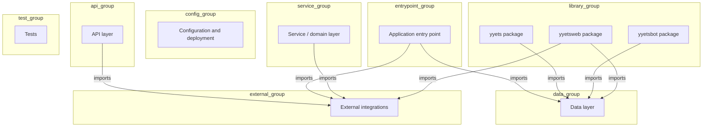

# Architecture report: tgbot-collection/YYeTsBot

> Automated static analysis. **Observed** = directly seen in files/imports/AST; **Inferred** = interpretation from that evidence. Repository code was not executed.

## 1. Repository at a glance

| Item | Value |
| --- | --- |
| Repository | tgbot-collection/YYeTsBot |
| Description | 🎬 人人影视 机器人和网站，包含人人影视全部资源以及众多网友的网盘分享 |
| Language | Python |
| Stars | 16316 |
| Licence | MIT |
| Analysed commit / branch | de73b9c1aa9aad7affdf4228f6d1d0198195921d / master |
| Framework(s) | Django |
| Files analysed | 111 |
| Components | 10 |

## 2. Architecture in one minute

tgbot-collection/YYeTsBot - 🎬 人人影视 机器人和网站，包含人人影视全部资源以及众多网友的网盘分享. This repository was analysed statically from 111 file(s) (45 Python). Detected technologies (observed from imports/manifests): GitHub Actions, MongoDB, MySQL, Redis, SQLite, Django. Files are grouped into 10 component(s): API layer, Configuration and deployment, Data layer, Application entry point, External integrations, Service / domain layer, Tests, yyets package. Observed entry point(s): yyets/BagAndDrag/bag.py, yyets/BagAndDrag/cfkv.py, yyets/BagAndDrag/convert_db.py. Findings below distinguish observed facts from inferred interpretation.

## 3. High-level block diagram

## 4. Main components

### API layer (`api_layer`)

- **Kind:** api
- **Status:** Observed
- **Confidence:** 0.85
- **Responsibility:** Groups 9 file(s) under api layer (observed from repository paths and static analysis). Observed top-level classes: AdsenseStatusHandler, AnnouncementHandler, BaseHandler, BlacklistHandler, CaptchaHandler, CategoryHandler.
- **Paths:** `yyetsweb/handlers/__init__.py`, `yyetsweb/handlers/base.py`, `yyetsweb/handlers/comment.py`, `yyetsweb/handlers/douban.py`, `yyetsweb/handlers/grafana.py`, `yyetsweb/handlers/oauth.py`, `yyetsweb/handlers/other.py`, `yyetsweb/handlers/resources.py`, `yyetsweb/handlers/user.py`
- **Evidence:** [yyetsweb/handlers/__init__.py](https://github.com/tgbot-collection/YYeTsBot/blob/de73b9c1aa9aad7affdf4228f6d1d0198195921d/yyetsweb/handlers/__init__.py); [yyetsweb/handlers/base.py:22](https://github.com/tgbot-collection/YYeTsBot/blob/de73b9c1aa9aad7affdf4228f6d1d0198195921d/yyetsweb/handlers/base.py#L22); [yyetsweb/handlers/comment.py:15](https://github.com/tgbot-collection/YYeTsBot/blob/de73b9c1aa9aad7affdf4228f6d1d0198195921d/yyetsweb/handlers/comment.py#L15); [yyetsweb/handlers/douban.py:15](https://github.com/tgbot-collection/YYeTsBot/blob/de73b9c1aa9aad7affdf4228f6d1d0198195921d/yyetsweb/handlers/douban.py#L15); [yyetsweb/handlers/grafana.py:17](https://github.com/tgbot-collection/YYeTsBot/blob/de73b9c1aa9aad7affdf4228f6d1d0198195921d/yyetsweb/handlers/grafana.py#L17); [yyetsweb/handlers/oauth.py:16](https://github.com/tgbot-collection/YYeTsBot/blob/de73b9c1aa9aad7affdf4228f6d1d0198195921d/yyetsweb/handlers/oauth.py#L16); [yyetsweb/handlers/other.py:21](https://github.com/tgbot-collection/YYeTsBot/blob/de73b9c1aa9aad7affdf4228f6d1d0198195921d/yyetsweb/handlers/other.py#L21); [yyetsweb/handlers/resources.py:15](https://github.com/tgbot-collection/YYeTsBot/blob/de73b9c1aa9aad7affdf4228f6d1d0198195921d/yyetsweb/handlers/resources.py#L15)

### Configuration and deployment (`config`)

- **Kind:** config
- **Status:** Observed
- **Confidence:** 0.85
- **Responsibility:** Groups 17 file(s) under configuration and deployment (observed from repository paths and static analysis). Observed top-level classes: UploadCommand.
- **Paths:** `Dockerfile`, `docker-compose.yml`, `requirements.txt`, `setup.py`, `tea.yaml`, `yyets/BagAndDrag/sample.json`, `yyets/management/format.json`, `yyets/worker/public/css/data.json`, `yyets/worker/public/css/index.json`, `yyets/worker/workers-site/package.json`, `yyets/worker/wrangler.toml`, `yyetsbot/config.py`, `yyetsweb/YYeTs-grafana.json`, `yyetsweb/go.mod`, `yyetsweb/templates/css/data.json`, `yyetsweb/templates/css/index.json`, `yyetsweb/templates/js/sample.json`
- **Evidence:** [Dockerfile](https://github.com/tgbot-collection/YYeTsBot/blob/de73b9c1aa9aad7affdf4228f6d1d0198195921d/Dockerfile); [docker-compose.yml](https://github.com/tgbot-collection/YYeTsBot/blob/de73b9c1aa9aad7affdf4228f6d1d0198195921d/docker-compose.yml); [requirements.txt](https://github.com/tgbot-collection/YYeTsBot/blob/de73b9c1aa9aad7affdf4228f6d1d0198195921d/requirements.txt); [setup.py:56](https://github.com/tgbot-collection/YYeTsBot/blob/de73b9c1aa9aad7affdf4228f6d1d0198195921d/setup.py#L56); [tea.yaml](https://github.com/tgbot-collection/YYeTsBot/blob/de73b9c1aa9aad7affdf4228f6d1d0198195921d/tea.yaml); [yyets/BagAndDrag/sample.json](https://github.com/tgbot-collection/YYeTsBot/blob/de73b9c1aa9aad7affdf4228f6d1d0198195921d/yyets/BagAndDrag/sample.json); [yyets/management/format.json](https://github.com/tgbot-collection/YYeTsBot/blob/de73b9c1aa9aad7affdf4228f6d1d0198195921d/yyets/management/format.json); [yyets/worker/public/css/data.json](https://github.com/tgbot-collection/YYeTsBot/blob/de73b9c1aa9aad7affdf4228f6d1d0198195921d/yyets/worker/public/css/data.json)

### Data layer (`data_layer`)

- **Kind:** data
- **Status:** Observed
- **Confidence:** 0.85
- **Responsibility:** Groups 1 file(s) under data layer (observed from repository paths and static analysis). Observed top-level classes: Mongo.
- **Paths:** `yyetsweb/cmd/db.py`
- **Evidence:** [yyetsweb/cmd/db.py:15](https://github.com/tgbot-collection/YYeTsBot/blob/de73b9c1aa9aad7affdf4228f6d1d0198195921d/yyetsweb/cmd/db.py#L15)

### Application entry point (`entrypoint`)

- **Kind:** entrypoint
- **Status:** Observed
- **Confidence:** 0.85
- **Responsibility:** Groups 16 file(s) under application entry point (observed from repository paths and static analysis). Observed top-level classes: AliyunChecker, BD2020, BaiduChecker, BaseFansub, BaseSync, Cloudflare. Observed top-level functions: MongoDB, MySQL, SQLite, __load_sample, _format_addr, approve_spam.
- **Paths:** `yyets/BagAndDrag/bag.py`, `yyets/BagAndDrag/cfkv.py`, `yyets/BagAndDrag/convert_db.py`, `yyets/BagAndDrag/drag.py`, `yyets/BagAndDrag/zimuxia/convert_db.py`, `yyets/BagAndDrag/zimuxia/zimuxia.py`, `yyets/__init__.py`, `yyets/healthcheck/check.py`, `yyetsbot/fansub.py`, `yyetsbot/yyetsbot.py`, `yyetsweb/cmd/add_dl.py`, `yyetsweb/common/comments_check.py`, `yyetsweb/common/dump_db.py`, `yyetsweb/common/sync.py`, `yyetsweb/common/utils.py`, `yyetsweb/server.py`
- **Evidence:** [yyets/BagAndDrag/bag.py:37](https://github.com/tgbot-collection/YYeTsBot/blob/de73b9c1aa9aad7affdf4228f6d1d0198195921d/yyets/BagAndDrag/bag.py#L37); [yyets/BagAndDrag/cfkv.py:25](https://github.com/tgbot-collection/YYeTsBot/blob/de73b9c1aa9aad7affdf4228f6d1d0198195921d/yyets/BagAndDrag/cfkv.py#L25); [yyets/BagAndDrag/convert_db.py:30](https://github.com/tgbot-collection/YYeTsBot/blob/de73b9c1aa9aad7affdf4228f6d1d0198195921d/yyets/BagAndDrag/convert_db.py#L30); [yyets/BagAndDrag/drag.py:38](https://github.com/tgbot-collection/YYeTsBot/blob/de73b9c1aa9aad7affdf4228f6d1d0198195921d/yyets/BagAndDrag/drag.py#L38); [yyets/BagAndDrag/zimuxia/convert_db.py:28](https://github.com/tgbot-collection/YYeTsBot/blob/de73b9c1aa9aad7affdf4228f6d1d0198195921d/yyets/BagAndDrag/zimuxia/convert_db.py#L28); [yyets/BagAndDrag/zimuxia/zimuxia.py:30](https://github.com/tgbot-collection/YYeTsBot/blob/de73b9c1aa9aad7affdf4228f6d1d0198195921d/yyets/BagAndDrag/zimuxia/zimuxia.py#L30); [yyets/__init__.py:23](https://github.com/tgbot-collection/YYeTsBot/blob/de73b9c1aa9aad7affdf4228f6d1d0198195921d/yyets/__init__.py#L23); [yyets/healthcheck/check.py:31](https://github.com/tgbot-collection/YYeTsBot/blob/de73b9c1aa9aad7affdf4228f6d1d0198195921d/yyets/healthcheck/check.py#L31)

### External integrations (`external_integrations`)

- **Kind:** external
- **Status:** Inferred
- **Confidence:** 0.70
- **Responsibility:** Groups 0 file(s) under external integrations (observed from repository paths and static analysis).
- **Evidence:** [yyets/BagAndDrag/bag.py:19](https://github.com/tgbot-collection/YYeTsBot/blob/de73b9c1aa9aad7affdf4228f6d1d0198195921d/yyets/BagAndDrag/bag.py#L19); [yyets/BagAndDrag/bag.py:20](https://github.com/tgbot-collection/YYeTsBot/blob/de73b9c1aa9aad7affdf4228f6d1d0198195921d/yyets/BagAndDrag/bag.py#L20); [yyets/BagAndDrag/cfkv.py:13](https://github.com/tgbot-collection/YYeTsBot/blob/de73b9c1aa9aad7affdf4228f6d1d0198195921d/yyets/BagAndDrag/cfkv.py#L13); [yyets/BagAndDrag/convert_db.py:13](https://github.com/tgbot-collection/YYeTsBot/blob/de73b9c1aa9aad7affdf4228f6d1d0198195921d/yyets/BagAndDrag/convert_db.py#L13); [yyets/BagAndDrag/convert_db.py:16](https://github.com/tgbot-collection/YYeTsBot/blob/de73b9c1aa9aad7affdf4228f6d1d0198195921d/yyets/BagAndDrag/convert_db.py#L16); [yyets/BagAndDrag/convert_db.py:17](https://github.com/tgbot-collection/YYeTsBot/blob/de73b9c1aa9aad7affdf4228f6d1d0198195921d/yyets/BagAndDrag/convert_db.py#L17)

### Service / domain layer (`service_layer`)

- **Kind:** service
- **Status:** Observed
- **Confidence:** 0.85
- **Responsibility:** Groups 1 file(s) under service / domain layer (observed from repository paths and static analysis).
- **Paths:** `yyets/healthcheck/restart_service.py`
- **Evidence:** [yyets/healthcheck/restart_service.py](https://github.com/tgbot-collection/YYeTsBot/blob/de73b9c1aa9aad7affdf4228f6d1d0198195921d/yyets/healthcheck/restart_service.py)

### Tests (`tests`)

- **Kind:** test
- **Status:** Observed
- **Confidence:** 0.85
- **Responsibility:** Groups 1 file(s) under tests (observed from repository paths and static analysis). Observed top-level classes: TestIndex, YYeTsTest.
- **Paths:** `yyetsweb/tests/router_test.py`
- **Evidence:** [yyetsweb/tests/router_test.py:14](https://github.com/tgbot-collection/YYeTsBot/blob/de73b9c1aa9aad7affdf4228f6d1d0198195921d/yyetsweb/tests/router_test.py#L14)

### yyets package (`yyets`)

- **Kind:** library
- **Status:** Observed
- **Confidence:** 0.85
- **Responsibility:** Groups 6 file(s) under yyets package (observed from repository paths and static analysis). Observed top-level functions: get_value.
- **Paths:** `yyets/BagAndDrag/create_db.py`, `yyets/management/ui.py`, `yyets/worker/public/js/aYin.js`, `yyets/worker/public/js/rshare.js`, `yyets/worker/public/js/search.js`, `yyets/worker/workers-site/index.js`
- **Evidence:** [yyets/BagAndDrag/create_db.py](https://github.com/tgbot-collection/YYeTsBot/blob/de73b9c1aa9aad7affdf4228f6d1d0198195921d/yyets/BagAndDrag/create_db.py); [yyets/management/ui.py:79](https://github.com/tgbot-collection/YYeTsBot/blob/de73b9c1aa9aad7affdf4228f6d1d0198195921d/yyets/management/ui.py#L79); [yyets/worker/public/js/aYin.js](https://github.com/tgbot-collection/YYeTsBot/blob/de73b9c1aa9aad7affdf4228f6d1d0198195921d/yyets/worker/public/js/aYin.js); [yyets/worker/public/js/rshare.js](https://github.com/tgbot-collection/YYeTsBot/blob/de73b9c1aa9aad7affdf4228f6d1d0198195921d/yyets/worker/public/js/rshare.js); [yyets/worker/public/js/search.js](https://github.com/tgbot-collection/YYeTsBot/blob/de73b9c1aa9aad7affdf4228f6d1d0198195921d/yyets/worker/public/js/search.js); [yyets/worker/workers-site/index.js](https://github.com/tgbot-collection/YYeTsBot/blob/de73b9c1aa9aad7affdf4228f6d1d0198195921d/yyets/worker/workers-site/index.js)

### yyetsbot package (`yyetsbot`)

- **Kind:** library
- **Status:** Observed
- **Confidence:** 0.85
- **Responsibility:** Groups 1 file(s) under yyetsbot package (observed from repository paths and static analysis). Observed top-level functions: get_error_dump, redis_announcement, reset_request, save_error_dump, show_usage, today_request.
- **Paths:** `yyetsbot/utils.py`
- **Evidence:** [yyetsbot/utils.py:18](https://github.com/tgbot-collection/YYeTsBot/blob/de73b9c1aa9aad7affdf4228f6d1d0198195921d/yyetsbot/utils.py#L18)

### yyetsweb package (`yyetsweb`)

- **Kind:** library
- **Status:** Observed
- **Confidence:** 0.85
- **Responsibility:** Groups 16 file(s) under yyetsweb package (observed from repository paths and static analysis). Observed top-level classes: Announcement, Blacklist, Captcha, Category, Comment, CommentChild. Observed top-level functions: generate_date_series.
- **Paths:** `yyetsweb/cmd/douban_fix.py`, `yyetsweb/cmd/grafana_test_data.py`, `yyetsweb/common/__init__.py`, `yyetsweb/databases/__init__.py`, `yyetsweb/databases/base.py`, `yyetsweb/databases/comment.py`, `yyetsweb/databases/douban.py`, `yyetsweb/databases/grafana.py`, `yyetsweb/databases/oauth.py`, `yyetsweb/databases/other.py`, `yyetsweb/databases/resources.py`, `yyetsweb/databases/user.py`, `yyetsweb/server.go`, `yyetsweb/templates/js/aYin.js`, `yyetsweb/templates/js/common.js`, `yyetsweb/templates/js/rshare.js`
- **Evidence:** [yyetsweb/cmd/douban_fix.py](https://github.com/tgbot-collection/YYeTsBot/blob/de73b9c1aa9aad7affdf4228f6d1d0198195921d/yyetsweb/cmd/douban_fix.py); [yyetsweb/cmd/grafana_test_data.py:18](https://github.com/tgbot-collection/YYeTsBot/blob/de73b9c1aa9aad7affdf4228f6d1d0198195921d/yyetsweb/cmd/grafana_test_data.py#L18); [yyetsweb/common/__init__.py](https://github.com/tgbot-collection/YYeTsBot/blob/de73b9c1aa9aad7affdf4228f6d1d0198195921d/yyetsweb/common/__init__.py); [yyetsweb/databases/__init__.py](https://github.com/tgbot-collection/YYeTsBot/blob/de73b9c1aa9aad7affdf4228f6d1d0198195921d/yyetsweb/databases/__init__.py); [yyetsweb/databases/base.py:13](https://github.com/tgbot-collection/YYeTsBot/blob/de73b9c1aa9aad7affdf4228f6d1d0198195921d/yyetsweb/databases/base.py#L13); [yyetsweb/databases/comment.py:17](https://github.com/tgbot-collection/YYeTsBot/blob/de73b9c1aa9aad7affdf4228f6d1d0198195921d/yyetsweb/databases/comment.py#L17); [yyetsweb/databases/douban.py:19](https://github.com/tgbot-collection/YYeTsBot/blob/de73b9c1aa9aad7affdf4228f6d1d0198195921d/yyetsweb/databases/douban.py#L19); [yyetsweb/databases/grafana.py:11](https://github.com/tgbot-collection/YYeTsBot/blob/de73b9c1aa9aad7affdf4228f6d1d0198195921d/yyetsweb/databases/grafana.py#L11)

## 5. Execution flow

**Observed** entry point(s):

- [yyets/BagAndDrag/bag.py:104](https://github.com/tgbot-collection/YYeTsBot/blob/de73b9c1aa9aad7affdf4228f6d1d0198195921d/yyets/BagAndDrag/bag.py#L104)
- [yyets/BagAndDrag/cfkv.py:84](https://github.com/tgbot-collection/YYeTsBot/blob/de73b9c1aa9aad7affdf4228f6d1d0198195921d/yyets/BagAndDrag/cfkv.py#L84)
- [yyets/BagAndDrag/convert_db.py:98](https://github.com/tgbot-collection/YYeTsBot/blob/de73b9c1aa9aad7affdf4228f6d1d0198195921d/yyets/BagAndDrag/convert_db.py#L98)
- [yyets/BagAndDrag/drag.py:59](https://github.com/tgbot-collection/YYeTsBot/blob/de73b9c1aa9aad7affdf4228f6d1d0198195921d/yyets/BagAndDrag/drag.py#L59)
- [yyets/BagAndDrag/zimuxia/convert_db.py:61](https://github.com/tgbot-collection/YYeTsBot/blob/de73b9c1aa9aad7affdf4228f6d1d0198195921d/yyets/BagAndDrag/zimuxia/convert_db.py#L61)
- [yyets/BagAndDrag/zimuxia/zimuxia.py:55](https://github.com/tgbot-collection/YYeTsBot/blob/de73b9c1aa9aad7affdf4228f6d1d0198195921d/yyets/BagAndDrag/zimuxia/zimuxia.py#L55)
- [yyets/__init__.py:60](https://github.com/tgbot-collection/YYeTsBot/blob/de73b9c1aa9aad7affdf4228f6d1d0198195921d/yyets/__init__.py#L60)
- [yyets/healthcheck/check.py:79](https://github.com/tgbot-collection/YYeTsBot/blob/de73b9c1aa9aad7affdf4228f6d1d0198195921d/yyets/healthcheck/check.py#L79)
- [yyetsbot/fansub.py:448](https://github.com/tgbot-collection/YYeTsBot/blob/de73b9c1aa9aad7affdf4228f6d1d0198195921d/yyetsbot/fansub.py#L448)
- [yyetsbot/yyetsbot.py:407](https://github.com/tgbot-collection/YYeTsBot/blob/de73b9c1aa9aad7affdf4228f6d1d0198195921d/yyetsbot/yyetsbot.py#L407)
- [yyetsweb/cmd/add_dl.py:101](https://github.com/tgbot-collection/YYeTsBot/blob/de73b9c1aa9aad7affdf4228f6d1d0198195921d/yyetsweb/cmd/add_dl.py#L101)
- [yyetsweb/common/comments_check.py:199](https://github.com/tgbot-collection/YYeTsBot/blob/de73b9c1aa9aad7affdf4228f6d1d0198195921d/yyetsweb/common/comments_check.py#L199)

Representative flow (derived from observed entry points and the import graph; steps beyond the entry point are **Inferred**):

1. Execution starts at an observed entry point listed above, if present.
2. `api_layer` imports `external_integrations` (API layer -> External integrations).
3. `entrypoint` imports `data_layer` (Application entry point -> Data layer).
4. `entrypoint` imports `external_integrations` (Application entry point -> External integrations).
5. `service_layer` imports `external_integrations` (Service / domain layer -> External integrations).
6. `yyets` imports `data_layer` (yyets package -> Data layer).
7. `yyetsbot` imports `data_layer` (yyetsbot package -> Data layer).
8. `yyetsweb` imports `data_layer` (yyetsweb package -> Data layer).
9. `yyetsweb` imports `external_integrations` (yyetsweb package -> External integrations).

## 6. Project structure

### `(root)`

- `.dockerignore` - container (136 bytes)
- `.gitattributes` - other (685 bytes)
- `.gitignore` - other (2447 bytes)
- `Dockerfile` - container (992 bytes)
- `LICENSE` - docs (1083 bytes)
- `Makefile` - other (2593 bytes)
- `README.md` - docs (1869 bytes)
- `docker-compose.yml` - container (1298 bytes)
- `requirements.txt` - manifest (477 bytes)
- `setup.py` - manifest, Python (3737 bytes)
- `tea.yaml` - config (175 bytes)

### `.github`

- `.github/FUNDING.yml` - config (116 bytes)
- `.github/dependabot.yml` - config (165 bytes)
- `.github/workflows/docker.yaml` - ci, YAML (2321 bytes)

### `conf`

- `conf/yyets.dmesg.app.conf` - other (2191 bytes)
- `conf/yyets.env` - other (102 bytes)

### `yyets`

- `yyets/BagAndDrag/README.md` - docs (107 bytes)
- `yyets/BagAndDrag/bag.py` - source, Python (3340 bytes)
- `yyets/BagAndDrag/cfkv.py` - source, Python (2286 bytes)
- `yyets/BagAndDrag/convert_db.py` - source, Python (2343 bytes)
- `yyets/BagAndDrag/create_db.py` - source, Python (885 bytes)
- `yyets/BagAndDrag/drag.py` - source, Python (1812 bytes)
- `yyets/BagAndDrag/sample.json` - config (45959 bytes)
- `yyets/BagAndDrag/zimuxia/convert_db.py` - source, Python (1400 bytes)
- `yyets/BagAndDrag/zimuxia/zimuxia.py` - source, Python (1447 bytes)
- `yyets/__init__.py` - source, Python (1499 bytes)
- `yyets/healthcheck/check.py` - source, Python (2775 bytes)
- `yyets/healthcheck/restart_service.py` - source, Python (909 bytes)
- `yyets/management/format.json` - config (1483 bytes)
- `yyets/management/ui.py` - source, Python (3070 bytes)
- `yyets/worker/.cargo-ok` - other (0 bytes)
- `yyets/worker/README.md` - docs (760 bytes)
- `yyets/worker/public/404.html` - other (1226 bytes)
- `yyets/worker/public/css/3rd/animate.css` - other (72259 bytes)
- `yyets/worker/public/css/3rd/icons.css` - other (59 bytes)
- `yyets/worker/public/css/3rd/widgets.css` - other (20 bytes)
- `yyets/worker/public/css/aYin.css` - other (343 bytes)
- `yyets/worker/public/css/data.json` - config (7533 bytes)
- `yyets/worker/public/css/down-list-20180530.css` - other (162113 bytes)
- `yyets/worker/public/css/index.json` - config (514 bytes)
- `yyets/worker/public/css/jquery.mCustomScrollbar.css` - other (53583 bytes)
- `yyets/worker/public/fonts/test.txt` - docs (4 bytes)
- `yyets/worker/public/index.html` - other (1808 bytes)
- `yyets/worker/public/js/aYin.js` - source, JavaScript (16361 bytes)
- `yyets/worker/public/js/rshare.js` - source, JavaScript (9769 bytes)
- `yyets/worker/public/js/search.js` - source, JavaScript (1797 bytes)
- `yyets/worker/public/resource.html` - other (40660 bytes)
- `yyets/worker/public/search.html` - other (2471 bytes)
- `yyets/worker/workers-site/index.js` - source, JavaScript (3254 bytes)
- `yyets/worker/workers-site/package.json` - manifest (235 bytes)
- `yyets/worker/wrangler.toml` - config (285 bytes)

### `yyetsbot`

- `yyetsbot/config.py` - source, Python (1787 bytes)
- `yyetsbot/fansub.py` - source, Python (16750 bytes)
- `yyetsbot/utils.py` - source, Python (1494 bytes)
- `yyetsbot/yyetsbot.py` - source, Python (16266 bytes)

### `yyetsweb`

- `yyetsweb/README.md` - docs (1566 bytes)
- `yyetsweb/YYeTs-grafana.json` - config (10955 bytes)
- `yyetsweb/cmd/add_dl.py` - source, Python (2660 bytes)
- `yyetsweb/cmd/db.py` - source, Python (491 bytes)
- `yyetsweb/cmd/douban_fix.py` - source, Python (1193 bytes)
- `yyetsweb/cmd/grafana_test_data.py` - source, Python (1032 bytes)
- `yyetsweb/common/__init__.py` - source, Python (140 bytes)
- `yyetsweb/common/comments_check.py` - source, Python (5250 bytes)
- `yyetsweb/common/dump_db.py` - source, Python (7548 bytes)
- `yyetsweb/common/sync.py` - source, Python (10208 bytes)
- `yyetsweb/common/utils.py` - source, Python (5376 bytes)
- `yyetsweb/databases/__init__.py` - source, Python (1227 bytes)
- `yyetsweb/databases/base.py` - source, Python (7852 bytes)
- `yyetsweb/databases/comment.py` - source, Python (18217 bytes)
- `yyetsweb/databases/douban.py` - source, Python (6716 bytes)
- `yyetsweb/databases/grafana.py` - source, Python (1316 bytes)
- `yyetsweb/databases/oauth.py` - source, Python (1793 bytes)
- `yyetsweb/databases/other.py` - source, Python (6980 bytes)
- `yyetsweb/databases/resources.py` - source, Python (13265 bytes)
- `yyetsweb/databases/user.py` - source, Python (8997 bytes)
- `yyetsweb/go.mod` - manifest (1817 bytes)
- `yyetsweb/go.sum` - other (15579 bytes)
- `yyetsweb/handlers/__init__.py` - source, Python (237 bytes)
- `yyetsweb/handlers/base.py` - source, Python (3539 bytes)
- `yyetsweb/handlers/comment.py` - source, Python (6807 bytes)
- `yyetsweb/handlers/douban.py` - source, Python (1999 bytes)
- `yyetsweb/handlers/grafana.py` - source, Python (3890 bytes)
- `yyetsweb/handlers/oauth.py` - source, Python (6278 bytes)
- `yyetsweb/handlers/other.py` - source, Python (5555 bytes)
- `yyetsweb/handlers/resources.py` - source, Python (3578 bytes)
- `yyetsweb/handlers/user.py` - source, Python (4894 bytes)
- `yyetsweb/server.go` - source, Go (7302 bytes)
- `yyetsweb/server.py` - source, Python (7226 bytes)
- `yyetsweb/templates/404.html` - other (1248 bytes)
- `yyetsweb/templates/ads.txt` - docs (58 bytes)
- `yyetsweb/templates/css/3rd/animate.css` - other (72259 bytes)
- `yyetsweb/templates/css/3rd/icons.css` - other (59 bytes)
- `yyetsweb/templates/css/3rd/widgets.css` - other (20 bytes)
- `yyetsweb/templates/css/aYin.css` - other (343 bytes)
- `yyetsweb/templates/css/data.json` - config (7533 bytes)
- `yyetsweb/templates/css/down-list-20180530.css` - other (162113 bytes)
- `yyetsweb/templates/css/index.json` - config (514 bytes)
- `yyetsweb/templates/css/jquery.mCustomScrollbar.css` - other (53583 bytes)
- `yyetsweb/templates/css/noty.css` - other (18782 bytes)
- `yyetsweb/templates/email_template.html` - other (7451 bytes)
- `yyetsweb/templates/googlee927c64a054a7beb.html` - other (53 bytes)
- `yyetsweb/templates/help.html` - other (6134 bytes)
- `yyetsweb/templates/index.html` - other (9173 bytes)
- `yyetsweb/templates/js/aYin.js` - source, JavaScript (16361 bytes)
- `yyetsweb/templates/js/common.js` - source, JavaScript (516 bytes)
- `yyetsweb/templates/js/rshare.js` - source, JavaScript (9769 bytes)
- `yyetsweb/templates/js/sample.json` - config (29598 bytes)
- `yyetsweb/templates/resource.html` - other (42634 bytes)
- `yyetsweb/templates/robots.txt` - docs (67 bytes)
- `yyetsweb/templates/search.html` - other (5094 bytes)
- `yyetsweb/tests/router_test.py` - test, Python (571 bytes)

## 7. Key dependencies and integrations

| Name | Category | Status | Confidence | Evidence |
| --- | --- | --- | --- | --- |
| GitHub Actions | ci | Observed | 0.85 | [.github/workflows/docker.yaml](https://github.com/tgbot-collection/YYeTsBot/blob/de73b9c1aa9aad7affdf4228f6d1d0198195921d/.github/workflows/docker.yaml) |
| MongoDB | database | Observed | 0.95 | [docker-compose.yml:10](https://github.com/tgbot-collection/YYeTsBot/blob/de73b9c1aa9aad7affdf4228f6d1d0198195921d/docker-compose.yml#L10); [requirements.txt:7](https://github.com/tgbot-collection/YYeTsBot/blob/de73b9c1aa9aad7affdf4228f6d1d0198195921d/requirements.txt#L7); [yyets/BagAndDrag/convert_db.py:16](https://github.com/tgbot-collection/YYeTsBot/blob/de73b9c1aa9aad7affdf4228f6d1d0198195921d/yyets/BagAndDrag/convert_db.py#L16); [yyets/BagAndDrag/zimuxia/convert_db.py:12](https://github.com/tgbot-collection/YYeTsBot/blob/de73b9c1aa9aad7affdf4228f6d1d0198195921d/yyets/BagAndDrag/zimuxia/convert_db.py#L12) |
| MySQL | database | Observed | 0.95 | [docker-compose.yml:29](https://github.com/tgbot-collection/YYeTsBot/blob/de73b9c1aa9aad7affdf4228f6d1d0198195921d/docker-compose.yml#L29); [requirements.txt:16](https://github.com/tgbot-collection/YYeTsBot/blob/de73b9c1aa9aad7affdf4228f6d1d0198195921d/requirements.txt#L16); [yyets/BagAndDrag/bag.py:19](https://github.com/tgbot-collection/YYeTsBot/blob/de73b9c1aa9aad7affdf4228f6d1d0198195921d/yyets/BagAndDrag/bag.py#L19); [yyets/BagAndDrag/cfkv.py:13](https://github.com/tgbot-collection/YYeTsBot/blob/de73b9c1aa9aad7affdf4228f6d1d0198195921d/yyets/BagAndDrag/cfkv.py#L13) |
| Redis | database | Observed | 0.95 | [docker-compose.yml:4](https://github.com/tgbot-collection/YYeTsBot/blob/de73b9c1aa9aad7affdf4228f6d1d0198195921d/docker-compose.yml#L4); [requirements.txt:5](https://github.com/tgbot-collection/YYeTsBot/blob/de73b9c1aa9aad7affdf4228f6d1d0198195921d/requirements.txt#L5); [yyetsbot/fansub.py:18](https://github.com/tgbot-collection/YYeTsBot/blob/de73b9c1aa9aad7affdf4228f6d1d0198195921d/yyetsbot/fansub.py#L18); [yyetsbot/utils.py:9](https://github.com/tgbot-collection/YYeTsBot/blob/de73b9c1aa9aad7affdf4228f6d1d0198195921d/yyetsbot/utils.py#L9) |
| SQLite | database | Observed | 0.95 | [yyets/BagAndDrag/convert_db.py:13](https://github.com/tgbot-collection/YYeTsBot/blob/de73b9c1aa9aad7affdf4228f6d1d0198195921d/yyets/BagAndDrag/convert_db.py#L13); [yyetsweb/common/dump_db.py:15](https://github.com/tgbot-collection/YYeTsBot/blob/de73b9c1aa9aad7affdf4228f6d1d0198195921d/yyetsweb/common/dump_db.py#L15) |
| Django | framework | Observed | 0.85 | [setup.py:28](https://github.com/tgbot-collection/YYeTsBot/blob/de73b9c1aa9aad7affdf4228f6d1d0198195921d/setup.py#L28) |
| requests | library | Observed | 0.95 | [requirements.txt:1](https://github.com/tgbot-collection/YYeTsBot/blob/de73b9c1aa9aad7affdf4228f6d1d0198195921d/requirements.txt#L1); [setup.py:24](https://github.com/tgbot-collection/YYeTsBot/blob/de73b9c1aa9aad7affdf4228f6d1d0198195921d/setup.py#L24); [yyets/BagAndDrag/bag.py:20](https://github.com/tgbot-collection/YYeTsBot/blob/de73b9c1aa9aad7affdf4228f6d1d0198195921d/yyets/BagAndDrag/bag.py#L20); [yyets/BagAndDrag/drag.py:16](https://github.com/tgbot-collection/YYeTsBot/blob/de73b9c1aa9aad7affdf4228f6d1d0198195921d/yyets/BagAndDrag/drag.py#L16) |
| setuptools | packaging | Observed | 0.90 | [setup.py:12](https://github.com/tgbot-collection/YYeTsBot/blob/de73b9c1aa9aad7affdf4228f6d1d0198195921d/setup.py#L12) |
| Docker | tooling | Observed | 0.90 | [.github/workflows/docker.yaml:1](https://github.com/tgbot-collection/YYeTsBot/blob/de73b9c1aa9aad7affdf4228f6d1d0198195921d/.github/workflows/docker.yaml#L1); [Dockerfile](https://github.com/tgbot-collection/YYeTsBot/blob/de73b9c1aa9aad7affdf4228f6d1d0198195921d/Dockerfile) |
| Docker Compose | tooling | Observed | 0.85 | [docker-compose.yml](https://github.com/tgbot-collection/YYeTsBot/blob/de73b9c1aa9aad7affdf4228f6d1d0198195921d/docker-compose.yml) |
| unittest | tooling | Observed | 0.90 | [yyetsweb/tests/router_test.py:6](https://github.com/tgbot-collection/YYeTsBot/blob/de73b9c1aa9aad7affdf4228f6d1d0198195921d/yyetsweb/tests/router_test.py#L6) |

## 8. Data and state

- **MongoDB** (Observed, confidence 0.95) - evidence: [docker-compose.yml:10](https://github.com/tgbot-collection/YYeTsBot/blob/de73b9c1aa9aad7affdf4228f6d1d0198195921d/docker-compose.yml#L10); [requirements.txt:7](https://github.com/tgbot-collection/YYeTsBot/blob/de73b9c1aa9aad7affdf4228f6d1d0198195921d/requirements.txt#L7); [yyets/BagAndDrag/convert_db.py:16](https://github.com/tgbot-collection/YYeTsBot/blob/de73b9c1aa9aad7affdf4228f6d1d0198195921d/yyets/BagAndDrag/convert_db.py#L16); [yyets/BagAndDrag/zimuxia/convert_db.py:12](https://github.com/tgbot-collection/YYeTsBot/blob/de73b9c1aa9aad7affdf4228f6d1d0198195921d/yyets/BagAndDrag/zimuxia/convert_db.py#L12)
- **MySQL** (Observed, confidence 0.95) - evidence: [docker-compose.yml:29](https://github.com/tgbot-collection/YYeTsBot/blob/de73b9c1aa9aad7affdf4228f6d1d0198195921d/docker-compose.yml#L29); [requirements.txt:16](https://github.com/tgbot-collection/YYeTsBot/blob/de73b9c1aa9aad7affdf4228f6d1d0198195921d/requirements.txt#L16); [yyets/BagAndDrag/bag.py:19](https://github.com/tgbot-collection/YYeTsBot/blob/de73b9c1aa9aad7affdf4228f6d1d0198195921d/yyets/BagAndDrag/bag.py#L19); [yyets/BagAndDrag/cfkv.py:13](https://github.com/tgbot-collection/YYeTsBot/blob/de73b9c1aa9aad7affdf4228f6d1d0198195921d/yyets/BagAndDrag/cfkv.py#L13)
- **Redis** (Observed, confidence 0.95) - evidence: [docker-compose.yml:4](https://github.com/tgbot-collection/YYeTsBot/blob/de73b9c1aa9aad7affdf4228f6d1d0198195921d/docker-compose.yml#L4); [requirements.txt:5](https://github.com/tgbot-collection/YYeTsBot/blob/de73b9c1aa9aad7affdf4228f6d1d0198195921d/requirements.txt#L5); [yyetsbot/fansub.py:18](https://github.com/tgbot-collection/YYeTsBot/blob/de73b9c1aa9aad7affdf4228f6d1d0198195921d/yyetsbot/fansub.py#L18); [yyetsbot/utils.py:9](https://github.com/tgbot-collection/YYeTsBot/blob/de73b9c1aa9aad7affdf4228f6d1d0198195921d/yyetsbot/utils.py#L9)
- **SQLite** (Observed, confidence 0.95) - evidence: [yyets/BagAndDrag/convert_db.py:13](https://github.com/tgbot-collection/YYeTsBot/blob/de73b9c1aa9aad7affdf4228f6d1d0198195921d/yyets/BagAndDrag/convert_db.py#L13); [yyetsweb/common/dump_db.py:15](https://github.com/tgbot-collection/YYeTsBot/blob/de73b9c1aa9aad7affdf4228f6d1d0198195921d/yyetsweb/common/dump_db.py#L15)
- Data component `data_layer` (Observed): Groups 1 file(s) under data layer (observed from repository paths and static analysis). Observed top-level classes: Mongo.

## 9. Configuration and deployment clues

- `.dockerignore` (container)
- `.github/FUNDING.yml` (config)
- `.github/dependabot.yml` (config)
- `.github/workflows/docker.yaml` (ci)
- `Dockerfile` (container)
- `docker-compose.yml` (container)
- `requirements.txt` (manifest)
- `setup.py` (manifest)
- `tea.yaml` (config)
- `yyets/BagAndDrag/sample.json` (config)
- `yyets/management/format.json` (config)
- `yyets/worker/public/css/data.json` (config)
- `yyets/worker/public/css/index.json` (config)
- `yyets/worker/workers-site/package.json` (manifest)
- `yyets/worker/wrangler.toml` (config)
- `yyetsweb/YYeTs-grafana.json` (config)
- `yyetsweb/go.mod` (manifest)
- `yyetsweb/templates/css/data.json` (config)
- `yyetsweb/templates/css/index.json` (config)
- `yyetsweb/templates/js/sample.json` (config)

Console scripts declared in packaging metadata (**Observed**):

- `mycli` -> `mymodule:cli`

## 10. Design observations

- An entry/API layer is separated from other code (Inferred from paths and decorators).
- Data-related code is grouped separately, suggesting a data-layer boundary (Inferred).
- Service/domain code is distinct from entry and data code, suggesting layered separation (Inferred).
- Tests are present alongside source code (Observed from test file paths).
- External integrations appear isolated behind a boundary component (Inferred from imports/paths).

These observations are interpretations (**Inferred**) of the observed structure, not guarantees about runtime design.

## 11. Limitations and unknowns

- Static analysis only: repository code was not executed, installed, or imported at runtime.
- Components and relationships are inferred from file paths, imports, and AST structure; runtime behaviour, dynamic imports, and reflection may not be visible.
- 6 file(s) were skipped during inventory (5 x generated/minified file excluded; 1 x lockfile excluded).
- Repository text was treated as untrusted data; no instructions found in repository files were followed, and likely secret values were redacted/excluded.

## 12. Source references

- [.github/workflows/docker.yaml](https://github.com/tgbot-collection/YYeTsBot/blob/de73b9c1aa9aad7affdf4228f6d1d0198195921d/.github/workflows/docker.yaml)
- [.github/workflows/docker.yaml:1](https://github.com/tgbot-collection/YYeTsBot/blob/de73b9c1aa9aad7affdf4228f6d1d0198195921d/.github/workflows/docker.yaml#L1)
- [Dockerfile](https://github.com/tgbot-collection/YYeTsBot/blob/de73b9c1aa9aad7affdf4228f6d1d0198195921d/Dockerfile)
- [docker-compose.yml](https://github.com/tgbot-collection/YYeTsBot/blob/de73b9c1aa9aad7affdf4228f6d1d0198195921d/docker-compose.yml)
- [docker-compose.yml:4](https://github.com/tgbot-collection/YYeTsBot/blob/de73b9c1aa9aad7affdf4228f6d1d0198195921d/docker-compose.yml#L4)
- [docker-compose.yml:10](https://github.com/tgbot-collection/YYeTsBot/blob/de73b9c1aa9aad7affdf4228f6d1d0198195921d/docker-compose.yml#L10)
- [docker-compose.yml:29](https://github.com/tgbot-collection/YYeTsBot/blob/de73b9c1aa9aad7affdf4228f6d1d0198195921d/docker-compose.yml#L29)
- [requirements.txt](https://github.com/tgbot-collection/YYeTsBot/blob/de73b9c1aa9aad7affdf4228f6d1d0198195921d/requirements.txt)
- [requirements.txt:1](https://github.com/tgbot-collection/YYeTsBot/blob/de73b9c1aa9aad7affdf4228f6d1d0198195921d/requirements.txt#L1)
- [requirements.txt:5](https://github.com/tgbot-collection/YYeTsBot/blob/de73b9c1aa9aad7affdf4228f6d1d0198195921d/requirements.txt#L5)
- [requirements.txt:7](https://github.com/tgbot-collection/YYeTsBot/blob/de73b9c1aa9aad7affdf4228f6d1d0198195921d/requirements.txt#L7)
- [requirements.txt:16](https://github.com/tgbot-collection/YYeTsBot/blob/de73b9c1aa9aad7affdf4228f6d1d0198195921d/requirements.txt#L16)
- [setup.py:12](https://github.com/tgbot-collection/YYeTsBot/blob/de73b9c1aa9aad7affdf4228f6d1d0198195921d/setup.py#L12)
- [setup.py:24](https://github.com/tgbot-collection/YYeTsBot/blob/de73b9c1aa9aad7affdf4228f6d1d0198195921d/setup.py#L24)
- [setup.py:28](https://github.com/tgbot-collection/YYeTsBot/blob/de73b9c1aa9aad7affdf4228f6d1d0198195921d/setup.py#L28)
- [setup.py:56](https://github.com/tgbot-collection/YYeTsBot/blob/de73b9c1aa9aad7affdf4228f6d1d0198195921d/setup.py#L56)
- [tea.yaml](https://github.com/tgbot-collection/YYeTsBot/blob/de73b9c1aa9aad7affdf4228f6d1d0198195921d/tea.yaml)
- [yyets/BagAndDrag/bag.py:19](https://github.com/tgbot-collection/YYeTsBot/blob/de73b9c1aa9aad7affdf4228f6d1d0198195921d/yyets/BagAndDrag/bag.py#L19)
- [yyets/BagAndDrag/bag.py:20](https://github.com/tgbot-collection/YYeTsBot/blob/de73b9c1aa9aad7affdf4228f6d1d0198195921d/yyets/BagAndDrag/bag.py#L20)
- [yyets/BagAndDrag/bag.py:37](https://github.com/tgbot-collection/YYeTsBot/blob/de73b9c1aa9aad7affdf4228f6d1d0198195921d/yyets/BagAndDrag/bag.py#L37)
- [yyets/BagAndDrag/bag.py:104](https://github.com/tgbot-collection/YYeTsBot/blob/de73b9c1aa9aad7affdf4228f6d1d0198195921d/yyets/BagAndDrag/bag.py#L104)
- [yyets/BagAndDrag/cfkv.py:13](https://github.com/tgbot-collection/YYeTsBot/blob/de73b9c1aa9aad7affdf4228f6d1d0198195921d/yyets/BagAndDrag/cfkv.py#L13)
- [yyets/BagAndDrag/cfkv.py:25](https://github.com/tgbot-collection/YYeTsBot/blob/de73b9c1aa9aad7affdf4228f6d1d0198195921d/yyets/BagAndDrag/cfkv.py#L25)
- [yyets/BagAndDrag/cfkv.py:84](https://github.com/tgbot-collection/YYeTsBot/blob/de73b9c1aa9aad7affdf4228f6d1d0198195921d/yyets/BagAndDrag/cfkv.py#L84)
- [yyets/BagAndDrag/convert_db.py:13](https://github.com/tgbot-collection/YYeTsBot/blob/de73b9c1aa9aad7affdf4228f6d1d0198195921d/yyets/BagAndDrag/convert_db.py#L13)
- [yyets/BagAndDrag/convert_db.py:16](https://github.com/tgbot-collection/YYeTsBot/blob/de73b9c1aa9aad7affdf4228f6d1d0198195921d/yyets/BagAndDrag/convert_db.py#L16)
- [yyets/BagAndDrag/convert_db.py:17](https://github.com/tgbot-collection/YYeTsBot/blob/de73b9c1aa9aad7affdf4228f6d1d0198195921d/yyets/BagAndDrag/convert_db.py#L17)
- [yyets/BagAndDrag/convert_db.py:30](https://github.com/tgbot-collection/YYeTsBot/blob/de73b9c1aa9aad7affdf4228f6d1d0198195921d/yyets/BagAndDrag/convert_db.py#L30)
- [yyets/BagAndDrag/convert_db.py:98](https://github.com/tgbot-collection/YYeTsBot/blob/de73b9c1aa9aad7affdf4228f6d1d0198195921d/yyets/BagAndDrag/convert_db.py#L98)
- [yyets/BagAndDrag/create_db.py](https://github.com/tgbot-collection/YYeTsBot/blob/de73b9c1aa9aad7affdf4228f6d1d0198195921d/yyets/BagAndDrag/create_db.py)
- [yyets/BagAndDrag/create_db.py:10](https://github.com/tgbot-collection/YYeTsBot/blob/de73b9c1aa9aad7affdf4228f6d1d0198195921d/yyets/BagAndDrag/create_db.py#L10)
- [yyets/BagAndDrag/drag.py:16](https://github.com/tgbot-collection/YYeTsBot/blob/de73b9c1aa9aad7affdf4228f6d1d0198195921d/yyets/BagAndDrag/drag.py#L16)
- [yyets/BagAndDrag/drag.py:38](https://github.com/tgbot-collection/YYeTsBot/blob/de73b9c1aa9aad7affdf4228f6d1d0198195921d/yyets/BagAndDrag/drag.py#L38)
- [yyets/BagAndDrag/drag.py:59](https://github.com/tgbot-collection/YYeTsBot/blob/de73b9c1aa9aad7affdf4228f6d1d0198195921d/yyets/BagAndDrag/drag.py#L59)
- [yyets/BagAndDrag/sample.json](https://github.com/tgbot-collection/YYeTsBot/blob/de73b9c1aa9aad7affdf4228f6d1d0198195921d/yyets/BagAndDrag/sample.json)
- [yyets/BagAndDrag/zimuxia/convert_db.py:12](https://github.com/tgbot-collection/YYeTsBot/blob/de73b9c1aa9aad7affdf4228f6d1d0198195921d/yyets/BagAndDrag/zimuxia/convert_db.py#L12)
- [yyets/BagAndDrag/zimuxia/convert_db.py:13](https://github.com/tgbot-collection/YYeTsBot/blob/de73b9c1aa9aad7affdf4228f6d1d0198195921d/yyets/BagAndDrag/zimuxia/convert_db.py#L13)
- [yyets/BagAndDrag/zimuxia/convert_db.py:28](https://github.com/tgbot-collection/YYeTsBot/blob/de73b9c1aa9aad7affdf4228f6d1d0198195921d/yyets/BagAndDrag/zimuxia/convert_db.py#L28)
- [yyets/BagAndDrag/zimuxia/convert_db.py:61](https://github.com/tgbot-collection/YYeTsBot/blob/de73b9c1aa9aad7affdf4228f6d1d0198195921d/yyets/BagAndDrag/zimuxia/convert_db.py#L61)
- [yyets/BagAndDrag/zimuxia/zimuxia.py:10](https://github.com/tgbot-collection/YYeTsBot/blob/de73b9c1aa9aad7affdf4228f6d1d0198195921d/yyets/BagAndDrag/zimuxia/zimuxia.py#L10)
- [yyets/BagAndDrag/zimuxia/zimuxia.py:30](https://github.com/tgbot-collection/YYeTsBot/blob/de73b9c1aa9aad7affdf4228f6d1d0198195921d/yyets/BagAndDrag/zimuxia/zimuxia.py#L30)
- [yyets/BagAndDrag/zimuxia/zimuxia.py:55](https://github.com/tgbot-collection/YYeTsBot/blob/de73b9c1aa9aad7affdf4228f6d1d0198195921d/yyets/BagAndDrag/zimuxia/zimuxia.py#L55)
- [yyets/__init__.py:12](https://github.com/tgbot-collection/YYeTsBot/blob/de73b9c1aa9aad7affdf4228f6d1d0198195921d/yyets/__init__.py#L12)
- [yyets/__init__.py:23](https://github.com/tgbot-collection/YYeTsBot/blob/de73b9c1aa9aad7affdf4228f6d1d0198195921d/yyets/__init__.py#L23)
- [yyets/__init__.py:60](https://github.com/tgbot-collection/YYeTsBot/blob/de73b9c1aa9aad7affdf4228f6d1d0198195921d/yyets/__init__.py#L60)
- [yyets/healthcheck/check.py:13](https://github.com/tgbot-collection/YYeTsBot/blob/de73b9c1aa9aad7affdf4228f6d1d0198195921d/yyets/healthcheck/check.py#L13)
- [yyets/healthcheck/check.py:31](https://github.com/tgbot-collection/YYeTsBot/blob/de73b9c1aa9aad7affdf4228f6d1d0198195921d/yyets/healthcheck/check.py#L31)
- [yyets/healthcheck/check.py:79](https://github.com/tgbot-collection/YYeTsBot/blob/de73b9c1aa9aad7affdf4228f6d1d0198195921d/yyets/healthcheck/check.py#L79)
- [yyets/healthcheck/restart_service.py](https://github.com/tgbot-collection/YYeTsBot/blob/de73b9c1aa9aad7affdf4228f6d1d0198195921d/yyets/healthcheck/restart_service.py)
- [yyets/healthcheck/restart_service.py:13](https://github.com/tgbot-collection/YYeTsBot/blob/de73b9c1aa9aad7affdf4228f6d1d0198195921d/yyets/healthcheck/restart_service.py#L13)
- [yyets/management/format.json](https://github.com/tgbot-collection/YYeTsBot/blob/de73b9c1aa9aad7affdf4228f6d1d0198195921d/yyets/management/format.json)
- [yyets/management/ui.py:79](https://github.com/tgbot-collection/YYeTsBot/blob/de73b9c1aa9aad7affdf4228f6d1d0198195921d/yyets/management/ui.py#L79)
- [yyets/worker/public/css/data.json](https://github.com/tgbot-collection/YYeTsBot/blob/de73b9c1aa9aad7affdf4228f6d1d0198195921d/yyets/worker/public/css/data.json)
- [yyets/worker/public/js/aYin.js](https://github.com/tgbot-collection/YYeTsBot/blob/de73b9c1aa9aad7affdf4228f6d1d0198195921d/yyets/worker/public/js/aYin.js)
- [yyets/worker/public/js/rshare.js](https://github.com/tgbot-collection/YYeTsBot/blob/de73b9c1aa9aad7affdf4228f6d1d0198195921d/yyets/worker/public/js/rshare.js)
- [yyets/worker/public/js/search.js](https://github.com/tgbot-collection/YYeTsBot/blob/de73b9c1aa9aad7affdf4228f6d1d0198195921d/yyets/worker/public/js/search.js)
- [yyets/worker/workers-site/index.js](https://github.com/tgbot-collection/YYeTsBot/blob/de73b9c1aa9aad7affdf4228f6d1d0198195921d/yyets/worker/workers-site/index.js)
- [yyetsbot/fansub.py:17](https://github.com/tgbot-collection/YYeTsBot/blob/de73b9c1aa9aad7affdf4228f6d1d0198195921d/yyetsbot/fansub.py#L17)
- [yyetsbot/fansub.py:18](https://github.com/tgbot-collection/YYeTsBot/blob/de73b9c1aa9aad7affdf4228f6d1d0198195921d/yyetsbot/fansub.py#L18)
- [yyetsbot/fansub.py:448](https://github.com/tgbot-collection/YYeTsBot/blob/de73b9c1aa9aad7affdf4228f6d1d0198195921d/yyetsbot/fansub.py#L448)
- [yyetsbot/utils.py:9](https://github.com/tgbot-collection/YYeTsBot/blob/de73b9c1aa9aad7affdf4228f6d1d0198195921d/yyetsbot/utils.py#L9)
- [yyetsbot/utils.py:18](https://github.com/tgbot-collection/YYeTsBot/blob/de73b9c1aa9aad7affdf4228f6d1d0198195921d/yyetsbot/utils.py#L18)
- [yyetsbot/yyetsbot.py:407](https://github.com/tgbot-collection/YYeTsBot/blob/de73b9c1aa9aad7affdf4228f6d1d0198195921d/yyetsbot/yyetsbot.py#L407)
- [yyetsweb/cmd/add_dl.py:101](https://github.com/tgbot-collection/YYeTsBot/blob/de73b9c1aa9aad7affdf4228f6d1d0198195921d/yyetsweb/cmd/add_dl.py#L101)
- [yyetsweb/cmd/db.py:12](https://github.com/tgbot-collection/YYeTsBot/blob/de73b9c1aa9aad7affdf4228f6d1d0198195921d/yyetsweb/cmd/db.py#L12)
- [yyetsweb/cmd/db.py:15](https://github.com/tgbot-collection/YYeTsBot/blob/de73b9c1aa9aad7affdf4228f6d1d0198195921d/yyetsweb/cmd/db.py#L15)
- [yyetsweb/cmd/douban_fix.py](https://github.com/tgbot-collection/YYeTsBot/blob/de73b9c1aa9aad7affdf4228f6d1d0198195921d/yyetsweb/cmd/douban_fix.py)
- [yyetsweb/cmd/grafana_test_data.py:18](https://github.com/tgbot-collection/YYeTsBot/blob/de73b9c1aa9aad7affdf4228f6d1d0198195921d/yyetsweb/cmd/grafana_test_data.py#L18)
- [yyetsweb/common/__init__.py](https://github.com/tgbot-collection/YYeTsBot/blob/de73b9c1aa9aad7affdf4228f6d1d0198195921d/yyetsweb/common/__init__.py)
- [yyetsweb/common/comments_check.py:15](https://github.com/tgbot-collection/YYeTsBot/blob/de73b9c1aa9aad7affdf4228f6d1d0198195921d/yyetsweb/common/comments_check.py#L15)
- [yyetsweb/common/comments_check.py:199](https://github.com/tgbot-collection/YYeTsBot/blob/de73b9c1aa9aad7affdf4228f6d1d0198195921d/yyetsweb/common/comments_check.py#L199)
- [yyetsweb/common/dump_db.py:15](https://github.com/tgbot-collection/YYeTsBot/blob/de73b9c1aa9aad7affdf4228f6d1d0198195921d/yyetsweb/common/dump_db.py#L15)
- [yyetsweb/common/dump_db.py:20](https://github.com/tgbot-collection/YYeTsBot/blob/de73b9c1aa9aad7affdf4228f6d1d0198195921d/yyetsweb/common/dump_db.py#L20)
- [yyetsweb/common/dump_db.py:21](https://github.com/tgbot-collection/YYeTsBot/blob/de73b9c1aa9aad7affdf4228f6d1d0198195921d/yyetsweb/common/dump_db.py#L21)
- [yyetsweb/databases/__init__.py](https://github.com/tgbot-collection/YYeTsBot/blob/de73b9c1aa9aad7affdf4228f6d1d0198195921d/yyetsweb/databases/__init__.py)
- [yyetsweb/databases/__init__.py:14](https://github.com/tgbot-collection/YYeTsBot/blob/de73b9c1aa9aad7affdf4228f6d1d0198195921d/yyetsweb/databases/__init__.py#L14)
- [yyetsweb/databases/base.py:13](https://github.com/tgbot-collection/YYeTsBot/blob/de73b9c1aa9aad7affdf4228f6d1d0198195921d/yyetsweb/databases/base.py#L13)
- [yyetsweb/databases/comment.py:17](https://github.com/tgbot-collection/YYeTsBot/blob/de73b9c1aa9aad7affdf4228f6d1d0198195921d/yyetsweb/databases/comment.py#L17)
- [yyetsweb/databases/douban.py:19](https://github.com/tgbot-collection/YYeTsBot/blob/de73b9c1aa9aad7affdf4228f6d1d0198195921d/yyetsweb/databases/douban.py#L19)
- [yyetsweb/databases/grafana.py:11](https://github.com/tgbot-collection/YYeTsBot/blob/de73b9c1aa9aad7affdf4228f6d1d0198195921d/yyetsweb/databases/grafana.py#L11)
- [yyetsweb/databases/user.py:11](https://github.com/tgbot-collection/YYeTsBot/blob/de73b9c1aa9aad7affdf4228f6d1d0198195921d/yyetsweb/databases/user.py#L11)
- [yyetsweb/handlers/__init__.py](https://github.com/tgbot-collection/YYeTsBot/blob/de73b9c1aa9aad7affdf4228f6d1d0198195921d/yyetsweb/handlers/__init__.py)
- [yyetsweb/handlers/base.py:22](https://github.com/tgbot-collection/YYeTsBot/blob/de73b9c1aa9aad7affdf4228f6d1d0198195921d/yyetsweb/handlers/base.py#L22)
- [yyetsweb/handlers/comment.py:15](https://github.com/tgbot-collection/YYeTsBot/blob/de73b9c1aa9aad7affdf4228f6d1d0198195921d/yyetsweb/handlers/comment.py#L15)
- [yyetsweb/handlers/douban.py:15](https://github.com/tgbot-collection/YYeTsBot/blob/de73b9c1aa9aad7affdf4228f6d1d0198195921d/yyetsweb/handlers/douban.py#L15)
- [yyetsweb/handlers/grafana.py:17](https://github.com/tgbot-collection/YYeTsBot/blob/de73b9c1aa9aad7affdf4228f6d1d0198195921d/yyetsweb/handlers/grafana.py#L17)
- [yyetsweb/handlers/oauth.py:16](https://github.com/tgbot-collection/YYeTsBot/blob/de73b9c1aa9aad7affdf4228f6d1d0198195921d/yyetsweb/handlers/oauth.py#L16)
- [yyetsweb/handlers/other.py:21](https://github.com/tgbot-collection/YYeTsBot/blob/de73b9c1aa9aad7affdf4228f6d1d0198195921d/yyetsweb/handlers/other.py#L21)
- [yyetsweb/handlers/resources.py:15](https://github.com/tgbot-collection/YYeTsBot/blob/de73b9c1aa9aad7affdf4228f6d1d0198195921d/yyetsweb/handlers/resources.py#L15)
- [yyetsweb/tests/router_test.py:6](https://github.com/tgbot-collection/YYeTsBot/blob/de73b9c1aa9aad7affdf4228f6d1d0198195921d/yyetsweb/tests/router_test.py#L6)
- [yyetsweb/tests/router_test.py:14](https://github.com/tgbot-collection/YYeTsBot/blob/de73b9c1aa9aad7affdf4228f6d1d0198195921d/yyetsweb/tests/router_test.py#L14)
