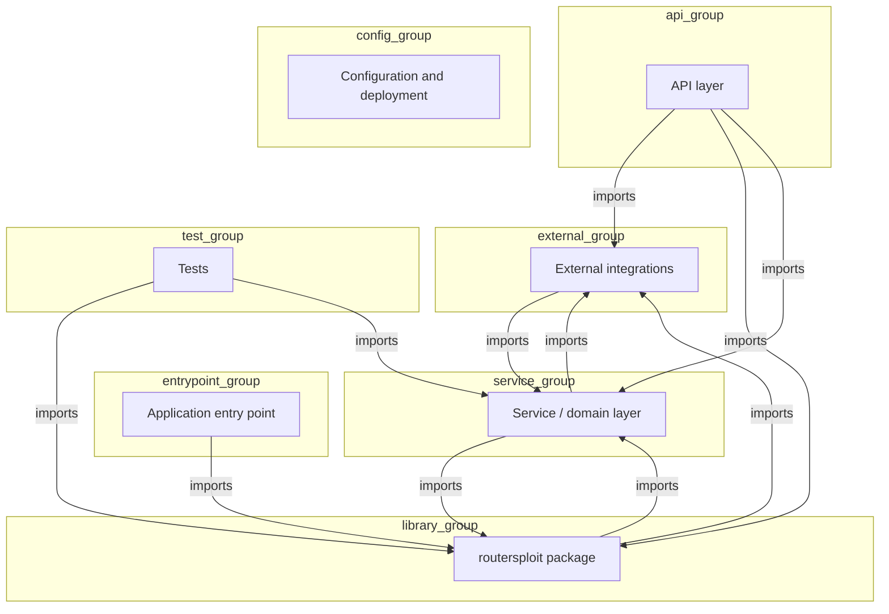

# Architecture report: threat9/routersploit

> Automated static analysis. **Observed** = directly seen in files/imports/AST; **Inferred** = interpretation from that evidence. Repository code was not executed.

## 1. Repository at a glance

| Item | Value |
| --- | --- |
| Repository | threat9/routersploit |
| Description | Exploitation Framework for Embedded Devices |
| Language | Python |
| Stars | 13304 |
| Licence | Other |
| Analysed commit / branch | 723b574c36ae202857e3f93e4f3c2ab9a1638ed4 / master |
| Framework(s) | Flask |
| Files analysed | 791 |
| Components | 7 |

## 2. Architecture in one minute

threat9/routersploit - Exploitation Framework for Embedded Devices. This repository was analysed statically from 791 file(s) (556 Python). Detected technologies (observed from imports/manifests): Flask, requests, setuptools, Docker, Docker Compose, pytest. Files are grouped into 7 component(s): API layer, Configuration and deployment, Application entry point, External integrations, routersploit package, Service / domain layer, Tests. Observed entry point(s): rsf.py. Findings below distinguish observed facts from inferred interpretation.

## 3. High-level block diagram

## 4. Main components

### API layer (`api_layer`)

- **Kind:** api
- **Status:** Observed
- **Confidence:** 0.85
- **Responsibility:** Groups 256 file(s) under api layer (observed from repository paths and static analysis). Observed top-level classes: Exploit, ExploitError.
- **Paths:** `routersploit/modules/creds/routers/2wire/__init__.py`, `routersploit/modules/creds/routers/2wire/ftp_default_creds.py`, `routersploit/modules/creds/routers/2wire/ssh_default_creds.py`, `routersploit/modules/creds/routers/2wire/telnet_default_creds.py`, `routersploit/modules/creds/routers/3com/__init__.py`, `routersploit/modules/creds/routers/3com/ftp_default_creds.py`, `routersploit/modules/creds/routers/3com/ssh_default_creds.py`, `routersploit/modules/creds/routers/3com/telnet_default_creds.py`, `routersploit/modules/creds/routers/__init__.py`, `routersploit/modules/creds/routers/asmax/__init__.py`, `routersploit/modules/creds/routers/asmax/ftp_default_creds.py`, `routersploit/modules/creds/routers/asmax/ssh_default_creds.py`, `routersploit/modules/creds/routers/asmax/telnet_default_creds.py`, `routersploit/modules/creds/routers/asmax/webinterface_http_auth_default_creds.py`, `routersploit/modules/creds/routers/asus/__init__.py`, `routersploit/modules/creds/routers/asus/ftp_default_creds.py`, `routersploit/modules/creds/routers/asus/ssh_default_creds.py`, `routersploit/modules/creds/routers/asus/telnet_default_creds.py`, `routersploit/modules/creds/routers/belkin/__init__.py`, `routersploit/modules/creds/routers/belkin/ftp_default_creds.py`, `routersploit/modules/creds/routers/belkin/ssh_default_creds.py`, `routersploit/modules/creds/routers/belkin/telnet_default_creds.py`, `routersploit/modules/creds/routers/bhu/__init__.py`, `routersploit/modules/creds/routers/bhu/ftp_default_creds.py`, `routersploit/modules/creds/routers/bhu/ssh_default_creds.py`, `routersploit/modules/creds/routers/bhu/telnet_default_creds.py`, `routersploit/modules/creds/routers/billion/__init__.py`, `routersploit/modules/creds/routers/billion/ftp_default_creds.py`, `routersploit/modules/creds/routers/billion/ssh_default_creds.py`, `routersploit/modules/creds/routers/billion/telnet_default_creds.py`, `routersploit/modules/creds/routers/cisco/__init__.py`, `routersploit/modules/creds/routers/cisco/ftp_default_creds.py`, `routersploit/modules/creds/routers/cisco/ssh_default_creds.py`, `routersploit/modules/creds/routers/cisco/telnet_default_creds.py`, `routersploit/modules/creds/routers/comtrend/__init__.py`, `routersploit/modules/creds/routers/comtrend/ftp_default_creds.py`, `routersploit/modules/creds/routers/comtrend/ssh_default_creds.py`, `routersploit/modules/creds/routers/comtrend/telnet_default_creds.py`, `routersploit/modules/creds/routers/dlink/__init__.py`, `routersploit/modules/creds/routers/dlink/ftp_default_creds.py`, `routersploit/modules/creds/routers/dlink/ssh_default_creds.py`, `routersploit/modules/creds/routers/dlink/telnet_default_creds.py`, `routersploit/modules/creds/routers/fortinet/__init__.py`, `routersploit/modules/creds/routers/fortinet/ftp_default_creds.py`, `routersploit/modules/creds/routers/fortinet/ssh_default_creds.py`, `routersploit/modules/creds/routers/fortinet/telnet_default_creds.py`, `routersploit/modules/creds/routers/huawei/__init__.py`, `routersploit/modules/creds/routers/huawei/ftp_default_creds.py`, `routersploit/modules/creds/routers/huawei/ssh_default_creds.py`, `routersploit/modules/creds/routers/huawei/telnet_default_creds.py`, `routersploit/modules/creds/routers/ipfire/__init__.py`, `routersploit/modules/creds/routers/ipfire/ftp_default_creds.py`, `routersploit/modules/creds/routers/ipfire/ssh_default_creds.py`, `routersploit/modules/creds/routers/ipfire/telnet_default_creds.py`, `routersploit/modules/creds/routers/juniper/__init__.py`, `routersploit/modules/creds/routers/juniper/ftp_default_creds.py`, `routersploit/modules/creds/routers/juniper/ssh_default_creds.py`, `routersploit/modules/creds/routers/juniper/telnet_default_creds.py`, `routersploit/modules/creds/routers/linksys/__init__.py`, `routersploit/modules/creds/routers/linksys/ftp_default_creds.py`, `routersploit/modules/creds/routers/linksys/ssh_default_creds.py`, `routersploit/modules/creds/routers/linksys/telnet_default_creds.py`, `routersploit/modules/creds/routers/mikrotik/__init__.py`, `routersploit/modules/creds/routers/mikrotik/api_ros_default_creds.py`, `routersploit/modules/creds/routers/mikrotik/ftp_default_creds.py`, `routersploit/modules/creds/routers/mikrotik/ssh_default_creds.py`, `routersploit/modules/creds/routers/mikrotik/telnet_default_creds.py`, `routersploit/modules/creds/routers/movistar/__init__.py`, `routersploit/modules/creds/routers/movistar/ftp_default_creds.py`, `routersploit/modules/creds/routers/movistar/ssh_default_creds.py`, `routersploit/modules/creds/routers/movistar/telnet_default_creds.py`, `routersploit/modules/creds/routers/netcore/__init__.py`, `routersploit/modules/creds/routers/netcore/ftp_default_creds.py`, `routersploit/modules/creds/routers/netcore/ssh_default_creds.py`, `routersploit/modules/creds/routers/netcore/telnet_default_creds.py`, `routersploit/modules/creds/routers/netgear/__init__.py`, `routersploit/modules/creds/routers/netgear/ftp_default_creds.py`, `routersploit/modules/creds/routers/netgear/ssh_default_creds.py`, `routersploit/modules/creds/routers/netgear/telnet_default_creds.py`, `routersploit/modules/creds/routers/netsys/__init__.py`, `routersploit/modules/creds/routers/netsys/ftp_default_creds.py`, `routersploit/modules/creds/routers/netsys/ssh_default_creds.py`, `routersploit/modules/creds/routers/netsys/telnet_default_creds.py`, `routersploit/modules/creds/routers/pfsense/__init__.py`, `routersploit/modules/creds/routers/pfsense/ssh_default_creds.py`, `routersploit/modules/creds/routers/pfsense/webinterface_http_form_default_creds.py`, `routersploit/modules/creds/routers/technicolor/__init__.py`, `routersploit/modules/creds/routers/technicolor/ftp_default_creds.py`, `routersploit/modules/creds/routers/technicolor/ssh_default_creds.py`, `routersploit/modules/creds/routers/technicolor/telnet_default_creds.py`, `routersploit/modules/creds/routers/thomson/__init__.py`, `routersploit/modules/creds/routers/thomson/ftp_default_creds.py`, `routersploit/modules/creds/routers/thomson/ssh_default_creds.py`, `routersploit/modules/creds/routers/thomson/telnet_default_creds.py`, `routersploit/modules/creds/routers/tplink/__init__.py`, `routersploit/modules/creds/routers/tplink/ftp_default_creds.py`, `routersploit/modules/creds/routers/tplink/ssh_default_creds.py`, `routersploit/modules/creds/routers/tplink/telnet_default_creds.py`, `routersploit/modules/creds/routers/ubiquiti/__init__.py`, `routersploit/modules/creds/routers/ubiquiti/ftp_default_creds.py`, `routersploit/modules/creds/routers/ubiquiti/ssh_default_creds.py`, `routersploit/modules/creds/routers/ubiquiti/telnet_default_creds.py`, `routersploit/modules/creds/routers/zte/__init__.py`, `routersploit/modules/creds/routers/zte/ftp_default_creds.py`, `routersploit/modules/creds/routers/zte/ssh_default_creds.py`, `routersploit/modules/creds/routers/zte/telnet_default_creds.py`, `routersploit/modules/creds/routers/zyxel/__init__.py`, `routersploit/modules/creds/routers/zyxel/ftp_default_creds.py`, `routersploit/modules/creds/routers/zyxel/ssh_default_creds.py`, `routersploit/modules/creds/routers/zyxel/telnet_default_creds.py`, `routersploit/modules/exploits/routers/2wire/4011g_5012nv_path_traversal.py`, `routersploit/modules/exploits/routers/2wire/__init__.py`, `routersploit/modules/exploits/routers/2wire/gateway_auth_bypass.py`, `routersploit/modules/exploits/routers/3com/__init__.py`, `routersploit/modules/exploits/routers/3com/ap8760_password_disclosure.py`, `routersploit/modules/exploits/routers/3com/imc_info_disclosure.py`, `routersploit/modules/exploits/routers/3com/imc_path_traversal.py`, `routersploit/modules/exploits/routers/3com/officeconnect_info_disclosure.py`, `routersploit/modules/exploits/routers/3com/officeconnect_rce.py`, `routersploit/modules/exploits/routers/__init__.py`, `routersploit/modules/exploits/routers/asmax/__init__.py`, `routersploit/modules/exploits/routers/asmax/ar_1004g_password_disclosure.py`, `routersploit/modules/exploits/routers/asmax/ar_804_gu_rce.py`, `routersploit/modules/exploits/routers/asus/__init__.py`, `routersploit/modules/exploits/routers/asus/asuswrt_lan_rce.py`, `routersploit/modules/exploits/routers/asus/infosvr_backdoor_rce.py`, `routersploit/modules/exploits/routers/asus/rt_n16_password_disclosure.py`, `routersploit/modules/exploits/routers/belkin/__init__.py`, `routersploit/modules/exploits/routers/belkin/auth_bypass.py`, `routersploit/modules/exploits/routers/belkin/g_n150_password_disclosure.py`, `routersploit/modules/exploits/routers/belkin/g_plus_info_disclosure.py`, `routersploit/modules/exploits/routers/belkin/n150_path_traversal.py`, `routersploit/modules/exploits/routers/belkin/n750_rce.py`, `routersploit/modules/exploits/routers/belkin/play_max_prce.py`, `routersploit/modules/exploits/routers/bhu/__init__.py`, `routersploit/modules/exploits/routers/bhu/bhu_urouter_rce.py`, `routersploit/modules/exploits/routers/billion/__init__.py`, `routersploit/modules/exploits/routers/billion/billion_5200w_rce.py`, `routersploit/modules/exploits/routers/billion/billion_7700nr4_password_disclosure.py`, `routersploit/modules/exploits/routers/cisco/__init__.py`, `routersploit/modules/exploits/routers/cisco/catalyst_2960_rocem.py`, `routersploit/modules/exploits/routers/cisco/dpc2420_info_disclosure.py`, `routersploit/modules/exploits/routers/cisco/firepower_management60_path_traversal.py`, `routersploit/modules/exploits/routers/cisco/firepower_management60_rce.py`, `routersploit/modules/exploits/routers/cisco/ios_http_authorization_bypass.py`, `routersploit/modules/exploits/routers/cisco/rv320_command_injection.py`, `routersploit/modules/exploits/routers/cisco/secure_acs_bypass.py`, `routersploit/modules/exploits/routers/cisco/ucm_info_disclosure.py`, `routersploit/modules/exploits/routers/cisco/ucs_manager_rce.py`, `routersploit/modules/exploits/routers/cisco/unified_multi_path_traversal.py`, `routersploit/modules/exploits/routers/comtrend/__init__.py`, `routersploit/modules/exploits/routers/comtrend/ct_5361t_password_disclosure.py`, `routersploit/modules/exploits/routers/dlink/__init__.py`, `routersploit/modules/exploits/routers/dlink/dcs_930l_auth_rce.py`, `routersploit/modules/exploits/routers/dlink/dgs_1510_add_user.py`, `routersploit/modules/exploits/routers/dlink/dir_300_320_600_615_info_disclosure.py`, `routersploit/modules/exploits/routers/dlink/dir_300_320_615_auth_bypass.py`, `routersploit/modules/exploits/routers/dlink/dir_300_600_rce.py`, `routersploit/modules/exploits/routers/dlink/dir_300_645_815_upnp_rce.py`, `routersploit/modules/exploits/routers/dlink/dir_645_815_rce.py`, `routersploit/modules/exploits/routers/dlink/dir_645_password_disclosure.py`, `routersploit/modules/exploits/routers/dlink/dir_655_866_652_rce.py`, `routersploit/modules/exploits/routers/dlink/dir_815_850l_rce.py`, `routersploit/modules/exploits/routers/dlink/dir_825_path_traversal.py`, `routersploit/modules/exploits/routers/dlink/dir_850l_creds_disclosure.py`, `routersploit/modules/exploits/routers/dlink/dir_8xx_password_disclosure.py`, `routersploit/modules/exploits/routers/dlink/dns_320l_327l_rce.py`, `routersploit/modules/exploits/routers/dlink/dsl_2640b_dns_change.py`, `routersploit/modules/exploits/routers/dlink/dsl_2730_2750_path_traversal.py`, `routersploit/modules/exploits/routers/dlink/dsl_2730b_2780b_526b_dns_change.py`, `routersploit/modules/exploits/routers/dlink/dsl_2740r_dns_change.py`, `routersploit/modules/exploits/routers/dlink/dsl_2750b_info_disclosure.py`, `routersploit/modules/exploits/routers/dlink/dsl_2750b_rce.py`, `routersploit/modules/exploits/routers/dlink/dsp_w110_rce.py`, `routersploit/modules/exploits/routers/dlink/dvg_n5402sp_path_traversal.py`, `routersploit/modules/exploits/routers/dlink/dwl_3200ap_password_disclosure.py`, `routersploit/modules/exploits/routers/dlink/dwr_932_info_disclosure.py`, `routersploit/modules/exploits/routers/dlink/dwr_932b_backdoor.py`, `routersploit/modules/exploits/routers/dlink/multi_hedwig_cgi_exec.py`, `routersploit/modules/exploits/routers/dlink/multi_hnap_rce.py`, `routersploit/modules/exploits/routers/fortinet/__init__.py`, `routersploit/modules/exploits/routers/fortinet/fortigate_os_backdoor.py`, `routersploit/modules/exploits/routers/huawei/__init__.py`, `routersploit/modules/exploits/routers/huawei/e5331_mifi_info_disclosure.py`, `routersploit/modules/exploits/routers/huawei/hg520_info_disclosure.py`, `routersploit/modules/exploits/routers/huawei/hg530_hg520b_password_disclosure.py`, `routersploit/modules/exploits/routers/huawei/hg532_rce.py`, `routersploit/modules/exploits/routers/huawei/hg866_password_change.py`, `routersploit/modules/exploits/routers/ipfire/__init__.py`, `routersploit/modules/exploits/routers/ipfire/ipfire_oinkcode_rce.py`, `routersploit/modules/exploits/routers/ipfire/ipfire_proxy_rce.py`, `routersploit/modules/exploits/routers/ipfire/ipfire_shellshock.py`, `routersploit/modules/exploits/routers/lg/__init__.py`, `routersploit/modules/exploits/routers/lg/nas_3718.py`, `routersploit/modules/exploits/routers/linksys/1500_2500_rce.py`, `routersploit/modules/exploits/routers/linksys/__init__.py`, `routersploit/modules/exploits/routers/linksys/eseries_themoon_rce.py`, `routersploit/modules/exploits/routers/linksys/smartwifi_password_disclosure.py`, `routersploit/modules/exploits/routers/linksys/wap54gv3_rce.py`, `routersploit/modules/exploits/routers/linksys/wrt100_110_rce.py`, `routersploit/modules/exploits/routers/mikrotik/__init__.py`, `routersploit/modules/exploits/routers/mikrotik/routeros_jailbreak.py`, `routersploit/modules/exploits/routers/mikrotik/winbox_auth_bypass_creds_disclosure.py`, `routersploit/modules/exploits/routers/movistar/__init__.py`, `routersploit/modules/exploits/routers/movistar/adsl_router_bhs_rta_path_traversal.py`, `routersploit/modules/exploits/routers/multi/__init__.py`, `routersploit/modules/exploits/routers/multi/gpon_home_gateway_rce.py`, `routersploit/modules/exploits/routers/multi/misfortune_cookie.py`, `routersploit/modules/exploits/routers/multi/rom0.py`, `routersploit/modules/exploits/routers/multi/tcp_32764_info_disclosure.py`, `routersploit/modules/exploits/routers/multi/tcp_32764_rce.py`, `routersploit/modules/exploits/routers/netcore/__init__.py`, `routersploit/modules/exploits/routers/netcore/udp_53413_rce.py`, `routersploit/modules/exploits/routers/netgear/__init__.py`, `routersploit/modules/exploits/routers/netgear/dgn2200_dnslookup_cgi_rce.py`, `routersploit/modules/exploits/routers/netgear/dgn2200_ping_cgi_rce.py`, `routersploit/modules/exploits/routers/netgear/jnr1010_path_traversal.py`, `routersploit/modules/exploits/routers/netgear/multi_password_disclosure-2017-5521.py`, `routersploit/modules/exploits/routers/netgear/multi_rce.py`, `routersploit/modules/exploits/routers/netgear/n300_auth_bypass.py`, `routersploit/modules/exploits/routers/netgear/prosafe_rce.py`, `routersploit/modules/exploits/routers/netgear/r7000_r6400_rce.py`, `routersploit/modules/exploits/routers/netgear/rax30_rce.py`, `routersploit/modules/exploits/routers/netgear/wnr500_612v3_jnr1010_2010_path_traversal.py`, `routersploit/modules/exploits/routers/netsys/__init__.py`, `routersploit/modules/exploits/routers/netsys/multi_rce.py`, `routersploit/modules/exploits/routers/shuttle/915wm_dns_change.py`, `routersploit/modules/exploits/routers/shuttle/__init__.py`, `routersploit/modules/exploits/routers/technicolor/__init__.py`, `routersploit/modules/exploits/routers/technicolor/dwg855_authbypass.py`, `routersploit/modules/exploits/routers/technicolor/tc7200_password_disclosure.py`, `routersploit/modules/exploits/routers/technicolor/tc7200_password_disclosure_v2.py`, `routersploit/modules/exploits/routers/technicolor/tg784_authbypass.py`, `routersploit/modules/exploits/routers/thomson/__init__.py`, `routersploit/modules/exploits/routers/thomson/twg849_info_disclosure.py`, `routersploit/modules/exploits/routers/thomson/twg850_password_disclosure.py`, `routersploit/modules/exploits/routers/tplink/__init__.py`, `routersploit/modules/exploits/routers/tplink/archer_c2_c20i_rce.py`, `routersploit/modules/exploits/routers/tplink/archer_c9_admin_password_reset.py`, `routersploit/modules/exploits/routers/tplink/wdr740nd_wdr740n_backdoor.py`, `routersploit/modules/exploits/routers/tplink/wdr740nd_wdr740n_path_traversal.py`, `routersploit/modules/exploits/routers/tplink/wdr842nd_wdr842n_configure_disclosure.py`, `routersploit/modules/exploits/routers/ubiquiti/__init__.py`, `routersploit/modules/exploits/routers/ubiquiti/airos_6_x.py`, `routersploit/modules/exploits/routers/zte/__init__.py`, `routersploit/modules/exploits/routers/zte/f460_f660_backdoor.py`, `routersploit/modules/exploits/routers/zte/zxhn_h108n_wifi_password_disclosure.py`, `routersploit/modules/exploits/routers/zte/zxv10_rce.py`, `routersploit/modules/exploits/routers/zyxel/__init__.py`, `routersploit/modules/exploits/routers/zyxel/d1000_rce.py`, `routersploit/modules/exploits/routers/zyxel/d1000_wifi_password_disclosure.py`, `routersploit/modules/exploits/routers/zyxel/p660hn_t_v1_rce.py`, `routersploit/modules/exploits/routers/zyxel/p660hn_t_v2_rce.py`, `routersploit/modules/exploits/routers/zyxel/zywall_usg_extract_hashes.py`, `routersploit/modules/scanners/routers/__init__.py`, `routersploit/modules/scanners/routers/router_scan.py`
- **Evidence:** [routersploit/modules/creds/routers/2wire/__init__.py](https://github.com/threat9/routersploit/blob/723b574c36ae202857e3f93e4f3c2ab9a1638ed4/routersploit/modules/creds/routers/2wire/__init__.py); [routersploit/modules/creds/routers/2wire/ftp_default_creds.py:7](https://github.com/threat9/routersploit/blob/723b574c36ae202857e3f93e4f3c2ab9a1638ed4/routersploit/modules/creds/routers/2wire/ftp_default_creds.py#L7); [routersploit/modules/creds/routers/2wire/ssh_default_creds.py:7](https://github.com/threat9/routersploit/blob/723b574c36ae202857e3f93e4f3c2ab9a1638ed4/routersploit/modules/creds/routers/2wire/ssh_default_creds.py#L7); [routersploit/modules/creds/routers/2wire/telnet_default_creds.py:7](https://github.com/threat9/routersploit/blob/723b574c36ae202857e3f93e4f3c2ab9a1638ed4/routersploit/modules/creds/routers/2wire/telnet_default_creds.py#L7); [routersploit/modules/creds/routers/3com/__init__.py](https://github.com/threat9/routersploit/blob/723b574c36ae202857e3f93e4f3c2ab9a1638ed4/routersploit/modules/creds/routers/3com/__init__.py); [routersploit/modules/creds/routers/3com/ftp_default_creds.py:7](https://github.com/threat9/routersploit/blob/723b574c36ae202857e3f93e4f3c2ab9a1638ed4/routersploit/modules/creds/routers/3com/ftp_default_creds.py#L7); [routersploit/modules/creds/routers/3com/ssh_default_creds.py:7](https://github.com/threat9/routersploit/blob/723b574c36ae202857e3f93e4f3c2ab9a1638ed4/routersploit/modules/creds/routers/3com/ssh_default_creds.py#L7); [routersploit/modules/creds/routers/3com/telnet_default_creds.py:7](https://github.com/threat9/routersploit/blob/723b574c36ae202857e3f93e4f3c2ab9a1638ed4/routersploit/modules/creds/routers/3com/telnet_default_creds.py#L7)

### Configuration and deployment (`config`)

- **Kind:** config
- **Status:** Observed
- **Confidence:** 0.85
- **Responsibility:** Groups 15 file(s) under configuration and deployment (observed from repository paths and static analysis).
- **Paths:** `Dockerfile`, `MANIFEST.in`, `docker-compose.yaml`, `requirements-dev.txt`, `requirements.txt`, `routersploit/resources/ssh_keys/array-networks-vapv-vxag.json`, `routersploit/resources/ssh_keys/barracuda_load_balancer_vm.json`, `routersploit/resources/ssh_keys/ceragon-fibeair-cve-2015-0936.json`, `routersploit/resources/ssh_keys/exagrid-cve-2016-1561.json`, `routersploit/resources/ssh_keys/f5-bigip-cve-2012-1493.json`, `routersploit/resources/ssh_keys/loadbalancer.org-enterprise-va.json`, `routersploit/resources/ssh_keys/monroe-dasdec-cve-2013-0137.json`, `routersploit/resources/ssh_keys/quantum-dxi-v1000.json`, `routersploit/resources/ssh_keys/vagrant.json`, `setup.py`
- **Evidence:** [Dockerfile](https://github.com/threat9/routersploit/blob/723b574c36ae202857e3f93e4f3c2ab9a1638ed4/Dockerfile); [MANIFEST.in](https://github.com/threat9/routersploit/blob/723b574c36ae202857e3f93e4f3c2ab9a1638ed4/MANIFEST.in); [docker-compose.yaml](https://github.com/threat9/routersploit/blob/723b574c36ae202857e3f93e4f3c2ab9a1638ed4/docker-compose.yaml); [requirements-dev.txt](https://github.com/threat9/routersploit/blob/723b574c36ae202857e3f93e4f3c2ab9a1638ed4/requirements-dev.txt); [requirements.txt](https://github.com/threat9/routersploit/blob/723b574c36ae202857e3f93e4f3c2ab9a1638ed4/requirements.txt); [routersploit/resources/ssh_keys/array-networks-vapv-vxag.json](https://github.com/threat9/routersploit/blob/723b574c36ae202857e3f93e4f3c2ab9a1638ed4/routersploit/resources/ssh_keys/array-networks-vapv-vxag.json); [routersploit/resources/ssh_keys/barracuda_load_balancer_vm.json](https://github.com/threat9/routersploit/blob/723b574c36ae202857e3f93e4f3c2ab9a1638ed4/routersploit/resources/ssh_keys/barracuda_load_balancer_vm.json); [routersploit/resources/ssh_keys/ceragon-fibeair-cve-2015-0936.json](https://github.com/threat9/routersploit/blob/723b574c36ae202857e3f93e4f3c2ab9a1638ed4/routersploit/resources/ssh_keys/ceragon-fibeair-cve-2015-0936.json)

### Application entry point (`entrypoint`)

- **Kind:** entrypoint
- **Status:** Observed
- **Confidence:** 0.85
- **Responsibility:** Groups 1 file(s) under application entry point (observed from repository paths and static analysis). Observed top-level functions: routersploit.
- **Paths:** `rsf.py`
- **Evidence:** [rsf.py:19](https://github.com/threat9/routersploit/blob/723b574c36ae202857e3f93e4f3c2ab9a1638ed4/rsf.py#L19)

### External integrations (`external_integrations`)

- **Kind:** external
- **Status:** Observed
- **Confidence:** 0.85
- **Responsibility:** Groups 9 file(s) under external integrations (observed from repository paths and static analysis). Observed top-level classes: ApiRosClient, BTLEClient, CreateSocketError, FTPCli, FTPClient, HTTPClient.
- **Paths:** `routersploit/core/bluetooth/btle_client.py`, `routersploit/core/ftp/ftp_client.py`, `routersploit/core/http/http_client.py`, `routersploit/core/snmp/snmp_client.py`, `routersploit/core/ssh/ssh_client.py`, `routersploit/core/tcp/tcp_client.py`, `routersploit/core/telnet/telnet_client.py`, `routersploit/core/udp/udp_client.py`, `routersploit/libs/apiros/apiros_client.py`
- **Evidence:** [routersploit/core/bluetooth/btle_client.py:13](https://github.com/threat9/routersploit/blob/723b574c36ae202857e3f93e4f3c2ab9a1638ed4/routersploit/core/bluetooth/btle_client.py#L13); [routersploit/core/ftp/ftp_client.py:14](https://github.com/threat9/routersploit/blob/723b574c36ae202857e3f93e4f3c2ab9a1638ed4/routersploit/core/ftp/ftp_client.py#L14); [routersploit/core/http/http_client.py:17](https://github.com/threat9/routersploit/blob/723b574c36ae202857e3f93e4f3c2ab9a1638ed4/routersploit/core/http/http_client.py#L17); [routersploit/core/snmp/snmp_client.py:14](https://github.com/threat9/routersploit/blob/723b574c36ae202857e3f93e4f3c2ab9a1638ed4/routersploit/core/snmp/snmp_client.py#L14); [routersploit/core/ssh/ssh_client.py:20](https://github.com/threat9/routersploit/blob/723b574c36ae202857e3f93e4f3c2ab9a1638ed4/routersploit/core/ssh/ssh_client.py#L20); [routersploit/core/tcp/tcp_client.py:15](https://github.com/threat9/routersploit/blob/723b574c36ae202857e3f93e4f3c2ab9a1638ed4/routersploit/core/tcp/tcp_client.py#L15); [routersploit/core/telnet/telnet_client.py:16](https://github.com/threat9/routersploit/blob/723b574c36ae202857e3f93e4f3c2ab9a1638ed4/routersploit/core/telnet/telnet_client.py#L16); [routersploit/core/udp/udp_client.py:14](https://github.com/threat9/routersploit/blob/723b574c36ae202857e3f93e4f3c2ab9a1638ed4/routersploit/core/udp/udp_client.py#L14)

### routersploit package (`routersploit`)

- **Kind:** library
- **Status:** Observed
- **Confidence:** 0.85
- **Responsibility:** Groups 241 file(s) under routersploit package (observed from repository paths and static analysis). Observed top-level classes: BaseInterpreter, BitReader, Encoder, Exploit, Payload, RingList. Observed top-level functions: LZSDecompress, is_libedit.
- **Paths:** `routersploit/__init__.py`, `routersploit/interpreter.py`, `routersploit/libs/__init__.py`, `routersploit/libs/apiros/__init__.py`, `routersploit/libs/lzs/__init__.py`, `routersploit/libs/lzs/lzs.py`, `routersploit/modules/__init__.py`, `routersploit/modules/creds/__init__.py`, `routersploit/modules/creds/cameras/__init__.py`, `routersploit/modules/creds/cameras/acti/__init__.py`, `routersploit/modules/creds/cameras/acti/ftp_default_creds.py`, `routersploit/modules/creds/cameras/acti/ssh_default_creds.py`, `routersploit/modules/creds/cameras/acti/telnet_default_creds.py`, `routersploit/modules/creds/cameras/acti/webinterface_http_form_default_creds.py`, `routersploit/modules/creds/cameras/american_dynamics/__init__.py`, `routersploit/modules/creds/cameras/american_dynamics/ftp_default_creds.py`, `routersploit/modules/creds/cameras/american_dynamics/ssh_default_creds.py`, `routersploit/modules/creds/cameras/american_dynamics/telnet_default_creds.py`, `routersploit/modules/creds/cameras/arecont/__init__.py`, `routersploit/modules/creds/cameras/arecont/ftp_default_creds.py`, `routersploit/modules/creds/cameras/arecont/ssh_default_creds.py`, `routersploit/modules/creds/cameras/arecont/telnet_default_creds.py`, `routersploit/modules/creds/cameras/avigilon/__init__.py`, `routersploit/modules/creds/cameras/avigilon/ftp_default_creds.py`, `routersploit/modules/creds/cameras/avigilon/ssh_default_creds.py`, `routersploit/modules/creds/cameras/avigilon/telnet_default_creds.py`, `routersploit/modules/creds/cameras/avtech/__init__.py`, `routersploit/modules/creds/cameras/avtech/ftp_default_creds.py`, `routersploit/modules/creds/cameras/avtech/ssh_default_creds.py`, `routersploit/modules/creds/cameras/avtech/telnet_default_creds.py`, `routersploit/modules/creds/cameras/axis/__init__.py`, `routersploit/modules/creds/cameras/axis/ftp_default_creds.py`, `routersploit/modules/creds/cameras/axis/ssh_default_creds.py`, `routersploit/modules/creds/cameras/axis/telnet_default_creds.py`, `routersploit/modules/creds/cameras/axis/webinterface_http_auth_default_creds.py`, `routersploit/modules/creds/cameras/basler/__init__.py`, `routersploit/modules/creds/cameras/basler/ftp_default_creds.py`, `routersploit/modules/creds/cameras/basler/ssh_default_creds.py`, `routersploit/modules/creds/cameras/basler/telnet_default_creds.py`, `routersploit/modules/creds/cameras/basler/webinterface_http_form_default_creds.py`, `routersploit/modules/creds/cameras/brickcom/__init__.py`, `routersploit/modules/creds/cameras/brickcom/ftp_default_creds.py`, `routersploit/modules/creds/cameras/brickcom/ssh_default_creds.py`, `routersploit/modules/creds/cameras/brickcom/telnet_default_creds.py`, `routersploit/modules/creds/cameras/brickcom/webinterface_http_auth_default_creds.py`, `routersploit/modules/creds/cameras/canon/__init__.py`, `routersploit/modules/creds/cameras/canon/ftp_default_creds.py`, `routersploit/modules/creds/cameras/canon/ssh_default_creds.py`, `routersploit/modules/creds/cameras/canon/telnet_default_creds.py`, `routersploit/modules/creds/cameras/canon/webinterface_http_auth_default_creds.py`, `routersploit/modules/creds/cameras/cisco/__init__.py`, `routersploit/modules/creds/cameras/cisco/ftp_default_creds.py`, `routersploit/modules/creds/cameras/cisco/ssh_default_creds.py`, `routersploit/modules/creds/cameras/cisco/telnet_default_creds.py`, `routersploit/modules/creds/cameras/dlink/__init__.py`, `routersploit/modules/creds/cameras/dlink/ftp_default_creds.py`, `routersploit/modules/creds/cameras/dlink/ssh_default_creds.py`, `routersploit/modules/creds/cameras/dlink/telnet_default_creds.py`, `routersploit/modules/creds/cameras/geovision/__init__.py`, `routersploit/modules/creds/cameras/geovision/ftp_default_creds.py`, `routersploit/modules/creds/cameras/geovision/ssh_default_creds.py`, `routersploit/modules/creds/cameras/geovision/telnet_default_creds.py`, `routersploit/modules/creds/cameras/grandstream/__init__.py`, `routersploit/modules/creds/cameras/grandstream/ftp_default_creds.py`, `routersploit/modules/creds/cameras/grandstream/ssh_default_creds.py`, `routersploit/modules/creds/cameras/grandstream/telnet_default_creds.py`, `routersploit/modules/creds/cameras/hikvision/__init__.py`, `routersploit/modules/creds/cameras/hikvision/ftp_default_creds.py`, `routersploit/modules/creds/cameras/hikvision/ssh_default_creds.py`, `routersploit/modules/creds/cameras/hikvision/telnet_default_creds.py`, `routersploit/modules/creds/cameras/honeywell/__init__.py`, `routersploit/modules/creds/cameras/honeywell/ftp_default_creds.py`, `routersploit/modules/creds/cameras/honeywell/ssh_default_creds.py`, `routersploit/modules/creds/cameras/honeywell/telnet_default_creds.py`, `routersploit/modules/creds/cameras/iqinvision/__init__.py`, `routersploit/modules/creds/cameras/iqinvision/ftp_default_creds.py`, `routersploit/modules/creds/cameras/iqinvision/ssh_default_creds.py`, `routersploit/modules/creds/cameras/iqinvision/telnet_default_creds.py`, `routersploit/modules/creds/cameras/jvc/__init__.py`, `routersploit/modules/creds/cameras/jvc/ftp_default_creds.py`, `routersploit/modules/creds/cameras/jvc/ssh_default_creds.py`, `routersploit/modules/creds/cameras/jvc/telnet_default_creds.py`, `routersploit/modules/creds/cameras/mobotix/__init__.py`, `routersploit/modules/creds/cameras/mobotix/ftp_default_creds.py`, `routersploit/modules/creds/cameras/mobotix/ssh_default_creds.py`, `routersploit/modules/creds/cameras/mobotix/telnet_default_creds.py`, `routersploit/modules/creds/cameras/samsung/__init__.py`, `routersploit/modules/creds/cameras/samsung/ftp_default_creds.py`, `routersploit/modules/creds/cameras/samsung/ssh_default_creds.py`, `routersploit/modules/creds/cameras/samsung/telnet_default_creds.py`, `routersploit/modules/creds/cameras/sentry360/__init__.py`, `routersploit/modules/creds/cameras/sentry360/ftp_default_creds.py`, `routersploit/modules/creds/cameras/sentry360/ssh_default_creds.py`, `routersploit/modules/creds/cameras/sentry360/telnet_default_creds.py`, `routersploit/modules/creds/cameras/siemens/__init__.py`, `routersploit/modules/creds/cameras/siemens/ftp_default_creds.py`, `routersploit/modules/creds/cameras/siemens/ssh_default_creds.py`, `routersploit/modules/creds/cameras/siemens/telnet_default_creds.py`, `routersploit/modules/creds/cameras/speco/__init__.py`, `routersploit/modules/creds/cameras/speco/ftp_default_creds.py`, `routersploit/modules/creds/cameras/speco/ssh_default_creds.py`, `routersploit/modules/creds/cameras/speco/telnet_default_creds.py`, `routersploit/modules/creds/cameras/stardot/__init__.py`, `routersploit/modules/creds/cameras/stardot/ftp_default_creds.py`, `routersploit/modules/creds/cameras/stardot/ssh_default_creds.py`, `routersploit/modules/creds/cameras/stardot/telnet_default_creds.py`, `routersploit/modules/creds/cameras/vacron/__init__.py`, `routersploit/modules/creds/cameras/vacron/ftp_default_creds.py`, `routersploit/modules/creds/cameras/vacron/ssh_default_creds.py`, `routersploit/modules/creds/cameras/vacron/telnet_default_creds.py`, `routersploit/modules/creds/cameras/videoiq/__init__.py`, `routersploit/modules/creds/cameras/videoiq/ftp_default_creds.py`, `routersploit/modules/creds/cameras/videoiq/ssh_default_creds.py`, `routersploit/modules/creds/cameras/videoiq/telnet_default_creds.py`, `routersploit/modules/creds/generic/__init__.py`, `routersploit/modules/creds/generic/ftp_bruteforce.py`, `routersploit/modules/creds/generic/ftp_default.py`, `routersploit/modules/creds/generic/http_basic_digest_bruteforce.py`, `routersploit/modules/creds/generic/http_basic_digest_default.py`, `routersploit/modules/creds/generic/snmp_bruteforce.py`, `routersploit/modules/creds/generic/ssh_bruteforce.py`, `routersploit/modules/creds/generic/ssh_default.py`, `routersploit/modules/creds/generic/telnet_bruteforce.py`, `routersploit/modules/creds/generic/telnet_default.py`, `routersploit/modules/creds/printers/__init__.py`, `routersploit/modules/encoders/__init__.py`, `routersploit/modules/encoders/perl/base64.py`, `routersploit/modules/encoders/perl/hex.py`, `routersploit/modules/encoders/php/__init__.py`, `routersploit/modules/encoders/php/base64.py`, `routersploit/modules/encoders/php/hex.py`, `routersploit/modules/encoders/python/__init__.py`, `routersploit/modules/encoders/python/base64.py`, `routersploit/modules/encoders/python/hex.py`, `routersploit/modules/exploits/__init__.py`, `routersploit/modules/exploits/cameras/__init__.py`, `routersploit/modules/exploits/cameras/acti/__init__.py`, `routersploit/modules/exploits/cameras/acti/acm_5611_rce.py`, `routersploit/modules/exploits/cameras/avigilon/__init__.py`, `routersploit/modules/exploits/cameras/avigilon/videoiq_camera_path_traversal.py`, `routersploit/modules/exploits/cameras/beward/__init__.py`, `routersploit/modules/exploits/cameras/beward/n100_rce.py`, `routersploit/modules/exploits/cameras/brickcom/__init__.py`, `routersploit/modules/exploits/cameras/brickcom/corp_network_cameras_conf_disclosure.py`, `routersploit/modules/exploits/cameras/brickcom/users_cgi_creds_disclosure.py`, `routersploit/modules/exploits/cameras/cisco/__init__.py`, `routersploit/modules/exploits/cameras/cisco/video_surv_path_traversal.py`, `routersploit/modules/exploits/cameras/dlink/__init__.py`, `routersploit/modules/exploits/cameras/dlink/dcs_930l_932l_auth_bypass.py`, `routersploit/modules/exploits/cameras/geuterbruck/__init__.py`, `routersploit/modules/exploits/cameras/geuterbruck/efd_2250.py`, `routersploit/modules/exploits/cameras/grandstream/__init__.py`, `routersploit/modules/exploits/cameras/grandstream/gxv3611hd_ip_camera_backdoor.py`, `routersploit/modules/exploits/cameras/grandstream/gxv3611hd_ip_camera_sqli.py`, `routersploit/modules/exploits/cameras/honeywell/__init__.py`, `routersploit/modules/exploits/cameras/honeywell/hicc_1100pt_password_disclosure.py`, `routersploit/modules/exploits/cameras/jovision/__init__.py`, `routersploit/modules/exploits/cameras/jovision/jovision_credentials_disclosure.py`, `routersploit/modules/exploits/cameras/multi/P2P_wificam_credential_disclosure.py`, `routersploit/modules/exploits/cameras/multi/P2P_wificam_rce.py`, `routersploit/modules/exploits/cameras/multi/__init__.py`, `routersploit/modules/exploits/cameras/multi/cctv_dvr_rce.py`, `routersploit/modules/exploits/cameras/multi/dvr_creds_disclosure.py`, `routersploit/modules/exploits/cameras/multi/jvc_vanderbilt_honeywell_path_traversal.py`, `routersploit/modules/exploits/cameras/multi/netwave_ip_camera_information_disclosure.py`, `routersploit/modules/exploits/cameras/mvpower/__init__.py`, `routersploit/modules/exploits/cameras/mvpower/dvr_jaws_rce.py`, `routersploit/modules/exploits/cameras/siemens/__init__.py`, `routersploit/modules/exploits/cameras/siemens/cvms2025_credentials_disclosure.py`, `routersploit/modules/exploits/cameras/xiongmai/__init__.py`, `routersploit/modules/exploits/cameras/xiongmai/uc_httpd_path_traversal.py`, `routersploit/modules/exploits/generic/__init__.py`, `routersploit/modules/exploits/generic/heartbleed.py`, `routersploit/modules/exploits/generic/shellshock.py`, `routersploit/modules/exploits/generic/ssh_auth_keys.py`, `routersploit/modules/exploits/misc/__init__.py`, `routersploit/modules/exploits/misc/asus/__init__.py`, `routersploit/modules/exploits/misc/asus/b1m_projector_rce.py`, `routersploit/modules/exploits/misc/miele/__init__.py`, `routersploit/modules/exploits/misc/miele/pg8528_path_traversal.py`, `routersploit/modules/exploits/misc/watchguard/__init__.py`, `routersploit/modules/exploits/misc/watchguard/xcs_9_rce.py`, `routersploit/modules/exploits/misc/wepresent/__init__.py`, `routersploit/modules/exploits/misc/wepresent/wipg1000_rce.py`, `routersploit/modules/generic/__init__.py`, `routersploit/modules/generic/bluetooth/__init__.py`, `routersploit/modules/generic/bluetooth/btle_enumerate.py`, `routersploit/modules/generic/bluetooth/btle_scan.py`, `routersploit/modules/generic/bluetooth/btle_write.py`, `routersploit/modules/generic/upnp/__init__.py`, `routersploit/modules/generic/upnp/ssdp_msearch.py`, `routersploit/modules/payloads/__init__.py`, `routersploit/modules/payloads/armle/__init__.py`, `routersploit/modules/payloads/armle/bind_tcp.py`, `routersploit/modules/payloads/armle/reverse_tcp.py`, `routersploit/modules/payloads/cmd/__init__.py`, `routersploit/modules/payloads/cmd/awk_bind_tcp.py`, `routersploit/modules/payloads/cmd/awk_bind_udp.py`, `routersploit/modules/payloads/cmd/awk_reverse_tcp.py`, `routersploit/modules/payloads/cmd/bash_reverse_tcp.py`, `routersploit/modules/payloads/cmd/netcat_bind_tcp.py`, `routersploit/modules/payloads/cmd/netcat_reverse_tcp.py`, `routersploit/modules/payloads/cmd/perl_bind_tcp.py`, `routersploit/modules/payloads/cmd/perl_reverse_tcp.py`, `routersploit/modules/payloads/cmd/php_bind_tcp.py`, `routersploit/modules/payloads/cmd/php_reverse_tcp.py`, `routersploit/modules/payloads/cmd/python_bind_tcp.py`, `routersploit/modules/payloads/cmd/python_bind_udp.py`, `routersploit/modules/payloads/cmd/python_reverse_tcp.py`, `routersploit/modules/payloads/cmd/python_reverse_udp.py`, `routersploit/modules/payloads/mipsbe/__init__.py`, `routersploit/modules/payloads/mipsbe/bind_tcp.py`, `routersploit/modules/payloads/mipsbe/reverse_tcp.py`, `routersploit/modules/payloads/mipsle/__init__.py`, `routersploit/modules/payloads/mipsle/bind_tcp.py`, `routersploit/modules/payloads/mipsle/reverse_tcp.py`, `routersploit/modules/payloads/perl/__init__.py`, `routersploit/modules/payloads/perl/bind_tcp.py`, `routersploit/modules/payloads/perl/reverse_tcp.py`, `routersploit/modules/payloads/php/__init__.py`, `routersploit/modules/payloads/php/bind_tcp.py`, `routersploit/modules/payloads/php/reverse_tcp.py`, `routersploit/modules/payloads/python/__init__.py`, `routersploit/modules/payloads/python/bind_tcp.py`, `routersploit/modules/payloads/python/bind_udp.py`, `routersploit/modules/payloads/python/reverse_tcp.py`, `routersploit/modules/payloads/python/reverse_udp.py`, `routersploit/modules/payloads/x64/__init__.py`, `routersploit/modules/payloads/x64/bind_tcp.py`, `routersploit/modules/payloads/x64/reverse_tcp.py`, `routersploit/modules/payloads/x86/__init__.py`, `routersploit/modules/payloads/x86/bind_tcp.py`, `routersploit/modules/payloads/x86/reverse_tcp.py`, `routersploit/modules/scanners/__init__.py`, `routersploit/modules/scanners/autopwn.py`, `routersploit/modules/scanners/cameras/__init__.py`, `routersploit/modules/scanners/cameras/camera_scan.py`, `routersploit/modules/scanners/misc/__init__.py`, `routersploit/modules/scanners/misc/misc_scan.py`, `routersploit/resources/__init__.py`, `routersploit/resources/wordlists/__init__.py`
- **Evidence:** [routersploit/__init__.py](https://github.com/threat9/routersploit/blob/723b574c36ae202857e3f93e4f3c2ab9a1638ed4/routersploit/__init__.py); [routersploit/interpreter.py:39](https://github.com/threat9/routersploit/blob/723b574c36ae202857e3f93e4f3c2ab9a1638ed4/routersploit/interpreter.py#L39); [routersploit/libs/__init__.py](https://github.com/threat9/routersploit/blob/723b574c36ae202857e3f93e4f3c2ab9a1638ed4/routersploit/libs/__init__.py); [routersploit/libs/apiros/__init__.py](https://github.com/threat9/routersploit/blob/723b574c36ae202857e3f93e4f3c2ab9a1638ed4/routersploit/libs/apiros/__init__.py); [routersploit/libs/lzs/__init__.py](https://github.com/threat9/routersploit/blob/723b574c36ae202857e3f93e4f3c2ab9a1638ed4/routersploit/libs/lzs/__init__.py); [routersploit/libs/lzs/lzs.py:26](https://github.com/threat9/routersploit/blob/723b574c36ae202857e3f93e4f3c2ab9a1638ed4/routersploit/libs/lzs/lzs.py#L26); [routersploit/modules/__init__.py](https://github.com/threat9/routersploit/blob/723b574c36ae202857e3f93e4f3c2ab9a1638ed4/routersploit/modules/__init__.py); [routersploit/modules/creds/__init__.py](https://github.com/threat9/routersploit/blob/723b574c36ae202857e3f93e4f3c2ab9a1638ed4/routersploit/modules/creds/__init__.py)

### Service / domain layer (`service_layer`)

- **Kind:** service
- **Status:** Observed
- **Confidence:** 0.85
- **Responsibility:** Groups 21 file(s) under service / domain layer (observed from repository paths and static analysis). Observed top-level classes: ArchitectureSpecificPayload, BTLEScanner, BaseEncoder, BaseExploit, BasePayload, BindTCPPayloadMixin. Observed top-level functions: __cprint, color_blue, color_green, color_red, convert_ip, convert_port.
- **Paths:** `routersploit/core/__init__.py`, `routersploit/core/bluetooth/__init__.py`, `routersploit/core/bluetooth/btle/__init__.py`, `routersploit/core/bluetooth/btle/btle_device.py`, `routersploit/core/bluetooth/btle/btle_scanner.py`, `routersploit/core/exploit/__init__.py`, `routersploit/core/exploit/encoders.py`, `routersploit/core/exploit/exceptions.py`, `routersploit/core/exploit/exploit.py`, `routersploit/core/exploit/option.py`, `routersploit/core/exploit/payloads.py`, `routersploit/core/exploit/printer.py`, `routersploit/core/exploit/shell.py`, `routersploit/core/exploit/utils.py`, `routersploit/core/ftp/__init__.py`, `routersploit/core/http/__init__.py`, `routersploit/core/snmp/__init__.py`, `routersploit/core/ssh/__init__.py`, `routersploit/core/tcp/__init__.py`, `routersploit/core/telnet/__init__.py`, `routersploit/core/udp/__init__.py`
- **Evidence:** [routersploit/core/__init__.py](https://github.com/threat9/routersploit/blob/723b574c36ae202857e3f93e4f3c2ab9a1638ed4/routersploit/core/__init__.py); [routersploit/core/bluetooth/__init__.py](https://github.com/threat9/routersploit/blob/723b574c36ae202857e3f93e4f3c2ab9a1638ed4/routersploit/core/bluetooth/__init__.py); [routersploit/core/bluetooth/btle/__init__.py](https://github.com/threat9/routersploit/blob/723b574c36ae202857e3f93e4f3c2ab9a1638ed4/routersploit/core/bluetooth/btle/__init__.py); [routersploit/core/bluetooth/btle/btle_device.py:21](https://github.com/threat9/routersploit/blob/723b574c36ae202857e3f93e4f3c2ab9a1638ed4/routersploit/core/bluetooth/btle/btle_device.py#L21); [routersploit/core/bluetooth/btle/btle_scanner.py:7](https://github.com/threat9/routersploit/blob/723b574c36ae202857e3f93e4f3c2ab9a1638ed4/routersploit/core/bluetooth/btle/btle_scanner.py#L7); [routersploit/core/exploit/__init__.py](https://github.com/threat9/routersploit/blob/723b574c36ae202857e3f93e4f3c2ab9a1638ed4/routersploit/core/exploit/__init__.py); [routersploit/core/exploit/encoders.py:5](https://github.com/threat9/routersploit/blob/723b574c36ae202857e3f93e4f3c2ab9a1638ed4/routersploit/core/exploit/encoders.py#L5); [routersploit/core/exploit/exceptions.py:1](https://github.com/threat9/routersploit/blob/723b574c36ae202857e3f93e4f3c2ab9a1638ed4/routersploit/core/exploit/exceptions.py#L1)

### Tests (`tests`)

- **Kind:** test
- **Status:** Observed
- **Confidence:** 0.85
- **Responsibility:** Groups 27 file(s) under tests (observed from repository paths and static analysis). Observed top-level functions: apply_response, empty_target, error_target, generic_target, not_found_target, redirect_target.
- **Paths:** `tests/__init__.py`, `tests/conftest.py`, `tests/core/__init__.py`, `tests/core/test_option.py`, `tests/creds/__init__.py`, `tests/creds/cameras/__init__.py`, `tests/creds/cameras/acti/__init__.py`, `tests/creds/cameras/acti/test_ftp_default_creds.py`, `tests/creds/cameras/acti/test_ssh_default_creds.py`, `tests/creds/cameras/acti/test_telnet_default_creds.py`, `tests/creds/cameras/acti/test_webinterface_default_creds.py`, `tests/creds/cameras/american_dynamics/__init__.py`, `tests/creds/cameras/american_dynamics/test_ftp_default_creds.py`, `tests/creds/cameras/american_dynamics/test_ssh_default_creds.py`, `tests/creds/cameras/american_dynamics/test_telnet_default_creds.py`, `tests/creds/cameras/arecont/__init__.py`, `tests/creds/cameras/arecont/test_ftp_default_creds.py`, `tests/creds/cameras/arecont/test_ssh_default_creds.py`, `tests/creds/cameras/arecont/test_telnet_default_creds.py`, `tests/creds/cameras/avigilon/__init__.py`, `tests/creds/cameras/avigilon/test_ftp_default_creds.py`, `tests/creds/cameras/avigilon/test_ssh_default_creds.py`, `tests/creds/cameras/avigilon/test_telnet_default_creds.py`, `tests/creds/cameras/avtech/__init__.py`, `tests/creds/cameras/avtech/test_ftp_default_creds.py`, `tests/creds/cameras/avtech/test_ssh_default_creds.py`, `tests/creds/cameras/avtech/test_telnet_default_creds.py`
- **Evidence:** [tests/__init__.py](https://github.com/threat9/routersploit/blob/723b574c36ae202857e3f93e4f3c2ab9a1638ed4/tests/__init__.py); [tests/conftest.py:12](https://github.com/threat9/routersploit/blob/723b574c36ae202857e3f93e4f3c2ab9a1638ed4/tests/conftest.py#L12); [tests/core/__init__.py](https://github.com/threat9/routersploit/blob/723b574c36ae202857e3f93e4f3c2ab9a1638ed4/tests/core/__init__.py); [tests/core/test_option.py:16](https://github.com/threat9/routersploit/blob/723b574c36ae202857e3f93e4f3c2ab9a1638ed4/tests/core/test_option.py#L16); [tests/creds/__init__.py](https://github.com/threat9/routersploit/blob/723b574c36ae202857e3f93e4f3c2ab9a1638ed4/tests/creds/__init__.py); [tests/creds/cameras/__init__.py](https://github.com/threat9/routersploit/blob/723b574c36ae202857e3f93e4f3c2ab9a1638ed4/tests/creds/cameras/__init__.py); [tests/creds/cameras/acti/__init__.py](https://github.com/threat9/routersploit/blob/723b574c36ae202857e3f93e4f3c2ab9a1638ed4/tests/creds/cameras/acti/__init__.py); [tests/creds/cameras/acti/test_ftp_default_creds.py:4](https://github.com/threat9/routersploit/blob/723b574c36ae202857e3f93e4f3c2ab9a1638ed4/tests/creds/cameras/acti/test_ftp_default_creds.py#L4)

## 5. Execution flow

**Observed** entry point(s):

- [rsf.py:26](https://github.com/threat9/routersploit/blob/723b574c36ae202857e3f93e4f3c2ab9a1638ed4/rsf.py#L26)

Representative flow (derived from observed entry points and the import graph; steps beyond the entry point are **Inferred**):

1. Execution starts at an observed entry point listed above, if present.
2. `api_layer` imports `external_integrations` (API layer -> External integrations).
3. `api_layer` imports `routersploit` (API layer -> routersploit package).
4. `api_layer` imports `service_layer` (API layer -> Service / domain layer).
5. `entrypoint` imports `routersploit` (Application entry point -> routersploit package).
6. `external_integrations` imports `service_layer` (External integrations -> Service / domain layer).
7. `routersploit` imports `external_integrations` (routersploit package -> External integrations).
8. `routersploit` imports `service_layer` (routersploit package -> Service / domain layer).
9. `service_layer` imports `external_integrations` (Service / domain layer -> External integrations).

## 6. Project structure

### `(root)`

- `.dockerignore` - container (58 bytes)
- `.gitignore` - other (888 bytes)
- `.travis.yml` - ci, YAML (212 bytes)
- `CONTRIBUTING.md` - docs (1710 bytes)
- `Dockerfile` - container (342 bytes)
- `LICENSE` - docs (1844 bytes)
- `MANIFEST.in` - manifest (175 bytes)
- `Makefile` - other (1082 bytes)
- `README.md` - docs (3702 bytes)
- `docker-compose.yaml` - container (238 bytes)
- `requirements-dev.txt` - manifest (158 bytes)
- `requirements.txt` - manifest (46 bytes)
- `rsf.py` - source, Python (846 bytes)
- `setup.py` - manifest, Python (1518 bytes)

### `.github`

- `.github/ISSUE_TEMPLATE.md` - docs (590 bytes)
- `.github/PULL_REQUEST_TEMPLATE.md` - docs (693 bytes)

### `.travis`

- `.travis/install.sh` - source, Shell (510 bytes)
- `.travis/run.sh` - source, Shell (211 bytes)

### `docs`

- `docs/modules/creds/cameras/acti/ftp_default_creds.md` - docs (1326 bytes)
- `docs/modules/creds/cameras/acti/ssh_default_creds.md` - docs (1369 bytes)
- `docs/modules/creds/cameras/acti/telnet_default_creds.md` - docs (1393 bytes)
- `docs/modules/creds/cameras/american_dynamics/ftp_default_creds.md` - docs (1391 bytes)
- `docs/modules/creds/cameras/american_dynamics/ssh_default_creds.md` - docs (1434 bytes)
- `docs/modules/creds/cameras/american_dynamics/telnet_default_creds.md` - docs (1458 bytes)
- `docs/modules/creds/cameras/arecont/ftp_default_creds.md` - docs (1341 bytes)
- `docs/modules/creds/cameras/arecont/ssh_default_creds.md` - docs (1384 bytes)
- `docs/modules/creds/cameras/arecont/telnet_default_creds.md` - docs (1408 bytes)
- `docs/modules/creds/cameras/avigilon/ftp_default_creds.md` - docs (1346 bytes)
- `docs/modules/creds/cameras/avigilon/ssh_default_creds.md` - docs (1389 bytes)
- `docs/modules/creds/cameras/avigilon/telnet_default_creds.md` - docs (1413 bytes)
- `docs/modules/creds/cameras/avtech/ftp_default_creds.md` - docs (1336 bytes)
- `docs/modules/creds/cameras/avtech/ssh_default_creds.md` - docs (1379 bytes)
- `docs/modules/creds/cameras/avtech/telnet_default_creds.md` - docs (1389 bytes)
- `docs/modules/creds/cameras/axis/ftp_default_creds.md` - docs (1326 bytes)
- `docs/modules/creds/cameras/axis/ssh_default_creds.md` - docs (1369 bytes)
- `docs/modules/creds/cameras/axis/telnet_default_creds.md` - docs (1393 bytes)
- `docs/modules/creds/cameras/basler/ftp_default_creds.md` - docs (1336 bytes)
- `docs/modules/creds/cameras/basler/ssh_default_creds.md` - docs (1385 bytes)
- `docs/modules/creds/cameras/basler/telnet_default_creds.md` - docs (1402 bytes)
- `docs/modules/creds/cameras/brickcom/ftp_default_creds.md` - docs (1346 bytes)
- `docs/modules/creds/cameras/brickcom/ssh_default_creds.md` - docs (1389 bytes)
- `docs/modules/creds/cameras/brickcom/telnet_default_creds.md` - docs (1413 bytes)
- `docs/modules/creds/cameras/canon/ftp_default_creds.md` - docs (1331 bytes)
- `docs/modules/creds/cameras/canon/ssh_default_creds.md` - docs (1374 bytes)
- `docs/modules/creds/cameras/canon/telnet_default_creds.md` - docs (1398 bytes)
- `docs/modules/creds/cameras/cisco/ftp_default_creds.md` - docs (1331 bytes)
- `docs/modules/creds/cameras/cisco/ssh_default_creds.md` - docs (1374 bytes)
- `docs/modules/creds/cameras/cisco/telnet_default_creds.md` - docs (1398 bytes)
- `docs/modules/creds/cameras/dlink/ftp_default_creds.md` - docs (1334 bytes)
- `docs/modules/creds/cameras/dlink/ssh_default_creds.md` - docs (1377 bytes)
- `docs/modules/creds/cameras/dlink/telnet_default_creds.md` - docs (1401 bytes)
- `docs/modules/creds/cameras/geovision/ftp_default_creds.md` - docs (1351 bytes)
- `docs/modules/creds/cameras/geovision/ssh_default_creds.md` - docs (1394 bytes)
- `docs/modules/creds/cameras/geovision/telnet_default_creds.md` - docs (1418 bytes)
- `docs/modules/creds/cameras/grandstream/ftp_default_creds.md` - docs (1361 bytes)
- `docs/modules/creds/cameras/grandstream/ssh_default_creds.md` - docs (1404 bytes)
- `docs/modules/creds/cameras/grandstream/telnet_default_creds.md` - docs (1428 bytes)
- `docs/modules/creds/cameras/hikvision/ftp_default_creds.md` - docs (1351 bytes)
- `docs/modules/creds/cameras/hikvision/ssh_default_creds.md` - docs (1394 bytes)
- `docs/modules/creds/cameras/hikvision/telnet_default_creds.md` - docs (1418 bytes)
- `docs/modules/creds/cameras/honeywell/ftp_default_creds.md` - docs (1351 bytes)
- `docs/modules/creds/cameras/honeywell/ssh_default_creds.md` - docs (1394 bytes)
- `docs/modules/creds/cameras/honeywell/telnet_default_creds.md` - docs (1418 bytes)
- `docs/modules/creds/cameras/iqinvision/ftp_default_creds.md` - docs (1356 bytes)
- `docs/modules/creds/cameras/iqinvision/ssh_default_creds.md` - docs (1399 bytes)
- `docs/modules/creds/cameras/iqinvision/telnet_default_creds.md` - docs (1423 bytes)
- `docs/modules/creds/cameras/jvc/ftp_default_creds.md` - docs (1321 bytes)
- `docs/modules/creds/cameras/jvc/ssh_default_creds.md` - docs (1364 bytes)
- `docs/modules/creds/cameras/jvc/telnet_default_creds.md` - docs (1388 bytes)
- `docs/modules/creds/cameras/mobotix/ftp_default_creds.md` - docs (1341 bytes)
- `docs/modules/creds/cameras/mobotix/ssh_default_creds.md` - docs (1384 bytes)
- `docs/modules/creds/cameras/mobotix/telnet_default_creds.md` - docs (1408 bytes)
- `docs/modules/creds/cameras/samsung/ftp_default_creds.md` - docs (1341 bytes)
- `docs/modules/creds/cameras/samsung/ssh_default_creds.md` - docs (1384 bytes)
- `docs/modules/creds/cameras/samsung/telnet_default_creds.md` - docs (1408 bytes)
- `docs/modules/creds/cameras/sentry360/ftp_default_creds.md` - docs (1351 bytes)
- `docs/modules/creds/cameras/sentry360/ssh_default_creds.md` - docs (1394 bytes)
- `docs/modules/creds/cameras/sentry360/telnet_default_creds.md` - docs (1418 bytes)
- `docs/modules/creds/cameras/siemens/ftp_default_creds.md` - docs (1341 bytes)
- `docs/modules/creds/cameras/siemens/ssh_default_creds.md` - docs (1384 bytes)
- `docs/modules/creds/cameras/siemens/telnet_default_creds.md` - docs (1408 bytes)
- `docs/modules/creds/cameras/speco/ftp_default_creds.md` - docs (1331 bytes)
- `docs/modules/creds/cameras/speco/ssh_default_creds.md` - docs (1374 bytes)
- `docs/modules/creds/cameras/speco/telnet_default_creds.md` - docs (1398 bytes)
- `docs/modules/creds/cameras/stardot/ftp_default_creds.md` - docs (1341 bytes)
- `docs/modules/creds/cameras/stardot/ssh_default_creds.md` - docs (1384 bytes)
- `docs/modules/creds/cameras/stardot/telnet_default_creds.md` - docs (1408 bytes)
- `docs/modules/creds/cameras/vacron/ftp_default_creds.md` - docs (1336 bytes)
- `docs/modules/creds/cameras/vacron/ssh_default_creds.md` - docs (1379 bytes)
- `docs/modules/creds/cameras/vacron/telnet_default_creds.md` - docs (1403 bytes)
- `docs/modules/creds/cameras/videoiq/ftp_default_creds.md` - docs (1341 bytes)
- `docs/modules/creds/cameras/videoiq/ssh_default_creds.md` - docs (1384 bytes)
- `docs/modules/creds/cameras/videoiq/telnet_default_creds.md` - docs (1408 bytes)
- `docs/modules/creds/routers/asmax/ftp_default_creds.md` - docs (1331 bytes)
- `docs/modules/creds/routers/asmax/ssh_default_creds.md` - docs (1374 bytes)
- `docs/modules/creds/routers/asmax/telnet_default_creds.md` - docs (1398 bytes)
- `docs/modules/creds/routers/asus/ftp_default_creds.md` - docs (1326 bytes)
- `docs/modules/creds/routers/asus/ssh_default_creds.md` - docs (1369 bytes)
- `docs/modules/creds/routers/asus/telnet_default_creds.md` - docs (1393 bytes)
- `docs/modules/creds/routers/belkin/ftp_default_creds.md` - docs (1336 bytes)
- `docs/modules/creds/routers/belkin/ssh_default_creds.md` - docs (1379 bytes)
- `docs/modules/creds/routers/belkin/telnet_default_creds.md` - docs (1403 bytes)
- `docs/modules/creds/routers/bhu/ftp_default_creds.md` - docs (1321 bytes)
- `docs/modules/creds/routers/bhu/ssh_default_creds.md` - docs (1364 bytes)
- `docs/modules/creds/routers/bhu/telnet_default_creds.md` - docs (1388 bytes)
- `docs/modules/creds/routers/billion/ftp_default_creds.md` - docs (1341 bytes)
- `docs/modules/creds/routers/billion/ssh_default_creds.md` - docs (1384 bytes)
- `docs/modules/creds/routers/billion/telnet_default_creds.md` - docs (1408 bytes)
- `docs/modules/creds/routers/cisco/ftp_default_creds.md` - docs (1331 bytes)
- `docs/modules/creds/routers/cisco/ssh_default_creds.md` - docs (1374 bytes)
- `docs/modules/creds/routers/cisco/telnet_default_creds.md` - docs (1398 bytes)
- `docs/modules/creds/routers/comtrend/ftp_default_creds.md` - docs (1346 bytes)
- `docs/modules/creds/routers/comtrend/ssh_default_creds.md` - docs (1389 bytes)
- `docs/modules/creds/routers/comtrend/telnet_default_creds.md` - docs (1413 bytes)
- `docs/modules/creds/routers/dlink/ftp_default_creds.md` - docs (1334 bytes)
- `docs/modules/creds/routers/dlink/ssh_default_creds.md` - docs (1377 bytes)
- `docs/modules/creds/routers/dlink/telnet_default_creds.md` - docs (1401 bytes)
- `docs/modules/creds/routers/fortinet/ftp_default_creds.md` - docs (1346 bytes)
- `docs/modules/creds/routers/fortinet/ssh_default_creds.md` - docs (1389 bytes)
- `docs/modules/creds/routers/fortinet/telnet_default_creds.md` - docs (1413 bytes)
- `docs/modules/creds/routers/huawei/ftp_default_creds.md` - docs (1336 bytes)
- `docs/modules/creds/routers/huawei/ssh_default_creds.md` - docs (1379 bytes)
- `docs/modules/creds/routers/huawei/telnet_default_creds.md` - docs (1403 bytes)
- `docs/modules/creds/routers/ipfire/ftp_default_creds.md` - docs (1336 bytes)
- `docs/modules/creds/routers/ipfire/ssh_default_creds.md` - docs (1379 bytes)
- `docs/modules/creds/routers/ipfire/telnet_default_creds.md` - docs (1403 bytes)
- `docs/modules/creds/routers/juniper/ftp_default_creds.md` - docs (1341 bytes)
- `docs/modules/creds/routers/juniper/ssh_default_creds.md` - docs (1384 bytes)
- `docs/modules/creds/routers/juniper/telnet_default_creds.md` - docs (1408 bytes)
- `docs/modules/creds/routers/linksys/ftp_default_creds.md` - docs (1341 bytes)
- `docs/modules/creds/routers/linksys/ssh_default_creds.md` - docs (1384 bytes)
- `docs/modules/creds/routers/linksys/telnet_default_creds.md` - docs (1408 bytes)
- `docs/modules/creds/routers/mikrotik/ftp_default_creds.md` - docs (1346 bytes)
- `docs/modules/creds/routers/mikrotik/ssh_default_creds.md` - docs (1389 bytes)
- `docs/modules/creds/routers/mikrotik/telnet_default_creds.md` - docs (1413 bytes)
- `docs/modules/creds/routers/movistar/ftp_default_creds.md` - docs (1346 bytes)
- `docs/modules/creds/routers/movistar/ssh_default_creds.md` - docs (1389 bytes)
- `docs/modules/creds/routers/movistar/telnet_default_creds.md` - docs (1413 bytes)
- `docs/modules/creds/routers/netcore/ftp_default_creds.md` - docs (1341 bytes)
- `docs/modules/creds/routers/netcore/ssh_default_creds.md` - docs (1384 bytes)
- `docs/modules/creds/routers/netcore/telnet_default_creds.md` - docs (1408 bytes)
- `docs/modules/creds/routers/netgear/ftp_default_creds.md` - docs (1341 bytes)
- `docs/modules/creds/routers/netgear/ssh_default_creds.md` - docs (1384 bytes)
- `docs/modules/creds/routers/netgear/telnet_default_creds.md` - docs (1408 bytes)
- `docs/modules/creds/routers/netsys/ftp_default_creds.md` - docs (1336 bytes)
- `docs/modules/creds/routers/netsys/ssh_default_creds.md` - docs (1379 bytes)
- `docs/modules/creds/routers/netsys/telnet_default_creds.md` - docs (1403 bytes)
- `docs/modules/creds/routers/pfsense/ftp_default_creds.md` - docs (1341 bytes)
- `docs/modules/creds/routers/pfsense/ssh_default_creds.md` - docs (1384 bytes)
- `docs/modules/creds/routers/pfsense/telnet_default_creds.md` - docs (1408 bytes)
- `docs/modules/creds/routers/technicolor/ftp_default_creds.md` - docs (1361 bytes)
- `docs/modules/creds/routers/technicolor/ssh_default_creds.md` - docs (1404 bytes)
- `docs/modules/creds/routers/technicolor/telnet_default_creds.md` - docs (1428 bytes)
- `docs/modules/creds/routers/thomson/ftp_default_creds.md` - docs (1341 bytes)
- `docs/modules/creds/routers/thomson/ssh_default_creds.md` - docs (1384 bytes)
- `docs/modules/creds/routers/thomson/telnet_default_creds.md` - docs (1408 bytes)
- `docs/modules/creds/routers/tplink/ftp_default_creds.md` - docs (1339 bytes)
- `docs/modules/creds/routers/tplink/ssh_default_creds.md` - docs (1382 bytes)
- `docs/modules/creds/routers/tplink/telnet_default_creds.md` - docs (1406 bytes)
- `docs/modules/creds/routers/ubiquiti/ftp_default_creds.md` - docs (1346 bytes)
- `docs/modules/creds/routers/ubiquiti/ssh_default_creds.md` - docs (1389 bytes)
- `docs/modules/creds/routers/ubiquiti/telnet_default_creds.md` - docs (1413 bytes)
- `docs/modules/creds/routers/zte/ftp_default_creds.md` - docs (1321 bytes)
- `docs/modules/creds/routers/zte/ssh_default_creds.md` - docs (1364 bytes)
- `docs/modules/creds/routers/zte/telnet_default_creds.md` - docs (1388 bytes)
- `docs/modules/creds/routers/zyxel/ftp_default_creds.md` - docs (1331 bytes)
- `docs/modules/creds/routers/zyxel/ssh_default_creds.md` - docs (1374 bytes)
- `docs/modules/creds/routers/zyxel/telnet_default_creds.md` - docs (1398 bytes)
- `docs/modules/encoders/perl/base64.md` - docs (394 bytes)
- `docs/modules/encoders/perl/hex.md` - docs (376 bytes)
- `docs/modules/encoders/php/base64.md` - docs (388 bytes)
- `docs/modules/encoders/php/hex.md` - docs (370 bytes)
- `docs/modules/encoders/python/base64.md` - docs (406 bytes)
- `docs/modules/encoders/python/hex.md` - docs (388 bytes)
- `docs/modules/exploits/cameras/acti/acm_5611_rce.md` - docs (531 bytes)
- `docs/modules/exploits/cameras/geuterbruck/efd_2250.md` - docs (737 bytes)
- `docs/modules/exploits/cameras/jovision/jovision_credentials_disclosure.md` - docs (944 bytes)
- `docs/modules/exploits/cameras/multi/cctv_dvr_rce.md` - docs (768 bytes)
- `docs/modules/exploits/misc/watchguard/xcs_9_rce.md` - docs (2294 bytes)
- `docs/modules/exploits/routers/asus/asuswrt_lan_rce.md` - docs (4041 bytes)
- `docs/modules/exploits/routers/asus/infosvr_backdoor_rce.md` - docs (3784 bytes)
- `docs/modules/exploits/routers/cisco/rv320_command_injection.md` - docs (1235 bytes)
- `docs/modules/exploits/routers/dlink/dir_655_866_652_rce.md` - docs (3120 bytes)
- `docs/modules/exploits/routers/dlink/dsl_2750b_rce.md` - docs (3026 bytes)
- `docs/modules/exploits/routers/ipfire/ipfire_proxy_rce.md` - docs (2433 bytes)
- `docs/modules/exploits/routers/ipfire/ipfire_shellshock.md` - docs (2972 bytes)
- `docs/modules/exploits/routers/linksys/eseries_themoon_rce.md` - docs (1970 bytes)
- `docs/modules/exploits/routers/mikrotik/winbox_auth_bypass_creds_disclosure.md` - docs (932 bytes)
- `docs/modules/exploits/routers/multi/tcp_32764_info_disclosure.md` - docs (847 bytes)
- `docs/modules/exploits/routers/multi/tcp_32764_rce.md` - docs (856 bytes)
- `docs/modules/exploits/routers/zte/zxhn_h108n_wifi_password_disclosure.md` - docs (830 bytes)
- `docs/modules/generic/upnp/ssdp_msearch.md` - docs (695 bytes)
- `docs/modules/payloads/armle/bind_tcp.md` - docs (1679 bytes)
- `docs/modules/payloads/armle/reverse_tcp.md` - docs (951 bytes)
- `docs/modules/payloads/cmd/awk_bind_tcp.md` - docs (564 bytes)
- `docs/modules/payloads/cmd/awk_bind_udp.md` - docs (553 bytes)
- `docs/modules/payloads/cmd/awk_reverse_tcp.md` - docs (696 bytes)
- `docs/modules/payloads/cmd/bash_reverse_tcp.md` - docs (637 bytes)
- `docs/modules/payloads/cmd/netcat_bind_tcp.md` - docs (509 bytes)
- `docs/modules/payloads/cmd/netcat_reverse_tcp.md` - docs (640 bytes)
- `docs/modules/payloads/cmd/perl_bind_tcp.md` - docs (834 bytes)
- `docs/modules/payloads/cmd/perl_reverse_tcp.md` - docs (954 bytes)
- `docs/modules/payloads/cmd/php_bind_tcp.md` - docs (892 bytes)
- `docs/modules/payloads/cmd/php_reverse_tcp.md` - docs (812 bytes)
- `docs/modules/payloads/cmd/python_bind_tcp.md` - docs (912 bytes)
- `docs/modules/payloads/cmd/python_bind_udp.md` - docs (914 bytes)
- `docs/modules/payloads/cmd/python_reverse_tcp.md` - docs (961 bytes)
- `docs/modules/payloads/cmd/python_reverse_udp.md` - docs (969 bytes)
- `docs/modules/payloads/mipsbe/bind_tcp.md` - docs (1559 bytes)
- `docs/modules/payloads/mipsbe/reverse_tcp.md` - docs (1511 bytes)
- `docs/modules/payloads/mipsle/bind_tcp.md` - docs (1559 bytes)
- `docs/modules/payloads/mipsle/reverse_tcp.md` - docs (1511 bytes)
- `docs/modules/payloads/perl/bind_tcp.md` - docs (780 bytes)
- `docs/modules/payloads/perl/reverse_tcp.md` - docs (890 bytes)
- `docs/modules/payloads/php/bind_tcp.md` - docs (845 bytes)
- `docs/modules/payloads/php/reverse_tcp.md` - docs (755 bytes)
- `docs/modules/payloads/python/bind_tcp.md` - docs (856 bytes)
- `docs/modules/payloads/python/bind_udp.md` - docs (864 bytes)
- `docs/modules/payloads/python/reverse_tcp.md` - docs (901 bytes)
- `docs/modules/payloads/python/reverse_udp.md` - docs (909 bytes)
- `docs/modules/payloads/x64/bind_tcp.md` - docs (887 bytes)
- `docs/modules/payloads/x64/reverse_tcp.md` - docs (939 bytes)
- `docs/modules/payloads/x86/bind_tcp.md` - docs (855 bytes)
- `docs/modules/payloads/x86/reverse_tcp.md` - docs (915 bytes)

### `routersploit`

- `routersploit/__init__.py` - source, Python (0 bytes)
- `routersploit/core/__init__.py` - source, Python (0 bytes)
- `routersploit/core/bluetooth/__init__.py` - source, Python (0 bytes)
- `routersploit/core/bluetooth/btle/__init__.py` - source, Python (173 bytes)
- `routersploit/core/bluetooth/btle/btle_device.py` - source, Python (12363 bytes)
- `routersploit/core/bluetooth/btle/btle_scanner.py` - source, Python (2083 bytes)
- `routersploit/core/bluetooth/btle_client.py` - source, Python (1403 bytes)
- `routersploit/core/exploit/__init__.py` - source, Python (826 bytes)
- `routersploit/core/exploit/encoders.py` - source, Python (600 bytes)
- `routersploit/core/exploit/exceptions.py` - source, Python (263 bytes)
- `routersploit/core/exploit/exploit.py` - source, Python (6432 bytes)
- `routersploit/core/exploit/option.py` - source, Python (5533 bytes)
- `routersploit/core/exploit/payloads.py` - source, Python (8645 bytes)
- `routersploit/core/exploit/printer.py` - source, Python (5444 bytes)
- `routersploit/core/exploit/shell.py` - source, Python (13488 bytes)
- `routersploit/core/exploit/utils.py` - source, Python (10613 bytes)
- `routersploit/core/ftp/__init__.py` - source, Python (0 bytes)
- `routersploit/core/ftp/ftp_client.py` - source, Python (4379 bytes)
- `routersploit/core/http/__init__.py` - source, Python (0 bytes)
- `routersploit/core/http/http_client.py` - source, Python (2858 bytes)
- `routersploit/core/snmp/__init__.py` - source, Python (0 bytes)
- `routersploit/core/snmp/snmp_client.py` - source, Python (3399 bytes)
- `routersploit/core/ssh/__init__.py` - source, Python (0 bytes)
- `routersploit/core/ssh/ssh_client.py` - source, Python (11463 bytes)
- `routersploit/core/tcp/__init__.py` - source, Python (0 bytes)
- `routersploit/core/tcp/tcp_client.py` - source, Python (4696 bytes)
- `routersploit/core/telnet/__init__.py` - source, Python (0 bytes)
- `routersploit/core/telnet/telnet_client.py` - source, Python (6089 bytes)
- `routersploit/core/udp/__init__.py` - source, Python (0 bytes)
- `routersploit/core/udp/udp_client.py` - source, Python (3357 bytes)
- `routersploit/interpreter.py` - source, Python (25635 bytes)
- `routersploit/libs/__init__.py` - source, Python (0 bytes)
- `routersploit/libs/apiros/__init__.py` - source, Python (0 bytes)
- `routersploit/libs/apiros/apiros_client.py` - source, Python (9764 bytes)
- `routersploit/libs/lzs/__init__.py` - source, Python (0 bytes)
- `routersploit/libs/lzs/lzs.py` - source, Python (3842 bytes)
- `routersploit/modules/__init__.py` - source, Python (0 bytes)
- `routersploit/modules/creds/__init__.py` - source, Python (20 bytes)
- `routersploit/modules/creds/cameras/__init__.py` - source, Python (0 bytes)
- `routersploit/modules/creds/cameras/acti/__init__.py` - source, Python (0 bytes)
- `routersploit/modules/creds/cameras/acti/ftp_default_creds.py` - source, Python (906 bytes)
- `routersploit/modules/creds/cameras/acti/ssh_default_creds.py` - source, Python (907 bytes)
- `routersploit/modules/creds/cameras/acti/telnet_default_creds.py` - source, Python (925 bytes)
- `routersploit/modules/creds/cameras/acti/webinterface_http_form_default_creds.py` - source, Python (3079 bytes)
- `routersploit/modules/creds/cameras/american_dynamics/__init__.py` - source, Python (0 bytes)
- `routersploit/modules/creds/cameras/american_dynamics/ftp_default_creds.py` - source, Python (895 bytes)
- `routersploit/modules/creds/cameras/american_dynamics/ssh_default_creds.py` - source, Python (894 bytes)
- `routersploit/modules/creds/cameras/american_dynamics/telnet_default_creds.py` - source, Python (896 bytes)
- `routersploit/modules/creds/cameras/arecont/__init__.py` - source, Python (0 bytes)
- `routersploit/modules/creds/cameras/arecont/ftp_default_creds.py` - source, Python (850 bytes)
- `routersploit/modules/creds/cameras/arecont/ssh_default_creds.py` - source, Python (850 bytes)
- `routersploit/modules/creds/cameras/arecont/telnet_default_creds.py` - source, Python (865 bytes)
- `routersploit/modules/creds/cameras/avigilon/__init__.py` - source, Python (0 bytes)
- `routersploit/modules/creds/cameras/avigilon/ftp_default_creds.py` - source, Python (871 bytes)
- `routersploit/modules/creds/cameras/avigilon/ssh_default_creds.py` - source, Python (870 bytes)
- `routersploit/modules/creds/cameras/avigilon/telnet_default_creds.py` - source, Python (888 bytes)
- `routersploit/modules/creds/cameras/avtech/__init__.py` - source, Python (0 bytes)
- `routersploit/modules/creds/cameras/avtech/ftp_default_creds.py` - source, Python (849 bytes)
- `routersploit/modules/creds/cameras/avtech/ssh_default_creds.py` - source, Python (849 bytes)
- `routersploit/modules/creds/cameras/avtech/telnet_default_creds.py` - source, Python (867 bytes)
- `routersploit/modules/creds/cameras/axis/__init__.py` - source, Python (0 bytes)
- `routersploit/modules/creds/cameras/axis/ftp_default_creds.py` - source, Python (853 bytes)
- `routersploit/modules/creds/cameras/axis/ssh_default_creds.py` - source, Python (853 bytes)
- `routersploit/modules/creds/cameras/axis/telnet_default_creds.py` - source, Python (872 bytes)
- `routersploit/modules/creds/cameras/axis/webinterface_http_auth_default_creds.py` - source, Python (915 bytes)
- `routersploit/modules/creds/cameras/basler/__init__.py` - source, Python (0 bytes)
- `routersploit/modules/creds/cameras/basler/ftp_default_creds.py` - source, Python (849 bytes)
- `routersploit/modules/creds/cameras/basler/ssh_default_creds.py` - source, Python (849 bytes)
- `routersploit/modules/creds/cameras/basler/telnet_default_creds.py` - source, Python (866 bytes)
- `routersploit/modules/creds/cameras/basler/webinterface_http_form_default_creds.py` - source, Python (3003 bytes)
- `routersploit/modules/creds/cameras/brickcom/__init__.py` - source, Python (0 bytes)
- `routersploit/modules/creds/cameras/brickcom/ftp_default_creds.py` - source, Python (854 bytes)
- `routersploit/modules/creds/cameras/brickcom/ssh_default_creds.py` - source, Python (855 bytes)
- `routersploit/modules/creds/cameras/brickcom/telnet_default_creds.py` - source, Python (866 bytes)
- `routersploit/modules/creds/cameras/brickcom/webinterface_http_auth_default_creds.py` - source, Python (946 bytes)
- `routersploit/modules/creds/cameras/canon/__init__.py` - source, Python (0 bytes)
- `routersploit/modules/creds/cameras/canon/ftp_default_creds.py` - source, Python (846 bytes)
- `routersploit/modules/creds/cameras/canon/ssh_default_creds.py` - source, Python (846 bytes)
- `routersploit/modules/creds/cameras/canon/telnet_default_creds.py` - source, Python (864 bytes)
- `routersploit/modules/creds/cameras/canon/webinterface_http_auth_default_creds.py` - source, Python (965 bytes)
- `routersploit/modules/creds/cameras/cisco/__init__.py` - source, Python (0 bytes)
- `routersploit/modules/creds/cameras/cisco/ftp_default_creds.py` - source, Python (755 bytes)
- `routersploit/modules/creds/cameras/cisco/ssh_default_creds.py` - source, Python (823 bytes)
- `routersploit/modules/creds/cameras/cisco/telnet_default_creds.py` - source, Python (840 bytes)
- `routersploit/modules/creds/cameras/dlink/__init__.py` - source, Python (0 bytes)
- `routersploit/modules/creds/cameras/dlink/ftp_default_creds.py` - source, Python (848 bytes)
- `routersploit/modules/creds/cameras/dlink/ssh_default_creds.py` - source, Python (825 bytes)
- `routersploit/modules/creds/cameras/dlink/telnet_default_creds.py` - source, Python (866 bytes)
- `routersploit/modules/creds/cameras/geovision/__init__.py` - source, Python (0 bytes)
- `routersploit/modules/creds/cameras/geovision/ftp_default_creds.py` - source, Python (858 bytes)
- `routersploit/modules/creds/cameras/geovision/ssh_default_creds.py` - source, Python (857 bytes)
- `routersploit/modules/creds/cameras/geovision/telnet_default_creds.py` - source, Python (876 bytes)
- `routersploit/modules/creds/cameras/grandstream/__init__.py` - source, Python (0 bytes)
- `routersploit/modules/creds/cameras/grandstream/ftp_default_creds.py` - source, Python (864 bytes)
- `routersploit/modules/creds/cameras/grandstream/ssh_default_creds.py` - source, Python (864 bytes)
- `routersploit/modules/creds/cameras/grandstream/telnet_default_creds.py` - source, Python (881 bytes)
- `routersploit/modules/creds/cameras/hikvision/__init__.py` - source, Python (0 bytes)
- `routersploit/modules/creds/cameras/hikvision/ftp_default_creds.py` - source, Python (847 bytes)
- `routersploit/modules/creds/cameras/hikvision/ssh_default_creds.py` - source, Python (858 bytes)
- `routersploit/modules/creds/cameras/hikvision/telnet_default_creds.py` - source, Python (877 bytes)
- `routersploit/modules/creds/cameras/honeywell/__init__.py` - source, Python (0 bytes)
- `routersploit/modules/creds/cameras/honeywell/ftp_default_creds.py` - source, Python (857 bytes)
- `routersploit/modules/creds/cameras/honeywell/ssh_default_creds.py` - source, Python (858 bytes)
- `routersploit/modules/creds/cameras/honeywell/telnet_default_creds.py` - source, Python (876 bytes)
- `routersploit/modules/creds/cameras/iqinvision/__init__.py` - source, Python (0 bytes)
- `routersploit/modules/creds/cameras/iqinvision/ftp_default_creds.py` - source, Python (861 bytes)
- `routersploit/modules/creds/cameras/iqinvision/ssh_default_creds.py` - source, Python (861 bytes)
- `routersploit/modules/creds/cameras/iqinvision/telnet_default_creds.py` - source, Python (878 bytes)
- `routersploit/modules/creds/cameras/jvc/__init__.py` - source, Python (0 bytes)
- `routersploit/modules/creds/cameras/jvc/ftp_default_creds.py` - source, Python (838 bytes)
- `routersploit/modules/creds/cameras/jvc/ssh_default_creds.py` - source, Python (838 bytes)
- `routersploit/modules/creds/cameras/jvc/telnet_default_creds.py` - source, Python (857 bytes)
- `routersploit/modules/creds/cameras/mobotix/__init__.py` - source, Python (0 bytes)
- `routersploit/modules/creds/cameras/mobotix/ftp_default_creds.py` - source, Python (853 bytes)
- `routersploit/modules/creds/cameras/mobotix/ssh_default_creds.py` - source, Python (853 bytes)
- `routersploit/modules/creds/cameras/mobotix/telnet_default_creds.py` - source, Python (870 bytes)
- `routersploit/modules/creds/cameras/samsung/__init__.py` - source, Python (0 bytes)
- `routersploit/modules/creds/cameras/samsung/ftp_default_creds.py` - source, Python (875 bytes)
- `routersploit/modules/creds/cameras/samsung/ssh_default_creds.py` - source, Python (876 bytes)
- `routersploit/modules/creds/cameras/samsung/telnet_default_creds.py` - source, Python (894 bytes)
- `routersploit/modules/creds/cameras/sentry360/__init__.py` - source, Python (0 bytes)
- `routersploit/modules/creds/cameras/sentry360/ftp_default_creds.py` - source, Python (857 bytes)
- `routersploit/modules/creds/cameras/sentry360/ssh_default_creds.py` - source, Python (850 bytes)
- `routersploit/modules/creds/cameras/sentry360/telnet_default_creds.py` - source, Python (874 bytes)
- `routersploit/modules/creds/cameras/siemens/__init__.py` - source, Python (0 bytes)
- `routersploit/modules/creds/cameras/siemens/ftp_default_creds.py` - source, Python (852 bytes)
- `routersploit/modules/creds/cameras/siemens/ssh_default_creds.py` - source, Python (852 bytes)
- `routersploit/modules/creds/cameras/siemens/telnet_default_creds.py` - source, Python (870 bytes)
- `routersploit/modules/creds/cameras/speco/__init__.py` - source, Python (0 bytes)
- `routersploit/modules/creds/cameras/speco/ftp_default_creds.py` - source, Python (845 bytes)
- `routersploit/modules/creds/cameras/speco/ssh_default_creds.py` - source, Python (845 bytes)
- `routersploit/modules/creds/cameras/speco/telnet_default_creds.py` - source, Python (862 bytes)
- `routersploit/modules/creds/cameras/stardot/__init__.py` - source, Python (0 bytes)
- `routersploit/modules/creds/cameras/stardot/ftp_default_creds.py` - source, Python (852 bytes)
- `routersploit/modules/creds/cameras/stardot/ssh_default_creds.py` - source, Python (852 bytes)
- `routersploit/modules/creds/cameras/stardot/telnet_default_creds.py` - source, Python (871 bytes)
- `routersploit/modules/creds/cameras/vacron/__init__.py` - source, Python (0 bytes)
- `routersploit/modules/creds/cameras/vacron/ftp_default_creds.py` - source, Python (850 bytes)
- `routersploit/modules/creds/cameras/vacron/ssh_default_creds.py` - source, Python (850 bytes)
- `routersploit/modules/creds/cameras/vacron/telnet_default_creds.py` - source, Python (869 bytes)
- `routersploit/modules/creds/cameras/videoiq/__init__.py` - source, Python (0 bytes)
- `routersploit/modules/creds/cameras/videoiq/ftp_default_creds.py` - source, Python (863 bytes)
- `routersploit/modules/creds/cameras/videoiq/ssh_default_creds.py` - source, Python (862 bytes)
- `routersploit/modules/creds/cameras/videoiq/telnet_default_creds.py` - source, Python (880 bytes)
- `routersploit/modules/creds/generic/__init__.py` - source, Python (0 bytes)
- `routersploit/modules/creds/generic/ftp_bruteforce.py` - source, Python (3118 bytes)
- `routersploit/modules/creds/generic/ftp_default.py` - source, Python (2968 bytes)
- `routersploit/modules/creds/generic/http_basic_digest_bruteforce.py` - source, Python (4427 bytes)
- `routersploit/modules/creds/generic/http_basic_digest_default.py` - source, Python (4312 bytes)
- `routersploit/modules/creds/generic/snmp_bruteforce.py` - source, Python (2511 bytes)
- `routersploit/modules/creds/generic/ssh_bruteforce.py` - source, Python (2920 bytes)
- `routersploit/modules/creds/generic/ssh_default.py` - source, Python (2784 bytes)
- `routersploit/modules/creds/generic/telnet_bruteforce.py` - source, Python (2990 bytes)
- `routersploit/modules/creds/generic/telnet_default.py` - source, Python (2879 bytes)
- `routersploit/modules/creds/printers/__init__.py` - source, Python (0 bytes)
- `routersploit/modules/creds/routers/2wire/__init__.py` - source, Python (0 bytes)
- `routersploit/modules/creds/routers/2wire/ftp_default_creds.py` - source, Python (915 bytes)
- `routersploit/modules/creds/routers/2wire/ssh_default_creds.py` - source, Python (915 bytes)
- `routersploit/modules/creds/routers/2wire/telnet_default_creds.py` - source, Python (930 bytes)
- `routersploit/modules/creds/routers/3com/__init__.py` - source, Python (0 bytes)
- `routersploit/modules/creds/routers/3com/ftp_default_creds.py` - source, Python (912 bytes)
- `routersploit/modules/creds/routers/3com/ssh_default_creds.py` - source, Python (912 bytes)
- `routersploit/modules/creds/routers/3com/telnet_default_creds.py` - source, Python (927 bytes)
- `routersploit/modules/creds/routers/__init__.py` - source, Python (0 bytes)
- `routersploit/modules/creds/routers/asmax/__init__.py` - source, Python (0 bytes)
- `routersploit/modules/creds/routers/asmax/ftp_default_creds.py` - source, Python (873 bytes)
- `routersploit/modules/creds/routers/asmax/ssh_default_creds.py` - source, Python (873 bytes)
- `routersploit/modules/creds/routers/asmax/telnet_default_creds.py` - source, Python (888 bytes)
- `routersploit/modules/creds/routers/asmax/webinterface_http_auth_default_creds.py` - source, Python (977 bytes)
- `routersploit/modules/creds/routers/asus/__init__.py` - source, Python (0 bytes)
- `routersploit/modules/creds/routers/asus/ftp_default_creds.py` - source, Python (881 bytes)
- `routersploit/modules/creds/routers/asus/ssh_default_creds.py` - source, Python (881 bytes)
- `routersploit/modules/creds/routers/asus/telnet_default_creds.py` - source, Python (899 bytes)
- `routersploit/modules/creds/routers/belkin/__init__.py` - source, Python (0 bytes)
- `routersploit/modules/creds/routers/belkin/ftp_default_creds.py` - source, Python (865 bytes)
- `routersploit/modules/creds/routers/belkin/ssh_default_creds.py` - source, Python (865 bytes)
- `routersploit/modules/creds/routers/belkin/telnet_default_creds.py` - source, Python (883 bytes)
- `routersploit/modules/creds/routers/bhu/__init__.py` - source, Python (0 bytes)
- `routersploit/modules/creds/routers/bhu/ftp_default_creds.py` - source, Python (850 bytes)
- `routersploit/modules/creds/routers/bhu/ssh_default_creds.py` - source, Python (850 bytes)
- `routersploit/modules/creds/routers/bhu/telnet_default_creds.py` - source, Python (860 bytes)
- `routersploit/modules/creds/routers/billion/__init__.py` - source, Python (0 bytes)
- `routersploit/modules/creds/routers/billion/ftp_default_creds.py` - source, Python (852 bytes)
- `routersploit/modules/creds/routers/billion/ssh_default_creds.py` - source, Python (853 bytes)
- `routersploit/modules/creds/routers/billion/telnet_default_creds.py` - source, Python (871 bytes)
- `routersploit/modules/creds/routers/cisco/__init__.py` - source, Python (0 bytes)
- `routersploit/modules/creds/routers/cisco/ftp_default_creds.py` - source, Python (847 bytes)
- `routersploit/modules/creds/routers/cisco/ssh_default_creds.py` - source, Python (847 bytes)
- `routersploit/modules/creds/routers/cisco/telnet_default_creds.py` - source, Python (866 bytes)
- `routersploit/modules/creds/routers/comtrend/__init__.py` - source, Python (0 bytes)
- `routersploit/modules/creds/routers/comtrend/ftp_default_creds.py` - source, Python (856 bytes)
- `routersploit/modules/creds/routers/comtrend/ssh_default_creds.py` - source, Python (856 bytes)
- `routersploit/modules/creds/routers/comtrend/telnet_default_creds.py` - source, Python (875 bytes)
- `routersploit/modules/creds/routers/dlink/__init__.py` - source, Python (0 bytes)
- `routersploit/modules/creds/routers/dlink/ftp_default_creds.py` - source, Python (881 bytes)
- `routersploit/modules/creds/routers/dlink/ssh_default_creds.py` - source, Python (881 bytes)
- `routersploit/modules/creds/routers/dlink/telnet_default_creds.py` - source, Python (899 bytes)
- `routersploit/modules/creds/routers/fortinet/__init__.py` - source, Python (0 bytes)
- `routersploit/modules/creds/routers/fortinet/ftp_default_creds.py` - source, Python (892 bytes)
- `routersploit/modules/creds/routers/fortinet/ssh_default_creds.py` - source, Python (892 bytes)
- `routersploit/modules/creds/routers/fortinet/telnet_default_creds.py` - source, Python (910 bytes)
- `routersploit/modules/creds/routers/huawei/__init__.py` - source, Python (0 bytes)
- `routersploit/modules/creds/routers/huawei/ftp_default_creds.py` - source, Python (965 bytes)
- `routersploit/modules/creds/routers/huawei/ssh_default_creds.py` - source, Python (965 bytes)
- `routersploit/modules/creds/routers/huawei/telnet_default_creds.py` - source, Python (983 bytes)
- `routersploit/modules/creds/routers/ipfire/__init__.py` - source, Python (0 bytes)
- `routersploit/modules/creds/routers/ipfire/ftp_default_creds.py` - source, Python (867 bytes)
- `routersploit/modules/creds/routers/ipfire/ssh_default_creds.py` - source, Python (867 bytes)
- `routersploit/modules/creds/routers/ipfire/telnet_default_creds.py` - source, Python (885 bytes)
- `routersploit/modules/creds/routers/juniper/__init__.py` - source, Python (0 bytes)
- `routersploit/modules/creds/routers/juniper/ftp_default_creds.py` - source, Python (901 bytes)
- `routersploit/modules/creds/routers/juniper/ssh_default_creds.py` - source, Python (899 bytes)
- `routersploit/modules/creds/routers/juniper/telnet_default_creds.py` - source, Python (919 bytes)
- `routersploit/modules/creds/routers/linksys/__init__.py` - source, Python (0 bytes)
- `routersploit/modules/creds/routers/linksys/ftp_default_creds.py` - source, Python (887 bytes)
- `routersploit/modules/creds/routers/linksys/ssh_default_creds.py` - source, Python (887 bytes)
- `routersploit/modules/creds/routers/linksys/telnet_default_creds.py` - source, Python (905 bytes)
- `routersploit/modules/creds/routers/mikrotik/__init__.py` - source, Python (0 bytes)
- `routersploit/modules/creds/routers/mikrotik/api_ros_default_creds.py` - source, Python (3970 bytes)
- `routersploit/modules/creds/routers/mikrotik/ftp_default_creds.py` - source, Python (854 bytes)
- `routersploit/modules/creds/routers/mikrotik/ssh_default_creds.py` - source, Python (854 bytes)
- `routersploit/modules/creds/routers/mikrotik/telnet_default_creds.py` - source, Python (872 bytes)
- `routersploit/modules/creds/routers/movistar/__init__.py` - source, Python (0 bytes)
- `routersploit/modules/creds/routers/movistar/ftp_default_creds.py` - source, Python (865 bytes)
- `routersploit/modules/creds/routers/movistar/ssh_default_creds.py` - source, Python (865 bytes)
- `routersploit/modules/creds/routers/movistar/telnet_default_creds.py` - source, Python (883 bytes)
- `routersploit/modules/creds/routers/netcore/__init__.py` - source, Python (0 bytes)
- `routersploit/modules/creds/routers/netcore/ftp_default_creds.py` - source, Python (864 bytes)
- `routersploit/modules/creds/routers/netcore/ssh_default_creds.py` - source, Python (864 bytes)
- `routersploit/modules/creds/routers/netcore/telnet_default_creds.py` - source, Python (882 bytes)
- `routersploit/modules/creds/routers/netgear/__init__.py` - source, Python (0 bytes)
- `routersploit/modules/creds/routers/netgear/ftp_default_creds.py` - source, Python (871 bytes)
- `routersploit/modules/creds/routers/netgear/ssh_default_creds.py` - source, Python (871 bytes)
- `routersploit/modules/creds/routers/netgear/telnet_default_creds.py` - source, Python (889 bytes)
- `routersploit/modules/creds/routers/netsys/__init__.py` - source, Python (0 bytes)
- `routersploit/modules/creds/routers/netsys/ftp_default_creds.py` - source, Python (850 bytes)
- `routersploit/modules/creds/routers/netsys/ssh_default_creds.py` - source, Python (850 bytes)
- `routersploit/modules/creds/routers/netsys/telnet_default_creds.py` - source, Python (862 bytes)
- `routersploit/modules/creds/routers/pfsense/__init__.py` - source, Python (0 bytes)
- `routersploit/modules/creds/routers/pfsense/ssh_default_creds.py` - source, Python (848 bytes)
- `routersploit/modules/creds/routers/pfsense/webinterface_http_form_default_creds.py` - source, Python (2144 bytes)
- `routersploit/modules/creds/routers/technicolor/__init__.py` - source, Python (0 bytes)
- `routersploit/modules/creds/routers/technicolor/ftp_default_creds.py` - source, Python (906 bytes)
- `routersploit/modules/creds/routers/technicolor/ssh_default_creds.py` - source, Python (906 bytes)
- `routersploit/modules/creds/routers/technicolor/telnet_default_creds.py` - source, Python (924 bytes)
- `routersploit/modules/creds/routers/thomson/__init__.py` - source, Python (0 bytes)
- `routersploit/modules/creds/routers/thomson/ftp_default_creds.py` - source, Python (868 bytes)
- `routersploit/modules/creds/routers/thomson/ssh_default_creds.py` - source, Python (868 bytes)
- `routersploit/modules/creds/routers/thomson/telnet_default_creds.py` - source, Python (886 bytes)
- `routersploit/modules/creds/routers/tplink/__init__.py` - source, Python (0 bytes)
- `routersploit/modules/creds/routers/tplink/ftp_default_creds.py` - source, Python (853 bytes)
- `routersploit/modules/creds/routers/tplink/ssh_default_creds.py` - source, Python (853 bytes)
- `routersploit/modules/creds/routers/tplink/telnet_default_creds.py` - source, Python (871 bytes)
- `routersploit/modules/creds/routers/ubiquiti/__init__.py` - source, Python (0 bytes)
- `routersploit/modules/creds/routers/ubiquiti/ftp_default_creds.py` - source, Python (876 bytes)
- `routersploit/modules/creds/routers/ubiquiti/ssh_default_creds.py` - source, Python (876 bytes)
- `routersploit/modules/creds/routers/ubiquiti/telnet_default_creds.py` - source, Python (894 bytes)
- `routersploit/modules/creds/routers/zte/__init__.py` - source, Python (0 bytes)
- `routersploit/modules/creds/routers/zte/ftp_default_creds.py` - source, Python (896 bytes)
- `routersploit/modules/creds/routers/zte/ssh_default_creds.py` - source, Python (896 bytes)
- `routersploit/modules/creds/routers/zte/telnet_default_creds.py` - source, Python (914 bytes)
- `routersploit/modules/creds/routers/zyxel/__init__.py` - source, Python (0 bytes)
- `routersploit/modules/creds/routers/zyxel/ftp_default_creds.py` - source, Python (887 bytes)
- `routersploit/modules/creds/routers/zyxel/ssh_default_creds.py` - source, Python (887 bytes)
- `routersploit/modules/creds/routers/zyxel/telnet_default_creds.py` - source, Python (905 bytes)
- `routersploit/modules/encoders/__init__.py` - source, Python (0 bytes)
- `routersploit/modules/encoders/perl/base64.py` - source, Python (650 bytes)
- `routersploit/modules/encoders/perl/hex.py` - source, Python (575 bytes)
- `routersploit/modules/encoders/php/__init__.py` - source, Python (0 bytes)
- `routersploit/modules/encoders/php/base64.py` - source, Python (630 bytes)
- `routersploit/modules/encoders/php/hex.py` - source, Python (616 bytes)
- `routersploit/modules/encoders/python/__init__.py` - source, Python (0 bytes)
- `routersploit/modules/encoders/python/base64.py` - source, Python (640 bytes)
- `routersploit/modules/encoders/python/hex.py` - source, Python (583 bytes)
- `routersploit/modules/exploits/__init__.py` - source, Python (0 bytes)
- `routersploit/modules/exploits/cameras/__init__.py` - source, Python (0 bytes)
- `routersploit/modules/exploits/cameras/acti/__init__.py` - source, Python (0 bytes)
- `routersploit/modules/exploits/cameras/acti/acm_5611_rce.py` - source, Python (2605 bytes)
- `routersploit/modules/exploits/cameras/avigilon/__init__.py` - source, Python (0 bytes)
- `routersploit/modules/exploits/cameras/avigilon/videoiq_camera_path_traversal.py` - source, Python (2282 bytes)
- `routersploit/modules/exploits/cameras/beward/__init__.py` - source, Python (0 bytes)
- `routersploit/modules/exploits/cameras/beward/n100_rce.py` - source, Python (2301 bytes)
- `routersploit/modules/exploits/cameras/brickcom/__init__.py` - source, Python (0 bytes)
- `routersploit/modules/exploits/cameras/brickcom/corp_network_cameras_conf_disclosure.py` - source, Python (3907 bytes)
- `routersploit/modules/exploits/cameras/brickcom/users_cgi_creds_disclosure.py` - source, Python (2342 bytes)
- `routersploit/modules/exploits/cameras/cisco/__init__.py` - source, Python (0 bytes)
- `routersploit/modules/exploits/cameras/cisco/video_surv_path_traversal.py` - source, Python (2160 bytes)
- `routersploit/modules/exploits/cameras/dlink/__init__.py` - source, Python (0 bytes)
- `routersploit/modules/exploits/cameras/dlink/dcs_930l_932l_auth_bypass.py` - source, Python (3754 bytes)
- `routersploit/modules/exploits/cameras/geuterbruck/__init__.py` - source, Python (0 bytes)
- `routersploit/modules/exploits/cameras/geuterbruck/efd_2250.py` - source, Python (2353 bytes)
- `routersploit/modules/exploits/cameras/grandstream/__init__.py` - source, Python (0 bytes)
- `routersploit/modules/exploits/cameras/grandstream/gxv3611hd_ip_camera_backdoor.py` - source, Python (2200 bytes)
- `routersploit/modules/exploits/cameras/grandstream/gxv3611hd_ip_camera_sqli.py` - source, Python (2388 bytes)
- `routersploit/modules/exploits/cameras/honeywell/__init__.py` - source, Python (0 bytes)
- `routersploit/modules/exploits/cameras/honeywell/hicc_1100pt_password_disclosure.py` - source, Python (1500 bytes)
- `routersploit/modules/exploits/cameras/jovision/__init__.py` - source, Python (0 bytes)
- `routersploit/modules/exploits/cameras/jovision/jovision_credentials_disclosure.py` - source, Python (2820 bytes)
- `routersploit/modules/exploits/cameras/multi/P2P_wificam_credential_disclosure.py` - source, Python (41546 bytes)
- `routersploit/modules/exploits/cameras/multi/P2P_wificam_rce.py` - source, Python (42581 bytes)
- `routersploit/modules/exploits/cameras/multi/__init__.py` - source, Python (0 bytes)
- `routersploit/modules/exploits/cameras/multi/cctv_dvr_rce.py` - source, Python (5799 bytes)
- `routersploit/modules/exploits/cameras/multi/dvr_creds_disclosure.py` - source, Python (2137 bytes)
- `routersploit/modules/exploits/cameras/multi/jvc_vanderbilt_honeywell_path_traversal.py` - source, Python (2555 bytes)
- `routersploit/modules/exploits/cameras/multi/netwave_ip_camera_information_disclosure.py` - source, Python (2874 bytes)
- `routersploit/modules/exploits/cameras/mvpower/__init__.py` - source, Python (0 bytes)
- `routersploit/modules/exploits/cameras/mvpower/dvr_jaws_rce.py` - source, Python (1978 bytes)
- `routersploit/modules/exploits/cameras/siemens/__init__.py` - source, Python (0 bytes)
- `routersploit/modules/exploits/cameras/siemens/cvms2025_credentials_disclosure.py` - source, Python (1634 bytes)
- `routersploit/modules/exploits/cameras/xiongmai/__init__.py` - source, Python (0 bytes)
- `routersploit/modules/exploits/cameras/xiongmai/uc_httpd_path_traversal.py` - source, Python (2076 bytes)
- `routersploit/modules/exploits/generic/__init__.py` - source, Python (0 bytes)
- `routersploit/modules/exploits/generic/heartbleed.py` - source, Python (14911 bytes)
- `routersploit/modules/exploits/generic/shellshock.py` - source, Python (2982 bytes)
- `routersploit/modules/exploits/generic/ssh_auth_keys.py` - source, Python (4092 bytes)
- `routersploit/modules/exploits/misc/__init__.py` - source, Python (0 bytes)
- `routersploit/modules/exploits/misc/asus/__init__.py` - source, Python (0 bytes)
- `routersploit/modules/exploits/misc/asus/b1m_projector_rce.py` - source, Python (1667 bytes)
- `routersploit/modules/exploits/misc/miele/__init__.py` - source, Python (0 bytes)
- `routersploit/modules/exploits/misc/miele/pg8528_path_traversal.py` - source, Python (1962 bytes)
- `routersploit/modules/exploits/misc/watchguard/__init__.py` - source, Python (0 bytes)
- `routersploit/modules/exploits/misc/watchguard/xcs_9_rce.py` - source, Python (8332 bytes)
- `routersploit/modules/exploits/misc/wepresent/__init__.py` - source, Python (0 bytes)
- `routersploit/modules/exploits/misc/wepresent/wipg1000_rce.py` - source, Python (1842 bytes)
- `routersploit/modules/exploits/routers/2wire/4011g_5012nv_path_traversal.py` - source, Python (2601 bytes)
- `routersploit/modules/exploits/routers/2wire/__init__.py` - source, Python (0 bytes)
- `routersploit/modules/exploits/routers/2wire/gateway_auth_bypass.py` - source, Python (1982 bytes)
- `routersploit/modules/exploits/routers/3com/__init__.py` - source, Python (0 bytes)
- `routersploit/modules/exploits/routers/3com/ap8760_password_disclosure.py` - source, Python (2033 bytes)
- `routersploit/modules/exploits/routers/3com/imc_info_disclosure.py` - source, Python (2293 bytes)
- `routersploit/modules/exploits/routers/3com/imc_path_traversal.py` - source, Python (2244 bytes)
- `routersploit/modules/exploits/routers/3com/officeconnect_info_disclosure.py` - source, Python (2233 bytes)
- `routersploit/modules/exploits/routers/3com/officeconnect_rce.py` - source, Python (2013 bytes)
- `routersploit/modules/exploits/routers/__init__.py` - source, Python (0 bytes)
- `routersploit/modules/exploits/routers/asmax/__init__.py` - source, Python (0 bytes)
- `routersploit/modules/exploits/routers/asmax/ar_1004g_password_disclosure.py` - source, Python (2087 bytes)
- `routersploit/modules/exploits/routers/asmax/ar_804_gu_rce.py` - source, Python (2009 bytes)
- `routersploit/modules/exploits/routers/asus/__init__.py` - source, Python (0 bytes)
- `routersploit/modules/exploits/routers/asus/asuswrt_lan_rce.py` - source, Python (3476 bytes)
- `routersploit/modules/exploits/routers/asus/infosvr_backdoor_rce.py` - source, Python (3353 bytes)
- `routersploit/modules/exploits/routers/asus/rt_n16_password_disclosure.py` - source, Python (2052 bytes)
- `routersploit/modules/exploits/routers/belkin/__init__.py` - source, Python (0 bytes)
- `routersploit/modules/exploits/routers/belkin/auth_bypass.py` - source, Python (2254 bytes)
- `routersploit/modules/exploits/routers/belkin/g_n150_password_disclosure.py` - source, Python (1968 bytes)
- `routersploit/modules/exploits/routers/belkin/g_plus_info_disclosure.py` - source, Python (2430 bytes)
- `routersploit/modules/exploits/routers/belkin/n150_path_traversal.py` - source, Python (2080 bytes)
- `routersploit/modules/exploits/routers/belkin/n750_rce.py` - source, Python (1902 bytes)
- `routersploit/modules/exploits/routers/belkin/play_max_prce.py` - source, Python (3737 bytes)
- `routersploit/modules/exploits/routers/bhu/__init__.py` - source, Python (0 bytes)
- `routersploit/modules/exploits/routers/bhu/bhu_urouter_rce.py` - source, Python (3099 bytes)
- `routersploit/modules/exploits/routers/billion/__init__.py` - source, Python (0 bytes)
- `routersploit/modules/exploits/routers/billion/billion_5200w_rce.py` - source, Python (5149 bytes)
- `routersploit/modules/exploits/routers/billion/billion_7700nr4_password_disclosure.py` - source, Python (2321 bytes)
- `routersploit/modules/exploits/routers/cisco/__init__.py` - source, Python (0 bytes)
- `routersploit/modules/exploits/routers/cisco/catalyst_2960_rocem.py` - source, Python (9688 bytes)
- `routersploit/modules/exploits/routers/cisco/dpc2420_info_disclosure.py` - source, Python (1718 bytes)
- `routersploit/modules/exploits/routers/cisco/firepower_management60_path_traversal.py` - source, Python (3554 bytes)
- `routersploit/modules/exploits/routers/cisco/firepower_management60_rce.py` - source, Python (5251 bytes)
- `routersploit/modules/exploits/routers/cisco/ios_http_authorization_bypass.py` - source, Python (2323 bytes)
- `routersploit/modules/exploits/routers/cisco/rv320_command_injection.py` - source, Python (6048 bytes)
- `routersploit/modules/exploits/routers/cisco/secure_acs_bypass.py` - source, Python (3768 bytes)
- `routersploit/modules/exploits/routers/cisco/ucm_info_disclosure.py` - source, Python (1932 bytes)
- `routersploit/modules/exploits/routers/cisco/ucs_manager_rce.py` - source, Python (2042 bytes)
- `routersploit/modules/exploits/routers/cisco/unified_multi_path_traversal.py` - source, Python (2863 bytes)
- `routersploit/modules/exploits/routers/comtrend/__init__.py` - source, Python (0 bytes)
- `routersploit/modules/exploits/routers/comtrend/ct_5361t_password_disclosure.py` - source, Python (2598 bytes)
- `routersploit/modules/exploits/routers/dlink/__init__.py` - source, Python (0 bytes)
- `routersploit/modules/exploits/routers/dlink/dcs_930l_auth_rce.py` - source, Python (2585 bytes)
- `routersploit/modules/exploits/routers/dlink/dgs_1510_add_user.py` - source, Python (5438 bytes)
- `routersploit/modules/exploits/routers/dlink/dir_300_320_600_615_info_disclosure.py` - source, Python (2117 bytes)
- `routersploit/modules/exploits/routers/dlink/dir_300_320_615_auth_bypass.py` - source, Python (2408 bytes)
- `routersploit/modules/exploits/routers/dlink/dir_300_600_rce.py` - source, Python (1948 bytes)
- `routersploit/modules/exploits/routers/dlink/dir_300_645_815_upnp_rce.py` - source, Python (2451 bytes)
- `routersploit/modules/exploits/routers/dlink/dir_645_815_rce.py` - source, Python (2469 bytes)
- `routersploit/modules/exploits/routers/dlink/dir_645_password_disclosure.py` - source, Python (2251 bytes)
- `routersploit/modules/exploits/routers/dlink/dir_655_866_652_rce.py` - source, Python (3251 bytes)
- `routersploit/modules/exploits/routers/dlink/dir_815_850l_rce.py` - source, Python (1738 bytes)
- `routersploit/modules/exploits/routers/dlink/dir_825_path_traversal.py` - source, Python (3044 bytes)
- `routersploit/modules/exploits/routers/dlink/dir_850l_creds_disclosure.py` - source, Python (2237 bytes)
- `routersploit/modules/exploits/routers/dlink/dir_8xx_password_disclosure.py` - source, Python (2148 bytes)
- `routersploit/modules/exploits/routers/dlink/dns_320l_327l_rce.py` - source, Python (2286 bytes)
- `routersploit/modules/exploits/routers/dlink/dsl_2640b_dns_change.py` - source, Python (1959 bytes)
- `routersploit/modules/exploits/routers/dlink/dsl_2730_2750_path_traversal.py` - source, Python (2171 bytes)
- `routersploit/modules/exploits/routers/dlink/dsl_2730b_2780b_526b_dns_change.py` - source, Python (2003 bytes)
- `routersploit/modules/exploits/routers/dlink/dsl_2740r_dns_change.py` - source, Python (1861 bytes)
- `routersploit/modules/exploits/routers/dlink/dsl_2750b_info_disclosure.py` - source, Python (2133 bytes)
- `routersploit/modules/exploits/routers/dlink/dsl_2750b_rce.py` - source, Python (1722 bytes)
- `routersploit/modules/exploits/routers/dlink/dsp_w110_rce.py` - source, Python (2000 bytes)
- `routersploit/modules/exploits/routers/dlink/dvg_n5402sp_path_traversal.py` - source, Python (2693 bytes)
- `routersploit/modules/exploits/routers/dlink/dwl_3200ap_password_disclosure.py` - source, Python (2935 bytes)
- `routersploit/modules/exploits/routers/dlink/dwr_932_info_disclosure.py` - source, Python (2650 bytes)
- `routersploit/modules/exploits/routers/dlink/dwr_932b_backdoor.py` - source, Python (1654 bytes)
- `routersploit/modules/exploits/routers/dlink/multi_hedwig_cgi_exec.py` - source, Python (2826 bytes)
- `routersploit/modules/exploits/routers/dlink/multi_hnap_rce.py` - source, Python (2701 bytes)
- `routersploit/modules/exploits/routers/fortinet/__init__.py` - source, Python (0 bytes)
- `routersploit/modules/exploits/routers/fortinet/fortigate_os_backdoor.py` - source, Python (3657 bytes)
- `routersploit/modules/exploits/routers/huawei/__init__.py` - source, Python (0 bytes)
- `routersploit/modules/exploits/routers/huawei/e5331_mifi_info_disclosure.py` - source, Python (2304 bytes)
- `routersploit/modules/exploits/routers/huawei/hg520_info_disclosure.py` - source, Python (6409 bytes)
- `routersploit/modules/exploits/routers/huawei/hg530_hg520b_password_disclosure.py` - source, Python (3157 bytes)
- `routersploit/modules/exploits/routers/huawei/hg532_rce.py` - source, Python (2342 bytes)
- `routersploit/modules/exploits/routers/huawei/hg866_password_change.py` - source, Python (2142 bytes)
- `routersploit/modules/exploits/routers/ipfire/__init__.py` - source, Python (0 bytes)
- `routersploit/modules/exploits/routers/ipfire/ipfire_oinkcode_rce.py` - source, Python (2732 bytes)
- `routersploit/modules/exploits/routers/ipfire/ipfire_proxy_rce.py` - source, Python (2583 bytes)
- `routersploit/modules/exploits/routers/ipfire/ipfire_shellshock.py` - source, Python (2615 bytes)
- `routersploit/modules/exploits/routers/lg/__init__.py` - source, Python (0 bytes)
- `routersploit/modules/exploits/routers/lg/nas_3718.py` - source, Python (2440 bytes)
- `routersploit/modules/exploits/routers/linksys/1500_2500_rce.py` - source, Python (2747 bytes)
- `routersploit/modules/exploits/routers/linksys/__init__.py` - source, Python (0 bytes)
- `routersploit/modules/exploits/routers/linksys/eseries_themoon_rce.py` - source, Python (3662 bytes)
- `routersploit/modules/exploits/routers/linksys/smartwifi_password_disclosure.py` - source, Python (2751 bytes)
- `routersploit/modules/exploits/routers/linksys/wap54gv3_rce.py` - source, Python (1853 bytes)
- `routersploit/modules/exploits/routers/linksys/wrt100_110_rce.py` - source, Python (2681 bytes)
- `routersploit/modules/exploits/routers/mikrotik/__init__.py` - source, Python (0 bytes)
- `routersploit/modules/exploits/routers/mikrotik/routeros_jailbreak.py` - source, Python (4161 bytes)
- `routersploit/modules/exploits/routers/mikrotik/winbox_auth_bypass_creds_disclosure.py` - source, Python (4260 bytes)
- `routersploit/modules/exploits/routers/movistar/__init__.py` - source, Python (0 bytes)
- `routersploit/modules/exploits/routers/movistar/adsl_router_bhs_rta_path_traversal.py` - source, Python (1964 bytes)
- `routersploit/modules/exploits/routers/multi/__init__.py` - source, Python (0 bytes)
- `routersploit/modules/exploits/routers/multi/gpon_home_gateway_rce.py` - source, Python (2309 bytes)
- `routersploit/modules/exploits/routers/multi/misfortune_cookie.py` - source, Python (17579 bytes)
- `routersploit/modules/exploits/routers/multi/rom0.py` - source, Python (3372 bytes)
- `routersploit/modules/exploits/routers/multi/tcp_32764_info_disclosure.py` - source, Python (3598 bytes)
- `routersploit/modules/exploits/routers/multi/tcp_32764_rce.py` - source, Python (3145 bytes)
- `routersploit/modules/exploits/routers/netcore/__init__.py` - source, Python (0 bytes)
- `routersploit/modules/exploits/routers/netcore/udp_53413_rce.py` - source, Python (2121 bytes)
- `routersploit/modules/exploits/routers/netgear/__init__.py` - source, Python (0 bytes)
- `routersploit/modules/exploits/routers/netgear/dgn2200_dnslookup_cgi_rce.py` - source, Python (1714 bytes)
- `routersploit/modules/exploits/routers/netgear/dgn2200_ping_cgi_rce.py` - source, Python (2569 bytes)
- `routersploit/modules/exploits/routers/netgear/jnr1010_path_traversal.py` - source, Python (2301 bytes)
- `routersploit/modules/exploits/routers/netgear/multi_password_disclosure-2017-5521.py` - source, Python (5350 bytes)
- `routersploit/modules/exploits/routers/netgear/multi_rce.py` - source, Python (3365 bytes)
- `routersploit/modules/exploits/routers/netgear/n300_auth_bypass.py` - source, Python (2461 bytes)
- `routersploit/modules/exploits/routers/netgear/prosafe_rce.py` - source, Python (2281 bytes)
- `routersploit/modules/exploits/routers/netgear/r7000_r6400_rce.py` - source, Python (2356 bytes)
- `routersploit/modules/exploits/routers/netgear/rax30_rce.py` - source, Python (2064 bytes)
- `routersploit/modules/exploits/routers/netgear/wnr500_612v3_jnr1010_2010_path_traversal.py` - source, Python (2449 bytes)
- `routersploit/modules/exploits/routers/netsys/__init__.py` - source, Python (0 bytes)
- `routersploit/modules/exploits/routers/netsys/multi_rce.py` - source, Python (2656 bytes)
- `routersploit/modules/exploits/routers/shuttle/915wm_dns_change.py` - source, Python (1907 bytes)
- `routersploit/modules/exploits/routers/shuttle/__init__.py` - source, Python (0 bytes)
- `routersploit/modules/exploits/routers/technicolor/__init__.py` - source, Python (0 bytes)
- `routersploit/modules/exploits/routers/technicolor/dwg855_authbypass.py` - source, Python (3360 bytes)
- `routersploit/modules/exploits/routers/technicolor/tc7200_password_disclosure.py` - source, Python (1713 bytes)
- `routersploit/modules/exploits/routers/technicolor/tc7200_password_disclosure_v2.py` - source, Python (2875 bytes)
- `routersploit/modules/exploits/routers/technicolor/tg784_authbypass.py` - source, Python (2926 bytes)
- `routersploit/modules/exploits/routers/thomson/__init__.py` - source, Python (0 bytes)
- `routersploit/modules/exploits/routers/thomson/twg849_info_disclosure.py` - source, Python (2449 bytes)
- `routersploit/modules/exploits/routers/thomson/twg850_password_disclosure.py` - source, Python (1712 bytes)
- `routersploit/modules/exploits/routers/tplink/__init__.py` - source, Python (0 bytes)
- `routersploit/modules/exploits/routers/tplink/archer_c2_c20i_rce.py` - source, Python (3280 bytes)
- `routersploit/modules/exploits/routers/tplink/archer_c9_admin_password_reset.py` - source, Python (4614 bytes)
- `routersploit/modules/exploits/routers/tplink/wdr740nd_wdr740n_backdoor.py` - source, Python (2212 bytes)
- `routersploit/modules/exploits/routers/tplink/wdr740nd_wdr740n_path_traversal.py` - source, Python (2310 bytes)
- `routersploit/modules/exploits/routers/tplink/wdr842nd_wdr842n_configure_disclosure.py` - source, Python (4310 bytes)
- `routersploit/modules/exploits/routers/ubiquiti/__init__.py` - source, Python (0 bytes)
- `routersploit/modules/exploits/routers/ubiquiti/airos_6_x.py` - source, Python (3802 bytes)
- `routersploit/modules/exploits/routers/zte/__init__.py` - source, Python (0 bytes)
- `routersploit/modules/exploits/routers/zte/f460_f660_backdoor.py` - source, Python (2133 bytes)
- `routersploit/modules/exploits/routers/zte/zxhn_h108n_wifi_password_disclosure.py` - source, Python (2191 bytes)
- `routersploit/modules/exploits/routers/zte/zxv10_rce.py` - source, Python (5245 bytes)
- `routersploit/modules/exploits/routers/zyxel/__init__.py` - source, Python (0 bytes)
- `routersploit/modules/exploits/routers/zyxel/d1000_rce.py` - source, Python (2897 bytes)
- `routersploit/modules/exploits/routers/zyxel/d1000_wifi_password_disclosure.py` - source, Python (2421 bytes)
- `routersploit/modules/exploits/routers/zyxel/p660hn_t_v1_rce.py` - source, Python (2158 bytes)
- `routersploit/modules/exploits/routers/zyxel/p660hn_t_v2_rce.py` - source, Python (2941 bytes)
- `routersploit/modules/exploits/routers/zyxel/zywall_usg_extract_hashes.py` - source, Python (2404 bytes)
- `routersploit/modules/generic/__init__.py` - source, Python (0 bytes)
- `routersploit/modules/generic/bluetooth/__init__.py` - source, Python (0 bytes)
- `routersploit/modules/generic/bluetooth/btle_enumerate.py` - source, Python (795 bytes)
- `routersploit/modules/generic/bluetooth/btle_scan.py` - source, Python (887 bytes)
- `routersploit/modules/generic/bluetooth/btle_write.py` - source, Python (1102 bytes)
- `routersploit/modules/generic/upnp/__init__.py` - source, Python (0 bytes)
- `routersploit/modules/generic/upnp/ssdp_msearch.py` - source, Python (1795 bytes)
- `routersploit/modules/payloads/__init__.py` - source, Python (0 bytes)
- `routersploit/modules/payloads/armle/__init__.py` - source, Python (0 bytes)
- `routersploit/modules/payloads/armle/bind_tcp.py` - source, Python (2861 bytes)
- `routersploit/modules/payloads/armle/reverse_tcp.py` - source, Python (1409 bytes)
- `routersploit/modules/payloads/cmd/__init__.py` - source, Python (0 bytes)
- `routersploit/modules/payloads/cmd/awk_bind_tcp.py` - source, Python (706 bytes)
- `routersploit/modules/payloads/cmd/awk_bind_udp.py` - source, Python (706 bytes)
- `routersploit/modules/payloads/cmd/awk_reverse_tcp.py` - source, Python (740 bytes)
- `routersploit/modules/payloads/cmd/bash_reverse_tcp.py` - source, Python (583 bytes)
- `routersploit/modules/payloads/cmd/netcat_bind_tcp.py` - source, Python (701 bytes)
- `routersploit/modules/payloads/cmd/netcat_reverse_tcp.py` - source, Python (758 bytes)
- `routersploit/modules/payloads/cmd/perl_bind_tcp.py` - source, Python (597 bytes)
- `routersploit/modules/payloads/cmd/perl_reverse_tcp.py` - source, Python (612 bytes)
- `routersploit/modules/payloads/cmd/php_bind_tcp.py` - source, Python (583 bytes)
- `routersploit/modules/payloads/cmd/php_reverse_tcp.py` - source, Python (598 bytes)
- `routersploit/modules/payloads/cmd/python_bind_tcp.py` - source, Python (607 bytes)
- `routersploit/modules/payloads/cmd/python_bind_udp.py` - source, Python (603 bytes)
- `routersploit/modules/payloads/cmd/python_reverse_tcp.py` - source, Python (619 bytes)
- `routersploit/modules/payloads/cmd/python_reverse_udp.py` - source, Python (612 bytes)
- `routersploit/modules/payloads/mipsbe/__init__.py` - source, Python (0 bytes)
- `routersploit/modules/payloads/mipsbe/bind_tcp.py` - source, Python (4812 bytes)
- `routersploit/modules/payloads/mipsbe/reverse_tcp.py` - source, Python (3942 bytes)
- `routersploit/modules/payloads/mipsle/__init__.py` - source, Python (0 bytes)
- `routersploit/modules/payloads/mipsle/bind_tcp.py` - source, Python (4089 bytes)
- `routersploit/modules/payloads/mipsle/reverse_tcp.py` - source, Python (3891 bytes)
- `routersploit/modules/payloads/perl/__init__.py` - source, Python (0 bytes)
- `routersploit/modules/payloads/perl/bind_tcp.py` - source, Python (967 bytes)
- `routersploit/modules/payloads/perl/reverse_tcp.py` - source, Python (985 bytes)
- `routersploit/modules/payloads/php/__init__.py` - source, Python (0 bytes)
- `routersploit/modules/payloads/php/bind_tcp.py` - source, Python (1212 bytes)
- `routersploit/modules/payloads/php/reverse_tcp.py` - source, Python (849 bytes)
- `routersploit/modules/payloads/python/__init__.py` - source, Python (0 bytes)
- `routersploit/modules/payloads/python/bind_tcp.py` - source, Python (1160 bytes)
- `routersploit/modules/payloads/python/bind_udp.py` - source, Python (1159 bytes)
- `routersploit/modules/payloads/python/reverse_tcp.py` - source, Python (1042 bytes)
- `routersploit/modules/payloads/python/reverse_udp.py` - source, Python (1148 bytes)
- `routersploit/modules/payloads/x64/__init__.py` - source, Python (0 bytes)
- `routersploit/modules/payloads/x64/bind_tcp.py` - source, Python (3368 bytes)
- `routersploit/modules/payloads/x64/reverse_tcp.py` - source, Python (2998 bytes)
- `routersploit/modules/payloads/x86/__init__.py` - source, Python (0 bytes)
- `routersploit/modules/payloads/x86/bind_tcp.py` - source, Python (3211 bytes)
- `routersploit/modules/payloads/x86/reverse_tcp.py` - source, Python (2815 bytes)
- `routersploit/modules/scanners/__init__.py` - source, Python (0 bytes)
- `routersploit/modules/scanners/autopwn.py` - source, Python (10271 bytes)
- `routersploit/modules/scanners/cameras/__init__.py` - source, Python (0 bytes)
- `routersploit/modules/scanners/cameras/camera_scan.py` - source, Python (427 bytes)
- `routersploit/modules/scanners/misc/__init__.py` - source, Python (0 bytes)
- `routersploit/modules/scanners/misc/misc_scan.py` - source, Python (431 bytes)
- `routersploit/modules/scanners/routers/__init__.py` - source, Python (0 bytes)
- `routersploit/modules/scanners/routers/router_scan.py` - source, Python (426 bytes)
- `routersploit/resources/__init__.py` - source, Python (0 bytes)
- `routersploit/resources/ssh_keys/array-networks-vapv-vxag.json` - config (634 bytes)
- `routersploit/resources/ssh_keys/barracuda_load_balancer_vm.json` - config (637 bytes)
- `routersploit/resources/ssh_keys/ceragon-fibeair-cve-2015-0936.json` - config (275 bytes)
- `routersploit/resources/ssh_keys/exagrid-cve-2016-1561.json` - config (254 bytes)
- `routersploit/resources/ssh_keys/f5-bigip-cve-2012-1493.json` - config (271 bytes)
- `routersploit/resources/ssh_keys/loadbalancer.org-enterprise-va.json` - config (647 bytes)
- `routersploit/resources/ssh_keys/monroe-dasdec-cve-2013-0137.json` - config (646 bytes)
- `routersploit/resources/ssh_keys/quantum-dxi-v1000.json` - config (634 bytes)
- `routersploit/resources/ssh_keys/vagrant.json` - config (457 bytes)
- `routersploit/resources/wordlists/__init__.py` - source, Python (343 bytes)
- `routersploit/resources/wordlists/defaults.txt` - docs (9596 bytes)
- `routersploit/resources/wordlists/passwords.txt` - docs (5946 bytes)
- `routersploit/resources/wordlists/snmp.txt` - docs (839 bytes)
- `routersploit/resources/wordlists/usernames.txt` - docs (2512 bytes)

### `tests`

- `tests/__init__.py` - test, Python (0 bytes)
- `tests/conftest.py` - test, Python (2118 bytes)
- `tests/core/__init__.py` - test, Python (0 bytes)
- `tests/core/test_option.py` - test, Python (7275 bytes)
- `tests/creds/__init__.py` - test, Python (0 bytes)
- `tests/creds/cameras/__init__.py` - test, Python (0 bytes)
- `tests/creds/cameras/acti/__init__.py` - test, Python (0 bytes)
- `tests/creds/cameras/acti/test_ftp_default_creds.py` - test, Python (663 bytes)
- `tests/creds/cameras/acti/test_ssh_default_creds.py` - test, Python (639 bytes)
- `tests/creds/cameras/acti/test_telnet_default_creds.py` - test, Python (672 bytes)
- `tests/creds/cameras/acti/test_webinterface_default_creds.py` - test, Python (988 bytes)
- `tests/creds/cameras/american_dynamics/__init__.py` - test, Python (0 bytes)
- `tests/creds/cameras/american_dynamics/test_ftp_default_creds.py` - test, Python (642 bytes)
- `tests/creds/cameras/american_dynamics/test_ssh_default_creds.py` - test, Python (618 bytes)
- `tests/creds/cameras/american_dynamics/test_telnet_default_creds.py` - test, Python (651 bytes)
- `tests/creds/cameras/arecont/__init__.py` - test, Python (0 bytes)
- `tests/creds/cameras/arecont/test_ftp_default_creds.py` - test, Python (618 bytes)
- `tests/creds/cameras/arecont/test_ssh_default_creds.py` - test, Python (594 bytes)
- `tests/creds/cameras/arecont/test_telnet_default_creds.py` - test, Python (627 bytes)
- `tests/creds/cameras/avigilon/__init__.py` - test, Python (0 bytes)
- `tests/creds/cameras/avigilon/test_ftp_default_creds.py` - test, Python (637 bytes)
- `tests/creds/cameras/avigilon/test_ssh_default_creds.py` - test, Python (613 bytes)
- `tests/creds/cameras/avigilon/test_telnet_default_creds.py` - test, Python (646 bytes)
- `tests/creds/cameras/avtech/__init__.py` - test, Python (0 bytes)
- `tests/creds/cameras/avtech/test_ftp_default_creds.py` - test, Python (617 bytes)
- `tests/creds/cameras/avtech/test_ssh_default_creds.py` - test, Python (593 bytes)
- `tests/creds/cameras/avtech/test_telnet_default_creds.py` - test, Python (626 bytes)

## 7. Key dependencies and integrations

| Name | Category | Status | Confidence | Evidence |
| --- | --- | --- | --- | --- |
| Flask | framework | Observed | 0.90 | [tests/creds/cameras/acti/test_webinterface_default_creds.py:1](https://github.com/threat9/routersploit/blob/723b574c36ae202857e3f93e4f3c2ab9a1638ed4/tests/creds/cameras/acti/test_webinterface_default_creds.py#L1) |
| requests | library | Observed | 0.95 | [requirements-dev.txt:1](https://github.com/threat9/routersploit/blob/723b574c36ae202857e3f93e4f3c2ab9a1638ed4/requirements-dev.txt#L1); [requirements.txt:1](https://github.com/threat9/routersploit/blob/723b574c36ae202857e3f93e4f3c2ab9a1638ed4/requirements.txt#L1); [routersploit/core/http/http_client.py:2](https://github.com/threat9/routersploit/blob/723b574c36ae202857e3f93e4f3c2ab9a1638ed4/routersploit/core/http/http_client.py#L2); [routersploit/modules/creds/generic/http_basic_digest_bruteforce.py:5](https://github.com/threat9/routersploit/blob/723b574c36ae202857e3f93e4f3c2ab9a1638ed4/routersploit/modules/creds/generic/http_basic_digest_bruteforce.py#L5) |
| setuptools | packaging | Observed | 0.90 | [setup.py:1](https://github.com/threat9/routersploit/blob/723b574c36ae202857e3f93e4f3c2ab9a1638ed4/setup.py#L1) |
| Docker | tooling | Observed | 0.85 | [Dockerfile](https://github.com/threat9/routersploit/blob/723b574c36ae202857e3f93e4f3c2ab9a1638ed4/Dockerfile) |
| Docker Compose | tooling | Observed | 0.85 | [docker-compose.yaml](https://github.com/threat9/routersploit/blob/723b574c36ae202857e3f93e4f3c2ab9a1638ed4/docker-compose.yaml) |
| pytest | tooling | Observed | 0.90 | [requirements-dev.txt:5](https://github.com/threat9/routersploit/blob/723b574c36ae202857e3f93e4f3c2ab9a1638ed4/requirements-dev.txt#L5); [setup.py:29](https://github.com/threat9/routersploit/blob/723b574c36ae202857e3f93e4f3c2ab9a1638ed4/setup.py#L29); [tests/conftest.py:1](https://github.com/threat9/routersploit/blob/723b574c36ae202857e3f93e4f3c2ab9a1638ed4/tests/conftest.py#L1) |

## 8. Data and state

No database, cache, queue, or persistent-state usage was observed in the analysed files. State handling, if any, may be in-memory or in files that were not analysed.

## 9. Configuration and deployment clues

- `.dockerignore` (container)
- `.travis.yml` (ci)
- `Dockerfile` (container)
- `MANIFEST.in` (manifest)
- `docker-compose.yaml` (container)
- `requirements-dev.txt` (manifest)
- `requirements.txt` (manifest)
- `routersploit/resources/ssh_keys/array-networks-vapv-vxag.json` (config)
- `routersploit/resources/ssh_keys/barracuda_load_balancer_vm.json` (config)
- `routersploit/resources/ssh_keys/ceragon-fibeair-cve-2015-0936.json` (config)
- `routersploit/resources/ssh_keys/exagrid-cve-2016-1561.json` (config)
- `routersploit/resources/ssh_keys/f5-bigip-cve-2012-1493.json` (config)
- `routersploit/resources/ssh_keys/loadbalancer.org-enterprise-va.json` (config)
- `routersploit/resources/ssh_keys/monroe-dasdec-cve-2013-0137.json` (config)
- `routersploit/resources/ssh_keys/quantum-dxi-v1000.json` (config)
- `routersploit/resources/ssh_keys/vagrant.json` (config)
- `setup.py` (manifest)

## 10. Design observations

- An entry/API layer is separated from other code (Inferred from paths and decorators).
- Service/domain code is distinct from entry and data code, suggesting layered separation (Inferred).
- Tests are present alongside source code (Observed from test file paths).
- External integrations appear isolated behind a boundary component (Inferred from imports/paths).

These observations are interpretations (**Inferred**) of the observed structure, not guarantees about runtime design.

## 11. Limitations and unknowns

- Static analysis only: repository code was not executed, installed, or imported at runtime.
- Components and relationships are inferred from file paths, imports, and AST structure; runtime behaviour, dynamic imports, and reflection may not be visible.
- 9 file(s) were skipped during inventory (9 x likely secret file excluded).
- Repository text was treated as untrusted data; no instructions found in repository files were followed, and likely secret values were redacted/excluded.

## 12. Source references

- [Dockerfile](https://github.com/threat9/routersploit/blob/723b574c36ae202857e3f93e4f3c2ab9a1638ed4/Dockerfile)
- [MANIFEST.in](https://github.com/threat9/routersploit/blob/723b574c36ae202857e3f93e4f3c2ab9a1638ed4/MANIFEST.in)
- [docker-compose.yaml](https://github.com/threat9/routersploit/blob/723b574c36ae202857e3f93e4f3c2ab9a1638ed4/docker-compose.yaml)
- [requirements-dev.txt](https://github.com/threat9/routersploit/blob/723b574c36ae202857e3f93e4f3c2ab9a1638ed4/requirements-dev.txt)
- [requirements-dev.txt:1](https://github.com/threat9/routersploit/blob/723b574c36ae202857e3f93e4f3c2ab9a1638ed4/requirements-dev.txt#L1)
- [requirements-dev.txt:5](https://github.com/threat9/routersploit/blob/723b574c36ae202857e3f93e4f3c2ab9a1638ed4/requirements-dev.txt#L5)
- [requirements.txt](https://github.com/threat9/routersploit/blob/723b574c36ae202857e3f93e4f3c2ab9a1638ed4/requirements.txt)
- [requirements.txt:1](https://github.com/threat9/routersploit/blob/723b574c36ae202857e3f93e4f3c2ab9a1638ed4/requirements.txt#L1)
- [routersploit/__init__.py](https://github.com/threat9/routersploit/blob/723b574c36ae202857e3f93e4f3c2ab9a1638ed4/routersploit/__init__.py)
- [routersploit/core/__init__.py](https://github.com/threat9/routersploit/blob/723b574c36ae202857e3f93e4f3c2ab9a1638ed4/routersploit/core/__init__.py)
- [routersploit/core/bluetooth/__init__.py](https://github.com/threat9/routersploit/blob/723b574c36ae202857e3f93e4f3c2ab9a1638ed4/routersploit/core/bluetooth/__init__.py)
- [routersploit/core/bluetooth/btle/__init__.py](https://github.com/threat9/routersploit/blob/723b574c36ae202857e3f93e4f3c2ab9a1638ed4/routersploit/core/bluetooth/btle/__init__.py)
- [routersploit/core/bluetooth/btle/btle_device.py:21](https://github.com/threat9/routersploit/blob/723b574c36ae202857e3f93e4f3c2ab9a1638ed4/routersploit/core/bluetooth/btle/btle_device.py#L21)
- [routersploit/core/bluetooth/btle/btle_scanner.py:7](https://github.com/threat9/routersploit/blob/723b574c36ae202857e3f93e4f3c2ab9a1638ed4/routersploit/core/bluetooth/btle/btle_scanner.py#L7)
- [routersploit/core/bluetooth/btle_client.py:13](https://github.com/threat9/routersploit/blob/723b574c36ae202857e3f93e4f3c2ab9a1638ed4/routersploit/core/bluetooth/btle_client.py#L13)
- [routersploit/core/exploit/__init__.py](https://github.com/threat9/routersploit/blob/723b574c36ae202857e3f93e4f3c2ab9a1638ed4/routersploit/core/exploit/__init__.py)
- [routersploit/core/exploit/encoders.py:5](https://github.com/threat9/routersploit/blob/723b574c36ae202857e3f93e4f3c2ab9a1638ed4/routersploit/core/exploit/encoders.py#L5)
- [routersploit/core/exploit/exceptions.py:1](https://github.com/threat9/routersploit/blob/723b574c36ae202857e3f93e4f3c2ab9a1638ed4/routersploit/core/exploit/exceptions.py#L1)
- [routersploit/core/ftp/ftp_client.py:14](https://github.com/threat9/routersploit/blob/723b574c36ae202857e3f93e4f3c2ab9a1638ed4/routersploit/core/ftp/ftp_client.py#L14)
- [routersploit/core/http/http_client.py:2](https://github.com/threat9/routersploit/blob/723b574c36ae202857e3f93e4f3c2ab9a1638ed4/routersploit/core/http/http_client.py#L2)
- [routersploit/core/http/http_client.py:17](https://github.com/threat9/routersploit/blob/723b574c36ae202857e3f93e4f3c2ab9a1638ed4/routersploit/core/http/http_client.py#L17)
- [routersploit/core/snmp/snmp_client.py:14](https://github.com/threat9/routersploit/blob/723b574c36ae202857e3f93e4f3c2ab9a1638ed4/routersploit/core/snmp/snmp_client.py#L14)
- [routersploit/core/ssh/ssh_client.py:20](https://github.com/threat9/routersploit/blob/723b574c36ae202857e3f93e4f3c2ab9a1638ed4/routersploit/core/ssh/ssh_client.py#L20)
- [routersploit/core/tcp/tcp_client.py:15](https://github.com/threat9/routersploit/blob/723b574c36ae202857e3f93e4f3c2ab9a1638ed4/routersploit/core/tcp/tcp_client.py#L15)
- [routersploit/core/telnet/telnet_client.py:16](https://github.com/threat9/routersploit/blob/723b574c36ae202857e3f93e4f3c2ab9a1638ed4/routersploit/core/telnet/telnet_client.py#L16)
- [routersploit/core/udp/udp_client.py:14](https://github.com/threat9/routersploit/blob/723b574c36ae202857e3f93e4f3c2ab9a1638ed4/routersploit/core/udp/udp_client.py#L14)
- [routersploit/interpreter.py:39](https://github.com/threat9/routersploit/blob/723b574c36ae202857e3f93e4f3c2ab9a1638ed4/routersploit/interpreter.py#L39)
- [routersploit/libs/__init__.py](https://github.com/threat9/routersploit/blob/723b574c36ae202857e3f93e4f3c2ab9a1638ed4/routersploit/libs/__init__.py)
- [routersploit/libs/apiros/__init__.py](https://github.com/threat9/routersploit/blob/723b574c36ae202857e3f93e4f3c2ab9a1638ed4/routersploit/libs/apiros/__init__.py)
- [routersploit/libs/lzs/__init__.py](https://github.com/threat9/routersploit/blob/723b574c36ae202857e3f93e4f3c2ab9a1638ed4/routersploit/libs/lzs/__init__.py)
- [routersploit/libs/lzs/lzs.py:26](https://github.com/threat9/routersploit/blob/723b574c36ae202857e3f93e4f3c2ab9a1638ed4/routersploit/libs/lzs/lzs.py#L26)
- [routersploit/modules/__init__.py](https://github.com/threat9/routersploit/blob/723b574c36ae202857e3f93e4f3c2ab9a1638ed4/routersploit/modules/__init__.py)
- [routersploit/modules/creds/__init__.py](https://github.com/threat9/routersploit/blob/723b574c36ae202857e3f93e4f3c2ab9a1638ed4/routersploit/modules/creds/__init__.py)
- [routersploit/modules/creds/generic/http_basic_digest_bruteforce.py:5](https://github.com/threat9/routersploit/blob/723b574c36ae202857e3f93e4f3c2ab9a1638ed4/routersploit/modules/creds/generic/http_basic_digest_bruteforce.py#L5)
- [routersploit/modules/creds/generic/http_basic_digest_default.py:4](https://github.com/threat9/routersploit/blob/723b574c36ae202857e3f93e4f3c2ab9a1638ed4/routersploit/modules/creds/generic/http_basic_digest_default.py#L4)
- [routersploit/modules/creds/routers/2wire/__init__.py](https://github.com/threat9/routersploit/blob/723b574c36ae202857e3f93e4f3c2ab9a1638ed4/routersploit/modules/creds/routers/2wire/__init__.py)
- [routersploit/modules/creds/routers/2wire/ftp_default_creds.py:7](https://github.com/threat9/routersploit/blob/723b574c36ae202857e3f93e4f3c2ab9a1638ed4/routersploit/modules/creds/routers/2wire/ftp_default_creds.py#L7)
- [routersploit/modules/creds/routers/2wire/ssh_default_creds.py:7](https://github.com/threat9/routersploit/blob/723b574c36ae202857e3f93e4f3c2ab9a1638ed4/routersploit/modules/creds/routers/2wire/ssh_default_creds.py#L7)
- [routersploit/modules/creds/routers/2wire/telnet_default_creds.py:7](https://github.com/threat9/routersploit/blob/723b574c36ae202857e3f93e4f3c2ab9a1638ed4/routersploit/modules/creds/routers/2wire/telnet_default_creds.py#L7)
- [routersploit/modules/creds/routers/3com/__init__.py](https://github.com/threat9/routersploit/blob/723b574c36ae202857e3f93e4f3c2ab9a1638ed4/routersploit/modules/creds/routers/3com/__init__.py)
- [routersploit/modules/creds/routers/3com/ftp_default_creds.py:7](https://github.com/threat9/routersploit/blob/723b574c36ae202857e3f93e4f3c2ab9a1638ed4/routersploit/modules/creds/routers/3com/ftp_default_creds.py#L7)
- [routersploit/modules/creds/routers/3com/ssh_default_creds.py:7](https://github.com/threat9/routersploit/blob/723b574c36ae202857e3f93e4f3c2ab9a1638ed4/routersploit/modules/creds/routers/3com/ssh_default_creds.py#L7)
- [routersploit/modules/creds/routers/3com/telnet_default_creds.py:7](https://github.com/threat9/routersploit/blob/723b574c36ae202857e3f93e4f3c2ab9a1638ed4/routersploit/modules/creds/routers/3com/telnet_default_creds.py#L7)
- [routersploit/modules/exploits/routers/cisco/firepower_management60_path_traversal.py:1](https://github.com/threat9/routersploit/blob/723b574c36ae202857e3f93e4f3c2ab9a1638ed4/routersploit/modules/exploits/routers/cisco/firepower_management60_path_traversal.py#L1)
- [routersploit/modules/exploits/routers/cisco/firepower_management60_rce.py:1](https://github.com/threat9/routersploit/blob/723b574c36ae202857e3f93e4f3c2ab9a1638ed4/routersploit/modules/exploits/routers/cisco/firepower_management60_rce.py#L1)
- [routersploit/modules/exploits/routers/cisco/rv320_command_injection.py:2](https://github.com/threat9/routersploit/blob/723b574c36ae202857e3f93e4f3c2ab9a1638ed4/routersploit/modules/exploits/routers/cisco/rv320_command_injection.py#L2)
- [routersploit/resources/ssh_keys/array-networks-vapv-vxag.json](https://github.com/threat9/routersploit/blob/723b574c36ae202857e3f93e4f3c2ab9a1638ed4/routersploit/resources/ssh_keys/array-networks-vapv-vxag.json)
- [routersploit/resources/ssh_keys/barracuda_load_balancer_vm.json](https://github.com/threat9/routersploit/blob/723b574c36ae202857e3f93e4f3c2ab9a1638ed4/routersploit/resources/ssh_keys/barracuda_load_balancer_vm.json)
- [routersploit/resources/ssh_keys/ceragon-fibeair-cve-2015-0936.json](https://github.com/threat9/routersploit/blob/723b574c36ae202857e3f93e4f3c2ab9a1638ed4/routersploit/resources/ssh_keys/ceragon-fibeair-cve-2015-0936.json)
- [rsf.py:19](https://github.com/threat9/routersploit/blob/723b574c36ae202857e3f93e4f3c2ab9a1638ed4/rsf.py#L19)
- [rsf.py:26](https://github.com/threat9/routersploit/blob/723b574c36ae202857e3f93e4f3c2ab9a1638ed4/rsf.py#L26)
- [setup.py:1](https://github.com/threat9/routersploit/blob/723b574c36ae202857e3f93e4f3c2ab9a1638ed4/setup.py#L1)
- [setup.py:29](https://github.com/threat9/routersploit/blob/723b574c36ae202857e3f93e4f3c2ab9a1638ed4/setup.py#L29)
- [tests/__init__.py](https://github.com/threat9/routersploit/blob/723b574c36ae202857e3f93e4f3c2ab9a1638ed4/tests/__init__.py)
- [tests/conftest.py:1](https://github.com/threat9/routersploit/blob/723b574c36ae202857e3f93e4f3c2ab9a1638ed4/tests/conftest.py#L1)
- [tests/conftest.py:12](https://github.com/threat9/routersploit/blob/723b574c36ae202857e3f93e4f3c2ab9a1638ed4/tests/conftest.py#L12)
- [tests/core/__init__.py](https://github.com/threat9/routersploit/blob/723b574c36ae202857e3f93e4f3c2ab9a1638ed4/tests/core/__init__.py)
- [tests/core/test_option.py:16](https://github.com/threat9/routersploit/blob/723b574c36ae202857e3f93e4f3c2ab9a1638ed4/tests/core/test_option.py#L16)
- [tests/creds/__init__.py](https://github.com/threat9/routersploit/blob/723b574c36ae202857e3f93e4f3c2ab9a1638ed4/tests/creds/__init__.py)
- [tests/creds/cameras/__init__.py](https://github.com/threat9/routersploit/blob/723b574c36ae202857e3f93e4f3c2ab9a1638ed4/tests/creds/cameras/__init__.py)
- [tests/creds/cameras/acti/__init__.py](https://github.com/threat9/routersploit/blob/723b574c36ae202857e3f93e4f3c2ab9a1638ed4/tests/creds/cameras/acti/__init__.py)
- [tests/creds/cameras/acti/test_ftp_default_creds.py:4](https://github.com/threat9/routersploit/blob/723b574c36ae202857e3f93e4f3c2ab9a1638ed4/tests/creds/cameras/acti/test_ftp_default_creds.py#L4)
- [tests/creds/cameras/acti/test_webinterface_default_creds.py:1](https://github.com/threat9/routersploit/blob/723b574c36ae202857e3f93e4f3c2ab9a1638ed4/tests/creds/cameras/acti/test_webinterface_default_creds.py#L1)
