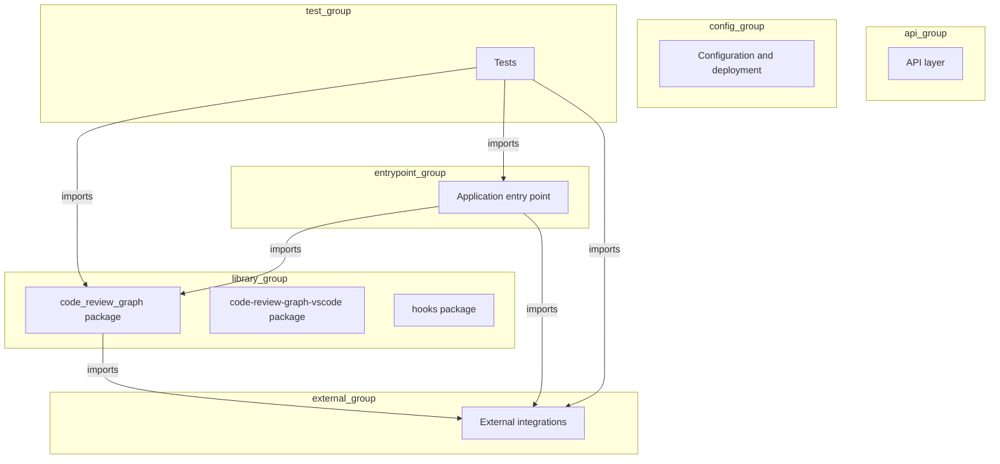

# Architecture report: tirth8205/code-review-graph

> Automated static analysis. **Observed** = directly seen in files/imports/AST; **Inferred** = interpretation from that evidence. Repository code was not executed.

## 1. Repository at a glance

| Item | Value |
| --- | --- |
| Repository | tirth8205/code-review-graph |
| Description | Local-first code intelligence graph for MCP and CLI. Builds a persistent map of your codebase so AI coding tools read only what matters, with benchmarked context reductions on reviews and large-repo workflows. |
| Language | Python |
| Stars | 32766 |
| Licence | MIT |
| Analysed commit / branch | bbdda4b9e4b4818a9f04d7ef96ac0e50da13f208 / staging |
| Framework(s) | Starlette |
| Files analysed | 552 |
| Components | 8 |

## 2. Architecture in one minute

tirth8205/code-review-graph - Local-first code intelligence graph for MCP and CLI. Builds a persistent map of your codebase so AI coding tools read only what matters, with benchmarked context reductions on reviews and large-repo…. This repository was analysed statically from 552 file(s) (345 Python). Detected technologies (observed from imports/manifests): GitHub Actions, SQLite, Starlette, NumPy, Poetry, Docker. Files are grouped into 8 component(s): API layer, code_review_graph package, code-review-graph-vscode package, Configuration and deployment, Application entry point, External integrations, hooks package, Tests. Observed entry point(s): code_review_graph/assets/code-review-graph/scripts/crg_readonly.py, code_review_graph/cli.py, code_review_graph/daemon_cli.py. Findings below distinguish observed facts from inferred interpretation.

## 3. High-level block diagram

## 4. Main components

### API layer (`api_layer`)

- **Kind:** api
- **Status:** Observed
- **Confidence:** 0.85
- **Responsibility:** Groups 4 file(s) under api layer (observed from repository paths and static analysis).
- **Paths:** `code-review-graph-vscode/src/views/graphWebview.ts`, `code-review-graph-vscode/src/views/statusBar.ts`, `code-review-graph-vscode/src/views/treeItems.ts`, `code-review-graph-vscode/src/views/treeView.ts`
- **Evidence:** [code-review-graph-vscode/src/views/graphWebview.ts](https://github.com/tirth8205/code-review-graph/blob/bbdda4b9e4b4818a9f04d7ef96ac0e50da13f208/code-review-graph-vscode/src/views/graphWebview.ts); [code-review-graph-vscode/src/views/statusBar.ts](https://github.com/tirth8205/code-review-graph/blob/bbdda4b9e4b4818a9f04d7ef96ac0e50da13f208/code-review-graph-vscode/src/views/statusBar.ts); [code-review-graph-vscode/src/views/treeItems.ts](https://github.com/tirth8205/code-review-graph/blob/bbdda4b9e4b4818a9f04d7ef96ac0e50da13f208/code-review-graph-vscode/src/views/treeItems.ts); [code-review-graph-vscode/src/views/treeView.ts](https://github.com/tirth8205/code-review-graph/blob/bbdda4b9e4b4818a9f04d7ef96ac0e50da13f208/code-review-graph-vscode/src/views/treeView.ts)

### code_review_graph package (`code_review_graph`)

- **Kind:** library
- **Status:** Observed
- **Confidence:** 0.85
- **Responsibility:** Groups 87 file(s) under code_review_graph package (observed from repository paths and static analysis). Observed top-level classes: CallInfo, ChangeDiscoveryError, CodeReviewGraphError, ConfigWatcher, ConnectionPool, Copy. Observed top-level functions: __dir__, __getattr__, _absolute, _add, _add_hook_block, _aggregate_community.
- **Paths:** `code_review_graph/__init__.py`, `code_review_graph/_legacy_instructions.py`, `code_review_graph/analysis.py`, `code_review_graph/aop_resolver.py`, `code_review_graph/build_state.py`, `code_review_graph/change_details.py`, `code_review_graph/changes.py`, `code_review_graph/codex_skill.py`, `code_review_graph/communities.py`, `code_review_graph/config_keys.py`, `code_review_graph/constants.py`, `code_review_graph/context_history.py`, `code_review_graph/context_savings.py`, `code_review_graph/csharp_resolver.py`, `code_review_graph/custom_languages.py`, `code_review_graph/daemon.py`, `code_review_graph/doctor.py`, `code_review_graph/dsh.py`, `code_review_graph/embeddings.py`, `code_review_graph/enrich.py`, `code_review_graph/errors.py`, `code_review_graph/eval/__init__.py`, `code_review_graph/eval/benchmarks/__init__.py`, `code_review_graph/eval/benchmarks/agent_baseline.py`, `code_review_graph/eval/benchmarks/build_performance.py`, `code_review_graph/eval/benchmarks/flow_completeness.py`, `code_review_graph/eval/benchmarks/impact_accuracy.py`, `code_review_graph/eval/benchmarks/incremental_fidelity.py`, `code_review_graph/eval/benchmarks/multi_hop_retrieval.py`, `code_review_graph/eval/benchmarks/search_quality.py`, `code_review_graph/eval/benchmarks/token_efficiency.py`, `code_review_graph/eval/reporter.py`, `code_review_graph/eval/runner.py`, `code_review_graph/eval/scorer.py`, `code_review_graph/eval/token_benchmark.py`, `code_review_graph/event_resolver.py`, `code_review_graph/exports.py`, `code_review_graph/flows.py`, `code_review_graph/forget.py`, `code_review_graph/graph_diff.py`, `code_review_graph/hcl_resolver.py`, `code_review_graph/hints.py`, `code_review_graph/hook_update.py`, `code_review_graph/http_origin_guard.py`, `code_review_graph/inheritance.py`, `code_review_graph/install_gitignore.py`, `code_review_graph/install_manifest.py`, `code_review_graph/install_plan.py`, `code_review_graph/jedi_resolver.py`, `code_review_graph/jsonc.py`, `code_review_graph/locking.py`, `code_review_graph/memory.py`, `code_review_graph/migrations.py`, `code_review_graph/multi_worktree.py`, `code_review_graph/neighbourhood.py`, `code_review_graph/npm_alias_resolver.py`, `code_review_graph/postprocessing.py`, `code_review_graph/prompts.py`, `code_review_graph/python_resolver.py`, `code_review_graph/refactor.py`, `code_review_graph/registry.py`, `code_review_graph/rescript_resolver.py`, `code_review_graph/scoped_resolver.py`, `code_review_graph/search.py`, `code_review_graph/skills.py`, `code_review_graph/spring_resolver.py`, `code_review_graph/stdio.py`, `code_review_graph/temporal_resolver.py`, `code_review_graph/token_benchmark.py`, `code_review_graph/tools/__init__.py`, `code_review_graph/tools/_common.py`, `code_review_graph/tools/analysis_tools.py`, `code_review_graph/tools/build.py`, `code_review_graph/tools/community_tools.py`, `code_review_graph/tools/context.py`, `code_review_graph/tools/docs.py`, `code_review_graph/tools/flows_tools.py`, `code_review_graph/tools/query.py`, `code_review_graph/tools/refactor_tools.py`, `code_review_graph/tools/registry_tools.py`, `code_review_graph/tools/review.py`, `code_review_graph/tsconfig_resolver.py`, `code_review_graph/uncertainty.py`, `code_review_graph/uninstall.py`, `code_review_graph/visualization.py`, `code_review_graph/wiki.py`, `code_review_graph/workspace_resolver.py`
- **Evidence:** [code_review_graph/__init__.py](https://github.com/tirth8205/code-review-graph/blob/bbdda4b9e4b4818a9f04d7ef96ac0e50da13f208/code_review_graph/__init__.py); [code_review_graph/_legacy_instructions.py](https://github.com/tirth8205/code-review-graph/blob/bbdda4b9e4b4818a9f04d7ef96ac0e50da13f208/code_review_graph/_legacy_instructions.py); [code_review_graph/analysis.py:27](https://github.com/tirth8205/code-review-graph/blob/bbdda4b9e4b4818a9f04d7ef96ac0e50da13f208/code_review_graph/analysis.py#L27); [code_review_graph/aop_resolver.py:135](https://github.com/tirth8205/code-review-graph/blob/bbdda4b9e4b4818a9f04d7ef96ac0e50da13f208/code_review_graph/aop_resolver.py#L135); [code_review_graph/build_state.py:52](https://github.com/tirth8205/code-review-graph/blob/bbdda4b9e4b4818a9f04d7ef96ac0e50da13f208/code_review_graph/build_state.py#L52); [code_review_graph/change_details.py:77](https://github.com/tirth8205/code-review-graph/blob/bbdda4b9e4b4818a9f04d7ef96ac0e50da13f208/code_review_graph/change_details.py#L77); [code_review_graph/changes.py:58](https://github.com/tirth8205/code-review-graph/blob/bbdda4b9e4b4818a9f04d7ef96ac0e50da13f208/code_review_graph/changes.py#L58); [code_review_graph/codex_skill.py:26](https://github.com/tirth8205/code-review-graph/blob/bbdda4b9e4b4818a9f04d7ef96ac0e50da13f208/code_review_graph/codex_skill.py#L26)

### code-review-graph-vscode package (`code_review_graph_vscode`)

- **Kind:** library
- **Status:** Observed
- **Confidence:** 0.85
- **Responsibility:** Groups 14 file(s) under code-review-graph-vscode package (observed from repository paths and static analysis).
- **Paths:** `code-review-graph-vscode/esbuild.mjs`, `code-review-graph-vscode/src/backend/cli.ts`, `code-review-graph-vscode/src/backend/sqlite.ts`, `code-review-graph-vscode/src/backend/watcher.ts`, `code-review-graph-vscode/src/extension.ts`, `code-review-graph-vscode/src/features/blastRadius.ts`, `code-review-graph-vscode/src/features/cursorResolver.ts`, `code-review-graph-vscode/src/features/navigation.ts`, `code-review-graph-vscode/src/features/reviewAssistant.ts`, `code-review-graph-vscode/src/features/scmDecorations.ts`, `code-review-graph-vscode/src/features/search.ts`, `code-review-graph-vscode/src/onboarding/installer.ts`, `code-review-graph-vscode/src/onboarding/welcome.ts`, `code-review-graph-vscode/src/webview/graph.ts`
- **Evidence:** [code-review-graph-vscode/esbuild.mjs](https://github.com/tirth8205/code-review-graph/blob/bbdda4b9e4b4818a9f04d7ef96ac0e50da13f208/code-review-graph-vscode/esbuild.mjs); [code-review-graph-vscode/src/backend/cli.ts](https://github.com/tirth8205/code-review-graph/blob/bbdda4b9e4b4818a9f04d7ef96ac0e50da13f208/code-review-graph-vscode/src/backend/cli.ts); [code-review-graph-vscode/src/backend/sqlite.ts](https://github.com/tirth8205/code-review-graph/blob/bbdda4b9e4b4818a9f04d7ef96ac0e50da13f208/code-review-graph-vscode/src/backend/sqlite.ts); [code-review-graph-vscode/src/backend/watcher.ts](https://github.com/tirth8205/code-review-graph/blob/bbdda4b9e4b4818a9f04d7ef96ac0e50da13f208/code-review-graph-vscode/src/backend/watcher.ts); [code-review-graph-vscode/src/extension.ts](https://github.com/tirth8205/code-review-graph/blob/bbdda4b9e4b4818a9f04d7ef96ac0e50da13f208/code-review-graph-vscode/src/extension.ts); [code-review-graph-vscode/src/features/blastRadius.ts](https://github.com/tirth8205/code-review-graph/blob/bbdda4b9e4b4818a9f04d7ef96ac0e50da13f208/code-review-graph-vscode/src/features/blastRadius.ts); [code-review-graph-vscode/src/features/cursorResolver.ts](https://github.com/tirth8205/code-review-graph/blob/bbdda4b9e4b4818a9f04d7ef96ac0e50da13f208/code-review-graph-vscode/src/features/cursorResolver.ts); [code-review-graph-vscode/src/features/navigation.ts](https://github.com/tirth8205/code-review-graph/blob/bbdda4b9e4b4818a9f04d7ef96ac0e50da13f208/code-review-graph-vscode/src/features/navigation.ts)

### Configuration and deployment (`config`)

- **Kind:** config
- **Status:** Observed
- **Confidence:** 0.85
- **Responsibility:** Groups 13 file(s) under configuration and deployment (observed from repository paths and static analysis).
- **Paths:** `Dockerfile`, `action.yml`, `code-review-graph-vscode/package.json`, `code-review-graph-vscode/tsconfig.json`, `code_review_graph/assets/code-review-graph/agents/openai.yaml`, `code_review_graph/eval/configs/code-review-graph.yaml`, `code_review_graph/eval/configs/express.yaml`, `code_review_graph/eval/configs/fastapi.yaml`, `code_review_graph/eval/configs/flask.yaml`, `code_review_graph/eval/configs/gin.yaml`, `code_review_graph/eval/configs/httpx.yaml`, `hooks/hooks.json`, `pyproject.toml`
- **Evidence:** [Dockerfile](https://github.com/tirth8205/code-review-graph/blob/bbdda4b9e4b4818a9f04d7ef96ac0e50da13f208/Dockerfile); [action.yml](https://github.com/tirth8205/code-review-graph/blob/bbdda4b9e4b4818a9f04d7ef96ac0e50da13f208/action.yml); [code-review-graph-vscode/package.json](https://github.com/tirth8205/code-review-graph/blob/bbdda4b9e4b4818a9f04d7ef96ac0e50da13f208/code-review-graph-vscode/package.json); [code-review-graph-vscode/tsconfig.json](https://github.com/tirth8205/code-review-graph/blob/bbdda4b9e4b4818a9f04d7ef96ac0e50da13f208/code-review-graph-vscode/tsconfig.json); [code_review_graph/assets/code-review-graph/agents/openai.yaml](https://github.com/tirth8205/code-review-graph/blob/bbdda4b9e4b4818a9f04d7ef96ac0e50da13f208/code_review_graph/assets/code-review-graph/agents/openai.yaml); [code_review_graph/eval/configs/code-review-graph.yaml](https://github.com/tirth8205/code-review-graph/blob/bbdda4b9e4b4818a9f04d7ef96ac0e50da13f208/code_review_graph/eval/configs/code-review-graph.yaml); [code_review_graph/eval/configs/express.yaml](https://github.com/tirth8205/code-review-graph/blob/bbdda4b9e4b4818a9f04d7ef96ac0e50da13f208/code_review_graph/eval/configs/express.yaml); [code_review_graph/eval/configs/fastapi.yaml](https://github.com/tirth8205/code-review-graph/blob/bbdda4b9e4b4818a9f04d7ef96ac0e50da13f208/code_review_graph/eval/configs/fastapi.yaml)

### Application entry point (`entrypoint`)

- **Kind:** entrypoint
- **Status:** Observed
- **Confidence:** 0.85
- **Responsibility:** Groups 13 file(s) under application entry point (observed from repository paths and static analysis). Observed top-level classes: Check, ReportError, Totals, _CallSite, _EmbeddingRefreshKwargs, _FileFacts. Observed top-level functions: A, D, E, LN, R, T.
- **Paths:** `code_review_graph/__main__.py`, `code_review_graph/assets/code-review-graph/scripts/crg_readonly.py`, `code_review_graph/cli.py`, `code_review_graph/daemon_cli.py`, `code_review_graph/main.py`, `diagrams/generate_diagrams.py`, `scripts/audit_python_imports.py`, `scripts/diagnose_pypi_connectivity.py`, `scripts/generate_documentary_skills.py`, `scripts/print_minimum_dependencies.py`, `scripts/promotion_gate.py`, `scripts/render_pr_comment.py`, `scripts/smoke_google_embeddings.py`
- **Evidence:** [code_review_graph/__main__.py](https://github.com/tirth8205/code-review-graph/blob/bbdda4b9e4b4818a9f04d7ef96ac0e50da13f208/code_review_graph/__main__.py); [code_review_graph/assets/code-review-graph/scripts/crg_readonly.py:51](https://github.com/tirth8205/code-review-graph/blob/bbdda4b9e4b4818a9f04d7ef96ac0e50da13f208/code_review_graph/assets/code-review-graph/scripts/crg_readonly.py#L51); [code_review_graph/cli.py:80](https://github.com/tirth8205/code-review-graph/blob/bbdda4b9e4b4818a9f04d7ef96ac0e50da13f208/code_review_graph/cli.py#L80); [code_review_graph/daemon_cli.py:28](https://github.com/tirth8205/code-review-graph/blob/bbdda4b9e4b4818a9f04d7ef96ac0e50da13f208/code_review_graph/daemon_cli.py#L28); [code_review_graph/main.py:112](https://github.com/tirth8205/code-review-graph/blob/bbdda4b9e4b4818a9f04d7ef96ac0e50da13f208/code_review_graph/main.py#L112); [diagrams/generate_diagrams.py:16](https://github.com/tirth8205/code-review-graph/blob/bbdda4b9e4b4818a9f04d7ef96ac0e50da13f208/diagrams/generate_diagrams.py#L16); [scripts/audit_python_imports.py:50](https://github.com/tirth8205/code-review-graph/blob/bbdda4b9e4b4818a9f04d7ef96ac0e50da13f208/scripts/audit_python_imports.py#L50); [scripts/diagnose_pypi_connectivity.py:20](https://github.com/tirth8205/code-review-graph/blob/bbdda4b9e4b4818a9f04d7ef96ac0e50da13f208/scripts/diagnose_pypi_connectivity.py#L20)

### External integrations (`external_integrations`)

- **Kind:** external
- **Status:** Inferred
- **Confidence:** 0.70
- **Responsibility:** Groups 0 file(s) under external integrations (observed from repository paths and static analysis).
- **Evidence:** [code_review_graph/build_state.py:38](https://github.com/tirth8205/code-review-graph/blob/bbdda4b9e4b4818a9f04d7ef96ac0e50da13f208/code_review_graph/build_state.py#L38); [code_review_graph/cli.py:49](https://github.com/tirth8205/code-review-graph/blob/bbdda4b9e4b4818a9f04d7ef96ac0e50da13f208/code_review_graph/cli.py#L49); [code_review_graph/doctor.py:27](https://github.com/tirth8205/code-review-graph/blob/bbdda4b9e4b4818a9f04d7ef96ac0e50da13f208/code_review_graph/doctor.py#L27); [code_review_graph/embeddings.py:19](https://github.com/tirth8205/code-review-graph/blob/bbdda4b9e4b4818a9f04d7ef96ac0e50da13f208/code_review_graph/embeddings.py#L19); [code_review_graph/embeddings.py:454](https://github.com/tirth8205/code-review-graph/blob/bbdda4b9e4b4818a9f04d7ef96ac0e50da13f208/code_review_graph/embeddings.py#L454); [code_review_graph/embeddings.py:689](https://github.com/tirth8205/code-review-graph/blob/bbdda4b9e4b4818a9f04d7ef96ac0e50da13f208/code_review_graph/embeddings.py#L689)

### hooks package (`hooks`)

- **Kind:** library
- **Status:** Observed
- **Confidence:** 0.85
- **Responsibility:** Groups 1 file(s) under hooks package (observed from repository paths and static analysis).
- **Paths:** `hooks/session-start.sh`
- **Evidence:** [hooks/session-start.sh](https://github.com/tirth8205/code-review-graph/blob/bbdda4b9e4b4818a9f04d7ef96ac0e50da13f208/hooks/session-start.sh)

### Tests (`tests`)

- **Kind:** test
- **Status:** Observed
- **Confidence:** 0.85
- **Responsibility:** Groups 323 file(s) under tests (observed from repository paths and static analysis). Observed routes: PATCH os.kill, PATCH code_review_graph.daemon.pid_alive, PATCH os.kill, PATCH os.kill, PATCH os.kill. Observed top-level classes: ActionRun, Artefacts, AuthService, Bands, BaseService, BuildFarm. Observed top-level functions: _add, _add_orphan_edge, _add_orphan_function, _add_virtual_event_node, _advised, _aliased_package.
- **Paths:** `code-review-graph-vscode/test/sqlite.test.ts`, `tests/__init__.py`, `tests/conftest.py`, `tests/corpus_baselines.json`, `tests/determinism_build_runner.py`, `tests/determinism_dump.py`, `tests/fixtures/KafkaPatterns.java`, `tests/fixtures/MarkdownMsg.tsx`, `tests/fixtures/Sample.cs`, `tests/fixtures/SampleJava.java`, `tests/fixtures/SpringDI.java`, `tests/fixtures/TemporalWorkflow.java`, `tests/fixtures/__tests__/UserService.ts`, `tests/fixtures/alias_importer.ts`, `tests/fixtures/caller_example.py`, `tests/fixtures/cpp_qt_headers/MyWidget.cpp`, `tests/fixtures/cpp_qt_headers/MyWidget.h`, `tests/fixtures/cpp_qt_headers/MyWidgetPlain.cpp`, `tests/fixtures/cpp_qt_headers/MyWidgetPlain.h`, `tests/fixtures/detect_changes_sample.json`, `tests/fixtures/graphml_xsd/SOURCE.txt`, `tests/fixtures/graphml_xsd/graphml-attributes.xsd`, `tests/fixtures/graphml_xsd/graphml-parseinfo.xsd`, `tests/fixtures/graphml_xsd/graphml-structure.xsd`, `tests/fixtures/graphml_xsd/graphml.xsd`, `tests/fixtures/graphml_xsd/xlink.xsd`, `tests/fixtures/multi_call_example.py`, `tests/fixtures/playbooks/sample_ansible_playbook.yml`, `tests/fixtures/roles/myrole/meta/main.yml`, `tests/fixtures/sample.R`, `tests/fixtures/sample.c`, `tests/fixtures/sample.cpp`, `tests/fixtures/sample.dart`, `tests/fixtures/sample.ex`, `tests/fixtures/sample.gd`, `tests/fixtures/sample.hh`, `tests/fixtures/sample.jl`, `tests/fixtures/sample.kt`, `tests/fixtures/sample.liquid`, `tests/fixtures/sample.lua`, `tests/fixtures/sample.luau`, `tests/fixtures/sample.m`, `tests/fixtures/sample.nix`, `tests/fixtures/sample.php`, `tests/fixtures/sample.pl`, `tests/fixtures/sample.rb`, `tests/fixtures/sample.res`, `tests/fixtures/sample.resi`, `tests/fixtures/sample.scala`, `tests/fixtures/sample.sh`, `tests/fixtures/sample.sol`, `tests/fixtures/sample.sql`, `tests/fixtures/sample.sv`, `tests/fixtures/sample.swift`, `tests/fixtures/sample.tf`, `tests/fixtures/sample.xs`, `tests/fixtures/sample_bun.test.ts`, `tests/fixtures/sample_callback_refs.py`, `tests/fixtures/sample_config.json`, `tests/fixtures/sample_databricks_export.py`, `tests/fixtures/sample_databricks_notebook.ipynb`, `tests/fixtures/sample_dead_guard.c`, `tests/fixtures/sample_dead_guard.go`, `tests/fixtures/sample_dead_guard.rs`, `tests/fixtures/sample_dead_guard.ts`, `tests/fixtures/sample_dead_guard_impl.rs`, `tests/fixtures/sample_go.go`, `tests/fixtures/sample_html.html`, `tests/fixtures/sample_lib.sh`, `tests/fixtures/sample_map_dispatch.py`, `tests/fixtures/sample_map_dispatch.ts`, `tests/fixtures/sample_mocha.test.ts`, `tests/fixtures/sample_module.nix`, `tests/fixtures/sample_notebook.ipynb`, `tests/fixtures/sample_plsql.sql`, `tests/fixtures/sample_python.py`, `tests/fixtures/sample_rust.rs`, `tests/fixtures/sample_typescript.ts`, `tests/fixtures/sample_vitest.test.ts`, `tests/fixtures/sample_vue.vue`, `tests/fixtures/sample_xslt.xsl`, `tests/fixtures/sample_xslt_common.xsl`, `tests/fixtures/sample_zig.zig`, `tests/fixtures/sample_zig_util.zig`, `tests/fixtures/src/lib/utils.ts`, `tests/fixtures/tasks/sample_ansible_tasks.yml`, `tests/fixtures/test_sample.R`, `tests/fixtures/test_sample.py`, `tests/fixtures/tsconfig.json`, `tests/import_audit.py`, `tests/mcp_client_compat.py`, `tests/real_repo_corpus.py`, `tests/test_action_e2e.py`, `tests/test_action_render.py`, `tests/test_affected_flows_limits.py`, `tests/test_agent_transparency.py`, `tests/test_ansible_parser.py`, `tests/test_aop_resolution_edge_cases.py`, `tests/test_aop_resolver.py`, `tests/test_build_tool_errors.py`, `tests/test_call_site_provenance.py`, `tests/test_callback_context_preservation.py`, `tests/test_change_details.py`, `tests/test_changes.py`, `tests/test_changes_path_normalization.py`, `tests/test_churn_runtime.py`, `tests/test_cjs_and_kts_extensions.py`, `tests/test_cli.py`, `tests/test_cli_help.py`, `tests/test_cli_install.py`, `tests/test_cli_query_accepts_every_pattern.py`, `tests/test_cli_reconciliation.py`, `tests/test_cli_stdio_encoding.py`, `tests/test_cli_surface.py`, `tests/test_cli_tool_commands.py`, `tests/test_codeql_url_substring.py`, `tests/test_codex_hook_never_builds_a_new_graph.py`, `tests/test_codex_skill_wrapper.py`, `tests/test_commonjs_imports.py`, `tests/test_communities.py`, `tests/test_compact_impact.py`, `tests/test_composer_vendor_ignore.py`, `tests/test_concurrency_and_daemon.py`, `tests/test_confirm_at_end_of_input_takes_default.py`, `tests/test_conftest_gates.py`, `tests/test_context_history.py`, `tests/test_context_savings.py`, `tests/test_cpp_header_prefilter.py`, `tests/test_cpp_overload_identity.py`, `tests/test_cpp_qt_headers.py`, `tests/test_csharp_dead_code_overrides.py`, `tests/test_csharp_dotted_query_targets.py`, `tests/test_csharp_namespace_binding_edges.py`, `tests/test_csharp_namespaces.py`, `tests/test_custom_languages.py`, `tests/test_d3_asset_line_endings.py`, `tests/test_daemon.py`, `tests/test_daemon_cli_followups.py`, `tests/test_daemon_stop_confirmation.py`, `tests/test_daemon_stop_escalation.py`, `tests/test_dbt_parser.py`, `tests/test_dead_code_edge_evidence.py`, `tests/test_dead_code_query_scaling.py`, `tests/test_dependency_floors.py`, `tests/test_derived_data_fallbacks.py`, `tests/test_detect_changes_brief_priorities.py`, `tests/test_determinism.py`, `tests/test_diagnose_pypi_connectivity.py`, `tests/test_docstring_embeddings.py`, `tests/test_doctor.py`, `tests/test_document_skills.py`, `tests/test_documentation.py`, `tests/test_dsh.py`, `tests/test_e2e_mcp_client.py`, `tests/test_e2e_real_repo.py`, `tests/test_edit_hook_follows_the_edited_file.py`, `tests/test_elixir_multi_clause.py`, `tests/test_embedding_initialization.py`, `tests/test_embedding_refresh.py`, `tests/test_embedding_refresh_skip_notice.py`, `tests/test_embeddings.py`, `tests/test_enrich.py`, `tests/test_env_config.py`, `tests/test_eval.py`, `tests/test_export_formats.py`, `tests/test_failure_reporting.py`, `tests/test_flow_source_stays_in_repo.py`, `tests/test_flows.py`, `tests/test_follow_symlinks.py`, `tests/test_forget.py`, `tests/test_forget_legacy_db.py`, `tests/test_forget_parity.py`, `tests/test_freshness_metadata.py`, `tests/test_fts_delta.py`, `tests/test_fts_sync.py`, `tests/test_genai_packaging.py`, `tests/test_generic_yaml_edge_cases.py`, `tests/test_git_hook_block_helpers.py`, `tests/test_git_hook_block_runs_before_trailing_exit.py`, `tests/test_git_hook_worktree.py`, `tests/test_git_sync_hooks.py`, `tests/test_go_embeddings.py`, `tests/test_go_imports.py`, `tests/test_go_receiver_resolution.py`, `tests/test_graph.py`, `tests/test_graph_fresh_after_hooked_commit.py`, `tests/test_graph_update_contracts.py`, `tests/test_hcl_parser.py`, `tests/test_hcl_provider_aliases.py`, `tests/test_header_dead_branch_scan.py`, `tests/test_hermes_install.py`, `tests/test_hermes_yaml_preservation.py`, `tests/test_hints.py`, `tests/test_hook_payload_is_read_as_utf8.py`, `tests/test_hook_update.py`, `tests/test_html_parser.py`, `tests/test_http_multi_repo.py`, `tests/test_http_origin_guard.py`, `tests/test_identity_pending_ignored.py`, `tests/test_identity_retry.py`, `tests/test_import_cycles.py`, `tests/test_import_scope.py`, `tests/test_import_target_integrity.py`, `tests/test_incremental.py`, `tests/test_incremental_dependent_derived_state.py`, `tests/test_incremental_fidelity.py`, `tests/test_incremental_flow_lifecycle.py`, `tests/test_incremental_reexport_regression.py`, `tests/test_incremental_unindexed_change_memory.py`, `tests/test_inherited_calls.py`, `tests/test_install_files_stay_out_of_graph.py`, `tests/test_install_gitignore_block.py`, `tests/test_install_manifest.py`, `tests/test_install_outputs_are_ignored.py`, `tests/test_install_preview.py`, `tests/test_installer_ownership.py`, `tests/test_integration_git.py`, `tests/test_integration_v2.py`, `tests/test_java_call_references.py`, `tests/test_java_name_extraction.py`, `tests/test_js_module_resolution.py`, `tests/test_js_wrapped_functions.py`, `tests/test_json_parser.py`, `tests/test_jsonc_removals.py`, `tests/test_julia_reconciliation.py`, `tests/test_jvm_implementors.py`, `tests/test_keyword_argument_callbacks.py`, `tests/test_kotlin_import_comments.py`, `tests/test_kotlin_imports.py`, `tests/test_language_reconciliation.py`, `tests/test_legacy_graph_paths.py`, `tests/test_liquid.py`, `tests/test_main.py`, `tests/test_main_lazy_tool_imports.py`, `tests/test_mcp_auto_watch.py`, `tests/test_mcp_auto_watch_startup_window.py`, `tests/test_mcp_stdio_shutdown.py`, `tests/test_mcp_surface.py`, `tests/test_mcp_watch_store_shutdown.py`, `tests/test_memory.py`, `tests/test_migrations.py`, `tests/test_missing_registered_data_dir.py`, `tests/test_missing_repo_path_is_one_error_line.py`, `tests/test_multi_worktree.py`, `tests/test_neighbourhood.py`, `tests/test_neighbourhood_bounded_reads.py`, `tests/test_neighbourhood_browser.py`, `tests/test_nested_method_identities.py`, `tests/test_nested_scope_upgrade.py`, `tests/test_no_savings_panel_without_changed_functions.py`, `tests/test_notebook.py`, `tests/test_npm_alias_resolver.py`, `tests/test_opencode_plugin_follows_xdg_config_home.py`, `tests/test_opencode_uninstall_cleans_both_configs.py`, `tests/test_opencode_v1_plugin_contract.py`, `tests/test_opencode_v2_plugin_contract.py`, `tests/test_optional_dependencies.py`, `tests/test_packaging.py`, `tests/test_parser.py`, `tests/test_parser_grammar_contract.py`, `tests/test_parser_load_probe.py`, `tests/test_php_guessed_test_links.py`, `tests/test_php_includes.py`, `tests/test_php_laravel.py`, `tests/test_php_scoped_calls.py`, `tests/test_platform_lifecycle.py`, `tests/test_plugin_hooks_check_for_git.py`, `tests/test_post_rewrite_updates_after_amend.py`, `tests/test_postprocessing.py`, `tests/test_powershell_extraction.py`, `tests/test_pr803_poisoned_graph_recovery.py`, `tests/test_pr_review_workflows.py`, `tests/test_promotion_gate.py`, `tests/test_promotion_is_manual.py`, `tests/test_prompts.py`, `tests/test_public_tool_hints.py`, `tests/test_publish_only_from_main.py`, `tests/test_pure_deletion_review.py`, `tests/test_python_module_alias_shims.py`, `tests/test_python_property_reads.py`, `tests/test_python_reachability.py`, `tests/test_python_receiver_evidence.py`, `tests/test_python_receiver_shapes.py`, `tests/test_python_relative_imports.py`, `tests/test_python_star_imports.py`, `tests/test_qoder_bundled_skills.py`, `tests/test_query_exact_name.py`, `tests/test_query_path_to.py`, `tests/test_quiet_first_build.py`, `tests/test_read_only_data_dir.py`, `tests/test_readme_parity.py`, `tests/test_real_repo_corpus.py`, `tests/test_real_repo_corpus_guard.py`, `tests/test_receiver_evidence_read_path.py`, `tests/test_reconcile_orphan_purge.py`, `tests/test_refactor.py`, `tests/test_registered_data_dir_recovery.py`, `tests/test_registry.py`, `tests/test_registry_search_integration.py`, `tests/test_released_shapes.py`, `tests/test_rename_imports.py`, `tests/test_repo_root_identity.py`, `tests/test_repos_unreachable_data_dir.py`, `tests/test_review_branch_scope.py`, `tests/test_review_guidance_lifecycle.py`, `tests/test_review_risk_budget.py`, `tests/test_review_utf8_content.py`, `tests/test_root_overlap.py`, `tests/test_ruby_imports.py`, `tests/test_ruby_namespaced_query_targets.py`, `tests/test_rust_scoped_calls.py`, `tests/test_scoped_calls_need_evidence.py`, `tests/test_search.py`, `tests/test_search_quality.py`, `tests/test_server_instructions.py`, `tests/test_settings_backup_keeps_the_users_copy.py`, `tests/test_skill_template_schema_sync.py`, `tests/test_skills.py`, `tests/test_spring_config.py`, `tests/test_spring_endpoints.py`, `tests/test_spring_java_reconciliation.py`, `tests/test_suite_home_is_temporary.py`, `tests/test_traverse_long_node_names.py`
- **Evidence:** [code-review-graph-vscode/test/sqlite.test.ts](https://github.com/tirth8205/code-review-graph/blob/bbdda4b9e4b4818a9f04d7ef96ac0e50da13f208/code-review-graph-vscode/test/sqlite.test.ts); [tests/__init__.py](https://github.com/tirth8205/code-review-graph/blob/bbdda4b9e4b4818a9f04d7ef96ac0e50da13f208/tests/__init__.py); [tests/conftest.py:30](https://github.com/tirth8205/code-review-graph/blob/bbdda4b9e4b4818a9f04d7ef96ac0e50da13f208/tests/conftest.py#L30); [tests/corpus_baselines.json](https://github.com/tirth8205/code-review-graph/blob/bbdda4b9e4b4818a9f04d7ef96ac0e50da13f208/tests/corpus_baselines.json); [tests/determinism_build_runner.py:40](https://github.com/tirth8205/code-review-graph/blob/bbdda4b9e4b4818a9f04d7ef96ac0e50da13f208/tests/determinism_build_runner.py#L40); [tests/determinism_dump.py:97](https://github.com/tirth8205/code-review-graph/blob/bbdda4b9e4b4818a9f04d7ef96ac0e50da13f208/tests/determinism_dump.py#L97); [tests/fixtures/KafkaPatterns.java](https://github.com/tirth8205/code-review-graph/blob/bbdda4b9e4b4818a9f04d7ef96ac0e50da13f208/tests/fixtures/KafkaPatterns.java); [tests/fixtures/MarkdownMsg.tsx](https://github.com/tirth8205/code-review-graph/blob/bbdda4b9e4b4818a9f04d7ef96ac0e50da13f208/tests/fixtures/MarkdownMsg.tsx)

## 5. Execution flow

**Observed** entry point(s):

- [code_review_graph/assets/code-review-graph/scripts/crg_readonly.py:280](https://github.com/tirth8205/code-review-graph/blob/bbdda4b9e4b4818a9f04d7ef96ac0e50da13f208/code_review_graph/assets/code-review-graph/scripts/crg_readonly.py#L280)
- [code_review_graph/cli.py](https://github.com/tirth8205/code-review-graph/blob/bbdda4b9e4b4818a9f04d7ef96ac0e50da13f208/code_review_graph/cli.py)
- [code_review_graph/daemon_cli.py](https://github.com/tirth8205/code-review-graph/blob/bbdda4b9e4b4818a9f04d7ef96ac0e50da13f208/code_review_graph/daemon_cli.py)
- [code_review_graph/main.py:1760](https://github.com/tirth8205/code-review-graph/blob/bbdda4b9e4b4818a9f04d7ef96ac0e50da13f208/code_review_graph/main.py#L1760)
- [diagrams/generate_diagrams.py:769](https://github.com/tirth8205/code-review-graph/blob/bbdda4b9e4b4818a9f04d7ef96ac0e50da13f208/diagrams/generate_diagrams.py#L769)
- [scripts/audit_python_imports.py:1134](https://github.com/tirth8205/code-review-graph/blob/bbdda4b9e4b4818a9f04d7ef96ac0e50da13f208/scripts/audit_python_imports.py#L1134)
- [scripts/diagnose_pypi_connectivity.py:62](https://github.com/tirth8205/code-review-graph/blob/bbdda4b9e4b4818a9f04d7ef96ac0e50da13f208/scripts/diagnose_pypi_connectivity.py#L62)
- [scripts/generate_documentary_skills.py:60](https://github.com/tirth8205/code-review-graph/blob/bbdda4b9e4b4818a9f04d7ef96ac0e50da13f208/scripts/generate_documentary_skills.py#L60)
- [scripts/print_minimum_dependencies.py:23](https://github.com/tirth8205/code-review-graph/blob/bbdda4b9e4b4818a9f04d7ef96ac0e50da13f208/scripts/print_minimum_dependencies.py#L23)
- [scripts/promotion_gate.py:721](https://github.com/tirth8205/code-review-graph/blob/bbdda4b9e4b4818a9f04d7ef96ac0e50da13f208/scripts/promotion_gate.py#L721)
- [scripts/render_pr_comment.py:1103](https://github.com/tirth8205/code-review-graph/blob/bbdda4b9e4b4818a9f04d7ef96ac0e50da13f208/scripts/render_pr_comment.py#L1103)
- [scripts/smoke_google_embeddings.py:23](https://github.com/tirth8205/code-review-graph/blob/bbdda4b9e4b4818a9f04d7ef96ac0e50da13f208/scripts/smoke_google_embeddings.py#L23)

**Observed** routes (from decorators):

- `PATCH os.kill` -> `test_is_daemon_running_alive` in `tests/test_daemon.py:315`
- `PATCH code_review_graph.daemon.pid_alive` -> `test_is_daemon_running_dead` in `tests/test_daemon.py:323`
- `PATCH os.kill` -> `test_is_daemon_running_oserror_treated_as_not_alive` in `tests/test_daemon.py:340`
- `PATCH os.kill` -> `test_pid_alive_permission_error_means_alive` in `tests/test_daemon.py:382`
- `PATCH os.kill` -> `test_pid_alive_unexpected_oserror_means_not_alive` in `tests/test_daemon.py:390`
- `PATCH code_review_graph.daemon.subprocess.Popen` -> `test_start_watches_the_config_with_the_polling_observer` in `tests/test_daemon.py:586`
- `PATCH code_review_graph.registry.Registry` -> `test_start_watches_the_config_with_the_polling_observer` in `tests/test_daemon.py:586`
- `PATCH code_review_graph.daemon.subprocess.Popen` -> `test_start_spawns_children` in `tests/test_daemon.py:607`
- `PATCH code_review_graph.registry.Registry` -> `test_start_spawns_children` in `tests/test_daemon.py:607`
- `PATCH code_review_graph.daemon.subprocess.Popen` -> `test_start_assigns_children_to_windows_job` in `tests/test_daemon.py:628`
- `PATCH code_review_graph.registry.Registry` -> `test_start_assigns_children_to_windows_job` in `tests/test_daemon.py:628`
- `PATCH code_review_graph.daemon.subprocess.Popen` -> `test_start_watcher_assignment_failure_terminates_alive_process` in `tests/test_daemon.py:650`
- `PATCH code_review_graph.daemon.subprocess.Popen` -> `test_health_loop_continues_after_assignment_cleanup_os_errors` in `tests/test_daemon.py:670`
- `PATCH code_review_graph.daemon.subprocess.Popen` -> `test_start_watcher_assignment_failure_kills_after_terminate_timeout` in `tests/test_daemon.py:702`
- `PATCH code_review_graph.daemon.subprocess.Popen` -> `test_start_watcher_assignment_failure_does_not_terminate_dead_process` in `tests/test_daemon.py:728`
- `PATCH code_review_graph.daemon.subprocess.Popen` -> `test_start_watcher_assignment_failure_handles_kill_wait_timeout` in `tests/test_daemon.py:747`
- `PATCH code_review_graph.daemon.subprocess.Popen` -> `test_start_registers_repos` in `tests/test_daemon.py:777`
- `PATCH code_review_graph.registry.Registry` -> `test_start_registers_repos` in `tests/test_daemon.py:777`
- `PATCH code_review_graph.daemon.subprocess.Popen` -> `test_start_persists_state` in `tests/test_daemon.py:1081`
- `PATCH code_review_graph.registry.Registry` -> `test_start_persists_state` in `tests/test_daemon.py:1081`
- `PATCH code_review_graph.embeddings.LocalEmbeddingProvider` -> `test_local_case_and_whitespace_normalized` in `tests/test_embeddings.py:674`
- `PATCH code_review_graph.embeddings._check_available` -> `test_local_case_and_whitespace_normalized` in `tests/test_embeddings.py:674`
- `PATCH code_review_graph.embeddings.LocalEmbeddingProvider` -> `test_none_and_empty_default_to_local` in `tests/test_embeddings.py:680`
- `PATCH code_review_graph.embeddings._check_available` -> `test_none_and_empty_default_to_local` in `tests/test_embeddings.py:680`
- `PATCH code_review_graph.embeddings.OpenAIEmbeddingProvider` -> `test_none_defaults_to_openai_when_env_configured` in `tests/test_embeddings.py:687`
- `PATCH code_review_graph.embeddings.OpenAIEmbeddingProvider` -> `test_explicit_blank_stays_local_when_openai_env_configured` in `tests/test_embeddings.py:711`
- `PATCH code_review_graph.embeddings.LocalEmbeddingProvider` -> `test_explicit_blank_stays_local_when_openai_env_configured` in `tests/test_embeddings.py:711`
- `PATCH code_review_graph.embeddings._check_available` -> `test_explicit_blank_stays_local_when_openai_env_configured` in `tests/test_embeddings.py:711`
- `PATCH code_review_graph.embeddings.LocalEmbeddingProvider` -> `test_local_passes_model` in `tests/test_embeddings.py:732`
- `PATCH code_review_graph.embeddings._check_available` -> `test_local_passes_model` in `tests/test_embeddings.py:732`
- `PATCH code_review_graph.embeddings.LocalEmbeddingProvider` -> `test_local_default_passes_none` in `tests/test_embeddings.py:739`
- `PATCH code_review_graph.embeddings._check_available` -> `test_local_default_passes_none` in `tests/test_embeddings.py:739`
- `PATCH code_review_graph.embeddings._check_available` -> `test_local_unavailable_returns_none` in `tests/test_embeddings.py:745`
- `PATCH code_review_graph.embeddings._check_available` -> `test_embedding_store_unavailable_without_local_dependency` in `tests/test_embeddings.py:749`
- `PATCH code_review_graph.incremental.subprocess.run` -> `test_get_changed_files` in `tests/test_incremental.py:723`
- `PATCH code_review_graph.incremental.subprocess.run` -> `test_get_changed_files_fallback` in `tests/test_incremental.py:745`
- `PATCH code_review_graph.incremental.subprocess.run` -> `test_get_changed_files_includes_untracked_paths` in `tests/test_incremental.py:759`
- `PATCH code_review_graph.incremental.subprocess.run` -> `test_get_changed_files_strict_failure_does_not_fallback` in `tests/test_incremental.py:770`
- `PATCH code_review_graph.incremental.subprocess.run` -> `test_get_changed_files_rejects_failed_fallback` in `tests/test_incremental.py:779`
- `PATCH code_review_graph.incremental.subprocess.run` -> `test_get_changed_files_timeout` in `tests/test_incremental.py:788`
- `PATCH code_review_graph.incremental.subprocess.run` -> `test_get_changed_files_rejects_option_like_base` in `tests/test_incremental.py:794`
- `PATCH code_review_graph.incremental.subprocess.run` -> `test_get_staged_and_unstaged` in `tests/test_incremental.py:799`
- `PATCH code_review_graph.incremental.subprocess.run` -> `test_get_staged_and_unstaged_rejects_failed_status` in `tests/test_incremental.py:825`
- `PATCH code_review_graph.incremental.subprocess.run` -> `test_get_all_tracked_files` in `tests/test_incremental.py:837`
- `PATCH code_review_graph.incremental.subprocess.run` -> `test_get_all_tracked_files_keeps_paths_git_would_quote` in `tests/test_incremental.py:847`
- `PATCH code_review_graph.incremental.subprocess.run` -> `test_get_all_tracked_files_recurse_submodules_param` in `tests/test_incremental.py:866`
- `PATCH code_review_graph.incremental.subprocess.run` -> `test_get_all_tracked_files_no_recurse_by_default` in `tests/test_incremental.py:879`
- `PATCH code_review_graph.incremental.subprocess.run` -> `test_get_all_tracked_files_env_var_fallback` in `tests/test_incremental.py:893`
- `PATCH code_review_graph.incremental._RECURSE_SUBMODULES` -> `test_get_all_tracked_files_env_var_fallback` in `tests/test_incremental.py:893`
- `PATCH code_review_graph.incremental.subprocess.run` -> `test_get_all_tracked_files_param_overrides_env` in `tests/test_incremental.py:908`
- `PATCH code_review_graph.incremental._RECURSE_SUBMODULES` -> `test_get_all_tracked_files_param_overrides_env` in `tests/test_incremental.py:908`
- `PATCH code_review_graph.incremental.watch` -> `test_starts_background_thread` in `tests/test_incremental.py:2048`
- `PATCH code_review_graph.incremental.subprocess.run` -> `test_get_changed_files_reports_both_sides_of_rename` in `tests/test_incremental.py:2556`
- `PATCH code_review_graph.incremental.subprocess.run` -> `test_get_changed_files_defaults_to_git_timeout` in `tests/test_incremental.py:2965`
- `PATCH code_review_graph.incremental.subprocess.run` -> `test_get_staged_and_unstaged_defaults_to_git_timeout` in `tests/test_incremental.py:2972`
- `PATCH code_review_graph.incremental.subprocess.run` -> `test_explicit_timeout_is_forwarded` in `tests/test_incremental.py:2981`
- `PATCH code_review_graph.incremental.subprocess.run` -> `test_the_walk_is_untracked_files_all` in `tests/test_incremental.py:3025`
- `PATCH code_review_graph.incremental.subprocess.run` -> `test_every_record_is_returned_as_a_path` in `tests/test_incremental.py:3034`

Representative flow (derived from observed entry points and the import graph; steps beyond the entry point are **Inferred**):

1. Execution starts at an observed entry point listed above, if present.
2. `code_review_graph` imports `external_integrations` (code_review_graph package -> External integrations).
3. `entrypoint` imports `code_review_graph` (Application entry point -> code_review_graph package).
4. `entrypoint` imports `external_integrations` (Application entry point -> External integrations).
5. `tests` imports `code_review_graph` (Tests -> code_review_graph package).
6. `tests` imports `entrypoint` (Tests -> Application entry point).
7. `tests` imports `external_integrations` (Tests -> External integrations).

## 6. Project structure

### `(root)`

- `.gitattributes` - other (125 bytes)
- `.gitignore` - other (1821 bytes)
- `.mcp.json` - config (128 bytes)
- `AGENTS.md` - docs (2958 bytes)
- `CHANGELOG.md` - docs (192107 bytes)
- `CLAUDE.md` - docs (16063 bytes)
- `CODE_OF_CONDUCT.md` - docs (663 bytes)
- `CONTRIBUTING.md` - docs (18100 bytes)
- `Dockerfile` - container (999 bytes)
- `GEMINI.md` - docs (457 bytes)
- `LICENSE` - docs (1069 bytes)
- `README.hi-IN.md` - docs (107135 bytes)
- `README.ja-JP.md` - docs (73429 bytes)
- `README.ko-KR.md` - docs (65847 bytes)
- `README.md` - docs (58266 bytes)
- `README.zh-CN.md` - docs (58103 bytes)
- `SECURITY.md` - docs (4278 bytes)
- `action.yml` - config (9031 bytes)
- `pyproject.toml` - manifest (7515 bytes)

### `.beads`

- `.beads/.gitignore` - other (1821 bytes)
- `.beads/README.md` - docs (2253 bytes)
- `.beads/config.yaml` - config (2192 bytes)
- `.beads/hooks/post-checkout` - other (801 bytes)
- `.beads/hooks/post-merge` - other (789 bytes)
- `.beads/hooks/pre-commit` - other (789 bytes)
- `.beads/hooks/pre-push` - other (781 bytes)
- `.beads/hooks/prepare-commit-msg` - other (821 bytes)
- `.beads/metadata.json` - config (168 bytes)

### `.github`

- `.github/ISSUE_TEMPLATE/bug_report.yml` - config (3399 bytes)
- `.github/ISSUE_TEMPLATE/config.yml` - config (444 bytes)
- `.github/ISSUE_TEMPLATE/feature_request.yml` - config (1532 bytes)
- `.github/ISSUE_TEMPLATE/platform_request.yml` - config (2079 bytes)
- `.github/PULL_REQUEST_TEMPLATE.md` - docs (1320 bytes)
- `.github/copilot-instructions.md` - docs (2354 bytes)
- `.github/dependabot.yml` - config (477 bytes)
- `.github/requirements-minimum.txt` - manifest (408 bytes)
- `.github/workflows/ci.yml` - ci, YAML (10030 bytes)
- `.github/workflows/eval.yml` - ci, YAML (2065 bytes)
- `.github/workflows/pr-review-comment.yml` - ci, YAML (7559 bytes)
- `.github/workflows/pr-review.yml` - ci, YAML (1329 bytes)
- `.github/workflows/promote.yml` - ci, YAML (3090 bytes)
- `.github/workflows/promotion-gate.yml` - ci, YAML (13709 bytes)
- `.github/workflows/publish.yml` - ci, YAML (1466 bytes)

### `code-review-graph-vscode`

- `code-review-graph-vscode/.gitignore` - other (32 bytes)
- `code-review-graph-vscode/.vscodeignore` - other (108 bytes)
- `code-review-graph-vscode/CHANGELOG.md` - docs (2532 bytes)
- `code-review-graph-vscode/LICENSE` - docs (1069 bytes)
- `code-review-graph-vscode/README.md` - docs (4241 bytes)
- `code-review-graph-vscode/esbuild.mjs` - source, JavaScript (1290 bytes)
- `code-review-graph-vscode/media/icons/graph.svg` - other (611 bytes)
- `code-review-graph-vscode/media/walkthrough/build.md` - docs (299 bytes)
- `code-review-graph-vscode/media/walkthrough/explore.md` - docs (490 bytes)
- `code-review-graph-vscode/media/walkthrough/install.md` - docs (200 bytes)
- `code-review-graph-vscode/package.json` - manifest (7489 bytes)
- `code-review-graph-vscode/src/backend/cli.ts` - source, TypeScript (8473 bytes)
- `code-review-graph-vscode/src/backend/sqlite.ts` - source, TypeScript (17847 bytes)
- `code-review-graph-vscode/src/backend/watcher.ts` - source, TypeScript (1914 bytes)
- `code-review-graph-vscode/src/extension.ts` - source, TypeScript (31749 bytes)
- `code-review-graph-vscode/src/features/blastRadius.ts` - source, TypeScript (2996 bytes)
- `code-review-graph-vscode/src/features/cursorResolver.ts` - source, TypeScript (1214 bytes)
- `code-review-graph-vscode/src/features/navigation.ts` - source, TypeScript (7264 bytes)
- `code-review-graph-vscode/src/features/reviewAssistant.ts` - source, TypeScript (3599 bytes)
- `code-review-graph-vscode/src/features/scmDecorations.ts` - source, TypeScript (4988 bytes)
- `code-review-graph-vscode/src/features/search.ts` - source, TypeScript (3707 bytes)
- `code-review-graph-vscode/src/onboarding/installer.ts` - source, TypeScript (3807 bytes)
- `code-review-graph-vscode/src/onboarding/welcome.ts` - source, TypeScript (3558 bytes)
- `code-review-graph-vscode/src/views/graphWebview.ts` - source, TypeScript (20219 bytes)
- `code-review-graph-vscode/src/views/statusBar.ts` - source, TypeScript (2624 bytes)
- `code-review-graph-vscode/src/views/treeItems.ts` - source, TypeScript (7672 bytes)
- `code-review-graph-vscode/src/views/treeView.ts` - source, TypeScript (7350 bytes)
- `code-review-graph-vscode/src/webview/graph.ts` - source, TypeScript (30640 bytes)
- `code-review-graph-vscode/test/sqlite.test.ts` - test, TypeScript (17564 bytes)
- `code-review-graph-vscode/tsconfig.json` - config (522 bytes)

### `code_review_graph`

- `code_review_graph/__init__.py` - source, Python (454 bytes)
- `code_review_graph/__main__.py` - source, Python (82 bytes)
- `code_review_graph/_legacy_instructions.py` - source, Python (24630 bytes)
- `code_review_graph/analysis.py` - source, Python (18509 bytes)
- `code_review_graph/aop_resolver.py` - source, Python (22669 bytes)
- `code_review_graph/assets/code-review-graph/SKILL.md` - docs (5723 bytes)
- `code_review_graph/assets/code-review-graph/agents/openai.yaml` - config (202 bytes)
- `code_review_graph/assets/code-review-graph/scripts/crg_readonly.py` - source, Python (10086 bytes)
- `code_review_graph/build_state.py` - source, Python (3536 bytes)
- `code_review_graph/change_details.py` - source, Python (17413 bytes)
- `code_review_graph/changes.py` - source, Python (81535 bytes)
- `code_review_graph/cli.py` - source, Python (139269 bytes)
- `code_review_graph/codex_skill.py` - source, Python (8750 bytes)
- `code_review_graph/communities.py` - source, Python (44885 bytes)
- `code_review_graph/config_keys.py` - source, Python (1235 bytes)
- `code_review_graph/constants.py` - source, Python (19018 bytes)
- `code_review_graph/context_history.py` - source, Python (10343 bytes)
- `code_review_graph/context_savings.py` - source, Python (11860 bytes)
- `code_review_graph/csharp_resolver.py` - source, Python (18233 bytes)
- `code_review_graph/custom_languages.py` - source, Python (12960 bytes)
- `code_review_graph/daemon.py` - source, Python (68710 bytes)
- `code_review_graph/daemon_cli.py` - source, Python (15984 bytes)
- `code_review_graph/docs/LLM-OPTIMIZED-REFERENCE.md` - docs (12854 bytes)
- `code_review_graph/doctor.py` - source, Python (33342 bytes)
- `code_review_graph/dsh.py` - source, Python (11317 bytes)
- `code_review_graph/embeddings.py` - source, Python (68171 bytes)
- `code_review_graph/enrich.py` - source, Python (10025 bytes)
- `code_review_graph/errors.py` - source, Python (2842 bytes)
- `code_review_graph/eval/__init__.py` - source, Python (1022 bytes)
- `code_review_graph/eval/benchmarks/__init__.py` - source, Python (54 bytes)
- `code_review_graph/eval/benchmarks/agent_baseline.py` - source, Python (9062 bytes)
- `code_review_graph/eval/benchmarks/build_performance.py` - source, Python (1911 bytes)
- `code_review_graph/eval/benchmarks/flow_completeness.py` - source, Python (1130 bytes)
- `code_review_graph/eval/benchmarks/impact_accuracy.py` - source, Python (9763 bytes)
- `code_review_graph/eval/benchmarks/incremental_fidelity.py` - source, Python (37424 bytes)
- `code_review_graph/eval/benchmarks/multi_hop_retrieval.py` - source, Python (4500 bytes)
- `code_review_graph/eval/benchmarks/search_quality.py` - source, Python (2198 bytes)
- `code_review_graph/eval/benchmarks/token_efficiency.py` - source, Python (4908 bytes)
- `code_review_graph/eval/configs/code-review-graph.yaml` - config (1971 bytes)
- `code_review_graph/eval/configs/express.yaml` - config (1677 bytes)
- `code_review_graph/eval/configs/fastapi.yaml` - config (1840 bytes)
- `code_review_graph/eval/configs/flask.yaml` - config (1855 bytes)
- `code_review_graph/eval/configs/gin.yaml` - config (1822 bytes)
- `code_review_graph/eval/configs/httpx.yaml` - config (1721 bytes)
- `code_review_graph/eval/reporter.py` - source, Python (11778 bytes)
- `code_review_graph/eval/runner.py` - source, Python (14733 bytes)
- `code_review_graph/eval/scorer.py` - source, Python (2574 bytes)
- `code_review_graph/eval/token_benchmark.py` - source, Python (5860 bytes)
- `code_review_graph/event_resolver.py` - source, Python (4681 bytes)
- `code_review_graph/exports.py` - source, Python (19810 bytes)
- `code_review_graph/flows.py` - source, Python (42458 bytes)
- `code_review_graph/forget.py` - source, Python (7732 bytes)
- `code_review_graph/graph_diff.py` - source, Python (3628 bytes)
- `code_review_graph/hcl_resolver.py` - source, Python (4442 bytes)
- `code_review_graph/hints.py` - source, Python (12236 bytes)
- `code_review_graph/hook_update.py` - source, Python (8848 bytes)
- `code_review_graph/http_origin_guard.py` - source, Python (7417 bytes)
- `code_review_graph/inheritance.py` - source, Python (14483 bytes)
- `code_review_graph/install_gitignore.py` - source, Python (17001 bytes)
- `code_review_graph/install_manifest.py` - source, Python (5996 bytes)
- `code_review_graph/install_plan.py` - source, Python (17684 bytes)
- `code_review_graph/jedi_resolver.py` - source, Python (13921 bytes)
- `code_review_graph/jsonc.py` - source, Python (17035 bytes)
- `code_review_graph/locking.py` - source, Python (9157 bytes)
- `code_review_graph/main.py` - source, Python (71928 bytes)
- `code_review_graph/memory.py` - source, Python (3848 bytes)
- `code_review_graph/migrations.py` - source, Python (32511 bytes)
- `code_review_graph/multi_worktree.py` - source, Python (29386 bytes)
- `code_review_graph/neighbourhood.py` - source, Python (24394 bytes)
- `code_review_graph/npm_alias_resolver.py` - source, Python (17589 bytes)
- `code_review_graph/postprocessing.py` - source, Python (7974 bytes)
- `code_review_graph/prompts.py` - source, Python (6762 bytes)
- `code_review_graph/python_resolver.py` - source, Python (5541 bytes)
- `code_review_graph/refactor.py` - source, Python (119669 bytes)
- `code_review_graph/registry.py` - source, Python (10404 bytes)
- `code_review_graph/rescript_resolver.py` - source, Python (8975 bytes)
- `code_review_graph/scoped_resolver.py` - source, Python (21068 bytes)
- `code_review_graph/search.py` - source, Python (45890 bytes)
- `code_review_graph/skills.py` - source, Python (181245 bytes)
- `code_review_graph/spring_resolver.py` - source, Python (11904 bytes)
- `code_review_graph/stdio.py` - source, Python (598 bytes)
- `code_review_graph/temporal_resolver.py` - source, Python (8654 bytes)
- `code_review_graph/token_benchmark.py` - source, Python (4096 bytes)
- `code_review_graph/tools/__init__.py` - source, Python (6729 bytes)
- `code_review_graph/tools/_common.py` - source, Python (16730 bytes)
- `code_review_graph/tools/analysis_tools.py` - source, Python (10443 bytes)
- `code_review_graph/tools/build.py` - source, Python (45145 bytes)
- `code_review_graph/tools/community_tools.py` - source, Python (13339 bytes)
- `code_review_graph/tools/context.py` - source, Python (9026 bytes)
- `code_review_graph/tools/docs.py` - source, Python (12351 bytes)
- `code_review_graph/tools/flows_tools.py` - source, Python (8546 bytes)
- `code_review_graph/tools/query.py` - source, Python (105427 bytes)
- `code_review_graph/tools/refactor_tools.py` - source, Python (8984 bytes)
- `code_review_graph/tools/registry_tools.py` - source, Python (11694 bytes)
- `code_review_graph/tools/review.py` - source, Python (52322 bytes)
- `code_review_graph/tsconfig_resolver.py` - source, Python (13159 bytes)
- `code_review_graph/uncertainty.py` - source, Python (22369 bytes)
- `code_review_graph/uninstall.py` - source, Python (62000 bytes)
- `code_review_graph/visualization.py` - source, Python (132751 bytes)
- `code_review_graph/wiki.py` - source, Python (12134 bytes)
- `code_review_graph/workspace_resolver.py` - source, Python (25908 bytes)

### `diagrams`

- `diagrams/context-savings-demo.tape` - other (1503 bytes)
- `diagrams/generate_diagrams.py` - source, Python (33352 bytes)

### `docs`

- `docs/COMMANDS.md` - docs (52356 bytes)
- `docs/CUSTOM_LANGUAGES.md` - docs (9333 bytes)
- `docs/FAQ.md` - docs (12667 bytes)
- `docs/FEATURES.md` - docs (22406 bytes)
- `docs/GITHUB_ACTION.md` - docs (15823 bytes)
- `docs/INDEX.md` - docs (1529 bytes)
- `docs/LEGAL.md` - docs (1613 bytes)
- `docs/RELEASING.md` - docs (3645 bytes)
- `docs/REPRODUCING.md` - docs (33185 bytes)
- `docs/ROADMAP.md` - docs (5898 bytes)
- `docs/TROUBLESHOOTING.md` - docs (39174 bytes)
- `docs/USAGE.md` - docs (29687 bytes)
- `docs/architecture.md` - docs (18847 bytes)
- `docs/schema.md` - docs (21549 bytes)

### `evaluate`

- `evaluate/results/code-review-graph_agent_baseline_2026-09-22.csv` - data (679 bytes)
- `evaluate/results/code-review-graph_impact_accuracy_2026-08-02.csv` - data (666 bytes)
- `evaluate/results/code-review-graph_multi_hop_retrieval_2026-05-25.csv` - data (350 bytes)
- `evaluate/results/code-review-graph_token_efficiency_2026-05-25.csv` - data (419 bytes)
- `evaluate/results/express_agent_baseline_2026-09-22.csv` - data (611 bytes)
- `evaluate/results/express_impact_accuracy_2026-08-02.csv` - data (704 bytes)
- `evaluate/results/express_multi_hop_retrieval_2026-05-25.csv` - data (230 bytes)
- `evaluate/results/express_token_efficiency_2026-05-25.csv` - data (367 bytes)
- `evaluate/results/fastapi_agent_baseline_2026-09-22.csv` - data (792 bytes)
- `evaluate/results/fastapi_impact_accuracy_2026-08-02.csv` - data (662 bytes)
- `evaluate/results/fastapi_multi_hop_retrieval_2026-05-25.csv` - data (344 bytes)
- `evaluate/results/fastapi_token_efficiency_2026-05-25.csv` - data (390 bytes)
- `evaluate/results/flask_agent_baseline_2026-09-22.csv` - data (648 bytes)
- `evaluate/results/flask_impact_accuracy_2026-08-02.csv` - data (613 bytes)
- `evaluate/results/flask_multi_hop_retrieval_2026-05-25.csv` - data (294 bytes)
- `evaluate/results/flask_token_efficiency_2026-05-25.csv` - data (379 bytes)
- `evaluate/results/gin_agent_baseline_2026-09-22.csv` - data (559 bytes)
- `evaluate/results/gin_impact_accuracy_2026-08-02.csv` - data (818 bytes)
- `evaluate/results/gin_multi_hop_retrieval_2026-05-25.csv` - data (327 bytes)
- `evaluate/results/gin_token_efficiency_2026-05-25.csv` - data (505 bytes)
- `evaluate/results/httpx_agent_baseline_2026-09-22.csv` - data (641 bytes)
- `evaluate/results/httpx_impact_accuracy_2026-08-02.csv` - data (598 bytes)
- `evaluate/results/httpx_multi_hop_retrieval_2026-05-25.csv` - data (335 bytes)
- `evaluate/results/httpx_token_efficiency_2026-05-25.csv` - data (339 bytes)

### `hooks`

- `hooks/hooks.json` - config (1135 bytes)
- `hooks/session-start.sh` - source, Shell (1207 bytes)

### `scripts`

- `scripts/audit_python_imports.py` - source, Python (42918 bytes)
- `scripts/diagnose_pypi_connectivity.py` - source, Python (2012 bytes)
- `scripts/generate_documentary_skills.py` - source, Python (1964 bytes)
- `scripts/print_minimum_dependencies.py` - source, Python (749 bytes)
- `scripts/promotion_gate.py` - source, Python (29192 bytes)
- `scripts/render_pr_comment.py` - source, Python (41673 bytes)
- `scripts/smoke_google_embeddings.py` - source, Python (655 bytes)

### `skills`

- `skills/build-graph/SKILL.md` - docs (1304 bytes)
- `skills/debug-issue/SKILL.md` - docs (1229 bytes)
- `skills/explore-codebase/SKILL.md` - docs (1712 bytes)
- `skills/refactor-safely/SKILL.md` - docs (1409 bytes)
- `skills/review-changes/SKILL.md` - docs (1458 bytes)
- `skills/review-delta/SKILL.md` - docs (1350 bytes)
- `skills/review-pr/SKILL.md` - docs (1957 bytes)

### `tests`

- `tests/__init__.py` - test, Python (0 bytes)
- `tests/conftest.py` - test, Python (6540 bytes)
- `tests/corpus_baselines.json` - test (6531 bytes)
- `tests/determinism_build_runner.py` - test, Python (4351 bytes)
- `tests/determinism_dump.py` - test, Python (20380 bytes)
- `tests/fixtures/KafkaPatterns.java` - test, Java (1753 bytes)
- `tests/fixtures/MarkdownMsg.tsx` - test, TypeScript (52 bytes)
- `tests/fixtures/Sample.cs` - test, C# (2134 bytes)
- `tests/fixtures/SampleJava.java` - test, Java (1435 bytes)
- `tests/fixtures/SpringDI.java` - test, Java (2099 bytes)
- `tests/fixtures/TemporalWorkflow.java` - test, Java (2260 bytes)
- `tests/fixtures/__tests__/UserService.ts` - test, TypeScript (458 bytes)
- `tests/fixtures/alias_importer.ts` - test, TypeScript (166 bytes)
- `tests/fixtures/caller_example.py` - test, Python (192 bytes)
- `tests/fixtures/cpp_qt_headers/MyWidget.cpp` - test, C++ (461 bytes)
- `tests/fixtures/cpp_qt_headers/MyWidget.h` - test, C/C++ (489 bytes)
- `tests/fixtures/cpp_qt_headers/MyWidgetPlain.cpp` - test, C++ (411 bytes)
- `tests/fixtures/cpp_qt_headers/MyWidgetPlain.h` - test, C/C++ (236 bytes)
- `tests/fixtures/detect_changes_sample.json` - test (3990 bytes)
- `tests/fixtures/graphml_xsd/SOURCE.txt` - test (506 bytes)
- `tests/fixtures/graphml_xsd/graphml-attributes.xsd` - test (3768 bytes)
- `tests/fixtures/graphml_xsd/graphml-parseinfo.xsd` - test (10647 bytes)
- `tests/fixtures/graphml_xsd/graphml-structure.xsd` - test (37058 bytes)
- `tests/fixtures/graphml_xsd/graphml.xsd` - test (11555 bytes)
- `tests/fixtures/graphml_xsd/xlink.xsd` - test (1556 bytes)
- `tests/fixtures/multi_call_example.py` - test, Python (487 bytes)
- `tests/fixtures/playbooks/sample_ansible_playbook.yml` - test (1989 bytes)
- `tests/fixtures/roles/myrole/meta/main.yml` - test (74 bytes)
- `tests/fixtures/sample.R` - test (505 bytes)
- `tests/fixtures/sample.c` - test, C (447 bytes)
- `tests/fixtures/sample.cpp` - test, C++ (649 bytes)
- `tests/fixtures/sample.dart` - test (664 bytes)
- `tests/fixtures/sample.ex` - test (493 bytes)
- `tests/fixtures/sample.gd` - test (633 bytes)
- `tests/fixtures/sample.hh` - test (444 bytes)
- `tests/fixtures/sample.jl` - test (1035 bytes)
- `tests/fixtures/sample.kt` - test (607 bytes)
- `tests/fixtures/sample.liquid` - test (395 bytes)
- `tests/fixtures/sample.lua` - test (3243 bytes)
- `tests/fixtures/sample.luau` - test (2931 bytes)
- `tests/fixtures/sample.m` - test (981 bytes)
- `tests/fixtures/sample.nix` - test (508 bytes)
- `tests/fixtures/sample.php` - test, PHP (2084 bytes)
- `tests/fixtures/sample.pl` - test (448 bytes)
- `tests/fixtures/sample.rb` - test, Ruby (571 bytes)
- `tests/fixtures/sample.res` - test (2021 bytes)
- `tests/fixtures/sample.resi` - test (500 bytes)
- `tests/fixtures/sample.scala` - test (947 bytes)
- `tests/fixtures/sample.sh` - test, Shell (663 bytes)
- `tests/fixtures/sample.sol` - test (8372 bytes)
- `tests/fixtures/sample.sql` - test, SQL (900 bytes)
- `tests/fixtures/sample.sv` - test (2429 bytes)
- `tests/fixtures/sample.swift` - test (1379 bytes)
- `tests/fixtures/sample.tf` - test (7047 bytes)
- `tests/fixtures/sample.xs` - test (453 bytes)
- `tests/fixtures/sample_bun.test.ts` - test, TypeScript (761 bytes)
- `tests/fixtures/sample_callback_refs.py` - test, Python (947 bytes)
- `tests/fixtures/sample_config.json` - test (407 bytes)
- `tests/fixtures/sample_databricks_export.py` - test, Python (680 bytes)
- `tests/fixtures/sample_databricks_notebook.ipynb` - test (1469 bytes)
- `tests/fixtures/sample_dead_guard.c` - test, C (1267 bytes)
- `tests/fixtures/sample_dead_guard.go` - test, Go (1705 bytes)
- `tests/fixtures/sample_dead_guard.rs` - test, Rust (964 bytes)
- `tests/fixtures/sample_dead_guard.ts` - test, TypeScript (1306 bytes)
- `tests/fixtures/sample_dead_guard_impl.rs` - test, Rust (402 bytes)
- `tests/fixtures/sample_go.go` - test, Go (2995 bytes)
- `tests/fixtures/sample_html.html` - test (1001 bytes)
- `tests/fixtures/sample_lib.sh` - test, Shell (178 bytes)
- `tests/fixtures/sample_map_dispatch.py` - test, Python (838 bytes)
- `tests/fixtures/sample_map_dispatch.ts` - test, TypeScript (1365 bytes)
- `tests/fixtures/sample_mocha.test.ts` - test, TypeScript (580 bytes)
- `tests/fixtures/sample_module.nix` - test (207 bytes)
- `tests/fixtures/sample_notebook.ipynb` - test (1810 bytes)
- `tests/fixtures/sample_plsql.sql` - test, SQL (1513 bytes)
- `tests/fixtures/sample_python.py` - test, Python (1225 bytes)
- `tests/fixtures/sample_rust.rs` - test, Rust (1396 bytes)
- `tests/fixtures/sample_typescript.ts` - test, TypeScript (892 bytes)
- `tests/fixtures/sample_vitest.test.ts` - test, TypeScript (489 bytes)
- `tests/fixtures/sample_vue.vue` - test, Vue (640 bytes)
- `tests/fixtures/sample_xslt.xsl` - test (1837 bytes)
- `tests/fixtures/sample_xslt_common.xsl` - test (283 bytes)
- `tests/fixtures/sample_zig.zig` - test (667 bytes)
- `tests/fixtures/sample_zig_util.zig` - test (22 bytes)
- `tests/fixtures/src/lib/utils.ts` - test, TypeScript (75 bytes)
- `tests/fixtures/tasks/sample_ansible_tasks.yml` - test (834 bytes)
- `tests/fixtures/test_sample.R` - test (137 bytes)
- `tests/fixtures/test_sample.py` - test, Python (579 bytes)
- `tests/fixtures/tsconfig.json` - test (134 bytes)
- `tests/import_audit.py` - test, Python (1234 bytes)
- `tests/mcp_client_compat.py` - test, Python (1681 bytes)
- `tests/real_repo_corpus.py` - test, Python (32103 bytes)
- `tests/test_action_e2e.py` - test, Python (81148 bytes)
- `tests/test_action_render.py` - test, Python (58965 bytes)
- `tests/test_affected_flows_limits.py` - test, Python (9289 bytes)
- `tests/test_agent_transparency.py` - test, Python (21640 bytes)
- `tests/test_ansible_parser.py` - test, Python (2753 bytes)
- `tests/test_aop_resolution_edge_cases.py` - test, Python (31001 bytes)
- `tests/test_aop_resolver.py` - test, Python (35519 bytes)
- `tests/test_build_tool_errors.py` - test, Python (2152 bytes)
- `tests/test_call_site_provenance.py` - test, Python (20550 bytes)
- `tests/test_callback_context_preservation.py` - test, Python (2113 bytes)
- `tests/test_change_details.py` - test, Python (20512 bytes)
- `tests/test_changes.py` - test, Python (41314 bytes)
- `tests/test_changes_path_normalization.py` - test, Python (7017 bytes)
- `tests/test_churn_runtime.py` - test, Python (12318 bytes)
- `tests/test_cjs_and_kts_extensions.py` - test, Python (3072 bytes)
- `tests/test_cli.py` - test, Python (35261 bytes)
- `tests/test_cli_help.py` - test, Python (4828 bytes)
- `tests/test_cli_install.py` - test, Python (20903 bytes)
- `tests/test_cli_query_accepts_every_pattern.py` - test, Python (2321 bytes)
- `tests/test_cli_reconciliation.py` - test, Python (15689 bytes)
- `tests/test_cli_stdio_encoding.py` - test, Python (7371 bytes)
- `tests/test_cli_surface.py` - test, Python (70041 bytes)
- `tests/test_cli_tool_commands.py` - test, Python (7248 bytes)
- `tests/test_codeql_url_substring.py` - test, Python (5547 bytes)
- `tests/test_codex_hook_never_builds_a_new_graph.py` - test, Python (4445 bytes)
- `tests/test_codex_skill_wrapper.py` - test, Python (12792 bytes)
- `tests/test_commonjs_imports.py` - test, Python (2832 bytes)
- `tests/test_communities.py` - test, Python (44195 bytes)
- `tests/test_compact_impact.py` - test, Python (11327 bytes)
- `tests/test_composer_vendor_ignore.py` - test, Python (4965 bytes)
- `tests/test_concurrency_and_daemon.py` - test, Python (109699 bytes)
- `tests/test_confirm_at_end_of_input_takes_default.py` - test, Python (1474 bytes)
- `tests/test_conftest_gates.py` - test, Python (3209 bytes)
- `tests/test_context_history.py` - test, Python (23027 bytes)
- `tests/test_context_savings.py` - test, Python (1738 bytes)
- `tests/test_cpp_header_prefilter.py` - test, Python (4600 bytes)
- `tests/test_cpp_overload_identity.py` - test, Python (40754 bytes)
- `tests/test_cpp_qt_headers.py` - test, Python (10324 bytes)
- `tests/test_csharp_dead_code_overrides.py` - test, Python (3023 bytes)
- `tests/test_csharp_dotted_query_targets.py` - test, Python (2667 bytes)
- `tests/test_csharp_namespace_binding_edges.py` - test, Python (28628 bytes)
- `tests/test_csharp_namespaces.py` - test, Python (42042 bytes)
- `tests/test_custom_languages.py` - test, Python (17577 bytes)
- `tests/test_d3_asset_line_endings.py` - test, Python (1368 bytes)
- `tests/test_daemon.py` - test, Python (73931 bytes)
- `tests/test_daemon_cli_followups.py` - test, Python (2703 bytes)
- `tests/test_daemon_stop_confirmation.py` - test, Python (4930 bytes)
- `tests/test_daemon_stop_escalation.py` - test, Python (10626 bytes)
- `tests/test_dbt_parser.py` - test, Python (6112 bytes)
- `tests/test_dead_code_edge_evidence.py` - test, Python (16672 bytes)
- `tests/test_dead_code_query_scaling.py` - test, Python (4240 bytes)
- `tests/test_dependency_floors.py` - test, Python (2397 bytes)
- `tests/test_derived_data_fallbacks.py` - test, Python (9049 bytes)
- `tests/test_detect_changes_brief_priorities.py` - test, Python (4796 bytes)
- `tests/test_determinism.py` - test, Python (25898 bytes)
- `tests/test_diagnose_pypi_connectivity.py` - test, Python (1018 bytes)
- `tests/test_docstring_embeddings.py` - test, Python (9298 bytes)
- `tests/test_doctor.py` - test, Python (23298 bytes)
- `tests/test_document_skills.py` - test, Python (4414 bytes)
- `tests/test_documentation.py` - test, Python (7989 bytes)
- `tests/test_dsh.py` - test, Python (10678 bytes)
- `tests/test_e2e_mcp_client.py` - test, Python (19662 bytes)
- `tests/test_e2e_real_repo.py` - test, Python (19141 bytes)
- `tests/test_edit_hook_follows_the_edited_file.py` - test, Python (11967 bytes)
- `tests/test_elixir_multi_clause.py` - test, Python (5256 bytes)
- `tests/test_embedding_initialization.py` - test, Python (9108 bytes)
- `tests/test_embedding_refresh.py` - test, Python (27187 bytes)
- `tests/test_embedding_refresh_skip_notice.py` - test, Python (23031 bytes)
- `tests/test_embeddings.py` - test, Python (80252 bytes)
- `tests/test_enrich.py` - test, Python (8704 bytes)
- `tests/test_env_config.py` - test, Python (4657 bytes)
- `tests/test_eval.py` - test, Python (44275 bytes)
- `tests/test_export_formats.py` - test, Python (73515 bytes)
- `tests/test_failure_reporting.py` - test, Python (23756 bytes)
- `tests/test_flow_source_stays_in_repo.py` - test, Python (1071 bytes)
- `tests/test_flows.py` - test, Python (40118 bytes)
- `tests/test_follow_symlinks.py` - test, Python (25811 bytes)
- `tests/test_forget.py` - test, Python (5970 bytes)
- `tests/test_forget_legacy_db.py` - test, Python (1341 bytes)
- `tests/test_forget_parity.py` - test, Python (15586 bytes)
- `tests/test_freshness_metadata.py` - test, Python (16675 bytes)
- `tests/test_fts_delta.py` - test, Python (14390 bytes)
- `tests/test_fts_sync.py` - test, Python (2582 bytes)
- `tests/test_genai_packaging.py` - test, Python (6059 bytes)
- `tests/test_generic_yaml_edge_cases.py` - test, Python (32016 bytes)
- `tests/test_git_hook_block_helpers.py` - test, Python (7795 bytes)
- `tests/test_git_hook_block_runs_before_trailing_exit.py` - test, Python (4370 bytes)
- `tests/test_git_hook_worktree.py` - test, Python (4955 bytes)
- `tests/test_git_sync_hooks.py` - test, Python (13336 bytes)
- `tests/test_go_embeddings.py` - test, Python (5815 bytes)
- `tests/test_go_imports.py` - test, Python (13206 bytes)
- `tests/test_go_receiver_resolution.py` - test, Python (14578 bytes)
- `tests/test_graph.py` - test, Python (110824 bytes)
- `tests/test_graph_fresh_after_hooked_commit.py` - test, Python (4833 bytes)
- `tests/test_graph_update_contracts.py` - test, Python (7568 bytes)
- `tests/test_hcl_parser.py` - test, Python (3356 bytes)
- `tests/test_hcl_provider_aliases.py` - test, Python (4041 bytes)
- `tests/test_header_dead_branch_scan.py` - test, Python (24100 bytes)
- `tests/test_hermes_install.py` - test, Python (11142 bytes)
- `tests/test_hermes_yaml_preservation.py` - test, Python (12455 bytes)
- `tests/test_hints.py` - test, Python (8166 bytes)
- `tests/test_hook_payload_is_read_as_utf8.py` - test, Python (1659 bytes)
- `tests/test_hook_update.py` - test, Python (7832 bytes)
- `tests/test_html_parser.py` - test, Python (18796 bytes)
- `tests/test_http_multi_repo.py` - test, Python (20543 bytes)
- `tests/test_http_origin_guard.py` - test, Python (6315 bytes)
- `tests/test_identity_pending_ignored.py` - test, Python (1689 bytes)
- `tests/test_identity_retry.py` - test, Python (7818 bytes)
- `tests/test_import_cycles.py` - test, Python (20874 bytes)
- `tests/test_import_scope.py` - test, Python (16323 bytes)
- `tests/test_import_target_integrity.py` - test, Python (12053 bytes)
- `tests/test_incremental.py` - test, Python (131263 bytes)
- `tests/test_incremental_dependent_derived_state.py` - test, Python (10307 bytes)
- `tests/test_incremental_fidelity.py` - test, Python (12962 bytes)
- `tests/test_incremental_flow_lifecycle.py` - test, Python (36303 bytes)
- `tests/test_incremental_reexport_regression.py` - test, Python (25384 bytes)
- `tests/test_incremental_unindexed_change_memory.py` - test, Python (2493 bytes)
- `tests/test_inherited_calls.py` - test, Python (24026 bytes)
- `tests/test_install_files_stay_out_of_graph.py` - test, Python (8759 bytes)
- `tests/test_install_gitignore_block.py` - test, Python (14348 bytes)
- `tests/test_install_manifest.py` - test, Python (7117 bytes)
- `tests/test_install_outputs_are_ignored.py` - test, Python (5351 bytes)
- `tests/test_install_preview.py` - test, Python (25266 bytes)
- `tests/test_installer_ownership.py` - test, Python (43200 bytes)
- `tests/test_integration_git.py` - test, Python (50712 bytes)
- `tests/test_integration_v2.py` - test, Python (17110 bytes)
- `tests/test_java_call_references.py` - test, Python (2629 bytes)
- `tests/test_java_name_extraction.py` - test, Python (5658 bytes)
- `tests/test_js_module_resolution.py` - test, Python (19193 bytes)
- `tests/test_js_wrapped_functions.py` - test, Python (56081 bytes)
- `tests/test_json_parser.py` - test, Python (21582 bytes)
- `tests/test_jsonc_removals.py` - test, Python (16601 bytes)
- `tests/test_julia_reconciliation.py` - test, Python (14241 bytes)
- `tests/test_jvm_implementors.py` - test, Python (3056 bytes)
- `tests/test_keyword_argument_callbacks.py` - test, Python (8433 bytes)
- `tests/test_kotlin_import_comments.py` - test, Python (7498 bytes)
- `tests/test_kotlin_imports.py` - test, Python (4020 bytes)
- `tests/test_language_reconciliation.py` - test, Python (22481 bytes)
- `tests/test_legacy_graph_paths.py` - test, Python (2603 bytes)
- `tests/test_liquid.py` - test, Python (10754 bytes)
- `tests/test_main.py` - test, Python (36314 bytes)
- `tests/test_main_lazy_tool_imports.py` - test, Python (3819 bytes)
- `tests/test_mcp_auto_watch.py` - test, Python (10774 bytes)
- `tests/test_mcp_auto_watch_startup_window.py` - test, Python (4855 bytes)
- `tests/test_mcp_stdio_shutdown.py` - test, Python (4151 bytes)
- `tests/test_mcp_surface.py` - test, Python (78508 bytes)
- `tests/test_mcp_watch_store_shutdown.py` - test, Python (14214 bytes)
- `tests/test_memory.py` - test, Python (6150 bytes)
- `tests/test_migrations.py` - test, Python (9560 bytes)
- `tests/test_missing_registered_data_dir.py` - test, Python (2665 bytes)
- `tests/test_missing_repo_path_is_one_error_line.py` - test, Python (1678 bytes)
- `tests/test_multi_worktree.py` - test, Python (11284 bytes)
- `tests/test_neighbourhood.py` - test, Python (33140 bytes)
- `tests/test_neighbourhood_bounded_reads.py` - test, Python (19164 bytes)
- `tests/test_neighbourhood_browser.py` - test, Python (12966 bytes)
- `tests/test_nested_method_identities.py` - test, Python (28425 bytes)
- `tests/test_nested_scope_upgrade.py` - test, Python (5593 bytes)
- `tests/test_no_savings_panel_without_changed_functions.py` - test, Python (2509 bytes)
- `tests/test_notebook.py` - test, Python (17910 bytes)
- `tests/test_npm_alias_resolver.py` - test, Python (21838 bytes)
- `tests/test_opencode_plugin_follows_xdg_config_home.py` - test, Python (2247 bytes)
- `tests/test_opencode_uninstall_cleans_both_configs.py` - test, Python (2586 bytes)
- `tests/test_opencode_v1_plugin_contract.py` - test, Python (10447 bytes)
- `tests/test_opencode_v2_plugin_contract.py` - test, Python (27951 bytes)
- `tests/test_optional_dependencies.py` - test, Python (5061 bytes)
- `tests/test_packaging.py` - test, Python (46757 bytes)
- `tests/test_parser.py` - test, Python (144075 bytes)
- `tests/test_parser_grammar_contract.py` - test, Python (11767 bytes)
- `tests/test_parser_load_probe.py` - test, Python (10476 bytes)
- `tests/test_php_guessed_test_links.py` - test, Python (15037 bytes)
- `tests/test_php_includes.py` - test, Python (2431 bytes)
- `tests/test_php_laravel.py` - test, Python (39016 bytes)
- `tests/test_php_scoped_calls.py` - test, Python (22940 bytes)
- `tests/test_platform_lifecycle.py` - test, Python (49865 bytes)
- `tests/test_plugin_hooks_check_for_git.py` - test, Python (6542 bytes)
- `tests/test_post_rewrite_updates_after_amend.py` - test, Python (2513 bytes)
- `tests/test_postprocessing.py` - test, Python (22812 bytes)
- `tests/test_powershell_extraction.py` - test, Python (5152 bytes)
- `tests/test_pr803_poisoned_graph_recovery.py` - test, Python (23437 bytes)
- `tests/test_pr_review_workflows.py` - test, Python (5779 bytes)
- `tests/test_promotion_gate.py` - test, Python (18853 bytes)
- `tests/test_promotion_is_manual.py` - test, Python (934 bytes)
- `tests/test_prompts.py` - test, Python (6840 bytes)
- `tests/test_public_tool_hints.py` - test, Python (1175 bytes)
- `tests/test_publish_only_from_main.py` - test, Python (3498 bytes)
- `tests/test_pure_deletion_review.py` - test, Python (19250 bytes)
- `tests/test_python_module_alias_shims.py` - test, Python (20658 bytes)
- `tests/test_python_property_reads.py` - test, Python (22649 bytes)
- `tests/test_python_reachability.py` - test, Python (5388 bytes)
- `tests/test_python_receiver_evidence.py` - test, Python (12314 bytes)
- `tests/test_python_receiver_shapes.py` - test, Python (13254 bytes)
- `tests/test_python_relative_imports.py` - test, Python (24998 bytes)
- `tests/test_python_star_imports.py` - test, Python (8489 bytes)
- `tests/test_qoder_bundled_skills.py` - test, Python (1409 bytes)
- `tests/test_query_exact_name.py` - test, Python (10334 bytes)
- `tests/test_query_path_to.py` - test, Python (28492 bytes)
- `tests/test_quiet_first_build.py` - test, Python (7559 bytes)
- `tests/test_read_only_data_dir.py` - test, Python (9048 bytes)
- `tests/test_readme_parity.py` - test, Python (10787 bytes)
- `tests/test_real_repo_corpus.py` - test, Python (8753 bytes)
- `tests/test_real_repo_corpus_guard.py` - test, Python (8933 bytes)
- `tests/test_receiver_evidence_read_path.py` - test, Python (13271 bytes)
- `tests/test_reconcile_orphan_purge.py` - test, Python (13882 bytes)
- `tests/test_refactor.py` - test, Python (50631 bytes)
- `tests/test_registered_data_dir_recovery.py` - test, Python (14362 bytes)
- `tests/test_registry.py` - test, Python (30148 bytes)
- `tests/test_registry_search_integration.py` - test, Python (4949 bytes)
- `tests/test_released_shapes.py` - test, Python (17689 bytes)
- `tests/test_rename_imports.py` - test, Python (77121 bytes)
- `tests/test_repo_root_identity.py` - test, Python (4204 bytes)
- `tests/test_repos_unreachable_data_dir.py` - test, Python (3202 bytes)
- `tests/test_review_branch_scope.py` - test, Python (1410 bytes)
- `tests/test_review_guidance_lifecycle.py` - test, Python (3887 bytes)
- `tests/test_review_risk_budget.py` - test, Python (20448 bytes)
- `tests/test_review_utf8_content.py` - test, Python (1157 bytes)
- `tests/test_root_overlap.py` - test, Python (826 bytes)
- `tests/test_ruby_imports.py` - test, Python (10946 bytes)
- `tests/test_ruby_namespaced_query_targets.py` - test, Python (1995 bytes)
- `tests/test_rust_scoped_calls.py` - test, Python (13191 bytes)
- `tests/test_scoped_calls_need_evidence.py` - test, Python (3729 bytes)
- `tests/test_search.py` - test, Python (15898 bytes)
- `tests/test_search_quality.py` - test, Python (26293 bytes)
- `tests/test_server_instructions.py` - test, Python (14638 bytes)
- `tests/test_settings_backup_keeps_the_users_copy.py` - test, Python (3568 bytes)
- `tests/test_skill_template_schema_sync.py` - test, Python (5095 bytes)
- `tests/test_skills.py` - test, Python (151816 bytes)
- `tests/test_spring_config.py` - test, Python (7342 bytes)
- `tests/test_spring_endpoints.py` - test, Python (4137 bytes)
- `tests/test_spring_java_reconciliation.py` - test, Python (2519 bytes)
- `tests/test_suite_home_is_temporary.py` - test, Python (1525 bytes)
- `tests/test_traverse_long_node_names.py` - test, Python (1208 bytes)

## 7. Key dependencies and integrations

| Name | Category | Status | Confidence | Evidence |
| --- | --- | --- | --- | --- |
| GitHub Actions | ci | Observed | 0.90 | [.github/workflows/ci.yml](https://github.com/tirth8205/code-review-graph/blob/bbdda4b9e4b4818a9f04d7ef96ac0e50da13f208/.github/workflows/ci.yml); [.github/workflows/eval.yml](https://github.com/tirth8205/code-review-graph/blob/bbdda4b9e4b4818a9f04d7ef96ac0e50da13f208/.github/workflows/eval.yml); [.github/workflows/pr-review-comment.yml](https://github.com/tirth8205/code-review-graph/blob/bbdda4b9e4b4818a9f04d7ef96ac0e50da13f208/.github/workflows/pr-review-comment.yml); [.github/workflows/pr-review.yml](https://github.com/tirth8205/code-review-graph/blob/bbdda4b9e4b4818a9f04d7ef96ac0e50da13f208/.github/workflows/pr-review.yml) |
| SQLite | database | Observed | 0.95 | [code_review_graph/build_state.py:38](https://github.com/tirth8205/code-review-graph/blob/bbdda4b9e4b4818a9f04d7ef96ac0e50da13f208/code_review_graph/build_state.py#L38); [code_review_graph/cli.py:49](https://github.com/tirth8205/code-review-graph/blob/bbdda4b9e4b4818a9f04d7ef96ac0e50da13f208/code_review_graph/cli.py#L49); [code_review_graph/doctor.py:27](https://github.com/tirth8205/code-review-graph/blob/bbdda4b9e4b4818a9f04d7ef96ac0e50da13f208/code_review_graph/doctor.py#L27); [code_review_graph/embeddings.py:19](https://github.com/tirth8205/code-review-graph/blob/bbdda4b9e4b4818a9f04d7ef96ac0e50da13f208/code_review_graph/embeddings.py#L19) |
| Starlette | framework | Observed | 0.95 | [code_review_graph/http_origin_guard.py:33](https://github.com/tirth8205/code-review-graph/blob/bbdda4b9e4b4818a9f04d7ef96ac0e50da13f208/code_review_graph/http_origin_guard.py#L33); [code_review_graph/http_origin_guard.py:34](https://github.com/tirth8205/code-review-graph/blob/bbdda4b9e4b4818a9f04d7ef96ac0e50da13f208/code_review_graph/http_origin_guard.py#L34); [tests/test_http_origin_guard.py:15](https://github.com/tirth8205/code-review-graph/blob/bbdda4b9e4b4818a9f04d7ef96ac0e50da13f208/tests/test_http_origin_guard.py#L15) |
| NumPy | library | Observed | 0.95 | [code_review_graph/embeddings.py:1088](https://github.com/tirth8205/code-review-graph/blob/bbdda4b9e4b4818a9f04d7ef96ac0e50da13f208/code_review_graph/embeddings.py#L1088); [code_review_graph/embeddings.py:1099](https://github.com/tirth8205/code-review-graph/blob/bbdda4b9e4b4818a9f04d7ef96ac0e50da13f208/code_review_graph/embeddings.py#L1099); [code_review_graph/embeddings.py:1109](https://github.com/tirth8205/code-review-graph/blob/bbdda4b9e4b4818a9f04d7ef96ac0e50da13f208/code_review_graph/embeddings.py#L1109); [code_review_graph/embeddings.py:1338](https://github.com/tirth8205/code-review-graph/blob/bbdda4b9e4b4818a9f04d7ef96ac0e50da13f208/code_review_graph/embeddings.py#L1338) |
| Poetry | packaging | Observed | 0.85 | [pyproject.toml](https://github.com/tirth8205/code-review-graph/blob/bbdda4b9e4b4818a9f04d7ef96ac0e50da13f208/pyproject.toml) |
| Docker | tooling | Observed | 0.85 | [Dockerfile](https://github.com/tirth8205/code-review-graph/blob/bbdda4b9e4b4818a9f04d7ef96ac0e50da13f208/Dockerfile) |
| pytest | tooling | Observed | 0.95 | [.github/workflows/ci.yml:102](https://github.com/tirth8205/code-review-graph/blob/bbdda4b9e4b4818a9f04d7ef96ac0e50da13f208/.github/workflows/ci.yml#L102); [.github/workflows/promotion-gate.yml:158](https://github.com/tirth8205/code-review-graph/blob/bbdda4b9e4b4818a9f04d7ef96ac0e50da13f208/.github/workflows/promotion-gate.yml#L158); [pyproject.toml:97](https://github.com/tirth8205/code-review-graph/blob/bbdda4b9e4b4818a9f04d7ef96ac0e50da13f208/pyproject.toml#L97); [tests/conftest.py:15](https://github.com/tirth8205/code-review-graph/blob/bbdda4b9e4b4818a9f04d7ef96ac0e50da13f208/tests/conftest.py#L15) |
| TypeScript | tooling | Observed | 0.85 | [code-review-graph-vscode/package.json:245](https://github.com/tirth8205/code-review-graph/blob/bbdda4b9e4b4818a9f04d7ef96ac0e50da13f208/code-review-graph-vscode/package.json#L245) |
| unittest | tooling | Observed | 0.95 | [tests/test_affected_flows_limits.py:13](https://github.com/tirth8205/code-review-graph/blob/bbdda4b9e4b4818a9f04d7ef96ac0e50da13f208/tests/test_affected_flows_limits.py#L13); [tests/test_change_details.py:18](https://github.com/tirth8205/code-review-graph/blob/bbdda4b9e4b4818a9f04d7ef96ac0e50da13f208/tests/test_change_details.py#L18); [tests/test_changes.py:6](https://github.com/tirth8205/code-review-graph/blob/bbdda4b9e4b4818a9f04d7ef96ac0e50da13f208/tests/test_changes.py#L6); [tests/test_churn_runtime.py:18](https://github.com/tirth8205/code-review-graph/blob/bbdda4b9e4b4818a9f04d7ef96ac0e50da13f208/tests/test_churn_runtime.py#L18) |

## 8. Data and state

- **SQLite** (Observed, confidence 0.95) - evidence: [code_review_graph/build_state.py:38](https://github.com/tirth8205/code-review-graph/blob/bbdda4b9e4b4818a9f04d7ef96ac0e50da13f208/code_review_graph/build_state.py#L38); [code_review_graph/cli.py:49](https://github.com/tirth8205/code-review-graph/blob/bbdda4b9e4b4818a9f04d7ef96ac0e50da13f208/code_review_graph/cli.py#L49); [code_review_graph/doctor.py:27](https://github.com/tirth8205/code-review-graph/blob/bbdda4b9e4b4818a9f04d7ef96ac0e50da13f208/code_review_graph/doctor.py#L27); [code_review_graph/embeddings.py:19](https://github.com/tirth8205/code-review-graph/blob/bbdda4b9e4b4818a9f04d7ef96ac0e50da13f208/code_review_graph/embeddings.py#L19)

## 9. Configuration and deployment clues

- `.beads/config.yaml` (config)
- `.beads/metadata.json` (config)
- `.github/ISSUE_TEMPLATE/bug_report.yml` (config)
- `.github/ISSUE_TEMPLATE/config.yml` (config)
- `.github/ISSUE_TEMPLATE/feature_request.yml` (config)
- `.github/ISSUE_TEMPLATE/platform_request.yml` (config)
- `.github/dependabot.yml` (config)
- `.github/requirements-minimum.txt` (manifest)
- `.github/workflows/ci.yml` (ci)
- `.github/workflows/eval.yml` (ci)
- `.github/workflows/pr-review-comment.yml` (ci)
- `.github/workflows/pr-review.yml` (ci)
- `.github/workflows/promote.yml` (ci)
- `.github/workflows/promotion-gate.yml` (ci)
- `.github/workflows/publish.yml` (ci)
- `.mcp.json` (config)
- `Dockerfile` (container)
- `action.yml` (config)
- `code-review-graph-vscode/package.json` (manifest)
- `code-review-graph-vscode/tsconfig.json` (config)
- `code_review_graph/assets/code-review-graph/agents/openai.yaml` (config)
- `code_review_graph/eval/configs/code-review-graph.yaml` (config)
- `code_review_graph/eval/configs/express.yaml` (config)
- `code_review_graph/eval/configs/fastapi.yaml` (config)
- `code_review_graph/eval/configs/flask.yaml` (config)
- `code_review_graph/eval/configs/gin.yaml` (config)
- `code_review_graph/eval/configs/httpx.yaml` (config)
- `hooks/hooks.json` (config)
- `pyproject.toml` (manifest)

Console scripts declared in packaging metadata (**Observed**):

- `code-review-graph` -> `code_review_graph.cli:main`
- `crg-daemon` -> `code_review_graph.daemon_cli:main`

## 10. Design observations

- An entry/API layer is separated from other code (Inferred from paths and decorators).
- Tests are present alongside source code (Observed from test file paths).
- External integrations appear isolated behind a boundary component (Inferred from imports/paths).

These observations are interpretations (**Inferred**) of the observed structure, not guarantees about runtime design.

## 11. Limitations and unknowns

- Static analysis only: repository code was not executed, installed, or imported at runtime.
- Components and relationships are inferred from file paths, imports, and AST structure; runtime behaviour, dynamic imports, and reflection may not be visible.
- 1 file(s) were skipped during inventory (1 x lockfile excluded).
- Repository text was treated as untrusted data; no instructions found in repository files were followed, and likely secret values were redacted/excluded.

## 12. Source references

- [.github/workflows/ci.yml](https://github.com/tirth8205/code-review-graph/blob/bbdda4b9e4b4818a9f04d7ef96ac0e50da13f208/.github/workflows/ci.yml)
- [.github/workflows/ci.yml:102](https://github.com/tirth8205/code-review-graph/blob/bbdda4b9e4b4818a9f04d7ef96ac0e50da13f208/.github/workflows/ci.yml#L102)
- [.github/workflows/eval.yml](https://github.com/tirth8205/code-review-graph/blob/bbdda4b9e4b4818a9f04d7ef96ac0e50da13f208/.github/workflows/eval.yml)
- [.github/workflows/pr-review-comment.yml](https://github.com/tirth8205/code-review-graph/blob/bbdda4b9e4b4818a9f04d7ef96ac0e50da13f208/.github/workflows/pr-review-comment.yml)
- [.github/workflows/pr-review.yml](https://github.com/tirth8205/code-review-graph/blob/bbdda4b9e4b4818a9f04d7ef96ac0e50da13f208/.github/workflows/pr-review.yml)
- [.github/workflows/promote.yml](https://github.com/tirth8205/code-review-graph/blob/bbdda4b9e4b4818a9f04d7ef96ac0e50da13f208/.github/workflows/promote.yml)
- [.github/workflows/promotion-gate.yml](https://github.com/tirth8205/code-review-graph/blob/bbdda4b9e4b4818a9f04d7ef96ac0e50da13f208/.github/workflows/promotion-gate.yml)
- [.github/workflows/promotion-gate.yml:158](https://github.com/tirth8205/code-review-graph/blob/bbdda4b9e4b4818a9f04d7ef96ac0e50da13f208/.github/workflows/promotion-gate.yml#L158)
- [.github/workflows/publish.yml](https://github.com/tirth8205/code-review-graph/blob/bbdda4b9e4b4818a9f04d7ef96ac0e50da13f208/.github/workflows/publish.yml)
- [Dockerfile](https://github.com/tirth8205/code-review-graph/blob/bbdda4b9e4b4818a9f04d7ef96ac0e50da13f208/Dockerfile)
- [action.yml](https://github.com/tirth8205/code-review-graph/blob/bbdda4b9e4b4818a9f04d7ef96ac0e50da13f208/action.yml)
- [code-review-graph-vscode/esbuild.mjs](https://github.com/tirth8205/code-review-graph/blob/bbdda4b9e4b4818a9f04d7ef96ac0e50da13f208/code-review-graph-vscode/esbuild.mjs)
- [code-review-graph-vscode/package.json](https://github.com/tirth8205/code-review-graph/blob/bbdda4b9e4b4818a9f04d7ef96ac0e50da13f208/code-review-graph-vscode/package.json)
- [code-review-graph-vscode/package.json:245](https://github.com/tirth8205/code-review-graph/blob/bbdda4b9e4b4818a9f04d7ef96ac0e50da13f208/code-review-graph-vscode/package.json#L245)
- [code-review-graph-vscode/src/backend/cli.ts](https://github.com/tirth8205/code-review-graph/blob/bbdda4b9e4b4818a9f04d7ef96ac0e50da13f208/code-review-graph-vscode/src/backend/cli.ts)
- [code-review-graph-vscode/src/backend/sqlite.ts](https://github.com/tirth8205/code-review-graph/blob/bbdda4b9e4b4818a9f04d7ef96ac0e50da13f208/code-review-graph-vscode/src/backend/sqlite.ts)
- [code-review-graph-vscode/src/backend/watcher.ts](https://github.com/tirth8205/code-review-graph/blob/bbdda4b9e4b4818a9f04d7ef96ac0e50da13f208/code-review-graph-vscode/src/backend/watcher.ts)
- [code-review-graph-vscode/src/extension.ts](https://github.com/tirth8205/code-review-graph/blob/bbdda4b9e4b4818a9f04d7ef96ac0e50da13f208/code-review-graph-vscode/src/extension.ts)
- [code-review-graph-vscode/src/features/blastRadius.ts](https://github.com/tirth8205/code-review-graph/blob/bbdda4b9e4b4818a9f04d7ef96ac0e50da13f208/code-review-graph-vscode/src/features/blastRadius.ts)
- [code-review-graph-vscode/src/features/cursorResolver.ts](https://github.com/tirth8205/code-review-graph/blob/bbdda4b9e4b4818a9f04d7ef96ac0e50da13f208/code-review-graph-vscode/src/features/cursorResolver.ts)
- [code-review-graph-vscode/src/features/navigation.ts](https://github.com/tirth8205/code-review-graph/blob/bbdda4b9e4b4818a9f04d7ef96ac0e50da13f208/code-review-graph-vscode/src/features/navigation.ts)
- [code-review-graph-vscode/src/views/graphWebview.ts](https://github.com/tirth8205/code-review-graph/blob/bbdda4b9e4b4818a9f04d7ef96ac0e50da13f208/code-review-graph-vscode/src/views/graphWebview.ts)
- [code-review-graph-vscode/src/views/statusBar.ts](https://github.com/tirth8205/code-review-graph/blob/bbdda4b9e4b4818a9f04d7ef96ac0e50da13f208/code-review-graph-vscode/src/views/statusBar.ts)
- [code-review-graph-vscode/src/views/treeItems.ts](https://github.com/tirth8205/code-review-graph/blob/bbdda4b9e4b4818a9f04d7ef96ac0e50da13f208/code-review-graph-vscode/src/views/treeItems.ts)
- [code-review-graph-vscode/src/views/treeView.ts](https://github.com/tirth8205/code-review-graph/blob/bbdda4b9e4b4818a9f04d7ef96ac0e50da13f208/code-review-graph-vscode/src/views/treeView.ts)
- [code-review-graph-vscode/test/sqlite.test.ts](https://github.com/tirth8205/code-review-graph/blob/bbdda4b9e4b4818a9f04d7ef96ac0e50da13f208/code-review-graph-vscode/test/sqlite.test.ts)
- [code-review-graph-vscode/tsconfig.json](https://github.com/tirth8205/code-review-graph/blob/bbdda4b9e4b4818a9f04d7ef96ac0e50da13f208/code-review-graph-vscode/tsconfig.json)
- [code_review_graph/__init__.py](https://github.com/tirth8205/code-review-graph/blob/bbdda4b9e4b4818a9f04d7ef96ac0e50da13f208/code_review_graph/__init__.py)
- [code_review_graph/__main__.py](https://github.com/tirth8205/code-review-graph/blob/bbdda4b9e4b4818a9f04d7ef96ac0e50da13f208/code_review_graph/__main__.py)
- [code_review_graph/_legacy_instructions.py](https://github.com/tirth8205/code-review-graph/blob/bbdda4b9e4b4818a9f04d7ef96ac0e50da13f208/code_review_graph/_legacy_instructions.py)
- [code_review_graph/analysis.py:27](https://github.com/tirth8205/code-review-graph/blob/bbdda4b9e4b4818a9f04d7ef96ac0e50da13f208/code_review_graph/analysis.py#L27)
- [code_review_graph/aop_resolver.py:135](https://github.com/tirth8205/code-review-graph/blob/bbdda4b9e4b4818a9f04d7ef96ac0e50da13f208/code_review_graph/aop_resolver.py#L135)
- [code_review_graph/assets/code-review-graph/agents/openai.yaml](https://github.com/tirth8205/code-review-graph/blob/bbdda4b9e4b4818a9f04d7ef96ac0e50da13f208/code_review_graph/assets/code-review-graph/agents/openai.yaml)
- [code_review_graph/assets/code-review-graph/scripts/crg_readonly.py:51](https://github.com/tirth8205/code-review-graph/blob/bbdda4b9e4b4818a9f04d7ef96ac0e50da13f208/code_review_graph/assets/code-review-graph/scripts/crg_readonly.py#L51)
- [code_review_graph/assets/code-review-graph/scripts/crg_readonly.py:280](https://github.com/tirth8205/code-review-graph/blob/bbdda4b9e4b4818a9f04d7ef96ac0e50da13f208/code_review_graph/assets/code-review-graph/scripts/crg_readonly.py#L280)
- [code_review_graph/build_state.py:38](https://github.com/tirth8205/code-review-graph/blob/bbdda4b9e4b4818a9f04d7ef96ac0e50da13f208/code_review_graph/build_state.py#L38)
- [code_review_graph/build_state.py:52](https://github.com/tirth8205/code-review-graph/blob/bbdda4b9e4b4818a9f04d7ef96ac0e50da13f208/code_review_graph/build_state.py#L52)
- [code_review_graph/change_details.py:77](https://github.com/tirth8205/code-review-graph/blob/bbdda4b9e4b4818a9f04d7ef96ac0e50da13f208/code_review_graph/change_details.py#L77)
- [code_review_graph/changes.py:58](https://github.com/tirth8205/code-review-graph/blob/bbdda4b9e4b4818a9f04d7ef96ac0e50da13f208/code_review_graph/changes.py#L58)
- [code_review_graph/cli.py](https://github.com/tirth8205/code-review-graph/blob/bbdda4b9e4b4818a9f04d7ef96ac0e50da13f208/code_review_graph/cli.py)
- [code_review_graph/cli.py:49](https://github.com/tirth8205/code-review-graph/blob/bbdda4b9e4b4818a9f04d7ef96ac0e50da13f208/code_review_graph/cli.py#L49)
- [code_review_graph/cli.py:80](https://github.com/tirth8205/code-review-graph/blob/bbdda4b9e4b4818a9f04d7ef96ac0e50da13f208/code_review_graph/cli.py#L80)
- [code_review_graph/codex_skill.py:26](https://github.com/tirth8205/code-review-graph/blob/bbdda4b9e4b4818a9f04d7ef96ac0e50da13f208/code_review_graph/codex_skill.py#L26)
- [code_review_graph/daemon_cli.py](https://github.com/tirth8205/code-review-graph/blob/bbdda4b9e4b4818a9f04d7ef96ac0e50da13f208/code_review_graph/daemon_cli.py)
- [code_review_graph/daemon_cli.py:28](https://github.com/tirth8205/code-review-graph/blob/bbdda4b9e4b4818a9f04d7ef96ac0e50da13f208/code_review_graph/daemon_cli.py#L28)
- [code_review_graph/doctor.py:27](https://github.com/tirth8205/code-review-graph/blob/bbdda4b9e4b4818a9f04d7ef96ac0e50da13f208/code_review_graph/doctor.py#L27)
- [code_review_graph/embeddings.py:19](https://github.com/tirth8205/code-review-graph/blob/bbdda4b9e4b4818a9f04d7ef96ac0e50da13f208/code_review_graph/embeddings.py#L19)
- [code_review_graph/embeddings.py:454](https://github.com/tirth8205/code-review-graph/blob/bbdda4b9e4b4818a9f04d7ef96ac0e50da13f208/code_review_graph/embeddings.py#L454)
- [code_review_graph/embeddings.py:689](https://github.com/tirth8205/code-review-graph/blob/bbdda4b9e4b4818a9f04d7ef96ac0e50da13f208/code_review_graph/embeddings.py#L689)
- [code_review_graph/embeddings.py:1088](https://github.com/tirth8205/code-review-graph/blob/bbdda4b9e4b4818a9f04d7ef96ac0e50da13f208/code_review_graph/embeddings.py#L1088)
- [code_review_graph/embeddings.py:1099](https://github.com/tirth8205/code-review-graph/blob/bbdda4b9e4b4818a9f04d7ef96ac0e50da13f208/code_review_graph/embeddings.py#L1099)
- [code_review_graph/embeddings.py:1109](https://github.com/tirth8205/code-review-graph/blob/bbdda4b9e4b4818a9f04d7ef96ac0e50da13f208/code_review_graph/embeddings.py#L1109)
- [code_review_graph/embeddings.py:1338](https://github.com/tirth8205/code-review-graph/blob/bbdda4b9e4b4818a9f04d7ef96ac0e50da13f208/code_review_graph/embeddings.py#L1338)
- [code_review_graph/embeddings.py:1372](https://github.com/tirth8205/code-review-graph/blob/bbdda4b9e4b4818a9f04d7ef96ac0e50da13f208/code_review_graph/embeddings.py#L1372)
- [code_review_graph/embeddings.py:1467](https://github.com/tirth8205/code-review-graph/blob/bbdda4b9e4b4818a9f04d7ef96ac0e50da13f208/code_review_graph/embeddings.py#L1467)
- [code_review_graph/enrich.py:14](https://github.com/tirth8205/code-review-graph/blob/bbdda4b9e4b4818a9f04d7ef96ac0e50da13f208/code_review_graph/enrich.py#L14)
- [code_review_graph/errors.py:14](https://github.com/tirth8205/code-review-graph/blob/bbdda4b9e4b4818a9f04d7ef96ac0e50da13f208/code_review_graph/errors.py#L14)
- [code_review_graph/eval/benchmarks/incremental_fidelity.py:41](https://github.com/tirth8205/code-review-graph/blob/bbdda4b9e4b4818a9f04d7ef96ac0e50da13f208/code_review_graph/eval/benchmarks/incremental_fidelity.py#L41)
- [code_review_graph/eval/benchmarks/search_quality.py:6](https://github.com/tirth8205/code-review-graph/blob/bbdda4b9e4b4818a9f04d7ef96ac0e50da13f208/code_review_graph/eval/benchmarks/search_quality.py#L6)
- [code_review_graph/eval/configs/code-review-graph.yaml](https://github.com/tirth8205/code-review-graph/blob/bbdda4b9e4b4818a9f04d7ef96ac0e50da13f208/code_review_graph/eval/configs/code-review-graph.yaml)
- [code_review_graph/eval/configs/express.yaml](https://github.com/tirth8205/code-review-graph/blob/bbdda4b9e4b4818a9f04d7ef96ac0e50da13f208/code_review_graph/eval/configs/express.yaml)
- [code_review_graph/eval/configs/fastapi.yaml](https://github.com/tirth8205/code-review-graph/blob/bbdda4b9e4b4818a9f04d7ef96ac0e50da13f208/code_review_graph/eval/configs/fastapi.yaml)
- [code_review_graph/http_origin_guard.py:33](https://github.com/tirth8205/code-review-graph/blob/bbdda4b9e4b4818a9f04d7ef96ac0e50da13f208/code_review_graph/http_origin_guard.py#L33)
- [code_review_graph/http_origin_guard.py:34](https://github.com/tirth8205/code-review-graph/blob/bbdda4b9e4b4818a9f04d7ef96ac0e50da13f208/code_review_graph/http_origin_guard.py#L34)
- [code_review_graph/main.py:112](https://github.com/tirth8205/code-review-graph/blob/bbdda4b9e4b4818a9f04d7ef96ac0e50da13f208/code_review_graph/main.py#L112)
- [code_review_graph/main.py:1760](https://github.com/tirth8205/code-review-graph/blob/bbdda4b9e4b4818a9f04d7ef96ac0e50da13f208/code_review_graph/main.py#L1760)
- [diagrams/generate_diagrams.py:16](https://github.com/tirth8205/code-review-graph/blob/bbdda4b9e4b4818a9f04d7ef96ac0e50da13f208/diagrams/generate_diagrams.py#L16)
- [diagrams/generate_diagrams.py:769](https://github.com/tirth8205/code-review-graph/blob/bbdda4b9e4b4818a9f04d7ef96ac0e50da13f208/diagrams/generate_diagrams.py#L769)
- [hooks/session-start.sh](https://github.com/tirth8205/code-review-graph/blob/bbdda4b9e4b4818a9f04d7ef96ac0e50da13f208/hooks/session-start.sh)
- [pyproject.toml](https://github.com/tirth8205/code-review-graph/blob/bbdda4b9e4b4818a9f04d7ef96ac0e50da13f208/pyproject.toml)
- [pyproject.toml:66](https://github.com/tirth8205/code-review-graph/blob/bbdda4b9e4b4818a9f04d7ef96ac0e50da13f208/pyproject.toml#L66)
- [pyproject.toml:97](https://github.com/tirth8205/code-review-graph/blob/bbdda4b9e4b4818a9f04d7ef96ac0e50da13f208/pyproject.toml#L97)
- [scripts/audit_python_imports.py:50](https://github.com/tirth8205/code-review-graph/blob/bbdda4b9e4b4818a9f04d7ef96ac0e50da13f208/scripts/audit_python_imports.py#L50)
- [scripts/audit_python_imports.py:1134](https://github.com/tirth8205/code-review-graph/blob/bbdda4b9e4b4818a9f04d7ef96ac0e50da13f208/scripts/audit_python_imports.py#L1134)
- [scripts/diagnose_pypi_connectivity.py:20](https://github.com/tirth8205/code-review-graph/blob/bbdda4b9e4b4818a9f04d7ef96ac0e50da13f208/scripts/diagnose_pypi_connectivity.py#L20)
- [scripts/diagnose_pypi_connectivity.py:62](https://github.com/tirth8205/code-review-graph/blob/bbdda4b9e4b4818a9f04d7ef96ac0e50da13f208/scripts/diagnose_pypi_connectivity.py#L62)
- [scripts/generate_documentary_skills.py:60](https://github.com/tirth8205/code-review-graph/blob/bbdda4b9e4b4818a9f04d7ef96ac0e50da13f208/scripts/generate_documentary_skills.py#L60)
- [scripts/print_minimum_dependencies.py:23](https://github.com/tirth8205/code-review-graph/blob/bbdda4b9e4b4818a9f04d7ef96ac0e50da13f208/scripts/print_minimum_dependencies.py#L23)
- [scripts/promotion_gate.py:721](https://github.com/tirth8205/code-review-graph/blob/bbdda4b9e4b4818a9f04d7ef96ac0e50da13f208/scripts/promotion_gate.py#L721)
- [scripts/render_pr_comment.py:1103](https://github.com/tirth8205/code-review-graph/blob/bbdda4b9e4b4818a9f04d7ef96ac0e50da13f208/scripts/render_pr_comment.py#L1103)
- [scripts/smoke_google_embeddings.py:23](https://github.com/tirth8205/code-review-graph/blob/bbdda4b9e4b4818a9f04d7ef96ac0e50da13f208/scripts/smoke_google_embeddings.py#L23)
- [tests/__init__.py](https://github.com/tirth8205/code-review-graph/blob/bbdda4b9e4b4818a9f04d7ef96ac0e50da13f208/tests/__init__.py)
- [tests/conftest.py:15](https://github.com/tirth8205/code-review-graph/blob/bbdda4b9e4b4818a9f04d7ef96ac0e50da13f208/tests/conftest.py#L15)
- [tests/conftest.py:30](https://github.com/tirth8205/code-review-graph/blob/bbdda4b9e4b4818a9f04d7ef96ac0e50da13f208/tests/conftest.py#L30)
- [tests/corpus_baselines.json](https://github.com/tirth8205/code-review-graph/blob/bbdda4b9e4b4818a9f04d7ef96ac0e50da13f208/tests/corpus_baselines.json)
- [tests/determinism_build_runner.py:40](https://github.com/tirth8205/code-review-graph/blob/bbdda4b9e4b4818a9f04d7ef96ac0e50da13f208/tests/determinism_build_runner.py#L40)
- [tests/determinism_dump.py:97](https://github.com/tirth8205/code-review-graph/blob/bbdda4b9e4b4818a9f04d7ef96ac0e50da13f208/tests/determinism_dump.py#L97)
- [tests/fixtures/KafkaPatterns.java](https://github.com/tirth8205/code-review-graph/blob/bbdda4b9e4b4818a9f04d7ef96ac0e50da13f208/tests/fixtures/KafkaPatterns.java)
- [tests/fixtures/MarkdownMsg.tsx](https://github.com/tirth8205/code-review-graph/blob/bbdda4b9e4b4818a9f04d7ef96ac0e50da13f208/tests/fixtures/MarkdownMsg.tsx)
- [tests/test_action_e2e.py:47](https://github.com/tirth8205/code-review-graph/blob/bbdda4b9e4b4818a9f04d7ef96ac0e50da13f208/tests/test_action_e2e.py#L47)
- [tests/test_action_render.py:15](https://github.com/tirth8205/code-review-graph/blob/bbdda4b9e4b4818a9f04d7ef96ac0e50da13f208/tests/test_action_render.py#L15)
- [tests/test_affected_flows_limits.py:13](https://github.com/tirth8205/code-review-graph/blob/bbdda4b9e4b4818a9f04d7ef96ac0e50da13f208/tests/test_affected_flows_limits.py#L13)
- [tests/test_agent_transparency.py:10](https://github.com/tirth8205/code-review-graph/blob/bbdda4b9e4b4818a9f04d7ef96ac0e50da13f208/tests/test_agent_transparency.py#L10)
- [tests/test_aop_resolution_edge_cases.py:19](https://github.com/tirth8205/code-review-graph/blob/bbdda4b9e4b4818a9f04d7ef96ac0e50da13f208/tests/test_aop_resolution_edge_cases.py#L19)
- [tests/test_change_details.py:18](https://github.com/tirth8205/code-review-graph/blob/bbdda4b9e4b4818a9f04d7ef96ac0e50da13f208/tests/test_change_details.py#L18)
- [tests/test_changes.py:6](https://github.com/tirth8205/code-review-graph/blob/bbdda4b9e4b4818a9f04d7ef96ac0e50da13f208/tests/test_changes.py#L6)
- [tests/test_churn_runtime.py:18](https://github.com/tirth8205/code-review-graph/blob/bbdda4b9e4b4818a9f04d7ef96ac0e50da13f208/tests/test_churn_runtime.py#L18)
- [tests/test_cli.py:9](https://github.com/tirth8205/code-review-graph/blob/bbdda4b9e4b4818a9f04d7ef96ac0e50da13f208/tests/test_cli.py#L9)
- [tests/test_cli_install.py:9](https://github.com/tirth8205/code-review-graph/blob/bbdda4b9e4b4818a9f04d7ef96ac0e50da13f208/tests/test_cli_install.py#L9)
- [tests/test_cli_query_accepts_every_pattern.py:13](https://github.com/tirth8205/code-review-graph/blob/bbdda4b9e4b4818a9f04d7ef96ac0e50da13f208/tests/test_cli_query_accepts_every_pattern.py#L13)
- [tests/test_cli_reconciliation.py:10](https://github.com/tirth8205/code-review-graph/blob/bbdda4b9e4b4818a9f04d7ef96ac0e50da13f208/tests/test_cli_reconciliation.py#L10)
- [tests/test_http_origin_guard.py:15](https://github.com/tirth8205/code-review-graph/blob/bbdda4b9e4b4818a9f04d7ef96ac0e50da13f208/tests/test_http_origin_guard.py#L15)
