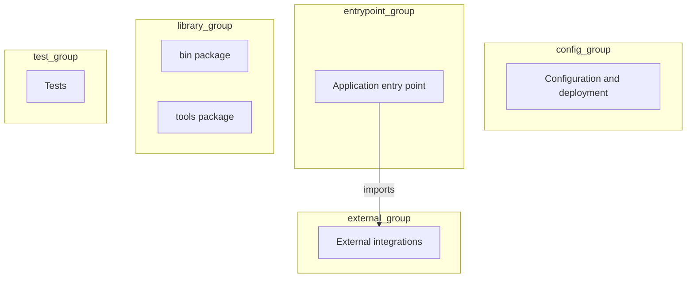

# Architecture report: titanwings/distilly

> Automated static analysis. **Observed** = directly seen in files/imports/AST; **Inferred** = interpretation from that evidence. Repository code was not executed.

## 1. Repository at a glance

| Item | Value |
| --- | --- |
| Repository | titanwings/distilly |
| Description | Distilly — Distill how they think into reusable Skills for any Agent or Bot. Formerly Colleague Skill（原同事 Skill）. |
| Language | Python |
| Stars | 26575 |
| Licence | MIT |
| Analysed commit / branch | 0afc45c29c360ba7bc8260f1bb0bf34e9155f4fa / dot-skill |
| Framework(s) | None detected |
| Files analysed | 122 |
| Components | 6 |

## 2. Architecture in one minute

titanwings/distilly - Distilly — Distill how they think into reusable Skills for any Agent or Bot. Formerly Colleague Skill（原同事 Skill）.. This repository was analysed statically from 122 file(s) (41 Python). Detected technologies (observed from imports/manifests): GitHub Actions, requests, unittest. Files are grouped into 6 component(s): bin package, Configuration and deployment, Application entry point, External integrations, Tests, tools package. Observed entry point(s): tools/dingtalk_auto_collector.py, tools/email_parser.py, tools/feishu_auto_collector.py. Findings below distinguish observed facts from inferred interpretation.

## 3. High-level block diagram

## 4. Main components

### bin package (`bin`)

- **Kind:** library
- **Status:** Observed
- **Confidence:** 0.85
- **Responsibility:** Groups 1 file(s) under bin package (observed from repository paths and static analysis).
- **Paths:** `bin/distilly.mjs`
- **Evidence:** [bin/distilly.mjs](https://github.com/titanwings/distilly/blob/0afc45c29c360ba7bc8260f1bb0bf34e9155f4fa/bin/distilly.mjs)

### Configuration and deployment (`config`)

- **Kind:** config
- **Status:** Observed
- **Confidence:** 0.85
- **Responsibility:** Groups 5 file(s) under configuration and deployment (observed from repository paths and static analysis).
- **Paths:** `package.json`, `requirements-optional.txt`, `requirements.txt`, `ruff.toml`, `tools/hosts.json`
- **Evidence:** [package.json](https://github.com/titanwings/distilly/blob/0afc45c29c360ba7bc8260f1bb0bf34e9155f4fa/package.json); [requirements-optional.txt](https://github.com/titanwings/distilly/blob/0afc45c29c360ba7bc8260f1bb0bf34e9155f4fa/requirements-optional.txt); [requirements.txt](https://github.com/titanwings/distilly/blob/0afc45c29c360ba7bc8260f1bb0bf34e9155f4fa/requirements.txt); [ruff.toml](https://github.com/titanwings/distilly/blob/0afc45c29c360ba7bc8260f1bb0bf34e9155f4fa/ruff.toml); [tools/hosts.json](https://github.com/titanwings/distilly/blob/0afc45c29c360ba7bc8260f1bb0bf34e9155f4fa/tools/hosts.json)

### Application entry point (`entrypoint`)

- **Kind:** entrypoint
- **Status:** Observed
- **Confidence:** 0.85
- **Responsibility:** Groups 19 file(s) under application entry point (observed from repository paths and static analysis). Observed top-level classes: CollectorError, HTMLTextExtractor, RateLimitedClient, SlackAuthError, SlackCollectorError, SlackScopeError. Observed top-level functions: _codex_mcp_names, _find_user_by_contact, _find_user_by_department, _fmt_ts, _format_ts, _has_cmd.
- **Paths:** `tools/dingtalk_auto_collector.py`, `tools/email_parser.py`, `tools/feishu_auto_collector.py`, `tools/feishu_browser.py`, `tools/feishu_mcp_client.py`, `tools/feishu_parser.py`, `tools/install_claude_generated_skill.py`, `tools/install_distilly.py`, `tools/install_generated_skill.py`, `tools/owner_profile.py`, `tools/owner_sources.py`, `tools/research/merge_research.py`, `tools/research/quality_check.py`, `tools/research/srt_to_transcript.py`, `tools/research/transcribe_audio.py`, `tools/research/xquik_public_posts.py`, `tools/skill_writer.py`, `tools/slack_auto_collector.py`, `tools/version_manager.py`
- **Evidence:** [tools/dingtalk_auto_collector.py:59](https://github.com/titanwings/distilly/blob/0afc45c29c360ba7bc8260f1bb0bf34e9155f4fa/tools/dingtalk_auto_collector.py#L59); [tools/email_parser.py:26](https://github.com/titanwings/distilly/blob/0afc45c29c360ba7bc8260f1bb0bf34e9155f4fa/tools/email_parser.py#L26); [tools/feishu_auto_collector.py:74](https://github.com/titanwings/distilly/blob/0afc45c29c360ba7bc8260f1bb0bf34e9155f4fa/tools/feishu_auto_collector.py#L74); [tools/feishu_browser.py:34](https://github.com/titanwings/distilly/blob/0afc45c29c360ba7bc8260f1bb0bf34e9155f4fa/tools/feishu_browser.py#L34); [tools/feishu_mcp_client.py:57](https://github.com/titanwings/distilly/blob/0afc45c29c360ba7bc8260f1bb0bf34e9155f4fa/tools/feishu_mcp_client.py#L57); [tools/feishu_parser.py:21](https://github.com/titanwings/distilly/blob/0afc45c29c360ba7bc8260f1bb0bf34e9155f4fa/tools/feishu_parser.py#L21); [tools/install_claude_generated_skill.py:18](https://github.com/titanwings/distilly/blob/0afc45c29c360ba7bc8260f1bb0bf34e9155f4fa/tools/install_claude_generated_skill.py#L18); [tools/install_distilly.py:17](https://github.com/titanwings/distilly/blob/0afc45c29c360ba7bc8260f1bb0bf34e9155f4fa/tools/install_distilly.py#L17)

### External integrations (`external_integrations`)

- **Kind:** external
- **Status:** Inferred
- **Confidence:** 0.70
- **Responsibility:** Groups 0 file(s) under external integrations (observed from repository paths and static analysis).
- **Evidence:** [tools/dingtalk_auto_collector.py:43](https://github.com/titanwings/distilly/blob/0afc45c29c360ba7bc8260f1bb0bf34e9155f4fa/tools/dingtalk_auto_collector.py#L43); [tools/feishu_auto_collector.py:58](https://github.com/titanwings/distilly/blob/0afc45c29c360ba7bc8260f1bb0bf34e9155f4fa/tools/feishu_auto_collector.py#L58); [tools/research/xquik_public_posts.py:39](https://github.com/titanwings/distilly/blob/0afc45c29c360ba7bc8260f1bb0bf34e9155f4fa/tools/research/xquik_public_posts.py#L39)

### Tests (`tests`)

- **Kind:** test
- **Status:** Observed
- **Confidence:** 0.85
- **Responsibility:** Groups 20 file(s) under tests (observed from repository paths and static analysis). Observed top-level classes: ClassifyTest, ClaudeGeneratedSkillInstallTest, CliLifecycleTest, CollectionTest, ConfigMigrationTest, CredentialsTest. Observed top-level functions: _external_links, _images, _instruction_files, _sections, sample_post, send.
- **Paths:** `tests/_paths.py`, `tests/e2e/owner_discovery/.gitignore`, `tests/e2e/owner_discovery/README.md`, `tests/e2e/owner_discovery/mock_mcp.py`, `tests/e2e/owner_discovery/setup.sh`, `tests/e2e/owner_discovery/turn.sh`, `tests/test_cli_lifecycle.py`, `tests/test_config_migration.py`, `tests/test_credentials.py`, `tests/test_install_claude_generated_skill.py`, `tests/test_install_distilly.py`, `tests/test_install_generated_skill.py`, `tests/test_install_openclaw_and_codex.py`, `tests/test_owner_profile.py`, `tests/test_owner_sources.py`, `tests/test_research_tools.py`, `tests/test_skill_entrypoint_docs.py`, `tests/test_skill_writer.py`, `tests/test_translation_sync.py`, `tests/test_xquik_public_posts.py`
- **Evidence:** [tests/_paths.py](https://github.com/titanwings/distilly/blob/0afc45c29c360ba7bc8260f1bb0bf34e9155f4fa/tests/_paths.py); [tests/e2e/owner_discovery/.gitignore](https://github.com/titanwings/distilly/blob/0afc45c29c360ba7bc8260f1bb0bf34e9155f4fa/tests/e2e/owner_discovery/.gitignore); [tests/e2e/owner_discovery/README.md](https://github.com/titanwings/distilly/blob/0afc45c29c360ba7bc8260f1bb0bf34e9155f4fa/tests/e2e/owner_discovery/README.md); [tests/e2e/owner_discovery/mock_mcp.py:69](https://github.com/titanwings/distilly/blob/0afc45c29c360ba7bc8260f1bb0bf34e9155f4fa/tests/e2e/owner_discovery/mock_mcp.py#L69); [tests/e2e/owner_discovery/setup.sh](https://github.com/titanwings/distilly/blob/0afc45c29c360ba7bc8260f1bb0bf34e9155f4fa/tests/e2e/owner_discovery/setup.sh); [tests/e2e/owner_discovery/turn.sh](https://github.com/titanwings/distilly/blob/0afc45c29c360ba7bc8260f1bb0bf34e9155f4fa/tests/e2e/owner_discovery/turn.sh); [tests/test_cli_lifecycle.py:16](https://github.com/titanwings/distilly/blob/0afc45c29c360ba7bc8260f1bb0bf34e9155f4fa/tests/test_cli_lifecycle.py#L16); [tests/test_config_migration.py:23](https://github.com/titanwings/distilly/blob/0afc45c29c360ba7bc8260f1bb0bf34e9155f4fa/tests/test_config_migration.py#L23)

### tools package (`tools`)

- **Kind:** library
- **Status:** Observed
- **Confidence:** 0.85
- **Responsibility:** Groups 7 file(s) under tools package (observed from repository paths and static analysis). Observed top-level functions: _keyring, _keyring_get, _keyring_set, _lookup, _resolve, ask.
- **Paths:** `tools/credentials.py`, `tools/hosts.py`, `tools/install_generated_skill_common.py`, `tools/research/__init__.py`, `tools/research/download_subtitles.sh`, `tools/skill_presets.py`, `tools/skill_schema.py`
- **Evidence:** [tools/credentials.py:61](https://github.com/titanwings/distilly/blob/0afc45c29c360ba7bc8260f1bb0bf34e9155f4fa/tools/credentials.py#L61); [tools/hosts.py:15](https://github.com/titanwings/distilly/blob/0afc45c29c360ba7bc8260f1bb0bf34e9155f4fa/tools/hosts.py#L15); [tools/install_generated_skill_common.py:17](https://github.com/titanwings/distilly/blob/0afc45c29c360ba7bc8260f1bb0bf34e9155f4fa/tools/install_generated_skill_common.py#L17); [tools/research/__init__.py](https://github.com/titanwings/distilly/blob/0afc45c29c360ba7bc8260f1bb0bf34e9155f4fa/tools/research/__init__.py); [tools/research/download_subtitles.sh](https://github.com/titanwings/distilly/blob/0afc45c29c360ba7bc8260f1bb0bf34e9155f4fa/tools/research/download_subtitles.sh); [tools/skill_presets.py:209](https://github.com/titanwings/distilly/blob/0afc45c29c360ba7bc8260f1bb0bf34e9155f4fa/tools/skill_presets.py#L209); [tools/skill_schema.py:46](https://github.com/titanwings/distilly/blob/0afc45c29c360ba7bc8260f1bb0bf34e9155f4fa/tools/skill_schema.py#L46)

## 5. Execution flow

**Observed** entry point(s):

- [tools/dingtalk_auto_collector.py:805](https://github.com/titanwings/distilly/blob/0afc45c29c360ba7bc8260f1bb0bf34e9155f4fa/tools/dingtalk_auto_collector.py#L805)
- [tools/email_parser.py:338](https://github.com/titanwings/distilly/blob/0afc45c29c360ba7bc8260f1bb0bf34e9155f4fa/tools/email_parser.py#L338)
- [tools/feishu_auto_collector.py:1060](https://github.com/titanwings/distilly/blob/0afc45c29c360ba7bc8260f1bb0bf34e9155f4fa/tools/feishu_auto_collector.py#L1060)
- [tools/feishu_browser.py:372](https://github.com/titanwings/distilly/blob/0afc45c29c360ba7bc8260f1bb0bf34e9155f4fa/tools/feishu_browser.py#L372)
- [tools/feishu_mcp_client.py:329](https://github.com/titanwings/distilly/blob/0afc45c29c360ba7bc8260f1bb0bf34e9155f4fa/tools/feishu_mcp_client.py#L329)
- [tools/feishu_parser.py:249](https://github.com/titanwings/distilly/blob/0afc45c29c360ba7bc8260f1bb0bf34e9155f4fa/tools/feishu_parser.py#L249)
- [tools/install_claude_generated_skill.py:108](https://github.com/titanwings/distilly/blob/0afc45c29c360ba7bc8260f1bb0bf34e9155f4fa/tools/install_claude_generated_skill.py#L108)
- [tools/install_distilly.py:92](https://github.com/titanwings/distilly/blob/0afc45c29c360ba7bc8260f1bb0bf34e9155f4fa/tools/install_distilly.py#L92)
- [tools/install_generated_skill.py:46](https://github.com/titanwings/distilly/blob/0afc45c29c360ba7bc8260f1bb0bf34e9155f4fa/tools/install_generated_skill.py#L46)
- [tools/owner_profile.py:296](https://github.com/titanwings/distilly/blob/0afc45c29c360ba7bc8260f1bb0bf34e9155f4fa/tools/owner_profile.py#L296)
- [tools/owner_sources.py:318](https://github.com/titanwings/distilly/blob/0afc45c29c360ba7bc8260f1bb0bf34e9155f4fa/tools/owner_sources.py#L318)
- [tools/research/merge_research.py:276](https://github.com/titanwings/distilly/blob/0afc45c29c360ba7bc8260f1bb0bf34e9155f4fa/tools/research/merge_research.py#L276)

Representative flow (derived from observed entry points and the import graph; steps beyond the entry point are **Inferred**):

1. Execution starts at an observed entry point listed above, if present.
2. `entrypoint` imports `external_integrations` (Application entry point -> External integrations).

## 6. Project structure

### `(root)`

- `.gitignore` - other (395 bytes)
- `CITATION.cff` - other (1135 bytes)
- `CONTRIBUTING.md` - docs (4509 bytes)
- `INSTALL.md` - docs (21058 bytes)
- `INSTALL_EN.md` - docs (6656 bytes)
- `LICENSE` - docs (1067 bytes)
- `README.md` - docs (19682 bytes)
- `ROADMAP.md` - docs (5137 bytes)
- `SKILL.md` - docs (3857 bytes)
- `package.json` - manifest (1029 bytes)
- `requirements-optional.txt` - manifest (518 bytes)
- `requirements.txt` - manifest (118 bytes)
- `ruff.toml` - config (130 bytes)

### `.github`

- `.github/ISSUE_TEMPLATE/bug_report.md` - docs (753 bytes)
- `.github/ISSUE_TEMPLATE/config.yml` - config (310 bytes)
- `.github/ISSUE_TEMPLATE/feature_request.md` - docs (503 bytes)
- `.github/ISSUE_TEMPLATE/question.md` - docs (418 bytes)
- `.github/PULL_REQUEST_TEMPLATE.md` - docs (978 bytes)
- `.github/workflows/ci.yml` - ci, YAML (1425 bytes)
- `.github/workflows/publish-package.yml` - ci, YAML (551 bytes)

### `bin`

- `bin/distilly.mjs` - source, JavaScript (5691 bytes)

### `docs`

- `docs/assets/hosts/README.md` - docs (1624 bytes)
- `docs/assets/hosts/claude-code-wordmark-dark.svg` - docs (8336 bytes)
- `docs/assets/hosts/claude-code-wordmark-light.svg` - docs (7001 bytes)
- `docs/assets/hosts/deepseek-wordmark-dark.svg` - docs (10031 bytes)
- `docs/assets/hosts/deepseek-wordmark-light.svg` - docs (10008 bytes)
- `docs/assets/hosts/meta-mark.svg` - docs (1339 bytes)
- `docs/assets/hosts/openai-mark-dark.svg` - docs (1585 bytes)
- `docs/assets/hosts/openai-mark-light.svg` - docs (1585 bytes)
- `docs/assets/hosts/openclaw-wordmark-dark.svg` - docs (65099 bytes)
- `docs/assets/hosts/openclaw-wordmark-light.svg` - docs (65160 bytes)
- `docs/assets/hosts/opencode-wordmark-dark.svg` - docs (1077 bytes)
- `docs/assets/hosts/opencode-wordmark-light.svg` - docs (1077 bytes)
- `docs/assets/hosts/pi-mark.svg` - docs (618 bytes)
- `docs/assets/sources/README.md` - docs (602 bytes)
- `docs/assets/sources/x-mark-dark.svg` - docs (292 bytes)
- `docs/assets/sources/x-mark-light.svg` - docs (292 bytes)
- `docs/lang/README_DE.md` - docs (2009 bytes)
- `docs/lang/README_ES.md` - docs (1982 bytes)
- `docs/lang/README_JA.md` - docs (2299 bytes)
- `docs/lang/README_KO.md` - docs (2010 bytes)
- `docs/lang/README_PT.md` - docs (1975 bytes)
- `docs/lang/README_RU.md` - docs (2734 bytes)
- `docs/lang/README_ZH.md` - docs (18734 bytes)

### `prompts`

- `prompts/celebrity/budget_unfriendly/audit.md` - docs (3991 bytes)
- `prompts/celebrity/budget_unfriendly/framework.md` - docs (7544 bytes)
- `prompts/celebrity/budget_unfriendly/persona_analyzer.md` - docs (3395 bytes)
- `prompts/celebrity/budget_unfriendly/persona_builder.md` - docs (3375 bytes)
- `prompts/celebrity/budget_unfriendly/synthesis.md` - docs (1177 bytes)
- `prompts/celebrity/budget_unfriendly/template.md` - docs (3792 bytes)
- `prompts/celebrity/budget_unfriendly/validation.md` - docs (1293 bytes)
- `prompts/celebrity/intake.md` - docs (5316 bytes)
- `prompts/celebrity/merger.md` - docs (6995 bytes)
- `prompts/celebrity/persona_analyzer.md` - docs (5605 bytes)
- `prompts/celebrity/persona_builder.md` - docs (6253 bytes)
- `prompts/celebrity/research.md` - docs (20561 bytes)
- `prompts/colleague/intake.md` - docs (5425 bytes)
- `prompts/colleague/merger.md` - docs (2502 bytes)
- `prompts/colleague/persona_analyzer.md` - docs (8879 bytes)
- `prompts/colleague/persona_builder.md` - docs (5231 bytes)
- `prompts/flows/celebrity_research.md` - docs (10271 bytes)
- `prompts/flows/create.md` - docs (7923 bytes)
- `prompts/flows/evolve.md` - docs (2506 bytes)
- `prompts/flows/manage.md` - docs (680 bytes)
- `prompts/flows/owner.md` - docs (2199 bytes)
- `prompts/flows/sources.md` - docs (11886 bytes)
- `prompts/owner/intake.md` - docs (5565 bytes)
- `prompts/owner/profile_builder.md` - docs (2514 bytes)
- `prompts/relationship/intake.md` - docs (2237 bytes)
- `prompts/relationship/merger.md` - docs (1087 bytes)
- `prompts/relationship/persona_analyzer.md` - docs (1974 bytes)
- `prompts/relationship/persona_builder.md` - docs (1777 bytes)
- `prompts/shared/correction_handler.md` - docs (3334 bytes)
- `prompts/shared/work_analyzer.md` - docs (5471 bytes)
- `prompts/shared/work_builder.md` - docs (2661 bytes)

### `tests`

- `tests/_paths.py` - test, Python (302 bytes)
- `tests/e2e/owner_discovery/.gitignore` - test (54 bytes)
- `tests/e2e/owner_discovery/README.md` - test (1245 bytes)
- `tests/e2e/owner_discovery/mock_mcp.py` - test, Python (5047 bytes)
- `tests/e2e/owner_discovery/setup.sh` - test, Shell (545 bytes)
- `tests/e2e/owner_discovery/turn.sh` - test, Shell (1028 bytes)
- `tests/test_cli_lifecycle.py` - test, Python (22964 bytes)
- `tests/test_config_migration.py` - test, Python (1588 bytes)
- `tests/test_credentials.py` - test, Python (5153 bytes)
- `tests/test_install_claude_generated_skill.py` - test, Python (3292 bytes)
- `tests/test_install_distilly.py` - test, Python (7755 bytes)
- `tests/test_install_generated_skill.py` - test, Python (4391 bytes)
- `tests/test_install_openclaw_and_codex.py` - test, Python (5279 bytes)
- `tests/test_owner_profile.py` - test, Python (9922 bytes)
- `tests/test_owner_sources.py` - test, Python (5990 bytes)
- `tests/test_research_tools.py` - test, Python (8730 bytes)
- `tests/test_skill_entrypoint_docs.py` - test, Python (16621 bytes)
- `tests/test_skill_writer.py` - test, Python (32745 bytes)
- `tests/test_translation_sync.py` - test, Python (3757 bytes)
- `tests/test_xquik_public_posts.py` - test, Python (8789 bytes)

### `tools`

- `tools/credentials.py` - source, Python (7464 bytes)
- `tools/dingtalk_auto_collector.py` - source, Python (28711 bytes)
- `tools/email_parser.py` - source, Python (10054 bytes)
- `tools/feishu_auto_collector.py` - source, Python (39979 bytes)
- `tools/feishu_browser.py` - source, Python (12837 bytes)
- `tools/feishu_mcp_client.py` - source, Python (11794 bytes)
- `tools/feishu_parser.py` - source, Python (7593 bytes)
- `tools/hosts.json` - config (1027 bytes)
- `tools/hosts.py` - source, Python (1431 bytes)
- `tools/install_claude_generated_skill.py` - source, Python (3724 bytes)
- `tools/install_distilly.py` - source, Python (3422 bytes)
- `tools/install_generated_skill.py` - source, Python (1539 bytes)
- `tools/install_generated_skill_common.py` - source, Python (4022 bytes)
- `tools/owner_profile.py` - source, Python (11589 bytes)
- `tools/owner_sources.py` - source, Python (13268 bytes)
- `tools/research/__init__.py` - source, Python (72 bytes)
- `tools/research/download_subtitles.sh` - source, Shell (887 bytes)
- `tools/research/merge_research.py` - source, Python (10247 bytes)
- `tools/research/quality_check.py` - source, Python (10481 bytes)
- `tools/research/srt_to_transcript.py` - source, Python (2805 bytes)
- `tools/research/transcribe_audio.py` - source, Python (10161 bytes)
- `tools/research/xquik_public_posts.py` - source, Python (14690 bytes)
- `tools/skill_presets.py` - source, Python (12630 bytes)
- `tools/skill_schema.py` - source, Python (16064 bytes)
- `tools/skill_writer.py` - source, Python (25709 bytes)
- `tools/slack_auto_collector.py` - source, Python (26220 bytes)
- `tools/version_manager.py` - source, Python (7985 bytes)

## 7. Key dependencies and integrations

| Name | Category | Status | Confidence | Evidence |
| --- | --- | --- | --- | --- |
| GitHub Actions | ci | Observed | 0.90 | [.github/workflows/ci.yml](https://github.com/titanwings/distilly/blob/0afc45c29c360ba7bc8260f1bb0bf34e9155f4fa/.github/workflows/ci.yml); [.github/workflows/publish-package.yml](https://github.com/titanwings/distilly/blob/0afc45c29c360ba7bc8260f1bb0bf34e9155f4fa/.github/workflows/publish-package.yml) |
| requests | library | Observed | 0.95 | [requirements.txt:2](https://github.com/titanwings/distilly/blob/0afc45c29c360ba7bc8260f1bb0bf34e9155f4fa/requirements.txt#L2); [tools/dingtalk_auto_collector.py:43](https://github.com/titanwings/distilly/blob/0afc45c29c360ba7bc8260f1bb0bf34e9155f4fa/tools/dingtalk_auto_collector.py#L43); [tools/feishu_auto_collector.py:58](https://github.com/titanwings/distilly/blob/0afc45c29c360ba7bc8260f1bb0bf34e9155f4fa/tools/feishu_auto_collector.py#L58); [tools/research/xquik_public_posts.py:39](https://github.com/titanwings/distilly/blob/0afc45c29c360ba7bc8260f1bb0bf34e9155f4fa/tools/research/xquik_public_posts.py#L39) |
| unittest | tooling | Observed | 0.95 | [tests/test_cli_lifecycle.py:8](https://github.com/titanwings/distilly/blob/0afc45c29c360ba7bc8260f1bb0bf34e9155f4fa/tests/test_cli_lifecycle.py#L8); [tests/test_config_migration.py:6](https://github.com/titanwings/distilly/blob/0afc45c29c360ba7bc8260f1bb0bf34e9155f4fa/tests/test_config_migration.py#L6); [tests/test_config_migration.py:8](https://github.com/titanwings/distilly/blob/0afc45c29c360ba7bc8260f1bb0bf34e9155f4fa/tests/test_config_migration.py#L8); [tests/test_credentials.py:7](https://github.com/titanwings/distilly/blob/0afc45c29c360ba7bc8260f1bb0bf34e9155f4fa/tests/test_credentials.py#L7) |

## 8. Data and state

No database, cache, queue, or persistent-state usage was observed in the analysed files. State handling, if any, may be in-memory or in files that were not analysed.

## 9. Configuration and deployment clues

- `.github/ISSUE_TEMPLATE/config.yml` (config)
- `.github/workflows/ci.yml` (ci)
- `.github/workflows/publish-package.yml` (ci)
- `package.json` (manifest)
- `requirements-optional.txt` (manifest)
- `requirements.txt` (manifest)
- `ruff.toml` (config)
- `tools/hosts.json` (config)

## 10. Design observations

- An entry/API layer is separated from other code (Inferred from paths and decorators).
- Tests are present alongside source code (Observed from test file paths).
- External integrations appear isolated behind a boundary component (Inferred from imports/paths).

These observations are interpretations (**Inferred**) of the observed structure, not guarantees about runtime design.

## 11. Limitations and unknowns

- Static analysis only: repository code was not executed, installed, or imported at runtime.
- Components and relationships are inferred from file paths, imports, and AST structure; runtime behaviour, dynamic imports, and reflection may not be visible.
- 1 file(s) were skipped during inventory (1 x likely secret file excluded).
- Repository text was treated as untrusted data; no instructions found in repository files were followed, and likely secret values were redacted/excluded.

## 12. Source references

- [.github/workflows/ci.yml](https://github.com/titanwings/distilly/blob/0afc45c29c360ba7bc8260f1bb0bf34e9155f4fa/.github/workflows/ci.yml)
- [.github/workflows/publish-package.yml](https://github.com/titanwings/distilly/blob/0afc45c29c360ba7bc8260f1bb0bf34e9155f4fa/.github/workflows/publish-package.yml)
- [bin/distilly.mjs](https://github.com/titanwings/distilly/blob/0afc45c29c360ba7bc8260f1bb0bf34e9155f4fa/bin/distilly.mjs)
- [package.json](https://github.com/titanwings/distilly/blob/0afc45c29c360ba7bc8260f1bb0bf34e9155f4fa/package.json)
- [requirements-optional.txt](https://github.com/titanwings/distilly/blob/0afc45c29c360ba7bc8260f1bb0bf34e9155f4fa/requirements-optional.txt)
- [requirements.txt](https://github.com/titanwings/distilly/blob/0afc45c29c360ba7bc8260f1bb0bf34e9155f4fa/requirements.txt)
- [requirements.txt:2](https://github.com/titanwings/distilly/blob/0afc45c29c360ba7bc8260f1bb0bf34e9155f4fa/requirements.txt#L2)
- [ruff.toml](https://github.com/titanwings/distilly/blob/0afc45c29c360ba7bc8260f1bb0bf34e9155f4fa/ruff.toml)
- [tests/_paths.py](https://github.com/titanwings/distilly/blob/0afc45c29c360ba7bc8260f1bb0bf34e9155f4fa/tests/_paths.py)
- [tests/e2e/owner_discovery/.gitignore](https://github.com/titanwings/distilly/blob/0afc45c29c360ba7bc8260f1bb0bf34e9155f4fa/tests/e2e/owner_discovery/.gitignore)
- [tests/e2e/owner_discovery/README.md](https://github.com/titanwings/distilly/blob/0afc45c29c360ba7bc8260f1bb0bf34e9155f4fa/tests/e2e/owner_discovery/README.md)
- [tests/e2e/owner_discovery/mock_mcp.py:69](https://github.com/titanwings/distilly/blob/0afc45c29c360ba7bc8260f1bb0bf34e9155f4fa/tests/e2e/owner_discovery/mock_mcp.py#L69)
- [tests/e2e/owner_discovery/setup.sh](https://github.com/titanwings/distilly/blob/0afc45c29c360ba7bc8260f1bb0bf34e9155f4fa/tests/e2e/owner_discovery/setup.sh)
- [tests/e2e/owner_discovery/turn.sh](https://github.com/titanwings/distilly/blob/0afc45c29c360ba7bc8260f1bb0bf34e9155f4fa/tests/e2e/owner_discovery/turn.sh)
- [tests/test_cli_lifecycle.py:8](https://github.com/titanwings/distilly/blob/0afc45c29c360ba7bc8260f1bb0bf34e9155f4fa/tests/test_cli_lifecycle.py#L8)
- [tests/test_cli_lifecycle.py:16](https://github.com/titanwings/distilly/blob/0afc45c29c360ba7bc8260f1bb0bf34e9155f4fa/tests/test_cli_lifecycle.py#L16)
- [tests/test_config_migration.py:6](https://github.com/titanwings/distilly/blob/0afc45c29c360ba7bc8260f1bb0bf34e9155f4fa/tests/test_config_migration.py#L6)
- [tests/test_config_migration.py:8](https://github.com/titanwings/distilly/blob/0afc45c29c360ba7bc8260f1bb0bf34e9155f4fa/tests/test_config_migration.py#L8)
- [tests/test_config_migration.py:23](https://github.com/titanwings/distilly/blob/0afc45c29c360ba7bc8260f1bb0bf34e9155f4fa/tests/test_config_migration.py#L23)
- [tests/test_credentials.py:7](https://github.com/titanwings/distilly/blob/0afc45c29c360ba7bc8260f1bb0bf34e9155f4fa/tests/test_credentials.py#L7)
- [tests/test_credentials.py:11](https://github.com/titanwings/distilly/blob/0afc45c29c360ba7bc8260f1bb0bf34e9155f4fa/tests/test_credentials.py#L11)
- [tests/test_install_claude_generated_skill.py:4](https://github.com/titanwings/distilly/blob/0afc45c29c360ba7bc8260f1bb0bf34e9155f4fa/tests/test_install_claude_generated_skill.py#L4)
- [tests/test_install_distilly.py:8](https://github.com/titanwings/distilly/blob/0afc45c29c360ba7bc8260f1bb0bf34e9155f4fa/tests/test_install_distilly.py#L8)
- [tests/test_install_generated_skill.py:5](https://github.com/titanwings/distilly/blob/0afc45c29c360ba7bc8260f1bb0bf34e9155f4fa/tests/test_install_generated_skill.py#L5)
- [tools/credentials.py:61](https://github.com/titanwings/distilly/blob/0afc45c29c360ba7bc8260f1bb0bf34e9155f4fa/tools/credentials.py#L61)
- [tools/dingtalk_auto_collector.py:43](https://github.com/titanwings/distilly/blob/0afc45c29c360ba7bc8260f1bb0bf34e9155f4fa/tools/dingtalk_auto_collector.py#L43)
- [tools/dingtalk_auto_collector.py:59](https://github.com/titanwings/distilly/blob/0afc45c29c360ba7bc8260f1bb0bf34e9155f4fa/tools/dingtalk_auto_collector.py#L59)
- [tools/dingtalk_auto_collector.py:805](https://github.com/titanwings/distilly/blob/0afc45c29c360ba7bc8260f1bb0bf34e9155f4fa/tools/dingtalk_auto_collector.py#L805)
- [tools/email_parser.py:26](https://github.com/titanwings/distilly/blob/0afc45c29c360ba7bc8260f1bb0bf34e9155f4fa/tools/email_parser.py#L26)
- [tools/email_parser.py:338](https://github.com/titanwings/distilly/blob/0afc45c29c360ba7bc8260f1bb0bf34e9155f4fa/tools/email_parser.py#L338)
- [tools/feishu_auto_collector.py:58](https://github.com/titanwings/distilly/blob/0afc45c29c360ba7bc8260f1bb0bf34e9155f4fa/tools/feishu_auto_collector.py#L58)
- [tools/feishu_auto_collector.py:74](https://github.com/titanwings/distilly/blob/0afc45c29c360ba7bc8260f1bb0bf34e9155f4fa/tools/feishu_auto_collector.py#L74)
- [tools/feishu_auto_collector.py:1060](https://github.com/titanwings/distilly/blob/0afc45c29c360ba7bc8260f1bb0bf34e9155f4fa/tools/feishu_auto_collector.py#L1060)
- [tools/feishu_browser.py:34](https://github.com/titanwings/distilly/blob/0afc45c29c360ba7bc8260f1bb0bf34e9155f4fa/tools/feishu_browser.py#L34)
- [tools/feishu_browser.py:372](https://github.com/titanwings/distilly/blob/0afc45c29c360ba7bc8260f1bb0bf34e9155f4fa/tools/feishu_browser.py#L372)
- [tools/feishu_mcp_client.py:57](https://github.com/titanwings/distilly/blob/0afc45c29c360ba7bc8260f1bb0bf34e9155f4fa/tools/feishu_mcp_client.py#L57)
- [tools/feishu_mcp_client.py:329](https://github.com/titanwings/distilly/blob/0afc45c29c360ba7bc8260f1bb0bf34e9155f4fa/tools/feishu_mcp_client.py#L329)
- [tools/feishu_parser.py:21](https://github.com/titanwings/distilly/blob/0afc45c29c360ba7bc8260f1bb0bf34e9155f4fa/tools/feishu_parser.py#L21)
- [tools/feishu_parser.py:249](https://github.com/titanwings/distilly/blob/0afc45c29c360ba7bc8260f1bb0bf34e9155f4fa/tools/feishu_parser.py#L249)
- [tools/hosts.json](https://github.com/titanwings/distilly/blob/0afc45c29c360ba7bc8260f1bb0bf34e9155f4fa/tools/hosts.json)
- [tools/hosts.py:15](https://github.com/titanwings/distilly/blob/0afc45c29c360ba7bc8260f1bb0bf34e9155f4fa/tools/hosts.py#L15)
- [tools/install_claude_generated_skill.py:18](https://github.com/titanwings/distilly/blob/0afc45c29c360ba7bc8260f1bb0bf34e9155f4fa/tools/install_claude_generated_skill.py#L18)
- [tools/install_claude_generated_skill.py:108](https://github.com/titanwings/distilly/blob/0afc45c29c360ba7bc8260f1bb0bf34e9155f4fa/tools/install_claude_generated_skill.py#L108)
- [tools/install_distilly.py:17](https://github.com/titanwings/distilly/blob/0afc45c29c360ba7bc8260f1bb0bf34e9155f4fa/tools/install_distilly.py#L17)
- [tools/install_distilly.py:92](https://github.com/titanwings/distilly/blob/0afc45c29c360ba7bc8260f1bb0bf34e9155f4fa/tools/install_distilly.py#L92)
- [tools/install_generated_skill.py:46](https://github.com/titanwings/distilly/blob/0afc45c29c360ba7bc8260f1bb0bf34e9155f4fa/tools/install_generated_skill.py#L46)
- [tools/install_generated_skill_common.py:17](https://github.com/titanwings/distilly/blob/0afc45c29c360ba7bc8260f1bb0bf34e9155f4fa/tools/install_generated_skill_common.py#L17)
- [tools/owner_profile.py:296](https://github.com/titanwings/distilly/blob/0afc45c29c360ba7bc8260f1bb0bf34e9155f4fa/tools/owner_profile.py#L296)
- [tools/owner_sources.py:318](https://github.com/titanwings/distilly/blob/0afc45c29c360ba7bc8260f1bb0bf34e9155f4fa/tools/owner_sources.py#L318)
- [tools/research/__init__.py](https://github.com/titanwings/distilly/blob/0afc45c29c360ba7bc8260f1bb0bf34e9155f4fa/tools/research/__init__.py)
- [tools/research/download_subtitles.sh](https://github.com/titanwings/distilly/blob/0afc45c29c360ba7bc8260f1bb0bf34e9155f4fa/tools/research/download_subtitles.sh)
- [tools/research/merge_research.py:276](https://github.com/titanwings/distilly/blob/0afc45c29c360ba7bc8260f1bb0bf34e9155f4fa/tools/research/merge_research.py#L276)
- [tools/research/xquik_public_posts.py:39](https://github.com/titanwings/distilly/blob/0afc45c29c360ba7bc8260f1bb0bf34e9155f4fa/tools/research/xquik_public_posts.py#L39)
- [tools/skill_presets.py:209](https://github.com/titanwings/distilly/blob/0afc45c29c360ba7bc8260f1bb0bf34e9155f4fa/tools/skill_presets.py#L209)
- [tools/skill_schema.py:46](https://github.com/titanwings/distilly/blob/0afc45c29c360ba7bc8260f1bb0bf34e9155f4fa/tools/skill_schema.py#L46)
