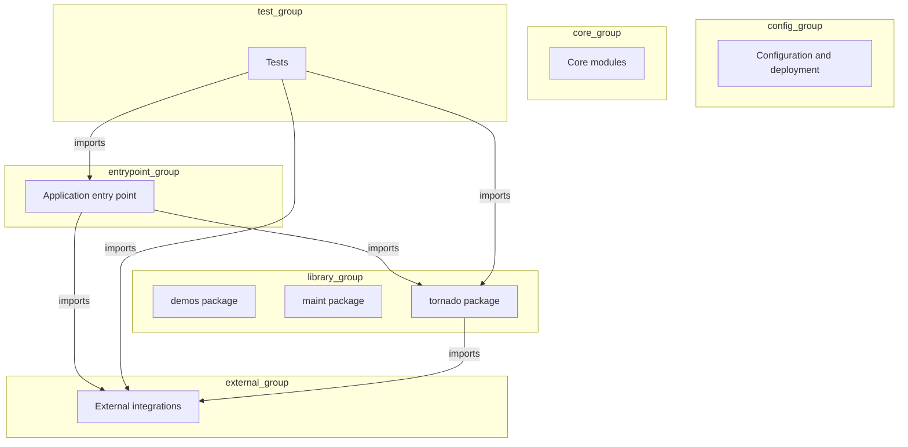

# Architecture report: tornadoweb/tornado

> Automated static analysis. **Observed** = directly seen in files/imports/AST; **Inferred** = interpretation from that evidence. Repository code was not executed.

## 1. Repository at a glance

| Item | Value |
| --- | --- |
| Repository | tornadoweb/tornado |
| Description | Tornado is a Python web framework and asynchronous networking library, originally developed at FriendFeed. |
| Language | Python |
| Stars | 22164 |
| Licence | Apache-2.0 |
| Analysed commit / branch | 48f6645edfd0ae1fc2ef58902c98876f1f5a37b7 / master |
| Framework(s) | None detected |
| Files analysed | 330 |
| Components | 8 |

## 2. Architecture in one minute

tornadoweb/tornado - Tornado is a Python web framework and asynchronous networking library, originally developed at FriendFeed.. This repository was analysed statically from 330 file(s) (114 Python). Detected technologies (observed from imports/manifests): GitHub Actions, PostgreSQL, Click, requests, Poetry, setuptools. Files are grouped into 8 component(s): Configuration and deployment, Core modules, demos package, Application entry point, External integrations, maint package, Tests, tornado package. Observed entry point(s): demos/blog/blog.py, demos/chat/chatdemo.py, demos/facebook/facebook.py. Findings below distinguish observed facts from inferred interpretation.

## 3. High-level block diagram

## 4. Main components

### Configuration and deployment (`config`)

- **Kind:** config
- **Status:** Observed
- **Confidence:** 0.85
- **Responsibility:** Groups 14 file(s) under configuration and deployment (observed from repository paths and static analysis).
- **Paths:** `MANIFEST.in`, `codecov.yml`, `demos/blog/Dockerfile`, `demos/blog/docker-compose.yml`, `demos/blog/requirements.txt`, `maint/vm/freebsd/tox.ini`, `maint/vm/ubuntu12.04/tox.ini`, `maint/vm/ubuntu14.04/tox.ini`, `maint/vm/windows/tox.ini`, `pyproject.toml`, `requirements.txt`, `setup.cfg`, `setup.py`, `tox.ini`
- **Evidence:** [MANIFEST.in](https://github.com/tornadoweb/tornado/blob/48f6645edfd0ae1fc2ef58902c98876f1f5a37b7/MANIFEST.in); [codecov.yml](https://github.com/tornadoweb/tornado/blob/48f6645edfd0ae1fc2ef58902c98876f1f5a37b7/codecov.yml); [demos/blog/Dockerfile](https://github.com/tornadoweb/tornado/blob/48f6645edfd0ae1fc2ef58902c98876f1f5a37b7/demos/blog/Dockerfile); [demos/blog/docker-compose.yml](https://github.com/tornadoweb/tornado/blob/48f6645edfd0ae1fc2ef58902c98876f1f5a37b7/demos/blog/docker-compose.yml); [demos/blog/requirements.txt](https://github.com/tornadoweb/tornado/blob/48f6645edfd0ae1fc2ef58902c98876f1f5a37b7/demos/blog/requirements.txt); [maint/vm/freebsd/tox.ini](https://github.com/tornadoweb/tornado/blob/48f6645edfd0ae1fc2ef58902c98876f1f5a37b7/maint/vm/freebsd/tox.ini); [maint/vm/ubuntu12.04/tox.ini](https://github.com/tornadoweb/tornado/blob/48f6645edfd0ae1fc2ef58902c98876f1f5a37b7/maint/vm/ubuntu12.04/tox.ini); [maint/vm/ubuntu14.04/tox.ini](https://github.com/tornadoweb/tornado/blob/48f6645edfd0ae1fc2ef58902c98876f1f5a37b7/maint/vm/ubuntu14.04/tox.ini)

### Core modules (`core`)

- **Kind:** core
- **Status:** Observed
- **Confidence:** 0.85
- **Responsibility:** Groups 1 file(s) under core modules (observed from repository paths and static analysis).
- **Paths:** `runtests.sh`
- **Evidence:** [runtests.sh](https://github.com/tornadoweb/tornado/blob/48f6645edfd0ae1fc2ef58902c98876f1f5a37b7/runtests.sh)

### demos package (`demos`)

- **Kind:** library
- **Status:** Observed
- **Confidence:** 0.85
- **Responsibility:** Groups 3 file(s) under demos package (observed from repository paths and static analysis).
- **Paths:** `demos/chat/static/chat.js`, `demos/facebook/static/facebook.js`, `demos/websocket/static/chat.js`
- **Evidence:** [demos/chat/static/chat.js](https://github.com/tornadoweb/tornado/blob/48f6645edfd0ae1fc2ef58902c98876f1f5a37b7/demos/chat/static/chat.js); [demos/facebook/static/facebook.js](https://github.com/tornadoweb/tornado/blob/48f6645edfd0ae1fc2ef58902c98876f1f5a37b7/demos/facebook/static/facebook.js); [demos/websocket/static/chat.js](https://github.com/tornadoweb/tornado/blob/48f6645edfd0ae1fc2ef58902c98876f1f5a37b7/demos/websocket/static/chat.js)

### Application entry point (`entrypoint`)

- **Kind:** entrypoint
- **Status:** Observed
- **Confidence:** 0.85
- **Responsibility:** Groups 27 file(s) under application entry point (observed from repository paths and static analysis). Observed top-level classes: Application, ArchiveHandler, AsyncHTTPClient, AsyncHTTPSTestCase, AsyncHTTPTestCase, AsyncTestCase. Observed top-level functions: _check_file, _pipe, _reload, _reload_on_update, add_reload_hook, bind_unused_port.
- **Paths:** `demos/blog/blog.py`, `demos/chat/chatdemo.py`, `demos/facebook/facebook.py`, `demos/file_upload/file_receiver.py`, `demos/file_upload/file_uploader.py`, `demos/google_auth/main.py`, `demos/helloworld/helloworld.py`, `demos/tcpecho/client.py`, `demos/tcpecho/server.py`, `demos/websocket/chatdemo.py`, `demos/webspider/webspider.py`, `maint/benchmark/benchmark.py`, `maint/benchmark/chunk_benchmark.py`, `maint/benchmark/ci_benchmark.py`, `maint/benchmark/compare_benchmarks.py`, `maint/benchmark/dos_benchmark.py`, `maint/benchmark/gen_benchmark.py`, `maint/benchmark/parsing_benchmark.py`, `maint/benchmark/template_benchmark.py`, `maint/scripts/pre_tag_checks.py`, `maint/vm/windows/bootstrap.py`, `tornado/autoreload.py`, `tornado/curl_httpclient.py`, `tornado/httpclient.py`, `tornado/simple_httpclient.py`, `tornado/testing.py`, `tornado/wsgi.py`
- **Evidence:** [demos/blog/blog.py:37](https://github.com/tornadoweb/tornado/blob/48f6645edfd0ae1fc2ef58902c98876f1f5a37b7/demos/blog/blog.py#L37); [demos/chat/chatdemo.py:28](https://github.com/tornadoweb/tornado/blob/48f6645edfd0ae1fc2ef58902c98876f1f5a37b7/demos/chat/chatdemo.py#L28); [demos/facebook/facebook.py:28](https://github.com/tornadoweb/tornado/blob/48f6645edfd0ae1fc2ef58902c98876f1f5a37b7/demos/facebook/facebook.py#L28); [demos/file_upload/file_receiver.py:19](https://github.com/tornadoweb/tornado/blob/48f6645edfd0ae1fc2ef58902c98876f1f5a37b7/demos/file_upload/file_receiver.py#L19); [demos/file_upload/file_uploader.py:26](https://github.com/tornadoweb/tornado/blob/48f6645edfd0ae1fc2ef58902c98876f1f5a37b7/demos/file_upload/file_uploader.py#L26); [demos/google_auth/main.py:32](https://github.com/tornadoweb/tornado/blob/48f6645edfd0ae1fc2ef58902c98876f1f5a37b7/demos/google_auth/main.py#L32); [demos/helloworld/helloworld.py:25](https://github.com/tornadoweb/tornado/blob/48f6645edfd0ae1fc2ef58902c98876f1f5a37b7/demos/helloworld/helloworld.py#L25); [demos/tcpecho/client.py:12](https://github.com/tornadoweb/tornado/blob/48f6645edfd0ae1fc2ef58902c98876f1f5a37b7/demos/tcpecho/client.py#L12)

### External integrations (`external_integrations`)

- **Kind:** external
- **Status:** Inferred
- **Confidence:** 0.70
- **Responsibility:** Groups 0 file(s) under external integrations (observed from repository paths and static analysis).
- **Evidence:** [demos/blog/blog.py:22](https://github.com/tornadoweb/tornado/blob/48f6645edfd0ae1fc2ef58902c98876f1f5a37b7/demos/blog/blog.py#L22); [maint/benchmark/dos_benchmark.py:29](https://github.com/tornadoweb/tornado/blob/48f6645edfd0ae1fc2ef58902c98876f1f5a37b7/maint/benchmark/dos_benchmark.py#L29); [maint/scripts/test_resolvers.py:12](https://github.com/tornadoweb/tornado/blob/48f6645edfd0ae1fc2ef58902c98876f1f5a37b7/maint/scripts/test_resolvers.py#L12); [tornado/httpserver.py:28](https://github.com/tornadoweb/tornado/blob/48f6645edfd0ae1fc2ef58902c98876f1f5a37b7/tornado/httpserver.py#L28); [tornado/iostream.py:33](https://github.com/tornadoweb/tornado/blob/48f6645edfd0ae1fc2ef58902c98876f1f5a37b7/tornado/iostream.py#L33); [tornado/netutil.py:23](https://github.com/tornadoweb/tornado/blob/48f6645edfd0ae1fc2ef58902c98876f1f5a37b7/tornado/netutil.py#L23)

### maint package (`maint`)

- **Kind:** library
- **Status:** Observed
- **Confidence:** 0.85
- **Responsibility:** Groups 10 file(s) under maint package (observed from repository paths and static analysis). Observed top-level classes: FixFutureImports, FixUnicodeLiteral. Observed top-level functions: is_docstring.
- **Paths:** `maint/scripts/custom_fixers/__init__.py`, `maint/scripts/custom_fixers/fix_future_imports.py`, `maint/scripts/custom_fixers/fix_unicode_literal.py`, `maint/scripts/run_autopep8.sh`, `maint/scripts/run_fixers.py`, `maint/scripts/runcog.sh`, `maint/vm/freebsd/setup.sh`, `maint/vm/shared-setup.sh`, `maint/vm/ubuntu12.04/setup.sh`, `maint/vm/ubuntu14.04/setup.sh`
- **Evidence:** [maint/scripts/custom_fixers/__init__.py](https://github.com/tornadoweb/tornado/blob/48f6645edfd0ae1fc2ef58902c98876f1f5a37b7/maint/scripts/custom_fixers/__init__.py); [maint/scripts/custom_fixers/fix_future_imports.py:10](https://github.com/tornadoweb/tornado/blob/48f6645edfd0ae1fc2ef58902c98876f1f5a37b7/maint/scripts/custom_fixers/fix_future_imports.py#L10); [maint/scripts/custom_fixers/fix_unicode_literal.py:5](https://github.com/tornadoweb/tornado/blob/48f6645edfd0ae1fc2ef58902c98876f1f5a37b7/maint/scripts/custom_fixers/fix_unicode_literal.py#L5); [maint/scripts/run_autopep8.sh](https://github.com/tornadoweb/tornado/blob/48f6645edfd0ae1fc2ef58902c98876f1f5a37b7/maint/scripts/run_autopep8.sh); [maint/scripts/run_fixers.py](https://github.com/tornadoweb/tornado/blob/48f6645edfd0ae1fc2ef58902c98876f1f5a37b7/maint/scripts/run_fixers.py); [maint/scripts/runcog.sh](https://github.com/tornadoweb/tornado/blob/48f6645edfd0ae1fc2ef58902c98876f1f5a37b7/maint/scripts/runcog.sh); [maint/vm/freebsd/setup.sh](https://github.com/tornadoweb/tornado/blob/48f6645edfd0ae1fc2ef58902c98876f1f5a37b7/maint/vm/freebsd/setup.sh); [maint/vm/shared-setup.sh](https://github.com/tornadoweb/tornado/blob/48f6645edfd0ae1fc2ef58902c98876f1f5a37b7/maint/vm/shared-setup.sh)

### Tests (`tests`)

- **Kind:** test
- **Status:** Observed
- **Confidence:** 0.85
- **Responsibility:** Groups 78 file(s) under tests (observed from repository paths and static analysis). Observed top-level classes: APISnapshotTest, AcceptLanguageTest, AllHTTPMethodsTest, AllMethodsHandler, AnyThreadEventLoopPolicyTest, ApplicationTest. Observed top-level functions: _assigned_names, _calibrate, _class_members, _describe_class, _detect_ipv6, _failing_getaddrinfo.
- **Paths:** `maint/scripts/test_resolvers.py`, `maint/test/README`, `maint/test/cython/.gitignore`, `maint/test/cython/MANIFEST.in`, `maint/test/cython/cythonapp.pyx`, `maint/test/cython/cythonapp_test.py`, `maint/test/cython/pythonmodule.py`, `maint/test/cython/setup.py`, `maint/test/cython/tox.ini`, `maint/test/mypy/.gitignore`, `maint/test/mypy/bad.py`, `maint/test/mypy/check.py`, `maint/test/mypy/good.py`, `maint/test/redbot/README`, `maint/test/redbot/red_test.py`, `maint/test/redbot/tox.ini`, `maint/test/websocket/.gitignore`, `maint/test/websocket/client.py`, `maint/test/websocket/fuzzingclient.json`, `maint/test/websocket/fuzzingserver.json`, `maint/test/websocket/run-client.sh`, `maint/test/websocket/run-server.sh`, `maint/test/websocket/server.py`, `maint/test/websocket/tox.ini`, `tornado/test/__init__.py`, `tornado/test/__main__.py`, `tornado/test/api.txt`, `tornado/test/api_test.py`, `tornado/test/asyncio_test.py`, `tornado/test/auth_test.py`, `tornado/test/autoreload_test.py`, `tornado/test/circlerefs_test.py`, `tornado/test/concurrent_test.py`, `tornado/test/csv_translations/fr_FR.csv`, `tornado/test/curl_httpclient_test.py`, `tornado/test/escape_test.py`, `tornado/test/gen_test.py`, `tornado/test/gettext_translations/extract_me.py`, `tornado/test/gettext_translations/fr_FR/LC_MESSAGES/tornado_test.po`, `tornado/test/http1connection_test.py`, `tornado/test/httpclient_test.py`, `tornado/test/httpserver_test.py`, `tornado/test/httputil_test.py`, `tornado/test/import_test.py`, `tornado/test/ioloop_test.py`, `tornado/test/iostream_test.py`, `tornado/test/locale_test.py`, `tornado/test/locks_test.py`, `tornado/test/log_test.py`, `tornado/test/netutil_test.py`, `tornado/test/options_test.cfg`, `tornado/test/options_test.py`, `tornado/test/options_test_types.cfg`, `tornado/test/options_test_types_str.cfg`, `tornado/test/process_test.py`, `tornado/test/property_test.py`, `tornado/test/queues_test.py`, `tornado/test/resolve_test_helper.py`, `tornado/test/routing_test.py`, `tornado/test/runtests.py`, `tornado/test/security_corpus_test.py`, `tornado/test/simple_httpclient_test.py`, `tornado/test/static/dir/index.html`, `tornado/test/static/robots.txt`, `tornado/test/static/sample.xml`, `tornado/test/static_foo.txt`, `tornado/test/tcpclient_test.py`, `tornado/test/tcpserver_test.py`, `tornado/test/template_test.py`, `tornado/test/templates/utf8.html`, `tornado/test/test.crt`, `tornado/test/testing_test.py`, `tornado/test/twisted_test.py`, `tornado/test/util.py`, `tornado/test/util_test.py`, `tornado/test/web_test.py`, `tornado/test/websocket_test.py`, `tornado/test/wsgi_test.py`
- **Evidence:** [maint/scripts/test_resolvers.py:30](https://github.com/tornadoweb/tornado/blob/48f6645edfd0ae1fc2ef58902c98876f1f5a37b7/maint/scripts/test_resolvers.py#L30); [maint/test/README](https://github.com/tornadoweb/tornado/blob/48f6645edfd0ae1fc2ef58902c98876f1f5a37b7/maint/test/README); [maint/test/cython/.gitignore](https://github.com/tornadoweb/tornado/blob/48f6645edfd0ae1fc2ef58902c98876f1f5a37b7/maint/test/cython/.gitignore); [maint/test/cython/MANIFEST.in](https://github.com/tornadoweb/tornado/blob/48f6645edfd0ae1fc2ef58902c98876f1f5a37b7/maint/test/cython/MANIFEST.in); [maint/test/cython/cythonapp.pyx](https://github.com/tornadoweb/tornado/blob/48f6645edfd0ae1fc2ef58902c98876f1f5a37b7/maint/test/cython/cythonapp.pyx); [maint/test/cython/cythonapp_test.py:8](https://github.com/tornadoweb/tornado/blob/48f6645edfd0ae1fc2ef58902c98876f1f5a37b7/maint/test/cython/cythonapp_test.py#L8); [maint/test/cython/pythonmodule.py:5](https://github.com/tornadoweb/tornado/blob/48f6645edfd0ae1fc2ef58902c98876f1f5a37b7/maint/test/cython/pythonmodule.py#L5); [maint/test/cython/setup.py](https://github.com/tornadoweb/tornado/blob/48f6645edfd0ae1fc2ef58902c98876f1f5a37b7/maint/test/cython/setup.py)

### tornado package (`tornado`)

- **Kind:** library
- **Status:** Observed
- **Confidence:** 0.85
- **Responsibility:** Groups 30 file(s) under tornado package (observed from repository paths and static analysis). Observed top-level classes: AddThreadSelectorEventLoop, AnyMatches, Application, ArgReplacer, AsyncIOLoop, AsyncIOMainLoop. Observed top-level functions: _, __getattr__, _atexit_callback, _client_ssl_defaults, _client_ssl_noverify, _create_future.
- **Paths:** `tornado/__init__.py`, `tornado/_locale_data.py`, `tornado/auth.py`, `tornado/concurrent.py`, `tornado/escape.py`, `tornado/gen.py`, `tornado/http1connection.py`, `tornado/httpserver.py`, `tornado/httputil.py`, `tornado/ioloop.py`, `tornado/iostream.py`, `tornado/locale.py`, `tornado/locks.py`, `tornado/log.py`, `tornado/netutil.py`, `tornado/options.py`, `tornado/platform/__init__.py`, `tornado/platform/asyncio.py`, `tornado/platform/caresresolver.py`, `tornado/platform/twisted.py`, `tornado/process.py`, `tornado/queues.py`, `tornado/routing.py`, `tornado/speedups.c`, `tornado/tcpclient.py`, `tornado/tcpserver.py`, `tornado/template.py`, `tornado/util.py`, `tornado/web.py`, `tornado/websocket.py`
- **Evidence:** [tornado/__init__.py:66](https://github.com/tornadoweb/tornado/blob/48f6645edfd0ae1fc2ef58902c98876f1f5a37b7/tornado/__init__.py#L66); [tornado/_locale_data.py](https://github.com/tornadoweb/tornado/blob/48f6645edfd0ae1fc2ef58902c98876f1f5a37b7/tornado/_locale_data.py); [tornado/auth.py:88](https://github.com/tornadoweb/tornado/blob/48f6645edfd0ae1fc2ef58902c98876f1f5a37b7/tornado/auth.py#L88); [tornado/concurrent.py:43](https://github.com/tornadoweb/tornado/blob/48f6645edfd0ae1fc2ef58902c98876f1f5a37b7/tornado/concurrent.py#L43); [tornado/escape.py:40](https://github.com/tornadoweb/tornado/blob/48f6645edfd0ae1fc2ef58902c98876f1f5a37b7/tornado/escape.py#L40); [tornado/gen.py:110](https://github.com/tornadoweb/tornado/blob/48f6645edfd0ae1fc2ef58902c98876f1f5a37b7/tornado/gen.py#L110); [tornado/http1connection.py:59](https://github.com/tornadoweb/tornado/blob/48f6645edfd0ae1fc2ef58902c98876f1f5a37b7/tornado/http1connection.py#L59); [tornado/httpserver.py:41](https://github.com/tornadoweb/tornado/blob/48f6645edfd0ae1fc2ef58902c98876f1f5a37b7/tornado/httpserver.py#L41)

## 5. Execution flow

**Observed** entry point(s):

- [demos/blog/blog.py:331](https://github.com/tornadoweb/tornado/blob/48f6645edfd0ae1fc2ef58902c98876f1f5a37b7/demos/blog/blog.py#L331)
- [demos/chat/chatdemo.py:141](https://github.com/tornadoweb/tornado/blob/48f6645edfd0ae1fc2ef58902c98876f1f5a37b7/demos/chat/chatdemo.py#L141)
- [demos/facebook/facebook.py:112](https://github.com/tornadoweb/tornado/blob/48f6645edfd0ae1fc2ef58902c98876f1f5a37b7/demos/facebook/facebook.py#L112)
- [demos/file_upload/file_receiver.py:58](https://github.com/tornadoweb/tornado/blob/48f6645edfd0ae1fc2ef58902c98876f1f5a37b7/demos/file_upload/file_receiver.py#L58)
- [demos/file_upload/file_uploader.py:100](https://github.com/tornadoweb/tornado/blob/48f6645edfd0ae1fc2ef58902c98876f1f5a37b7/demos/file_upload/file_uploader.py#L100)
- [demos/google_auth/main.py:113](https://github.com/tornadoweb/tornado/blob/48f6645edfd0ae1fc2ef58902c98876f1f5a37b7/demos/google_auth/main.py#L113)
- [demos/helloworld/helloworld.py:38](https://github.com/tornadoweb/tornado/blob/48f6645edfd0ae1fc2ef58902c98876f1f5a37b7/demos/helloworld/helloworld.py#L38)
- [demos/tcpecho/client.py:20](https://github.com/tornadoweb/tornado/blob/48f6645edfd0ae1fc2ef58902c98876f1f5a37b7/demos/tcpecho/client.py#L20)
- [demos/tcpecho/server.py:39](https://github.com/tornadoweb/tornado/blob/48f6645edfd0ae1fc2ef58902c98876f1f5a37b7/demos/tcpecho/server.py#L39)
- [demos/websocket/chatdemo.py:98](https://github.com/tornadoweb/tornado/blob/48f6645edfd0ae1fc2ef58902c98876f1f5a37b7/demos/websocket/chatdemo.py#L98)
- [demos/webspider/webspider.py:97](https://github.com/tornadoweb/tornado/blob/48f6645edfd0ae1fc2ef58902c98876f1f5a37b7/demos/webspider/webspider.py#L97)
- [maint/benchmark/benchmark.py:72](https://github.com/tornadoweb/tornado/blob/48f6645edfd0ae1fc2ef58902c98876f1f5a37b7/maint/benchmark/benchmark.py#L72)

Representative flow (derived from observed entry points and the import graph; steps beyond the entry point are **Inferred**):

1. Execution starts at an observed entry point listed above, if present.
2. `entrypoint` imports `external_integrations` (Application entry point -> External integrations).
3. `entrypoint` imports `tornado` (Application entry point -> tornado package).
4. `tests` imports `entrypoint` (Tests -> Application entry point).
5. `tests` imports `external_integrations` (Tests -> External integrations).
6. `tests` imports `tornado` (Tests -> tornado package).
7. `tornado` imports `external_integrations` (tornado package -> External integrations).

## 6. Project structure

### `(root)`

- `.coveragerc` - other (1122 bytes)
- `.flake8` - other (628 bytes)
- `.gitattributes` - other (187 bytes)
- `.gitignore` - other (170 bytes)
- `.readthedocs.yaml` - config (189 bytes)
- `CONTRIBUTING.md` - docs (7431 bytes)
- `LICENSE` - docs (11358 bytes)
- `MANIFEST.in` - manifest (852 bytes)
- `README.rst` - docs (1437 bytes)
- `SECURITY.md` - docs (1744 bytes)
- `codecov.yml` - config (37 bytes)
- `pyproject.toml` - manifest (1629 bytes)
- `requirements.in` - other (96 bytes)
- `requirements.txt` - manifest (2791 bytes)
- `runtests.sh` - source, Shell (511 bytes)
- `setup.cfg` - manifest (461 bytes)
- `setup.py` - manifest, Python (4659 bytes)
- `tox.ini` - config (7628 bytes)

### `.github`

- `.github/workflows/build.yml` - ci, YAML (4712 bytes)
- `.github/workflows/downstream.yml` - ci, YAML (1519 bytes)
- `.github/workflows/test.yml` - ci, YAML (11428 bytes)
- `.github/zizmor.yml` - config (762 bytes)

### `demos`

- `demos/README.rst` - docs (927 bytes)
- `demos/blog/Dockerfile` - container (210 bytes)
- `demos/blog/README` - other (2106 bytes)
- `demos/blog/blog.py` - source, Python (11130 bytes)
- `demos/blog/docker-compose.yml` - container (242 bytes)
- `demos/blog/requirements.txt` - manifest (39 bytes)
- `demos/blog/schema.sql` - data, SQL (1354 bytes)
- `demos/blog/static/blog.css` - other (2130 bytes)
- `demos/blog/templates/archive.html` - other (673 bytes)
- `demos/blog/templates/base.html` - other (988 bytes)
- `demos/blog/templates/compose.html` - other (1549 bytes)
- `demos/blog/templates/create_author.html` - other (307 bytes)
- `demos/blog/templates/entry.html` - other (82 bytes)
- `demos/blog/templates/feed.xml` - other (1363 bytes)
- `demos/blog/templates/home.html` - other (180 bytes)
- `demos/blog/templates/login.html` - other (342 bytes)
- `demos/blog/templates/modules/entry.html` - other (373 bytes)
- `demos/chat/chatdemo.py` - source, Python (4821 bytes)
- `demos/chat/static/chat.css` - other (989 bytes)
- `demos/chat/static/chat.js` - source, JavaScript (4033 bytes)
- `demos/chat/templates/index.html` - other (1127 bytes)
- `demos/chat/templates/message.html` - other (91 bytes)
- `demos/facebook/README` - other (399 bytes)
- `demos/facebook/facebook.py` - source, Python (3954 bytes)
- `demos/facebook/static/facebook.css` - other (1492 bytes)
- `demos/facebook/static/facebook.js` - source, JavaScript (0 bytes)
- `demos/facebook/templates/modules/post.html` - other (766 bytes)
- `demos/facebook/templates/stream.html` - other (627 bytes)
- `demos/file_upload/file_receiver.py` - source, Python (1562 bytes)
- `demos/file_upload/file_uploader.py` - source, Python (3388 bytes)
- `demos/google_auth/.gitignore` - other (9 bytes)
- `demos/google_auth/main.py` - source, Python (3991 bytes)
- `demos/helloworld/helloworld.py` - source, Python (1155 bytes)
- `demos/tcpecho/README.md` - docs (604 bytes)
- `demos/tcpecho/client.py` - source, Python (696 bytes)
- `demos/tcpecho/server.py` - source, Python (1118 bytes)
- `demos/websocket/chatdemo.py` - source, Python (3013 bytes)
- `demos/websocket/static/chat.css` - other (989 bytes)
- `demos/websocket/static/chat.js` - source, JavaScript (2013 bytes)
- `demos/websocket/templates/index.html` - other (1100 bytes)
- `demos/websocket/templates/message.html` - other (91 bytes)
- `demos/webspider/webspider.py` - source, Python (2699 bytes)

### `docs`

- `docs/Makefile` - docs (812 bytes)
- `docs/asyncio.rst` - docs (518 bytes)
- `docs/auth.rst` - docs (1089 bytes)
- `docs/autoreload.rst` - docs (201 bytes)
- `docs/caresresolver.rst` - docs (1109 bytes)
- `docs/concurrent.rst` - docs (1206 bytes)
- `docs/conf.py` - docs (5756 bytes)
- `docs/coroutine.rst` - docs (106 bytes)
- `docs/escape.rst` - docs (912 bytes)
- `docs/faq.rst` - docs (3783 bytes)
- `docs/gen.rst` - docs (1047 bytes)
- `docs/guide.rst` - docs (180 bytes)
- `docs/guide/async.rst` - docs (4567 bytes)
- `docs/guide/coroutines.rst` - docs (10894 bytes)
- `docs/guide/intro.rst` - docs (1411 bytes)
- `docs/guide/queues.rst` - docs (1317 bytes)
- `docs/guide/running.rst` - docs (10878 bytes)
- `docs/guide/security.rst` - docs (18069 bytes)
- `docs/guide/structure.rst` - docs (14168 bytes)
- `docs/guide/templates.rst` - docs (13579 bytes)
- `docs/http.rst` - docs (124 bytes)
- `docs/http1connection.rst` - docs (192 bytes)
- `docs/httpclient.rst` - docs (2656 bytes)
- `docs/httpserver.rst` - docs (910 bytes)
- `docs/httputil.rst` - docs (214 bytes)
- `docs/index.rst` - docs (5673 bytes)
- `docs/integration.rst` - docs (134 bytes)
- `docs/ioloop.rst` - docs (1263 bytes)
- `docs/iostream.rst` - docs (1394 bytes)
- `docs/locale.rst` - docs (149 bytes)
- `docs/locks.rst` - docs (1101 bytes)
- `docs/log.rst` - docs (114 bytes)
- `docs/netutil.rst` - docs (158 bytes)
- `docs/networking.rst` - docs (122 bytes)
- `docs/options.rst` - docs (1036 bytes)
- `docs/process.rst` - docs (251 bytes)
- `docs/queues.rst` - docs (523 bytes)
- `docs/releases.rst` - docs (1371 bytes)
- `docs/releases/v1.0.0.rst` - docs (2667 bytes)
- `docs/releases/v1.0.1.rst` - docs (262 bytes)
- `docs/releases/v1.1.0.rst` - docs (2693 bytes)
- `docs/releases/v1.1.1.rst` - docs (873 bytes)
- `docs/releases/v1.2.0.rst` - docs (5743 bytes)
- `docs/releases/v1.2.1.rst` - docs (753 bytes)
- `docs/releases/v2.0.0.rst` - docs (2702 bytes)
- `docs/releases/v2.1.0.rst` - docs (7578 bytes)
- `docs/releases/v2.1.1.rst` - docs (1118 bytes)
- `docs/releases/v2.2.0.rst` - docs (5583 bytes)
- `docs/releases/v2.2.1.rst` - docs (573 bytes)
- `docs/releases/v2.3.0.rst` - docs (5077 bytes)
- `docs/releases/v2.4.0.rst` - docs (2886 bytes)
- `docs/releases/v2.4.1.rst` - docs (467 bytes)
- `docs/releases/v3.0.0.rst` - docs (21098 bytes)
- `docs/releases/v3.0.1.rst` - docs (1021 bytes)
- `docs/releases/v3.0.2.rst` - docs (417 bytes)
- `docs/releases/v3.1.0.rst` - docs (10631 bytes)
- `docs/releases/v3.1.1.rst` - docs (348 bytes)
- `docs/releases/v3.2.0.rst` - docs (7270 bytes)
- `docs/releases/v3.2.1.rst` - docs (1665 bytes)
- `docs/releases/v3.2.2.rst` - docs (920 bytes)
- `docs/releases/v4.0.0.rst` - docs (14925 bytes)
- `docs/releases/v4.0.1.rst` - docs (861 bytes)
- `docs/releases/v4.0.2.rst` - docs (824 bytes)
- `docs/releases/v4.1.0.rst` - docs (7851 bytes)
- `docs/releases/v4.2.0.rst` - docs (8800 bytes)
- `docs/releases/v4.2.1.rst` - docs (325 bytes)
- `docs/releases/v4.3.0.rst` - docs (6985 bytes)
- `docs/releases/v4.4.0.rst` - docs (2638 bytes)
- `docs/releases/v4.4.1.rst` - docs (248 bytes)
- `docs/releases/v4.4.2.rst` - docs (755 bytes)
- `docs/releases/v4.4.3.rst` - docs (276 bytes)
- `docs/releases/v4.5.0.rst` - docs (7147 bytes)
- `docs/releases/v4.5.1.rst` - docs (285 bytes)
- `docs/releases/v4.5.2.rst` - docs (323 bytes)
- `docs/releases/v4.5.3.rst` - docs (1189 bytes)
- `docs/releases/v5.0.0.rst` - docs (13117 bytes)
- `docs/releases/v5.0.1.rst` - docs (279 bytes)
- `docs/releases/v5.0.2.rst` - docs (621 bytes)
- `docs/releases/v5.1.0.rst` - docs (7840 bytes)
- `docs/releases/v5.1.1.rst` - docs (390 bytes)
- `docs/releases/v6.0.0.rst` - docs (5573 bytes)
- `docs/releases/v6.0.1.rst` - docs (202 bytes)
- `docs/releases/v6.0.2.rst` - docs (346 bytes)
- `docs/releases/v6.0.3.rst` - docs (434 bytes)
- `docs/releases/v6.0.4.rst` - docs (636 bytes)
- `docs/releases/v6.1.0.rst` - docs (3691 bytes)
- `docs/releases/v6.2.0.rst` - docs (5101 bytes)
- `docs/releases/v6.3.0.rst` - docs (4225 bytes)
- `docs/releases/v6.3.1.rst` - docs (311 bytes)
- `docs/releases/v6.3.2.rst` - docs (220 bytes)
- `docs/releases/v6.3.3.rst` - docs (362 bytes)
- `docs/releases/v6.4.0.rst` - docs (3278 bytes)
- `docs/releases/v6.4.1.rst` - docs (1623 bytes)
- `docs/releases/v6.4.2.rst` - docs (418 bytes)
- `docs/releases/v6.5.0.rst` - docs (5139 bytes)
- `docs/releases/v6.5.1.rst` - docs (282 bytes)
- `docs/releases/v6.5.10.rst` - docs (394 bytes)
- `docs/releases/v6.5.2.rst` - docs (675 bytes)
- `docs/releases/v6.5.3.rst` - docs (1912 bytes)
- `docs/releases/v6.5.4.rst` - docs (414 bytes)
- `docs/releases/v6.5.5.rst` - docs (1004 bytes)
- `docs/releases/v6.5.6.rst` - docs (1841 bytes)
- `docs/releases/v6.5.7.rst` - docs (425 bytes)
- `docs/releases/v6.5.8.rst` - docs (1143 bytes)
- `docs/releases/v6.5.9.rst` - docs (2387 bytes)
- `docs/releases/v6.6.0.rst` - docs (11897 bytes)
- `docs/releases/v6.6.1.rst` - docs (1161 bytes)
- `docs/routing.rst` - docs (152 bytes)
- `docs/tcpclient.rst` - docs (162 bytes)
- `docs/tcpserver.rst` - docs (171 bytes)
- `docs/template.rst` - docs (546 bytes)
- `docs/testing.rst` - docs (739 bytes)
- `docs/twisted.rst` - docs (1384 bytes)
- `docs/util.rst` - docs (862 bytes)
- `docs/utilities.rst` - docs (100 bytes)
- `docs/web.rst` - docs (16103 bytes)
- `docs/webframework.rst` - docs (106 bytes)
- `docs/websocket.rst` - docs (1178 bytes)
- `docs/wsgi.rst` - docs (237 bytes)

### `maint`

- `maint/README` - other (161 bytes)
- `maint/RELEASING.md` - docs (4570 bytes)
- `maint/benchmark/benchmark.py` - source, Python (2027 bytes)
- `maint/benchmark/chunk_benchmark.py` - source, Python (1622 bytes)
- `maint/benchmark/ci_benchmark.py` - source, Python (7554 bytes)
- `maint/benchmark/compare_benchmarks.py` - source, Python (6820 bytes)
- `maint/benchmark/dos_benchmark.py` - source, Python (10741 bytes)
- `maint/benchmark/gen_benchmark.py` - source, Python (1195 bytes)
- `maint/benchmark/parsing_benchmark.py` - source, Python (3085 bytes)
- `maint/benchmark/template_benchmark.py` - source, Python (1596 bytes)
- `maint/scripts/custom_fixers/__init__.py` - source, Python (0 bytes)
- `maint/scripts/custom_fixers/fix_future_imports.py` - source, Python (2175 bytes)
- `maint/scripts/custom_fixers/fix_unicode_literal.py` - source, Python (407 bytes)
- `maint/scripts/pre_tag_checks.py` - source, Python (6037 bytes)
- `maint/scripts/run_autopep8.sh` - source, Shell (534 bytes)
- `maint/scripts/run_fixers.py` - source, Python (174 bytes)
- `maint/scripts/runcog.sh` - source, Shell (1078 bytes)
- `maint/scripts/test_resolvers.py` - test, Python (1725 bytes)
- `maint/test/README` - test (185 bytes)
- `maint/test/cython/.gitignore` - test (30 bytes)
- `maint/test/cython/MANIFEST.in` - test (22 bytes)
- `maint/test/cython/cythonapp.pyx` - test (780 bytes)
- `maint/test/cython/cythonapp_test.py` - test, Python (1196 bytes)
- `maint/test/cython/pythonmodule.py` - test, Python (111 bytes)
- `maint/test/cython/setup.py` - test, Python (341 bytes)
- `maint/test/cython/tox.ini` - test (370 bytes)
- `maint/test/mypy/.gitignore` - test (17 bytes)
- `maint/test/mypy/bad.py` - test, Python (146 bytes)
- `maint/test/mypy/check.py` - test, Python (1531 bytes)
- `maint/test/mypy/good.py` - test, Python (1726 bytes)
- `maint/test/redbot/README` - test (329 bytes)
- `maint/test/redbot/red_test.py` - test, Python (8805 bytes)
- `maint/test/redbot/tox.ini` - test (211 bytes)
- `maint/test/websocket/.gitignore` - test (9 bytes)
- `maint/test/websocket/client.py` - test, Python (1367 bytes)
- `maint/test/websocket/fuzzingclient.json` - test (836 bytes)
- `maint/test/websocket/fuzzingserver.json` - test (267 bytes)
- `maint/test/websocket/run-client.sh` - test, Shell (353 bytes)
- `maint/test/websocket/run-server.sh` - test, Shell (791 bytes)
- `maint/test/websocket/server.py` - test, Python (607 bytes)
- `maint/test/websocket/tox.ini` - test (292 bytes)
- `maint/vm/README` - other (931 bytes)
- `maint/vm/freebsd/Vagrantfile` - other (871 bytes)
- `maint/vm/freebsd/setup.sh` - source, Shell (237 bytes)
- `maint/vm/freebsd/tox.ini` - config (317 bytes)
- `maint/vm/shared-setup.sh` - source, Shell (277 bytes)
- `maint/vm/ubuntu12.04/Vagrantfile` - other (309 bytes)
- `maint/vm/ubuntu12.04/setup.sh` - source, Shell (811 bytes)
- `maint/vm/ubuntu12.04/tox.ini` - config (677 bytes)
- `maint/vm/ubuntu14.04/Vagrantfile` - other (248 bytes)
- `maint/vm/ubuntu14.04/setup.sh` - source, Shell (556 bytes)
- `maint/vm/ubuntu14.04/tox.ini` - config (713 bytes)
- `maint/vm/windows/bootstrap.py` - source, Python (3262 bytes)
- `maint/vm/windows/tox.ini` - config (647 bytes)

### `tornado`

- `tornado/__init__.py` - source, Python (1796 bytes)
- `tornado/__init__.pyi` - other (480 bytes)
- `tornado/_locale_data.py` - source, Python (4503 bytes)
- `tornado/auth.py` - source, Python (41092 bytes)
- `tornado/autoreload.py` - source, Python (13196 bytes)
- `tornado/concurrent.py` - source, Python (8593 bytes)
- `tornado/curl_httpclient.py` - source, Python (32167 bytes)
- `tornado/escape.py` - source, Python (16698 bytes)
- `tornado/gen.py` - source, Python (33730 bytes)
- `tornado/http1connection.py` - source, Python (43810 bytes)
- `tornado/httpclient.py` - source, Python (32406 bytes)
- `tornado/httpserver.py` - source, Python (15942 bytes)
- `tornado/httputil.py` - source, Python (54069 bytes)
- `tornado/ioloop.py` - source, Python (37425 bytes)
- `tornado/iostream.py` - source, Python (67449 bytes)
- `tornado/locale.py` - source, Python (21218 bytes)
- `tornado/locks.py` - source, Python (17875 bytes)
- `tornado/log.py` - source, Python (12709 bytes)
- `tornado/netutil.py` - source, Python (26353 bytes)
- `tornado/options.py` - source, Python (25718 bytes)
- `tornado/platform/__init__.py` - source, Python (50 bytes)
- `tornado/platform/asyncio.py` - source, Python (35968 bytes)
- `tornado/platform/caresresolver.py` - source, Python (3448 bytes)
- `tornado/platform/twisted.py` - source, Python (2053 bytes)
- `tornado/process.py` - source, Python (12493 bytes)
- `tornado/py.typed` - other (0 bytes)
- `tornado/queues.py` - source, Python (13005 bytes)
- `tornado/routing.py` - source, Python (25005 bytes)
- `tornado/simple_httpclient.py` - source, Python (32637 bytes)
- `tornado/speedups.c` - source, C (2919 bytes)
- `tornado/speedups.pyi` - other (59 bytes)
- `tornado/tcpclient.py` - source, Python (15761 bytes)
- `tornado/tcpserver.py` - source, Python (14850 bytes)
- `tornado/template.py` - source, Python (38345 bytes)
- `tornado/test/__init__.py` - test, Python (0 bytes)
- `tornado/test/__main__.py` - test, Python (302 bytes)
- `tornado/test/api.txt` - test (76960 bytes)
- `tornado/test/api_test.py` - test, Python (15304 bytes)
- `tornado/test/asyncio_test.py` - test, Python (18931 bytes)
- `tornado/test/auth_test.py` - test, Python (21478 bytes)
- `tornado/test/autoreload_test.py` - test, Python (9902 bytes)
- `tornado/test/circlerefs_test.py` - test, Python (8957 bytes)
- `tornado/test/concurrent_test.py` - test, Python (7441 bytes)
- `tornado/test/csv_translations/fr_FR.csv` - test (18 bytes)
- `tornado/test/curl_httpclient_test.py` - test, Python (21059 bytes)
- `tornado/test/escape_test.py` - test, Python (14864 bytes)
- `tornado/test/gen_test.py` - test, Python (38572 bytes)
- `tornado/test/gettext_translations/extract_me.py` - test, Python (806 bytes)
- `tornado/test/gettext_translations/fr_FR/LC_MESSAGES/tornado_test.po` - test (1049 bytes)
- `tornado/test/http1connection_test.py` - test, Python (7738 bytes)
- `tornado/test/httpclient_test.py` - test, Python (63744 bytes)
- `tornado/test/httpserver_test.py` - test, Python (61989 bytes)
- `tornado/test/httputil_test.py` - test, Python (38049 bytes)
- `tornado/test/import_test.py` - test, Python (2341 bytes)
- `tornado/test/ioloop_test.py` - test, Python (27876 bytes)
- `tornado/test/iostream_test.py` - test, Python (64183 bytes)
- `tornado/test/locale_test.py` - test, Python (10383 bytes)
- `tornado/test/locks_test.py` - test, Python (16906 bytes)
- `tornado/test/log_test.py` - test, Python (8910 bytes)
- `tornado/test/netutil_test.py` - test, Python (7261 bytes)
- `tornado/test/options_test.cfg` - test (69 bytes)
- `tornado/test/options_test.py` - test, Python (11806 bytes)
- `tornado/test/options_test_types.cfg` - test (296 bytes)
- `tornado/test/options_test_types_str.cfg` - test (172 bytes)
- `tornado/test/process_test.py` - test, Python (11257 bytes)
- `tornado/test/property_test.py` - test, Python (20412 bytes)
- `tornado/test/queues_test.py` - test, Python (14164 bytes)
- `tornado/test/resolve_test_helper.py` - test, Python (410 bytes)
- `tornado/test/routing_test.py` - test, Python (8787 bytes)
- `tornado/test/runtests.py` - test, Python (7299 bytes)
- `tornado/test/security_corpus_test.py` - test, Python (22301 bytes)
- `tornado/test/simple_httpclient_test.py` - test, Python (45607 bytes)
- `tornado/test/static/dir/index.html` - test (18 bytes)
- `tornado/test/static/robots.txt` - test (26 bytes)
- `tornado/test/static/sample.xml` - test (666 bytes)
- `tornado/test/static_foo.txt` - test (95 bytes)
- `tornado/test/tcpclient_test.py` - test, Python (27728 bytes)
- `tornado/test/tcpserver_test.py` - test, Python (8644 bytes)
- `tornado/test/template_test.py` - test, Python (18178 bytes)
- `tornado/test/templates/utf8.html` - test (7 bytes)
- `tornado/test/test.crt` - test (1042 bytes)
- `tornado/test/testing_test.py` - test, Python (10612 bytes)
- `tornado/test/twisted_test.py` - test, Python (2133 bytes)
- `tornado/test/util.py` - test, Python (15205 bytes)
- `tornado/test/util_test.py` - test, Python (19343 bytes)
- `tornado/test/web_test.py` - test, Python (193826 bytes)
- `tornado/test/websocket_test.py` - test, Python (50770 bytes)
- `tornado/test/wsgi_test.py` - test, Python (4185 bytes)
- `tornado/testing.py` - source, Python (33303 bytes)
- `tornado/util.py` - source, Python (22140 bytes)
- `tornado/web.py` - source, Python (173159 bytes)
- `tornado/websocket.py` - source, Python (67990 bytes)
- `tornado/wsgi.py` - source, Python (10913 bytes)

## 7. Key dependencies and integrations

| Name | Category | Status | Confidence | Evidence |
| --- | --- | --- | --- | --- |
| GitHub Actions | ci | Observed | 0.90 | [.github/workflows/build.yml](https://github.com/tornadoweb/tornado/blob/48f6645edfd0ae1fc2ef58902c98876f1f5a37b7/.github/workflows/build.yml); [.github/workflows/downstream.yml](https://github.com/tornadoweb/tornado/blob/48f6645edfd0ae1fc2ef58902c98876f1f5a37b7/.github/workflows/downstream.yml); [.github/workflows/test.yml](https://github.com/tornadoweb/tornado/blob/48f6645edfd0ae1fc2ef58902c98876f1f5a37b7/.github/workflows/test.yml) |
| PostgreSQL | database | Observed | 0.90 | [demos/blog/blog.py:22](https://github.com/tornadoweb/tornado/blob/48f6645edfd0ae1fc2ef58902c98876f1f5a37b7/demos/blog/blog.py#L22); [demos/blog/docker-compose.yml:1](https://github.com/tornadoweb/tornado/blob/48f6645edfd0ae1fc2ef58902c98876f1f5a37b7/demos/blog/docker-compose.yml#L1); [demos/blog/requirements.txt:4](https://github.com/tornadoweb/tornado/blob/48f6645edfd0ae1fc2ef58902c98876f1f5a37b7/demos/blog/requirements.txt#L4) |
| Click | library | Observed | 0.85 | [requirements.txt:23](https://github.com/tornadoweb/tornado/blob/48f6645edfd0ae1fc2ef58902c98876f1f5a37b7/requirements.txt#L23) |
| requests | library | Observed | 0.85 | [requirements.txt:20](https://github.com/tornadoweb/tornado/blob/48f6645edfd0ae1fc2ef58902c98876f1f5a37b7/requirements.txt#L20) |
| Poetry | packaging | Observed | 0.85 | [pyproject.toml](https://github.com/tornadoweb/tornado/blob/48f6645edfd0ae1fc2ef58902c98876f1f5a37b7/pyproject.toml) |
| setuptools | packaging | Observed | 0.95 | [maint/test/cython/setup.py:1](https://github.com/tornadoweb/tornado/blob/48f6645edfd0ae1fc2ef58902c98876f1f5a37b7/maint/test/cython/setup.py#L1); [pyproject.toml:2](https://github.com/tornadoweb/tornado/blob/48f6645edfd0ae1fc2ef58902c98876f1f5a37b7/pyproject.toml#L2); [setup.py:20](https://github.com/tornadoweb/tornado/blob/48f6645edfd0ae1fc2ef58902c98876f1f5a37b7/setup.py#L20) |
| Docker | tooling | Observed | 0.90 | [.github/workflows/build.yml:88](https://github.com/tornadoweb/tornado/blob/48f6645edfd0ae1fc2ef58902c98876f1f5a37b7/.github/workflows/build.yml#L88); [demos/blog/Dockerfile](https://github.com/tornadoweb/tornado/blob/48f6645edfd0ae1fc2ef58902c98876f1f5a37b7/demos/blog/Dockerfile) |
| Docker Compose | tooling | Observed | 0.85 | [demos/blog/docker-compose.yml](https://github.com/tornadoweb/tornado/blob/48f6645edfd0ae1fc2ef58902c98876f1f5a37b7/demos/blog/docker-compose.yml) |
| unittest | tooling | Observed | 0.95 | [maint/test/cython/cythonapp_test.py:3](https://github.com/tornadoweb/tornado/blob/48f6645edfd0ae1fc2ef58902c98876f1f5a37b7/maint/test/cython/cythonapp_test.py#L3); [maint/test/redbot/red_test.py:12](https://github.com/tornadoweb/tornado/blob/48f6645edfd0ae1fc2ef58902c98876f1f5a37b7/maint/test/redbot/red_test.py#L12); [tornado/httputil.py:53](https://github.com/tornadoweb/tornado/blob/48f6645edfd0ae1fc2ef58902c98876f1f5a37b7/tornado/httputil.py#L53); [tornado/iostream.py:52](https://github.com/tornadoweb/tornado/blob/48f6645edfd0ae1fc2ef58902c98876f1f5a37b7/tornado/iostream.py#L52) |

## 8. Data and state

- **PostgreSQL** (Observed, confidence 0.90) - evidence: [demos/blog/blog.py:22](https://github.com/tornadoweb/tornado/blob/48f6645edfd0ae1fc2ef58902c98876f1f5a37b7/demos/blog/blog.py#L22); [demos/blog/docker-compose.yml:1](https://github.com/tornadoweb/tornado/blob/48f6645edfd0ae1fc2ef58902c98876f1f5a37b7/demos/blog/docker-compose.yml#L1); [demos/blog/requirements.txt:4](https://github.com/tornadoweb/tornado/blob/48f6645edfd0ae1fc2ef58902c98876f1f5a37b7/demos/blog/requirements.txt#L4)

## 9. Configuration and deployment clues

- `.github/workflows/build.yml` (ci)
- `.github/workflows/downstream.yml` (ci)
- `.github/workflows/test.yml` (ci)
- `.github/zizmor.yml` (config)
- `.readthedocs.yaml` (config)
- `MANIFEST.in` (manifest)
- `codecov.yml` (config)
- `demos/blog/Dockerfile` (container)
- `demos/blog/docker-compose.yml` (container)
- `demos/blog/requirements.txt` (manifest)
- `maint/vm/freebsd/tox.ini` (config)
- `maint/vm/ubuntu12.04/tox.ini` (config)
- `maint/vm/ubuntu14.04/tox.ini` (config)
- `maint/vm/windows/tox.ini` (config)
- `pyproject.toml` (manifest)
- `requirements.txt` (manifest)
- `setup.cfg` (manifest)
- `setup.py` (manifest)
- `tox.ini` (config)

## 10. Design observations

- An entry/API layer is separated from other code (Inferred from paths and decorators).
- Tests are present alongside source code (Observed from test file paths).
- External integrations appear isolated behind a boundary component (Inferred from imports/paths).

These observations are interpretations (**Inferred**) of the observed structure, not guarantees about runtime design.

## 11. Limitations and unknowns

- Static analysis only: repository code was not executed, installed, or imported at runtime.
- Components and relationships are inferred from file paths, imports, and AST structure; runtime behaviour, dynamic imports, and reflection may not be visible.
- 1 file(s) were skipped during inventory (1 x likely secret file excluded).
- Repository text was treated as untrusted data; no instructions found in repository files were followed, and likely secret values were redacted/excluded.

## 12. Source references

- [.github/workflows/build.yml](https://github.com/tornadoweb/tornado/blob/48f6645edfd0ae1fc2ef58902c98876f1f5a37b7/.github/workflows/build.yml)
- [.github/workflows/build.yml:88](https://github.com/tornadoweb/tornado/blob/48f6645edfd0ae1fc2ef58902c98876f1f5a37b7/.github/workflows/build.yml#L88)
- [.github/workflows/downstream.yml](https://github.com/tornadoweb/tornado/blob/48f6645edfd0ae1fc2ef58902c98876f1f5a37b7/.github/workflows/downstream.yml)
- [.github/workflows/test.yml](https://github.com/tornadoweb/tornado/blob/48f6645edfd0ae1fc2ef58902c98876f1f5a37b7/.github/workflows/test.yml)
- [MANIFEST.in](https://github.com/tornadoweb/tornado/blob/48f6645edfd0ae1fc2ef58902c98876f1f5a37b7/MANIFEST.in)
- [codecov.yml](https://github.com/tornadoweb/tornado/blob/48f6645edfd0ae1fc2ef58902c98876f1f5a37b7/codecov.yml)
- [demos/blog/Dockerfile](https://github.com/tornadoweb/tornado/blob/48f6645edfd0ae1fc2ef58902c98876f1f5a37b7/demos/blog/Dockerfile)
- [demos/blog/blog.py:22](https://github.com/tornadoweb/tornado/blob/48f6645edfd0ae1fc2ef58902c98876f1f5a37b7/demos/blog/blog.py#L22)
- [demos/blog/blog.py:37](https://github.com/tornadoweb/tornado/blob/48f6645edfd0ae1fc2ef58902c98876f1f5a37b7/demos/blog/blog.py#L37)
- [demos/blog/blog.py:331](https://github.com/tornadoweb/tornado/blob/48f6645edfd0ae1fc2ef58902c98876f1f5a37b7/demos/blog/blog.py#L331)
- [demos/blog/docker-compose.yml](https://github.com/tornadoweb/tornado/blob/48f6645edfd0ae1fc2ef58902c98876f1f5a37b7/demos/blog/docker-compose.yml)
- [demos/blog/docker-compose.yml:1](https://github.com/tornadoweb/tornado/blob/48f6645edfd0ae1fc2ef58902c98876f1f5a37b7/demos/blog/docker-compose.yml#L1)
- [demos/blog/requirements.txt](https://github.com/tornadoweb/tornado/blob/48f6645edfd0ae1fc2ef58902c98876f1f5a37b7/demos/blog/requirements.txt)
- [demos/blog/requirements.txt:4](https://github.com/tornadoweb/tornado/blob/48f6645edfd0ae1fc2ef58902c98876f1f5a37b7/demos/blog/requirements.txt#L4)
- [demos/chat/chatdemo.py:28](https://github.com/tornadoweb/tornado/blob/48f6645edfd0ae1fc2ef58902c98876f1f5a37b7/demos/chat/chatdemo.py#L28)
- [demos/chat/chatdemo.py:141](https://github.com/tornadoweb/tornado/blob/48f6645edfd0ae1fc2ef58902c98876f1f5a37b7/demos/chat/chatdemo.py#L141)
- [demos/chat/static/chat.js](https://github.com/tornadoweb/tornado/blob/48f6645edfd0ae1fc2ef58902c98876f1f5a37b7/demos/chat/static/chat.js)
- [demos/facebook/facebook.py:28](https://github.com/tornadoweb/tornado/blob/48f6645edfd0ae1fc2ef58902c98876f1f5a37b7/demos/facebook/facebook.py#L28)
- [demos/facebook/facebook.py:112](https://github.com/tornadoweb/tornado/blob/48f6645edfd0ae1fc2ef58902c98876f1f5a37b7/demos/facebook/facebook.py#L112)
- [demos/facebook/static/facebook.js](https://github.com/tornadoweb/tornado/blob/48f6645edfd0ae1fc2ef58902c98876f1f5a37b7/demos/facebook/static/facebook.js)
- [demos/file_upload/file_receiver.py:19](https://github.com/tornadoweb/tornado/blob/48f6645edfd0ae1fc2ef58902c98876f1f5a37b7/demos/file_upload/file_receiver.py#L19)
- [demos/file_upload/file_receiver.py:58](https://github.com/tornadoweb/tornado/blob/48f6645edfd0ae1fc2ef58902c98876f1f5a37b7/demos/file_upload/file_receiver.py#L58)
- [demos/file_upload/file_uploader.py:26](https://github.com/tornadoweb/tornado/blob/48f6645edfd0ae1fc2ef58902c98876f1f5a37b7/demos/file_upload/file_uploader.py#L26)
- [demos/file_upload/file_uploader.py:100](https://github.com/tornadoweb/tornado/blob/48f6645edfd0ae1fc2ef58902c98876f1f5a37b7/demos/file_upload/file_uploader.py#L100)
- [demos/google_auth/main.py:32](https://github.com/tornadoweb/tornado/blob/48f6645edfd0ae1fc2ef58902c98876f1f5a37b7/demos/google_auth/main.py#L32)
- [demos/google_auth/main.py:113](https://github.com/tornadoweb/tornado/blob/48f6645edfd0ae1fc2ef58902c98876f1f5a37b7/demos/google_auth/main.py#L113)
- [demos/helloworld/helloworld.py:25](https://github.com/tornadoweb/tornado/blob/48f6645edfd0ae1fc2ef58902c98876f1f5a37b7/demos/helloworld/helloworld.py#L25)
- [demos/helloworld/helloworld.py:38](https://github.com/tornadoweb/tornado/blob/48f6645edfd0ae1fc2ef58902c98876f1f5a37b7/demos/helloworld/helloworld.py#L38)
- [demos/tcpecho/client.py:12](https://github.com/tornadoweb/tornado/blob/48f6645edfd0ae1fc2ef58902c98876f1f5a37b7/demos/tcpecho/client.py#L12)
- [demos/tcpecho/client.py:20](https://github.com/tornadoweb/tornado/blob/48f6645edfd0ae1fc2ef58902c98876f1f5a37b7/demos/tcpecho/client.py#L20)
- [demos/tcpecho/server.py:39](https://github.com/tornadoweb/tornado/blob/48f6645edfd0ae1fc2ef58902c98876f1f5a37b7/demos/tcpecho/server.py#L39)
- [demos/websocket/chatdemo.py:98](https://github.com/tornadoweb/tornado/blob/48f6645edfd0ae1fc2ef58902c98876f1f5a37b7/demos/websocket/chatdemo.py#L98)
- [demos/websocket/static/chat.js](https://github.com/tornadoweb/tornado/blob/48f6645edfd0ae1fc2ef58902c98876f1f5a37b7/demos/websocket/static/chat.js)
- [demos/webspider/webspider.py:97](https://github.com/tornadoweb/tornado/blob/48f6645edfd0ae1fc2ef58902c98876f1f5a37b7/demos/webspider/webspider.py#L97)
- [maint/benchmark/benchmark.py:72](https://github.com/tornadoweb/tornado/blob/48f6645edfd0ae1fc2ef58902c98876f1f5a37b7/maint/benchmark/benchmark.py#L72)
- [maint/benchmark/dos_benchmark.py:29](https://github.com/tornadoweb/tornado/blob/48f6645edfd0ae1fc2ef58902c98876f1f5a37b7/maint/benchmark/dos_benchmark.py#L29)
- [maint/scripts/custom_fixers/__init__.py](https://github.com/tornadoweb/tornado/blob/48f6645edfd0ae1fc2ef58902c98876f1f5a37b7/maint/scripts/custom_fixers/__init__.py)
- [maint/scripts/custom_fixers/fix_future_imports.py:10](https://github.com/tornadoweb/tornado/blob/48f6645edfd0ae1fc2ef58902c98876f1f5a37b7/maint/scripts/custom_fixers/fix_future_imports.py#L10)
- [maint/scripts/custom_fixers/fix_unicode_literal.py:5](https://github.com/tornadoweb/tornado/blob/48f6645edfd0ae1fc2ef58902c98876f1f5a37b7/maint/scripts/custom_fixers/fix_unicode_literal.py#L5)
- [maint/scripts/run_autopep8.sh](https://github.com/tornadoweb/tornado/blob/48f6645edfd0ae1fc2ef58902c98876f1f5a37b7/maint/scripts/run_autopep8.sh)
- [maint/scripts/run_fixers.py](https://github.com/tornadoweb/tornado/blob/48f6645edfd0ae1fc2ef58902c98876f1f5a37b7/maint/scripts/run_fixers.py)
- [maint/scripts/runcog.sh](https://github.com/tornadoweb/tornado/blob/48f6645edfd0ae1fc2ef58902c98876f1f5a37b7/maint/scripts/runcog.sh)
- [maint/scripts/test_resolvers.py:12](https://github.com/tornadoweb/tornado/blob/48f6645edfd0ae1fc2ef58902c98876f1f5a37b7/maint/scripts/test_resolvers.py#L12)
- [maint/scripts/test_resolvers.py:30](https://github.com/tornadoweb/tornado/blob/48f6645edfd0ae1fc2ef58902c98876f1f5a37b7/maint/scripts/test_resolvers.py#L30)
- [maint/test/README](https://github.com/tornadoweb/tornado/blob/48f6645edfd0ae1fc2ef58902c98876f1f5a37b7/maint/test/README)
- [maint/test/cython/.gitignore](https://github.com/tornadoweb/tornado/blob/48f6645edfd0ae1fc2ef58902c98876f1f5a37b7/maint/test/cython/.gitignore)
- [maint/test/cython/MANIFEST.in](https://github.com/tornadoweb/tornado/blob/48f6645edfd0ae1fc2ef58902c98876f1f5a37b7/maint/test/cython/MANIFEST.in)
- [maint/test/cython/cythonapp.pyx](https://github.com/tornadoweb/tornado/blob/48f6645edfd0ae1fc2ef58902c98876f1f5a37b7/maint/test/cython/cythonapp.pyx)
- [maint/test/cython/cythonapp_test.py:3](https://github.com/tornadoweb/tornado/blob/48f6645edfd0ae1fc2ef58902c98876f1f5a37b7/maint/test/cython/cythonapp_test.py#L3)
- [maint/test/cython/cythonapp_test.py:8](https://github.com/tornadoweb/tornado/blob/48f6645edfd0ae1fc2ef58902c98876f1f5a37b7/maint/test/cython/cythonapp_test.py#L8)
- [maint/test/cython/pythonmodule.py:5](https://github.com/tornadoweb/tornado/blob/48f6645edfd0ae1fc2ef58902c98876f1f5a37b7/maint/test/cython/pythonmodule.py#L5)
- [maint/test/cython/setup.py](https://github.com/tornadoweb/tornado/blob/48f6645edfd0ae1fc2ef58902c98876f1f5a37b7/maint/test/cython/setup.py)
- [maint/test/cython/setup.py:1](https://github.com/tornadoweb/tornado/blob/48f6645edfd0ae1fc2ef58902c98876f1f5a37b7/maint/test/cython/setup.py#L1)
- [maint/test/redbot/red_test.py:12](https://github.com/tornadoweb/tornado/blob/48f6645edfd0ae1fc2ef58902c98876f1f5a37b7/maint/test/redbot/red_test.py#L12)
- [maint/vm/freebsd/setup.sh](https://github.com/tornadoweb/tornado/blob/48f6645edfd0ae1fc2ef58902c98876f1f5a37b7/maint/vm/freebsd/setup.sh)
- [maint/vm/freebsd/tox.ini](https://github.com/tornadoweb/tornado/blob/48f6645edfd0ae1fc2ef58902c98876f1f5a37b7/maint/vm/freebsd/tox.ini)
- [maint/vm/shared-setup.sh](https://github.com/tornadoweb/tornado/blob/48f6645edfd0ae1fc2ef58902c98876f1f5a37b7/maint/vm/shared-setup.sh)
- [maint/vm/ubuntu12.04/tox.ini](https://github.com/tornadoweb/tornado/blob/48f6645edfd0ae1fc2ef58902c98876f1f5a37b7/maint/vm/ubuntu12.04/tox.ini)
- [maint/vm/ubuntu14.04/tox.ini](https://github.com/tornadoweb/tornado/blob/48f6645edfd0ae1fc2ef58902c98876f1f5a37b7/maint/vm/ubuntu14.04/tox.ini)
- [pyproject.toml](https://github.com/tornadoweb/tornado/blob/48f6645edfd0ae1fc2ef58902c98876f1f5a37b7/pyproject.toml)
- [pyproject.toml:2](https://github.com/tornadoweb/tornado/blob/48f6645edfd0ae1fc2ef58902c98876f1f5a37b7/pyproject.toml#L2)
- [requirements.txt:20](https://github.com/tornadoweb/tornado/blob/48f6645edfd0ae1fc2ef58902c98876f1f5a37b7/requirements.txt#L20)
- [requirements.txt:23](https://github.com/tornadoweb/tornado/blob/48f6645edfd0ae1fc2ef58902c98876f1f5a37b7/requirements.txt#L23)
- [runtests.sh](https://github.com/tornadoweb/tornado/blob/48f6645edfd0ae1fc2ef58902c98876f1f5a37b7/runtests.sh)
- [setup.py:20](https://github.com/tornadoweb/tornado/blob/48f6645edfd0ae1fc2ef58902c98876f1f5a37b7/setup.py#L20)
- [tornado/__init__.py:66](https://github.com/tornadoweb/tornado/blob/48f6645edfd0ae1fc2ef58902c98876f1f5a37b7/tornado/__init__.py#L66)
- [tornado/_locale_data.py](https://github.com/tornadoweb/tornado/blob/48f6645edfd0ae1fc2ef58902c98876f1f5a37b7/tornado/_locale_data.py)
- [tornado/auth.py:88](https://github.com/tornadoweb/tornado/blob/48f6645edfd0ae1fc2ef58902c98876f1f5a37b7/tornado/auth.py#L88)
- [tornado/concurrent.py:43](https://github.com/tornadoweb/tornado/blob/48f6645edfd0ae1fc2ef58902c98876f1f5a37b7/tornado/concurrent.py#L43)
- [tornado/escape.py:40](https://github.com/tornadoweb/tornado/blob/48f6645edfd0ae1fc2ef58902c98876f1f5a37b7/tornado/escape.py#L40)
- [tornado/gen.py:110](https://github.com/tornadoweb/tornado/blob/48f6645edfd0ae1fc2ef58902c98876f1f5a37b7/tornado/gen.py#L110)
- [tornado/http1connection.py:59](https://github.com/tornadoweb/tornado/blob/48f6645edfd0ae1fc2ef58902c98876f1f5a37b7/tornado/http1connection.py#L59)
- [tornado/httpserver.py:28](https://github.com/tornadoweb/tornado/blob/48f6645edfd0ae1fc2ef58902c98876f1f5a37b7/tornado/httpserver.py#L28)
- [tornado/httpserver.py:41](https://github.com/tornadoweb/tornado/blob/48f6645edfd0ae1fc2ef58902c98876f1f5a37b7/tornado/httpserver.py#L41)
- [tornado/httputil.py:53](https://github.com/tornadoweb/tornado/blob/48f6645edfd0ae1fc2ef58902c98876f1f5a37b7/tornado/httputil.py#L53)
- [tornado/iostream.py:33](https://github.com/tornadoweb/tornado/blob/48f6645edfd0ae1fc2ef58902c98876f1f5a37b7/tornado/iostream.py#L33)
- [tornado/iostream.py:52](https://github.com/tornadoweb/tornado/blob/48f6645edfd0ae1fc2ef58902c98876f1f5a37b7/tornado/iostream.py#L52)
- [tornado/netutil.py:23](https://github.com/tornadoweb/tornado/blob/48f6645edfd0ae1fc2ef58902c98876f1f5a37b7/tornado/netutil.py#L23)
- [tornado/test/api_test.py:40](https://github.com/tornadoweb/tornado/blob/48f6645edfd0ae1fc2ef58902c98876f1f5a37b7/tornado/test/api_test.py#L40)
- [tornado/test/auth_test.py:6](https://github.com/tornadoweb/tornado/blob/48f6645edfd0ae1fc2ef58902c98876f1f5a37b7/tornado/test/auth_test.py#L6)
- [tornado/test/circlerefs_test.py:17](https://github.com/tornadoweb/tornado/blob/48f6645edfd0ae1fc2ef58902c98876f1f5a37b7/tornado/test/circlerefs_test.py#L17)
- [tornado/test/concurrent_test.py:19](https://github.com/tornadoweb/tornado/blob/48f6645edfd0ae1fc2ef58902c98876f1f5a37b7/tornado/test/concurrent_test.py#L19)
