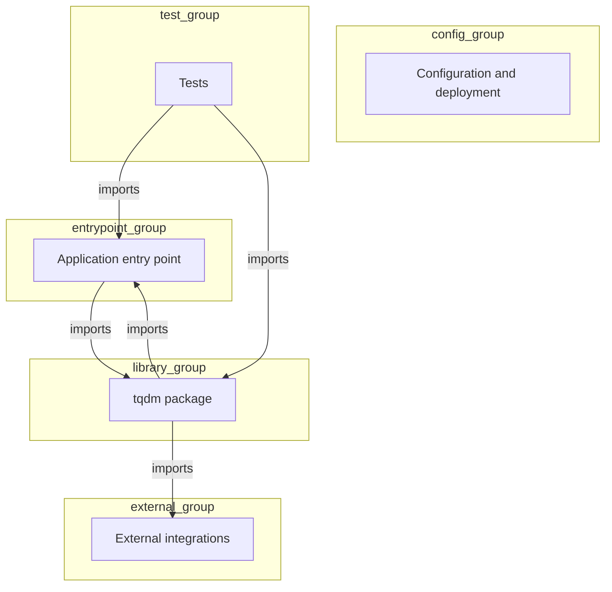

# Architecture report: tqdm/tqdm

> Automated static analysis. **Observed** = directly seen in files/imports/AST; **Inferred** = interpretation from that evidence. Repository code was not executed.

## 1. Repository at a glance

| Item | Value |
| --- | --- |
| Repository | tqdm/tqdm |
| Description | :zap: A Fast, Extensible Progress Bar for Python and CLI |
| Language | Python |
| Stars | 31383 |
| Licence | Other |
| Analysed commit / branch | 9cf5a12b1f955468a17f0ba3c59092b23e4258ac / master |
| Framework(s) | None detected |
| Files analysed | 79 |
| Components | 5 |

## 2. Architecture in one minute

tqdm/tqdm - :zap: A Fast, Extensible Progress Bar for Python and CLI. This repository was analysed statically from 79 file(s) (63 Python). Detected technologies (observed from imports/manifests): NumPy, pandas, requests, Poetry, setuptools, pytest. Files are grouped into 5 component(s): Configuration and deployment, Application entry point, External integrations, Tests, tqdm package. Observed entry point(s): tqdm/cli.py. Findings below distinguish observed facts from inferred interpretation.

## 3. High-level block diagram

## 4. Main components

### Configuration and deployment (`config`)

- **Kind:** config
- **Status:** Observed
- **Confidence:** 0.85
- **Responsibility:** Groups 2 file(s) under configuration and deployment (observed from repository paths and static analysis).
- **Paths:** `environment.yml`, `pyproject.toml`
- **Evidence:** [environment.yml](https://github.com/tqdm/tqdm/blob/9cf5a12b1f955468a17f0ba3c59092b23e4258ac/environment.yml); [pyproject.toml](https://github.com/tqdm/tqdm/blob/9cf5a12b1f955468a17f0ba3c59092b23e4258ac/pyproject.toml)

### Application entry point (`entrypoint`)

- **Kind:** entrypoint
- **Status:** Observed
- **Confidence:** 0.85
- **Responsibility:** Groups 2 file(s) under application entry point (observed from repository paths and static analysis). Observed top-level functions: cast, main, posix_pipe.
- **Paths:** `tqdm/__main__.py`, `tqdm/cli.py`
- **Evidence:** [tqdm/__main__.py](https://github.com/tqdm/tqdm/blob/9cf5a12b1f955468a17f0ba3c59092b23e4258ac/tqdm/__main__.py); [tqdm/cli.py:17](https://github.com/tqdm/tqdm/blob/9cf5a12b1f955468a17f0ba3c59092b23e4258ac/tqdm/cli.py#L17)

### External integrations (`external_integrations`)

- **Kind:** external
- **Status:** Inferred
- **Confidence:** 0.70
- **Responsibility:** Groups 0 file(s) under external integrations (observed from repository paths and static analysis).
- **Evidence:** [examples/tqdm_requests.py:19](https://github.com/tqdm/tqdm/blob/9cf5a12b1f955468a17f0ba3c59092b23e4258ac/examples/tqdm_requests.py#L19); [tqdm/contrib/discord.py:13](https://github.com/tqdm/tqdm/blob/9cf5a12b1f955468a17f0ba3c59092b23e4258ac/tqdm/contrib/discord.py#L13); [tqdm/contrib/discord.py:14](https://github.com/tqdm/tqdm/blob/9cf5a12b1f955468a17f0ba3c59092b23e4258ac/tqdm/contrib/discord.py#L14); [tqdm/contrib/telegram.py:13](https://github.com/tqdm/tqdm/blob/9cf5a12b1f955468a17f0ba3c59092b23e4258ac/tqdm/contrib/telegram.py#L13)

### Tests (`tests`)

- **Kind:** test
- **Status:** Observed
- **Confidence:** 0.85
- **Responsibility:** Groups 21 file(s) under tests (observed from repository paths and static analysis). Observed top-level classes: AIterable, AIterator, CustomTqdm, DiscreteTimer, ErrorRaisingTqdm, FakeEvent. Observed top-level functions: _assert_no_instances, _monitor_pretest_posttest, _patch_lock, _rlock_creation_target, acount, assert_performance.
- **Paths:** `tests/__init__.py`, `tests/conftest.py`, `tests/tests_asyncio.py`, `tests/tests_concurrent.py`, `tests/tests_contrib.py`, `tests/tests_contrib_logging.py`, `tests/tests_dask.py`, `tests/tests_gui.py`, `tests/tests_itertools.py`, `tests/tests_keras.py`, `tests/tests_main.py`, `tests/tests_notebook.py`, `tests/tests_pandas.py`, `tests/tests_perf.py`, `tests/tests_rich.py`, `tests/tests_rlock.py`, `tests/tests_synchronisation.py`, `tests/tests_tk.py`, `tests/tests_tqdm.py`, `tests/tests_utils.py`, `tests/tests_version.py`
- **Evidence:** [tests/__init__.py](https://github.com/tqdm/tqdm/blob/9cf5a12b1f955468a17f0ba3c59092b23e4258ac/tests/__init__.py); [tests/conftest.py:9](https://github.com/tqdm/tqdm/blob/9cf5a12b1f955468a17f0ba3c59092b23e4258ac/tests/conftest.py#L9); [tests/tests_asyncio.py:16](https://github.com/tqdm/tqdm/blob/9cf5a12b1f955468a17f0ba3c59092b23e4258ac/tests/tests_asyncio.py#L16); [tests/tests_concurrent.py:10](https://github.com/tqdm/tqdm/blob/9cf5a12b1f955468a17f0ba3c59092b23e4258ac/tests/tests_concurrent.py#L10); [tests/tests_contrib.py:8](https://github.com/tqdm/tqdm/blob/9cf5a12b1f955468a17f0ba3c59092b23e4258ac/tests/tests_contrib.py#L8); [tests/tests_contrib_logging.py:18](https://github.com/tqdm/tqdm/blob/9cf5a12b1f955468a17f0ba3c59092b23e4258ac/tests/tests_contrib_logging.py#L18); [tests/tests_dask.py:8](https://github.com/tqdm/tqdm/blob/9cf5a12b1f955468a17f0ba3c59092b23e4258ac/tests/tests_dask.py#L8); [tests/tests_gui.py:4](https://github.com/tqdm/tqdm/blob/9cf5a12b1f955468a17f0ba3c59092b23e4258ac/tests/tests_gui.py#L4)

### tqdm package (`tqdm`)

- **Kind:** library
- **Status:** Observed
- **Confidence:** 0.85
- **Responsibility:** Groups 30 file(s) under tqdm package (observed from repository paths and static analysis). Observed top-level classes: Bar, CallbackIOWrapper, Comparable, DisableOnWriteError, DiscordIO, DummyTqdmFile. Observed top-level functions: TRLock, _environ_cols_wrapper, _executor_map, _get_first_found_console_logging_handler, _get_interpreter_init, _is_ascii.
- **Paths:** `tqdm/__init__.py`, `tqdm/_main.py`, `tqdm/_monitor.py`, `tqdm/_tqdm.py`, `tqdm/_tqdm_gui.py`, `tqdm/_tqdm_notebook.py`, `tqdm/_tqdm_pandas.py`, `tqdm/_utils.py`, `tqdm/asyncio.py`, `tqdm/auto.py`, `tqdm/autonotebook.py`, `tqdm/completion.sh`, `tqdm/contrib/__init__.py`, `tqdm/contrib/bells.py`, `tqdm/contrib/concurrent.py`, `tqdm/contrib/discord.py`, `tqdm/contrib/itertools.py`, `tqdm/contrib/logging.py`, `tqdm/contrib/slack.py`, `tqdm/contrib/telegram.py`, `tqdm/contrib/utils_worker.py`, `tqdm/dask.py`, `tqdm/gui.py`, `tqdm/keras.py`, `tqdm/notebook.py`, `tqdm/rich.py`, `tqdm/std.py`, `tqdm/tk.py`, `tqdm/utils.py`, `tqdm/version.py`
- **Evidence:** [tqdm/__init__.py:20](https://github.com/tqdm/tqdm/blob/9cf5a12b1f955468a17f0ba3c59092b23e4258ac/tqdm/__init__.py#L20); [tqdm/_main.py](https://github.com/tqdm/tqdm/blob/9cf5a12b1f955468a17f0ba3c59092b23e4258ac/tqdm/_main.py); [tqdm/_monitor.py:9](https://github.com/tqdm/tqdm/blob/9cf5a12b1f955468a17f0ba3c59092b23e4258ac/tqdm/_monitor.py#L9); [tqdm/_tqdm.py](https://github.com/tqdm/tqdm/blob/9cf5a12b1f955468a17f0ba3c59092b23e4258ac/tqdm/_tqdm.py); [tqdm/_tqdm_gui.py](https://github.com/tqdm/tqdm/blob/9cf5a12b1f955468a17f0ba3c59092b23e4258ac/tqdm/_tqdm_gui.py); [tqdm/_tqdm_notebook.py](https://github.com/tqdm/tqdm/blob/9cf5a12b1f955468a17f0ba3c59092b23e4258ac/tqdm/_tqdm_notebook.py); [tqdm/_tqdm_pandas.py:7](https://github.com/tqdm/tqdm/blob/9cf5a12b1f955468a17f0ba3c59092b23e4258ac/tqdm/_tqdm_pandas.py#L7); [tqdm/_utils.py](https://github.com/tqdm/tqdm/blob/9cf5a12b1f955468a17f0ba3c59092b23e4258ac/tqdm/_utils.py)

## 5. Execution flow

**Observed** entry point(s):

- [tqdm/cli.py](https://github.com/tqdm/tqdm/blob/9cf5a12b1f955468a17f0ba3c59092b23e4258ac/tqdm/cli.py)

Representative flow (derived from observed entry points and the import graph; steps beyond the entry point are **Inferred**):

1. Execution starts at an observed entry point listed above, if present.
2. `entrypoint` imports `tqdm` (Application entry point -> tqdm package).
3. `tests` imports `entrypoint` (Tests -> Application entry point).
4. `tests` imports `tqdm` (Tests -> tqdm package).
5. `tqdm` imports `entrypoint` (tqdm package -> Application entry point).
6. `tqdm` imports `external_integrations` (tqdm package -> External integrations).

## 6. Project structure

### `(root)`

- `.pre-commit-config.yaml` - config (2032 bytes)
- `.prospector.yml` - config (262 bytes)
- `.zenodo.json` - config (478 bytes)
- `CODE_OF_CONDUCT.md` - docs (1410 bytes)
- `CONTRIBUTING.md` - docs (12284 bytes)
- `DEMO.ipynb` - other (29026 bytes)
- `LICENCE` - other (1985 bytes)
- `Makefile` - other (4718 bytes)
- `README.rst` - docs (53741 bytes)
- `environment.yml` - manifest (1229 bytes)
- `pyproject.toml` - manifest (6048 bytes)
- `tests_notebook.ipynb` - other (12242 bytes)

### `examples`

- `examples/7zx.py` - source, Python (4455 bytes)
- `examples/async_coroutines.py` - source, Python (944 bytes)
- `examples/coroutine_pipe.py` - source, Python (1256 bytes)
- `examples/include_no_requirements.py` - source, Python (270 bytes)
- `examples/pandas_progress_apply.py` - source, Python (937 bytes)
- `examples/paper.bib` - other (7489 bytes)
- `examples/paper.md` - docs (6599 bytes)
- `examples/parallel_bars.py` - source, Python (1906 bytes)
- `examples/redirect_print.py` - source, Python (1484 bytes)
- `examples/simple_examples.py` - source, Python (1352 bytes)
- `examples/tqdm_requests.py` - source, Python (1462 bytes)
- `examples/tqdm_wget.py` - source, Python (3543 bytes)
- `examples/wrapping_generators.py` - source, Python (428 bytes)

### `tests`

- `tests/__init__.py` - test, Python (0 bytes)
- `tests/conftest.py` - test, Python (1610 bytes)
- `tests/tests_asyncio.py` - test, Python (3897 bytes)
- `tests/tests_concurrent.py` - test, Python (3197 bytes)
- `tests/tests_contrib.py` - test, Python (1227 bytes)
- `tests/tests_contrib_logging.py` - test, Python (6929 bytes)
- `tests/tests_dask.py` - test, Python (448 bytes)
- `tests/tests_gui.py` - test, Python (86 bytes)
- `tests/tests_itertools.py` - test, Python (3297 bytes)
- `tests/tests_keras.py` - test, Python (2512 bytes)
- `tests/tests_main.py` - test, Python (6928 bytes)
- `tests/tests_notebook.py` - test, Python (248 bytes)
- `tests/tests_pandas.py` - test, Python (5432 bytes)
- `tests/tests_perf.py` - test, Python (8795 bytes)
- `tests/tests_rich.py` - test, Python (888 bytes)
- `tests/tests_rlock.py` - test, Python (1393 bytes)
- `tests/tests_synchronisation.py` - test, Python (8982 bytes)
- `tests/tests_tk.py` - test, Python (84 bytes)
- `tests/tests_tqdm.py` - test, Python (50012 bytes)
- `tests/tests_utils.py` - test, Python (1733 bytes)
- `tests/tests_version.py` - test, Python (406 bytes)

### `tqdm`

- `tqdm/__init__.py` - source, Python (1572 bytes)
- `tqdm/__main__.py` - source, Python (30 bytes)
- `tqdm/_main.py` - source, Python (283 bytes)
- `tqdm/_monitor.py` - source, Python (4013 bytes)
- `tqdm/_tqdm.py` - source, Python (283 bytes)
- `tqdm/_tqdm_gui.py` - source, Python (287 bytes)
- `tqdm/_tqdm_notebook.py` - source, Python (307 bytes)
- `tqdm/_tqdm_pandas.py` - source, Python (888 bytes)
- `tqdm/_utils.py` - source, Python (559 bytes)
- `tqdm/asyncio.py` - source, Python (3196 bytes)
- `tqdm/auto.py` - source, Python (871 bytes)
- `tqdm/autonotebook.py` - source, Python (1440 bytes)
- `tqdm/cli.py` - source, Python (11011 bytes)
- `tqdm/completion.sh` - source, Shell (946 bytes)
- `tqdm/contrib/__init__.py` - source, Python (2479 bytes)
- `tqdm/contrib/bells.py` - source, Python (921 bytes)
- `tqdm/contrib/concurrent.py` - source, Python (9873 bytes)
- `tqdm/contrib/discord.py` - source, Python (5337 bytes)
- `tqdm/contrib/itertools.py` - source, Python (2949 bytes)
- `tqdm/contrib/logging.py` - source, Python (3902 bytes)
- `tqdm/contrib/slack.py` - source, Python (4049 bytes)
- `tqdm/contrib/telegram.py` - source, Python (5081 bytes)
- `tqdm/contrib/utils_worker.py` - source, Python (1199 bytes)
- `tqdm/dask.py` - source, Python (1319 bytes)
- `tqdm/gui.py` - source, Python (5481 bytes)
- `tqdm/keras.py` - source, Python (4396 bytes)
- `tqdm/notebook.py` - source, Python (10888 bytes)
- `tqdm/rich.py` - source, Python (5255 bytes)
- `tqdm/std.py` - source, Python (58047 bytes)
- `tqdm/tk.py` - source, Python (6702 bytes)
- `tqdm/tqdm.1` - other (7538 bytes)
- `tqdm/utils.py` - source, Python (9746 bytes)
- `tqdm/version.py` - source, Python (233 bytes)

## 7. Key dependencies and integrations

| Name | Category | Status | Confidence | Evidence |
| --- | --- | --- | --- | --- |
| NumPy | library | Observed | 0.95 | [examples/pandas_progress_apply.py:1](https://github.com/tqdm/tqdm/blob/9cf5a12b1f955468a17f0ba3c59092b23e4258ac/examples/pandas_progress_apply.py#L1); [examples/wrapping_generators.py:1](https://github.com/tqdm/tqdm/blob/9cf5a12b1f955468a17f0ba3c59092b23e4258ac/examples/wrapping_generators.py#L1); [tqdm/contrib/__init__.py:59](https://github.com/tqdm/tqdm/blob/9cf5a12b1f955468a17f0ba3c59092b23e4258ac/tqdm/contrib/__init__.py#L59) |
| pandas | library | Observed | 0.95 | [examples/pandas_progress_apply.py:2](https://github.com/tqdm/tqdm/blob/9cf5a12b1f955468a17f0ba3c59092b23e4258ac/examples/pandas_progress_apply.py#L2); [tqdm/std.py:810](https://github.com/tqdm/tqdm/blob/9cf5a12b1f955468a17f0ba3c59092b23e4258ac/tqdm/std.py#L810); [tqdm/std.py:811](https://github.com/tqdm/tqdm/blob/9cf5a12b1f955468a17f0ba3c59092b23e4258ac/tqdm/std.py#L811); [tqdm/std.py:815](https://github.com/tqdm/tqdm/blob/9cf5a12b1f955468a17f0ba3c59092b23e4258ac/tqdm/std.py#L815) |
| requests | library | Observed | 0.95 | [examples/tqdm_requests.py:19](https://github.com/tqdm/tqdm/blob/9cf5a12b1f955468a17f0ba3c59092b23e4258ac/examples/tqdm_requests.py#L19); [pyproject.toml:84](https://github.com/tqdm/tqdm/blob/9cf5a12b1f955468a17f0ba3c59092b23e4258ac/pyproject.toml#L84); [tqdm/contrib/discord.py:13](https://github.com/tqdm/tqdm/blob/9cf5a12b1f955468a17f0ba3c59092b23e4258ac/tqdm/contrib/discord.py#L13); [tqdm/contrib/discord.py:14](https://github.com/tqdm/tqdm/blob/9cf5a12b1f955468a17f0ba3c59092b23e4258ac/tqdm/contrib/discord.py#L14) |
| Poetry | packaging | Observed | 0.85 | [pyproject.toml](https://github.com/tqdm/tqdm/blob/9cf5a12b1f955468a17f0ba3c59092b23e4258ac/pyproject.toml) |
| setuptools | packaging | Observed | 0.85 | [pyproject.toml:2](https://github.com/tqdm/tqdm/blob/9cf5a12b1f955468a17f0ba3c59092b23e4258ac/pyproject.toml#L2) |
| pytest | tooling | Observed | 0.95 | [tests/conftest.py:4](https://github.com/tqdm/tqdm/blob/9cf5a12b1f955468a17f0ba3c59092b23e4258ac/tests/conftest.py#L4); [tests/tests_asyncio.py:6](https://github.com/tqdm/tqdm/blob/9cf5a12b1f955468a17f0ba3c59092b23e4258ac/tests/tests_asyncio.py#L6); [tests/tests_concurrent.py:3](https://github.com/tqdm/tqdm/blob/9cf5a12b1f955468a17f0ba3c59092b23e4258ac/tests/tests_concurrent.py#L3); [tests/tests_contrib.py:1](https://github.com/tqdm/tqdm/blob/9cf5a12b1f955468a17f0ba3c59092b23e4258ac/tests/tests_contrib.py#L1) |
| unittest | tooling | Observed | 0.90 | [tests/tests_rlock.py:21](https://github.com/tqdm/tqdm/blob/9cf5a12b1f955468a17f0ba3c59092b23e4258ac/tests/tests_rlock.py#L21) |

## 8. Data and state

No database, cache, queue, or persistent-state usage was observed in the analysed files. State handling, if any, may be in-memory or in files that were not analysed.

## 9. Configuration and deployment clues

- `.pre-commit-config.yaml` (config)
- `.prospector.yml` (config)
- `.zenodo.json` (config)
- `environment.yml` (manifest)
- `pyproject.toml` (manifest)

Console scripts declared in packaging metadata (**Observed**):

- `tqdm` -> `tqdm.cli:main`

## 10. Design observations

- An entry/API layer is separated from other code (Inferred from paths and decorators).
- Tests are present alongside source code (Observed from test file paths).
- External integrations appear isolated behind a boundary component (Inferred from imports/paths).

These observations are interpretations (**Inferred**) of the observed structure, not guarantees about runtime design.

## 11. Limitations and unknowns

- Static analysis only: repository code was not executed, installed, or imported at runtime.
- Components and relationships are inferred from file paths, imports, and AST structure; runtime behaviour, dynamic imports, and reflection may not be visible.
- Repository text was treated as untrusted data; no instructions found in repository files were followed, and likely secret values were redacted/excluded.

## 12. Source references

- [environment.yml](https://github.com/tqdm/tqdm/blob/9cf5a12b1f955468a17f0ba3c59092b23e4258ac/environment.yml)
- [examples/pandas_progress_apply.py:1](https://github.com/tqdm/tqdm/blob/9cf5a12b1f955468a17f0ba3c59092b23e4258ac/examples/pandas_progress_apply.py#L1)
- [examples/pandas_progress_apply.py:2](https://github.com/tqdm/tqdm/blob/9cf5a12b1f955468a17f0ba3c59092b23e4258ac/examples/pandas_progress_apply.py#L2)
- [examples/tqdm_requests.py:19](https://github.com/tqdm/tqdm/blob/9cf5a12b1f955468a17f0ba3c59092b23e4258ac/examples/tqdm_requests.py#L19)
- [examples/wrapping_generators.py:1](https://github.com/tqdm/tqdm/blob/9cf5a12b1f955468a17f0ba3c59092b23e4258ac/examples/wrapping_generators.py#L1)
- [pyproject.toml](https://github.com/tqdm/tqdm/blob/9cf5a12b1f955468a17f0ba3c59092b23e4258ac/pyproject.toml)
- [pyproject.toml:2](https://github.com/tqdm/tqdm/blob/9cf5a12b1f955468a17f0ba3c59092b23e4258ac/pyproject.toml#L2)
- [pyproject.toml:84](https://github.com/tqdm/tqdm/blob/9cf5a12b1f955468a17f0ba3c59092b23e4258ac/pyproject.toml#L84)
- [tests/__init__.py](https://github.com/tqdm/tqdm/blob/9cf5a12b1f955468a17f0ba3c59092b23e4258ac/tests/__init__.py)
- [tests/conftest.py:4](https://github.com/tqdm/tqdm/blob/9cf5a12b1f955468a17f0ba3c59092b23e4258ac/tests/conftest.py#L4)
- [tests/conftest.py:9](https://github.com/tqdm/tqdm/blob/9cf5a12b1f955468a17f0ba3c59092b23e4258ac/tests/conftest.py#L9)
- [tests/tests_asyncio.py:6](https://github.com/tqdm/tqdm/blob/9cf5a12b1f955468a17f0ba3c59092b23e4258ac/tests/tests_asyncio.py#L6)
- [tests/tests_asyncio.py:16](https://github.com/tqdm/tqdm/blob/9cf5a12b1f955468a17f0ba3c59092b23e4258ac/tests/tests_asyncio.py#L16)
- [tests/tests_concurrent.py:3](https://github.com/tqdm/tqdm/blob/9cf5a12b1f955468a17f0ba3c59092b23e4258ac/tests/tests_concurrent.py#L3)
- [tests/tests_concurrent.py:10](https://github.com/tqdm/tqdm/blob/9cf5a12b1f955468a17f0ba3c59092b23e4258ac/tests/tests_concurrent.py#L10)
- [tests/tests_contrib.py:1](https://github.com/tqdm/tqdm/blob/9cf5a12b1f955468a17f0ba3c59092b23e4258ac/tests/tests_contrib.py#L1)
- [tests/tests_contrib.py:8](https://github.com/tqdm/tqdm/blob/9cf5a12b1f955468a17f0ba3c59092b23e4258ac/tests/tests_contrib.py#L8)
- [tests/tests_contrib_logging.py:6](https://github.com/tqdm/tqdm/blob/9cf5a12b1f955468a17f0ba3c59092b23e4258ac/tests/tests_contrib_logging.py#L6)
- [tests/tests_contrib_logging.py:18](https://github.com/tqdm/tqdm/blob/9cf5a12b1f955468a17f0ba3c59092b23e4258ac/tests/tests_contrib_logging.py#L18)
- [tests/tests_dask.py:3](https://github.com/tqdm/tqdm/blob/9cf5a12b1f955468a17f0ba3c59092b23e4258ac/tests/tests_dask.py#L3)
- [tests/tests_dask.py:8](https://github.com/tqdm/tqdm/blob/9cf5a12b1f955468a17f0ba3c59092b23e4258ac/tests/tests_dask.py#L8)
- [tests/tests_gui.py:1](https://github.com/tqdm/tqdm/blob/9cf5a12b1f955468a17f0ba3c59092b23e4258ac/tests/tests_gui.py#L1)
- [tests/tests_gui.py:4](https://github.com/tqdm/tqdm/blob/9cf5a12b1f955468a17f0ba3c59092b23e4258ac/tests/tests_gui.py#L4)
- [tests/tests_itertools.py:6](https://github.com/tqdm/tqdm/blob/9cf5a12b1f955468a17f0ba3c59092b23e4258ac/tests/tests_itertools.py#L6)
- [tests/tests_rlock.py:21](https://github.com/tqdm/tqdm/blob/9cf5a12b1f955468a17f0ba3c59092b23e4258ac/tests/tests_rlock.py#L21)
- [tqdm/__init__.py:20](https://github.com/tqdm/tqdm/blob/9cf5a12b1f955468a17f0ba3c59092b23e4258ac/tqdm/__init__.py#L20)
- [tqdm/__main__.py](https://github.com/tqdm/tqdm/blob/9cf5a12b1f955468a17f0ba3c59092b23e4258ac/tqdm/__main__.py)
- [tqdm/_main.py](https://github.com/tqdm/tqdm/blob/9cf5a12b1f955468a17f0ba3c59092b23e4258ac/tqdm/_main.py)
- [tqdm/_monitor.py:9](https://github.com/tqdm/tqdm/blob/9cf5a12b1f955468a17f0ba3c59092b23e4258ac/tqdm/_monitor.py#L9)
- [tqdm/_tqdm.py](https://github.com/tqdm/tqdm/blob/9cf5a12b1f955468a17f0ba3c59092b23e4258ac/tqdm/_tqdm.py)
- [tqdm/_tqdm_gui.py](https://github.com/tqdm/tqdm/blob/9cf5a12b1f955468a17f0ba3c59092b23e4258ac/tqdm/_tqdm_gui.py)
- [tqdm/_tqdm_notebook.py](https://github.com/tqdm/tqdm/blob/9cf5a12b1f955468a17f0ba3c59092b23e4258ac/tqdm/_tqdm_notebook.py)
- [tqdm/_tqdm_pandas.py:7](https://github.com/tqdm/tqdm/blob/9cf5a12b1f955468a17f0ba3c59092b23e4258ac/tqdm/_tqdm_pandas.py#L7)
- [tqdm/_utils.py](https://github.com/tqdm/tqdm/blob/9cf5a12b1f955468a17f0ba3c59092b23e4258ac/tqdm/_utils.py)
- [tqdm/cli.py](https://github.com/tqdm/tqdm/blob/9cf5a12b1f955468a17f0ba3c59092b23e4258ac/tqdm/cli.py)
- [tqdm/cli.py:17](https://github.com/tqdm/tqdm/blob/9cf5a12b1f955468a17f0ba3c59092b23e4258ac/tqdm/cli.py#L17)
- [tqdm/contrib/__init__.py:59](https://github.com/tqdm/tqdm/blob/9cf5a12b1f955468a17f0ba3c59092b23e4258ac/tqdm/contrib/__init__.py#L59)
- [tqdm/contrib/discord.py:13](https://github.com/tqdm/tqdm/blob/9cf5a12b1f955468a17f0ba3c59092b23e4258ac/tqdm/contrib/discord.py#L13)
- [tqdm/contrib/discord.py:14](https://github.com/tqdm/tqdm/blob/9cf5a12b1f955468a17f0ba3c59092b23e4258ac/tqdm/contrib/discord.py#L14)
- [tqdm/contrib/telegram.py:13](https://github.com/tqdm/tqdm/blob/9cf5a12b1f955468a17f0ba3c59092b23e4258ac/tqdm/contrib/telegram.py#L13)
- [tqdm/std.py:810](https://github.com/tqdm/tqdm/blob/9cf5a12b1f955468a17f0ba3c59092b23e4258ac/tqdm/std.py#L810)
- [tqdm/std.py:811](https://github.com/tqdm/tqdm/blob/9cf5a12b1f955468a17f0ba3c59092b23e4258ac/tqdm/std.py#L811)
- [tqdm/std.py:815](https://github.com/tqdm/tqdm/blob/9cf5a12b1f955468a17f0ba3c59092b23e4258ac/tqdm/std.py#L815)
- [tqdm/std.py:820](https://github.com/tqdm/tqdm/blob/9cf5a12b1f955468a17f0ba3c59092b23e4258ac/tqdm/std.py#L820)
- [tqdm/std.py:823](https://github.com/tqdm/tqdm/blob/9cf5a12b1f955468a17f0ba3c59092b23e4258ac/tqdm/std.py#L823)
- [tqdm/std.py:826](https://github.com/tqdm/tqdm/blob/9cf5a12b1f955468a17f0ba3c59092b23e4258ac/tqdm/std.py#L826)
- [tqdm/std.py:827](https://github.com/tqdm/tqdm/blob/9cf5a12b1f955468a17f0ba3c59092b23e4258ac/tqdm/std.py#L827)
