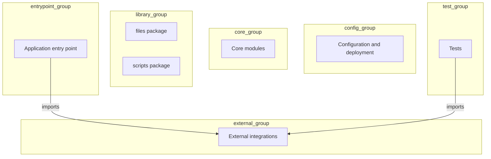

# Architecture report: trailofbits/algo

> Automated static analysis. **Observed** = directly seen in files/imports/AST; **Inferred** = interpretation from that evidence. Repository code was not executed.

## 1. Repository at a glance

| Item | Value |
| --- | --- |
| Repository | trailofbits/algo |
| Description | Set up a personal VPN in the cloud |
| Language | Python |
| Stars | 30470 |
| Licence | AGPL-3.0 |
| Analysed commit / branch | 4a1be750cb3f8e509663c1a389f9c55bb0e6a05c / main |
| Framework(s) | None detected |
| Files analysed | 276 |
| Components | 7 |

## 2. Architecture in one minute

trailofbits/algo - Set up a personal VPN in the cloud. This repository was analysed statically from 276 file(s) (47 Python). Detected technologies (observed from imports/manifests): GitHub Actions, AWS (boto3), requests, Poetry, setuptools, Docker. Files are grouped into 7 component(s): Configuration and deployment, Core modules, Application entry point, External integrations, files package, scripts package, Tests. Observed entry point(s): library/gcp_compute_location_info.py, library/lightsail_region_facts.py, library/scaleway_instance.py. Findings below distinguish observed facts from inferred interpretation.

## 3. High-level block diagram

## 4. Main components

### Configuration and deployment (`config`)

- **Kind:** config
- **Status:** Observed
- **Confidence:** 0.85
- **Responsibility:** Groups 115 file(s) under configuration and deployment (observed from repository paths and static analysis).
- **Paths:** `Dockerfile`, `ansible.cfg`, `cloud.yml`, `config.cfg`, `deploy_client.yml`, `destroy.yml`, `files/cloud-init/base.yml`, `input.yml`, `main.yml`, `playbooks/cloud-post.yml`, `playbooks/cloud-pre.yml`, `playbooks/rescue.yml`, `playbooks/tmpfs/linux.yml`, `playbooks/tmpfs/macos.yml`, `playbooks/tmpfs/main.yml`, `playbooks/tmpfs/umount.yml`, `playbooks/user-preflight.yml`, `pyproject.toml`, `requirements.yml`, `roles/client/handlers/main.yml`, `roles/client/tasks/main.yml`, `roles/client/tasks/systems/CentOS.yml`, `roles/client/tasks/systems/Debian.yml`, `roles/client/tasks/systems/Fedora.yml`, `roles/client/tasks/systems/Ubuntu.yml`, `roles/client/tasks/systems/main.yml`, `roles/cloud-azure/tasks/auth.yml`, `roles/cloud-azure/tasks/destroy.yml`, `roles/cloud-azure/tasks/main.yml`, `roles/cloud-azure/tasks/prompts.yml`, `roles/cloud-azure/tasks/regions.yml`, `roles/cloud-azure/tasks/select_region.yml`, `roles/cloud-cloudstack/tasks/destroy.yml`, `roles/cloud-cloudstack/tasks/main.yml`, `roles/cloud-cloudstack/tasks/prompts.yml`, `roles/cloud-digitalocean/tasks/destroy.yml`, `roles/cloud-digitalocean/tasks/main.yml`, `roles/cloud-digitalocean/tasks/prompts.yml`, `roles/cloud-ec2/defaults/main.yml`, `roles/cloud-ec2/tasks/cloudformation.yml`, `roles/cloud-ec2/tasks/destroy.yml`, `roles/cloud-ec2/tasks/main.yml`, `roles/cloud-ec2/tasks/prompts.yml`, `roles/cloud-gce/tasks/destroy.yml`, `roles/cloud-gce/tasks/main.yml`, `roles/cloud-gce/tasks/prompts.yml`, `roles/cloud-hetzner/tasks/destroy.yml`, `roles/cloud-hetzner/tasks/main.yml`, `roles/cloud-hetzner/tasks/prompts.yml`, `roles/cloud-lightsail/tasks/cloudformation.yml`, `roles/cloud-lightsail/tasks/destroy.yml`, `roles/cloud-lightsail/tasks/main.yml`, `roles/cloud-lightsail/tasks/prompts.yml`, `roles/cloud-linode/defaults/main.yml`, `roles/cloud-linode/tasks/auth.yml`, `roles/cloud-linode/tasks/destroy.yml`, `roles/cloud-linode/tasks/main.yml`, `roles/cloud-linode/tasks/prompts.yml`, `roles/cloud-openstack/tasks/destroy.yml`, `roles/cloud-openstack/tasks/main.yml`, `roles/cloud-scaleway/defaults/main.yml`, `roles/cloud-scaleway/tasks/destroy.yml`, `roles/cloud-scaleway/tasks/main.yml`, `roles/cloud-scaleway/tasks/prompts.yml`, `roles/cloud-vultr/tasks/destroy.yml`, `roles/cloud-vultr/tasks/main.yml`, `roles/cloud-vultr/tasks/prompts.yml`, `roles/common/defaults/main.yml`, `roles/common/handlers/main.yml`, `roles/common/tasks/aip/digitalocean.yml`, `roles/common/tasks/aip/main.yml`, `roles/common/tasks/aip/placeholder.yml`, `roles/common/tasks/facts.yml`, `roles/common/tasks/iptables.yml`, `roles/common/tasks/main.yml`, `roles/common/tasks/packages.yml`, `roles/common/tasks/ubuntu.yml`, `roles/common/tasks/unattended-upgrades.yml`, `roles/dns/defaults/main.yml`, `roles/dns/handlers/main.yml`, `roles/dns/tasks/dns_adblocking.yml`, `roles/dns/tasks/main.yml`, `roles/dns/tasks/ubuntu.yml`, `roles/local/tasks/main.yml`, `roles/local/tasks/prompts.yml`, `roles/privacy/defaults/main.yml`, `roles/privacy/handlers/main.yml`, `roles/privacy/tasks/advanced_privacy.yml`, `roles/privacy/tasks/auto_cleanup.yml`, `roles/privacy/tasks/clear_history.yml`, `roles/privacy/tasks/log_filtering.yml`, `roles/privacy/tasks/log_rotation.yml`, `roles/privacy/tasks/main.yml`, `roles/ssh_tunneling/defaults/main.yml`, `roles/ssh_tunneling/handlers/main.yml`, `roles/ssh_tunneling/tasks/main.yml`, `roles/strongswan/defaults/main.yml`, `roles/strongswan/handlers/main.yml`, `roles/strongswan/meta/main.yml`, `roles/strongswan/tasks/client_configs.yml`, `roles/strongswan/tasks/distribute_keys.yml`, `roles/strongswan/tasks/ipsec_configuration.yml`, `roles/strongswan/tasks/main.yml`, `roles/strongswan/tasks/openssl.yml`, `roles/strongswan/tasks/ubuntu.yml`, `roles/wireguard/defaults/main.yml`, `roles/wireguard/handlers/main.yml`, `roles/wireguard/tasks/keys.yml`, `roles/wireguard/tasks/main.yml`, `roles/wireguard/tasks/mobileconfig.yml`, `roles/wireguard/tasks/qr.yml`, `roles/wireguard/tasks/ubuntu.yml`, `server.yml`, `users.yml`, `zizmor.yml`
- **Evidence:** [Dockerfile](https://github.com/trailofbits/algo/blob/4a1be750cb3f8e509663c1a389f9c55bb0e6a05c/Dockerfile); [ansible.cfg](https://github.com/trailofbits/algo/blob/4a1be750cb3f8e509663c1a389f9c55bb0e6a05c/ansible.cfg); [cloud.yml](https://github.com/trailofbits/algo/blob/4a1be750cb3f8e509663c1a389f9c55bb0e6a05c/cloud.yml); [config.cfg](https://github.com/trailofbits/algo/blob/4a1be750cb3f8e509663c1a389f9c55bb0e6a05c/config.cfg); [deploy_client.yml](https://github.com/trailofbits/algo/blob/4a1be750cb3f8e509663c1a389f9c55bb0e6a05c/deploy_client.yml); [destroy.yml](https://github.com/trailofbits/algo/blob/4a1be750cb3f8e509663c1a389f9c55bb0e6a05c/destroy.yml); [files/cloud-init/base.yml](https://github.com/trailofbits/algo/blob/4a1be750cb3f8e509663c1a389f9c55bb0e6a05c/files/cloud-init/base.yml); [input.yml](https://github.com/trailofbits/algo/blob/4a1be750cb3f8e509663c1a389f9c55bb0e6a05c/input.yml)

### Core modules (`core`)

- **Kind:** core
- **Status:** Observed
- **Confidence:** 0.85
- **Responsibility:** Groups 3 file(s) under core modules (observed from repository paths and static analysis).
- **Paths:** `algo-docker.sh`, `algo-showenv.sh`, `install.sh`
- **Evidence:** [algo-docker.sh](https://github.com/trailofbits/algo/blob/4a1be750cb3f8e509663c1a389f9c55bb0e6a05c/algo-docker.sh); [algo-showenv.sh](https://github.com/trailofbits/algo/blob/4a1be750cb3f8e509663c1a389f9c55bb0e6a05c/algo-showenv.sh); [install.sh](https://github.com/trailofbits/algo/blob/4a1be750cb3f8e509663c1a389f9c55bb0e6a05c/install.sh)

### Application entry point (`entrypoint`)

- **Kind:** entrypoint
- **Status:** Observed
- **Confidence:** 0.85
- **Responsibility:** Groups 5 file(s) under application entry point (observed from repository paths and static analysis). Observed top-level classes: ScalewayInstance. Observed top-level functions: collection, fetch_list, list_servers, main, query_options, read_private_key.
- **Paths:** `library/gcp_compute_location_info.py`, `library/lightsail_region_facts.py`, `library/scaleway_instance.py`, `library/x25519_pubkey.py`, `scripts/list_servers.py`
- **Evidence:** [library/gcp_compute_location_info.py:19](https://github.com/trailofbits/algo/blob/4a1be750cb3f8e509663c1a389f9c55bb0e6a05c/library/gcp_compute_location_info.py#L19); [library/lightsail_region_facts.py:72](https://github.com/trailofbits/algo/blob/4a1be750cb3f8e509663c1a389f9c55bb0e6a05c/library/lightsail_region_facts.py#L72); [library/scaleway_instance.py:79](https://github.com/trailofbits/algo/blob/4a1be750cb3f8e509663c1a389f9c55bb0e6a05c/library/scaleway_instance.py#L79); [library/x25519_pubkey.py:12](https://github.com/trailofbits/algo/blob/4a1be750cb3f8e509663c1a389f9c55bb0e6a05c/library/x25519_pubkey.py#L12); [scripts/list_servers.py:11](https://github.com/trailofbits/algo/blob/4a1be750cb3f8e509663c1a389f9c55bb0e6a05c/scripts/list_servers.py#L11)

### External integrations (`external_integrations`)

- **Kind:** external
- **Status:** Inferred
- **Confidence:** 0.70
- **Responsibility:** Groups 0 file(s) under external integrations (observed from repository paths and static analysis).
- **Evidence:** [library/lightsail_region_facts.py:58](https://github.com/trailofbits/algo/blob/4a1be750cb3f8e509663c1a389f9c55bb0e6a05c/library/lightsail_region_facts.py#L58); [tests/network/test_dns_rebinding.py:7](https://github.com/trailofbits/algo/blob/4a1be750cb3f8e509663c1a389f9c55bb0e6a05c/tests/network/test_dns_rebinding.py#L7); [tests/test_user_preflight.py:6](https://github.com/trailofbits/algo/blob/4a1be750cb3f8e509663c1a389f9c55bb0e6a05c/tests/test_user_preflight.py#L6)

### files package (`files`)

- **Kind:** library
- **Status:** Observed
- **Confidence:** 0.85
- **Responsibility:** Groups 1 file(s) under files package (observed from repository paths and static analysis).
- **Paths:** `files/cloud-init/base.sh`
- **Evidence:** [files/cloud-init/base.sh](https://github.com/trailofbits/algo/blob/4a1be750cb3f8e509663c1a389f9c55bb0e6a05c/files/cloud-init/base.sh)

### scripts package (`scripts`)

- **Kind:** library
- **Status:** Observed
- **Confidence:** 0.85
- **Responsibility:** Groups 1 file(s) under scripts package (observed from repository paths and static analysis).
- **Paths:** `scripts/lint.sh`
- **Evidence:** [scripts/lint.sh](https://github.com/trailofbits/algo/blob/4a1be750cb3f8e509663c1a389f9c55bb0e6a05c/scripts/lint.sh)

### Tests (`tests`)

- **Kind:** test
- **Status:** Observed
- **Confidence:** 0.85
- **Responsibility:** Groups 48 file(s) under tests (observed from repository paths and static analysis). Observed top-level classes: CertificateDeployment, LinodeAPIHandler, MockAnsibleModule, TestAnsible12BooleanFix, TestComprehensiveBooleanScan, TestLightsailBoto3Fix. Observed top-level functions: _ansible_bool, _conditions, adblock, ansible_loader, ansible_templar, apply_cloud_task.
- **Paths:** `tests/README.md`, `tests/ansible-smoke.yml`, `tests/cloud_module_smoke.py`, `tests/conftest.py`, `tests/docker_wrapper.py`, `tests/e2e/README.md`, `tests/e2e/test-vpn-connectivity.sh`, `tests/fixtures/__init__.py`, `tests/fixtures/test_variables.yml`, `tests/library/test_scaleway_instance.py`, `tests/library/test_x25519_pubkey.py`, `tests/network/conftest.py`, `tests/network/test_cloud_firewalls.py`, `tests/network/test_dns_rebinding.py`, `tests/network/test_firewall.py`, `tests/test-aws-credentials.yml`, `tests/test_adblock.py`, `tests/test_algo_launcher.py`, `tests/test_ansible_smoke.py`, `tests/test_aws_collections.py`, `tests/test_azure_preflight.py`, `tests/test_cloud_dependencies.py`, `tests/test_destroy_dependencies.py`, `tests/test_destroy_paths.py`, `tests/test_hetzner_locations.py`, `tests/test_ipsec_certificate_chain.py`, `tests/test_linode_teardown.py`, `tests/test_openstack.py`, `tests/test_privacy_services.py`, `tests/test_provider_install.py`, `tests/test_region_persistence.py`, `tests/test_user_preflight.py`, `tests/test_wireguard_qr.py`, `tests/unit/test_ansible_12_boolean_fix.py`, `tests/unit/test_basic_sanity.py`, `tests/unit/test_cloud_provider_configs.py`, `tests/unit/test_comprehensive_boolean_scan.py`, `tests/unit/test_destroy.py`, `tests/unit/test_double_templating.py`, `tests/unit/test_iptables_rules.py`, `tests/unit/test_lightsail_boto3_fix.py`, `tests/unit/test_list_servers.py`, `tests/unit/test_scaleway_fix.py`, `tests/unit/test_strongswan_hardening.py`, `tests/unit/test_strongswan_templates.py`, `tests/unit/test_template_rendering.py`, `tests/unit/test_unattended_upgrades_origins.py`, `tests/unit/test_yaml_jinja2_expressions.py`
- **Evidence:** [tests/README.md](https://github.com/trailofbits/algo/blob/4a1be750cb3f8e509663c1a389f9c55bb0e6a05c/tests/README.md); [tests/ansible-smoke.yml](https://github.com/trailofbits/algo/blob/4a1be750cb3f8e509663c1a389f9c55bb0e6a05c/tests/ansible-smoke.yml); [tests/cloud_module_smoke.py:18](https://github.com/trailofbits/algo/blob/4a1be750cb3f8e509663c1a389f9c55bb0e6a05c/tests/cloud_module_smoke.py#L18); [tests/conftest.py:18](https://github.com/trailofbits/algo/blob/4a1be750cb3f8e509663c1a389f9c55bb0e6a05c/tests/conftest.py#L18); [tests/docker_wrapper.py:9](https://github.com/trailofbits/algo/blob/4a1be750cb3f8e509663c1a389f9c55bb0e6a05c/tests/docker_wrapper.py#L9); [tests/e2e/README.md](https://github.com/trailofbits/algo/blob/4a1be750cb3f8e509663c1a389f9c55bb0e6a05c/tests/e2e/README.md); [tests/e2e/test-vpn-connectivity.sh](https://github.com/trailofbits/algo/blob/4a1be750cb3f8e509663c1a389f9c55bb0e6a05c/tests/e2e/test-vpn-connectivity.sh); [tests/fixtures/__init__.py:8](https://github.com/trailofbits/algo/blob/4a1be750cb3f8e509663c1a389f9c55bb0e6a05c/tests/fixtures/__init__.py#L8)

## 5. Execution flow

**Observed** entry point(s):

- [library/gcp_compute_location_info.py:90](https://github.com/trailofbits/algo/blob/4a1be750cb3f8e509663c1a389f9c55bb0e6a05c/library/gcp_compute_location_info.py#L90)
- [library/lightsail_region_facts.py:101](https://github.com/trailofbits/algo/blob/4a1be750cb3f8e509663c1a389f9c55bb0e6a05c/library/lightsail_region_facts.py#L101)
- [library/scaleway_instance.py:246](https://github.com/trailofbits/algo/blob/4a1be750cb3f8e509663c1a389f9c55bb0e6a05c/library/scaleway_instance.py#L246)
- [library/x25519_pubkey.py:101](https://github.com/trailofbits/algo/blob/4a1be750cb3f8e509663c1a389f9c55bb0e6a05c/library/x25519_pubkey.py#L101)
- [scripts/list_servers.py:33](https://github.com/trailofbits/algo/blob/4a1be750cb3f8e509663c1a389f9c55bb0e6a05c/scripts/list_servers.py#L33)

Representative flow (derived from observed entry points and the import graph; steps beyond the entry point are **Inferred**):

1. Execution starts at an observed entry point listed above, if present.
2. `entrypoint` imports `external_integrations` (Application entry point -> External integrations).
3. `tests` imports `external_integrations` (Tests -> External integrations).

## 6. Project structure

### `(root)`

- `.ansible-lint` - other (1983 bytes)
- `.dockerignore` - container (506 bytes)
- `.gitignore` - other (146 bytes)
- `.pre-commit-config.yaml` - config (4002 bytes)
- `.yamllint` - other (537 bytes)
- `CLAUDE.md` - docs (17402 bytes)
- `CODEOWNERS` - other (14 bytes)
- `CONTRIBUTING.md` - docs (1894 bytes)
- `Dockerfile` - container (2122 bytes)
- `LICENSE` - docs (34523 bytes)
- `PULL_REQUEST_TEMPLATE.md` - docs (1471 bytes)
- `README.md` - docs (18568 bytes)
- `SECURITY.md` - docs (735 bytes)
- `algo` - other (7945 bytes)
- `algo-docker.sh` - source, Shell (1668 bytes)
- `algo-showenv.sh` - source, Shell (2526 bytes)
- `algo.ps1` - other (5819 bytes)
- `ansible.cfg` - config (535 bytes)
- `cloud.yml` - config (521 bytes)
- `config.cfg` - config (7336 bytes)
- `deploy_client.yml` - config (756 bytes)
- `destroy.yml` - config (5504 bytes)
- `input.yml` - config (6386 bytes)
- `install.sh` - source, Shell (4551 bytes)
- `inventory` - other (78 bytes)
- `main.yml` - config (3558 bytes)
- `pyproject.toml` - manifest (6340 bytes)
- `requirements.yml` - config (657 bytes)
- `server.yml` - config (5013 bytes)
- `users.yml` - config (4417 bytes)
- `zizmor.yml` - config (275 bytes)

### `.github`

- `.github/FUNDING.yml` - config (657 bytes)
- `.github/ISSUE_TEMPLATE/bug_report.md` - docs (208 bytes)
- `.github/ISSUE_TEMPLATE/config.yml` - config (202 bytes)
- `.github/ISSUE_TEMPLATE/feature_request.md` - docs (560 bytes)
- `.github/actions/setup-uv/action.yml` - config (459 bytes)
- `.github/dependabot.yml` - config (1224 bytes)
- `.github/workflows/docker-image.yaml` - ci, YAML (1676 bytes)
- `.github/workflows/integration-tests.yml` - ci, YAML (10716 bytes)
- `.github/workflows/main.yml` - ci, YAML (4586 bytes)

### `configs`

- `configs/.gitinit` - other (0 bytes)

### `docs`

- `docs/aws-credentials.md` - docs (1902 bytes)
- `docs/client-android.md` - docs (259 bytes)
- `docs/client-apple-ipsec.md` - docs (1679 bytes)
- `docs/client-linux-ipsec.md` - docs (2208 bytes)
- `docs/client-linux-wireguard.md` - docs (2229 bytes)
- `docs/client-linux.md` - docs (2537 bytes)
- `docs/client-macos-wireguard.md` - docs (1340 bytes)
- `docs/client-openwrt-router-wireguard.md` - docs (7434 bytes)
- `docs/client-windows.md` - docs (3689 bytes)
- `docs/cloud-alternative-ingress-ip.md` - docs (916 bytes)
- `docs/cloud-amazon-ec2.md` - docs (6470 bytes)
- `docs/cloud-azure.md` - docs (4046 bytes)
- `docs/cloud-cloudstack.md` - docs (682 bytes)
- `docs/cloud-do.md` - docs (4902 bytes)
- `docs/cloud-gce.md` - docs (1724 bytes)
- `docs/cloud-hetzner.md` - docs (389 bytes)
- `docs/cloud-linode.md` - docs (369 bytes)
- `docs/cloud-scaleway.md` - docs (794 bytes)
- `docs/cloud-vultr.md` - docs (1088 bytes)
- `docs/deploy-from-ansible.md` - docs (12999 bytes)
- `docs/deploy-from-cloudshell.md` - docs (1114 bytes)
- `docs/deploy-from-docker.md` - docs (6080 bytes)
- `docs/deploy-from-macos.md` - docs (893 bytes)
- `docs/deploy-from-script-or-cloud-init-to-localhost.md` - docs (4295 bytes)
- `docs/deploy-from-windows.md` - docs (3134 bytes)
- `docs/deploy-to-ubuntu.md` - docs (2320 bytes)
- `docs/deploy-to-unsupported-cloud.md` - docs (4413 bytes)
- `docs/faq.md` - docs (14302 bytes)
- `docs/firewalls.md` - docs (2636 bytes)
- `docs/index.md` - docs (1491 bytes)
- `docs/troubleshooting.md` - docs (34363 bytes)

### `files`

- `files/cloud-init/README.md` - docs (2118 bytes)
- `files/cloud-init/base.sh` - source, Shell (797 bytes)
- `files/cloud-init/base.yml` - config (1202 bytes)
- `files/cloud-init/sshd_config` - other (223 bytes)

### `library`

- `library/gcp_compute_location_info.py` - source, Python (2682 bytes)
- `library/lightsail_region_facts.py` - source, Python (2700 bytes)
- `library/scaleway_instance.py` - source, Python (10471 bytes)
- `library/x25519_pubkey.py` - source, Python (3523 bytes)

### `playbooks`

- `playbooks/cloud-post.yml` - config (2517 bytes)
- `playbooks/cloud-pre.yml` - config (2438 bytes)
- `playbooks/rescue.yml` - config (71 bytes)
- `playbooks/tmpfs/linux.yml` - config (143 bytes)
- `playbooks/tmpfs/macos.yml` - config (446 bytes)
- `playbooks/tmpfs/main.yml` - config (504 bytes)
- `playbooks/tmpfs/umount.yml` - config (840 bytes)
- `playbooks/user-preflight.yml` - config (1897 bytes)

### `roles`

- `roles/client/files/libstrongswan-relax-constraints.conf` - other (57 bytes)
- `roles/client/handlers/main.yml` - config (88 bytes)
- `roles/client/tasks/main.yml` - config (2250 bytes)
- `roles/client/tasks/systems/CentOS.yml` - config (122 bytes)
- `roles/client/tasks/systems/Debian.yml` - config (129 bytes)
- `roles/client/tasks/systems/Fedora.yml` - config (127 bytes)
- `roles/client/tasks/systems/Ubuntu.yml` - config (129 bytes)
- `roles/client/tasks/systems/main.yml` - config (319 bytes)
- `roles/cloud-azure/tasks/auth.yml` - config (1290 bytes)
- `roles/cloud-azure/tasks/destroy.yml` - config (369 bytes)
- `roles/cloud-azure/tasks/main.yml` - config (1576 bytes)
- `roles/cloud-azure/tasks/prompts.yml` - config (980 bytes)
- `roles/cloud-azure/tasks/regions.yml` - config (841 bytes)
- `roles/cloud-azure/tasks/select_region.yml` - config (1169 bytes)
- `roles/cloud-azure/templates/deployment.json.j2` - other (6911 bytes)
- `roles/cloud-cloudstack/tasks/destroy.yml` - config (490 bytes)
- `roles/cloud-cloudstack/tasks/main.yml` - config (2529 bytes)
- `roles/cloud-cloudstack/tasks/prompts.yml` - config (3017 bytes)
- `roles/cloud-digitalocean/tasks/destroy.yml` - config (180 bytes)
- `roles/cloud-digitalocean/tasks/main.yml` - config (1580 bytes)
- `roles/cloud-digitalocean/tasks/prompts.yml` - config (3733 bytes)
- `roles/cloud-ec2/defaults/main.yml` - config (143 bytes)
- `roles/cloud-ec2/tasks/cloudformation.yml` - config (1049 bytes)
- `roles/cloud-ec2/tasks/destroy.yml` - config (406 bytes)
- `roles/cloud-ec2/tasks/main.yml` - config (831 bytes)
- `roles/cloud-ec2/tasks/prompts.yml` - config (5535 bytes)
- `roles/cloud-ec2/templates/stack.yaml.j2` - other (5186 bytes)
- `roles/cloud-gce/tasks/destroy.yml` - config (1439 bytes)
- `roles/cloud-gce/tasks/main.yml` - config (2586 bytes)
- `roles/cloud-gce/tasks/prompts.yml` - config (2792 bytes)
- `roles/cloud-hetzner/tasks/destroy.yml` - config (154 bytes)
- `roles/cloud-hetzner/tasks/main.yml` - config (987 bytes)
- `roles/cloud-hetzner/tasks/prompts.yml` - config (2200 bytes)
- `roles/cloud-lightsail/tasks/cloudformation.yml` - config (853 bytes)
- `roles/cloud-lightsail/tasks/destroy.yml` - config (334 bytes)
- `roles/cloud-lightsail/tasks/main.yml` - config (277 bytes)
- `roles/cloud-lightsail/tasks/prompts.yml` - config (2489 bytes)
- `roles/cloud-lightsail/templates/stack.yaml.j2` - other (1960 bytes)
- `roles/cloud-linode/defaults/main.yml` - config (60 bytes)
- `roles/cloud-linode/tasks/auth.yml` - config (536 bytes)
- `roles/cloud-linode/tasks/destroy.yml` - config (156 bytes)
- `roles/cloud-linode/tasks/main.yml` - config (1599 bytes)
- `roles/cloud-linode/tasks/prompts.yml` - config (1188 bytes)
- `roles/cloud-openstack/tasks/destroy.yml` - config (249 bytes)
- `roles/cloud-openstack/tasks/main.yml` - config (5003 bytes)
- `roles/cloud-scaleway/defaults/main.yml` - config (565 bytes)
- `roles/cloud-scaleway/tasks/destroy.yml` - config (495 bytes)
- `roles/cloud-scaleway/tasks/main.yml` - config (3707 bytes)
- `roles/cloud-scaleway/tasks/prompts.yml` - config (1724 bytes)
- `roles/cloud-vultr/tasks/destroy.yml` - config (440 bytes)
- `roles/cloud-vultr/tasks/main.yml` - config (2497 bytes)
- `roles/cloud-vultr/tasks/prompts.yml` - config (2021 bytes)
- `roles/common/defaults/main.yml` - config (462 bytes)
- `roles/common/handlers/main.yml` - config (527 bytes)
- `roles/common/tasks/aip/digitalocean.yml` - config (557 bytes)
- `roles/common/tasks/aip/main.yml` - config (580 bytes)
- `roles/common/tasks/aip/placeholder.yml` - config (0 bytes)
- `roles/common/tasks/facts.yml` - config (1202 bytes)
- `roles/common/tasks/iptables.yml` - config (515 bytes)
- `roles/common/tasks/main.yml` - config (608 bytes)
- `roles/common/tasks/packages.yml` - config (2286 bytes)
- `roles/common/tasks/ubuntu.yml` - config (5286 bytes)
- `roles/common/tasks/unattended-upgrades.yml` - config (445 bytes)
- `roles/common/templates/10-algo-lo100.network.j2` - other (117 bytes)
- `roles/common/templates/10periodic.j2` - other (168 bytes)
- `roles/common/templates/50unattended-upgrades.j2` - other (3929 bytes)
- `roles/common/templates/99-algo-ipv6-egress.yaml.j2` - other (154 bytes)
- `roles/common/templates/rules.v4.j2` - other (5327 bytes)
- `roles/common/templates/rules.v6.j2` - other (6373 bytes)
- `roles/dns/defaults/main.yml` - config (168 bytes)
- `roles/dns/files/apparmor.profile.dnscrypt-proxy` - other (737 bytes)
- `roles/dns/handlers/main.yml` - config (371 bytes)
- `roles/dns/tasks/dns_adblocking.yml` - config (488 bytes)
- `roles/dns/tasks/main.yml` - config (999 bytes)
- `roles/dns/tasks/ubuntu.yml` - config (3773 bytes)
- `roles/dns/templates/adblock.sh.j2` - other (1653 bytes)
- `roles/dns/templates/dnscrypt-proxy.toml.j2` - other (480 bytes)
- `roles/dns/templates/dnscrypt-proxy/cache.toml.j2` - other (444 bytes)
- `roles/dns/templates/dnscrypt-proxy/filters.toml.j2` - other (1495 bytes)
- `roles/dns/templates/dnscrypt-proxy/global.toml.j2` - other (2687 bytes)
- `roles/dns/templates/dnscrypt-proxy/sources.toml.j2` - other (785 bytes)
- `roles/dns/templates/ip-blacklist.txt.j2` - other (679 bytes)
- `roles/local/tasks/main.yml` - config (56 bytes)
- `roles/local/tasks/prompts.yml` - config (2766 bytes)
- `roles/privacy/README.md` - docs (6543 bytes)
- `roles/privacy/defaults/main.yml` - config (1659 bytes)
- `roles/privacy/handlers/main.yml` - config (591 bytes)
- `roles/privacy/tasks/advanced_privacy.yml` - config (2324 bytes)
- `roles/privacy/tasks/auto_cleanup.yml` - config (2064 bytes)
- `roles/privacy/tasks/clear_history.yml` - config (1597 bytes)
- `roles/privacy/tasks/log_filtering.yml` - config (1513 bytes)
- `roles/privacy/tasks/log_rotation.yml` - config (1886 bytes)
- `roles/privacy/tasks/main.yml` - config (1890 bytes)
- `roles/privacy/templates/46-privacy-ssh-filter.conf.j2` - other (558 bytes)
- `roles/privacy/templates/47-privacy-auth-filter.conf.j2` - other (643 bytes)
- `roles/privacy/templates/48-privacy-kernel-filter.conf.j2` - other (644 bytes)
- `roles/privacy/templates/49-privacy-vpn-filter.conf.j2` - other (997 bytes)
- `roles/privacy/templates/auth-logrotate.j2` - other (568 bytes)
- `roles/privacy/templates/clear-history-on-logout.sh.j2` - other (778 bytes)
- `roles/privacy/templates/kern-logrotate.j2` - other (1037 bytes)
- `roles/privacy/templates/privacy-auto-cleanup.sh.j2` - other (2570 bytes)
- `roles/privacy/templates/privacy-log-cleanup.sh.j2` - other (932 bytes)
- `roles/privacy/templates/privacy-logrotate.j2` - other (1308 bytes)
- `roles/privacy/templates/privacy-monitor.sh.j2` - other (2810 bytes)
- `roles/privacy/templates/privacy-rsyslog.conf.j2` - other (785 bytes)
- `roles/privacy/templates/privacy-shutdown-cleanup.service.j2` - other (1159 bytes)
- `roles/ssh_tunneling/defaults/main.yml` - config (75 bytes)
- `roles/ssh_tunneling/handlers/main.yml` - config (98 bytes)
- `roles/ssh_tunneling/tasks/main.yml` - config (3357 bytes)
- `roles/ssh_tunneling/templates/ssh_config.j2` - other (265 bytes)
- `roles/strongswan/defaults/main.yml` - config (1799 bytes)
- `roles/strongswan/handlers/main.yml` - config (1064 bytes)
- `roles/strongswan/meta/main.yml` - config (4 bytes)
- `roles/strongswan/tasks/client_configs.yml` - config (1174 bytes)
- `roles/strongswan/tasks/distribute_keys.yml` - config (836 bytes)
- `roles/strongswan/tasks/ipsec_configuration.yml` - config (1869 bytes)
- `roles/strongswan/tasks/main.yml` - config (931 bytes)
- `roles/strongswan/tasks/openssl.yml` - config (11548 bytes)
- `roles/strongswan/tasks/ubuntu.yml` - config (1556 bytes)
- `roles/strongswan/templates/100-CustomLimitations.conf.j2` - other (939 bytes)
- `roles/strongswan/templates/charon.conf.j2` - other (10786 bytes)
- `roles/strongswan/templates/client_ipsec.conf.j2` - other (505 bytes)
- `roles/strongswan/templates/client_ipsec.secrets.j2` - other (49 bytes)
- `roles/strongswan/templates/ipsec.conf.j2` - other (1272 bytes)
- `roles/strongswan/templates/ipsec.secrets.j2` - other (38 bytes)
- `roles/strongswan/templates/mobileconfig.j2` - other (8579 bytes)
- `roles/strongswan/templates/strongswan.conf.j2` - other (317 bytes)
- `roles/wireguard/defaults/main.yml` - config (1125 bytes)
- `roles/wireguard/handlers/main.yml` - config (151 bytes)
- `roles/wireguard/tasks/keys.yml` - config (2155 bytes)
- `roles/wireguard/tasks/main.yml` - config (2122 bytes)
- `roles/wireguard/tasks/mobileconfig.yml` - config (279 bytes)
- `roles/wireguard/tasks/qr.yml` - config (700 bytes)
- `roles/wireguard/tasks/ubuntu.yml` - config (1571 bytes)
- `roles/wireguard/templates/client.conf.j2` - other (717 bytes)
- `roles/wireguard/templates/mobileconfig.j2` - other (791 bytes)
- `roles/wireguard/templates/server.conf.j2` - other (805 bytes)
- `roles/wireguard/templates/vpn-dict.j2` - other (2913 bytes)

### `scripts`

- `scripts/lint.sh` - source, Shell (143 bytes)
- `scripts/list_servers.py` - source, Python (832 bytes)

### `tests`

- `tests/README.md` - test (4432 bytes)
- `tests/ansible-smoke.yml` - test (5925 bytes)
- `tests/cloud_module_smoke.py` - test, Python (4388 bytes)
- `tests/conftest.py` - test, Python (4285 bytes)
- `tests/docker_wrapper.py` - test, Python (7068 bytes)
- `tests/e2e/README.md` - test (5285 bytes)
- `tests/e2e/test-vpn-connectivity.sh` - test, Shell (23850 bytes)
- `tests/fixtures/__init__.py` - test, Python (487 bytes)
- `tests/fixtures/test_variables.yml` - test (2716 bytes)
- `tests/library/test_scaleway_instance.py` - test, Python (11155 bytes)
- `tests/library/test_x25519_pubkey.py` - test, Python (5301 bytes)
- `tests/network/conftest.py` - test, Python (1530 bytes)
- `tests/network/test_cloud_firewalls.py` - test, Python (5238 bytes)
- `tests/network/test_dns_rebinding.py` - test, Python (7339 bytes)
- `tests/network/test_firewall.py` - test, Python (3100 bytes)
- `tests/test-aws-credentials.yml` - test (3329 bytes)
- `tests/test_adblock.py` - test, Python (3715 bytes)
- `tests/test_algo_launcher.py` - test, Python (2661 bytes)
- `tests/test_ansible_smoke.py` - test, Python (6726 bytes)
- `tests/test_aws_collections.py` - test, Python (4933 bytes)
- `tests/test_azure_preflight.py` - test, Python (6631 bytes)
- `tests/test_cloud_dependencies.py` - test, Python (2192 bytes)
- `tests/test_destroy_dependencies.py` - test, Python (2218 bytes)
- `tests/test_destroy_paths.py` - test, Python (6350 bytes)
- `tests/test_hetzner_locations.py` - test, Python (5829 bytes)
- `tests/test_ipsec_certificate_chain.py` - test, Python (12374 bytes)
- `tests/test_linode_teardown.py` - test, Python (10112 bytes)
- `tests/test_openstack.py` - test, Python (10228 bytes)
- `tests/test_privacy_services.py` - test, Python (8912 bytes)
- `tests/test_provider_install.py` - test, Python (2373 bytes)
- `tests/test_region_persistence.py` - test, Python (3873 bytes)
- `tests/test_user_preflight.py` - test, Python (2755 bytes)
- `tests/test_wireguard_qr.py` - test, Python (2686 bytes)
- `tests/unit/test_ansible_12_boolean_fix.py` - test, Python (4830 bytes)
- `tests/unit/test_basic_sanity.py` - test, Python (4215 bytes)
- `tests/unit/test_cloud_provider_configs.py` - test, Python (3213 bytes)
- `tests/unit/test_comprehensive_boolean_scan.py` - test, Python (13679 bytes)
- `tests/unit/test_destroy.py` - test, Python (6745 bytes)
- `tests/unit/test_double_templating.py` - test, Python (4909 bytes)
- `tests/unit/test_iptables_rules.py` - test, Python (9115 bytes)
- `tests/unit/test_lightsail_boto3_fix.py` - test, Python (6792 bytes)
- `tests/unit/test_list_servers.py` - test, Python (2804 bytes)
- `tests/unit/test_scaleway_fix.py` - test, Python (5529 bytes)
- `tests/unit/test_strongswan_hardening.py` - test, Python (1811 bytes)
- `tests/unit/test_strongswan_templates.py` - test, Python (8036 bytes)
- `tests/unit/test_template_rendering.py` - test, Python (11984 bytes)
- `tests/unit/test_unattended_upgrades_origins.py` - test, Python (1388 bytes)
- `tests/unit/test_yaml_jinja2_expressions.py` - test, Python (15835 bytes)

## 7. Key dependencies and integrations

| Name | Category | Status | Confidence | Evidence |
| --- | --- | --- | --- | --- |
| GitHub Actions | ci | Observed | 0.90 | [.github/workflows/docker-image.yaml](https://github.com/trailofbits/algo/blob/4a1be750cb3f8e509663c1a389f9c55bb0e6a05c/.github/workflows/docker-image.yaml); [.github/workflows/integration-tests.yml](https://github.com/trailofbits/algo/blob/4a1be750cb3f8e509663c1a389f9c55bb0e6a05c/.github/workflows/integration-tests.yml); [.github/workflows/main.yml](https://github.com/trailofbits/algo/blob/4a1be750cb3f8e509663c1a389f9c55bb0e6a05c/.github/workflows/main.yml) |
| AWS (boto3) | library | Observed | 0.90 | [library/lightsail_region_facts.py:58](https://github.com/trailofbits/algo/blob/4a1be750cb3f8e509663c1a389f9c55bb0e6a05c/library/lightsail_region_facts.py#L58); [pyproject.toml:26](https://github.com/trailofbits/algo/blob/4a1be750cb3f8e509663c1a389f9c55bb0e6a05c/pyproject.toml#L26) |
| requests | library | Observed | 0.85 | [pyproject.toml:77](https://github.com/trailofbits/algo/blob/4a1be750cb3f8e509663c1a389f9c55bb0e6a05c/pyproject.toml#L77) |
| Poetry | packaging | Observed | 0.85 | [pyproject.toml](https://github.com/trailofbits/algo/blob/4a1be750cb3f8e509663c1a389f9c55bb0e6a05c/pyproject.toml) |
| setuptools | packaging | Observed | 0.85 | [pyproject.toml:2](https://github.com/trailofbits/algo/blob/4a1be750cb3f8e509663c1a389f9c55bb0e6a05c/pyproject.toml#L2) |
| Docker | tooling | Observed | 0.90 | [.github/workflows/docker-image.yaml:2](https://github.com/trailofbits/algo/blob/4a1be750cb3f8e509663c1a389f9c55bb0e6a05c/.github/workflows/docker-image.yaml#L2); [.github/workflows/main.yml:92](https://github.com/trailofbits/algo/blob/4a1be750cb3f8e509663c1a389f9c55bb0e6a05c/.github/workflows/main.yml#L92); [Dockerfile](https://github.com/trailofbits/algo/blob/4a1be750cb3f8e509663c1a389f9c55bb0e6a05c/Dockerfile) |
| pytest | tooling | Observed | 0.95 | [.github/workflows/main.yml:56](https://github.com/trailofbits/algo/blob/4a1be750cb3f8e509663c1a389f9c55bb0e6a05c/.github/workflows/main.yml#L56); [tests/conftest.py:9](https://github.com/trailofbits/algo/blob/4a1be750cb3f8e509663c1a389f9c55bb0e6a05c/tests/conftest.py#L9); [tests/library/test_scaleway_instance.py:8](https://github.com/trailofbits/algo/blob/4a1be750cb3f8e509663c1a389f9c55bb0e6a05c/tests/library/test_scaleway_instance.py#L8); [tests/library/test_x25519_pubkey.py:11](https://github.com/trailofbits/algo/blob/4a1be750cb3f8e509663c1a389f9c55bb0e6a05c/tests/library/test_x25519_pubkey.py#L11) |
| unittest | tooling | Observed | 0.95 | [tests/cloud_module_smoke.py:11](https://github.com/trailofbits/algo/blob/4a1be750cb3f8e509663c1a389f9c55bb0e6a05c/tests/cloud_module_smoke.py#L11); [tests/test_openstack.py:10](https://github.com/trailofbits/algo/blob/4a1be750cb3f8e509663c1a389f9c55bb0e6a05c/tests/test_openstack.py#L10); [tests/unit/test_lightsail_boto3_fix.py:11](https://github.com/trailofbits/algo/blob/4a1be750cb3f8e509663c1a389f9c55bb0e6a05c/tests/unit/test_lightsail_boto3_fix.py#L11); [tests/unit/test_lightsail_boto3_fix.py:12](https://github.com/trailofbits/algo/blob/4a1be750cb3f8e509663c1a389f9c55bb0e6a05c/tests/unit/test_lightsail_boto3_fix.py#L12) |

## 8. Data and state

No database, cache, queue, or persistent-state usage was observed in the analysed files. State handling, if any, may be in-memory or in files that were not analysed.

## 9. Configuration and deployment clues

- `.dockerignore` (container)
- `.github/FUNDING.yml` (config)
- `.github/ISSUE_TEMPLATE/config.yml` (config)
- `.github/actions/setup-uv/action.yml` (config)
- `.github/dependabot.yml` (config)
- `.github/workflows/docker-image.yaml` (ci)
- `.github/workflows/integration-tests.yml` (ci)
- `.github/workflows/main.yml` (ci)
- `.pre-commit-config.yaml` (config)
- `Dockerfile` (container)
- `ansible.cfg` (config)
- `cloud.yml` (config)
- `config.cfg` (config)
- `deploy_client.yml` (config)
- `destroy.yml` (config)
- `files/cloud-init/base.yml` (config)
- `input.yml` (config)
- `main.yml` (config)
- `playbooks/cloud-post.yml` (config)
- `playbooks/cloud-pre.yml` (config)
- `playbooks/rescue.yml` (config)
- `playbooks/tmpfs/linux.yml` (config)
- `playbooks/tmpfs/macos.yml` (config)
- `playbooks/tmpfs/main.yml` (config)
- `playbooks/tmpfs/umount.yml` (config)
- `playbooks/user-preflight.yml` (config)
- `pyproject.toml` (manifest)
- `requirements.yml` (config)
- `roles/client/handlers/main.yml` (config)
- `roles/client/tasks/main.yml` (config)
- `roles/client/tasks/systems/CentOS.yml` (config)
- `roles/client/tasks/systems/Debian.yml` (config)
- `roles/client/tasks/systems/Fedora.yml` (config)
- `roles/client/tasks/systems/Ubuntu.yml` (config)
- `roles/client/tasks/systems/main.yml` (config)
- `roles/cloud-azure/tasks/auth.yml` (config)
- `roles/cloud-azure/tasks/destroy.yml` (config)
- `roles/cloud-azure/tasks/main.yml` (config)
- `roles/cloud-azure/tasks/prompts.yml` (config)
- `roles/cloud-azure/tasks/regions.yml` (config)
- `roles/cloud-azure/tasks/select_region.yml` (config)
- `roles/cloud-cloudstack/tasks/destroy.yml` (config)
- `roles/cloud-cloudstack/tasks/main.yml` (config)
- `roles/cloud-cloudstack/tasks/prompts.yml` (config)
- `roles/cloud-digitalocean/tasks/destroy.yml` (config)
- `roles/cloud-digitalocean/tasks/main.yml` (config)
- `roles/cloud-digitalocean/tasks/prompts.yml` (config)
- `roles/cloud-ec2/defaults/main.yml` (config)
- `roles/cloud-ec2/tasks/cloudformation.yml` (config)
- `roles/cloud-ec2/tasks/destroy.yml` (config)
- `roles/cloud-ec2/tasks/main.yml` (config)
- `roles/cloud-ec2/tasks/prompts.yml` (config)
- `roles/cloud-gce/tasks/destroy.yml` (config)
- `roles/cloud-gce/tasks/main.yml` (config)
- `roles/cloud-gce/tasks/prompts.yml` (config)
- `roles/cloud-hetzner/tasks/destroy.yml` (config)
- `roles/cloud-hetzner/tasks/main.yml` (config)
- `roles/cloud-hetzner/tasks/prompts.yml` (config)
- `roles/cloud-lightsail/tasks/cloudformation.yml` (config)
- `roles/cloud-lightsail/tasks/destroy.yml` (config)
- `roles/cloud-lightsail/tasks/main.yml` (config)
- `roles/cloud-lightsail/tasks/prompts.yml` (config)
- `roles/cloud-linode/defaults/main.yml` (config)
- `roles/cloud-linode/tasks/auth.yml` (config)
- `roles/cloud-linode/tasks/destroy.yml` (config)
- `roles/cloud-linode/tasks/main.yml` (config)
- `roles/cloud-linode/tasks/prompts.yml` (config)
- `roles/cloud-openstack/tasks/destroy.yml` (config)
- `roles/cloud-openstack/tasks/main.yml` (config)
- `roles/cloud-scaleway/defaults/main.yml` (config)
- `roles/cloud-scaleway/tasks/destroy.yml` (config)
- `roles/cloud-scaleway/tasks/main.yml` (config)
- `roles/cloud-scaleway/tasks/prompts.yml` (config)
- `roles/cloud-vultr/tasks/destroy.yml` (config)
- `roles/cloud-vultr/tasks/main.yml` (config)
- `roles/cloud-vultr/tasks/prompts.yml` (config)
- `roles/common/defaults/main.yml` (config)
- `roles/common/handlers/main.yml` (config)
- `roles/common/tasks/aip/digitalocean.yml` (config)
- `roles/common/tasks/aip/main.yml` (config)
- `roles/common/tasks/aip/placeholder.yml` (config)
- `roles/common/tasks/facts.yml` (config)
- `roles/common/tasks/iptables.yml` (config)
- `roles/common/tasks/main.yml` (config)
- `roles/common/tasks/packages.yml` (config)
- `roles/common/tasks/ubuntu.yml` (config)
- `roles/common/tasks/unattended-upgrades.yml` (config)
- `roles/dns/defaults/main.yml` (config)
- `roles/dns/handlers/main.yml` (config)
- `roles/dns/tasks/dns_adblocking.yml` (config)
- `roles/dns/tasks/main.yml` (config)
- `roles/dns/tasks/ubuntu.yml` (config)
- `roles/local/tasks/main.yml` (config)
- `roles/local/tasks/prompts.yml` (config)
- `roles/privacy/defaults/main.yml` (config)
- `roles/privacy/handlers/main.yml` (config)
- `roles/privacy/tasks/advanced_privacy.yml` (config)
- `roles/privacy/tasks/auto_cleanup.yml` (config)
- `roles/privacy/tasks/clear_history.yml` (config)
- `roles/privacy/tasks/log_filtering.yml` (config)
- `roles/privacy/tasks/log_rotation.yml` (config)
- `roles/privacy/tasks/main.yml` (config)
- `roles/ssh_tunneling/defaults/main.yml` (config)
- `roles/ssh_tunneling/handlers/main.yml` (config)
- `roles/ssh_tunneling/tasks/main.yml` (config)
- `roles/strongswan/defaults/main.yml` (config)
- `roles/strongswan/handlers/main.yml` (config)
- `roles/strongswan/meta/main.yml` (config)
- `roles/strongswan/tasks/client_configs.yml` (config)
- `roles/strongswan/tasks/distribute_keys.yml` (config)
- `roles/strongswan/tasks/ipsec_configuration.yml` (config)
- `roles/strongswan/tasks/main.yml` (config)
- `roles/strongswan/tasks/openssl.yml` (config)
- `roles/strongswan/tasks/ubuntu.yml` (config)
- `roles/wireguard/defaults/main.yml` (config)
- `roles/wireguard/handlers/main.yml` (config)
- `roles/wireguard/tasks/keys.yml` (config)
- `roles/wireguard/tasks/main.yml` (config)
- `roles/wireguard/tasks/mobileconfig.yml` (config)
- `roles/wireguard/tasks/qr.yml` (config)
- `roles/wireguard/tasks/ubuntu.yml` (config)
- `server.yml` (config)
- `users.yml` (config)
- `zizmor.yml` (config)

## 10. Design observations

- An entry/API layer is separated from other code (Inferred from paths and decorators).
- Tests are present alongside source code (Observed from test file paths).
- External integrations appear isolated behind a boundary component (Inferred from imports/paths).

These observations are interpretations (**Inferred**) of the observed structure, not guarantees about runtime design.

## 11. Limitations and unknowns

- Static analysis only: repository code was not executed, installed, or imported at runtime.
- Components and relationships are inferred from file paths, imports, and AST structure; runtime behaviour, dynamic imports, and reflection may not be visible.
- Repository text was treated as untrusted data; no instructions found in repository files were followed, and likely secret values were redacted/excluded.

## 12. Source references

- [.github/workflows/docker-image.yaml](https://github.com/trailofbits/algo/blob/4a1be750cb3f8e509663c1a389f9c55bb0e6a05c/.github/workflows/docker-image.yaml)
- [.github/workflows/docker-image.yaml:2](https://github.com/trailofbits/algo/blob/4a1be750cb3f8e509663c1a389f9c55bb0e6a05c/.github/workflows/docker-image.yaml#L2)
- [.github/workflows/integration-tests.yml](https://github.com/trailofbits/algo/blob/4a1be750cb3f8e509663c1a389f9c55bb0e6a05c/.github/workflows/integration-tests.yml)
- [.github/workflows/main.yml](https://github.com/trailofbits/algo/blob/4a1be750cb3f8e509663c1a389f9c55bb0e6a05c/.github/workflows/main.yml)
- [.github/workflows/main.yml:56](https://github.com/trailofbits/algo/blob/4a1be750cb3f8e509663c1a389f9c55bb0e6a05c/.github/workflows/main.yml#L56)
- [.github/workflows/main.yml:92](https://github.com/trailofbits/algo/blob/4a1be750cb3f8e509663c1a389f9c55bb0e6a05c/.github/workflows/main.yml#L92)
- [Dockerfile](https://github.com/trailofbits/algo/blob/4a1be750cb3f8e509663c1a389f9c55bb0e6a05c/Dockerfile)
- [algo-docker.sh](https://github.com/trailofbits/algo/blob/4a1be750cb3f8e509663c1a389f9c55bb0e6a05c/algo-docker.sh)
- [algo-showenv.sh](https://github.com/trailofbits/algo/blob/4a1be750cb3f8e509663c1a389f9c55bb0e6a05c/algo-showenv.sh)
- [ansible.cfg](https://github.com/trailofbits/algo/blob/4a1be750cb3f8e509663c1a389f9c55bb0e6a05c/ansible.cfg)
- [cloud.yml](https://github.com/trailofbits/algo/blob/4a1be750cb3f8e509663c1a389f9c55bb0e6a05c/cloud.yml)
- [config.cfg](https://github.com/trailofbits/algo/blob/4a1be750cb3f8e509663c1a389f9c55bb0e6a05c/config.cfg)
- [deploy_client.yml](https://github.com/trailofbits/algo/blob/4a1be750cb3f8e509663c1a389f9c55bb0e6a05c/deploy_client.yml)
- [destroy.yml](https://github.com/trailofbits/algo/blob/4a1be750cb3f8e509663c1a389f9c55bb0e6a05c/destroy.yml)
- [files/cloud-init/base.sh](https://github.com/trailofbits/algo/blob/4a1be750cb3f8e509663c1a389f9c55bb0e6a05c/files/cloud-init/base.sh)
- [files/cloud-init/base.yml](https://github.com/trailofbits/algo/blob/4a1be750cb3f8e509663c1a389f9c55bb0e6a05c/files/cloud-init/base.yml)
- [input.yml](https://github.com/trailofbits/algo/blob/4a1be750cb3f8e509663c1a389f9c55bb0e6a05c/input.yml)
- [install.sh](https://github.com/trailofbits/algo/blob/4a1be750cb3f8e509663c1a389f9c55bb0e6a05c/install.sh)
- [library/gcp_compute_location_info.py:19](https://github.com/trailofbits/algo/blob/4a1be750cb3f8e509663c1a389f9c55bb0e6a05c/library/gcp_compute_location_info.py#L19)
- [library/gcp_compute_location_info.py:90](https://github.com/trailofbits/algo/blob/4a1be750cb3f8e509663c1a389f9c55bb0e6a05c/library/gcp_compute_location_info.py#L90)
- [library/lightsail_region_facts.py:58](https://github.com/trailofbits/algo/blob/4a1be750cb3f8e509663c1a389f9c55bb0e6a05c/library/lightsail_region_facts.py#L58)
- [library/lightsail_region_facts.py:72](https://github.com/trailofbits/algo/blob/4a1be750cb3f8e509663c1a389f9c55bb0e6a05c/library/lightsail_region_facts.py#L72)
- [library/lightsail_region_facts.py:101](https://github.com/trailofbits/algo/blob/4a1be750cb3f8e509663c1a389f9c55bb0e6a05c/library/lightsail_region_facts.py#L101)
- [library/scaleway_instance.py:79](https://github.com/trailofbits/algo/blob/4a1be750cb3f8e509663c1a389f9c55bb0e6a05c/library/scaleway_instance.py#L79)
- [library/scaleway_instance.py:246](https://github.com/trailofbits/algo/blob/4a1be750cb3f8e509663c1a389f9c55bb0e6a05c/library/scaleway_instance.py#L246)
- [library/x25519_pubkey.py:12](https://github.com/trailofbits/algo/blob/4a1be750cb3f8e509663c1a389f9c55bb0e6a05c/library/x25519_pubkey.py#L12)
- [library/x25519_pubkey.py:101](https://github.com/trailofbits/algo/blob/4a1be750cb3f8e509663c1a389f9c55bb0e6a05c/library/x25519_pubkey.py#L101)
- [pyproject.toml](https://github.com/trailofbits/algo/blob/4a1be750cb3f8e509663c1a389f9c55bb0e6a05c/pyproject.toml)
- [pyproject.toml:2](https://github.com/trailofbits/algo/blob/4a1be750cb3f8e509663c1a389f9c55bb0e6a05c/pyproject.toml#L2)
- [pyproject.toml:26](https://github.com/trailofbits/algo/blob/4a1be750cb3f8e509663c1a389f9c55bb0e6a05c/pyproject.toml#L26)
- [pyproject.toml:77](https://github.com/trailofbits/algo/blob/4a1be750cb3f8e509663c1a389f9c55bb0e6a05c/pyproject.toml#L77)
- [scripts/lint.sh](https://github.com/trailofbits/algo/blob/4a1be750cb3f8e509663c1a389f9c55bb0e6a05c/scripts/lint.sh)
- [scripts/list_servers.py:11](https://github.com/trailofbits/algo/blob/4a1be750cb3f8e509663c1a389f9c55bb0e6a05c/scripts/list_servers.py#L11)
- [scripts/list_servers.py:33](https://github.com/trailofbits/algo/blob/4a1be750cb3f8e509663c1a389f9c55bb0e6a05c/scripts/list_servers.py#L33)
- [tests/README.md](https://github.com/trailofbits/algo/blob/4a1be750cb3f8e509663c1a389f9c55bb0e6a05c/tests/README.md)
- [tests/ansible-smoke.yml](https://github.com/trailofbits/algo/blob/4a1be750cb3f8e509663c1a389f9c55bb0e6a05c/tests/ansible-smoke.yml)
- [tests/cloud_module_smoke.py:11](https://github.com/trailofbits/algo/blob/4a1be750cb3f8e509663c1a389f9c55bb0e6a05c/tests/cloud_module_smoke.py#L11)
- [tests/cloud_module_smoke.py:18](https://github.com/trailofbits/algo/blob/4a1be750cb3f8e509663c1a389f9c55bb0e6a05c/tests/cloud_module_smoke.py#L18)
- [tests/conftest.py:9](https://github.com/trailofbits/algo/blob/4a1be750cb3f8e509663c1a389f9c55bb0e6a05c/tests/conftest.py#L9)
- [tests/conftest.py:18](https://github.com/trailofbits/algo/blob/4a1be750cb3f8e509663c1a389f9c55bb0e6a05c/tests/conftest.py#L18)
- [tests/docker_wrapper.py:9](https://github.com/trailofbits/algo/blob/4a1be750cb3f8e509663c1a389f9c55bb0e6a05c/tests/docker_wrapper.py#L9)
- [tests/e2e/README.md](https://github.com/trailofbits/algo/blob/4a1be750cb3f8e509663c1a389f9c55bb0e6a05c/tests/e2e/README.md)
- [tests/e2e/test-vpn-connectivity.sh](https://github.com/trailofbits/algo/blob/4a1be750cb3f8e509663c1a389f9c55bb0e6a05c/tests/e2e/test-vpn-connectivity.sh)
- [tests/fixtures/__init__.py:8](https://github.com/trailofbits/algo/blob/4a1be750cb3f8e509663c1a389f9c55bb0e6a05c/tests/fixtures/__init__.py#L8)
- [tests/library/test_scaleway_instance.py:8](https://github.com/trailofbits/algo/blob/4a1be750cb3f8e509663c1a389f9c55bb0e6a05c/tests/library/test_scaleway_instance.py#L8)
- [tests/library/test_x25519_pubkey.py:11](https://github.com/trailofbits/algo/blob/4a1be750cb3f8e509663c1a389f9c55bb0e6a05c/tests/library/test_x25519_pubkey.py#L11)
- [tests/network/conftest.py:6](https://github.com/trailofbits/algo/blob/4a1be750cb3f8e509663c1a389f9c55bb0e6a05c/tests/network/conftest.py#L6)
- [tests/network/test_cloud_firewalls.py:5](https://github.com/trailofbits/algo/blob/4a1be750cb3f8e509663c1a389f9c55bb0e6a05c/tests/network/test_cloud_firewalls.py#L5)
- [tests/network/test_dns_rebinding.py:7](https://github.com/trailofbits/algo/blob/4a1be750cb3f8e509663c1a389f9c55bb0e6a05c/tests/network/test_dns_rebinding.py#L7)
- [tests/network/test_dns_rebinding.py:17](https://github.com/trailofbits/algo/blob/4a1be750cb3f8e509663c1a389f9c55bb0e6a05c/tests/network/test_dns_rebinding.py#L17)
- [tests/network/test_firewall.py:7](https://github.com/trailofbits/algo/blob/4a1be750cb3f8e509663c1a389f9c55bb0e6a05c/tests/network/test_firewall.py#L7)
- [tests/test_openstack.py:10](https://github.com/trailofbits/algo/blob/4a1be750cb3f8e509663c1a389f9c55bb0e6a05c/tests/test_openstack.py#L10)
- [tests/test_user_preflight.py:6](https://github.com/trailofbits/algo/blob/4a1be750cb3f8e509663c1a389f9c55bb0e6a05c/tests/test_user_preflight.py#L6)
- [tests/unit/test_lightsail_boto3_fix.py:11](https://github.com/trailofbits/algo/blob/4a1be750cb3f8e509663c1a389f9c55bb0e6a05c/tests/unit/test_lightsail_boto3_fix.py#L11)
- [tests/unit/test_lightsail_boto3_fix.py:12](https://github.com/trailofbits/algo/blob/4a1be750cb3f8e509663c1a389f9c55bb0e6a05c/tests/unit/test_lightsail_boto3_fix.py#L12)
