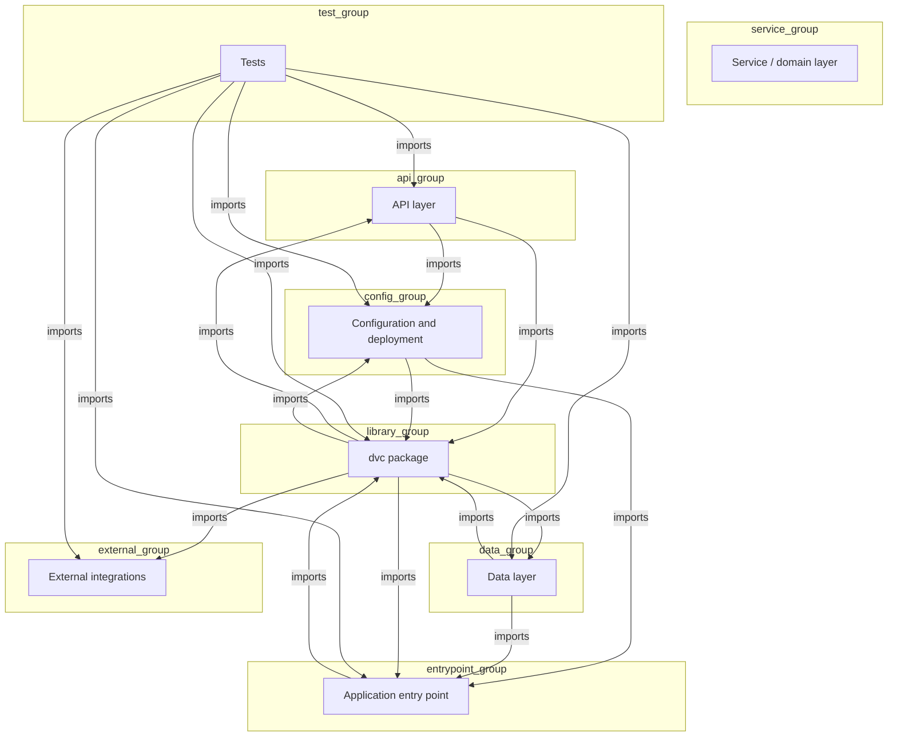

# Architecture report: treeverse/dvc

> Automated static analysis. **Observed** = directly seen in files/imports/AST; **Inferred** = interpretation from that evidence. Repository code was not executed.

## 1. Repository at a glance

| Item | Value |
| --- | --- |
| Repository | treeverse/dvc |
| Description | 🦉 Data Versioning and ML Experiments |
| Language | Python |
| Stars | 15973 |
| Licence | Apache-2.0 |
| Analysed commit / branch | b59add99ee667f2b352cc1be337619f965fe3fea / main |
| Framework(s) | None detected |
| Files analysed | 589 |
| Components | 8 |

## 2. Architecture in one minute

treeverse/dvc - 🦉 Data Versioning and ML Experiments. This repository was analysed statically from 589 file(s) (554 Python). Detected technologies (observed from imports/manifests): GitHub Actions, SQLite, Celery, Kombu, pandas, requests. Files are grouped into 8 component(s): API layer, Configuration and deployment, Data layer, dvc package, Application entry point, External integrations, Service / domain layer, Tests. Observed entry point(s): dvc/__main__.py, dvc/cli/__init__.py, dvc/parsing/context.py. Findings below distinguish observed facts from inferred interpretation.

## 3. High-level block diagram

## 4. Main components

### API layer (`api_layer`)

- **Kind:** api
- **Status:** Observed
- **Confidence:** 0.85
- **Responsibility:** Groups 8 file(s) under api layer (observed from repository paths and static analysis). Observed top-level classes: DVCDataset, DatachainDataset, URLDataset, _OpenContextManager. Observed top-level functions: _open, _postprocess, _wrap_exceptions, all_branches, all_commits, all_tags.
- **Paths:** `dvc/api/__init__.py`, `dvc/api/artifacts.py`, `dvc/api/data.py`, `dvc/api/dataset.py`, `dvc/api/experiments.py`, `dvc/api/scm.py`, `dvc/api/show.py`, `dvc/testing/benchmarks/api/__init__.py`
- **Evidence:** [dvc/api/__init__.py](https://github.com/treeverse/dvc/blob/b59add99ee667f2b352cc1be337619f965fe3fea/dvc/api/__init__.py); [dvc/api/artifacts.py:7](https://github.com/treeverse/dvc/blob/b59add99ee667f2b352cc1be337619f965fe3fea/dvc/api/artifacts.py#L7); [dvc/api/data.py:12](https://github.com/treeverse/dvc/blob/b59add99ee667f2b352cc1be337619f965fe3fea/dvc/api/data.py#L12); [dvc/api/dataset.py:4](https://github.com/treeverse/dvc/blob/b59add99ee667f2b352cc1be337619f965fe3fea/dvc/api/dataset.py#L4); [dvc/api/experiments.py:9](https://github.com/treeverse/dvc/blob/b59add99ee667f2b352cc1be337619f965fe3fea/dvc/api/experiments.py#L9); [dvc/api/scm.py:6](https://github.com/treeverse/dvc/blob/b59add99ee667f2b352cc1be337619f965fe3fea/dvc/api/scm.py#L6); [dvc/api/show.py:11](https://github.com/treeverse/dvc/blob/b59add99ee667f2b352cc1be337619f965fe3fea/dvc/api/show.py#L11); [dvc/testing/benchmarks/api/__init__.py](https://github.com/treeverse/dvc/blob/b59add99ee667f2b352cc1be337619f965fe3fea/dvc/testing/benchmarks/api/__init__.py)

### Configuration and deployment (`config`)

- **Kind:** config
- **Status:** Observed
- **Confidence:** 0.85
- **Responsibility:** Groups 4 file(s) under configuration and deployment (observed from repository paths and static analysis). Observed top-level classes: CmdConfig, Config, ConfigError, NoRemoteError, RemoteConfigError, RemoteNotFoundError. Observed top-level functions: _lower_keys, _name_type, _pack_named, _parse_named, add_parser, get_compiled_schema.
- **Paths:** `dvc/commands/config.py`, `dvc/config.py`, `pyproject.toml`, `tests/docker-compose.yml`
- **Evidence:** [dvc/commands/config.py:17](https://github.com/treeverse/dvc/blob/b59add99ee667f2b352cc1be337619f965fe3fea/dvc/commands/config.py#L17); [dvc/config.py:25](https://github.com/treeverse/dvc/blob/b59add99ee667f2b352cc1be337619f965fe3fea/dvc/config.py#L25); [pyproject.toml](https://github.com/treeverse/dvc/blob/b59add99ee667f2b352cc1be337619f965fe3fea/pyproject.toml); [tests/docker-compose.yml](https://github.com/treeverse/dvc/blob/b59add99ee667f2b352cc1be337619f965fe3fea/tests/docker-compose.yml)

### Data layer (`data_layer`)

- **Kind:** data
- **Status:** Observed
- **Confidence:** 0.85
- **Responsibility:** Groups 2 file(s) under data layer (observed from repository paths and static analysis). Observed top-level classes: AbstractDependency, Client, DbDependency, Serializer. Observed top-level functions: atomic_file, client, download_progress, handle_error, make_url, noop.
- **Paths:** `dvc/database.py`, `dvc/dependency/db.py`
- **Evidence:** [dvc/database.py:26](https://github.com/treeverse/dvc/blob/b59add99ee667f2b352cc1be337619f965fe3fea/dvc/database.py#L26); [dvc/dependency/db.py:21](https://github.com/treeverse/dvc/blob/b59add99ee667f2b352cc1be337619f965fe3fea/dvc/dependency/db.py#L21)

### dvc package (`dvc`)

- **Kind:** library
- **Status:** Observed
- **Confidence:** 0.85
- **Responsibility:** Groups 253 file(s) under dvc package (observed from repository paths and static analysis). Observed top-level classes: AmbiguousExpRefInfo, Annotation, ApplyStash, ApplyStashEntry, ArgumentDuplicationError, Artifact. Observed top-level functions: ByUrl, Choices, SCM, _, _acquire_read, _acquire_write.
- **Paths:** `dvc/__init__.py`, `dvc/__pyinstaller/__init__.py`, `dvc/__pyinstaller/hook-asyncssh.py`, `dvc/__pyinstaller/hook-celery.py`, `dvc/__pyinstaller/hook-dvc.py`, `dvc/__pyinstaller/hook-dvc.utils.flatten.py`, `dvc/__pyinstaller/hook-dvc_task.py`, `dvc/__pyinstaller/hook-fsspec.py`, `dvc/__pyinstaller/hook-pydrive2.py`, `dvc/_debug.py`, `dvc/analytics.py`, `dvc/annotations.py`, `dvc/build.py`, `dvc/cachemgr.py`, `dvc/cli/__init__.py`, `dvc/cli/command.py`, `dvc/cli/completion.py`, `dvc/cli/formatter.py`, `dvc/cli/parser.py`, `dvc/cli/utils.py`, `dvc/commands/__init__.py`, `dvc/commands/add.py`, `dvc/commands/artifacts.py`, `dvc/commands/cache.py`, `dvc/commands/check_ignore.py`, `dvc/commands/checkout.py`, `dvc/commands/commit.py`, `dvc/commands/completion.py`, `dvc/commands/daemon.py`, `dvc/commands/dag.py`, `dvc/commands/data.py`, `dvc/commands/data_sync.py`, `dvc/commands/dataset.py`, `dvc/commands/destroy.py`, `dvc/commands/diff.py`, `dvc/commands/du.py`, `dvc/commands/experiments/__init__.py`, `dvc/commands/experiments/apply.py`, `dvc/commands/experiments/branch.py`, `dvc/commands/experiments/clean.py`, `dvc/commands/experiments/diff.py`, `dvc/commands/experiments/exec_run.py`, `dvc/commands/experiments/ls.py`, `dvc/commands/experiments/pull.py`, `dvc/commands/experiments/push.py`, `dvc/commands/experiments/queue_worker.py`, `dvc/commands/experiments/remove.py`, `dvc/commands/experiments/rename.py`, `dvc/commands/experiments/save.py`, `dvc/commands/experiments/show.py`, `dvc/commands/freeze.py`, `dvc/commands/gc.py`, `dvc/commands/get.py`, `dvc/commands/get_url.py`, `dvc/commands/git_hook.py`, `dvc/commands/imp.py`, `dvc/commands/imp_db.py`, `dvc/commands/imp_url.py`, `dvc/commands/init.py`, `dvc/commands/install.py`, `dvc/commands/ls/__init__.py`, `dvc/commands/ls/ls_colors.py`, `dvc/commands/ls_url.py`, `dvc/commands/metrics.py`, `dvc/commands/move.py`, `dvc/commands/params.py`, `dvc/commands/plots.py`, `dvc/commands/queue/__init__.py`, `dvc/commands/queue/kill.py`, `dvc/commands/queue/logs.py`, `dvc/commands/queue/remove.py`, `dvc/commands/queue/start.py`, `dvc/commands/queue/status.py`, `dvc/commands/queue/stop.py`, `dvc/commands/remote.py`, `dvc/commands/remove.py`, `dvc/commands/repro.py`, `dvc/commands/root.py`, `dvc/commands/stage.py`, `dvc/commands/status.py`, `dvc/commands/studio.py`, `dvc/commands/unprotect.py`, `dvc/commands/update.py`, `dvc/commands/version.py`, `dvc/compare.py`, `dvc/config_schema.py`, `dvc/daemon.py`, `dvc/dagascii.py`, `dvc/data_cloud.py`, `dvc/dependency/__init__.py`, `dvc/dependency/base.py`, `dvc/dependency/dataset.py`, `dvc/dependency/param.py`, `dvc/dependency/repo.py`, `dvc/dirs.py`, `dvc/dvcfile.py`, `dvc/env.py`, `dvc/exceptions.py`, `dvc/fs/__init__.py`, `dvc/fs/callbacks.py`, `dvc/fs/data.py`, `dvc/fs/dvc.py`, `dvc/fs/dvc_path.py`, `dvc/fs/git.py`, `dvc/ignore.py`, `dvc/info.py`, `dvc/lock.py`, `dvc/log.py`, `dvc/logger.py`, `dvc/output.py`, `dvc/parsing/__init__.py`, `dvc/parsing/interpolate.py`, `dvc/pathspec_math.py`, `dvc/progress.py`, `dvc/prompt.py`, `dvc/render/__init__.py`, `dvc/render/convert.py`, `dvc/render/converter/__init__.py`, `dvc/render/converter/image.py`, `dvc/render/converter/vega.py`, `dvc/render/match.py`, `dvc/repo/__init__.py`, `dvc/repo/add.py`, `dvc/repo/artifacts.py`, `dvc/repo/brancher.py`, `dvc/repo/cache.py`, `dvc/repo/checkout.py`, `dvc/repo/collect.py`, `dvc/repo/commit.py`, `dvc/repo/data.py`, `dvc/repo/datasets.py`, `dvc/repo/destroy.py`, `dvc/repo/diff.py`, `dvc/repo/du.py`, `dvc/repo/experiments/__init__.py`, `dvc/repo/experiments/apply.py`, `dvc/repo/experiments/branch.py`, `dvc/repo/experiments/brancher.py`, `dvc/repo/experiments/cache.py`, `dvc/repo/experiments/clean.py`, `dvc/repo/experiments/collect.py`, `dvc/repo/experiments/diff.py`, `dvc/repo/experiments/exceptions.py`, `dvc/repo/experiments/executor/__init__.py`, `dvc/repo/experiments/executor/base.py`, `dvc/repo/experiments/executor/local.py`, `dvc/repo/experiments/ls.py`, `dvc/repo/experiments/pull.py`, `dvc/repo/experiments/push.py`, `dvc/repo/experiments/queue/__init__.py`, `dvc/repo/experiments/queue/base.py`, `dvc/repo/experiments/queue/celery.py`, `dvc/repo/experiments/queue/exceptions.py`, `dvc/repo/experiments/queue/remove.py`, `dvc/repo/experiments/queue/tasks.py`, `dvc/repo/experiments/queue/tempdir.py`, `dvc/repo/experiments/queue/utils.py`, `dvc/repo/experiments/queue/workspace.py`, `dvc/repo/experiments/refs.py`, `dvc/repo/experiments/remove.py`, `dvc/repo/experiments/rename.py`, `dvc/repo/experiments/save.py`, `dvc/repo/experiments/serialize.py`, `dvc/repo/experiments/show.py`, `dvc/repo/experiments/stash.py`, `dvc/repo/experiments/utils.py`, `dvc/repo/fetch.py`, `dvc/repo/freeze.py`, `dvc/repo/gc.py`, `dvc/repo/get.py`, `dvc/repo/get_url.py`, `dvc/repo/graph.py`, `dvc/repo/imp.py`, `dvc/repo/imp_db.py`, `dvc/repo/imp_url.py`, `dvc/repo/index.py`, `dvc/repo/init.py`, `dvc/repo/install.py`, `dvc/repo/ls.py`, `dvc/repo/ls_url.py`, `dvc/repo/metrics/__init__.py`, `dvc/repo/metrics/diff.py`, `dvc/repo/metrics/show.py`, `dvc/repo/move.py`, `dvc/repo/open_repo.py`, `dvc/repo/params/__init__.py`, `dvc/repo/params/diff.py`, `dvc/repo/params/show.py`, `dvc/repo/plots/__init__.py`, `dvc/repo/plots/diff.py`, `dvc/repo/pull.py`, `dvc/repo/push.py`, `dvc/repo/remove.py`, `dvc/repo/reproduce.py`, `dvc/repo/scm_context.py`, `dvc/repo/stage.py`, `dvc/repo/status.py`, `dvc/repo/trie.py`, `dvc/repo/update.py`, `dvc/repo/worktree.py`, `dvc/rwlock.py`, `dvc/schema.py`, `dvc/scm.py`, `dvc/stage/__init__.py`, `dvc/stage/cache.py`, `dvc/stage/decorators.py`, `dvc/stage/exceptions.py`, `dvc/stage/imports.py`, `dvc/stage/loader.py`, `dvc/stage/params.py`, `dvc/stage/serialize.py`, `dvc/stage/utils.py`, `dvc/testing/__init__.py`, `dvc/testing/benchmarks/__init__.py`, `dvc/testing/benchmarks/cli/__init__.py`, `dvc/testing/benchmarks/cli/commands/__init__.py`, `dvc/testing/benchmarks/cli/stories/__init__.py`, `dvc/testing/benchmarks/fixtures.py`, `dvc/testing/benchmarks/plugin.py`, `dvc/testing/cloud.py`, `dvc/testing/fixtures.py`, `dvc/testing/matchers.py`, `dvc/testing/path_info.py`, `dvc/testing/plugin.py`, `dvc/testing/scripts.py`, `dvc/testing/tmp_dir.py`, `dvc/types.py`, `dvc/ui/_rich_progress.py`, `dvc/ui/pager.py`, `dvc/ui/table.py`, `dvc/updater.py`, `dvc/utils/__init__.py`, `dvc/utils/cli_parse.py`, `dvc/utils/collections.py`, `dvc/utils/diff.py`, `dvc/utils/flatten.py`, `dvc/utils/fs.py`, `dvc/utils/humanize.py`, `dvc/utils/hydra.py`, `dvc/utils/objects.py`, `dvc/utils/packaging.py`, `dvc/utils/plots.py`, `dvc/utils/serialize/__init__.py`, `dvc/utils/serialize/_common.py`, `dvc/utils/serialize/_json.py`, `dvc/utils/serialize/_py.py`, `dvc/utils/serialize/_toml.py`, `dvc/utils/serialize/_yaml.py`, `dvc/utils/strictyaml.py`, `dvc/utils/studio.py`, `dvc/utils/table.py`, `dvc/utils/threadpool.py`, `dvc/version.py`
- **Evidence:** [dvc/__init__.py](https://github.com/treeverse/dvc/blob/b59add99ee667f2b352cc1be337619f965fe3fea/dvc/__init__.py); [dvc/__pyinstaller/__init__.py:4](https://github.com/treeverse/dvc/blob/b59add99ee667f2b352cc1be337619f965fe3fea/dvc/__pyinstaller/__init__.py#L4); [dvc/__pyinstaller/hook-asyncssh.py](https://github.com/treeverse/dvc/blob/b59add99ee667f2b352cc1be337619f965fe3fea/dvc/__pyinstaller/hook-asyncssh.py); [dvc/__pyinstaller/hook-celery.py](https://github.com/treeverse/dvc/blob/b59add99ee667f2b352cc1be337619f965fe3fea/dvc/__pyinstaller/hook-celery.py); [dvc/__pyinstaller/hook-dvc.py](https://github.com/treeverse/dvc/blob/b59add99ee667f2b352cc1be337619f965fe3fea/dvc/__pyinstaller/hook-dvc.py); [dvc/__pyinstaller/hook-dvc.utils.flatten.py](https://github.com/treeverse/dvc/blob/b59add99ee667f2b352cc1be337619f965fe3fea/dvc/__pyinstaller/hook-dvc.utils.flatten.py); [dvc/__pyinstaller/hook-dvc_task.py](https://github.com/treeverse/dvc/blob/b59add99ee667f2b352cc1be337619f965fe3fea/dvc/__pyinstaller/hook-dvc_task.py); [dvc/__pyinstaller/hook-fsspec.py](https://github.com/treeverse/dvc/blob/b59add99ee667f2b352cc1be337619f965fe3fea/dvc/__pyinstaller/hook-fsspec.py)

### Application entry point (`entrypoint`)

- **Kind:** entrypoint
- **Status:** Observed
- **Confidence:** 0.85
- **Responsibility:** Groups 7 file(s) under application entry point (observed from repository paths and static analysis). Observed top-level classes: CmdExperimentsRun, Console, Container, Context, ContextError, CtxDict. Observed top-level functions: _add_run_common, _default_meta, _enforce_cmd_list, _fish_supports_no_config, _make_cmd, _merge.
- **Paths:** `dvc/__main__.py`, `dvc/commands/experiments/run.py`, `dvc/parsing/context.py`, `dvc/repo/experiments/run.py`, `dvc/repo/run.py`, `dvc/stage/run.py`, `dvc/ui/__init__.py`
- **Evidence:** [dvc/__main__.py](https://github.com/treeverse/dvc/blob/b59add99ee667f2b352cc1be337619f965fe3fea/dvc/__main__.py); [dvc/commands/experiments/run.py:12](https://github.com/treeverse/dvc/blob/b59add99ee667f2b352cc1be337619f965fe3fea/dvc/commands/experiments/run.py#L12); [dvc/parsing/context.py:28](https://github.com/treeverse/dvc/blob/b59add99ee667f2b352cc1be337619f965fe3fea/dvc/parsing/context.py#L28); [dvc/repo/experiments/run.py:15](https://github.com/treeverse/dvc/blob/b59add99ee667f2b352cc1be337619f965fe3fea/dvc/repo/experiments/run.py#L15); [dvc/repo/run.py:16](https://github.com/treeverse/dvc/blob/b59add99ee667f2b352cc1be337619f965fe3fea/dvc/repo/run.py#L16); [dvc/stage/run.py:19](https://github.com/treeverse/dvc/blob/b59add99ee667f2b352cc1be337619f965fe3fea/dvc/stage/run.py#L19); [dvc/ui/__init__.py:22](https://github.com/treeverse/dvc/blob/b59add99ee667f2b352cc1be337619f965fe3fea/dvc/ui/__init__.py#L22)

### External integrations (`external_integrations`)

- **Kind:** external
- **Status:** Inferred
- **Confidence:** 0.70
- **Responsibility:** Groups 0 file(s) under external integrations (observed from repository paths and static analysis).
- **Evidence:** [dvc/analytics.py:73](https://github.com/treeverse/dvc/blob/b59add99ee667f2b352cc1be337619f965fe3fea/dvc/analytics.py#L73); [dvc/analytics.py:74](https://github.com/treeverse/dvc/blob/b59add99ee667f2b352cc1be337619f965fe3fea/dvc/analytics.py#L74); [dvc/database.py:8](https://github.com/treeverse/dvc/blob/b59add99ee667f2b352cc1be337619f965fe3fea/dvc/database.py#L8); [dvc/database.py:9](https://github.com/treeverse/dvc/blob/b59add99ee667f2b352cc1be337619f965fe3fea/dvc/database.py#L9); [dvc/database.py:10](https://github.com/treeverse/dvc/blob/b59add99ee667f2b352cc1be337619f965fe3fea/dvc/database.py#L10); [dvc/database.py:19](https://github.com/treeverse/dvc/blob/b59add99ee667f2b352cc1be337619f965fe3fea/dvc/database.py#L19)

### Service / domain layer (`service_layer`)

- **Kind:** service
- **Status:** Observed
- **Confidence:** 0.85
- **Responsibility:** Groups 1 file(s) under service / domain layer (observed from repository paths and static analysis).
- **Paths:** `dvc/testing/benchmarks/cli/stories/use_cases/__init__.py`
- **Evidence:** [dvc/testing/benchmarks/cli/stories/use_cases/__init__.py](https://github.com/treeverse/dvc/blob/b59add99ee667f2b352cc1be337619f965fe3fea/dvc/testing/benchmarks/cli/stories/use_cases/__init__.py)

### Tests (`tests`)

- **Kind:** test
- **Status:** Observed
- **Confidence:** 0.85
- **Responsibility:** Groups 284 file(s) under tests (observed from repository paths and static analysis). Observed top-level classes: ANY, DVCFixtures, DVCTestConfig, GitRemote, GitSSH, MockedDatachainVersionInfo. Observed top-level functions: _assert_experiment_rev_order, _check_status, _count_files, _foo, _gen, _get_opt.
- **Paths:** `dvc/testing/api_tests.py`, `dvc/testing/benchmarks/cli/commands/test_add.py`, `dvc/testing/benchmarks/cli/commands/test_checkout.py`, `dvc/testing/benchmarks/cli/commands/test_data_status.py`, `dvc/testing/benchmarks/cli/commands/test_diff.py`, `dvc/testing/benchmarks/cli/commands/test_exp_show.py`, `dvc/testing/benchmarks/cli/commands/test_fetch.py`, `dvc/testing/benchmarks/cli/commands/test_gc.py`, `dvc/testing/benchmarks/cli/commands/test_get.py`, `dvc/testing/benchmarks/cli/commands/test_get_url.py`, `dvc/testing/benchmarks/cli/commands/test_help.py`, `dvc/testing/benchmarks/cli/commands/test_import.py`, `dvc/testing/benchmarks/cli/commands/test_import_url.py`, `dvc/testing/benchmarks/cli/commands/test_init.py`, `dvc/testing/benchmarks/cli/commands/test_ls.py`, `dvc/testing/benchmarks/cli/commands/test_plots.py`, `dvc/testing/benchmarks/cli/commands/test_push.py`, `dvc/testing/benchmarks/cli/commands/test_status.py`, `dvc/testing/benchmarks/cli/commands/test_update.py`, `dvc/testing/benchmarks/cli/stories/test_modify_data.py`, `dvc/testing/benchmarks/cli/stories/use_cases/test_sharing.py`, `dvc/testing/benchmarks/conftest.py`, `dvc/testing/conftest.py`, `dvc/testing/remote_tests.py`, `dvc/testing/workspace_tests.py`, `tests/__init__.py`, `tests/conftest.py`, `tests/dir_helpers.py`, `tests/func/__init__.py`, `tests/func/api/__init__.py`, `tests/func/api/test_artifacts.py`, `tests/func/api/test_data.py`, `tests/func/api/test_experiments.py`, `tests/func/api/test_scm.py`, `tests/func/api/test_show.py`, `tests/func/artifacts/__init__.py`, `tests/func/artifacts/test_artifacts.py`, `tests/func/data/__init__.py`, `tests/func/data/db/__init__.py`, `tests/func/data/db/test_index.py`, `tests/func/experiments/__init__.py`, `tests/func/experiments/conftest.py`, `tests/func/experiments/executor/__init__.py`, `tests/func/experiments/test_apply.py`, `tests/func/experiments/test_diff.py`, `tests/func/experiments/test_experiments.py`, `tests/func/experiments/test_queue.py`, `tests/func/experiments/test_remote.py`, `tests/func/experiments/test_remove.py`, `tests/func/experiments/test_rename.py`, `tests/func/experiments/test_save.py`, `tests/func/experiments/test_set_params.py`, `tests/func/experiments/test_show.py`, `tests/func/experiments/test_stash_exp.py`, `tests/func/experiments/test_utils.py`, `tests/func/metrics/__init__.py`, `tests/func/metrics/test_diff.py`, `tests/func/metrics/test_show.py`, `tests/func/params/__init__.py`, `tests/func/params/test_diff.py`, `tests/func/params/test_show.py`, `tests/func/parsing/__init__.py`, `tests/func/parsing/test_errors.py`, `tests/func/parsing/test_foreach.py`, `tests/func/parsing/test_interpolated_entry.py`, `tests/func/parsing/test_matrix.py`, `tests/func/parsing/test_resolver.py`, `tests/func/parsing/test_top_level.py`, `tests/func/plots/__init__.py`, `tests/func/plots/test_collect.py`, `tests/func/plots/test_diff.py`, `tests/func/plots/test_modify.py`, `tests/func/plots/test_show.py`, `tests/func/repro/__init__.py`, `tests/func/repro/test_repro.py`, `tests/func/repro/test_repro_allow_missing.py`, `tests/func/repro/test_repro_pull.py`, `tests/func/test_add.py`, `tests/func/test_analytics.py`, `tests/func/test_check_ignore.py`, `tests/func/test_checkout.py`, `tests/func/test_cli.py`, `tests/func/test_commit.py`, `tests/func/test_config.py`, `tests/func/test_daemon.py`, `tests/func/test_data_cloud.py`, `tests/func/test_data_status.py`, `tests/func/test_dataset.py`, `tests/func/test_diff.py`, `tests/func/test_download.py`, `tests/func/test_du.py`, `tests/func/test_dvcfile.py`, `tests/func/test_external_repo.py`, `tests/func/test_fs.py`, `tests/func/test_gc.py`, `tests/func/test_get.py`, `tests/func/test_get_url.py`, `tests/func/test_ignore.py`, `tests/func/test_import.py`, `tests/func/test_import_db.py`, `tests/func/test_import_url.py`, `tests/func/test_init.py`, `tests/func/test_install.py`, `tests/func/test_lock.py`, `tests/func/test_lockfile.py`, `tests/func/test_ls.py`, `tests/func/test_ls_url.py`, `tests/func/test_merge_driver.py`, `tests/func/test_move.py`, `tests/func/test_odb.py`, `tests/func/test_remote.py`, `tests/func/test_remove.py`, `tests/func/test_repo.py`, `tests/func/test_repo_index.py`, `tests/func/test_root.py`, `tests/func/test_run.py`, `tests/func/test_run_cache.py`, `tests/func/test_scm.py`, `tests/func/test_scm_context.py`, `tests/func/test_stage.py`, `tests/func/test_stage_load.py`, `tests/func/test_state.py`, `tests/func/test_status.py`, `tests/func/test_unprotect.py`, `tests/func/test_update.py`, `tests/func/test_used_objs.py`, `tests/func/test_utils.py`, `tests/func/test_version.py`, `tests/func/test_virtual_directory.py`, `tests/func/utils/__init__.py`, `tests/func/utils/test_hydra.py`, `tests/func/utils/test_strict_yaml.py`, `tests/integration/__init__.py`, `tests/integration/conftest.py`, `tests/integration/plots/__init__.py`, `tests/integration/plots/conftest.py`, `tests/integration/plots/test_plots.py`, `tests/integration/plots/test_repo_plots_api.py`, `tests/integration/test_studio_live_experiments.py`, `tests/remotes/__init__.py`, `tests/remotes/git-init/git.sh`, `tests/remotes/git_server.py`, `tests/remotes/user.key.pub`, `tests/remotes_env.sample`, `tests/scripts.py`, `tests/unit/__init__.py`, `tests/unit/cli/__init__.py`, `tests/unit/cli/test_main.py`, `tests/unit/command/__init__.py`, `tests/unit/command/ls/__init__.py`, `tests/unit/command/ls/test_ls.py`, `tests/unit/command/ls/test_ls_colors.py`, `tests/unit/command/test_add.py`, `tests/unit/command/test_cache.py`, `tests/unit/command/test_checkout.py`, `tests/unit/command/test_compat_flag.py`, `tests/unit/command/test_completion.py`, `tests/unit/command/test_config.py`, `tests/unit/command/test_dag.py`, `tests/unit/command/test_data_status.py`, `tests/unit/command/test_data_sync.py`, `tests/unit/command/test_dataset.py`, `tests/unit/command/test_diff.py`, `tests/unit/command/test_du.py`, `tests/unit/command/test_experiments.py`, `tests/unit/command/test_gc.py`, `tests/unit/command/test_get.py`, `tests/unit/command/test_get_url.py`, `tests/unit/command/test_git_hook.py`, `tests/unit/command/test_help.py`, `tests/unit/command/test_imp.py`, `tests/unit/command/test_imp_url.py`, `tests/unit/command/test_ls_url.py`, `tests/unit/command/test_metrics.py`, `tests/unit/command/test_params.py`, `tests/unit/command/test_plots.py`, `tests/unit/command/test_queue.py`, `tests/unit/command/test_repro.py`, `tests/unit/command/test_stage.py`, `tests/unit/command/test_status.py`, `tests/unit/command/test_studio.py`, `tests/unit/command/test_update.py`, `tests/unit/data/__init__.py`, `tests/unit/data/db/__init__.py`, `tests/unit/data/db/test_local.py`, `tests/unit/dependency/__init__.py`, `tests/unit/dependency/test_dependency.py`, `tests/unit/dependency/test_params.py`, `tests/unit/fs/__init__.py`, `tests/unit/fs/test_base.py`, `tests/unit/fs/test_data.py`, `tests/unit/fs/test_dvc.py`, `tests/unit/fs/test_dvc_info.py`, `tests/unit/fs/test_dvcfs.py`, `tests/unit/fs/test_fs.py`, `tests/unit/fs/test_tree.py`, `tests/unit/output/__init__.py`, `tests/unit/output/test_annotations.py`, `tests/unit/output/test_load.py`, `tests/unit/output/test_local.py`, `tests/unit/output/test_output.py`, `tests/unit/remote/__init__.py`, `tests/unit/remote/test_oss.py`, `tests/unit/remote/test_remote.py`, `tests/unit/remote/test_webdav.py`, `tests/unit/remote/test_webhdfs.py`, `tests/unit/render/__init__.py`, `tests/unit/render/test_convert.py`, `tests/unit/render/test_image_converter.py`, `tests/unit/render/test_match.py`, `tests/unit/render/test_vega_converter.py`, `tests/unit/repo/__init__.py`, `tests/unit/repo/experiments/__init__.py`, `tests/unit/repo/experiments/conftest.py`, `tests/unit/repo/experiments/queue/__init__.py`, `tests/unit/repo/experiments/queue/test_celery.py`, `tests/unit/repo/experiments/queue/test_remove.py`, `tests/unit/repo/experiments/test_collect.py`, `tests/unit/repo/experiments/test_executor_status.py`, `tests/unit/repo/experiments/test_remove.py`, `tests/unit/repo/experiments/test_utils.py`, `tests/unit/repo/plots/__init__.py`, `tests/unit/repo/plots/test_diff.py`, `tests/unit/repo/test_graph.py`, `tests/unit/repo/test_open_repo.py`, `tests/unit/repo/test_repo.py`, `tests/unit/repo/test_reproduce.py`, `tests/unit/repo/test_scm_context.py`, `tests/unit/scm/__init__.py`, `tests/unit/scm/test_scm.py`, `tests/unit/stage/__init__.py`, `tests/unit/stage/test_cache.py`, `tests/unit/stage/test_loader_pipeline_file.py`, `tests/unit/stage/test_run.py`, `tests/unit/stage/test_serialize_pipeline_file.py`, `tests/unit/stage/test_serialize_pipeline_lock.py`, `tests/unit/stage/test_stage.py`, `tests/unit/stage/test_utils.py`, `tests/unit/test_analytics.py`, `tests/unit/test_api.py`, `tests/unit/test_collect.py`, `tests/unit/test_compare.py`, `tests/unit/test_config.py`, `tests/unit/test_context.py`, `tests/unit/test_daemon.py`, `tests/unit/test_dirs.py`, `tests/unit/test_dvcfile.py`, `tests/unit/test_hashinfo.py`, `tests/unit/test_ignore.py`, `tests/unit/test_imports.py`, `tests/unit/test_info.py`, `tests/unit/test_interpolate.py`, `tests/unit/test_lockfile.py`, `tests/unit/test_logger.py`, `tests/unit/test_metrics.py`, `tests/unit/test_params.py`, `tests/unit/test_pathspec_math.py`, `tests/unit/test_progress.py`, `tests/unit/test_prompt.py`, `tests/unit/test_run.py`, `tests/unit/test_rwlock.py`, `tests/unit/test_scm.py`, `tests/unit/test_tabular_data.py`, `tests/unit/test_updater.py`, `tests/unit/ui/__init__.py`, `tests/unit/ui/test_console.py`, `tests/unit/ui/test_pager.py`, `tests/unit/ui/test_table.py`, `tests/unit/utils/__init__.py`, `tests/unit/utils/serialize/__init__.py`, `tests/unit/utils/serialize/test_python.py`, `tests/unit/utils/serialize/test_toml.py`, `tests/unit/utils/serialize/test_yaml.py`, `tests/unit/utils/test_cli_parse.py`, `tests/unit/utils/test_collections.py`, `tests/unit/utils/test_executors.py`, `tests/unit/utils/test_fs.py`, `tests/unit/utils/test_humanize.py`, `tests/unit/utils/test_plots.py`, `tests/unit/utils/test_studio.py`, `tests/unit/utils/test_utils.py`, `tests/utils/__init__.py`, `tests/utils/asserts.py`, `tests/utils/plots.py`
- **Evidence:** [dvc/testing/api_tests.py:9](https://github.com/treeverse/dvc/blob/b59add99ee667f2b352cc1be337619f965fe3fea/dvc/testing/api_tests.py#L9); [dvc/testing/benchmarks/cli/commands/test_add.py:4](https://github.com/treeverse/dvc/blob/b59add99ee667f2b352cc1be337619f965fe3fea/dvc/testing/benchmarks/cli/commands/test_add.py#L4); [dvc/testing/benchmarks/cli/commands/test_checkout.py:10](https://github.com/treeverse/dvc/blob/b59add99ee667f2b352cc1be337619f965fe3fea/dvc/testing/benchmarks/cli/commands/test_checkout.py#L10); [dvc/testing/benchmarks/cli/commands/test_data_status.py:4](https://github.com/treeverse/dvc/blob/b59add99ee667f2b352cc1be337619f965fe3fea/dvc/testing/benchmarks/cli/commands/test_data_status.py#L4); [dvc/testing/benchmarks/cli/commands/test_diff.py:1](https://github.com/treeverse/dvc/blob/b59add99ee667f2b352cc1be337619f965fe3fea/dvc/testing/benchmarks/cli/commands/test_diff.py#L1); [dvc/testing/benchmarks/cli/commands/test_exp_show.py:1](https://github.com/treeverse/dvc/blob/b59add99ee667f2b352cc1be337619f965fe3fea/dvc/testing/benchmarks/cli/commands/test_exp_show.py#L1); [dvc/testing/benchmarks/cli/commands/test_fetch.py:1](https://github.com/treeverse/dvc/blob/b59add99ee667f2b352cc1be337619f965fe3fea/dvc/testing/benchmarks/cli/commands/test_fetch.py#L1); [dvc/testing/benchmarks/cli/commands/test_gc.py:1](https://github.com/treeverse/dvc/blob/b59add99ee667f2b352cc1be337619f965fe3fea/dvc/testing/benchmarks/cli/commands/test_gc.py#L1)

## 5. Execution flow

**Observed** entry point(s):

- [dvc/__main__.py:7](https://github.com/treeverse/dvc/blob/b59add99ee667f2b352cc1be337619f965fe3fea/dvc/__main__.py#L7)
- [dvc/cli/__init__.py](https://github.com/treeverse/dvc/blob/b59add99ee667f2b352cc1be337619f965fe3fea/dvc/cli/__init__.py)
- [dvc/parsing/context.py:556](https://github.com/treeverse/dvc/blob/b59add99ee667f2b352cc1be337619f965fe3fea/dvc/parsing/context.py#L556)
- [dvc/ui/__init__.py:369](https://github.com/treeverse/dvc/blob/b59add99ee667f2b352cc1be337619f965fe3fea/dvc/ui/__init__.py#L369)

Representative flow (derived from observed entry points and the import graph; steps beyond the entry point are **Inferred**):

1. Execution starts at an observed entry point listed above, if present.
2. `api_layer` imports `config` (API layer -> Configuration and deployment).
3. `api_layer` imports `dvc` (API layer -> dvc package).
4. `config` imports `dvc` (Configuration and deployment -> dvc package).
5. `config` imports `entrypoint` (Configuration and deployment -> Application entry point).
6. `data_layer` imports `dvc` (Data layer -> dvc package).
7. `data_layer` imports `entrypoint` (Data layer -> Application entry point).
8. `dvc` imports `api_layer` (dvc package -> API layer).
9. `dvc` imports `config` (dvc package -> Configuration and deployment).

## 6. Project structure

### `(root)`

- `.dvcignore` - other (21 bytes)
- `.git-blame-ignore-revs` - other (634 bytes)
- `.git_archival.txt` - docs (145 bytes)
- `.gitattributes` - other (32 bytes)
- `.gitignore` - other (420 bytes)
- `.mailmap` - other (238 bytes)
- `.pre-commit-config.yaml` - config (1892 bytes)
- `.pre-commit-hooks.yaml` - config (639 bytes)
- `.zenodo.json` - config (322 bytes)
- `CITATION.cff` - other (784 bytes)
- `CODE_OF_CONDUCT.md` - docs (3347 bytes)
- `CONTRIBUTING.md` - docs (95 bytes)
- `LICENSE` - docs (11340 bytes)
- `README.rst` - docs (12874 bytes)
- `pyproject.toml` - manifest (8763 bytes)

### `.dvc`

- `.dvc/.gitignore` - other (26 bytes)
- `.dvc/config` - other (0 bytes)

### `.github`

- `.github/ISSUE_TEMPLATE/bug_report.md` - docs (1295 bytes)
- `.github/ISSUE_TEMPLATE/config.yml` - config (189 bytes)
- `.github/ISSUE_TEMPLATE/feature_request.md` - docs (83 bytes)
- `.github/PULL_REQUEST_TEMPLATE.md` - docs (395 bytes)
- `.github/codecov.yml` - config (183 bytes)
- `.github/dependabot.yml` - config (273 bytes)
- `.github/release.yml` - config (510 bytes)
- `.github/workflows/benchmarks.yaml` - ci, YAML (1184 bytes)
- `.github/workflows/build.yaml` - ci, YAML (2195 bytes)
- `.github/workflows/codeql.yml` - ci, YAML (739 bytes)
- `.github/workflows/plugin_tests.yaml` - ci, YAML (1212 bytes)
- `.github/workflows/tests.yaml` - ci, YAML (3324 bytes)

### `dvc`

- `dvc/__init__.py` - source, Python (221 bytes)
- `dvc/__main__.py` - source, Python (149 bytes)
- `dvc/__pyinstaller/__init__.py` - source, Python (72 bytes)
- `dvc/__pyinstaller/hook-asyncssh.py` - source, Python (53 bytes)
- `dvc/__pyinstaller/hook-celery.py` - source, Python (462 bytes)
- `dvc/__pyinstaller/hook-dvc.py` - source, Python (766 bytes)
- `dvc/__pyinstaller/hook-dvc.utils.flatten.py` - source, Python (108 bytes)
- `dvc/__pyinstaller/hook-dvc_task.py` - source, Python (123 bytes)
- `dvc/__pyinstaller/hook-fsspec.py` - source, Python (69 bytes)
- `dvc/__pyinstaller/hook-pydrive2.py` - source, Python (104 bytes)
- `dvc/_debug.py` - source, Python (8028 bytes)
- `dvc/analytics.py` - source, Python (6380 bytes)
- `dvc/annotations.py` - source, Python (1445 bytes)
- `dvc/api/__init__.py` - source, Python (569 bytes)
- `dvc/api/artifacts.py` - source, Python (1905 bytes)
- `dvc/api/data.py` - source, Python (11341 bytes)
- `dvc/api/dataset.py` - source, Python (2037 bytes)
- `dvc/api/experiments.py` - source, Python (4143 bytes)
- `dvc/api/scm.py` - source, Python (1889 bytes)
- `dvc/api/show.py` - source, Python (12121 bytes)
- `dvc/build.py` - source, Python (264 bytes)
- `dvc/cachemgr.py` - source, Python (4367 bytes)
- `dvc/cli/__init__.py` - source, Python (7751 bytes)
- `dvc/cli/command.py` - source, Python (847 bytes)
- `dvc/cli/completion.py` - source, Python (2877 bytes)
- `dvc/cli/formatter.py` - source, Python (355 bytes)
- `dvc/cli/parser.py` - source, Python (4812 bytes)
- `dvc/cli/utils.py` - source, Python (1524 bytes)
- `dvc/commands/__init__.py` - source, Python (0 bytes)
- `dvc/commands/add.py` - source, Python (3942 bytes)
- `dvc/commands/artifacts.py` - source, Python (4944 bytes)
- `dvc/commands/cache.py` - source, Python (4078 bytes)
- `dvc/commands/check_ignore.py` - source, Python (3847 bytes)
- `dvc/commands/checkout.py` - source, Python (3377 bytes)
- `dvc/commands/commit.py` - source, Python (2459 bytes)
- `dvc/commands/completion.py` - source, Python (1282 bytes)
- `dvc/commands/config.py` - source, Python (7150 bytes)
- `dvc/commands/daemon.py` - source, Python (2186 bytes)
- `dvc/commands/dag.py` - source, Python (7705 bytes)
- `dvc/commands/data.py` - source, Python (7211 bytes)
- `dvc/commands/data_sync.py` - source, Python (12979 bytes)
- `dvc/commands/dataset.py` - source, Python (7615 bytes)
- `dvc/commands/destroy.py` - source, Python (1554 bytes)
- `dvc/commands/diff.py` - source, Python (6338 bytes)
- `dvc/commands/du.py` - source, Python (2265 bytes)
- `dvc/commands/experiments/__init__.py` - source, Python (2643 bytes)
- `dvc/commands/experiments/apply.py` - source, Python (1511 bytes)
- `dvc/commands/experiments/branch.py` - source, Python (1171 bytes)
- `dvc/commands/experiments/clean.py` - source, Python (781 bytes)
- `dvc/commands/experiments/diff.py` - source, Python (3675 bytes)
- `dvc/commands/experiments/exec_run.py` - source, Python (1655 bytes)
- `dvc/commands/experiments/ls.py` - source, Python (3043 bytes)
- `dvc/commands/experiments/pull.py` - source, Python (3186 bytes)
- `dvc/commands/experiments/push.py` - source, Python (4806 bytes)
- `dvc/commands/experiments/queue_worker.py` - source, Python (860 bytes)
- `dvc/commands/experiments/remove.py` - source, Python (2526 bytes)
- `dvc/commands/experiments/rename.py` - source, Python (2164 bytes)
- `dvc/commands/experiments/run.py` - source, Python (3585 bytes)
- `dvc/commands/experiments/save.py` - source, Python (2917 bytes)
- `dvc/commands/experiments/show.py` - source, Python (9959 bytes)
- `dvc/commands/freeze.py` - source, Python (1784 bytes)
- `dvc/commands/gc.py` - source, Python (7373 bytes)
- `dvc/commands/get.py` - source, Python (3890 bytes)
- `dvc/commands/get_url.py` - source, Python (2005 bytes)
- `dvc/commands/git_hook.py` - source, Python (4544 bytes)
- `dvc/commands/imp.py` - source, Python (3905 bytes)
- `dvc/commands/imp_db.py` - source, Python (3205 bytes)
- `dvc/commands/imp_url.py` - source, Python (3941 bytes)
- `dvc/commands/init.py` - source, Python (3228 bytes)
- `dvc/commands/install.py` - source, Python (1135 bytes)
- `dvc/commands/ls/__init__.py` - source, Python (7571 bytes)
- `dvc/commands/ls/ls_colors.py` - source, Python (1419 bytes)
- `dvc/commands/ls_url.py` - source, Python (2497 bytes)
- `dvc/commands/metrics.py` - source, Python (8014 bytes)
- `dvc/commands/move.py` - source, Python (1362 bytes)
- `dvc/commands/params.py` - source, Python (3984 bytes)
- `dvc/commands/plots.py` - source, Python (12811 bytes)
- `dvc/commands/queue/__init__.py` - source, Python (813 bytes)
- `dvc/commands/queue/kill.py` - source, Python (1226 bytes)
- `dvc/commands/queue/logs.py` - source, Python (1471 bytes)
- `dvc/commands/queue/remove.py` - source, Python (2817 bytes)
- `dvc/commands/queue/start.py` - source, Python (1181 bytes)
- `dvc/commands/queue/status.py` - source, Python (1884 bytes)
- `dvc/commands/queue/stop.py` - source, Python (1238 bytes)
- `dvc/commands/remote.py` - source, Python (9879 bytes)
- `dvc/commands/remove.py` - source, Python (1291 bytes)
- `dvc/commands/repro.py` - source, Python (5728 bytes)
- `dvc/commands/root.py` - source, Python (786 bytes)
- `dvc/commands/stage.py` - source, Python (10024 bytes)
- `dvc/commands/status.py` - source, Python (2822 bytes)
- `dvc/commands/studio.py` - source, Python (6334 bytes)
- `dvc/commands/unprotect.py` - source, Python (1214 bytes)
- `dvc/commands/update.py` - source, Python (2567 bytes)
- `dvc/commands/version.py` - source, Python (916 bytes)
- `dvc/compare.py` - source, Python (13105 bytes)
- `dvc/config.py` - source, Python (11748 bytes)
- `dvc/config_schema.py` - source, Python (12129 bytes)
- `dvc/daemon.py` - source, Python (5542 bytes)
- `dvc/dagascii.py` - source, Python (8132 bytes)
- `dvc/data_cloud.py` - source, Python (11842 bytes)
- `dvc/database.py` - source, Python (4080 bytes)
- `dvc/dependency/__init__.py` - source, Python (3375 bytes)
- `dvc/dependency/base.py` - source, Python (1972 bytes)
- `dvc/dependency/dataset.py` - source, Python (2621 bytes)
- `dvc/dependency/db.py` - source, Python (3896 bytes)
- `dvc/dependency/param.py` - source, Python (5467 bytes)
- `dvc/dependency/repo.py` - source, Python (5476 bytes)
- `dvc/dirs.py` - source, Python (1357 bytes)
- `dvc/dvcfile.py` - source, Python (15281 bytes)
- `dvc/env.py` - source, Python (866 bytes)
- `dvc/exceptions.py` - source, Python (10358 bytes)
- `dvc/fs/__init__.py` - source, Python (5636 bytes)
- `dvc/fs/callbacks.py` - source, Python (3181 bytes)
- `dvc/fs/data.py` - source, Python (904 bytes)
- `dvc/fs/dvc.py` - source, Python (23874 bytes)
- `dvc/fs/dvc_path.py` - source, Python (1714 bytes)
- `dvc/fs/git.py` - source, Python (1423 bytes)
- `dvc/ignore.py` - source, Python (19760 bytes)
- `dvc/info.py` - source, Python (5080 bytes)
- `dvc/lock.py` - source, Python (6267 bytes)
- `dvc/log.py` - source, Python (276 bytes)
- `dvc/logger.py` - source, Python (8139 bytes)
- `dvc/output.py` - source, Python (48810 bytes)
- `dvc/parsing/__init__.py` - source, Python (23133 bytes)
- `dvc/parsing/context.py` - source, Python (16691 bytes)
- `dvc/parsing/interpolate.py` - source, Python (6016 bytes)
- `dvc/pathspec_math.py` - source, Python (2620 bytes)
- `dvc/progress.py` - source, Python (5214 bytes)
- `dvc/prompt.py` - source, Python (1354 bytes)
- `dvc/render/__init__.py` - source, Python (166 bytes)
- `dvc/render/convert.py` - source, Python (1542 bytes)
- `dvc/render/converter/__init__.py` - source, Python (517 bytes)
- `dvc/render/converter/image.py` - source, Python (1884 bytes)
- `dvc/render/converter/vega.py` - source, Python (11001 bytes)
- `dvc/render/match.py` - source, Python (4274 bytes)
- `dvc/repo/__init__.py` - source, Python (21857 bytes)
- `dvc/repo/add.py` - source, Python (7127 bytes)
- `dvc/repo/artifacts.py` - source, Python (13318 bytes)
- `dvc/repo/brancher.py` - source, Python (4879 bytes)
- `dvc/repo/cache.py` - source, Python (897 bytes)
- `dvc/repo/checkout.py` - source, Python (6318 bytes)
- `dvc/repo/collect.py` - source, Python (2110 bytes)
- `dvc/repo/commit.py` - source, Python (4814 bytes)
- `dvc/repo/data.py` - source, Python (17837 bytes)
- `dvc/repo/datasets.py` - source, Python (13660 bytes)
- `dvc/repo/destroy.py` - source, Python (519 bytes)
- `dvc/repo/diff.py` - source, Python (4797 bytes)
- `dvc/repo/du.py` - source, Python (1024 bytes)
- `dvc/repo/experiments/__init__.py` - source, Python (12683 bytes)
- `dvc/repo/experiments/apply.py` - source, Python (2070 bytes)
- `dvc/repo/experiments/branch.py` - source, Python (1983 bytes)
- `dvc/repo/experiments/brancher.py` - source, Python (1338 bytes)
- `dvc/repo/experiments/cache.py` - source, Python (2019 bytes)
- `dvc/repo/experiments/clean.py` - source, Python (252 bytes)
- `dvc/repo/experiments/collect.py` - source, Python (10669 bytes)
- `dvc/repo/experiments/diff.py` - source, Python (964 bytes)
- `dvc/repo/experiments/exceptions.py` - source, Python (3131 bytes)
- `dvc/repo/experiments/executor/__init__.py` - source, Python (0 bytes)
- `dvc/repo/experiments/executor/base.py` - source, Python (27491 bytes)
- `dvc/repo/experiments/executor/local.py` - source, Python (8568 bytes)
- `dvc/repo/experiments/ls.py` - source, Python (1223 bytes)
- `dvc/repo/experiments/pull.py` - source, Python (3569 bytes)
- `dvc/repo/experiments/push.py` - source, Python (5421 bytes)
- `dvc/repo/experiments/queue/__init__.py` - source, Python (0 bytes)
- `dvc/repo/experiments/queue/base.py` - source, Python (25182 bytes)
- `dvc/repo/experiments/queue/celery.py` - source, Python (24246 bytes)
- `dvc/repo/experiments/queue/exceptions.py` - source, Python (395 bytes)
- `dvc/repo/experiments/queue/remove.py` - source, Python (4568 bytes)
- `dvc/repo/experiments/queue/tasks.py` - source, Python (3891 bytes)
- `dvc/repo/experiments/queue/tempdir.py` - source, Python (6897 bytes)
- `dvc/repo/experiments/queue/utils.py` - source, Python (2681 bytes)
- `dvc/repo/experiments/queue/workspace.py` - source, Python (8868 bytes)
- `dvc/repo/experiments/refs.py` - source, Python (2435 bytes)
- `dvc/repo/experiments/remove.py` - source, Python (4228 bytes)
- `dvc/repo/experiments/rename.py` - source, Python (1709 bytes)
- `dvc/repo/experiments/run.py` - source, Python (3520 bytes)
- `dvc/repo/experiments/save.py` - source, Python (1233 bytes)
- `dvc/repo/experiments/serialize.py` - source, Python (5962 bytes)
- `dvc/repo/experiments/show.py` - source, Python (11879 bytes)
- `dvc/repo/experiments/stash.py` - source, Python (6606 bytes)
- `dvc/repo/experiments/utils.py` - source, Python (26309 bytes)
- `dvc/repo/fetch.py` - source, Python (6303 bytes)
- `dvc/repo/freeze.py` - source, Python (386 bytes)
- `dvc/repo/gc.py` - source, Python (5684 bytes)
- `dvc/repo/get.py` - source, Python (1529 bytes)
- `dvc/repo/get_url.py` - source, Python (588 bytes)
- `dvc/repo/graph.py` - source, Python (5187 bytes)
- `dvc/repo/imp.py` - source, Python (1110 bytes)
- `dvc/repo/imp_db.py` - source, Python (1480 bytes)
- `dvc/repo/imp_url.py` - source, Python (2378 bytes)
- `dvc/repo/index.py` - source, Python (31935 bytes)
- `dvc/repo/init.py` - source, Python (2818 bytes)
- `dvc/repo/install.py` - source, Python (2633 bytes)
- `dvc/repo/ls.py` - source, Python (5222 bytes)
- `dvc/repo/ls_url.py` - source, Python (1352 bytes)
- `dvc/repo/metrics/__init__.py` - source, Python (322 bytes)
- `dvc/repo/metrics/diff.py` - source, Python (1663 bytes)
- `dvc/repo/metrics/show.py` - source, Python (7072 bytes)
- `dvc/repo/move.py` - source, Python (3269 bytes)
- `dvc/repo/open_repo.py` - source, Python (7643 bytes)
- `dvc/repo/params/__init__.py` - source, Python (305 bytes)
- `dvc/repo/params/diff.py` - source, Python (520 bytes)
- `dvc/repo/params/show.py` - source, Python (6711 bytes)
- `dvc/repo/plots/__init__.py` - source, Python (17698 bytes)
- `dvc/repo/plots/diff.py` - source, Python (633 bytes)
- `dvc/repo/pull.py` - source, Python (1406 bytes)
- `dvc/repo/push.py` - source, Python (4888 bytes)
- `dvc/repo/remove.py` - source, Python (923 bytes)
- `dvc/repo/reproduce.py` - source, Python (7758 bytes)
- `dvc/repo/run.py` - source, Python (821 bytes)
- `dvc/repo/scm_context.py` - source, Python (4736 bytes)
- `dvc/repo/stage.py` - source, Python (14673 bytes)
- `dvc/repo/status.py` - source, Python (3822 bytes)
- `dvc/repo/trie.py` - source, Python (1361 bytes)
- `dvc/repo/update.py` - source, Python (1804 bytes)
- `dvc/repo/worktree.py` - source, Python (10769 bytes)
- `dvc/rwlock.py` - source, Python (6536 bytes)
- `dvc/schema.py` - source, Python (4749 bytes)
- `dvc/scm.py` - source, Python (9021 bytes)
- `dvc/stage/__init__.py` - source, Python (25555 bytes)
- `dvc/stage/cache.py` - source, Python (10136 bytes)
- `dvc/stage/decorators.py` - source, Python (1608 bytes)
- `dvc/stage/exceptions.py` - source, Python (2723 bytes)
- `dvc/stage/imports.py` - source, Python (1676 bytes)
- `dvc/stage/loader.py` - source, Python (7423 bytes)
- `dvc/stage/params.py` - source, Python (393 bytes)
- `dvc/stage/run.py` - source, Python (5423 bytes)
- `dvc/stage/serialize.py` - source, Python (7260 bytes)
- `dvc/stage/utils.py` - source, Python (9087 bytes)
- `dvc/testing/README.rst` - docs (1174 bytes)
- `dvc/testing/__init__.py` - source, Python (0 bytes)
- `dvc/testing/api_tests.py` - test, Python (4422 bytes)
- `dvc/testing/benchmarks/__init__.py` - source, Python (0 bytes)
- `dvc/testing/benchmarks/api/__init__.py` - source, Python (0 bytes)
- `dvc/testing/benchmarks/cli/__init__.py` - source, Python (0 bytes)
- `dvc/testing/benchmarks/cli/commands/__init__.py` - source, Python (0 bytes)
- `dvc/testing/benchmarks/cli/commands/test_add.py` - test, Python (577 bytes)
- `dvc/testing/benchmarks/cli/commands/test_checkout.py` - test, Python (1183 bytes)
- `dvc/testing/benchmarks/cli/commands/test_data_status.py` - test, Python (1191 bytes)
- `dvc/testing/benchmarks/cli/commands/test_diff.py` - test, Python (316 bytes)
- `dvc/testing/benchmarks/cli/commands/test_exp_show.py` - test, Python (318 bytes)
- `dvc/testing/benchmarks/cli/commands/test_fetch.py` - test, Python (156 bytes)
- `dvc/testing/benchmarks/cli/commands/test_gc.py` - test, Python (141 bytes)
- `dvc/testing/benchmarks/cli/commands/test_get.py` - test, Python (275 bytes)
- `dvc/testing/benchmarks/cli/commands/test_get_url.py` - test, Python (217 bytes)
- `dvc/testing/benchmarks/cli/commands/test_help.py` - test, Python (62 bytes)
- `dvc/testing/benchmarks/cli/commands/test_import.py` - test, Python (522 bytes)
- `dvc/testing/benchmarks/cli/commands/test_import_url.py` - test, Python (223 bytes)
- `dvc/testing/benchmarks/cli/commands/test_init.py` - test, Python (349 bytes)
- `dvc/testing/benchmarks/cli/commands/test_ls.py` - test, Python (365 bytes)
- `dvc/testing/benchmarks/cli/commands/test_plots.py` - test, Python (484 bytes)
- `dvc/testing/benchmarks/cli/commands/test_push.py` - test, Python (140 bytes)
- `dvc/testing/benchmarks/cli/commands/test_status.py` - test, Python (308 bytes)
- `dvc/testing/benchmarks/cli/commands/test_update.py` - test, Python (337 bytes)
- `dvc/testing/benchmarks/cli/stories/__init__.py` - source, Python (0 bytes)
- `dvc/testing/benchmarks/cli/stories/test_modify_data.py` - test, Python (1831 bytes)
- `dvc/testing/benchmarks/cli/stories/use_cases/__init__.py` - source, Python (0 bytes)
- `dvc/testing/benchmarks/cli/stories/use_cases/test_sharing.py` - test, Python (820 bytes)
- `dvc/testing/benchmarks/conftest.py` - test, Python (79 bytes)
- `dvc/testing/benchmarks/fixtures.py` - source, Python (8561 bytes)
- `dvc/testing/benchmarks/plugin.py` - source, Python (3343 bytes)
- `dvc/testing/cloud.py` - source, Python (2208 bytes)
- `dvc/testing/conftest.py` - test, Python (38 bytes)
- `dvc/testing/fixtures.py` - source, Python (7307 bytes)
- `dvc/testing/matchers.py` - source, Python (3149 bytes)
- `dvc/testing/path_info.py` - source, Python (10307 bytes)
- `dvc/testing/plugin.py` - source, Python (662 bytes)
- `dvc/testing/remote_tests.py` - test, Python (15532 bytes)
- `dvc/testing/scripts.py` - source, Python (543 bytes)
- `dvc/testing/tmp_dir.py` - source, Python (8775 bytes)
- `dvc/testing/workspace_tests.py` - test, Python (14224 bytes)
- `dvc/types.py` - source, Python (366 bytes)
- `dvc/ui/__init__.py` - source, Python (11017 bytes)
- `dvc/ui/_rich_progress.py` - source, Python (2179 bytes)
- `dvc/ui/pager.py` - source, Python (2368 bytes)
- `dvc/ui/table.py` - source, Python (3942 bytes)
- `dvc/updater.py` - source, Python (5814 bytes)
- `dvc/utils/.gitignore` - other (10 bytes)
- `dvc/utils/__init__.py` - source, Python (11584 bytes)
- `dvc/utils/cli_parse.py` - source, Python (1285 bytes)
- `dvc/utils/collections.py` - source, Python (3289 bytes)
- `dvc/utils/diff.py` - source, Python (2387 bytes)
- `dvc/utils/flatten.py` - source, Python (189 bytes)
- `dvc/utils/fs.py` - source, Python (2056 bytes)
- `dvc/utils/humanize.py` - source, Python (930 bytes)
- `dvc/utils/hydra.py` - source, Python (4804 bytes)
- `dvc/utils/objects.py` - source, Python (185 bytes)
- `dvc/utils/packaging.py` - source, Python (851 bytes)
- `dvc/utils/plots.py` - source, Python (1276 bytes)
- `dvc/utils/serialize/__init__.py` - source, Python (1219 bytes)
- `dvc/utils/serialize/_common.py` - source, Python (2479 bytes)
- `dvc/utils/serialize/_json.py` - source, Python (1004 bytes)
- `dvc/utils/serialize/_py.py` - source, Python (5183 bytes)
- `dvc/utils/serialize/_toml.py` - source, Python (1241 bytes)
- `dvc/utils/serialize/_yaml.py` - source, Python (1989 bytes)
- `dvc/utils/strictyaml.py` - source, Python (10193 bytes)
- `dvc/utils/studio.py` - source, Python (3800 bytes)
- `dvc/utils/table.py` - source, Python (2711 bytes)
- `dvc/utils/threadpool.py` - source, Python (1400 bytes)
- `dvc/version.py` - source, Python (258 bytes)

### `tests`

- `tests/__init__.py` - test, Python (0 bytes)
- `tests/conftest.py` - test, Python (7366 bytes)
- `tests/dir_helpers.py` - test, Python (3290 bytes)
- `tests/docker-compose.yml` - container (286 bytes)
- `tests/func/__init__.py` - test, Python (0 bytes)
- `tests/func/api/__init__.py` - test, Python (0 bytes)
- `tests/func/api/test_artifacts.py` - test, Python (2430 bytes)
- `tests/func/api/test_data.py` - test, Python (10479 bytes)
- `tests/func/api/test_experiments.py` - test, Python (1149 bytes)
- `tests/func/api/test_scm.py` - test, Python (719 bytes)
- `tests/func/api/test_show.py` - test, Python (10386 bytes)
- `tests/func/artifacts/__init__.py` - test, Python (0 bytes)
- `tests/func/artifacts/test_artifacts.py` - test, Python (9436 bytes)
- `tests/func/data/__init__.py` - test, Python (0 bytes)
- `tests/func/data/db/__init__.py` - test, Python (0 bytes)
- `tests/func/data/db/test_index.py` - test, Python (3425 bytes)
- `tests/func/experiments/__init__.py` - test, Python (0 bytes)
- `tests/func/experiments/conftest.py` - test, Python (1042 bytes)
- `tests/func/experiments/executor/__init__.py` - test, Python (0 bytes)
- `tests/func/experiments/test_apply.py` - test, Python (3788 bytes)
- `tests/func/experiments/test_diff.py` - test, Python (999 bytes)
- `tests/func/experiments/test_experiments.py` - test, Python (27338 bytes)
- `tests/func/experiments/test_queue.py` - test, Python (2195 bytes)
- `tests/func/experiments/test_remote.py` - test, Python (16325 bytes)
- `tests/func/experiments/test_remove.py` - test, Python (10340 bytes)
- `tests/func/experiments/test_rename.py` - test, Python (1655 bytes)
- `tests/func/experiments/test_save.py` - test, Python (5812 bytes)
- `tests/func/experiments/test_set_params.py` - test, Python (6095 bytes)
- `tests/func/experiments/test_show.py` - test, Python (23007 bytes)
- `tests/func/experiments/test_stash_exp.py` - test, Python (1838 bytes)
- `tests/func/experiments/test_utils.py` - test, Python (866 bytes)
- `tests/func/metrics/__init__.py` - test, Python (0 bytes)
- `tests/func/metrics/test_diff.py` - test, Python (8272 bytes)
- `tests/func/metrics/test_show.py` - test, Python (11697 bytes)
- `tests/func/params/__init__.py` - test, Python (0 bytes)
- `tests/func/params/test_diff.py` - test, Python (8716 bytes)
- `tests/func/params/test_show.py` - test, Python (7061 bytes)
- `tests/func/parsing/__init__.py` - test, Python (1469 bytes)
- `tests/func/parsing/test_errors.py` - test, Python (10141 bytes)
- `tests/func/parsing/test_foreach.py` - test, Python (15836 bytes)
- `tests/func/parsing/test_interpolated_entry.py` - test, Python (9670 bytes)
- `tests/func/parsing/test_matrix.py` - test, Python (4054 bytes)
- `tests/func/parsing/test_resolver.py` - test, Python (6068 bytes)
- `tests/func/parsing/test_top_level.py` - test, Python (5312 bytes)
- `tests/func/plots/__init__.py` - test, Python (0 bytes)
- `tests/func/plots/test_collect.py` - test, Python (1668 bytes)
- `tests/func/plots/test_diff.py` - test, Python (1896 bytes)
- `tests/func/plots/test_modify.py` - test, Python (2816 bytes)
- `tests/func/plots/test_show.py` - test, Python (17428 bytes)
- `tests/func/repro/__init__.py` - test, Python (0 bytes)
- `tests/func/repro/test_repro.py` - test, Python (36839 bytes)
- `tests/func/repro/test_repro_allow_missing.py` - test, Python (2214 bytes)
- `tests/func/repro/test_repro_pull.py` - test, Python (3256 bytes)
- `tests/func/test_add.py` - test, Python (30806 bytes)
- `tests/func/test_analytics.py` - test, Python (2129 bytes)
- `tests/func/test_check_ignore.py` - test, Python (4221 bytes)
- `tests/func/test_checkout.py` - test, Python (28992 bytes)
- `tests/func/test_cli.py` - test, Python (3983 bytes)
- `tests/func/test_commit.py` - test, Python (11308 bytes)
- `tests/func/test_config.py` - test, Python (10178 bytes)
- `tests/func/test_daemon.py` - test, Python (5426 bytes)
- `tests/func/test_data_cloud.py` - test, Python (24404 bytes)
- `tests/func/test_data_status.py` - test, Python (42688 bytes)
- `tests/func/test_dataset.py` - test, Python (15298 bytes)
- `tests/func/test_diff.py` - test, Python (21896 bytes)
- `tests/func/test_download.py` - test, Python (2208 bytes)
- `tests/func/test_du.py` - test, Python (1415 bytes)
- `tests/func/test_dvcfile.py` - test, Python (12211 bytes)
- `tests/func/test_external_repo.py` - test, Python (7871 bytes)
- `tests/func/test_fs.py` - test, Python (1372 bytes)
- `tests/func/test_gc.py` - test, Python (15686 bytes)
- `tests/func/test_get.py` - test, Python (10847 bytes)
- `tests/func/test_get_url.py` - test, Python (2254 bytes)
- `tests/func/test_ignore.py` - test, Python (14829 bytes)
- `tests/func/test_import.py` - test, Python (24932 bytes)
- `tests/func/test_import_db.py` - test, Python (2947 bytes)
- `tests/func/test_import_url.py` - test, Python (7508 bytes)
- `tests/func/test_init.py` - test, Python (3170 bytes)
- `tests/func/test_install.py` - test, Python (5709 bytes)
- `tests/func/test_lock.py` - test, Python (3502 bytes)
- `tests/func/test_lockfile.py` - test, Python (5090 bytes)
- `tests/func/test_ls.py` - test, Python (31450 bytes)
- `tests/func/test_ls_url.py` - test, Python (656 bytes)
- `tests/func/test_merge_driver.py` - test, Python (5798 bytes)
- `tests/func/test_move.py` - test, Python (11724 bytes)
- `tests/func/test_odb.py` - test, Python (5610 bytes)
- `tests/func/test_remote.py` - test, Python (15530 bytes)
- `tests/func/test_remove.py` - test, Python (3491 bytes)
- `tests/func/test_repo.py` - test, Python (2007 bytes)
- `tests/func/test_repo_index.py` - test, Python (14157 bytes)
- `tests/func/test_root.py` - test, Python (340 bytes)
- `tests/func/test_run.py` - test, Python (20364 bytes)
- `tests/func/test_run_cache.py` - test, Python (8699 bytes)
- `tests/func/test_scm.py` - test, Python (1115 bytes)
- `tests/func/test_scm_context.py` - test, Python (1839 bytes)
- `tests/func/test_stage.py` - test, Python (10406 bytes)
- `tests/func/test_stage_load.py` - test, Python (14891 bytes)
- `tests/func/test_state.py` - test, Python (1970 bytes)
- `tests/func/test_status.py` - test, Python (5410 bytes)
- `tests/func/test_unprotect.py` - test, Python (860 bytes)
- `tests/func/test_update.py` - test, Python (14857 bytes)
- `tests/func/test_used_objs.py` - test, Python (1951 bytes)
- `tests/func/test_utils.py` - test, Python (1148 bytes)
- `tests/func/test_version.py` - test, Python (1339 bytes)
- `tests/func/test_virtual_directory.py` - test, Python (5735 bytes)
- `tests/func/utils/__init__.py` - test, Python (0 bytes)
- `tests/func/utils/test_hydra.py` - test, Python (10855 bytes)
- `tests/func/utils/test_strict_yaml.py` - test, Python (9741 bytes)
- `tests/integration/__init__.py` - test, Python (0 bytes)
- `tests/integration/conftest.py` - test, Python (85 bytes)
- `tests/integration/plots/__init__.py` - test, Python (0 bytes)
- `tests/integration/plots/conftest.py` - test, Python (9322 bytes)
- `tests/integration/plots/test_plots.py` - test, Python (20208 bytes)
- `tests/integration/plots/test_repo_plots_api.py` - test, Python (3978 bytes)
- `tests/integration/test_studio_live_experiments.py` - test, Python (6224 bytes)
- `tests/remotes/__init__.py` - test, Python (274 bytes)
- `tests/remotes/git-init/git.sh` - test, Shell (35 bytes)
- `tests/remotes/git_server.py` - test, Python (1437 bytes)
- `tests/remotes/user.key.pub` - test (394 bytes)
- `tests/remotes_env.sample` - test (924 bytes)
- `tests/scripts.py` - test, Python (783 bytes)
- `tests/unit/__init__.py` - test, Python (0 bytes)
- `tests/unit/cli/__init__.py` - test, Python (0 bytes)
- `tests/unit/cli/test_main.py` - test, Python (2363 bytes)
- `tests/unit/command/__init__.py` - test, Python (0 bytes)
- `tests/unit/command/ls/__init__.py` - test, Python (0 bytes)
- `tests/unit/command/ls/test_ls.py` - test, Python (13328 bytes)
- `tests/unit/command/ls/test_ls_colors.py` - test, Python (2086 bytes)
- `tests/unit/command/test_add.py` - test, Python (2367 bytes)
- `tests/unit/command/test_cache.py` - test, Python (674 bytes)
- `tests/unit/command/test_checkout.py` - test, Python (1270 bytes)
- `tests/unit/command/test_compat_flag.py` - test, Python (610 bytes)
- `tests/unit/command/test_completion.py` - test, Python (398 bytes)
- `tests/unit/command/test_config.py` - test, Python (883 bytes)
- `tests/unit/command/test_dag.py` - test, Python (8482 bytes)
- `tests/unit/command/test_data_status.py` - test, Python (4248 bytes)
- `tests/unit/command/test_data_sync.py` - test, Python (3004 bytes)
- `tests/unit/command/test_dataset.py` - test, Python (4999 bytes)
- `tests/unit/command/test_diff.py` - test, Python (11237 bytes)
- `tests/unit/command/test_du.py` - test, Python (510 bytes)
- `tests/unit/command/test_experiments.py` - test, Python (13674 bytes)
- `tests/unit/command/test_gc.py` - test, Python (2405 bytes)
- `tests/unit/command/test_get.py` - test, Python (1646 bytes)
- `tests/unit/command/test_get_url.py` - test, Python (551 bytes)
- `tests/unit/command/test_git_hook.py` - test, Python (563 bytes)
- `tests/unit/command/test_help.py` - test, Python (2093 bytes)
- `tests/unit/command/test_imp.py` - test, Python (2325 bytes)
- `tests/unit/command/test_imp_url.py` - test, Python (3796 bytes)
- `tests/unit/command/test_ls_url.py` - test, Python (1288 bytes)
- `tests/unit/command/test_metrics.py` - test, Python (4139 bytes)
- `tests/unit/command/test_params.py` - test, Python (2157 bytes)
- `tests/unit/command/test_plots.py` - test, Python (11122 bytes)
- `tests/unit/command/test_queue.py` - test, Python (5853 bytes)
- `tests/unit/command/test_repro.py` - test, Python (1052 bytes)
- `tests/unit/command/test_stage.py` - test, Python (2681 bytes)
- `tests/unit/command/test_status.py` - test, Python (3842 bytes)
- `tests/unit/command/test_studio.py` - test, Python (2340 bytes)
- `tests/unit/command/test_update.py` - test, Python (1330 bytes)
- `tests/unit/data/__init__.py` - test, Python (0 bytes)
- `tests/unit/data/db/__init__.py` - test, Python (0 bytes)
- `tests/unit/data/db/test_local.py` - test, Python (3994 bytes)
- `tests/unit/dependency/__init__.py` - test, Python (0 bytes)
- `tests/unit/dependency/test_dependency.py` - test, Python (306 bytes)
- `tests/unit/dependency/test_params.py` - test, Python (8839 bytes)
- `tests/unit/fs/__init__.py` - test, Python (0 bytes)
- `tests/unit/fs/test_base.py` - test, Python (297 bytes)
- `tests/unit/fs/test_data.py` - test, Python (7345 bytes)
- `tests/unit/fs/test_dvc.py` - test, Python (21444 bytes)
- `tests/unit/fs/test_dvc_info.py` - test, Python (3567 bytes)
- `tests/unit/fs/test_dvcfs.py` - test, Python (28915 bytes)
- `tests/unit/fs/test_fs.py` - test, Python (2001 bytes)
- `tests/unit/fs/test_tree.py` - test, Python (1422 bytes)
- `tests/unit/output/__init__.py` - test, Python (0 bytes)
- `tests/unit/output/test_annotations.py` - test, Python (360 bytes)
- `tests/unit/output/test_load.py` - test, Python (4092 bytes)
- `tests/unit/output/test_local.py` - test, Python (1857 bytes)
- `tests/unit/output/test_output.py` - test, Python (6719 bytes)
- `tests/unit/remote/__init__.py` - test, Python (0 bytes)
- `tests/unit/remote/test_oss.py` - test, Python (573 bytes)
- `tests/unit/remote/test_remote.py` - test, Python (1576 bytes)
- `tests/unit/remote/test_webdav.py` - test, Python (5196 bytes)
- `tests/unit/remote/test_webhdfs.py` - test, Python (1588 bytes)
- `tests/unit/render/__init__.py` - test, Python (0 bytes)
- `tests/unit/render/test_convert.py` - test, Python (2488 bytes)
- `tests/unit/render/test_image_converter.py` - test, Python (1351 bytes)
- `tests/unit/render/test_match.py` - test, Python (7160 bytes)
- `tests/unit/render/test_vega_converter.py` - test, Python (17503 bytes)
- `tests/unit/repo/__init__.py` - test, Python (0 bytes)
- `tests/unit/repo/experiments/__init__.py` - test, Python (0 bytes)
- `tests/unit/repo/experiments/conftest.py` - test, Python (3599 bytes)
- `tests/unit/repo/experiments/queue/__init__.py` - test, Python (0 bytes)
- `tests/unit/repo/experiments/queue/test_celery.py` - test, Python (7673 bytes)
- `tests/unit/repo/experiments/queue/test_remove.py` - test, Python (4034 bytes)
- `tests/unit/repo/experiments/test_collect.py` - test, Python (2224 bytes)
- `tests/unit/repo/experiments/test_executor_status.py` - test, Python (4134 bytes)
- `tests/unit/repo/experiments/test_remove.py` - test, Python (1563 bytes)
- `tests/unit/repo/experiments/test_utils.py` - test, Python (2505 bytes)
- `tests/unit/repo/plots/__init__.py` - test, Python (0 bytes)
- `tests/unit/repo/plots/test_diff.py` - test, Python (1450 bytes)
- `tests/unit/repo/test_graph.py` - test, Python (1230 bytes)
- `tests/unit/repo/test_open_repo.py` - test, Python (2958 bytes)
- `tests/unit/repo/test_repo.py` - test, Python (3670 bytes)
- `tests/unit/repo/test_reproduce.py` - test, Python (2108 bytes)
- `tests/unit/repo/test_scm_context.py` - test, Python (4486 bytes)
- `tests/unit/scm/__init__.py` - test, Python (0 bytes)
- `tests/unit/scm/test_scm.py` - test, Python (3503 bytes)
- `tests/unit/stage/__init__.py` - test, Python (0 bytes)
- `tests/unit/stage/test_cache.py` - test, Python (6527 bytes)
- `tests/unit/stage/test_loader_pipeline_file.py` - test, Python (9286 bytes)
- `tests/unit/stage/test_run.py` - test, Python (578 bytes)
- `tests/unit/stage/test_serialize_pipeline_file.py` - test, Python (6064 bytes)
- `tests/unit/stage/test_serialize_pipeline_lock.py` - test, Python (9091 bytes)
- `tests/unit/stage/test_stage.py` - test, Python (3854 bytes)
- `tests/unit/stage/test_utils.py` - test, Python (1634 bytes)
- `tests/unit/test_analytics.py` - test, Python (5570 bytes)
- `tests/unit/test_api.py` - test, Python (560 bytes)
- `tests/unit/test_collect.py` - test, Python (588 bytes)
- `tests/unit/test_compare.py` - test, Python (13495 bytes)
- `tests/unit/test_config.py` - test, Python (3892 bytes)
- `tests/unit/test_context.py` - test, Python (12356 bytes)
- `tests/unit/test_daemon.py` - test, Python (732 bytes)
- `tests/unit/test_dirs.py` - test, Python (1050 bytes)
- `tests/unit/test_dvcfile.py` - test, Python (5205 bytes)
- `tests/unit/test_hashinfo.py` - test, Python (457 bytes)
- `tests/unit/test_ignore.py` - test, Python (14379 bytes)
- `tests/unit/test_imports.py` - test, Python (520 bytes)
- `tests/unit/test_info.py` - test, Python (4168 bytes)
- `tests/unit/test_interpolate.py` - test, Python (3045 bytes)
- `tests/unit/test_lockfile.py` - test, Python (3447 bytes)
- `tests/unit/test_logger.py` - test, Python (8539 bytes)
- `tests/unit/test_metrics.py` - test, Python (819 bytes)
- `tests/unit/test_params.py` - test, Python (1240 bytes)
- `tests/unit/test_pathspec_math.py` - test, Python (3747 bytes)
- `tests/unit/test_progress.py` - test, Python (1404 bytes)
- `tests/unit/test_prompt.py` - test, Python (339 bytes)
- `tests/unit/test_run.py` - test, Python (354 bytes)
- `tests/unit/test_rwlock.py` - test, Python (4282 bytes)
- `tests/unit/test_scm.py` - test, Python (239 bytes)
- `tests/unit/test_tabular_data.py` - test, Python (9715 bytes)
- `tests/unit/test_updater.py` - test, Python (5252 bytes)
- `tests/unit/ui/__init__.py` - test, Python (0 bytes)
- `tests/unit/ui/test_console.py` - test, Python (1574 bytes)
- `tests/unit/ui/test_pager.py` - test, Python (2697 bytes)
- `tests/unit/ui/test_table.py` - test, Python (4393 bytes)
- `tests/unit/utils/__init__.py` - test, Python (0 bytes)
- `tests/unit/utils/serialize/__init__.py` - test, Python (0 bytes)
- `tests/unit/utils/serialize/test_python.py` - test, Python (1221 bytes)
- `tests/unit/utils/serialize/test_toml.py` - test, Python (1080 bytes)
- `tests/unit/utils/serialize/test_yaml.py` - test, Python (629 bytes)
- `tests/unit/utils/test_cli_parse.py` - test, Python (1162 bytes)
- `tests/unit/utils/test_collections.py` - test, Python (3522 bytes)
- `tests/unit/utils/test_executors.py` - test, Python (2546 bytes)
- `tests/unit/utils/test_fs.py` - test, Python (4598 bytes)
- `tests/unit/utils/test_humanize.py` - test, Python (2050 bytes)
- `tests/unit/utils/test_plots.py` - test, Python (621 bytes)
- `tests/unit/utils/test_studio.py` - test, Python (2300 bytes)
- `tests/unit/utils/test_utils.py` - test, Python (4881 bytes)
- `tests/utils/__init__.py` - test, Python (1650 bytes)
- `tests/utils/asserts.py` - test, Python (582 bytes)
- `tests/utils/plots.py` - test, Python (297 bytes)

## 7. Key dependencies and integrations

| Name | Category | Status | Confidence | Evidence |
| --- | --- | --- | --- | --- |
| GitHub Actions | ci | Observed | 0.90 | [.github/workflows/benchmarks.yaml](https://github.com/treeverse/dvc/blob/b59add99ee667f2b352cc1be337619f965fe3fea/.github/workflows/benchmarks.yaml); [.github/workflows/build.yaml](https://github.com/treeverse/dvc/blob/b59add99ee667f2b352cc1be337619f965fe3fea/.github/workflows/build.yaml); [.github/workflows/codeql.yml](https://github.com/treeverse/dvc/blob/b59add99ee667f2b352cc1be337619f965fe3fea/.github/workflows/codeql.yml); [.github/workflows/plugin_tests.yaml](https://github.com/treeverse/dvc/blob/b59add99ee667f2b352cc1be337619f965fe3fea/.github/workflows/plugin_tests.yaml) |
| SQLite | database | Observed | 0.90 | [tests/func/test_import_db.py:2](https://github.com/treeverse/dvc/blob/b59add99ee667f2b352cc1be337619f965fe3fea/tests/func/test_import_db.py#L2) |
| Celery | library | Observed | 0.95 | [dvc/repo/experiments/queue/celery.py:10](https://github.com/treeverse/dvc/blob/b59add99ee667f2b352cc1be337619f965fe3fea/dvc/repo/experiments/queue/celery.py#L10); [dvc/repo/experiments/queue/celery.py:267](https://github.com/treeverse/dvc/blob/b59add99ee667f2b352cc1be337619f965fe3fea/dvc/repo/experiments/queue/celery.py#L267); [dvc/repo/experiments/queue/remove.py:22](https://github.com/treeverse/dvc/blob/b59add99ee667f2b352cc1be337619f965fe3fea/dvc/repo/experiments/queue/remove.py#L22); [dvc/repo/experiments/queue/tasks.py:3](https://github.com/treeverse/dvc/blob/b59add99ee667f2b352cc1be337619f965fe3fea/dvc/repo/experiments/queue/tasks.py#L3) |
| Kombu | library | Observed | 0.95 | [dvc/repo/experiments/queue/celery.py:32](https://github.com/treeverse/dvc/blob/b59add99ee667f2b352cc1be337619f965fe3fea/dvc/repo/experiments/queue/celery.py#L32); [dvc/repo/experiments/queue/celery.py:71](https://github.com/treeverse/dvc/blob/b59add99ee667f2b352cc1be337619f965fe3fea/dvc/repo/experiments/queue/celery.py#L71); [pyproject.toml:59](https://github.com/treeverse/dvc/blob/b59add99ee667f2b352cc1be337619f965fe3fea/pyproject.toml#L59); [tests/unit/repo/experiments/conftest.py:70](https://github.com/treeverse/dvc/blob/b59add99ee667f2b352cc1be337619f965fe3fea/tests/unit/repo/experiments/conftest.py#L70) |
| pandas | library | Observed | 0.95 | [dvc/database.py:55](https://github.com/treeverse/dvc/blob/b59add99ee667f2b352cc1be337619f965fe3fea/dvc/database.py#L55); [dvc/database.py:64](https://github.com/treeverse/dvc/blob/b59add99ee667f2b352cc1be337619f965fe3fea/dvc/database.py#L64); [pyproject.toml:92](https://github.com/treeverse/dvc/blob/b59add99ee667f2b352cc1be337619f965fe3fea/pyproject.toml#L92); [tests/func/test_import_db.py:5](https://github.com/treeverse/dvc/blob/b59add99ee667f2b352cc1be337619f965fe3fea/tests/func/test_import_db.py#L5) |
| requests | library | Observed | 0.95 | [dvc/analytics.py:73](https://github.com/treeverse/dvc/blob/b59add99ee667f2b352cc1be337619f965fe3fea/dvc/analytics.py#L73); [dvc/analytics.py:74](https://github.com/treeverse/dvc/blob/b59add99ee667f2b352cc1be337619f965fe3fea/dvc/analytics.py#L74); [dvc/updater.py:101](https://github.com/treeverse/dvc/blob/b59add99ee667f2b352cc1be337619f965fe3fea/dvc/updater.py#L101); [dvc/updater.py:102](https://github.com/treeverse/dvc/blob/b59add99ee667f2b352cc1be337619f965fe3fea/dvc/updater.py#L102) |
| SQLAlchemy | library | Observed | 0.95 | [dvc/database.py:8](https://github.com/treeverse/dvc/blob/b59add99ee667f2b352cc1be337619f965fe3fea/dvc/database.py#L8); [dvc/database.py:9](https://github.com/treeverse/dvc/blob/b59add99ee667f2b352cc1be337619f965fe3fea/dvc/database.py#L9); [dvc/database.py:10](https://github.com/treeverse/dvc/blob/b59add99ee667f2b352cc1be337619f965fe3fea/dvc/database.py#L10); [dvc/database.py:19](https://github.com/treeverse/dvc/blob/b59add99ee667f2b352cc1be337619f965fe3fea/dvc/database.py#L19) |
| Poetry | packaging | Observed | 0.85 | [pyproject.toml](https://github.com/treeverse/dvc/blob/b59add99ee667f2b352cc1be337619f965fe3fea/pyproject.toml) |
| setuptools | packaging | Observed | 0.85 | [pyproject.toml:2](https://github.com/treeverse/dvc/blob/b59add99ee667f2b352cc1be337619f965fe3fea/pyproject.toml#L2) |
| Docker Compose | tooling | Observed | 0.85 | [tests/docker-compose.yml](https://github.com/treeverse/dvc/blob/b59add99ee667f2b352cc1be337619f965fe3fea/tests/docker-compose.yml) |
| pytest | tooling | Observed | 0.95 | [.github/workflows/benchmarks.yaml:33](https://github.com/treeverse/dvc/blob/b59add99ee667f2b352cc1be337619f965fe3fea/.github/workflows/benchmarks.yaml#L33); [.github/workflows/plugin_tests.yaml:55](https://github.com/treeverse/dvc/blob/b59add99ee667f2b352cc1be337619f965fe3fea/.github/workflows/plugin_tests.yaml#L55); [.github/workflows/tests.yaml:80](https://github.com/treeverse/dvc/blob/b59add99ee667f2b352cc1be337619f965fe3fea/.github/workflows/tests.yaml#L80); [dvc/testing/api_tests.py:1](https://github.com/treeverse/dvc/blob/b59add99ee667f2b352cc1be337619f965fe3fea/dvc/testing/api_tests.py#L1) |
| unittest | tooling | Observed | 0.95 | [tests/func/experiments/test_show.py:4](https://github.com/treeverse/dvc/blob/b59add99ee667f2b352cc1be337619f965fe3fea/tests/func/experiments/test_show.py#L4); [tests/func/test_download.py:2](https://github.com/treeverse/dvc/blob/b59add99ee667f2b352cc1be337619f965fe3fea/tests/func/test_download.py#L2); [tests/utils/asserts.py:2](https://github.com/treeverse/dvc/blob/b59add99ee667f2b352cc1be337619f965fe3fea/tests/utils/asserts.py#L2); [tests/utils/asserts.py:5](https://github.com/treeverse/dvc/blob/b59add99ee667f2b352cc1be337619f965fe3fea/tests/utils/asserts.py#L5) |

## 8. Data and state

- **SQLite** (Observed, confidence 0.90) - evidence: [tests/func/test_import_db.py:2](https://github.com/treeverse/dvc/blob/b59add99ee667f2b352cc1be337619f965fe3fea/tests/func/test_import_db.py#L2)
- Data component `data_layer` (Observed): Groups 2 file(s) under data layer (observed from repository paths and static analysis). Observed top-level classes: AbstractDependency, Client, DbDependency, Serializer. Observed top-level functions: atomic_file, client, download_progress, handle_error, make_url, noop.

## 9. Configuration and deployment clues

- `.github/ISSUE_TEMPLATE/config.yml` (config)
- `.github/codecov.yml` (config)
- `.github/dependabot.yml` (config)
- `.github/release.yml` (config)
- `.github/workflows/benchmarks.yaml` (ci)
- `.github/workflows/build.yaml` (ci)
- `.github/workflows/codeql.yml` (ci)
- `.github/workflows/plugin_tests.yaml` (ci)
- `.github/workflows/tests.yaml` (ci)
- `.pre-commit-config.yaml` (config)
- `.pre-commit-hooks.yaml` (config)
- `.zenodo.json` (config)
- `pyproject.toml` (manifest)
- `tests/docker-compose.yml` (container)

Console scripts declared in packaging metadata (**Observed**):

- `dvc` -> `dvc.cli:main`

## 10. Design observations

- An entry/API layer is separated from other code (Inferred from paths and decorators).
- Data-related code is grouped separately, suggesting a data-layer boundary (Inferred).
- Service/domain code is distinct from entry and data code, suggesting layered separation (Inferred).
- Tests are present alongside source code (Observed from test file paths).
- External integrations appear isolated behind a boundary component (Inferred from imports/paths).

These observations are interpretations (**Inferred**) of the observed structure, not guarantees about runtime design.

## 11. Limitations and unknowns

- Static analysis only: repository code was not executed, installed, or imported at runtime.
- Components and relationships are inferred from file paths, imports, and AST structure; runtime behaviour, dynamic imports, and reflection may not be visible.
- 1 file(s) were skipped during inventory (1 x likely secret file excluded).
- Repository text was treated as untrusted data; no instructions found in repository files were followed, and likely secret values were redacted/excluded.

## 12. Source references

- [.github/workflows/benchmarks.yaml](https://github.com/treeverse/dvc/blob/b59add99ee667f2b352cc1be337619f965fe3fea/.github/workflows/benchmarks.yaml)
- [.github/workflows/benchmarks.yaml:33](https://github.com/treeverse/dvc/blob/b59add99ee667f2b352cc1be337619f965fe3fea/.github/workflows/benchmarks.yaml#L33)
- [.github/workflows/build.yaml](https://github.com/treeverse/dvc/blob/b59add99ee667f2b352cc1be337619f965fe3fea/.github/workflows/build.yaml)
- [.github/workflows/codeql.yml](https://github.com/treeverse/dvc/blob/b59add99ee667f2b352cc1be337619f965fe3fea/.github/workflows/codeql.yml)
- [.github/workflows/plugin_tests.yaml](https://github.com/treeverse/dvc/blob/b59add99ee667f2b352cc1be337619f965fe3fea/.github/workflows/plugin_tests.yaml)
- [.github/workflows/plugin_tests.yaml:55](https://github.com/treeverse/dvc/blob/b59add99ee667f2b352cc1be337619f965fe3fea/.github/workflows/plugin_tests.yaml#L55)
- [.github/workflows/tests.yaml](https://github.com/treeverse/dvc/blob/b59add99ee667f2b352cc1be337619f965fe3fea/.github/workflows/tests.yaml)
- [.github/workflows/tests.yaml:80](https://github.com/treeverse/dvc/blob/b59add99ee667f2b352cc1be337619f965fe3fea/.github/workflows/tests.yaml#L80)
- [dvc/__init__.py](https://github.com/treeverse/dvc/blob/b59add99ee667f2b352cc1be337619f965fe3fea/dvc/__init__.py)
- [dvc/__main__.py](https://github.com/treeverse/dvc/blob/b59add99ee667f2b352cc1be337619f965fe3fea/dvc/__main__.py)
- [dvc/__main__.py:7](https://github.com/treeverse/dvc/blob/b59add99ee667f2b352cc1be337619f965fe3fea/dvc/__main__.py#L7)
- [dvc/__pyinstaller/__init__.py:4](https://github.com/treeverse/dvc/blob/b59add99ee667f2b352cc1be337619f965fe3fea/dvc/__pyinstaller/__init__.py#L4)
- [dvc/__pyinstaller/hook-asyncssh.py](https://github.com/treeverse/dvc/blob/b59add99ee667f2b352cc1be337619f965fe3fea/dvc/__pyinstaller/hook-asyncssh.py)
- [dvc/__pyinstaller/hook-celery.py](https://github.com/treeverse/dvc/blob/b59add99ee667f2b352cc1be337619f965fe3fea/dvc/__pyinstaller/hook-celery.py)
- [dvc/__pyinstaller/hook-dvc.py](https://github.com/treeverse/dvc/blob/b59add99ee667f2b352cc1be337619f965fe3fea/dvc/__pyinstaller/hook-dvc.py)
- [dvc/__pyinstaller/hook-dvc.utils.flatten.py](https://github.com/treeverse/dvc/blob/b59add99ee667f2b352cc1be337619f965fe3fea/dvc/__pyinstaller/hook-dvc.utils.flatten.py)
- [dvc/__pyinstaller/hook-dvc_task.py](https://github.com/treeverse/dvc/blob/b59add99ee667f2b352cc1be337619f965fe3fea/dvc/__pyinstaller/hook-dvc_task.py)
- [dvc/__pyinstaller/hook-fsspec.py](https://github.com/treeverse/dvc/blob/b59add99ee667f2b352cc1be337619f965fe3fea/dvc/__pyinstaller/hook-fsspec.py)
- [dvc/analytics.py:73](https://github.com/treeverse/dvc/blob/b59add99ee667f2b352cc1be337619f965fe3fea/dvc/analytics.py#L73)
- [dvc/analytics.py:74](https://github.com/treeverse/dvc/blob/b59add99ee667f2b352cc1be337619f965fe3fea/dvc/analytics.py#L74)
- [dvc/api/__init__.py](https://github.com/treeverse/dvc/blob/b59add99ee667f2b352cc1be337619f965fe3fea/dvc/api/__init__.py)
- [dvc/api/artifacts.py:7](https://github.com/treeverse/dvc/blob/b59add99ee667f2b352cc1be337619f965fe3fea/dvc/api/artifacts.py#L7)
- [dvc/api/data.py:12](https://github.com/treeverse/dvc/blob/b59add99ee667f2b352cc1be337619f965fe3fea/dvc/api/data.py#L12)
- [dvc/api/dataset.py:4](https://github.com/treeverse/dvc/blob/b59add99ee667f2b352cc1be337619f965fe3fea/dvc/api/dataset.py#L4)
- [dvc/api/experiments.py:9](https://github.com/treeverse/dvc/blob/b59add99ee667f2b352cc1be337619f965fe3fea/dvc/api/experiments.py#L9)
- [dvc/api/scm.py:6](https://github.com/treeverse/dvc/blob/b59add99ee667f2b352cc1be337619f965fe3fea/dvc/api/scm.py#L6)
- [dvc/api/show.py:11](https://github.com/treeverse/dvc/blob/b59add99ee667f2b352cc1be337619f965fe3fea/dvc/api/show.py#L11)
- [dvc/cli/__init__.py](https://github.com/treeverse/dvc/blob/b59add99ee667f2b352cc1be337619f965fe3fea/dvc/cli/__init__.py)
- [dvc/commands/config.py:17](https://github.com/treeverse/dvc/blob/b59add99ee667f2b352cc1be337619f965fe3fea/dvc/commands/config.py#L17)
- [dvc/commands/experiments/run.py:12](https://github.com/treeverse/dvc/blob/b59add99ee667f2b352cc1be337619f965fe3fea/dvc/commands/experiments/run.py#L12)
- [dvc/config.py:25](https://github.com/treeverse/dvc/blob/b59add99ee667f2b352cc1be337619f965fe3fea/dvc/config.py#L25)
- [dvc/database.py:8](https://github.com/treeverse/dvc/blob/b59add99ee667f2b352cc1be337619f965fe3fea/dvc/database.py#L8)
- [dvc/database.py:9](https://github.com/treeverse/dvc/blob/b59add99ee667f2b352cc1be337619f965fe3fea/dvc/database.py#L9)
- [dvc/database.py:10](https://github.com/treeverse/dvc/blob/b59add99ee667f2b352cc1be337619f965fe3fea/dvc/database.py#L10)
- [dvc/database.py:19](https://github.com/treeverse/dvc/blob/b59add99ee667f2b352cc1be337619f965fe3fea/dvc/database.py#L19)
- [dvc/database.py:20](https://github.com/treeverse/dvc/blob/b59add99ee667f2b352cc1be337619f965fe3fea/dvc/database.py#L20)
- [dvc/database.py:26](https://github.com/treeverse/dvc/blob/b59add99ee667f2b352cc1be337619f965fe3fea/dvc/database.py#L26)
- [dvc/database.py:55](https://github.com/treeverse/dvc/blob/b59add99ee667f2b352cc1be337619f965fe3fea/dvc/database.py#L55)
- [dvc/database.py:64](https://github.com/treeverse/dvc/blob/b59add99ee667f2b352cc1be337619f965fe3fea/dvc/database.py#L64)
- [dvc/dependency/db.py:21](https://github.com/treeverse/dvc/blob/b59add99ee667f2b352cc1be337619f965fe3fea/dvc/dependency/db.py#L21)
- [dvc/parsing/context.py:28](https://github.com/treeverse/dvc/blob/b59add99ee667f2b352cc1be337619f965fe3fea/dvc/parsing/context.py#L28)
- [dvc/parsing/context.py:556](https://github.com/treeverse/dvc/blob/b59add99ee667f2b352cc1be337619f965fe3fea/dvc/parsing/context.py#L556)
- [dvc/repo/experiments/queue/celery.py:10](https://github.com/treeverse/dvc/blob/b59add99ee667f2b352cc1be337619f965fe3fea/dvc/repo/experiments/queue/celery.py#L10)
- [dvc/repo/experiments/queue/celery.py:32](https://github.com/treeverse/dvc/blob/b59add99ee667f2b352cc1be337619f965fe3fea/dvc/repo/experiments/queue/celery.py#L32)
- [dvc/repo/experiments/queue/celery.py:71](https://github.com/treeverse/dvc/blob/b59add99ee667f2b352cc1be337619f965fe3fea/dvc/repo/experiments/queue/celery.py#L71)
- [dvc/repo/experiments/queue/celery.py:267](https://github.com/treeverse/dvc/blob/b59add99ee667f2b352cc1be337619f965fe3fea/dvc/repo/experiments/queue/celery.py#L267)
- [dvc/repo/experiments/queue/remove.py:22](https://github.com/treeverse/dvc/blob/b59add99ee667f2b352cc1be337619f965fe3fea/dvc/repo/experiments/queue/remove.py#L22)
- [dvc/repo/experiments/queue/tasks.py:3](https://github.com/treeverse/dvc/blob/b59add99ee667f2b352cc1be337619f965fe3fea/dvc/repo/experiments/queue/tasks.py#L3)
- [dvc/repo/experiments/queue/tasks.py:4](https://github.com/treeverse/dvc/blob/b59add99ee667f2b352cc1be337619f965fe3fea/dvc/repo/experiments/queue/tasks.py#L4)
- [dvc/repo/experiments/run.py:15](https://github.com/treeverse/dvc/blob/b59add99ee667f2b352cc1be337619f965fe3fea/dvc/repo/experiments/run.py#L15)
- [dvc/repo/run.py:16](https://github.com/treeverse/dvc/blob/b59add99ee667f2b352cc1be337619f965fe3fea/dvc/repo/run.py#L16)
- [dvc/stage/run.py:19](https://github.com/treeverse/dvc/blob/b59add99ee667f2b352cc1be337619f965fe3fea/dvc/stage/run.py#L19)
- [dvc/testing/api_tests.py:1](https://github.com/treeverse/dvc/blob/b59add99ee667f2b352cc1be337619f965fe3fea/dvc/testing/api_tests.py#L1)
- [dvc/testing/api_tests.py:9](https://github.com/treeverse/dvc/blob/b59add99ee667f2b352cc1be337619f965fe3fea/dvc/testing/api_tests.py#L9)
- [dvc/testing/benchmarks/api/__init__.py](https://github.com/treeverse/dvc/blob/b59add99ee667f2b352cc1be337619f965fe3fea/dvc/testing/benchmarks/api/__init__.py)
- [dvc/testing/benchmarks/cli/commands/test_add.py:4](https://github.com/treeverse/dvc/blob/b59add99ee667f2b352cc1be337619f965fe3fea/dvc/testing/benchmarks/cli/commands/test_add.py#L4)
- [dvc/testing/benchmarks/cli/commands/test_checkout.py:3](https://github.com/treeverse/dvc/blob/b59add99ee667f2b352cc1be337619f965fe3fea/dvc/testing/benchmarks/cli/commands/test_checkout.py#L3)
- [dvc/testing/benchmarks/cli/commands/test_checkout.py:10](https://github.com/treeverse/dvc/blob/b59add99ee667f2b352cc1be337619f965fe3fea/dvc/testing/benchmarks/cli/commands/test_checkout.py#L10)
- [dvc/testing/benchmarks/cli/commands/test_data_status.py:4](https://github.com/treeverse/dvc/blob/b59add99ee667f2b352cc1be337619f965fe3fea/dvc/testing/benchmarks/cli/commands/test_data_status.py#L4)
- [dvc/testing/benchmarks/cli/commands/test_diff.py:1](https://github.com/treeverse/dvc/blob/b59add99ee667f2b352cc1be337619f965fe3fea/dvc/testing/benchmarks/cli/commands/test_diff.py#L1)
- [dvc/testing/benchmarks/cli/commands/test_exp_show.py:1](https://github.com/treeverse/dvc/blob/b59add99ee667f2b352cc1be337619f965fe3fea/dvc/testing/benchmarks/cli/commands/test_exp_show.py#L1)
- [dvc/testing/benchmarks/cli/commands/test_fetch.py:1](https://github.com/treeverse/dvc/blob/b59add99ee667f2b352cc1be337619f965fe3fea/dvc/testing/benchmarks/cli/commands/test_fetch.py#L1)
- [dvc/testing/benchmarks/cli/commands/test_gc.py:1](https://github.com/treeverse/dvc/blob/b59add99ee667f2b352cc1be337619f965fe3fea/dvc/testing/benchmarks/cli/commands/test_gc.py#L1)
- [dvc/testing/benchmarks/cli/commands/test_get.py:1](https://github.com/treeverse/dvc/blob/b59add99ee667f2b352cc1be337619f965fe3fea/dvc/testing/benchmarks/cli/commands/test_get.py#L1)
- [dvc/testing/benchmarks/cli/commands/test_import.py:1](https://github.com/treeverse/dvc/blob/b59add99ee667f2b352cc1be337619f965fe3fea/dvc/testing/benchmarks/cli/commands/test_import.py#L1)
- [dvc/testing/benchmarks/cli/stories/test_modify_data.py:11](https://github.com/treeverse/dvc/blob/b59add99ee667f2b352cc1be337619f965fe3fea/dvc/testing/benchmarks/cli/stories/test_modify_data.py#L11)
- [dvc/testing/benchmarks/cli/stories/use_cases/__init__.py](https://github.com/treeverse/dvc/blob/b59add99ee667f2b352cc1be337619f965fe3fea/dvc/testing/benchmarks/cli/stories/use_cases/__init__.py)
- [dvc/ui/__init__.py:22](https://github.com/treeverse/dvc/blob/b59add99ee667f2b352cc1be337619f965fe3fea/dvc/ui/__init__.py#L22)
- [dvc/ui/__init__.py:369](https://github.com/treeverse/dvc/blob/b59add99ee667f2b352cc1be337619f965fe3fea/dvc/ui/__init__.py#L369)
- [dvc/updater.py:101](https://github.com/treeverse/dvc/blob/b59add99ee667f2b352cc1be337619f965fe3fea/dvc/updater.py#L101)
- [dvc/updater.py:102](https://github.com/treeverse/dvc/blob/b59add99ee667f2b352cc1be337619f965fe3fea/dvc/updater.py#L102)
- [dvc/utils/studio.py:5](https://github.com/treeverse/dvc/blob/b59add99ee667f2b352cc1be337619f965fe3fea/dvc/utils/studio.py#L5)
- [dvc/utils/studio.py:7](https://github.com/treeverse/dvc/blob/b59add99ee667f2b352cc1be337619f965fe3fea/dvc/utils/studio.py#L7)
- [dvc/utils/studio.py:19](https://github.com/treeverse/dvc/blob/b59add99ee667f2b352cc1be337619f965fe3fea/dvc/utils/studio.py#L19)
- [pyproject.toml](https://github.com/treeverse/dvc/blob/b59add99ee667f2b352cc1be337619f965fe3fea/pyproject.toml)
- [pyproject.toml:2](https://github.com/treeverse/dvc/blob/b59add99ee667f2b352cc1be337619f965fe3fea/pyproject.toml#L2)
- [pyproject.toml:39](https://github.com/treeverse/dvc/blob/b59add99ee667f2b352cc1be337619f965fe3fea/pyproject.toml#L39)
- [pyproject.toml:59](https://github.com/treeverse/dvc/blob/b59add99ee667f2b352cc1be337619f965fe3fea/pyproject.toml#L59)
- [pyproject.toml:69](https://github.com/treeverse/dvc/blob/b59add99ee667f2b352cc1be337619f965fe3fea/pyproject.toml#L69)
- [pyproject.toml:92](https://github.com/treeverse/dvc/blob/b59add99ee667f2b352cc1be337619f965fe3fea/pyproject.toml#L92)
- [pyproject.toml:124](https://github.com/treeverse/dvc/blob/b59add99ee667f2b352cc1be337619f965fe3fea/pyproject.toml#L124)
- [tests/docker-compose.yml](https://github.com/treeverse/dvc/blob/b59add99ee667f2b352cc1be337619f965fe3fea/tests/docker-compose.yml)
- [tests/func/experiments/test_show.py:4](https://github.com/treeverse/dvc/blob/b59add99ee667f2b352cc1be337619f965fe3fea/tests/func/experiments/test_show.py#L4)
- [tests/func/test_download.py:2](https://github.com/treeverse/dvc/blob/b59add99ee667f2b352cc1be337619f965fe3fea/tests/func/test_download.py#L2)
- [tests/func/test_import_db.py:2](https://github.com/treeverse/dvc/blob/b59add99ee667f2b352cc1be337619f965fe3fea/tests/func/test_import_db.py#L2)
- [tests/func/test_import_db.py:5](https://github.com/treeverse/dvc/blob/b59add99ee667f2b352cc1be337619f965fe3fea/tests/func/test_import_db.py#L5)
- [tests/unit/repo/experiments/conftest.py:61](https://github.com/treeverse/dvc/blob/b59add99ee667f2b352cc1be337619f965fe3fea/tests/unit/repo/experiments/conftest.py#L61)
- [tests/unit/repo/experiments/conftest.py:70](https://github.com/treeverse/dvc/blob/b59add99ee667f2b352cc1be337619f965fe3fea/tests/unit/repo/experiments/conftest.py#L70)
- [tests/unit/repo/experiments/conftest.py:119](https://github.com/treeverse/dvc/blob/b59add99ee667f2b352cc1be337619f965fe3fea/tests/unit/repo/experiments/conftest.py#L119)
- [tests/utils/asserts.py:2](https://github.com/treeverse/dvc/blob/b59add99ee667f2b352cc1be337619f965fe3fea/tests/utils/asserts.py#L2)
- [tests/utils/asserts.py:5](https://github.com/treeverse/dvc/blob/b59add99ee667f2b352cc1be337619f965fe3fea/tests/utils/asserts.py#L5)
