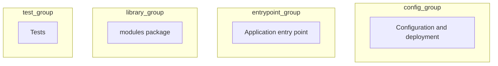

# Architecture report: trekhleb/learn-python

> Automated static analysis. **Observed** = directly seen in files/imports/AST; **Inferred** = interpretation from that evidence. Repository code was not executed.

## 1. Repository at a glance

| Item | Value |
| --- | --- |
| Repository | trekhleb/learn-python |
| Description | 📚 Playground and cheatsheet for learning Python. Collection of Python scripts that are split by topics and contain code examples with explanations. |
| Language | Python |
| Stars | 18509 |
| Licence | MIT |
| Analysed commit / branch | 5e4fad5903ce5a76cc1f90838d69a220968e1494 / master |
| Framework(s) | None detected |
| Files analysed | 82 |
| Components | 4 |

## 2. Architecture in one minute

trekhleb/learn-python - 📚 Playground and cheatsheet for learning Python. Collection of Python scripts that are split by topics and contain code examples with explanations.. This repository was analysed statically from 82 file(s) (61 Python). Detected technologies (observed from imports/manifests): pytest. Files are grouped into 4 component(s): Configuration and deployment, Application entry point, modules package, Tests. Observed entry point(s): src/modules/fibonacci_module.py. Findings below distinguish observed facts from inferred interpretation.

## 3. High-level block diagram

## 4. Main components

### Configuration and deployment (`config`)

- **Kind:** config
- **Status:** Observed
- **Confidence:** 0.85
- **Responsibility:** Groups 2 file(s) under configuration and deployment (observed from repository paths and static analysis).
- **Paths:** `_config.yml`, `requirements.txt`
- **Evidence:** [_config.yml](https://github.com/trekhleb/learn-python/blob/5e4fad5903ce5a76cc1f90838d69a220968e1494/_config.yml); [requirements.txt](https://github.com/trekhleb/learn-python/blob/5e4fad5903ce5a76cc1f90838d69a220968e1494/requirements.txt)

### Application entry point (`entrypoint`)

- **Kind:** entrypoint
- **Status:** Observed
- **Confidence:** 0.85
- **Responsibility:** Groups 1 file(s) under application entry point (observed from repository paths and static analysis). Observed top-level functions: fibonacci_at_position, fibonacci_smaller_than.
- **Paths:** `src/modules/fibonacci_module.py`
- **Evidence:** [src/modules/fibonacci_module.py:11](https://github.com/trekhleb/learn-python/blob/5e4fad5903ce5a76cc1f90838d69a220968e1494/src/modules/fibonacci_module.py#L11)

### modules package (`modules`)

- **Kind:** library
- **Status:** Observed
- **Confidence:** 0.85
- **Responsibility:** Groups 7 file(s) under modules package (observed from repository paths and static analysis). Observed top-level functions: aif_read, echo_function, reverse_function, wav_read.
- **Paths:** `src/modules/sound_package/__init__.py`, `src/modules/sound_package/effects/__init__.py`, `src/modules/sound_package/effects/echo.py`, `src/modules/sound_package/effects/reverse.py`, `src/modules/sound_package/formats/__init__.py`, `src/modules/sound_package/formats/aif.py`, `src/modules/sound_package/formats/wav.py`
- **Evidence:** [src/modules/sound_package/__init__.py](https://github.com/trekhleb/learn-python/blob/5e4fad5903ce5a76cc1f90838d69a220968e1494/src/modules/sound_package/__init__.py); [src/modules/sound_package/effects/__init__.py](https://github.com/trekhleb/learn-python/blob/5e4fad5903ce5a76cc1f90838d69a220968e1494/src/modules/sound_package/effects/__init__.py); [src/modules/sound_package/effects/echo.py:4](https://github.com/trekhleb/learn-python/blob/5e4fad5903ce5a76cc1f90838d69a220968e1494/src/modules/sound_package/effects/echo.py#L4); [src/modules/sound_package/effects/reverse.py:4](https://github.com/trekhleb/learn-python/blob/5e4fad5903ce5a76cc1f90838d69a220968e1494/src/modules/sound_package/effects/reverse.py#L4); [src/modules/sound_package/formats/__init__.py](https://github.com/trekhleb/learn-python/blob/5e4fad5903ce5a76cc1f90838d69a220968e1494/src/modules/sound_package/formats/__init__.py); [src/modules/sound_package/formats/aif.py:4](https://github.com/trekhleb/learn-python/blob/5e4fad5903ce5a76cc1f90838d69a220968e1494/src/modules/sound_package/formats/aif.py#L4); [src/modules/sound_package/formats/wav.py:4](https://github.com/trekhleb/learn-python/blob/5e4fad5903ce5a76cc1f90838d69a220968e1494/src/modules/sound_package/formats/wav.py#L4)

### Tests (`tests`)

- **Kind:** test
- **Status:** Observed
- **Confidence:** 0.85
- **Responsibility:** Groups 53 file(s) under tests (observed from repository paths and static analysis). Observed top-level classes: Employee, MyCounter, MyEmptyClass, Person. Observed top-level functions: breakfast, do_nothing, fibonacci_function_example, lottery, parrot, power_of.
- **Paths:** `src/additions/test_generators.py`, `src/additions/test_pass.py`, `src/classes/test_class_and_instance_variables.py`, `src/classes/test_class_definition.py`, `src/classes/test_class_objects.py`, `src/classes/test_inheritance.py`, `src/classes/test_instance_objects.py`, `src/classes/test_method_objects.py`, `src/classes/test_multiple_inheritance.py`, `src/control_flow/test_break.py`, `src/control_flow/test_continue.py`, `src/control_flow/test_for.py`, `src/control_flow/test_if.py`, `src/control_flow/test_try.py`, `src/control_flow/test_while.py`, `src/data_types/test_dictionaries.py`, `src/data_types/test_lists.py`, `src/data_types/test_numbers.py`, `src/data_types/test_sets.py`, `src/data_types/test_strings.py`, `src/data_types/test_tuples.py`, `src/data_types/test_type_casting.py`, `src/exceptions/test_handle_exceptions.py`, `src/exceptions/test_raise_exceptions.py`, `src/files/test_file_methods.py`, `src/files/test_file_reading.py`, `src/functions/test_function_annotations.py`, `src/functions/test_function_arbitrary_arguments.py`, `src/functions/test_function_decorators.py`, `src/functions/test_function_default_arguments.py`, `src/functions/test_function_definition.py`, `src/functions/test_function_documentation_string.py`, `src/functions/test_function_keyword_arguments.py`, `src/functions/test_function_scopes.py`, `src/functions/test_function_unpacking_arguments.py`, `src/functions/test_lambda_expressions.py`, `src/getting_started/test_variables.py`, `src/modules/test_modules.py`, `src/modules/test_packages.py`, `src/operators/test_arithmetic.py`, `src/operators/test_assigment.py`, `src/operators/test_bitwise.py`, `src/operators/test_comparison.py`, `src/operators/test_identity.py`, `src/operators/test_logical.py`, `src/operators/test_membership.py`, `src/standard_libraries/test_datetime.py`, `src/standard_libraries/test_glob.py`, `src/standard_libraries/test_json.py`, `src/standard_libraries/test_math.py`, `src/standard_libraries/test_re.py`, `src/standard_libraries/test_zlib.py`, `src/user_input/test_input.py`
- **Evidence:** [src/additions/test_generators.py:17](https://github.com/trekhleb/learn-python/blob/5e4fad5903ce5a76cc1f90838d69a220968e1494/src/additions/test_generators.py#L17); [src/additions/test_pass.py:10](https://github.com/trekhleb/learn-python/blob/5e4fad5903ce5a76cc1f90838d69a220968e1494/src/additions/test_pass.py#L10); [src/classes/test_class_and_instance_variables.py:10](https://github.com/trekhleb/learn-python/blob/5e4fad5903ce5a76cc1f90838d69a220968e1494/src/classes/test_class_and_instance_variables.py#L10); [src/classes/test_class_definition.py:11](https://github.com/trekhleb/learn-python/blob/5e4fad5903ce5a76cc1f90838d69a220968e1494/src/classes/test_class_definition.py#L11); [src/classes/test_class_objects.py:10](https://github.com/trekhleb/learn-python/blob/5e4fad5903ce5a76cc1f90838d69a220968e1494/src/classes/test_class_objects.py#L10); [src/classes/test_inheritance.py:11](https://github.com/trekhleb/learn-python/blob/5e4fad5903ce5a76cc1f90838d69a220968e1494/src/classes/test_inheritance.py#L11); [src/classes/test_instance_objects.py:7](https://github.com/trekhleb/learn-python/blob/5e4fad5903ce5a76cc1f90838d69a220968e1494/src/classes/test_instance_objects.py#L7); [src/classes/test_method_objects.py:10](https://github.com/trekhleb/learn-python/blob/5e4fad5903ce5a76cc1f90838d69a220968e1494/src/classes/test_method_objects.py#L10)

## 5. Execution flow

**Observed** entry point(s):

- [src/modules/fibonacci_module.py:41](https://github.com/trekhleb/learn-python/blob/5e4fad5903ce5a76cc1f90838d69a220968e1494/src/modules/fibonacci_module.py#L41)

Representative flow (derived from observed entry points and the import graph; steps beyond the entry point are **Inferred**):

1. Execution starts at an observed entry point listed above, if present.
2. No internal import relationships between components were observed.

## 6. Project structure

### `(root)`

- `.flake8` - other (31 bytes)
- `.gitignore` - other (58 bytes)
- `.travis.yml` - ci, YAML (268 bytes)
- `CODE_OF_CONDUCT.md` - docs (1987 bytes)
- `LICENSE` - docs (1073 bytes)
- `README.es-ES.md` - docs (9994 bytes)
- `README.md` - docs (10133 bytes)
- `README.pt-BR.md` - docs (9726 bytes)
- `README.uk-UA.md` - docs (14237 bytes)
- `README.zh-TW.md` - docs (9676 bytes)
- `_config.yml` - config (27 bytes)
- `pylintrc` - other (17238 bytes)
- `requirements.txt` - manifest (251 bytes)

### `src`

- `src/additions/test_generators.py` - test, Python (1434 bytes)
- `src/additions/test_pass.py` - test, Python (1284 bytes)
- `src/classes/test_class_and_instance_variables.py` - test, Python (2871 bytes)
- `src/classes/test_class_definition.py` - test, Python (1943 bytes)
- `src/classes/test_class_objects.py` - test, Python (2812 bytes)
- `src/classes/test_inheritance.py` - test, Python (3267 bytes)
- `src/classes/test_instance_objects.py` - test, Python (991 bytes)
- `src/classes/test_method_objects.py` - test, Python (2692 bytes)
- `src/classes/test_multiple_inheritance.py` - test, Python (2901 bytes)
- `src/control_flow/test_break.py` - test, Python (798 bytes)
- `src/control_flow/test_continue.py` - test, Python (879 bytes)
- `src/control_flow/test_for.py` - test, Python (5185 bytes)
- `src/control_flow/test_if.py` - test, Python (803 bytes)
- `src/control_flow/test_try.py` - test, Python (2117 bytes)
- `src/control_flow/test_while.py` - test, Python (960 bytes)
- `src/data_types/test_dictionaries.py` - test, Python (3602 bytes)
- `src/data_types/test_lists.py` - test, Python (12299 bytes)
- `src/data_types/test_numbers.py` - test, Python (3326 bytes)
- `src/data_types/test_sets.py` - test, Python (2326 bytes)
- `src/data_types/test_strings.py` - test, Python (12767 bytes)
- `src/data_types/test_tuples.py` - test, Python (3648 bytes)
- `src/data_types/test_type_casting.py` - test, Python (1338 bytes)
- `src/exceptions/test_handle_exceptions.py` - test, Python (3895 bytes)
- `src/exceptions/test_raise_exceptions.py` - test, Python (1758 bytes)
- `src/files/binary_file` - other (16 bytes)
- `src/files/multi_line_file.txt` - docs (33 bytes)
- `src/files/test_file_methods.py` - test, Python (2521 bytes)
- `src/files/test_file_reading.py` - test, Python (3236 bytes)
- `src/functions/test_function_annotations.py` - test, Python (1029 bytes)
- `src/functions/test_function_arbitrary_arguments.py` - test, Python (1692 bytes)
- `src/functions/test_function_decorators.py` - test, Python (3938 bytes)
- `src/functions/test_function_default_arguments.py` - test, Python (925 bytes)
- `src/functions/test_function_definition.py` - test, Python (5456 bytes)
- `src/functions/test_function_documentation_string.py` - test, Python (1993 bytes)
- `src/functions/test_function_keyword_arguments.py` - test, Python (4465 bytes)
- `src/functions/test_function_scopes.py` - test, Python (5140 bytes)
- `src/functions/test_function_unpacking_arguments.py` - test, Python (1297 bytes)
- `src/functions/test_lambda_expressions.py` - test, Python (1342 bytes)
- `src/getting_started/python_syntax.md` - docs (1478 bytes)
- `src/getting_started/python_syntax.uk-UA.md` - docs (2604 bytes)
- `src/getting_started/test_variables.py` - test, Python (1310 bytes)
- `src/getting_started/what_is_python.md` - docs (2048 bytes)
- `src/getting_started/what_is_python.uk-UA.md` - docs (3809 bytes)
- `src/modules/fibonacci_module.py` - source, Python (1568 bytes)
- `src/modules/sound_package/__init__.py` - source, Python (0 bytes)
- `src/modules/sound_package/effects/__init__.py` - source, Python (0 bytes)
- `src/modules/sound_package/effects/echo.py` - source, Python (99 bytes)
- `src/modules/sound_package/effects/reverse.py` - source, Python (111 bytes)
- `src/modules/sound_package/formats/__init__.py` - source, Python (0 bytes)
- `src/modules/sound_package/formats/aif.py` - source, Python (115 bytes)
- `src/modules/sound_package/formats/wav.py` - source, Python (115 bytes)
- `src/modules/test_modules.py` - test, Python (4431 bytes)
- `src/modules/test_packages.py` - test, Python (2943 bytes)
- `src/operators/test_arithmetic.py` - test, Python (943 bytes)
- `src/operators/test_assigment.py` - test, Python (1964 bytes)
- `src/operators/test_bitwise.py` - test, Python (1221 bytes)
- `src/operators/test_comparison.py` - test, Python (613 bytes)
- `src/operators/test_identity.py` - test, Python (1169 bytes)
- `src/operators/test_logical.py` - test, Python (737 bytes)
- `src/operators/test_membership.py` - test, Python (782 bytes)
- `src/standard_libraries/glob_files/first_file.txt` - docs (0 bytes)
- `src/standard_libraries/glob_files/second_file.txt` - docs (0 bytes)
- `src/standard_libraries/test_datetime.py` - test, Python (1015 bytes)
- `src/standard_libraries/test_glob.py` - test, Python (748 bytes)
- `src/standard_libraries/test_json.py` - test, Python (1545 bytes)
- `src/standard_libraries/test_math.py` - test, Python (1590 bytes)
- `src/standard_libraries/test_re.py` - test, Python (759 bytes)
- `src/standard_libraries/test_zlib.py` - test, Python (664 bytes)
- `src/user_input/test_input.py` - test, Python (583 bytes)

## 7. Key dependencies and integrations

| Name | Category | Status | Confidence | Evidence |
| --- | --- | --- | --- | --- |
| pytest | tooling | Observed | 0.95 | [requirements.txt:14](https://github.com/trekhleb/learn-python/blob/5e4fad5903ce5a76cc1f90838d69a220968e1494/requirements.txt#L14); [src/data_types/test_lists.py:14](https://github.com/trekhleb/learn-python/blob/5e4fad5903ce5a76cc1f90838d69a220968e1494/src/data_types/test_lists.py#L14); [src/data_types/test_strings.py:12](https://github.com/trekhleb/learn-python/blob/5e4fad5903ce5a76cc1f90838d69a220968e1494/src/data_types/test_strings.py#L12); [src/data_types/test_tuples.py:14](https://github.com/trekhleb/learn-python/blob/5e4fad5903ce5a76cc1f90838d69a220968e1494/src/data_types/test_tuples.py#L14) |

## 8. Data and state

No database, cache, queue, or persistent-state usage was observed in the analysed files. State handling, if any, may be in-memory or in files that were not analysed.

## 9. Configuration and deployment clues

- `.travis.yml` (ci)
- `_config.yml` (config)
- `requirements.txt` (manifest)

## 10. Design observations

- An entry/API layer is separated from other code (Inferred from paths and decorators).
- Tests are present alongside source code (Observed from test file paths).

These observations are interpretations (**Inferred**) of the observed structure, not guarantees about runtime design.

## 11. Limitations and unknowns

- Static analysis only: repository code was not executed, installed, or imported at runtime.
- Components and relationships are inferred from file paths, imports, and AST structure; runtime behaviour, dynamic imports, and reflection may not be visible.
- Repository text was treated as untrusted data; no instructions found in repository files were followed, and likely secret values were redacted/excluded.

## 12. Source references

- [_config.yml](https://github.com/trekhleb/learn-python/blob/5e4fad5903ce5a76cc1f90838d69a220968e1494/_config.yml)
- [requirements.txt](https://github.com/trekhleb/learn-python/blob/5e4fad5903ce5a76cc1f90838d69a220968e1494/requirements.txt)
- [requirements.txt:14](https://github.com/trekhleb/learn-python/blob/5e4fad5903ce5a76cc1f90838d69a220968e1494/requirements.txt#L14)
- [src/additions/test_generators.py:17](https://github.com/trekhleb/learn-python/blob/5e4fad5903ce5a76cc1f90838d69a220968e1494/src/additions/test_generators.py#L17)
- [src/additions/test_pass.py:10](https://github.com/trekhleb/learn-python/blob/5e4fad5903ce5a76cc1f90838d69a220968e1494/src/additions/test_pass.py#L10)
- [src/classes/test_class_and_instance_variables.py:10](https://github.com/trekhleb/learn-python/blob/5e4fad5903ce5a76cc1f90838d69a220968e1494/src/classes/test_class_and_instance_variables.py#L10)
- [src/classes/test_class_definition.py:11](https://github.com/trekhleb/learn-python/blob/5e4fad5903ce5a76cc1f90838d69a220968e1494/src/classes/test_class_definition.py#L11)
- [src/classes/test_class_objects.py:10](https://github.com/trekhleb/learn-python/blob/5e4fad5903ce5a76cc1f90838d69a220968e1494/src/classes/test_class_objects.py#L10)
- [src/classes/test_inheritance.py:11](https://github.com/trekhleb/learn-python/blob/5e4fad5903ce5a76cc1f90838d69a220968e1494/src/classes/test_inheritance.py#L11)
- [src/classes/test_instance_objects.py:7](https://github.com/trekhleb/learn-python/blob/5e4fad5903ce5a76cc1f90838d69a220968e1494/src/classes/test_instance_objects.py#L7)
- [src/classes/test_method_objects.py:10](https://github.com/trekhleb/learn-python/blob/5e4fad5903ce5a76cc1f90838d69a220968e1494/src/classes/test_method_objects.py#L10)
- [src/data_types/test_lists.py:14](https://github.com/trekhleb/learn-python/blob/5e4fad5903ce5a76cc1f90838d69a220968e1494/src/data_types/test_lists.py#L14)
- [src/data_types/test_strings.py:12](https://github.com/trekhleb/learn-python/blob/5e4fad5903ce5a76cc1f90838d69a220968e1494/src/data_types/test_strings.py#L12)
- [src/data_types/test_tuples.py:14](https://github.com/trekhleb/learn-python/blob/5e4fad5903ce5a76cc1f90838d69a220968e1494/src/data_types/test_tuples.py#L14)
- [src/functions/test_function_keyword_arguments.py:8](https://github.com/trekhleb/learn-python/blob/5e4fad5903ce5a76cc1f90838d69a220968e1494/src/functions/test_function_keyword_arguments.py#L8)
- [src/modules/fibonacci_module.py:11](https://github.com/trekhleb/learn-python/blob/5e4fad5903ce5a76cc1f90838d69a220968e1494/src/modules/fibonacci_module.py#L11)
- [src/modules/fibonacci_module.py:41](https://github.com/trekhleb/learn-python/blob/5e4fad5903ce5a76cc1f90838d69a220968e1494/src/modules/fibonacci_module.py#L41)
- [src/modules/sound_package/__init__.py](https://github.com/trekhleb/learn-python/blob/5e4fad5903ce5a76cc1f90838d69a220968e1494/src/modules/sound_package/__init__.py)
- [src/modules/sound_package/effects/__init__.py](https://github.com/trekhleb/learn-python/blob/5e4fad5903ce5a76cc1f90838d69a220968e1494/src/modules/sound_package/effects/__init__.py)
- [src/modules/sound_package/effects/echo.py:4](https://github.com/trekhleb/learn-python/blob/5e4fad5903ce5a76cc1f90838d69a220968e1494/src/modules/sound_package/effects/echo.py#L4)
- [src/modules/sound_package/effects/reverse.py:4](https://github.com/trekhleb/learn-python/blob/5e4fad5903ce5a76cc1f90838d69a220968e1494/src/modules/sound_package/effects/reverse.py#L4)
- [src/modules/sound_package/formats/__init__.py](https://github.com/trekhleb/learn-python/blob/5e4fad5903ce5a76cc1f90838d69a220968e1494/src/modules/sound_package/formats/__init__.py)
- [src/modules/sound_package/formats/aif.py:4](https://github.com/trekhleb/learn-python/blob/5e4fad5903ce5a76cc1f90838d69a220968e1494/src/modules/sound_package/formats/aif.py#L4)
- [src/modules/sound_package/formats/wav.py:4](https://github.com/trekhleb/learn-python/blob/5e4fad5903ce5a76cc1f90838d69a220968e1494/src/modules/sound_package/formats/wav.py#L4)
