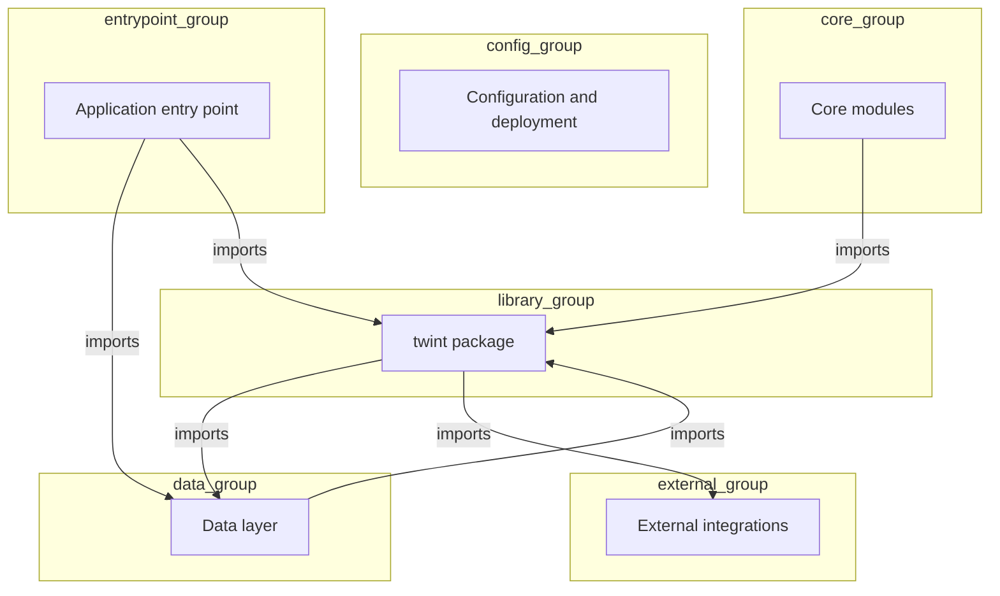

# Architecture report: twintproject/twint

> Automated static analysis. **Observed** = directly seen in files/imports/AST; **Inferred** = interpretation from that evidence. Repository code was not executed.

## 1. Repository at a glance

| Item | Value |
| --- | --- |
| Repository | twintproject/twint |
| Description | An advanced Twitter scraping & OSINT tool written in Python that doesn't use Twitter's API, allowing you to scrape a user's followers, following, Tweets and more while evading most API limitations. |
| Language | Python |
| Stars | 16410 |
| Licence | MIT |
| Analysed commit / branch | e7c8a0c764f6879188e5c21e25fb6f1f856a7221 / master |
| Framework(s) | None detected |
| Files analysed | 40 |
| Components | 6 |

## 2. Architecture in one minute

twintproject/twint - An advanced Twitter scraping & OSINT tool written in Python that doesn't use Twitter's API, allowing you to scrape a user's followers, following, Tweets and more while evading most API limitations.. This repository was analysed statically from 40 file(s) (24 Python). Detected technologies (observed from imports/manifests): SQLite, aiohttp, pandas, requests, setuptools, Docker. Files are grouped into 6 component(s): Configuration and deployment, Core modules, Data layer, Application entry point, External integrations, twint package. Observed entry point(s): test.py, twint/cli.py. Findings below distinguish observed facts from inferred interpretation.

## 3. High-level block diagram

## 4. Main components

### Configuration and deployment (`config`)

- **Kind:** config
- **Status:** Observed
- **Confidence:** 0.85
- **Responsibility:** Groups 10 file(s) under configuration and deployment (observed from repository paths and static analysis). Observed top-level classes: Config.
- **Paths:** `Dockerfile`, `MANIFEST.in`, `elasticsearch/dashboard.json`, `elasticsearch/index-follow.json`, `elasticsearch/index-tweets.json`, `elasticsearch/index-user.json`, `elasticsearch/visualizations.json`, `requirements.txt`, `setup.py`, `twint/config.py`
- **Evidence:** [Dockerfile](https://github.com/twintproject/twint/blob/e7c8a0c764f6879188e5c21e25fb6f1f856a7221/Dockerfile); [MANIFEST.in](https://github.com/twintproject/twint/blob/e7c8a0c764f6879188e5c21e25fb6f1f856a7221/MANIFEST.in); [elasticsearch/dashboard.json](https://github.com/twintproject/twint/blob/e7c8a0c764f6879188e5c21e25fb6f1f856a7221/elasticsearch/dashboard.json); [elasticsearch/index-follow.json](https://github.com/twintproject/twint/blob/e7c8a0c764f6879188e5c21e25fb6f1f856a7221/elasticsearch/index-follow.json); [elasticsearch/index-tweets.json](https://github.com/twintproject/twint/blob/e7c8a0c764f6879188e5c21e25fb6f1f856a7221/elasticsearch/index-tweets.json); [elasticsearch/index-user.json](https://github.com/twintproject/twint/blob/e7c8a0c764f6879188e5c21e25fb6f1f856a7221/elasticsearch/index-user.json); [elasticsearch/visualizations.json](https://github.com/twintproject/twint/blob/e7c8a0c764f6879188e5c21e25fb6f1f856a7221/elasticsearch/visualizations.json); [requirements.txt](https://github.com/twintproject/twint/blob/e7c8a0c764f6879188e5c21e25fb6f1f856a7221/requirements.txt)

### Core modules (`core`)

- **Kind:** core
- **Status:** Observed
- **Confidence:** 0.85
- **Responsibility:** Groups 1 file(s) under core modules (observed from repository paths and static analysis). Observed top-level functions: jobone, jobtwo.
- **Paths:** `automate.py`
- **Evidence:** [automate.py:6](https://github.com/twintproject/twint/blob/e7c8a0c764f6879188e5c21e25fb6f1f856a7221/automate.py#L6)

### Data layer (`data_layer`)

- **Kind:** data
- **Status:** Observed
- **Confidence:** 0.85
- **Responsibility:** Groups 6 file(s) under data layer (observed from repository paths and static analysis). Observed top-level classes: RecycleObject. Observed top-level functions: Conn, Csv, Data, Fieldnames, Follow, Json.
- **Paths:** `twint/storage/__init__.py`, `twint/storage/db.py`, `twint/storage/elasticsearch.py`, `twint/storage/panda.py`, `twint/storage/write.py`, `twint/storage/write_meta.py`
- **Evidence:** [twint/storage/__init__.py](https://github.com/twintproject/twint/blob/e7c8a0c764f6879188e5c21e25fb6f1f856a7221/twint/storage/__init__.py); [twint/storage/db.py:8](https://github.com/twintproject/twint/blob/e7c8a0c764f6879188e5c21e25fb6f1f856a7221/twint/storage/db.py#L8); [twint/storage/elasticsearch.py:18](https://github.com/twintproject/twint/blob/e7c8a0c764f6879188e5c21e25fb6f1f856a7221/twint/storage/elasticsearch.py#L18); [twint/storage/panda.py:28](https://github.com/twintproject/twint/blob/e7c8a0c764f6879188e5c21e25fb6f1f856a7221/twint/storage/panda.py#L28); [twint/storage/write.py:6](https://github.com/twintproject/twint/blob/e7c8a0c764f6879188e5c21e25fb6f1f856a7221/twint/storage/write.py#L6); [twint/storage/write_meta.py:1](https://github.com/twintproject/twint/blob/e7c8a0c764f6879188e5c21e25fb6f1f856a7221/twint/storage/write_meta.py#L1)

### Application entry point (`entrypoint`)

- **Kind:** entrypoint
- **Status:** Observed
- **Confidence:** 0.85
- **Responsibility:** Groups 3 file(s) under application entry point (observed from repository paths and static analysis). Observed top-level classes: Twint. Observed top-level functions: Favorites, Followers, Following, Lookup, Profile, Search.
- **Paths:** `test.py`, `twint/cli.py`, `twint/run.py`
- **Evidence:** [test.py:9](https://github.com/twintproject/twint/blob/e7c8a0c764f6879188e5c21e25fb6f1f856a7221/test.py#L9); [twint/cli.py:20](https://github.com/twintproject/twint/blob/e7c8a0c764f6879188e5c21e25fb6f1f856a7221/twint/cli.py#L20); [twint/run.py:18](https://github.com/twintproject/twint/blob/e7c8a0c764f6879188e5c21e25fb6f1f856a7221/twint/run.py#L18)

### External integrations (`external_integrations`)

- **Kind:** external
- **Status:** Inferred
- **Confidence:** 0.70
- **Responsibility:** Groups 0 file(s) under external integrations (observed from repository paths and static analysis).
- **Evidence:** [twint/get.py:5](https://github.com/twintproject/twint/blob/e7c8a0c764f6879188e5c21e25fb6f1f856a7221/twint/get.py#L5); [twint/get.py:6](https://github.com/twintproject/twint/blob/e7c8a0c764f6879188e5c21e25fb6f1f856a7221/twint/get.py#L6); [twint/storage/db.py:1](https://github.com/twintproject/twint/blob/e7c8a0c764f6879188e5c21e25fb6f1f856a7221/twint/storage/db.py#L1); [twint/token.py:4](https://github.com/twintproject/twint/blob/e7c8a0c764f6879188e5c21e25fb6f1f856a7221/twint/token.py#L4)

### twint package (`twint`)

- **Kind:** library
- **Status:** Observed
- **Confidence:** 0.85
- **Responsibility:** Groups 12 file(s) under twint package (observed from repository paths and static analysis). Observed top-level classes: Datelock, NoMoreTweetsException, RefreshTokenException, Token, TokenExpiryException, tweet. Observed top-level functions: Count, Elastic, Favorites, Follow, Followers, Following.
- **Paths:** `twint/__init__.py`, `twint/__version__.py`, `twint/datelock.py`, `twint/feed.py`, `twint/format.py`, `twint/get.py`, `twint/output.py`, `twint/token.py`, `twint/tweet.py`, `twint/url.py`, `twint/user.py`, `twint/verbose.py`
- **Evidence:** [twint/__init__.py](https://github.com/twintproject/twint/blob/e7c8a0c764f6879188e5c21e25fb6f1f856a7221/twint/__init__.py); [twint/__version__.py](https://github.com/twintproject/twint/blob/e7c8a0c764f6879188e5c21e25fb6f1f856a7221/twint/__version__.py); [twint/datelock.py:8](https://github.com/twintproject/twint/blob/e7c8a0c764f6879188e5c21e25fb6f1f856a7221/twint/datelock.py#L8); [twint/feed.py:13](https://github.com/twintproject/twint/blob/e7c8a0c764f6879188e5c21e25fb6f1f856a7221/twint/feed.py#L13); [twint/format.py:3](https://github.com/twintproject/twint/blob/e7c8a0c764f6879188e5c21e25fb6f1f856a7221/twint/format.py#L3); [twint/get.py:64](https://github.com/twintproject/twint/blob/e7c8a0c764f6879188e5c21e25fb6f1f856a7221/twint/get.py#L64); [twint/output.py:21](https://github.com/twintproject/twint/blob/e7c8a0c764f6879188e5c21e25fb6f1f856a7221/twint/output.py#L21); [twint/token.py:8](https://github.com/twintproject/twint/blob/e7c8a0c764f6879188e5c21e25fb6f1f856a7221/twint/token.py#L8)

## 5. Execution flow

**Observed** entry point(s):

- [test.py:91](https://github.com/twintproject/twint/blob/e7c8a0c764f6879188e5c21e25fb6f1f856a7221/test.py#L91)
- [twint/cli.py](https://github.com/twintproject/twint/blob/e7c8a0c764f6879188e5c21e25fb6f1f856a7221/twint/cli.py)

Representative flow (derived from observed entry points and the import graph; steps beyond the entry point are **Inferred**):

1. Execution starts at an observed entry point listed above, if present.
2. `core` imports `twint` (Core modules -> twint package).
3. `data_layer` imports `twint` (Data layer -> twint package).
4. `entrypoint` imports `data_layer` (Application entry point -> Data layer).
5. `entrypoint` imports `twint` (Application entry point -> twint package).
6. `twint` imports `data_layer` (twint package -> Data layer).
7. `twint` imports `external_integrations` (twint package -> External integrations).

## 6. Project structure

### `(root)`

- `.gitignore` - other (1311 bytes)
- `.travis.yml` - ci, YAML (1017 bytes)
- `Dockerfile` - container (221 bytes)
- `LICENSE` - docs (1071 bytes)
- `MANIFEST.in` - manifest (26 bytes)
- `README.md` - docs (8432 bytes)
- `automate.py` - source, Python (2066 bytes)
- `requirements.txt` - manifest (152 bytes)
- `setup.py` - manifest, Python (1851 bytes)
- `test.py` - source, Python (1947 bytes)

### `.github`

- `.github/FUNDING.yml` - config (98 bytes)
- `.github/ISSUE_TEMPLATE.md` - docs (960 bytes)
- `.github/ISSUE_TEMPLATE/ISSUE_TEMPLATE.md` - docs (857 bytes)

### `elasticsearch`

- `elasticsearch/README.md` - docs (157 bytes)
- `elasticsearch/dashboard.json` - config (2057 bytes)
- `elasticsearch/index-follow.json` - config (250 bytes)
- `elasticsearch/index-tweets.json` - config (1622 bytes)
- `elasticsearch/index-user.json` - config (1003 bytes)
- `elasticsearch/visualizations.json` - config (11979 bytes)

### `twint`

- `twint/__init__.py` - source, Python (818 bytes)
- `twint/__version__.py` - source, Python (64 bytes)
- `twint/cli.py` - source, Python (14868 bytes)
- `twint/config.py` - source, Python (2512 bytes)
- `twint/datelock.py` - source, Python (1034 bytes)
- `twint/feed.py` - source, Python (4780 bytes)
- `twint/format.py` - source, Python (4454 bytes)
- `twint/get.py` - source, Python (11684 bytes)
- `twint/output.py` - source, Python (8168 bytes)
- `twint/run.py` - source, Python (17626 bytes)
- `twint/storage/__init__.py` - source, Python (0 bytes)
- `twint/storage/db.py` - source, Python (10553 bytes)
- `twint/storage/elasticsearch.py` - source, Python (14035 bytes)
- `twint/storage/panda.py` - source, Python (6258 bytes)
- `twint/storage/write.py` - source, Python (2161 bytes)
- `twint/storage/write_meta.py` - source, Python (3939 bytes)
- `twint/token.py` - source, Python (2539 bytes)
- `twint/tweet.py` - source, Python (5217 bytes)
- `twint/url.py` - source, Python (6346 bytes)
- `twint/user.py` - source, Python (1974 bytes)
- `twint/verbose.py` - source, Python (621 bytes)

## 7. Key dependencies and integrations

| Name | Category | Status | Confidence | Evidence |
| --- | --- | --- | --- | --- |
| SQLite | database | Observed | 0.90 | [twint/storage/db.py:1](https://github.com/twintproject/twint/blob/e7c8a0c764f6879188e5c21e25fb6f1f856a7221/twint/storage/db.py#L1) |
| aiohttp | library | Observed | 0.90 | [requirements.txt:1](https://github.com/twintproject/twint/blob/e7c8a0c764f6879188e5c21e25fb6f1f856a7221/requirements.txt#L1); [setup.py:17](https://github.com/twintproject/twint/blob/e7c8a0c764f6879188e5c21e25fb6f1f856a7221/setup.py#L17); [twint/get.py:6](https://github.com/twintproject/twint/blob/e7c8a0c764f6879188e5c21e25fb6f1f856a7221/twint/get.py#L6) |
| pandas | library | Observed | 0.90 | [requirements.txt:8](https://github.com/twintproject/twint/blob/e7c8a0c764f6879188e5c21e25fb6f1f856a7221/requirements.txt#L8); [setup.py:18](https://github.com/twintproject/twint/blob/e7c8a0c764f6879188e5c21e25fb6f1f856a7221/setup.py#L18); [twint/storage/panda.py:1](https://github.com/twintproject/twint/blob/e7c8a0c764f6879188e5c21e25fb6f1f856a7221/twint/storage/panda.py#L1) |
| requests | library | Observed | 0.90 | [twint/token.py:4](https://github.com/twintproject/twint/blob/e7c8a0c764f6879188e5c21e25fb6f1f856a7221/twint/token.py#L4) |
| setuptools | packaging | Observed | 0.90 | [setup.py:2](https://github.com/twintproject/twint/blob/e7c8a0c764f6879188e5c21e25fb6f1f856a7221/setup.py#L2) |
| Docker | tooling | Observed | 0.85 | [Dockerfile](https://github.com/twintproject/twint/blob/e7c8a0c764f6879188e5c21e25fb6f1f856a7221/Dockerfile) |

## 8. Data and state

- **SQLite** (Observed, confidence 0.90) - evidence: [twint/storage/db.py:1](https://github.com/twintproject/twint/blob/e7c8a0c764f6879188e5c21e25fb6f1f856a7221/twint/storage/db.py#L1)
- Data component `data_layer` (Observed): Groups 6 file(s) under data layer (observed from repository paths and static analysis). Observed top-level classes: RecycleObject. Observed top-level functions: Conn, Csv, Data, Fieldnames, Follow, Json.

## 9. Configuration and deployment clues

- `.github/FUNDING.yml` (config)
- `.travis.yml` (ci)
- `Dockerfile` (container)
- `MANIFEST.in` (manifest)
- `elasticsearch/dashboard.json` (config)
- `elasticsearch/index-follow.json` (config)
- `elasticsearch/index-tweets.json` (config)
- `elasticsearch/index-user.json` (config)
- `elasticsearch/visualizations.json` (config)
- `requirements.txt` (manifest)
- `setup.py` (manifest)

Console scripts declared in packaging metadata (**Observed**):

- `twint` -> `twint.cli:run_as_command`

## 10. Design observations

- An entry/API layer is separated from other code (Inferred from paths and decorators).
- Data-related code is grouped separately, suggesting a data-layer boundary (Inferred).
- External integrations appear isolated behind a boundary component (Inferred from imports/paths).

These observations are interpretations (**Inferred**) of the observed structure, not guarantees about runtime design.

## 11. Limitations and unknowns

- Static analysis only: repository code was not executed, installed, or imported at runtime.
- Components and relationships are inferred from file paths, imports, and AST structure; runtime behaviour, dynamic imports, and reflection may not be visible.
- Repository text was treated as untrusted data; no instructions found in repository files were followed, and likely secret values were redacted/excluded.
- The GitHub repository was marked archived at selection time.

## 12. Source references

- [Dockerfile](https://github.com/twintproject/twint/blob/e7c8a0c764f6879188e5c21e25fb6f1f856a7221/Dockerfile)
- [MANIFEST.in](https://github.com/twintproject/twint/blob/e7c8a0c764f6879188e5c21e25fb6f1f856a7221/MANIFEST.in)
- [automate.py:6](https://github.com/twintproject/twint/blob/e7c8a0c764f6879188e5c21e25fb6f1f856a7221/automate.py#L6)
- [elasticsearch/dashboard.json](https://github.com/twintproject/twint/blob/e7c8a0c764f6879188e5c21e25fb6f1f856a7221/elasticsearch/dashboard.json)
- [elasticsearch/index-follow.json](https://github.com/twintproject/twint/blob/e7c8a0c764f6879188e5c21e25fb6f1f856a7221/elasticsearch/index-follow.json)
- [elasticsearch/index-tweets.json](https://github.com/twintproject/twint/blob/e7c8a0c764f6879188e5c21e25fb6f1f856a7221/elasticsearch/index-tweets.json)
- [elasticsearch/index-user.json](https://github.com/twintproject/twint/blob/e7c8a0c764f6879188e5c21e25fb6f1f856a7221/elasticsearch/index-user.json)
- [elasticsearch/visualizations.json](https://github.com/twintproject/twint/blob/e7c8a0c764f6879188e5c21e25fb6f1f856a7221/elasticsearch/visualizations.json)
- [requirements.txt](https://github.com/twintproject/twint/blob/e7c8a0c764f6879188e5c21e25fb6f1f856a7221/requirements.txt)
- [requirements.txt:1](https://github.com/twintproject/twint/blob/e7c8a0c764f6879188e5c21e25fb6f1f856a7221/requirements.txt#L1)
- [requirements.txt:8](https://github.com/twintproject/twint/blob/e7c8a0c764f6879188e5c21e25fb6f1f856a7221/requirements.txt#L8)
- [setup.py:2](https://github.com/twintproject/twint/blob/e7c8a0c764f6879188e5c21e25fb6f1f856a7221/setup.py#L2)
- [setup.py:17](https://github.com/twintproject/twint/blob/e7c8a0c764f6879188e5c21e25fb6f1f856a7221/setup.py#L17)
- [setup.py:18](https://github.com/twintproject/twint/blob/e7c8a0c764f6879188e5c21e25fb6f1f856a7221/setup.py#L18)
- [test.py:9](https://github.com/twintproject/twint/blob/e7c8a0c764f6879188e5c21e25fb6f1f856a7221/test.py#L9)
- [test.py:91](https://github.com/twintproject/twint/blob/e7c8a0c764f6879188e5c21e25fb6f1f856a7221/test.py#L91)
- [twint/__init__.py](https://github.com/twintproject/twint/blob/e7c8a0c764f6879188e5c21e25fb6f1f856a7221/twint/__init__.py)
- [twint/__version__.py](https://github.com/twintproject/twint/blob/e7c8a0c764f6879188e5c21e25fb6f1f856a7221/twint/__version__.py)
- [twint/cli.py](https://github.com/twintproject/twint/blob/e7c8a0c764f6879188e5c21e25fb6f1f856a7221/twint/cli.py)
- [twint/cli.py:20](https://github.com/twintproject/twint/blob/e7c8a0c764f6879188e5c21e25fb6f1f856a7221/twint/cli.py#L20)
- [twint/datelock.py:8](https://github.com/twintproject/twint/blob/e7c8a0c764f6879188e5c21e25fb6f1f856a7221/twint/datelock.py#L8)
- [twint/feed.py:13](https://github.com/twintproject/twint/blob/e7c8a0c764f6879188e5c21e25fb6f1f856a7221/twint/feed.py#L13)
- [twint/format.py:3](https://github.com/twintproject/twint/blob/e7c8a0c764f6879188e5c21e25fb6f1f856a7221/twint/format.py#L3)
- [twint/get.py:5](https://github.com/twintproject/twint/blob/e7c8a0c764f6879188e5c21e25fb6f1f856a7221/twint/get.py#L5)
- [twint/get.py:6](https://github.com/twintproject/twint/blob/e7c8a0c764f6879188e5c21e25fb6f1f856a7221/twint/get.py#L6)
- [twint/get.py:64](https://github.com/twintproject/twint/blob/e7c8a0c764f6879188e5c21e25fb6f1f856a7221/twint/get.py#L64)
- [twint/output.py:21](https://github.com/twintproject/twint/blob/e7c8a0c764f6879188e5c21e25fb6f1f856a7221/twint/output.py#L21)
- [twint/run.py:18](https://github.com/twintproject/twint/blob/e7c8a0c764f6879188e5c21e25fb6f1f856a7221/twint/run.py#L18)
- [twint/storage/__init__.py](https://github.com/twintproject/twint/blob/e7c8a0c764f6879188e5c21e25fb6f1f856a7221/twint/storage/__init__.py)
- [twint/storage/db.py:1](https://github.com/twintproject/twint/blob/e7c8a0c764f6879188e5c21e25fb6f1f856a7221/twint/storage/db.py#L1)
- [twint/storage/db.py:8](https://github.com/twintproject/twint/blob/e7c8a0c764f6879188e5c21e25fb6f1f856a7221/twint/storage/db.py#L8)
- [twint/storage/elasticsearch.py:18](https://github.com/twintproject/twint/blob/e7c8a0c764f6879188e5c21e25fb6f1f856a7221/twint/storage/elasticsearch.py#L18)
- [twint/storage/panda.py:1](https://github.com/twintproject/twint/blob/e7c8a0c764f6879188e5c21e25fb6f1f856a7221/twint/storage/panda.py#L1)
- [twint/storage/panda.py:28](https://github.com/twintproject/twint/blob/e7c8a0c764f6879188e5c21e25fb6f1f856a7221/twint/storage/panda.py#L28)
- [twint/storage/write.py:6](https://github.com/twintproject/twint/blob/e7c8a0c764f6879188e5c21e25fb6f1f856a7221/twint/storage/write.py#L6)
- [twint/storage/write_meta.py:1](https://github.com/twintproject/twint/blob/e7c8a0c764f6879188e5c21e25fb6f1f856a7221/twint/storage/write_meta.py#L1)
- [twint/token.py:4](https://github.com/twintproject/twint/blob/e7c8a0c764f6879188e5c21e25fb6f1f856a7221/twint/token.py#L4)
- [twint/token.py:8](https://github.com/twintproject/twint/blob/e7c8a0c764f6879188e5c21e25fb6f1f856a7221/twint/token.py#L8)
