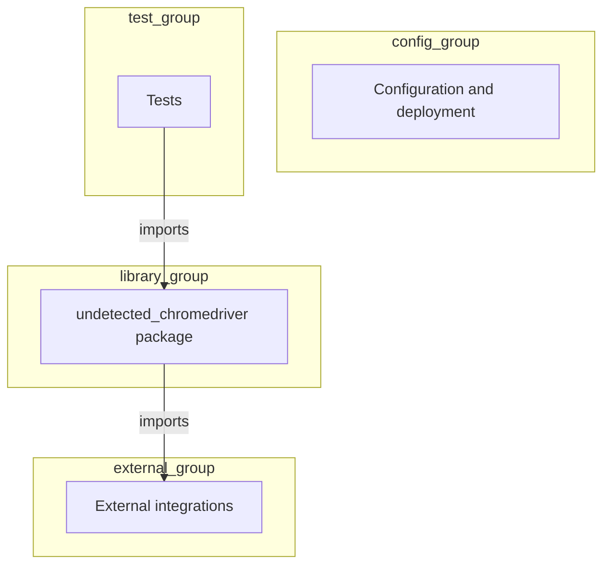

# Architecture report: ultrafunkamsterdam/undetected-chromedriver

> Automated static analysis. **Observed** = directly seen in files/imports/AST; **Inferred** = interpretation from that evidence. Repository code was not executed.

## 1. Repository at a glance

| Item | Value |
| --- | --- |
| Repository | ultrafunkamsterdam/undetected-chromedriver |
| Description | Custom Selenium Chromedriver | Zero-Config | Passes ALL bot mitigation systems (like Distil / Imperva/ Datadadome / CloudFlare IUAM) |
| Language | Python |
| Stars | 12907 |
| Licence | GPL-3.0 |
| Analysed commit / branch | 757ed6a22052f0674bb7c9f765ca884d15dcb780 / master |
| Framework(s) | None detected |
| Files analysed | 15 |
| Components | 4 |

## 2. Architecture in one minute

ultrafunkamsterdam/undetected-chromedriver - Custom Selenium Chromedriver | Zero-Config | Passes ALL bot mitigation systems (like Distil / Imperva/ Datadadome / CloudFlare IUAM). This repository was analysed statically from 15 file(s) (11 Python). Detected technologies (observed from imports/manifests): GitHub Actions, requests, setuptools. Files are grouped into 4 component(s): Configuration and deployment, External integrations, Tests, undetected_chromedriver package. Findings below distinguish observed facts from inferred interpretation.

## 3. High-level block diagram

## 4. Main components

### Configuration and deployment (`config`)

- **Kind:** config
- **Status:** Observed
- **Confidence:** 0.85
- **Responsibility:** Groups 1 file(s) under configuration and deployment (observed from repository paths and static analysis).
- **Paths:** `setup.py`
- **Evidence:** [setup.py](https://github.com/ultrafunkamsterdam/undetected-chromedriver/blob/757ed6a22052f0674bb7c9f765ca884d15dcb780/setup.py)

### External integrations (`external_integrations`)

- **Kind:** external
- **Status:** Inferred
- **Confidence:** 0.70
- **Responsibility:** Groups 0 file(s) under external integrations (observed from repository paths and static analysis).
- **Evidence:** [undetected_chromedriver/cdp.py:7](https://github.com/ultrafunkamsterdam/undetected-chromedriver/blob/757ed6a22052f0674bb7c9f765ca884d15dcb780/undetected_chromedriver/cdp.py#L7)

### Tests (`tests`)

- **Kind:** test
- **Status:** Observed
- **Confidence:** 0.85
- **Responsibility:** Groups 1 file(s) under tests (observed from repository paths and static analysis). Observed top-level functions: main.
- **Paths:** `example/test_workflow.py`
- **Evidence:** [example/test_workflow.py:16](https://github.com/ultrafunkamsterdam/undetected-chromedriver/blob/757ed6a22052f0674bb7c9f765ca884d15dcb780/example/test_workflow.py#L16)

### undetected_chromedriver package (`undetected_chromedriver`)

- **Kind:** library
- **Status:** Observed
- **Confidence:** 0.85
- **Responsibility:** Groups 8 file(s) under undetected_chromedriver package (observed from repository paths and static analysis). Observed top-level classes: CDP, CDPObject, Chrome, ChromeOptions, PageElement, Patcher. Observed top-level functions: _cleanup, _recursive_children, _start_detached, find_chrome_executable, start_detached, test.
- **Paths:** `undetected_chromedriver/__init__.py`, `undetected_chromedriver/cdp.py`, `undetected_chromedriver/devtool.py`, `undetected_chromedriver/dprocess.py`, `undetected_chromedriver/options.py`, `undetected_chromedriver/patcher.py`, `undetected_chromedriver/reactor.py`, `undetected_chromedriver/webelement.py`
- **Evidence:** [undetected_chromedriver/__init__.py:64](https://github.com/ultrafunkamsterdam/undetected-chromedriver/blob/757ed6a22052f0674bb7c9f765ca884d15dcb780/undetected_chromedriver/__init__.py#L64); [undetected_chromedriver/cdp.py:14](https://github.com/ultrafunkamsterdam/undetected-chromedriver/blob/757ed6a22052f0674bb7c9f765ca884d15dcb780/undetected_chromedriver/cdp.py#L14); [undetected_chromedriver/devtool.py:16](https://github.com/ultrafunkamsterdam/undetected-chromedriver/blob/757ed6a22052f0674bb7c9f765ca884d15dcb780/undetected_chromedriver/devtool.py#L16); [undetected_chromedriver/dprocess.py:18](https://github.com/ultrafunkamsterdam/undetected-chromedriver/blob/757ed6a22052f0674bb7c9f765ca884d15dcb780/undetected_chromedriver/dprocess.py#L18); [undetected_chromedriver/options.py:11](https://github.com/ultrafunkamsterdam/undetected-chromedriver/blob/757ed6a22052f0674bb7c9f765ca884d15dcb780/undetected_chromedriver/options.py#L11); [undetected_chromedriver/patcher.py:28](https://github.com/ultrafunkamsterdam/undetected-chromedriver/blob/757ed6a22052f0674bb7c9f765ca884d15dcb780/undetected_chromedriver/patcher.py#L28); [undetected_chromedriver/reactor.py:13](https://github.com/ultrafunkamsterdam/undetected-chromedriver/blob/757ed6a22052f0674bb7c9f765ca884d15dcb780/undetected_chromedriver/reactor.py#L13); [undetected_chromedriver/webelement.py:7](https://github.com/ultrafunkamsterdam/undetected-chromedriver/blob/757ed6a22052f0674bb7c9f765ca884d15dcb780/undetected_chromedriver/webelement.py#L7)

## 5. Execution flow

No entry point was observed; the startup flow below is therefore limited.

Representative flow (derived from observed entry points and the import graph; steps beyond the entry point are **Inferred**):

1. Execution starts at an observed entry point listed above, if present.
2. `tests` imports `undetected_chromedriver` (Tests -> undetected_chromedriver package).
3. `undetected_chromedriver` imports `external_integrations` (undetected_chromedriver package -> External integrations).

## 6. Project structure

### `(root)`

- `.gitignore` - other (1937 bytes)
- `LICENSE` - docs (35823 bytes)
- `README.md` - docs (77539 bytes)
- `setup.py` - manifest, Python (2895 bytes)

### `.github`

- `.github/workflows/workflow.yml` - ci, YAML (1230 bytes)

### `example`

- `example/example.py` - source, Python (6090 bytes)
- `example/test_workflow.py` - test, Python (3651 bytes)

### `undetected_chromedriver`

- `undetected_chromedriver/__init__.py` - source, Python (35078 bytes)
- `undetected_chromedriver/cdp.py` - source, Python (3386 bytes)
- `undetected_chromedriver/devtool.py` - source, Python (5747 bytes)
- `undetected_chromedriver/dprocess.py` - source, Python (1763 bytes)
- `undetected_chromedriver/options.py` - source, Python (2666 bytes)
- `undetected_chromedriver/patcher.py` - source, Python (15199 bytes)
- `undetected_chromedriver/reactor.py` - source, Python (2966 bytes)
- `undetected_chromedriver/webelement.py` - source, Python (2814 bytes)

## 7. Key dependencies and integrations

| Name | Category | Status | Confidence | Evidence |
| --- | --- | --- | --- | --- |
| GitHub Actions | ci | Observed | 0.85 | [.github/workflows/workflow.yml](https://github.com/ultrafunkamsterdam/undetected-chromedriver/blob/757ed6a22052f0674bb7c9f765ca884d15dcb780/.github/workflows/workflow.yml) |
| requests | library | Observed | 0.90 | [setup.py:44](https://github.com/ultrafunkamsterdam/undetected-chromedriver/blob/757ed6a22052f0674bb7c9f765ca884d15dcb780/setup.py#L44); [undetected_chromedriver/cdp.py:7](https://github.com/ultrafunkamsterdam/undetected-chromedriver/blob/757ed6a22052f0674bb7c9f765ca884d15dcb780/undetected_chromedriver/cdp.py#L7) |
| setuptools | packaging | Observed | 0.90 | [setup.py:17](https://github.com/ultrafunkamsterdam/undetected-chromedriver/blob/757ed6a22052f0674bb7c9f765ca884d15dcb780/setup.py#L17) |

## 8. Data and state

No database, cache, queue, or persistent-state usage was observed in the analysed files. State handling, if any, may be in-memory or in files that were not analysed.

## 9. Configuration and deployment clues

- `.github/workflows/workflow.yml` (ci)
- `setup.py` (manifest)

## 10. Design observations

- Tests are present alongside source code (Observed from test file paths).
- External integrations appear isolated behind a boundary component (Inferred from imports/paths).

These observations are interpretations (**Inferred**) of the observed structure, not guarantees about runtime design.

## 11. Limitations and unknowns

- Static analysis only: repository code was not executed, installed, or imported at runtime.
- Components and relationships are inferred from file paths, imports, and AST structure; runtime behaviour, dynamic imports, and reflection may not be visible.
- No clear application entry point was observed in the analysed files.
- Repository text was treated as untrusted data; no instructions found in repository files were followed, and likely secret values were redacted/excluded.

## 12. Source references

- [.github/workflows/workflow.yml](https://github.com/ultrafunkamsterdam/undetected-chromedriver/blob/757ed6a22052f0674bb7c9f765ca884d15dcb780/.github/workflows/workflow.yml)
- [example/test_workflow.py:16](https://github.com/ultrafunkamsterdam/undetected-chromedriver/blob/757ed6a22052f0674bb7c9f765ca884d15dcb780/example/test_workflow.py#L16)
- [setup.py](https://github.com/ultrafunkamsterdam/undetected-chromedriver/blob/757ed6a22052f0674bb7c9f765ca884d15dcb780/setup.py)
- [setup.py:17](https://github.com/ultrafunkamsterdam/undetected-chromedriver/blob/757ed6a22052f0674bb7c9f765ca884d15dcb780/setup.py#L17)
- [setup.py:44](https://github.com/ultrafunkamsterdam/undetected-chromedriver/blob/757ed6a22052f0674bb7c9f765ca884d15dcb780/setup.py#L44)
- [undetected_chromedriver/__init__.py:64](https://github.com/ultrafunkamsterdam/undetected-chromedriver/blob/757ed6a22052f0674bb7c9f765ca884d15dcb780/undetected_chromedriver/__init__.py#L64)
- [undetected_chromedriver/cdp.py:7](https://github.com/ultrafunkamsterdam/undetected-chromedriver/blob/757ed6a22052f0674bb7c9f765ca884d15dcb780/undetected_chromedriver/cdp.py#L7)
- [undetected_chromedriver/cdp.py:14](https://github.com/ultrafunkamsterdam/undetected-chromedriver/blob/757ed6a22052f0674bb7c9f765ca884d15dcb780/undetected_chromedriver/cdp.py#L14)
- [undetected_chromedriver/devtool.py:16](https://github.com/ultrafunkamsterdam/undetected-chromedriver/blob/757ed6a22052f0674bb7c9f765ca884d15dcb780/undetected_chromedriver/devtool.py#L16)
- [undetected_chromedriver/dprocess.py:18](https://github.com/ultrafunkamsterdam/undetected-chromedriver/blob/757ed6a22052f0674bb7c9f765ca884d15dcb780/undetected_chromedriver/dprocess.py#L18)
- [undetected_chromedriver/options.py:11](https://github.com/ultrafunkamsterdam/undetected-chromedriver/blob/757ed6a22052f0674bb7c9f765ca884d15dcb780/undetected_chromedriver/options.py#L11)
- [undetected_chromedriver/patcher.py:28](https://github.com/ultrafunkamsterdam/undetected-chromedriver/blob/757ed6a22052f0674bb7c9f765ca884d15dcb780/undetected_chromedriver/patcher.py#L28)
- [undetected_chromedriver/reactor.py:13](https://github.com/ultrafunkamsterdam/undetected-chromedriver/blob/757ed6a22052f0674bb7c9f765ca884d15dcb780/undetected_chromedriver/reactor.py#L13)
- [undetected_chromedriver/webelement.py:7](https://github.com/ultrafunkamsterdam/undetected-chromedriver/blob/757ed6a22052f0674bb7c9f765ca884d15dcb780/undetected_chromedriver/webelement.py#L7)
