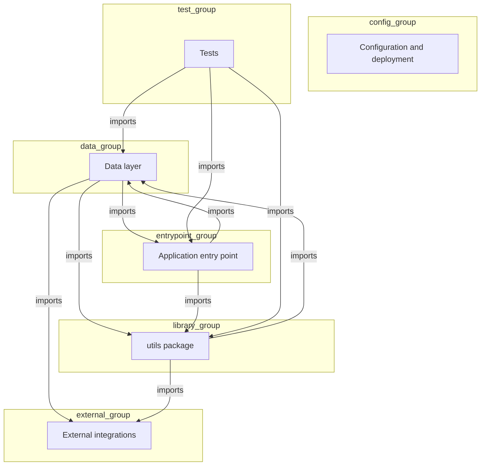

# Architecture report: ultralytics/yolov5

> Automated static analysis. **Observed** = directly seen in files/imports/AST; **Inferred** = interpretation from that evidence. Repository code was not executed.

## 1. Repository at a glance

| Item | Value |
| --- | --- |
| Repository | ultralytics/yolov5 |
| Description | Ultralytics YOLOv5 in PyTorch for object detection, instance segmentation, classification, training, and export. |
| Language | Python |
| Stars | 58267 |
| Licence | AGPL-3.0 |
| Analysed commit / branch | cb2f17fd5d790cfdd0c07c25351904df9affbe6e / master |
| Framework(s) | Flask |
| Files analysed | 141 |
| Components | 6 |

## 2. Architecture in one minute

ultralytics/yolov5 - Ultralytics YOLOv5 in PyTorch for object detection, instance segmentation, classification, training, and export.. This repository was analysed statically from 141 file(s) (52 Python). Detected technologies (observed from imports/manifests): GitHub Actions, Flask, NumPy, pandas, requests, Poetry. Files are grouped into 6 component(s): Configuration and deployment, Data layer, Application entry point, External integrations, Tests, utils package. Observed entry point(s): benchmarks.py, classify/predict.py, classify/train.py. Findings below distinguish observed facts from inferred interpretation.

## 3. High-level block diagram

## 4. Main components

### Configuration and deployment (`config`)

- **Kind:** config
- **Status:** Observed
- **Confidence:** 0.85
- **Responsibility:** Groups 55 file(s) under configuration and deployment (observed from repository paths and static analysis).
- **Paths:** `data/Argoverse.yaml`, `data/GlobalWheat2020.yaml`, `data/ImageNet.yaml`, `data/ImageNet10.yaml`, `data/ImageNet100.yaml`, `data/ImageNet1000.yaml`, `data/Objects365.yaml`, `data/SKU-110K.yaml`, `data/VOC.yaml`, `data/VisDrone.yaml`, `data/coco.yaml`, `data/coco128-seg.yaml`, `data/coco128.yaml`, `data/hyps/hyp.Objects365.yaml`, `data/hyps/hyp.VOC.yaml`, `data/hyps/hyp.no-augmentation.yaml`, `data/hyps/hyp.scratch-high.yaml`, `data/hyps/hyp.scratch-low.yaml`, `data/hyps/hyp.scratch-med.yaml`, `data/xView.yaml`, `models/hub/anchors.yaml`, `models/hub/yolov3-spp.yaml`, `models/hub/yolov3-tiny.yaml`, `models/hub/yolov3.yaml`, `models/hub/yolov5-bifpn.yaml`, `models/hub/yolov5-fpn.yaml`, `models/hub/yolov5-p2.yaml`, `models/hub/yolov5-p34.yaml`, `models/hub/yolov5-p6.yaml`, `models/hub/yolov5-p7.yaml`, `models/hub/yolov5-panet.yaml`, `models/hub/yolov5l6.yaml`, `models/hub/yolov5m6.yaml`, `models/hub/yolov5n6.yaml`, `models/hub/yolov5s-LeakyReLU.yaml`, `models/hub/yolov5s-ghost.yaml`, `models/hub/yolov5s-transformer.yaml`, `models/hub/yolov5s6.yaml`, `models/hub/yolov5x6.yaml`, `models/segment/yolov5l-seg.yaml`, `models/segment/yolov5m-seg.yaml`, `models/segment/yolov5n-seg.yaml`, `models/segment/yolov5s-seg.yaml`, `models/segment/yolov5x-seg.yaml`, `models/yolov5l.yaml`, `models/yolov5m.yaml`, `models/yolov5n.yaml`, `models/yolov5s.yaml`, `models/yolov5x.yaml`, `pyproject.toml`, `requirements.txt`, `utils/docker/Dockerfile`, `utils/docker/Dockerfile-arm64`, `utils/docker/Dockerfile-cpu`, `utils/loggers/comet/optimizer_config.json`
- **Evidence:** [data/Argoverse.yaml](https://github.com/ultralytics/yolov5/blob/cb2f17fd5d790cfdd0c07c25351904df9affbe6e/data/Argoverse.yaml); [data/GlobalWheat2020.yaml](https://github.com/ultralytics/yolov5/blob/cb2f17fd5d790cfdd0c07c25351904df9affbe6e/data/GlobalWheat2020.yaml); [data/ImageNet.yaml](https://github.com/ultralytics/yolov5/blob/cb2f17fd5d790cfdd0c07c25351904df9affbe6e/data/ImageNet.yaml); [data/ImageNet10.yaml](https://github.com/ultralytics/yolov5/blob/cb2f17fd5d790cfdd0c07c25351904df9affbe6e/data/ImageNet10.yaml); [data/ImageNet100.yaml](https://github.com/ultralytics/yolov5/blob/cb2f17fd5d790cfdd0c07c25351904df9affbe6e/data/ImageNet100.yaml); [data/ImageNet1000.yaml](https://github.com/ultralytics/yolov5/blob/cb2f17fd5d790cfdd0c07c25351904df9affbe6e/data/ImageNet1000.yaml); [data/Objects365.yaml](https://github.com/ultralytics/yolov5/blob/cb2f17fd5d790cfdd0c07c25351904df9affbe6e/data/Objects365.yaml); [data/SKU-110K.yaml](https://github.com/ultralytics/yolov5/blob/cb2f17fd5d790cfdd0c07c25351904df9affbe6e/data/SKU-110K.yaml)

### Data layer (`data_layer`)

- **Kind:** data
- **Status:** Observed
- **Confidence:** 0.85
- **Responsibility:** Groups 10 file(s) under data layer (observed from repository paths and static analysis). Observed top-level classes: AutoShape, Bottleneck, BottleneckCSP, C3, C3Ghost, C3SPP. Observed top-level functions: _request_ssrf_url, _validate_ssrf_url, attempt_load, autopad.
- **Paths:** `data/scripts/download_weights.sh`, `data/scripts/get_coco.sh`, `data/scripts/get_coco128.sh`, `data/scripts/get_imagenet.sh`, `data/scripts/get_imagenet10.sh`, `data/scripts/get_imagenet100.sh`, `data/scripts/get_imagenet1000.sh`, `models/__init__.py`, `models/common.py`, `models/experimental.py`
- **Evidence:** [data/scripts/download_weights.sh](https://github.com/ultralytics/yolov5/blob/cb2f17fd5d790cfdd0c07c25351904df9affbe6e/data/scripts/download_weights.sh); [data/scripts/get_coco.sh](https://github.com/ultralytics/yolov5/blob/cb2f17fd5d790cfdd0c07c25351904df9affbe6e/data/scripts/get_coco.sh); [data/scripts/get_coco128.sh](https://github.com/ultralytics/yolov5/blob/cb2f17fd5d790cfdd0c07c25351904df9affbe6e/data/scripts/get_coco128.sh); [data/scripts/get_imagenet.sh](https://github.com/ultralytics/yolov5/blob/cb2f17fd5d790cfdd0c07c25351904df9affbe6e/data/scripts/get_imagenet.sh); [data/scripts/get_imagenet10.sh](https://github.com/ultralytics/yolov5/blob/cb2f17fd5d790cfdd0c07c25351904df9affbe6e/data/scripts/get_imagenet10.sh); [data/scripts/get_imagenet100.sh](https://github.com/ultralytics/yolov5/blob/cb2f17fd5d790cfdd0c07c25351904df9affbe6e/data/scripts/get_imagenet100.sh); [data/scripts/get_imagenet1000.sh](https://github.com/ultralytics/yolov5/blob/cb2f17fd5d790cfdd0c07c25351904df9affbe6e/data/scripts/get_imagenet1000.sh); [models/__init__.py](https://github.com/ultralytics/yolov5/blob/cb2f17fd5d790cfdd0c07c25351904df9affbe6e/models/__init__.py)

### Application entry point (`entrypoint`)

- **Kind:** entrypoint
- **Status:** Observed
- **Confidence:** 0.85
- **Responsibility:** Groups 16 file(s) under application entry point (observed from repository paths and static analysis). Observed application object created via Flask. Observed routes: ROUTE (path not a literal). Observed top-level classes: AgnosticNMS, BaseModel, ClassificationModel, Detect, DetectionModel, Segment. Observed top-level functions: _create, activations, add_tflite_metadata, custom, export_coreml, export_edgetpu.
- **Paths:** `benchmarks.py`, `classify/predict.py`, `classify/train.py`, `classify/val.py`, `detect.py`, `export.py`, `hubconf.py`, `models/tf.py`, `models/yolo.py`, `segment/predict.py`, `segment/train.py`, `segment/val.py`, `train.py`, `utils/flask_rest_api/restapi.py`, `utils/loggers/comet/hpo.py`, `val.py`
- **Evidence:** [benchmarks.py:51](https://github.com/ultralytics/yolov5/blob/cb2f17fd5d790cfdd0c07c25351904df9affbe6e/benchmarks.py#L51); [classify/predict.py:68](https://github.com/ultralytics/yolov5/blob/cb2f17fd5d790cfdd0c07c25351904df9affbe6e/classify/predict.py#L68); [classify/train.py:78](https://github.com/ultralytics/yolov5/blob/cb2f17fd5d790cfdd0c07c25351904df9affbe6e/classify/train.py#L78); [classify/val.py:52](https://github.com/ultralytics/yolov5/blob/cb2f17fd5d790cfdd0c07c25351904df9affbe6e/classify/val.py#L52); [detect.py:71](https://github.com/ultralytics/yolov5/blob/cb2f17fd5d790cfdd0c07c25351904df9affbe6e/detect.py#L71); [export.py:93](https://github.com/ultralytics/yolov5/blob/cb2f17fd5d790cfdd0c07c25351904df9affbe6e/export.py#L93); [hubconf.py:16](https://github.com/ultralytics/yolov5/blob/cb2f17fd5d790cfdd0c07c25351904df9affbe6e/hubconf.py#L16); [models/tf.py:51](https://github.com/ultralytics/yolov5/blob/cb2f17fd5d790cfdd0c07c25351904df9affbe6e/models/tf.py#L51)

### External integrations (`external_integrations`)

- **Kind:** external
- **Status:** Inferred
- **Confidence:** 0.70
- **Responsibility:** Groups 0 file(s) under external integrations (observed from repository paths and static analysis).
- **Evidence:** [models/common.py:10](https://github.com/ultralytics/yolov5/blob/cb2f17fd5d790cfdd0c07c25351904df9affbe6e/models/common.py#L10); [models/common.py:21](https://github.com/ultralytics/yolov5/blob/cb2f17fd5d790cfdd0c07c25351904df9affbe6e/models/common.py#L21); [utils/downloads.py:9](https://github.com/ultralytics/yolov5/blob/cb2f17fd5d790cfdd0c07c25351904df9affbe6e/utils/downloads.py#L9); [utils/flask_rest_api/example_request.py:6](https://github.com/ultralytics/yolov5/blob/cb2f17fd5d790cfdd0c07c25351904df9affbe6e/utils/flask_rest_api/example_request.py#L6); [utils/general.py:190](https://github.com/ultralytics/yolov5/blob/cb2f17fd5d790cfdd0c07c25351904df9affbe6e/utils/general.py#L190)

### Tests (`tests`)

- **Kind:** test
- **Status:** Observed
- **Confidence:** 0.85
- **Responsibility:** Groups 3 file(s) under tests (observed from repository paths and static analysis). Observed top-level classes: DummyModel, DummyResults. Observed top-level functions: client, make_image_bytes, post_image, setup_model, test_accepts_valid_image_upload, test_api_key.
- **Paths:** `tests/test_flask_rest_api.py`, `tests/test_invariant_common.py`, `tests/test_invariant_export.py`
- **Evidence:** [tests/test_flask_rest_api.py:14](https://github.com/ultralytics/yolov5/blob/cb2f17fd5d790cfdd0c07c25351904df9affbe6e/tests/test_flask_rest_api.py#L14); [tests/test_invariant_common.py:29](https://github.com/ultralytics/yolov5/blob/cb2f17fd5d790cfdd0c07c25351904df9affbe6e/tests/test_invariant_common.py#L29); [tests/test_invariant_export.py:21](https://github.com/ultralytics/yolov5/blob/cb2f17fd5d790cfdd0c07c25351904df9affbe6e/tests/test_invariant_export.py#L21)

### utils package (`utils`)

- **Kind:** library
- **Status:** Observed
- **Confidence:** 0.85
- **Responsibility:** Groups 30 file(s) under utils package (observed from repository paths and static analysis). Observed top-level classes: AconC, Albumentations, BCEBlurWithLogitsLoss, Callbacks, CenterCrop, ClassificationDataset. Observed top-level functions: all_logging_disabled, ap_per_class, ap_per_class_box_and_mask, attempt_download, augment_hsv, autobatch.
- **Paths:** `utils/__init__.py`, `utils/activations.py`, `utils/augmentations.py`, `utils/autoanchor.py`, `utils/autobatch.py`, `utils/callbacks.py`, `utils/dataloaders.py`, `utils/downloads.py`, `utils/flask_rest_api/example_request.py`, `utils/general.py`, `utils/loggers/__init__.py`, `utils/loggers/clearml/__init__.py`, `utils/loggers/clearml/clearml_utils.py`, `utils/loggers/clearml/hpo.py`, `utils/loggers/comet/__init__.py`, `utils/loggers/comet/comet_utils.py`, `utils/loggers/wandb/__init__.py`, `utils/loggers/wandb/wandb_utils.py`, `utils/loss.py`, `utils/metrics.py`, `utils/plots.py`, `utils/segment/__init__.py`, `utils/segment/augmentations.py`, `utils/segment/dataloaders.py`, `utils/segment/general.py`, `utils/segment/loss.py`, `utils/segment/metrics.py`, `utils/segment/plots.py`, `utils/torch_utils.py`, `utils/triton.py`
- **Evidence:** [utils/__init__.py:9](https://github.com/ultralytics/yolov5/blob/cb2f17fd5d790cfdd0c07c25351904df9affbe6e/utils/__init__.py#L9); [utils/activations.py:9](https://github.com/ultralytics/yolov5/blob/cb2f17fd5d790cfdd0c07c25351904df9affbe6e/utils/activations.py#L9); [utils/augmentations.py:19](https://github.com/ultralytics/yolov5/blob/cb2f17fd5d790cfdd0c07c25351904df9affbe6e/utils/augmentations.py#L19); [utils/autoanchor.py:16](https://github.com/ultralytics/yolov5/blob/cb2f17fd5d790cfdd0c07c25351904df9affbe6e/utils/autoanchor.py#L16); [utils/autobatch.py:13](https://github.com/ultralytics/yolov5/blob/cb2f17fd5d790cfdd0c07c25351904df9affbe6e/utils/autobatch.py#L13); [utils/callbacks.py:7](https://github.com/ultralytics/yolov5/blob/cb2f17fd5d790cfdd0c07c25351904df9affbe6e/utils/callbacks.py#L7); [utils/dataloaders.py:67](https://github.com/ultralytics/yolov5/blob/cb2f17fd5d790cfdd0c07c25351904df9affbe6e/utils/dataloaders.py#L67); [utils/downloads.py:13](https://github.com/ultralytics/yolov5/blob/cb2f17fd5d790cfdd0c07c25351904df9affbe6e/utils/downloads.py#L13)

## 5. Execution flow

**Observed** entry point(s):

- [benchmarks.py:282](https://github.com/ultralytics/yolov5/blob/cb2f17fd5d790cfdd0c07c25351904df9affbe6e/benchmarks.py#L282)
- [classify/predict.py:239](https://github.com/ultralytics/yolov5/blob/cb2f17fd5d790cfdd0c07c25351904df9affbe6e/classify/predict.py#L239)
- [classify/train.py:381](https://github.com/ultralytics/yolov5/blob/cb2f17fd5d790cfdd0c07c25351904df9affbe6e/classify/train.py#L381)
- [classify/val.py:176](https://github.com/ultralytics/yolov5/blob/cb2f17fd5d790cfdd0c07c25351904df9affbe6e/classify/val.py#L176)
- [detect.py:437](https://github.com/ultralytics/yolov5/blob/cb2f17fd5d790cfdd0c07c25351904df9affbe6e/detect.py#L437)
- [export.py:1552](https://github.com/ultralytics/yolov5/blob/cb2f17fd5d790cfdd0c07c25351904df9affbe6e/export.py#L1552)
- [hubconf.py:469](https://github.com/ultralytics/yolov5/blob/cb2f17fd5d790cfdd0c07c25351904df9affbe6e/hubconf.py#L469)
- [models/tf.py:764](https://github.com/ultralytics/yolov5/blob/cb2f17fd5d790cfdd0c07c25351904df9affbe6e/models/tf.py#L764)
- [models/yolo.py:461](https://github.com/ultralytics/yolov5/blob/cb2f17fd5d790cfdd0c07c25351904df9affbe6e/models/yolo.py#L461)
- [segment/predict.py:295](https://github.com/ultralytics/yolov5/blob/cb2f17fd5d790cfdd0c07c25351904df9affbe6e/segment/predict.py#L295)
- [segment/train.py:748](https://github.com/ultralytics/yolov5/blob/cb2f17fd5d790cfdd0c07c25351904df9affbe6e/segment/train.py#L748)
- [segment/val.py:464](https://github.com/ultralytics/yolov5/blob/cb2f17fd5d790cfdd0c07c25351904df9affbe6e/segment/val.py#L464)

**Observed** routes (from decorators):

- `ROUTE ` -> `predict` in `utils/flask_rest_api/restapi.py:29`

Representative flow (derived from observed entry points and the import graph; steps beyond the entry point are **Inferred**):

1. Execution starts at an observed entry point listed above, if present.
2. `data_layer` imports `entrypoint` (Data layer -> Application entry point).
3. `data_layer` imports `external_integrations` (Data layer -> External integrations).
4. `data_layer` imports `utils` (Data layer -> utils package).
5. `entrypoint` imports `data_layer` (Application entry point -> Data layer).
6. `entrypoint` imports `utils` (Application entry point -> utils package).
7. `tests` imports `data_layer` (Tests -> Data layer).
8. `tests` imports `entrypoint` (Tests -> Application entry point).
9. `tests` imports `utils` (Tests -> utils package).

## 6. Project structure

### `(root)`

- `.dockerignore` - container (3525 bytes)
- `.gitattributes` - other (70 bytes)
- `.gitignore` - other (3875 bytes)
- `AGENTS.md` - docs (7628 bytes)
- `CITATION.cff` - other (396 bytes)
- `CONTRIBUTING.md` - docs (5929 bytes)
- `LICENSE` - docs (34523 bytes)
- `README.md` - docs (46593 bytes)
- `README.zh-CN.md` - docs (45713 bytes)
- `benchmarks.py` - source, Python (13672 bytes)
- `detect.py` - source, Python (23606 bytes)
- `export.py` - source, Python (68685 bytes)
- `hubconf.py` - source, Python (24065 bytes)
- `pyproject.toml` - manifest (5172 bytes)
- `requirements.txt` - manifest (1592 bytes)
- `train.py` - source, Python (46907 bytes)
- `tutorial.ipynb` - other (39095 bytes)
- `val.py` - source, Python (26793 bytes)

### `.github`

- `.github/ISSUE_TEMPLATE/bug-report.yml` - config (3035 bytes)
- `.github/ISSUE_TEMPLATE/config.yml` - config (607 bytes)
- `.github/ISSUE_TEMPLATE/feature-request.yml` - config (1873 bytes)
- `.github/ISSUE_TEMPLATE/question.yml` - config (1350 bytes)
- `.github/dependabot.yml` - config (605 bytes)
- `.github/workflows/ci-testing.yml` - ci, YAML (6404 bytes)
- `.github/workflows/cla.yml` - ci, YAML (1038 bytes)
- `.github/workflows/docker.yml` - ci, YAML (2570 bytes)
- `.github/workflows/format.yml` - ci, YAML (5207 bytes)
- `.github/workflows/links.yml` - ci, YAML (3832 bytes)
- `.github/workflows/merge-main-into-prs.yml` - ci, YAML (3647 bytes)
- `.github/workflows/stale.yml` - ci, YAML (2614 bytes)

### `classify`

- `classify/predict.py` - source, Python (12006 bytes)
- `classify/train.py` - source, Python (16543 bytes)
- `classify/tutorial.ipynb` - other (97135 bytes)
- `classify/val.py` - source, Python (8204 bytes)

### `data`

- `data/Argoverse.yaml` - config (3179 bytes)
- `data/GlobalWheat2020.yaml` - config (2133 bytes)
- `data/ImageNet.yaml` - config (19051 bytes)
- `data/ImageNet10.yaml` - config (1092 bytes)
- `data/ImageNet100.yaml` - config (2810 bytes)
- `data/ImageNet1000.yaml` - config (19030 bytes)
- `data/Objects365.yaml` - config (9423 bytes)
- `data/SKU-110K.yaml` - config (2555 bytes)
- `data/VOC.yaml` - config (3727 bytes)
- `data/VisDrone.yaml` - config (3061 bytes)
- `data/coco.yaml` - config (2718 bytes)
- `data/coco128-seg.yaml` - config (2225 bytes)
- `data/coco128.yaml` - config (2127 bytes)
- `data/hyps/hyp.Objects365.yaml` - config (1781 bytes)
- `data/hyps/hyp.VOC.yaml` - config (2264 bytes)
- `data/hyps/hyp.no-augmentation.yaml` - config (1858 bytes)
- `data/hyps/hyp.scratch-high.yaml` - config (1831 bytes)
- `data/hyps/hyp.scratch-low.yaml` - config (1830 bytes)
- `data/hyps/hyp.scratch-med.yaml` - config (1833 bytes)
- `data/scripts/download_weights.sh` - source, Shell (664 bytes)
- `data/scripts/get_coco.sh` - source, Shell (1599 bytes)
- `data/scripts/get_coco128.sh` - source, Shell (643 bytes)
- `data/scripts/get_imagenet.sh` - source, Shell (1750 bytes)
- `data/scripts/get_imagenet10.sh` - source, Shell (586 bytes)
- `data/scripts/get_imagenet100.sh` - source, Shell (594 bytes)
- `data/scripts/get_imagenet1000.sh` - source, Shell (601 bytes)
- `data/xView.yaml` - config (5545 bytes)

### `models`

- `models/__init__.py` - source, Python (70 bytes)
- `models/common.py` - source, Python (54092 bytes)
- `models/experimental.py` - source, Python (4135 bytes)
- `models/hub/anchors.yaml` - config (4278 bytes)
- `models/hub/yolov3-spp.yaml` - config (1938 bytes)
- `models/hub/yolov3-tiny.yaml` - config (1577 bytes)
- `models/hub/yolov3.yaml` - config (1921 bytes)
- `models/hub/yolov5-bifpn.yaml` - config (1802 bytes)
- `models/hub/yolov5-fpn.yaml` - config (1587 bytes)
- `models/hub/yolov5-p2.yaml` - config (1980 bytes)
- `models/hub/yolov5-p34.yaml` - config (1521 bytes)
- `models/hub/yolov5-p6.yaml` - config (2035 bytes)
- `models/hub/yolov5-p7.yaml` - config (2421 bytes)
- `models/hub/yolov5-panet.yaml` - config (1786 bytes)
- `models/hub/yolov5l6.yaml` - config (2207 bytes)
- `models/hub/yolov5m6.yaml` - config (2209 bytes)
- `models/hub/yolov5n6.yaml` - config (2209 bytes)
- `models/hub/yolov5s-LeakyReLU.yaml` - config (1892 bytes)
- `models/hub/yolov5s-ghost.yaml` - config (1867 bytes)
- `models/hub/yolov5s-transformer.yaml` - config (1841 bytes)
- `models/hub/yolov5s6.yaml` - config (2209 bytes)
- `models/hub/yolov5x6.yaml` - config (2209 bytes)
- `models/segment/yolov5l-seg.yaml` - config (1801 bytes)
- `models/segment/yolov5m-seg.yaml` - config (1803 bytes)
- `models/segment/yolov5n-seg.yaml` - config (1803 bytes)
- `models/segment/yolov5s-seg.yaml` - config (1803 bytes)
- `models/segment/yolov5x-seg.yaml` - config (1803 bytes)
- `models/tf.py` - source, Python (32953 bytes)
- `models/yolo.py` - source, Python (20907 bytes)
- `models/yolov5l.yaml` - config (1761 bytes)
- `models/yolov5m.yaml` - config (1763 bytes)
- `models/yolov5n.yaml` - config (1763 bytes)
- `models/yolov5s.yaml` - config (1763 bytes)
- `models/yolov5x.yaml` - config (1763 bytes)

### `segment`

- `segment/predict.py` - source, Python (15819 bytes)
- `segment/train.py` - source, Python (34190 bytes)
- `segment/tutorial.ipynb` - other (42307 bytes)
- `segment/val.py` - source, Python (21588 bytes)

### `tests`

- `tests/test_flask_rest_api.py` - test, Python (2558 bytes)
- `tests/test_invariant_common.py` - test, Python (3437 bytes)
- `tests/test_invariant_export.py` - test, Python (3328 bytes)

### `utils`

- `utils/__init__.py` - source, Python (1505 bytes)
- `utils/activations.py` - source, Python (5082 bytes)
- `utils/augmentations.py` - source, Python (15000 bytes)
- `utils/autoanchor.py` - source, Python (7391 bytes)
- `utils/autobatch.py` - source, Python (3089 bytes)
- `utils/callbacks.py` - source, Python (2426 bytes)
- `utils/dataloaders.py` - source, Python (44638 bytes)
- `utils/docker/Dockerfile` - container (2168 bytes)
- `utils/docker/Dockerfile-arm64` - container (1699 bytes)
- `utils/docker/Dockerfile-cpu` - container (1692 bytes)
- `utils/downloads.py` - source, Python (4981 bytes)
- `utils/flask_rest_api/README.md` - docs (4269 bytes)
- `utils/flask_rest_api/example_request.py` - source, Python (539 bytes)
- `utils/flask_rest_api/restapi.py` - source, Python (2846 bytes)
- `utils/general.py` - source, Python (39140 bytes)
- `utils/loggers/__init__.py` - source, Python (18965 bytes)
- `utils/loggers/clearml/README.md` - docs (12059 bytes)
- `utils/loggers/clearml/__init__.py` - source, Python (70 bytes)
- `utils/loggers/clearml/clearml_utils.py` - source, Python (10449 bytes)
- `utils/loggers/clearml/hpo.py` - source, Python (5289 bytes)
- `utils/loggers/comet/README.md` - docs (13679 bytes)
- `utils/loggers/comet/__init__.py` - source, Python (21023 bytes)
- `utils/loggers/comet/comet_utils.py` - source, Python (4021 bytes)
- `utils/loggers/comet/hpo.py` - source, Python (6648 bytes)
- `utils/loggers/comet/optimizer_config.json` - config (2425 bytes)
- `utils/loggers/wandb/__init__.py` - source, Python (70 bytes)
- `utils/loggers/wandb/wandb_utils.py` - source, Python (6859 bytes)
- `utils/loss.py` - source, Python (10699 bytes)
- `utils/metrics.py` - source, Python (11469 bytes)
- `utils/plots.py` - source, Python (12455 bytes)
- `utils/segment/__init__.py` - source, Python (70 bytes)
- `utils/segment/augmentations.py` - source, Python (3536 bytes)
- `utils/segment/dataloaders.py` - source, Python (11607 bytes)
- `utils/segment/general.py` - source, Python (4917 bytes)
- `utils/segment/loss.py` - source, Python (9141 bytes)
- `utils/segment/metrics.py` - source, Python (6778 bytes)
- `utils/segment/plots.py` - source, Python (6622 bytes)
- `utils/torch_utils.py` - source, Python (16991 bytes)
- `utils/triton.py` - source, Python (3488 bytes)

## 7. Key dependencies and integrations

| Name | Category | Status | Confidence | Evidence |
| --- | --- | --- | --- | --- |
| GitHub Actions | ci | Observed | 0.90 | [.github/workflows/ci-testing.yml](https://github.com/ultralytics/yolov5/blob/cb2f17fd5d790cfdd0c07c25351904df9affbe6e/.github/workflows/ci-testing.yml); [.github/workflows/cla.yml](https://github.com/ultralytics/yolov5/blob/cb2f17fd5d790cfdd0c07c25351904df9affbe6e/.github/workflows/cla.yml); [.github/workflows/docker.yml](https://github.com/ultralytics/yolov5/blob/cb2f17fd5d790cfdd0c07c25351904df9affbe6e/.github/workflows/docker.yml); [.github/workflows/format.yml](https://github.com/ultralytics/yolov5/blob/cb2f17fd5d790cfdd0c07c25351904df9affbe6e/.github/workflows/format.yml) |
| Flask | framework | Observed | 0.90 | [utils/flask_rest_api/restapi.py:9](https://github.com/ultralytics/yolov5/blob/cb2f17fd5d790cfdd0c07c25351904df9affbe6e/utils/flask_rest_api/restapi.py#L9) |
| NumPy | library | Observed | 0.95 | [export.py:422](https://github.com/ultralytics/yolov5/blob/cb2f17fd5d790cfdd0c07c25351904df9affbe6e/export.py#L422); [hubconf.py:473](https://github.com/ultralytics/yolov5/blob/cb2f17fd5d790cfdd0c07c25351904df9affbe6e/hubconf.py#L473); [models/common.py:19](https://github.com/ultralytics/yolov5/blob/cb2f17fd5d790cfdd0c07c25351904df9affbe6e/models/common.py#L19); [models/experimental.py:6](https://github.com/ultralytics/yolov5/blob/cb2f17fd5d790cfdd0c07c25351904df9affbe6e/models/experimental.py#L6) |
| pandas | library | Observed | 0.95 | [benchmarks.py:34](https://github.com/ultralytics/yolov5/blob/cb2f17fd5d790cfdd0c07c25351904df9affbe6e/benchmarks.py#L34); [export.py:59](https://github.com/ultralytics/yolov5/blob/cb2f17fd5d790cfdd0c07c25351904df9affbe6e/export.py#L59); [models/common.py:20](https://github.com/ultralytics/yolov5/blob/cb2f17fd5d790cfdd0c07c25351904df9affbe6e/models/common.py#L20); [pyproject.toml:76](https://github.com/ultralytics/yolov5/blob/cb2f17fd5d790cfdd0c07c25351904df9affbe6e/pyproject.toml#L76) |
| requests | library | Observed | 0.95 | [models/common.py:21](https://github.com/ultralytics/yolov5/blob/cb2f17fd5d790cfdd0c07c25351904df9affbe6e/models/common.py#L21); [pyproject.toml:70](https://github.com/ultralytics/yolov5/blob/cb2f17fd5d790cfdd0c07c25351904df9affbe6e/pyproject.toml#L70); [requirements.txt:11](https://github.com/ultralytics/yolov5/blob/cb2f17fd5d790cfdd0c07c25351904df9affbe6e/requirements.txt#L11); [utils/downloads.py:9](https://github.com/ultralytics/yolov5/blob/cb2f17fd5d790cfdd0c07c25351904df9affbe6e/utils/downloads.py#L9) |
| Poetry | packaging | Observed | 0.85 | [pyproject.toml](https://github.com/ultralytics/yolov5/blob/cb2f17fd5d790cfdd0c07c25351904df9affbe6e/pyproject.toml) |
| setuptools | packaging | Observed | 0.90 | [pyproject.toml:8](https://github.com/ultralytics/yolov5/blob/cb2f17fd5d790cfdd0c07c25351904df9affbe6e/pyproject.toml#L8); [requirements.txt:40](https://github.com/ultralytics/yolov5/blob/cb2f17fd5d790cfdd0c07c25351904df9affbe6e/requirements.txt#L40) |
| Docker | tooling | Observed | 0.90 | [.github/workflows/docker.yml:3](https://github.com/ultralytics/yolov5/blob/cb2f17fd5d790cfdd0c07c25351904df9affbe6e/.github/workflows/docker.yml#L3); [.github/workflows/format.yml:57](https://github.com/ultralytics/yolov5/blob/cb2f17fd5d790cfdd0c07c25351904df9affbe6e/.github/workflows/format.yml#L57); [utils/docker/Dockerfile](https://github.com/ultralytics/yolov5/blob/cb2f17fd5d790cfdd0c07c25351904df9affbe6e/utils/docker/Dockerfile); [utils/docker/Dockerfile-arm64](https://github.com/ultralytics/yolov5/blob/cb2f17fd5d790cfdd0c07c25351904df9affbe6e/utils/docker/Dockerfile-arm64) |
| pytest | tooling | Observed | 0.95 | [pyproject.toml:11](https://github.com/ultralytics/yolov5/blob/cb2f17fd5d790cfdd0c07c25351904df9affbe6e/pyproject.toml#L11); [tests/test_flask_rest_api.py:5](https://github.com/ultralytics/yolov5/blob/cb2f17fd5d790cfdd0c07c25351904df9affbe6e/tests/test_flask_rest_api.py#L5); [tests/test_invariant_common.py:9](https://github.com/ultralytics/yolov5/blob/cb2f17fd5d790cfdd0c07c25351904df9affbe6e/tests/test_invariant_common.py#L9); [tests/test_invariant_export.py:9](https://github.com/ultralytics/yolov5/blob/cb2f17fd5d790cfdd0c07c25351904df9affbe6e/tests/test_invariant_export.py#L9) |
| unittest | tooling | Observed | 0.90 | [tests/test_invariant_export.py:7](https://github.com/ultralytics/yolov5/blob/cb2f17fd5d790cfdd0c07c25351904df9affbe6e/tests/test_invariant_export.py#L7) |

## 8. Data and state

- Data component `data_layer` (Observed): Groups 10 file(s) under data layer (observed from repository paths and static analysis). Observed top-level classes: AutoShape, Bottleneck, BottleneckCSP, C3, C3Ghost, C3SPP. Observed top-level functions: _request_ssrf_url, _validate_ssrf_url, attempt_load, autopad.

## 9. Configuration and deployment clues

- `.dockerignore` (container)
- `.github/ISSUE_TEMPLATE/bug-report.yml` (config)
- `.github/ISSUE_TEMPLATE/config.yml` (config)
- `.github/ISSUE_TEMPLATE/feature-request.yml` (config)
- `.github/ISSUE_TEMPLATE/question.yml` (config)
- `.github/dependabot.yml` (config)
- `.github/workflows/ci-testing.yml` (ci)
- `.github/workflows/cla.yml` (ci)
- `.github/workflows/docker.yml` (ci)
- `.github/workflows/format.yml` (ci)
- `.github/workflows/links.yml` (ci)
- `.github/workflows/merge-main-into-prs.yml` (ci)
- `.github/workflows/stale.yml` (ci)
- `data/Argoverse.yaml` (config)
- `data/GlobalWheat2020.yaml` (config)
- `data/ImageNet.yaml` (config)
- `data/ImageNet10.yaml` (config)
- `data/ImageNet100.yaml` (config)
- `data/ImageNet1000.yaml` (config)
- `data/Objects365.yaml` (config)
- `data/SKU-110K.yaml` (config)
- `data/VOC.yaml` (config)
- `data/VisDrone.yaml` (config)
- `data/coco.yaml` (config)
- `data/coco128-seg.yaml` (config)
- `data/coco128.yaml` (config)
- `data/hyps/hyp.Objects365.yaml` (config)
- `data/hyps/hyp.VOC.yaml` (config)
- `data/hyps/hyp.no-augmentation.yaml` (config)
- `data/hyps/hyp.scratch-high.yaml` (config)
- `data/hyps/hyp.scratch-low.yaml` (config)
- `data/hyps/hyp.scratch-med.yaml` (config)
- `data/xView.yaml` (config)
- `models/hub/anchors.yaml` (config)
- `models/hub/yolov3-spp.yaml` (config)
- `models/hub/yolov3-tiny.yaml` (config)
- `models/hub/yolov3.yaml` (config)
- `models/hub/yolov5-bifpn.yaml` (config)
- `models/hub/yolov5-fpn.yaml` (config)
- `models/hub/yolov5-p2.yaml` (config)
- `models/hub/yolov5-p34.yaml` (config)
- `models/hub/yolov5-p6.yaml` (config)
- `models/hub/yolov5-p7.yaml` (config)
- `models/hub/yolov5-panet.yaml` (config)
- `models/hub/yolov5l6.yaml` (config)
- `models/hub/yolov5m6.yaml` (config)
- `models/hub/yolov5n6.yaml` (config)
- `models/hub/yolov5s-LeakyReLU.yaml` (config)
- `models/hub/yolov5s-ghost.yaml` (config)
- `models/hub/yolov5s-transformer.yaml` (config)
- `models/hub/yolov5s6.yaml` (config)
- `models/hub/yolov5x6.yaml` (config)
- `models/segment/yolov5l-seg.yaml` (config)
- `models/segment/yolov5m-seg.yaml` (config)
- `models/segment/yolov5n-seg.yaml` (config)
- `models/segment/yolov5s-seg.yaml` (config)
- `models/segment/yolov5x-seg.yaml` (config)
- `models/yolov5l.yaml` (config)
- `models/yolov5m.yaml` (config)
- `models/yolov5n.yaml` (config)
- `models/yolov5s.yaml` (config)
- `models/yolov5x.yaml` (config)
- `pyproject.toml` (manifest)
- `requirements.txt` (manifest)
- `utils/docker/Dockerfile` (container)
- `utils/docker/Dockerfile-arm64` (container)
- `utils/docker/Dockerfile-cpu` (container)
- `utils/loggers/comet/optimizer_config.json` (config)

## 10. Design observations

- An entry/API layer is separated from other code (Inferred from paths and decorators).
- Data-related code is grouped separately, suggesting a data-layer boundary (Inferred).
- Tests are present alongside source code (Observed from test file paths).
- External integrations appear isolated behind a boundary component (Inferred from imports/paths).

These observations are interpretations (**Inferred**) of the observed structure, not guarantees about runtime design.

## 11. Limitations and unknowns

- Static analysis only: repository code was not executed, installed, or imported at runtime.
- Components and relationships are inferred from file paths, imports, and AST structure; runtime behaviour, dynamic imports, and reflection may not be visible.
- Repository text was treated as untrusted data; no instructions found in repository files were followed, and likely secret values were redacted/excluded.

## 12. Source references

- [.github/workflows/ci-testing.yml](https://github.com/ultralytics/yolov5/blob/cb2f17fd5d790cfdd0c07c25351904df9affbe6e/.github/workflows/ci-testing.yml)
- [.github/workflows/cla.yml](https://github.com/ultralytics/yolov5/blob/cb2f17fd5d790cfdd0c07c25351904df9affbe6e/.github/workflows/cla.yml)
- [.github/workflows/docker.yml](https://github.com/ultralytics/yolov5/blob/cb2f17fd5d790cfdd0c07c25351904df9affbe6e/.github/workflows/docker.yml)
- [.github/workflows/docker.yml:3](https://github.com/ultralytics/yolov5/blob/cb2f17fd5d790cfdd0c07c25351904df9affbe6e/.github/workflows/docker.yml#L3)
- [.github/workflows/format.yml](https://github.com/ultralytics/yolov5/blob/cb2f17fd5d790cfdd0c07c25351904df9affbe6e/.github/workflows/format.yml)
- [.github/workflows/format.yml:57](https://github.com/ultralytics/yolov5/blob/cb2f17fd5d790cfdd0c07c25351904df9affbe6e/.github/workflows/format.yml#L57)
- [.github/workflows/links.yml](https://github.com/ultralytics/yolov5/blob/cb2f17fd5d790cfdd0c07c25351904df9affbe6e/.github/workflows/links.yml)
- [.github/workflows/merge-main-into-prs.yml](https://github.com/ultralytics/yolov5/blob/cb2f17fd5d790cfdd0c07c25351904df9affbe6e/.github/workflows/merge-main-into-prs.yml)
- [.github/workflows/stale.yml](https://github.com/ultralytics/yolov5/blob/cb2f17fd5d790cfdd0c07c25351904df9affbe6e/.github/workflows/stale.yml)
- [benchmarks.py:34](https://github.com/ultralytics/yolov5/blob/cb2f17fd5d790cfdd0c07c25351904df9affbe6e/benchmarks.py#L34)
- [benchmarks.py:51](https://github.com/ultralytics/yolov5/blob/cb2f17fd5d790cfdd0c07c25351904df9affbe6e/benchmarks.py#L51)
- [benchmarks.py:282](https://github.com/ultralytics/yolov5/blob/cb2f17fd5d790cfdd0c07c25351904df9affbe6e/benchmarks.py#L282)
- [classify/predict.py:68](https://github.com/ultralytics/yolov5/blob/cb2f17fd5d790cfdd0c07c25351904df9affbe6e/classify/predict.py#L68)
- [classify/predict.py:239](https://github.com/ultralytics/yolov5/blob/cb2f17fd5d790cfdd0c07c25351904df9affbe6e/classify/predict.py#L239)
- [classify/train.py:78](https://github.com/ultralytics/yolov5/blob/cb2f17fd5d790cfdd0c07c25351904df9affbe6e/classify/train.py#L78)
- [classify/train.py:381](https://github.com/ultralytics/yolov5/blob/cb2f17fd5d790cfdd0c07c25351904df9affbe6e/classify/train.py#L381)
- [classify/val.py:52](https://github.com/ultralytics/yolov5/blob/cb2f17fd5d790cfdd0c07c25351904df9affbe6e/classify/val.py#L52)
- [classify/val.py:176](https://github.com/ultralytics/yolov5/blob/cb2f17fd5d790cfdd0c07c25351904df9affbe6e/classify/val.py#L176)
- [data/Argoverse.yaml](https://github.com/ultralytics/yolov5/blob/cb2f17fd5d790cfdd0c07c25351904df9affbe6e/data/Argoverse.yaml)
- [data/GlobalWheat2020.yaml](https://github.com/ultralytics/yolov5/blob/cb2f17fd5d790cfdd0c07c25351904df9affbe6e/data/GlobalWheat2020.yaml)
- [data/ImageNet.yaml](https://github.com/ultralytics/yolov5/blob/cb2f17fd5d790cfdd0c07c25351904df9affbe6e/data/ImageNet.yaml)
- [data/ImageNet10.yaml](https://github.com/ultralytics/yolov5/blob/cb2f17fd5d790cfdd0c07c25351904df9affbe6e/data/ImageNet10.yaml)
- [data/ImageNet100.yaml](https://github.com/ultralytics/yolov5/blob/cb2f17fd5d790cfdd0c07c25351904df9affbe6e/data/ImageNet100.yaml)
- [data/ImageNet1000.yaml](https://github.com/ultralytics/yolov5/blob/cb2f17fd5d790cfdd0c07c25351904df9affbe6e/data/ImageNet1000.yaml)
- [data/Objects365.yaml](https://github.com/ultralytics/yolov5/blob/cb2f17fd5d790cfdd0c07c25351904df9affbe6e/data/Objects365.yaml)
- [data/SKU-110K.yaml](https://github.com/ultralytics/yolov5/blob/cb2f17fd5d790cfdd0c07c25351904df9affbe6e/data/SKU-110K.yaml)
- [data/scripts/download_weights.sh](https://github.com/ultralytics/yolov5/blob/cb2f17fd5d790cfdd0c07c25351904df9affbe6e/data/scripts/download_weights.sh)
- [data/scripts/get_coco.sh](https://github.com/ultralytics/yolov5/blob/cb2f17fd5d790cfdd0c07c25351904df9affbe6e/data/scripts/get_coco.sh)
- [data/scripts/get_coco128.sh](https://github.com/ultralytics/yolov5/blob/cb2f17fd5d790cfdd0c07c25351904df9affbe6e/data/scripts/get_coco128.sh)
- [data/scripts/get_imagenet.sh](https://github.com/ultralytics/yolov5/blob/cb2f17fd5d790cfdd0c07c25351904df9affbe6e/data/scripts/get_imagenet.sh)
- [data/scripts/get_imagenet10.sh](https://github.com/ultralytics/yolov5/blob/cb2f17fd5d790cfdd0c07c25351904df9affbe6e/data/scripts/get_imagenet10.sh)
- [data/scripts/get_imagenet100.sh](https://github.com/ultralytics/yolov5/blob/cb2f17fd5d790cfdd0c07c25351904df9affbe6e/data/scripts/get_imagenet100.sh)
- [data/scripts/get_imagenet1000.sh](https://github.com/ultralytics/yolov5/blob/cb2f17fd5d790cfdd0c07c25351904df9affbe6e/data/scripts/get_imagenet1000.sh)
- [detect.py:71](https://github.com/ultralytics/yolov5/blob/cb2f17fd5d790cfdd0c07c25351904df9affbe6e/detect.py#L71)
- [detect.py:437](https://github.com/ultralytics/yolov5/blob/cb2f17fd5d790cfdd0c07c25351904df9affbe6e/detect.py#L437)
- [export.py:59](https://github.com/ultralytics/yolov5/blob/cb2f17fd5d790cfdd0c07c25351904df9affbe6e/export.py#L59)
- [export.py:93](https://github.com/ultralytics/yolov5/blob/cb2f17fd5d790cfdd0c07c25351904df9affbe6e/export.py#L93)
- [export.py:422](https://github.com/ultralytics/yolov5/blob/cb2f17fd5d790cfdd0c07c25351904df9affbe6e/export.py#L422)
- [export.py:1552](https://github.com/ultralytics/yolov5/blob/cb2f17fd5d790cfdd0c07c25351904df9affbe6e/export.py#L1552)
- [hubconf.py:16](https://github.com/ultralytics/yolov5/blob/cb2f17fd5d790cfdd0c07c25351904df9affbe6e/hubconf.py#L16)
- [hubconf.py:469](https://github.com/ultralytics/yolov5/blob/cb2f17fd5d790cfdd0c07c25351904df9affbe6e/hubconf.py#L469)
- [hubconf.py:473](https://github.com/ultralytics/yolov5/blob/cb2f17fd5d790cfdd0c07c25351904df9affbe6e/hubconf.py#L473)
- [models/__init__.py](https://github.com/ultralytics/yolov5/blob/cb2f17fd5d790cfdd0c07c25351904df9affbe6e/models/__init__.py)
- [models/common.py:10](https://github.com/ultralytics/yolov5/blob/cb2f17fd5d790cfdd0c07c25351904df9affbe6e/models/common.py#L10)
- [models/common.py:19](https://github.com/ultralytics/yolov5/blob/cb2f17fd5d790cfdd0c07c25351904df9affbe6e/models/common.py#L19)
- [models/common.py:20](https://github.com/ultralytics/yolov5/blob/cb2f17fd5d790cfdd0c07c25351904df9affbe6e/models/common.py#L20)
- [models/common.py:21](https://github.com/ultralytics/yolov5/blob/cb2f17fd5d790cfdd0c07c25351904df9affbe6e/models/common.py#L21)
- [models/experimental.py:6](https://github.com/ultralytics/yolov5/blob/cb2f17fd5d790cfdd0c07c25351904df9affbe6e/models/experimental.py#L6)
- [models/tf.py:24](https://github.com/ultralytics/yolov5/blob/cb2f17fd5d790cfdd0c07c25351904df9affbe6e/models/tf.py#L24)
- [models/tf.py:51](https://github.com/ultralytics/yolov5/blob/cb2f17fd5d790cfdd0c07c25351904df9affbe6e/models/tf.py#L51)
- [models/tf.py:764](https://github.com/ultralytics/yolov5/blob/cb2f17fd5d790cfdd0c07c25351904df9affbe6e/models/tf.py#L764)
- [models/yolo.py:461](https://github.com/ultralytics/yolov5/blob/cb2f17fd5d790cfdd0c07c25351904df9affbe6e/models/yolo.py#L461)
- [pyproject.toml](https://github.com/ultralytics/yolov5/blob/cb2f17fd5d790cfdd0c07c25351904df9affbe6e/pyproject.toml)
- [pyproject.toml:8](https://github.com/ultralytics/yolov5/blob/cb2f17fd5d790cfdd0c07c25351904df9affbe6e/pyproject.toml#L8)
- [pyproject.toml:11](https://github.com/ultralytics/yolov5/blob/cb2f17fd5d790cfdd0c07c25351904df9affbe6e/pyproject.toml#L11)
- [pyproject.toml:66](https://github.com/ultralytics/yolov5/blob/cb2f17fd5d790cfdd0c07c25351904df9affbe6e/pyproject.toml#L66)
- [pyproject.toml:70](https://github.com/ultralytics/yolov5/blob/cb2f17fd5d790cfdd0c07c25351904df9affbe6e/pyproject.toml#L70)
- [pyproject.toml:76](https://github.com/ultralytics/yolov5/blob/cb2f17fd5d790cfdd0c07c25351904df9affbe6e/pyproject.toml#L76)
- [requirements.txt:6](https://github.com/ultralytics/yolov5/blob/cb2f17fd5d790cfdd0c07c25351904df9affbe6e/requirements.txt#L6)
- [requirements.txt:11](https://github.com/ultralytics/yolov5/blob/cb2f17fd5d790cfdd0c07c25351904df9affbe6e/requirements.txt#L11)
- [requirements.txt:25](https://github.com/ultralytics/yolov5/blob/cb2f17fd5d790cfdd0c07c25351904df9affbe6e/requirements.txt#L25)
- [requirements.txt:40](https://github.com/ultralytics/yolov5/blob/cb2f17fd5d790cfdd0c07c25351904df9affbe6e/requirements.txt#L40)
- [segment/predict.py:295](https://github.com/ultralytics/yolov5/blob/cb2f17fd5d790cfdd0c07c25351904df9affbe6e/segment/predict.py#L295)
- [segment/train.py:29](https://github.com/ultralytics/yolov5/blob/cb2f17fd5d790cfdd0c07c25351904df9affbe6e/segment/train.py#L29)
- [segment/train.py:748](https://github.com/ultralytics/yolov5/blob/cb2f17fd5d790cfdd0c07c25351904df9affbe6e/segment/train.py#L748)
- [segment/val.py:464](https://github.com/ultralytics/yolov5/blob/cb2f17fd5d790cfdd0c07c25351904df9affbe6e/segment/val.py#L464)
- [tests/test_flask_rest_api.py:5](https://github.com/ultralytics/yolov5/blob/cb2f17fd5d790cfdd0c07c25351904df9affbe6e/tests/test_flask_rest_api.py#L5)
- [tests/test_flask_rest_api.py:14](https://github.com/ultralytics/yolov5/blob/cb2f17fd5d790cfdd0c07c25351904df9affbe6e/tests/test_flask_rest_api.py#L14)
- [tests/test_invariant_common.py:9](https://github.com/ultralytics/yolov5/blob/cb2f17fd5d790cfdd0c07c25351904df9affbe6e/tests/test_invariant_common.py#L9)
- [tests/test_invariant_common.py:29](https://github.com/ultralytics/yolov5/blob/cb2f17fd5d790cfdd0c07c25351904df9affbe6e/tests/test_invariant_common.py#L29)
- [tests/test_invariant_export.py:7](https://github.com/ultralytics/yolov5/blob/cb2f17fd5d790cfdd0c07c25351904df9affbe6e/tests/test_invariant_export.py#L7)
- [tests/test_invariant_export.py:9](https://github.com/ultralytics/yolov5/blob/cb2f17fd5d790cfdd0c07c25351904df9affbe6e/tests/test_invariant_export.py#L9)
- [tests/test_invariant_export.py:21](https://github.com/ultralytics/yolov5/blob/cb2f17fd5d790cfdd0c07c25351904df9affbe6e/tests/test_invariant_export.py#L21)
- [utils/__init__.py:9](https://github.com/ultralytics/yolov5/blob/cb2f17fd5d790cfdd0c07c25351904df9affbe6e/utils/__init__.py#L9)
- [utils/activations.py:9](https://github.com/ultralytics/yolov5/blob/cb2f17fd5d790cfdd0c07c25351904df9affbe6e/utils/activations.py#L9)
- [utils/augmentations.py:19](https://github.com/ultralytics/yolov5/blob/cb2f17fd5d790cfdd0c07c25351904df9affbe6e/utils/augmentations.py#L19)
- [utils/autoanchor.py:16](https://github.com/ultralytics/yolov5/blob/cb2f17fd5d790cfdd0c07c25351904df9affbe6e/utils/autoanchor.py#L16)
- [utils/autobatch.py:13](https://github.com/ultralytics/yolov5/blob/cb2f17fd5d790cfdd0c07c25351904df9affbe6e/utils/autobatch.py#L13)
- [utils/callbacks.py:7](https://github.com/ultralytics/yolov5/blob/cb2f17fd5d790cfdd0c07c25351904df9affbe6e/utils/callbacks.py#L7)
- [utils/dataloaders.py:67](https://github.com/ultralytics/yolov5/blob/cb2f17fd5d790cfdd0c07c25351904df9affbe6e/utils/dataloaders.py#L67)
- [utils/docker/Dockerfile](https://github.com/ultralytics/yolov5/blob/cb2f17fd5d790cfdd0c07c25351904df9affbe6e/utils/docker/Dockerfile)
- [utils/docker/Dockerfile-arm64](https://github.com/ultralytics/yolov5/blob/cb2f17fd5d790cfdd0c07c25351904df9affbe6e/utils/docker/Dockerfile-arm64)
- [utils/docker/Dockerfile-cpu](https://github.com/ultralytics/yolov5/blob/cb2f17fd5d790cfdd0c07c25351904df9affbe6e/utils/docker/Dockerfile-cpu)
- [utils/downloads.py:9](https://github.com/ultralytics/yolov5/blob/cb2f17fd5d790cfdd0c07c25351904df9affbe6e/utils/downloads.py#L9)
- [utils/downloads.py:13](https://github.com/ultralytics/yolov5/blob/cb2f17fd5d790cfdd0c07c25351904df9affbe6e/utils/downloads.py#L13)
- [utils/flask_rest_api/example_request.py:6](https://github.com/ultralytics/yolov5/blob/cb2f17fd5d790cfdd0c07c25351904df9affbe6e/utils/flask_rest_api/example_request.py#L6)
- [utils/flask_rest_api/restapi.py:9](https://github.com/ultralytics/yolov5/blob/cb2f17fd5d790cfdd0c07c25351904df9affbe6e/utils/flask_rest_api/restapi.py#L9)
- [utils/general.py:28](https://github.com/ultralytics/yolov5/blob/cb2f17fd5d790cfdd0c07c25351904df9affbe6e/utils/general.py#L28)
- [utils/general.py:190](https://github.com/ultralytics/yolov5/blob/cb2f17fd5d790cfdd0c07c25351904df9affbe6e/utils/general.py#L190)
- [utils/plots.py:13](https://github.com/ultralytics/yolov5/blob/cb2f17fd5d790cfdd0c07c25351904df9affbe6e/utils/plots.py#L13)
- [utils/segment/plots.py:11](https://github.com/ultralytics/yolov5/blob/cb2f17fd5d790cfdd0c07c25351904df9affbe6e/utils/segment/plots.py#L11)
