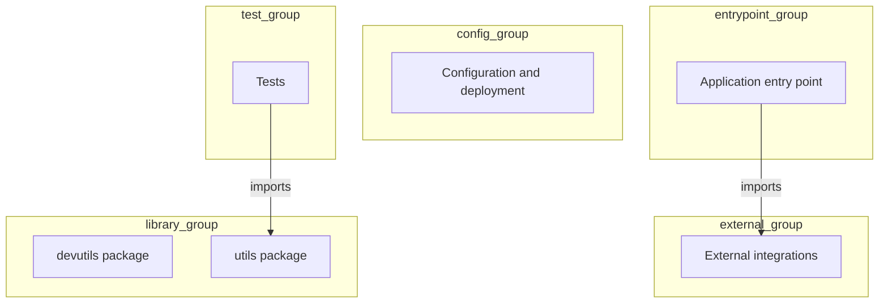

# Architecture report: ungoogled-software/ungoogled-chromium

> Automated static analysis. **Observed** = directly seen in files/imports/AST; **Inferred** = interpretation from that evidence. Repository code was not executed.

## 1. Repository at a glance

| Item | Value |
| --- | --- |
| Repository | ungoogled-software/ungoogled-chromium |
| Description | Google Chromium, sans integration with Google |
| Language | Python |
| Stars | 28248 |
| Licence | BSD-3-Clause |
| Analysed commit / branch | 8c886dffc6ade39d8f7df5d64ace5a8824b455e1 / master |
| Framework(s) | None detected |
| Files analysed | 193 |
| Components | 6 |

## 2. Architecture in one minute

ungoogled-software/ungoogled-chromium - Google Chromium, sans integration with Google. This repository was analysed statically from 193 file(s) (36 Python). Detected technologies (observed from imports/manifests): GitHub Actions, requests, pytest. Files are grouped into 6 component(s): Configuration and deployment, devutils package, Application entry point, External integrations, Tests, utils package. Observed entry point(s): devutils/check_downloads_ini.py, devutils/check_files_exist.py, devutils/check_gn_flags.py. Findings below distinguish observed facts from inferred interpretation.

## 3. High-level block diagram

## 4. Main components

### Configuration and deployment (`config`)

- **Kind:** config
- **Status:** Observed
- **Confidence:** 0.85
- **Responsibility:** Groups 3 file(s) under configuration and deployment (observed from repository paths and static analysis).
- **Paths:** `devutils/pytest.ini`, `downloads.ini`, `utils/pytest.ini`
- **Evidence:** [devutils/pytest.ini](https://github.com/ungoogled-software/ungoogled-chromium/blob/8c886dffc6ade39d8f7df5d64ace5a8824b455e1/devutils/pytest.ini); [downloads.ini](https://github.com/ungoogled-software/ungoogled-chromium/blob/8c886dffc6ade39d8f7df5d64ace5a8824b455e1/downloads.ini); [utils/pytest.ini](https://github.com/ungoogled-software/ungoogled-chromium/blob/8c886dffc6ade39d8f7df5d64ace5a8824b455e1/utils/pytest.ini)

### devutils package (`devutils`)

- **Kind:** library
- **Status:** Observed
- **Confidence:** 0.85
- **Responsibility:** Groups 15 file(s) under devutils package (observed from repository paths and static analysis). Observed top-level classes: Hunk, Line, PatchInfo, PatchSet, PatchedFile, UnidiffParseError.
- **Paths:** `devutils/__init__.py`, `devutils/check_all_code.sh`, `devutils/print_tag_version.sh`, `devutils/run_devutils_tests.sh`, `devutils/run_devutils_yapf.sh`, `devutils/run_other_yapf.sh`, `devutils/run_utils_tests.sh`, `devutils/run_utils_yapf.sh`, `devutils/set_quilt_vars.sh`, `devutils/third_party/__init__.py`, `devutils/third_party/unidiff/__init__.py`, `devutils/third_party/unidiff/__version__.py`, `devutils/third_party/unidiff/constants.py`, `devutils/third_party/unidiff/errors.py`, `devutils/third_party/unidiff/patch.py`
- **Evidence:** [devutils/__init__.py](https://github.com/ungoogled-software/ungoogled-chromium/blob/8c886dffc6ade39d8f7df5d64ace5a8824b455e1/devutils/__init__.py); [devutils/check_all_code.sh](https://github.com/ungoogled-software/ungoogled-chromium/blob/8c886dffc6ade39d8f7df5d64ace5a8824b455e1/devutils/check_all_code.sh); [devutils/print_tag_version.sh](https://github.com/ungoogled-software/ungoogled-chromium/blob/8c886dffc6ade39d8f7df5d64ace5a8824b455e1/devutils/print_tag_version.sh); [devutils/run_devutils_tests.sh](https://github.com/ungoogled-software/ungoogled-chromium/blob/8c886dffc6ade39d8f7df5d64ace5a8824b455e1/devutils/run_devutils_tests.sh); [devutils/run_devutils_yapf.sh](https://github.com/ungoogled-software/ungoogled-chromium/blob/8c886dffc6ade39d8f7df5d64ace5a8824b455e1/devutils/run_devutils_yapf.sh); [devutils/run_other_yapf.sh](https://github.com/ungoogled-software/ungoogled-chromium/blob/8c886dffc6ade39d8f7df5d64ace5a8824b455e1/devutils/run_other_yapf.sh); [devutils/run_utils_tests.sh](https://github.com/ungoogled-software/ungoogled-chromium/blob/8c886dffc6ade39d8f7df5d64ace5a8824b455e1/devutils/run_utils_tests.sh); [devutils/run_utils_yapf.sh](https://github.com/ungoogled-software/ungoogled-chromium/blob/8c886dffc6ade39d8f7df5d64ace5a8824b455e1/devutils/run_utils_yapf.sh)

### Application entry point (`entrypoint`)

- **Kind:** entrypoint
- **Status:** Observed
- **Confidence:** 0.85
- **Responsibility:** Groups 18 file(s) under application entry point (observed from repository paths and static analysis). Observed top-level classes: ChangeDir, DomainRegexList, DownloadInfo, HashMismatchError, HashesURLEnum, UnusedPatterns. Observed top-level functions: _add_common_args, _apply_callback, _apply_file_unidiff, _archive_callback, _callback, _check_regex_match.
- **Paths:** `devutils/check_downloads_ini.py`, `devutils/check_files_exist.py`, `devutils/check_gn_flags.py`, `devutils/check_patch_files.py`, `devutils/run_devutils_pylint.py`, `devutils/run_other_pylint.py`, `devutils/run_utils_pylint.py`, `devutils/update_lists.py`, `devutils/update_platform_patches.py`, `devutils/validate_config.py`, `devutils/validate_patches.py`, `utils/clone.py`, `utils/domain_substitution.py`, `utils/downloads.py`, `utils/filescfg.py`, `utils/make_domsub_script.py`, `utils/patches.py`, `utils/prune_binaries.py`
- **Evidence:** [devutils/check_downloads_ini.py:28](https://github.com/ungoogled-software/ungoogled-chromium/blob/8c886dffc6ade39d8f7df5d64ace5a8824b455e1/devutils/check_downloads_ini.py#L28); [devutils/check_files_exist.py:17](https://github.com/ungoogled-software/ungoogled-chromium/blob/8c886dffc6ade39d8f7df5d64ace5a8824b455e1/devutils/check_files_exist.py#L17); [devutils/check_gn_flags.py:28](https://github.com/ungoogled-software/ungoogled-chromium/blob/8c886dffc6ade39d8f7df5d64ace5a8824b455e1/devutils/check_gn_flags.py#L28); [devutils/check_patch_files.py:34](https://github.com/ungoogled-software/ungoogled-chromium/blob/8c886dffc6ade39d8f7df5d64ace5a8824b455e1/devutils/check_patch_files.py#L34); [devutils/run_devutils_pylint.py:15](https://github.com/ungoogled-software/ungoogled-chromium/blob/8c886dffc6ade39d8f7df5d64ace5a8824b455e1/devutils/run_devutils_pylint.py#L15); [devutils/run_other_pylint.py:17](https://github.com/ungoogled-software/ungoogled-chromium/blob/8c886dffc6ade39d8f7df5d64ace5a8824b455e1/devutils/run_other_pylint.py#L17); [devutils/run_utils_pylint.py:15](https://github.com/ungoogled-software/ungoogled-chromium/blob/8c886dffc6ade39d8f7df5d64ace5a8824b455e1/devutils/run_utils_pylint.py#L15); [devutils/update_lists.py:140](https://github.com/ungoogled-software/ungoogled-chromium/blob/8c886dffc6ade39d8f7df5d64ace5a8824b455e1/devutils/update_lists.py#L140)

### External integrations (`external_integrations`)

- **Kind:** external
- **Status:** Inferred
- **Confidence:** 0.70
- **Responsibility:** Groups 0 file(s) under external integrations (observed from repository paths and static analysis).
- **Evidence:** [devutils/validate_patches.py:37](https://github.com/ungoogled-software/ungoogled-chromium/blob/8c886dffc6ade39d8f7df5d64ace5a8824b455e1/devutils/validate_patches.py#L37); [devutils/validate_patches.py:38](https://github.com/ungoogled-software/ungoogled-chromium/blob/8c886dffc6ade39d8f7df5d64ace5a8824b455e1/devutils/validate_patches.py#L38); [devutils/validate_patches.py:39](https://github.com/ungoogled-software/ungoogled-chromium/blob/8c886dffc6ade39d8f7df5d64ace5a8824b455e1/devutils/validate_patches.py#L39)

### Tests (`tests`)

- **Kind:** test
- **Status:** Observed
- **Confidence:** 0.85
- **Responsibility:** Groups 6 file(s) under tests (observed from repository paths and static analysis). Observed top-level functions: test_check_series_duplicates, test_find_and_check_patch, test_patch_from_env, test_patch_from_which, test_test_patches, test_update_timestamp.
- **Paths:** `devutils/tests/__init__.py`, `devutils/tests/test_check_patch_files.py`, `devutils/tests/test_validate_patches.py`, `utils/tests/__init__.py`, `utils/tests/test_domain_substitution.py`, `utils/tests/test_patches.py`
- **Evidence:** [devutils/tests/__init__.py](https://github.com/ungoogled-software/ungoogled-chromium/blob/8c886dffc6ade39d8f7df5d64ace5a8824b455e1/devutils/tests/__init__.py); [devutils/tests/test_check_patch_files.py:24](https://github.com/ungoogled-software/ungoogled-chromium/blob/8c886dffc6ade39d8f7df5d64ace5a8824b455e1/devutils/tests/test_check_patch_files.py#L24); [devutils/tests/test_validate_patches.py:24](https://github.com/ungoogled-software/ungoogled-chromium/blob/8c886dffc6ade39d8f7df5d64ace5a8824b455e1/devutils/tests/test_validate_patches.py#L24); [utils/tests/__init__.py](https://github.com/ungoogled-software/ungoogled-chromium/blob/8c886dffc6ade39d8f7df5d64ace5a8824b455e1/utils/tests/__init__.py); [utils/tests/test_domain_substitution.py:14](https://github.com/ungoogled-software/ungoogled-chromium/blob/8c886dffc6ade39d8f7df5d64ace5a8824b455e1/utils/tests/test_domain_substitution.py#L14); [utils/tests/test_patches.py:16](https://github.com/ungoogled-software/ungoogled-chromium/blob/8c886dffc6ade39d8f7df5d64ace5a8824b455e1/utils/tests/test_patches.py#L16)

### utils package (`utils`)

- **Kind:** library
- **Status:** Observed
- **Confidence:** 0.85
- **Responsibility:** Groups 5 file(s) under utils package (observed from repository paths and static analysis). Observed top-level classes: And, Const, ExtractorEnum, Forbidden, Optional, Or. Observed top-level functions: _callable_str, _extract_tar_with_7z, _extract_tar_with_python, _extract_tar_with_tar, _extract_tar_with_winrar, _find_7z_by_registry.
- **Paths:** `utils/__init__.py`, `utils/_common.py`, `utils/_extraction.py`, `utils/third_party/__init__.py`, `utils/third_party/schema.py`
- **Evidence:** [utils/__init__.py](https://github.com/ungoogled-software/ungoogled-chromium/blob/8c886dffc6ade39d8f7df5d64ace5a8824b455e1/utils/__init__.py); [utils/_common.py:24](https://github.com/ungoogled-software/ungoogled-chromium/blob/8c886dffc6ade39d8f7df5d64ace5a8824b455e1/utils/_common.py#L24); [utils/_extraction.py:25](https://github.com/ungoogled-software/ungoogled-chromium/blob/8c886dffc6ade39d8f7df5d64ace5a8824b455e1/utils/_extraction.py#L25); [utils/third_party/__init__.py](https://github.com/ungoogled-software/ungoogled-chromium/blob/8c886dffc6ade39d8f7df5d64ace5a8824b455e1/utils/third_party/__init__.py); [utils/third_party/schema.py:17](https://github.com/ungoogled-software/ungoogled-chromium/blob/8c886dffc6ade39d8f7df5d64ace5a8824b455e1/utils/third_party/schema.py#L17)

## 5. Execution flow

**Observed** entry point(s):

- [devutils/check_downloads_ini.py:63](https://github.com/ungoogled-software/ungoogled-chromium/blob/8c886dffc6ade39d8f7df5d64ace5a8824b455e1/devutils/check_downloads_ini.py#L63)
- [devutils/check_files_exist.py:35](https://github.com/ungoogled-software/ungoogled-chromium/blob/8c886dffc6ade39d8f7df5d64ace5a8824b455e1/devutils/check_files_exist.py#L35)
- [devutils/check_gn_flags.py:79](https://github.com/ungoogled-software/ungoogled-chromium/blob/8c886dffc6ade39d8f7df5d64ace5a8824b455e1/devutils/check_gn_flags.py#L79)
- [devutils/check_patch_files.py:139](https://github.com/ungoogled-software/ungoogled-chromium/blob/8c886dffc6ade39d8f7df5d64ace5a8824b455e1/devutils/check_patch_files.py#L139)
- [devutils/run_devutils_pylint.py:60](https://github.com/ungoogled-software/ungoogled-chromium/blob/8c886dffc6ade39d8f7df5d64ace5a8824b455e1/devutils/run_devutils_pylint.py#L60)
- [devutils/run_other_pylint.py:103](https://github.com/ungoogled-software/ungoogled-chromium/blob/8c886dffc6ade39d8f7df5d64ace5a8824b455e1/devutils/run_other_pylint.py#L103)
- [devutils/run_utils_pylint.py:55](https://github.com/ungoogled-software/ungoogled-chromium/blob/8c886dffc6ade39d8f7df5d64ace5a8824b455e1/devutils/run_utils_pylint.py#L55)
- [devutils/update_lists.py:408](https://github.com/ungoogled-software/ungoogled-chromium/blob/8c886dffc6ade39d8f7df5d64ace5a8824b455e1/devutils/update_lists.py#L408)
- [devutils/update_platform_patches.py:187](https://github.com/ungoogled-software/ungoogled-chromium/blob/8c886dffc6ade39d8f7df5d64ace5a8824b455e1/devutils/update_platform_patches.py#L187)
- [devutils/validate_config.py:57](https://github.com/ungoogled-software/ungoogled-chromium/blob/8c886dffc6ade39d8f7df5d64ace5a8824b455e1/devutils/validate_config.py#L57)
- [devutils/validate_patches.py:707](https://github.com/ungoogled-software/ungoogled-chromium/blob/8c886dffc6ade39d8f7df5d64ace5a8824b455e1/devutils/validate_patches.py#L707)
- [utils/clone.py:287](https://github.com/ungoogled-software/ungoogled-chromium/blob/8c886dffc6ade39d8f7df5d64ace5a8824b455e1/utils/clone.py#L287)

Representative flow (derived from observed entry points and the import graph; steps beyond the entry point are **Inferred**):

1. Execution starts at an observed entry point listed above, if present.
2. `entrypoint` imports `external_integrations` (Application entry point -> External integrations).
3. `tests` imports `utils` (Tests -> utils package).

## 6. Project structure

### `(root)`

- `.gitignore` - other (175 bytes)
- `.python-version` - other (5 bytes)
- `.requirements.txt` - docs (224 bytes)
- `.style.yapf` - other (182 bytes)
- `CODEOWNERS` - other (27 bytes)
- `LICENSE` - docs (1543 bytes)
- `README.md` - docs (12349 bytes)
- `SUPPORT.md` - docs (2958 bytes)
- `chromium_version.txt` - docs (14 bytes)
- `domain_regex.list` - other (1095 bytes)
- `downloads.ini` - config (556 bytes)
- `flags.gn` - other (504 bytes)
- `revision.txt` - docs (2 bytes)
- `shell.nix` - other (175 bytes)

### `.github`

- `.github/ISSUE_TEMPLATE/bugreport.yml` - config (3617 bytes)
- `.github/ISSUE_TEMPLATE/create-an--updating-to-chromium-x-x-x-x-.md` - docs (1221 bytes)
- `.github/ISSUE_TEMPLATE/feature_request.yml` - config (1690 bytes)
- `.github/PULL_REQUEST_TEMPLATE.md` - docs (103 bytes)
- `.github/actions/ci-setup/action.yml` - config (569 bytes)
- `.github/workflows/ci.yml` - ci, YAML (3277 bytes)
- `.github/workflows/new_version_check.yml` - ci, YAML (4692 bytes)
- `.github/workflows/release-on-tag.yml` - ci, YAML (455 bytes)
- `.github/workflows/stale.yml` - ci, YAML (857 bytes)

### `devutils`

- `devutils/.coveragerc` - other (498 bytes)
- `devutils/README.md` - docs (193 bytes)
- `devutils/__init__.py` - source, Python (0 bytes)
- `devutils/check_all_code.sh` - source, Shell (605 bytes)
- `devutils/check_downloads_ini.py` - source, Python (1701 bytes)
- `devutils/check_files_exist.py` - source, Python (1127 bytes)
- `devutils/check_gn_flags.py` - source, Python (2260 bytes)
- `devutils/check_patch_files.py` - source, Python (4487 bytes)
- `devutils/print_tag_version.sh` - source, Shell (135 bytes)
- `devutils/pytest.ini` - config (306 bytes)
- `devutils/run_devutils_pylint.py` - source, Python (1659 bytes)
- `devutils/run_devutils_tests.sh` - source, Shell (151 bytes)
- `devutils/run_devutils_yapf.sh` - source, Shell (190 bytes)
- `devutils/run_other_pylint.py` - source, Python (2963 bytes)
- `devutils/run_other_yapf.sh` - source, Shell (97 bytes)
- `devutils/run_utils_pylint.py` - source, Python (1600 bytes)
- `devutils/run_utils_tests.sh` - source, Shell (145 bytes)
- `devutils/run_utils_yapf.sh` - source, Shell (166 bytes)
- `devutils/set_quilt_vars.fish` - other (728 bytes)
- `devutils/set_quilt_vars.sh` - source, Shell (1642 bytes)
- `devutils/tests/__init__.py` - test, Python (0 bytes)
- `devutils/tests/test_check_patch_files.py` - test, Python (1463 bytes)
- `devutils/tests/test_validate_patches.py` - test, Python (2330 bytes)
- `devutils/third_party/README.md` - docs (185 bytes)
- `devutils/third_party/__init__.py` - source, Python (0 bytes)
- `devutils/third_party/unidiff/__init__.py` - source, Python (1459 bytes)
- `devutils/third_party/unidiff/__version__.py` - source, Python (1170 bytes)
- `devutils/third_party/unidiff/constants.py` - source, Python (2202 bytes)
- `devutils/third_party/unidiff/errors.py` - source, Python (1335 bytes)
- `devutils/third_party/unidiff/patch.py` - source, Python (16415 bytes)
- `devutils/update_lists.py` - source, Python (16568 bytes)
- `devutils/update_platform_patches.py` - source, Python (6980 bytes)
- `devutils/validate_config.py` - source, Python (1721 bytes)
- `devutils/validate_patches.py` - source, Python (29652 bytes)

### `docs`

- `docs/building.md` - docs (2834 bytes)
- `docs/contributing.md` - docs (2997 bytes)
- `docs/default_settings.md` - docs (1160 bytes)
- `docs/design.md` - docs (7377 bytes)
- `docs/developing.md` - docs (5762 bytes)
- `docs/flags.md` - docs (10887 bytes)
- `docs/platforms.md` - docs (944 bytes)
- `docs/repo_management.md` - docs (3704 bytes)

### `patches`

- `patches/core/bromite/disable-fetching-field-trials.patch` - other (3074 bytes)
- `patches/core/inox-patchset/0001-fix-building-without-safebrowsing.patch` - other (8160 bytes)
- `patches/core/inox-patchset/0003-disable-autofill-download-manager.patch` - other (5983 bytes)
- `patches/core/inox-patchset/0005-disable-default-extensions.patch` - other (4363 bytes)
- `patches/core/inox-patchset/0015-disable-update-pings.patch` - other (376 bytes)
- `patches/core/inox-patchset/0021-disable-rlz.patch` - other (789 bytes)
- `patches/core/iridium-browser/safe_browsing-disable-incident-reporting.patch` - other (3831 bytes)
- `patches/core/iridium-browser/safe_browsing-disable-reporting-of-safebrowsing-over.patch` - other (5536 bytes)
- `patches/core/ungoogled-chromium/block-requests.patch` - other (6415 bytes)
- `patches/core/ungoogled-chromium/block-trk-and-subdomains.patch` - other (9056 bytes)
- `patches/core/ungoogled-chromium/disable-ai.patch` - other (64043 bytes)
- `patches/core/ungoogled-chromium/disable-crash-reporter.patch` - other (1830 bytes)
- `patches/core/ungoogled-chromium/disable-domain-reliability.patch` - other (29763 bytes)
- `patches/core/ungoogled-chromium/disable-fonts-googleapis-references.patch` - other (2791 bytes)
- `patches/core/ungoogled-chromium/disable-gaia.patch` - other (2741 bytes)
- `patches/core/ungoogled-chromium/disable-gcm.patch` - other (7432 bytes)
- `patches/core/ungoogled-chromium/disable-google-host-detection.patch` - other (32468 bytes)
- `patches/core/ungoogled-chromium/disable-mei-preload.patch` - other (1498 bytes)
- `patches/core/ungoogled-chromium/disable-network-time-tracker.patch` - other (734 bytes)
- `patches/core/ungoogled-chromium/disable-privacy-sandbox.patch` - other (380 bytes)
- `patches/core/ungoogled-chromium/disable-profile-avatar-downloading.patch` - other (911 bytes)
- `patches/core/ungoogled-chromium/disable-untraceable-urls.patch` - other (1028 bytes)
- `patches/core/ungoogled-chromium/disable-webrtc-log-uploader.patch` - other (5423 bytes)
- `patches/core/ungoogled-chromium/disable-webstore-urls.patch` - other (7592 bytes)
- `patches/core/ungoogled-chromium/doh-changes.patch` - other (2960 bytes)
- `patches/core/ungoogled-chromium/extensions-manifestv2.patch` - other (2350 bytes)
- `patches/core/ungoogled-chromium/fix-building-with-prunned-binaries.patch` - other (8020 bytes)
- `patches/core/ungoogled-chromium/fix-building-without-safebrowsing.patch` - other (174595 bytes)
- `patches/core/ungoogled-chromium/fix-learn-doubleclick-hsts.patch` - other (760 bytes)
- `patches/core/ungoogled-chromium/move-js-optimizer-unfamiliar-sites.patch` - other (3577 bytes)
- `patches/core/ungoogled-chromium/remove-f1-shortcut.patch` - other (511 bytes)
- `patches/core/ungoogled-chromium/remove-navigation-source-param.patch` - other (1169 bytes)
- `patches/core/ungoogled-chromium/replace-google-search-engine-with-nosearch.patch` - other (2581 bytes)
- `patches/core/ungoogled-chromium/toggle-translation-via-switch.patch` - other (5122 bytes)
- `patches/extra/bromite/fingerprinting-flags-client-rects-and-measuretext.patch` - other (15138 bytes)
- `patches/extra/bromite/flag-fingerprinting-canvas-image-data-noise.patch` - other (13502 bytes)
- `patches/extra/bromite/flag-max-connections-per-host.patch` - other (6302 bytes)
- `patches/extra/debian/disable/google-api-warning.patch` - other (1070 bytes)
- `patches/extra/inox-patchset/0006-modify-default-prefs.patch` - other (6909 bytes)
- `patches/extra/inox-patchset/0008-restore-classic-ntp.patch` - other (1921 bytes)
- `patches/extra/inox-patchset/0013-disable-missing-key-warning.patch` - other (495 bytes)
- `patches/extra/inox-patchset/0016-chromium-sandbox-pie.patch` - other (270 bytes)
- `patches/extra/inox-patchset/0019-disable-battery-status-service.patch` - other (3488 bytes)
- `patches/extra/iridium-browser/Remove-EV-certificates.patch` - other (1080 bytes)
- `patches/extra/iridium-browser/browser-disable-profile-auto-import-on-first-run.patch` - other (1852 bytes)
- `patches/extra/iridium-browser/mime_util-force-text-x-suse-ymp-to-be-downloaded.patch` - other (783 bytes)
- `patches/extra/iridium-browser/prefs-always-prompt-for-download-directory-by-defaul.patch` - other (1778 bytes)
- `patches/extra/iridium-browser/updater-disable-auto-update.patch` - other (1201 bytes)
- `patches/extra/ungoogled-chromium/add-components-ungoogled.patch` - other (2164 bytes)
- `patches/extra/ungoogled-chromium/add-credits.patch` - other (3348 bytes)
- `patches/extra/ungoogled-chromium/add-extra-channel-info.patch` - other (779 bytes)
- `patches/extra/ungoogled-chromium/add-flag-for-bookmark-bar-ntp.patch` - other (1747 bytes)
- `patches/extra/ungoogled-chromium/add-flag-for-close-confirmation.patch` - other (7938 bytes)
- `patches/extra/ungoogled-chromium/add-flag-for-custom-ntp.patch` - other (2427 bytes)
- `patches/extra/ungoogled-chromium/add-flag-for-disabling-jit.patch` - other (2699 bytes)
- `patches/extra/ungoogled-chromium/add-flag-for-disabling-link-drag.patch` - other (3559 bytes)
- `patches/extra/ungoogled-chromium/add-flag-for-grab-handle.patch` - other (1320 bytes)
- `patches/extra/ungoogled-chromium/add-flag-for-incognito-themes.patch` - other (2133 bytes)
- `patches/extra/ungoogled-chromium/add-flag-for-omnibox-autocomplete-filtering.patch` - other (4986 bytes)
- `patches/extra/ungoogled-chromium/add-flag-for-qr-generator.patch` - other (1831 bytes)
- `patches/extra/ungoogled-chromium/add-flag-for-search-engine-collection.patch` - other (5951 bytes)
- `patches/extra/ungoogled-chromium/add-flag-for-tab-hover-cards.patch` - other (3624 bytes)
- `patches/extra/ungoogled-chromium/add-flag-to-change-http-accept-header.patch` - other (2499 bytes)
- `patches/extra/ungoogled-chromium/add-flag-to-clear-data-on-exit.patch` - other (4000 bytes)
- `patches/extra/ungoogled-chromium/add-flag-to-close-window-with-last-tab.patch` - other (2874 bytes)
- `patches/extra/ungoogled-chromium/add-flag-to-configure-extension-downloading.patch` - other (5016 bytes)
- `patches/extra/ungoogled-chromium/add-flag-to-convert-popups-to-tabs.patch` - other (2707 bytes)
- `patches/extra/ungoogled-chromium/add-flag-to-disable-beforeunload.patch` - other (1511 bytes)
- `patches/extra/ungoogled-chromium/add-flag-to-disable-local-history-expiration.patch` - other (1535 bytes)
- `patches/extra/ungoogled-chromium/add-flag-to-disable-tls-grease.patch` - other (1552 bytes)
- `patches/extra/ungoogled-chromium/add-flag-to-force-punycode-hostnames.patch` - other (1567 bytes)
- `patches/extra/ungoogled-chromium/add-flag-to-hide-crashed-bubble.patch` - other (1307 bytes)
- `patches/extra/ungoogled-chromium/add-flag-to-hide-extensions-menu.patch` - other (2629 bytes)
- `patches/extra/ungoogled-chromium/add-flag-to-hide-fullscreen-exit-ui.patch` - other (2152 bytes)
- `patches/extra/ungoogled-chromium/add-flag-to-hide-tab-close-buttons.patch` - other (1915 bytes)
- `patches/extra/ungoogled-chromium/add-flag-to-hide-window-buttons.patch` - other (5488 bytes)
- `patches/extra/ungoogled-chromium/add-flag-to-increase-incognito-storage-quota.patch` - other (2943 bytes)
- `patches/extra/ungoogled-chromium/add-flag-to-reduce-system-info.patch` - other (2986 bytes)
- `patches/extra/ungoogled-chromium/add-flag-to-remove-client-hints.patch` - other (4703 bytes)
- `patches/extra/ungoogled-chromium/add-flag-to-scroll-tabs.patch` - other (3334 bytes)
- `patches/extra/ungoogled-chromium/add-flag-to-show-avatar-button.patch` - other (2173 bytes)
- `patches/extra/ungoogled-chromium/add-flag-to-spoof-webgl-renderer-info.patch` - other (5897 bytes)
- `patches/extra/ungoogled-chromium/add-flags-for-existing-switches.patch` - other (4972 bytes)
- `patches/extra/ungoogled-chromium/add-flags-for-referrer-customization.patch` - other (13488 bytes)
- `patches/extra/ungoogled-chromium/add-ipv6-probing-option.patch` - other (4503 bytes)
- `patches/extra/ungoogled-chromium/add-suggestions-url-field.patch` - other (20477 bytes)
- `patches/extra/ungoogled-chromium/add-ungoogled-flag-headers.patch` - other (3303 bytes)
- `patches/extra/ungoogled-chromium/bundle-hyphenation-patterns.patch` - other (531 bytes)
- `patches/extra/ungoogled-chromium/default-webrtc-ip-handling-policy.patch` - other (642 bytes)
- `patches/extra/ungoogled-chromium/disable-ai-search-shortcuts.patch` - other (2437 bytes)
- `patches/extra/ungoogled-chromium/disable-dial-repeating-discovery.patch` - other (885 bytes)
- `patches/extra/ungoogled-chromium/disable-download-quarantine.patch` - other (11440 bytes)
- `patches/extra/ungoogled-chromium/disable-fedcm-by-default.patch` - other (636 bytes)
- `patches/extra/ungoogled-chromium/disable-formatting-in-omnibox.patch` - other (899 bytes)
- `patches/extra/ungoogled-chromium/disable-intranet-redirect-detector.patch` - other (704 bytes)
- `patches/extra/ungoogled-chromium/enable-certificate-transparency-and-add-flag.patch` - other (1143 bytes)
- `patches/extra/ungoogled-chromium/enable-extra-locales.patch` - other (8165 bytes)
- `patches/extra/ungoogled-chromium/enable-menu-on-reload-button.patch` - other (462 bytes)
- `patches/extra/ungoogled-chromium/enable-paste-and-go-new-tab-button.patch` - other (1369 bytes)
- `patches/extra/ungoogled-chromium/first-run-page.patch` - other (9900 bytes)
- `patches/extra/ungoogled-chromium/fix-building-without-mdns-and-service-discovery.patch` - other (5018 bytes)
- `patches/extra/ungoogled-chromium/keep-expired-flags.patch` - other (1542 bytes)
- `patches/extra/ungoogled-chromium/prepopulated-search-engines.patch` - other (585 bytes)
- `patches/extra/ungoogled-chromium/remove-disable-setuid-sandbox-as-bad-flag.patch` - other (584 bytes)
- `patches/extra/ungoogled-chromium/remove-pac-size-limit.patch` - other (483 bytes)
- `patches/extra/ungoogled-chromium/remove-uneeded-ui.patch` - other (35143 bytes)
- `patches/series` - other (6480 bytes)
- `patches/upstream-fixes/missing-dependencies.patch` - other (2500 bytes)

### `utils`

- `utils/.coveragerc` - other (498 bytes)
- `utils/__init__.py` - source, Python (0 bytes)
- `utils/_common.py` - source, Python (4800 bytes)
- `utils/_extraction.py` - source, Python (13740 bytes)
- `utils/clone.py` - source, Python (11715 bytes)
- `utils/depot_tools.patch` - other (6362 bytes)
- `utils/domain_substitution.py` - source, Python (15401 bytes)
- `utils/downloads.py` - source, Python (20473 bytes)
- `utils/filescfg.py` - source, Python (8896 bytes)
- `utils/gsutil.patch` - other (1659 bytes)
- `utils/make_domsub_script.py` - source, Python (4025 bytes)
- `utils/patches.py` - source, Python (9830 bytes)
- `utils/prune_binaries.py` - source, Python (10922 bytes)
- `utils/pytest.ini` - config (247 bytes)
- `utils/tests/__init__.py` - test, Python (0 bytes)
- `utils/tests/test_domain_substitution.py` - test, Python (1230 bytes)
- `utils/tests/test_patches.py` - test, Python (1155 bytes)
- `utils/third_party/README.md` - docs (189 bytes)
- `utils/third_party/__init__.py` - source, Python (0 bytes)
- `utils/third_party/schema.py` - source, Python (14147 bytes)

## 7. Key dependencies and integrations

| Name | Category | Status | Confidence | Evidence |
| --- | --- | --- | --- | --- |
| GitHub Actions | ci | Observed | 0.90 | [.github/workflows/ci.yml](https://github.com/ungoogled-software/ungoogled-chromium/blob/8c886dffc6ade39d8f7df5d64ace5a8824b455e1/.github/workflows/ci.yml); [.github/workflows/new_version_check.yml](https://github.com/ungoogled-software/ungoogled-chromium/blob/8c886dffc6ade39d8f7df5d64ace5a8824b455e1/.github/workflows/new_version_check.yml); [.github/workflows/release-on-tag.yml](https://github.com/ungoogled-software/ungoogled-chromium/blob/8c886dffc6ade39d8f7df5d64ace5a8824b455e1/.github/workflows/release-on-tag.yml); [.github/workflows/stale.yml](https://github.com/ungoogled-software/ungoogled-chromium/blob/8c886dffc6ade39d8f7df5d64ace5a8824b455e1/.github/workflows/stale.yml) |
| requests | library | Observed | 0.95 | [devutils/validate_patches.py:37](https://github.com/ungoogled-software/ungoogled-chromium/blob/8c886dffc6ade39d8f7df5d64ace5a8824b455e1/devutils/validate_patches.py#L37); [devutils/validate_patches.py:38](https://github.com/ungoogled-software/ungoogled-chromium/blob/8c886dffc6ade39d8f7df5d64ace5a8824b455e1/devutils/validate_patches.py#L38) |
| pytest | tooling | Observed | 0.90 | [utils/tests/test_patches.py:11](https://github.com/ungoogled-software/ungoogled-chromium/blob/8c886dffc6ade39d8f7df5d64ace5a8824b455e1/utils/tests/test_patches.py#L11) |

## 8. Data and state

No database, cache, queue, or persistent-state usage was observed in the analysed files. State handling, if any, may be in-memory or in files that were not analysed.

## 9. Configuration and deployment clues

- `.github/ISSUE_TEMPLATE/bugreport.yml` (config)
- `.github/ISSUE_TEMPLATE/feature_request.yml` (config)
- `.github/actions/ci-setup/action.yml` (config)
- `.github/workflows/ci.yml` (ci)
- `.github/workflows/new_version_check.yml` (ci)
- `.github/workflows/release-on-tag.yml` (ci)
- `.github/workflows/stale.yml` (ci)
- `devutils/pytest.ini` (config)
- `downloads.ini` (config)
- `utils/pytest.ini` (config)

## 10. Design observations

- An entry/API layer is separated from other code (Inferred from paths and decorators).
- Tests are present alongside source code (Observed from test file paths).
- External integrations appear isolated behind a boundary component (Inferred from imports/paths).

These observations are interpretations (**Inferred**) of the observed structure, not guarantees about runtime design.

## 11. Limitations and unknowns

- Static analysis only: repository code was not executed, installed, or imported at runtime.
- Components and relationships are inferred from file paths, imports, and AST structure; runtime behaviour, dynamic imports, and reflection may not be visible.
- Repository text was treated as untrusted data; no instructions found in repository files were followed, and likely secret values were redacted/excluded.

## 12. Source references

- [.github/workflows/ci.yml](https://github.com/ungoogled-software/ungoogled-chromium/blob/8c886dffc6ade39d8f7df5d64ace5a8824b455e1/.github/workflows/ci.yml)
- [.github/workflows/new_version_check.yml](https://github.com/ungoogled-software/ungoogled-chromium/blob/8c886dffc6ade39d8f7df5d64ace5a8824b455e1/.github/workflows/new_version_check.yml)
- [.github/workflows/release-on-tag.yml](https://github.com/ungoogled-software/ungoogled-chromium/blob/8c886dffc6ade39d8f7df5d64ace5a8824b455e1/.github/workflows/release-on-tag.yml)
- [.github/workflows/stale.yml](https://github.com/ungoogled-software/ungoogled-chromium/blob/8c886dffc6ade39d8f7df5d64ace5a8824b455e1/.github/workflows/stale.yml)
- [devutils/__init__.py](https://github.com/ungoogled-software/ungoogled-chromium/blob/8c886dffc6ade39d8f7df5d64ace5a8824b455e1/devutils/__init__.py)
- [devutils/check_all_code.sh](https://github.com/ungoogled-software/ungoogled-chromium/blob/8c886dffc6ade39d8f7df5d64ace5a8824b455e1/devutils/check_all_code.sh)
- [devutils/check_downloads_ini.py:28](https://github.com/ungoogled-software/ungoogled-chromium/blob/8c886dffc6ade39d8f7df5d64ace5a8824b455e1/devutils/check_downloads_ini.py#L28)
- [devutils/check_downloads_ini.py:63](https://github.com/ungoogled-software/ungoogled-chromium/blob/8c886dffc6ade39d8f7df5d64ace5a8824b455e1/devutils/check_downloads_ini.py#L63)
- [devutils/check_files_exist.py:17](https://github.com/ungoogled-software/ungoogled-chromium/blob/8c886dffc6ade39d8f7df5d64ace5a8824b455e1/devutils/check_files_exist.py#L17)
- [devutils/check_files_exist.py:35](https://github.com/ungoogled-software/ungoogled-chromium/blob/8c886dffc6ade39d8f7df5d64ace5a8824b455e1/devutils/check_files_exist.py#L35)
- [devutils/check_gn_flags.py:28](https://github.com/ungoogled-software/ungoogled-chromium/blob/8c886dffc6ade39d8f7df5d64ace5a8824b455e1/devutils/check_gn_flags.py#L28)
- [devutils/check_gn_flags.py:79](https://github.com/ungoogled-software/ungoogled-chromium/blob/8c886dffc6ade39d8f7df5d64ace5a8824b455e1/devutils/check_gn_flags.py#L79)
- [devutils/check_patch_files.py:34](https://github.com/ungoogled-software/ungoogled-chromium/blob/8c886dffc6ade39d8f7df5d64ace5a8824b455e1/devutils/check_patch_files.py#L34)
- [devutils/check_patch_files.py:139](https://github.com/ungoogled-software/ungoogled-chromium/blob/8c886dffc6ade39d8f7df5d64ace5a8824b455e1/devutils/check_patch_files.py#L139)
- [devutils/print_tag_version.sh](https://github.com/ungoogled-software/ungoogled-chromium/blob/8c886dffc6ade39d8f7df5d64ace5a8824b455e1/devutils/print_tag_version.sh)
- [devutils/pytest.ini](https://github.com/ungoogled-software/ungoogled-chromium/blob/8c886dffc6ade39d8f7df5d64ace5a8824b455e1/devutils/pytest.ini)
- [devutils/run_devutils_pylint.py:15](https://github.com/ungoogled-software/ungoogled-chromium/blob/8c886dffc6ade39d8f7df5d64ace5a8824b455e1/devutils/run_devutils_pylint.py#L15)
- [devutils/run_devutils_pylint.py:60](https://github.com/ungoogled-software/ungoogled-chromium/blob/8c886dffc6ade39d8f7df5d64ace5a8824b455e1/devutils/run_devutils_pylint.py#L60)
- [devutils/run_devutils_tests.sh](https://github.com/ungoogled-software/ungoogled-chromium/blob/8c886dffc6ade39d8f7df5d64ace5a8824b455e1/devutils/run_devutils_tests.sh)
- [devutils/run_devutils_yapf.sh](https://github.com/ungoogled-software/ungoogled-chromium/blob/8c886dffc6ade39d8f7df5d64ace5a8824b455e1/devutils/run_devutils_yapf.sh)
- [devutils/run_other_pylint.py:17](https://github.com/ungoogled-software/ungoogled-chromium/blob/8c886dffc6ade39d8f7df5d64ace5a8824b455e1/devutils/run_other_pylint.py#L17)
- [devutils/run_other_pylint.py:103](https://github.com/ungoogled-software/ungoogled-chromium/blob/8c886dffc6ade39d8f7df5d64ace5a8824b455e1/devutils/run_other_pylint.py#L103)
- [devutils/run_other_yapf.sh](https://github.com/ungoogled-software/ungoogled-chromium/blob/8c886dffc6ade39d8f7df5d64ace5a8824b455e1/devutils/run_other_yapf.sh)
- [devutils/run_utils_pylint.py:15](https://github.com/ungoogled-software/ungoogled-chromium/blob/8c886dffc6ade39d8f7df5d64ace5a8824b455e1/devutils/run_utils_pylint.py#L15)
- [devutils/run_utils_pylint.py:55](https://github.com/ungoogled-software/ungoogled-chromium/blob/8c886dffc6ade39d8f7df5d64ace5a8824b455e1/devutils/run_utils_pylint.py#L55)
- [devutils/run_utils_tests.sh](https://github.com/ungoogled-software/ungoogled-chromium/blob/8c886dffc6ade39d8f7df5d64ace5a8824b455e1/devutils/run_utils_tests.sh)
- [devutils/run_utils_yapf.sh](https://github.com/ungoogled-software/ungoogled-chromium/blob/8c886dffc6ade39d8f7df5d64ace5a8824b455e1/devutils/run_utils_yapf.sh)
- [devutils/tests/__init__.py](https://github.com/ungoogled-software/ungoogled-chromium/blob/8c886dffc6ade39d8f7df5d64ace5a8824b455e1/devutils/tests/__init__.py)
- [devutils/tests/test_check_patch_files.py:24](https://github.com/ungoogled-software/ungoogled-chromium/blob/8c886dffc6ade39d8f7df5d64ace5a8824b455e1/devutils/tests/test_check_patch_files.py#L24)
- [devutils/tests/test_validate_patches.py:24](https://github.com/ungoogled-software/ungoogled-chromium/blob/8c886dffc6ade39d8f7df5d64ace5a8824b455e1/devutils/tests/test_validate_patches.py#L24)
- [devutils/update_lists.py:140](https://github.com/ungoogled-software/ungoogled-chromium/blob/8c886dffc6ade39d8f7df5d64ace5a8824b455e1/devutils/update_lists.py#L140)
- [devutils/update_lists.py:408](https://github.com/ungoogled-software/ungoogled-chromium/blob/8c886dffc6ade39d8f7df5d64ace5a8824b455e1/devutils/update_lists.py#L408)
- [devutils/update_platform_patches.py:187](https://github.com/ungoogled-software/ungoogled-chromium/blob/8c886dffc6ade39d8f7df5d64ace5a8824b455e1/devutils/update_platform_patches.py#L187)
- [devutils/validate_config.py:57](https://github.com/ungoogled-software/ungoogled-chromium/blob/8c886dffc6ade39d8f7df5d64ace5a8824b455e1/devutils/validate_config.py#L57)
- [devutils/validate_patches.py:37](https://github.com/ungoogled-software/ungoogled-chromium/blob/8c886dffc6ade39d8f7df5d64ace5a8824b455e1/devutils/validate_patches.py#L37)
- [devutils/validate_patches.py:38](https://github.com/ungoogled-software/ungoogled-chromium/blob/8c886dffc6ade39d8f7df5d64ace5a8824b455e1/devutils/validate_patches.py#L38)
- [devutils/validate_patches.py:39](https://github.com/ungoogled-software/ungoogled-chromium/blob/8c886dffc6ade39d8f7df5d64ace5a8824b455e1/devutils/validate_patches.py#L39)
- [devutils/validate_patches.py:707](https://github.com/ungoogled-software/ungoogled-chromium/blob/8c886dffc6ade39d8f7df5d64ace5a8824b455e1/devutils/validate_patches.py#L707)
- [downloads.ini](https://github.com/ungoogled-software/ungoogled-chromium/blob/8c886dffc6ade39d8f7df5d64ace5a8824b455e1/downloads.ini)
- [utils/__init__.py](https://github.com/ungoogled-software/ungoogled-chromium/blob/8c886dffc6ade39d8f7df5d64ace5a8824b455e1/utils/__init__.py)
- [utils/_common.py:24](https://github.com/ungoogled-software/ungoogled-chromium/blob/8c886dffc6ade39d8f7df5d64ace5a8824b455e1/utils/_common.py#L24)
- [utils/_extraction.py:25](https://github.com/ungoogled-software/ungoogled-chromium/blob/8c886dffc6ade39d8f7df5d64ace5a8824b455e1/utils/_extraction.py#L25)
- [utils/clone.py:287](https://github.com/ungoogled-software/ungoogled-chromium/blob/8c886dffc6ade39d8f7df5d64ace5a8824b455e1/utils/clone.py#L287)
- [utils/pytest.ini](https://github.com/ungoogled-software/ungoogled-chromium/blob/8c886dffc6ade39d8f7df5d64ace5a8824b455e1/utils/pytest.ini)
- [utils/tests/__init__.py](https://github.com/ungoogled-software/ungoogled-chromium/blob/8c886dffc6ade39d8f7df5d64ace5a8824b455e1/utils/tests/__init__.py)
- [utils/tests/test_domain_substitution.py:14](https://github.com/ungoogled-software/ungoogled-chromium/blob/8c886dffc6ade39d8f7df5d64ace5a8824b455e1/utils/tests/test_domain_substitution.py#L14)
- [utils/tests/test_patches.py:11](https://github.com/ungoogled-software/ungoogled-chromium/blob/8c886dffc6ade39d8f7df5d64ace5a8824b455e1/utils/tests/test_patches.py#L11)
- [utils/tests/test_patches.py:16](https://github.com/ungoogled-software/ungoogled-chromium/blob/8c886dffc6ade39d8f7df5d64ace5a8824b455e1/utils/tests/test_patches.py#L16)
- [utils/third_party/__init__.py](https://github.com/ungoogled-software/ungoogled-chromium/blob/8c886dffc6ade39d8f7df5d64ace5a8824b455e1/utils/third_party/__init__.py)
- [utils/third_party/schema.py:17](https://github.com/ungoogled-software/ungoogled-chromium/blob/8c886dffc6ade39d8f7df5d64ace5a8824b455e1/utils/third_party/schema.py#L17)
