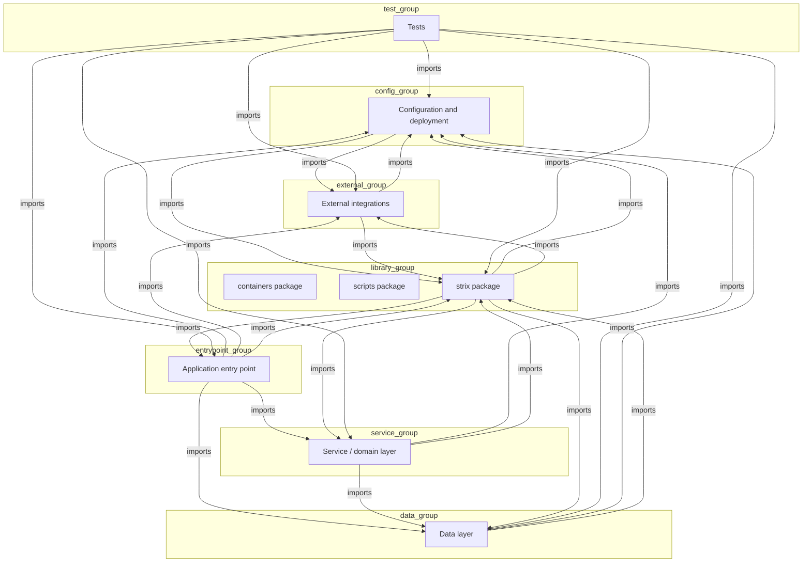

# Architecture report: usestrix/strix

> Automated static analysis. **Observed** = directly seen in files/imports/AST; **Inferred** = interpretation from that evidence. Repository code was not executed.

## 1. Repository at a glance

| Item | Value |
| --- | --- |
| Repository | usestrix/strix |
| Description | Open-source AI penetration testing tool to find and fix your app’s vulnerabilities. |
| Language | Python |
| Stars | 75546 |
| Licence | Apache-2.0 |
| Analysed commit / branch | 4719329d1c3eb0db796714397551945c514a2301 / main |
| Framework(s) | React |
| Files analysed | 538 |
| Components | 9 |

## 2. Architecture in one minute

usestrix/strix - Open-source AI penetration testing tool to find and fix your app’s vulnerabilities.. This repository was analysed statically from 538 file(s) (255 Python). Detected technologies (observed from imports/manifests): GitHub Actions, SQLite, React, AWS (boto3), httpx, Pydantic. Files are grouped into 9 component(s): Configuration and deployment, containers package, Data layer, Application entry point, External integrations, scripts package, Service / domain layer, strix package. Observed entry point(s): strix/interface/main.py. Findings below distinguish observed facts from inferred interpretation.

## 3. High-level block diagram

## 4. Main components

### Configuration and deployment (`config`)

- **Kind:** config
- **Status:** Observed
- **Confidence:** 0.85
- **Responsibility:** Groups 14 file(s) under configuration and deployment (observed from repository paths and static analysis). Observed top-level classes: BearerAuth, CodexAuthError, CodexContentGuardrailError, ContextSettings, DedupeSettings, IntegrationSettings. Observed top-level functions: _account_id_from_jwt, _aliases_for, _b64url, _decode_saved_value, _drop_stale_llm_connection, _first.
- **Paths:** `containers/Dockerfile`, `containers/opengrep-rules/github-owned-action-not-pinned-to-commit-sha.yaml`, `pyproject.toml`, `strix/config/__init__.py`, `strix/config/codex.py`, `strix/config/loader.py`, `strix/config/settings.py`, `strix/config/tool_call_arguments.py`, `strix/config/tool_call_ids.py`, `strix/config/tool_call_limits.py`, `strix/interface/tui/go.mod`, `strix/interface/viewer/frontend/package.json`, `strix/interface/viewer/frontend/tsconfig.json`, `strix/tools/mcp/config.py`
- **Evidence:** [containers/Dockerfile](https://github.com/usestrix/strix/blob/4719329d1c3eb0db796714397551945c514a2301/containers/Dockerfile); [containers/opengrep-rules/github-owned-action-not-pinned-to-commit-sha.yaml](https://github.com/usestrix/strix/blob/4719329d1c3eb0db796714397551945c514a2301/containers/opengrep-rules/github-owned-action-not-pinned-to-commit-sha.yaml); [pyproject.toml](https://github.com/usestrix/strix/blob/4719329d1c3eb0db796714397551945c514a2301/pyproject.toml); [strix/config/__init__.py](https://github.com/usestrix/strix/blob/4719329d1c3eb0db796714397551945c514a2301/strix/config/__init__.py); [strix/config/codex.py:63](https://github.com/usestrix/strix/blob/4719329d1c3eb0db796714397551945c514a2301/strix/config/codex.py#L63); [strix/config/loader.py:37](https://github.com/usestrix/strix/blob/4719329d1c3eb0db796714397551945c514a2301/strix/config/loader.py#L37); [strix/config/settings.py:17](https://github.com/usestrix/strix/blob/4719329d1c3eb0db796714397551945c514a2301/strix/config/settings.py#L17); [strix/config/tool_call_arguments.py:25](https://github.com/usestrix/strix/blob/4719329d1c3eb0db796714397551945c514a2301/strix/config/tool_call_arguments.py#L25)

### containers package (`containers`)

- **Kind:** library
- **Status:** Observed
- **Confidence:** 0.85
- **Responsibility:** Groups 1 file(s) under containers package (observed from repository paths and static analysis).
- **Paths:** `containers/docker-entrypoint.sh`
- **Evidence:** [containers/docker-entrypoint.sh](https://github.com/usestrix/strix/blob/4719329d1c3eb0db796714397551945c514a2301/containers/docker-entrypoint.sh)

### Data layer (`data_layer`)

- **Kind:** data
- **Status:** Observed
- **Confidence:** 0.85
- **Responsibility:** Groups 2 file(s) under data layer (observed from repository paths and static analysis). Observed top-level classes: StrixProvider, _CodexResponsesModel, _CredentialedLitellmProvider, _NonStreamingModel, _TurnGuardModel. Observed top-level functions: _aclose, _bare_openai_name, _catalog_entry, _catalog_supported_endpoints, _completed_stream_event, _configure_attribution.
- **Paths:** `strix/config/models.py`, `strix/interface/viewer/frontend/src/data/serverSource.ts`
- **Evidence:** [strix/config/models.py:69](https://github.com/usestrix/strix/blob/4719329d1c3eb0db796714397551945c514a2301/strix/config/models.py#L69); [strix/interface/viewer/frontend/src/data/serverSource.ts](https://github.com/usestrix/strix/blob/4719329d1c3eb0db796714397551945c514a2301/strix/interface/viewer/frontend/src/data/serverSource.ts)

### Application entry point (`entrypoint`)

- **Kind:** entrypoint
- **Status:** Observed
- **Confidence:** 0.85
- **Responsibility:** Groups 5 file(s) under application entry point (observed from repository paths and static analysis). Observed top-level classes: TuiBackendServer, _CollectionState, _MessageTooLargeError, _ViewerState. Observed top-level functions: _bootstrap_scan, _exception_messages, _fail_no_run, _fall_back_to_headless, _force_utf8_streams, _iter_run_dirs.
- **Paths:** `strix/interface/cli.py`, `strix/interface/main.py`, `strix/interface/tui/backend/server.py`, `strix/interface/viewer/cli.py`, `strix/interface/viewer/server.py`
- **Evidence:** [strix/interface/cli.py:32](https://github.com/usestrix/strix/blob/4719329d1c3eb0db796714397551945c514a2301/strix/interface/cli.py#L32); [strix/interface/main.py:71](https://github.com/usestrix/strix/blob/4719329d1c3eb0db796714397551945c514a2301/strix/interface/main.py#L71); [strix/interface/tui/backend/server.py:40](https://github.com/usestrix/strix/blob/4719329d1c3eb0db796714397551945c514a2301/strix/interface/tui/backend/server.py#L40); [strix/interface/viewer/cli.py:31](https://github.com/usestrix/strix/blob/4719329d1c3eb0db796714397551945c514a2301/strix/interface/viewer/cli.py#L31); [strix/interface/viewer/server.py:48](https://github.com/usestrix/strix/blob/4719329d1c3eb0db796714397551945c514a2301/strix/interface/viewer/server.py#L48)

### External integrations (`external_integrations`)

- **Kind:** external
- **Status:** Observed
- **Confidence:** 0.85
- **Responsibility:** Groups 3 file(s) under external integrations (observed from repository paths and static analysis). Observed top-level classes: BuiltMcpServer, ConnectedMcpServer, StrixDockerSandboxClient, StrixDockerSandboxSession, _QuietMCPServerStdio. Observed top-level functions: _apply_log_limits, _apply_resource_limits, _apply_run_labels, _apply_sandbox_devices, _apply_sandbox_network, _auth_headers.
- **Paths:** `strix/runtime/docker_client.py`, `strix/tools/mcp/client.py`, `strix/tools/proxy/caido_api.py`
- **Evidence:** [strix/runtime/docker_client.py:57](https://github.com/usestrix/strix/blob/4719329d1c3eb0db796714397551945c514a2301/strix/runtime/docker_client.py#L57); [strix/tools/mcp/client.py:63](https://github.com/usestrix/strix/blob/4719329d1c3eb0db796714397551945c514a2301/strix/tools/mcp/client.py#L63); [strix/tools/proxy/caido_api.py:56](https://github.com/usestrix/strix/blob/4719329d1c3eb0db796714397551945c514a2301/strix/tools/proxy/caido_api.py#L56)

### scripts package (`scripts`)

- **Kind:** library
- **Status:** Observed
- **Confidence:** 0.85
- **Responsibility:** Groups 4 file(s) under scripts package (observed from repository paths and static analysis). Observed top-level classes: CustomBuildHook.
- **Paths:** `scripts/build.sh`, `scripts/docker.sh`, `scripts/install.sh`, `scripts/tui_sidecar_hook.py`
- **Evidence:** [scripts/build.sh](https://github.com/usestrix/strix/blob/4719329d1c3eb0db796714397551945c514a2301/scripts/build.sh); [scripts/docker.sh](https://github.com/usestrix/strix/blob/4719329d1c3eb0db796714397551945c514a2301/scripts/docker.sh); [scripts/install.sh](https://github.com/usestrix/strix/blob/4719329d1c3eb0db796714397551945c514a2301/scripts/install.sh); [scripts/tui_sidecar_hook.py:15](https://github.com/usestrix/strix/blob/4719329d1c3eb0db796714397551945c514a2301/scripts/tui_sidecar_hook.py#L15)

### Service / domain layer (`service_layer`)

- **Kind:** service
- **Status:** Observed
- **Confidence:** 0.85
- **Responsibility:** Groups 8 file(s) under service / domain layer (observed from repository paths and static analysis). Observed top-level classes: AgentCoordinator, AgentRuntime, BudgetExceededError, BudgetPausedError, ProviderRefusalError, ReportUsageHooks. Observed top-level functions: _accepts_required_tool_choice, _agent_instructions, _agent_status, _agent_tools_text, _append_tool_required_message, _compact_session.
- **Paths:** `strix/core/__init__.py`, `strix/core/agents.py`, `strix/core/execution.py`, `strix/core/hooks.py`, `strix/core/inputs.py`, `strix/core/paths.py`, `strix/core/runner.py`, `strix/core/sessions.py`
- **Evidence:** [strix/core/__init__.py](https://github.com/usestrix/strix/blob/4719329d1c3eb0db796714397551945c514a2301/strix/core/__init__.py); [strix/core/agents.py:42](https://github.com/usestrix/strix/blob/4719329d1c3eb0db796714397551945c514a2301/strix/core/agents.py#L42); [strix/core/execution.py:80](https://github.com/usestrix/strix/blob/4719329d1c3eb0db796714397551945c514a2301/strix/core/execution.py#L80); [strix/core/hooks.py:63](https://github.com/usestrix/strix/blob/4719329d1c3eb0db796714397551945c514a2301/strix/core/hooks.py#L63); [strix/core/inputs.py:29](https://github.com/usestrix/strix/blob/4719329d1c3eb0db796714397551945c514a2301/strix/core/inputs.py#L29); [strix/core/paths.py:13](https://github.com/usestrix/strix/blob/4719329d1c3eb0db796714397551945c514a2301/strix/core/paths.py#L13); [strix/core/runner.py:92](https://github.com/usestrix/strix/blob/4719329d1c3eb0db796714397551945c514a2301/strix/core/runner.py#L92); [strix/core/sessions.py:27](https://github.com/usestrix/strix/blob/4719329d1c3eb0db796714397551945c514a2301/strix/core/sessions.py#L27)

### strix package (`strix`)

- **Kind:** library
- **Status:** Observed
- **Confidence:** 0.85
- **Responsibility:** Groups 234 file(s) under strix package (observed from repository paths and static analysis). Observed top-level classes: CaidoBootstrapHandle, CloudArgumentParser, CloudError, CloudTransportError, Cmd, DeferredSandboxClient. Observed top-level functions: __getattr__, _abandonment_message, _absolute_urls, _accept_authenticated_connection, _access_rows, _add_idempotency_option.
- **Paths:** `strix/__init__.py`, `strix/agents/__init__.py`, `strix/agents/factory.py`, `strix/agents/prompt.py`, `strix/interface/__init__.py`, `strix/interface/auth_cli.py`, `strix/interface/cli_args.py`, `strix/interface/cloud/__init__.py`, `strix/interface/cloud/arguments.py`, `strix/interface/cloud/billing.py`, `strix/interface/cloud/http.py`, `strix/interface/cloud/payment_proxy.py`, `strix/interface/cloud/render.py`, `strix/interface/cloud/runner.py`, `strix/interface/cloud/session.py`, `strix/interface/cloud/source_scan.py`, `strix/interface/cloud/source_upload.py`, `strix/interface/cloud/spec.py`, `strix/interface/cloud/workspaces.py`, `strix/interface/completions.py`, `strix/interface/environment.py`, `strix/interface/interactive.py`, `strix/interface/platform_cli.py`, `strix/interface/platform_identity.py`, `strix/interface/resume_picker.py`, `strix/interface/scan_setup.py`, `strix/interface/terminal_text.py`, `strix/interface/tui/__init__.py`, `strix/interface/tui/backend/__init__.py`, `strix/interface/tui/backend/controller.py`, `strix/interface/tui/backend/live_view.py`, `strix/interface/tui/backend/messages.py`, `strix/interface/tui/backend/projection.py`, `strix/interface/tui/backend/protocol.py`, `strix/interface/tui/cmd/strix-tui/main.go`, `strix/interface/tui/history.py`, `strix/interface/tui/internal/app/agents.go`, `strix/interface/tui/internal/app/client.go`, `strix/interface/tui/internal/app/client_test.go`, `strix/interface/tui/internal/app/findings_test.go`, `strix/interface/tui/internal/app/frame_bench_test.go`, `strix/interface/tui/internal/app/input_test.go`, `strix/interface/tui/internal/app/mcp_test.go`, `strix/interface/tui/internal/app/model.go`, `strix/interface/tui/internal/app/model_test.go`, `strix/interface/tui/internal/app/panels.go`, `strix/interface/tui/internal/app/panels_test.go`, `strix/interface/tui/internal/app/selection.go`, `strix/interface/tui/internal/app/selection_test.go`, `strix/interface/tui/internal/app/setup.go`, `strix/interface/tui/internal/app/setup_log_test.go`, `strix/interface/tui/internal/app/setup_prompt_test.go`, `strix/interface/tui/internal/app/spinner_test.go`, `strix/interface/tui/internal/app/update.go`, `strix/interface/tui/internal/app/view.go`, `strix/interface/tui/internal/app/vuln_report.go`, `strix/interface/tui/internal/app/vulnerabilities.go`, `strix/interface/tui/internal/app/wire.go`, `strix/interface/tui/internal/protocol/protocol.go`, `strix/interface/tui/internal/protocol/protocol_test.go`, `strix/interface/tui/internal/render/agent_message.go`, `strix/interface/tui/internal/render/agents_graph.go`, `strix/interface/tui/internal/render/chat.go`, `strix/interface/tui/internal/render/code.go`, `strix/interface/tui/internal/render/coverage.go`, `strix/interface/tui/internal/render/coverage_test.go`, `strix/interface/tui/internal/render/dependency.go`, `strix/interface/tui/internal/render/file_edit.go`, `strix/interface/tui/internal/render/helpers.go`, `strix/interface/tui/internal/render/image.go`, `strix/interface/tui/internal/render/image_detect.go`, `strix/interface/tui/internal/render/image_detect_test.go`, `strix/interface/tui/internal/render/image_detect_unix.go`, `strix/interface/tui/internal/render/image_detect_windows.go`, `strix/interface/tui/internal/render/image_kitty.go`, `strix/interface/tui/internal/render/image_kitty_test.go`, `strix/interface/tui/internal/render/markdown_test.go`, `strix/interface/tui/internal/render/mcp.go`, `strix/interface/tui/internal/render/notes.go`, `strix/interface/tui/internal/render/proxy.go`, `strix/interface/tui/internal/render/registry.go`, `strix/interface/tui/internal/render/render_test.go`, `strix/interface/tui/internal/render/report.go`, `strix/interface/tui/internal/render/report_list.go`, `strix/interface/tui/internal/render/scan.go`, `strix/interface/tui/internal/render/simple.go`, `strix/interface/tui/internal/render/spinner.go`, `strix/interface/tui/internal/render/styles.go`, `strix/interface/tui/internal/render/terminal.go`, `strix/interface/tui/internal/render/threat_model.go`, `strix/interface/tui/internal/render/todo.go`, `strix/interface/tui/internal/render/wait_user.go`, `strix/interface/tui/live_view.py`, `strix/interface/tui/runtime.py`, `strix/interface/tui/sidecar.py`, `strix/interface/update_check.py`, `strix/interface/url_safety.py`, `strix/interface/utils.py`, `strix/interface/viewer/__init__.py`, `strix/interface/viewer/auth.py`, `strix/interface/viewer/frontend/src/App.tsx`, `strix/interface/viewer/frontend/src/components/AddRepositoryDialog.tsx`, `strix/interface/viewer/frontend/src/components/EmailReportView.tsx`, `strix/interface/viewer/frontend/src/components/EmailVerifyInline.tsx`, `strix/interface/viewer/frontend/src/components/FeedbackView.tsx`, `strix/interface/viewer/frontend/src/components/IssueSeveritySummary.tsx`, `strix/interface/viewer/frontend/src/components/PastRunsView.tsx`, `strix/interface/viewer/frontend/src/components/ProCta.tsx`, `strix/interface/viewer/frontend/src/components/RunDetails.tsx`, `strix/interface/viewer/frontend/src/components/Sidebar.tsx`, `strix/interface/viewer/frontend/src/components/TrustToast.tsx`, `strix/interface/viewer/frontend/src/components/UpgradeModal.tsx`, `strix/interface/viewer/frontend/src/components/live/AgentDetailModal.tsx`, `strix/interface/viewer/frontend/src/components/live/AgentGraph.tsx`, `strix/interface/viewer/frontend/src/components/live/AgentNode.tsx`, `strix/interface/viewer/frontend/src/components/live/AgentTranscript.tsx`, `strix/interface/viewer/frontend/src/components/live/GraphSkeleton.tsx`, `strix/interface/viewer/frontend/src/components/live/ScanPromptComposer.tsx`, `strix/interface/viewer/frontend/src/components/live/tool-renderers/AgentCommsRenderer.tsx`, `strix/interface/viewer/frontend/src/components/live/tool-renderers/ApplyPatchRenderer.tsx`, `strix/interface/viewer/frontend/src/components/live/tool-renderers/BrowserRenderer.tsx`, `strix/interface/viewer/frontend/src/components/live/tool-renderers/ChatBubble.tsx`, `strix/interface/viewer/frontend/src/components/live/tool-renderers/CoverageRenderer.tsx`, `strix/interface/viewer/frontend/src/components/live/tool-renderers/FallbackRenderer.tsx`, `strix/interface/viewer/frontend/src/components/live/tool-renderers/FileEditRenderer.tsx`, `strix/interface/viewer/frontend/src/components/live/tool-renderers/FinishRenderer.tsx`, `strix/interface/viewer/frontend/src/components/live/tool-renderers/LoadSkillRenderer.tsx`, `strix/interface/viewer/frontend/src/components/live/tool-renderers/Markdown.tsx`, `strix/interface/viewer/frontend/src/components/live/tool-renderers/McpRenderer.tsx`, `strix/interface/viewer/frontend/src/components/live/tool-renderers/NotesRenderer.tsx`, `strix/interface/viewer/frontend/src/components/live/tool-renderers/ProxyRenderer.tsx`, `strix/interface/viewer/frontend/src/components/live/tool-renderers/PythonRenderer.tsx`, `strix/interface/viewer/frontend/src/components/live/tool-renderers/ReportListRenderer.tsx`, `strix/interface/viewer/frontend/src/components/live/tool-renderers/ScanInfoRenderer.tsx`, `strix/interface/viewer/frontend/src/components/live/tool-renderers/TerminalRenderer.tsx`, `strix/interface/viewer/frontend/src/components/live/tool-renderers/ThinkRenderer.tsx`, `strix/interface/viewer/frontend/src/components/live/tool-renderers/ThreatModelRenderer.tsx`, `strix/interface/viewer/frontend/src/components/live/tool-renderers/TodoRenderer.tsx`, `strix/interface/viewer/frontend/src/components/live/tool-renderers/ToolCard.tsx`, `strix/interface/viewer/frontend/src/components/live/tool-renderers/ViewImageRenderer.tsx`, `strix/interface/viewer/frontend/src/components/live/tool-renderers/VulnReportDeleteRenderer.tsx`, `strix/interface/viewer/frontend/src/components/live/tool-renderers/VulnReportRenderer.tsx`, `strix/interface/viewer/frontend/src/components/live/tool-renderers/WaitForUserRenderer.tsx`, `strix/interface/viewer/frontend/src/components/live/tool-renderers/WebSearchRenderer.tsx`, `strix/interface/viewer/frontend/src/components/live/tool-renderers/index.ts`, `strix/interface/viewer/frontend/src/components/live/tool-renderers/utils.ts`, `strix/interface/viewer/frontend/src/components/vulnerability/CodeDiffBlock.tsx`, `strix/interface/viewer/frontend/src/components/vulnerability/ContentSection.tsx`, `strix/interface/viewer/frontend/src/components/vulnerability/IssueSidebar.tsx`, `strix/interface/viewer/frontend/src/components/vulnerability/MdCodeBlock.tsx`, `strix/interface/viewer/frontend/src/components/vulnerability/PocBlock.tsx`, `strix/interface/viewer/frontend/src/components/vulnerability/VulnerabilityDetail.tsx`, `strix/interface/viewer/frontend/src/lib/cta.ts`, `strix/interface/viewer/frontend/src/lib/display-number.ts`, `strix/interface/viewer/frontend/src/lib/fenced-code.ts`, `strix/interface/viewer/frontend/src/lib/hljs.ts`, `strix/interface/viewer/frontend/src/lib/local-run-parser.ts`, `strix/interface/viewer/frontend/src/lib/target-utils.ts`, `strix/interface/viewer/frontend/src/lib/utils.ts`, `strix/interface/viewer/frontend/src/lib/vulnerability-utils.ts`, `strix/interface/viewer/frontend/src/main.tsx`, `strix/interface/viewer/frontend/src/stores/auth.ts`, `strix/interface/viewer/frontend/src/types/events.ts`, `strix/interface/viewer/frontend/src/types/issues.ts`, `strix/interface/viewer/frontend/vite.config.ts`, `strix/interface/viewer/report_pdf.py`, `strix/interface/viewer/transcript.py`, `strix/llm/__init__.py`, `strix/llm/compaction.py`, `strix/llm/context_budget.py`, `strix/llm/request_log.py`, `strix/llm/warmup.py`, `strix/report/__init__.py`, `strix/report/coverage.py`, `strix/report/dedupe.py`, `strix/report/pricing.py`, `strix/report/runs.py`, `strix/report/sarif.py`, `strix/report/state.py`, `strix/report/usage.py`, `strix/report/writer.py`, `strix/runtime/__init__.py`, `strix/runtime/backends.py`, `strix/runtime/caido_bootstrap.py`, `strix/runtime/caido_handle.py`, `strix/runtime/deferred_session.py`, `strix/runtime/docker_connection.py`, `strix/runtime/session_manager.py`, `strix/runtime/status.py`, `strix/skills/__init__.py`, `strix/telemetry/__init__.py`, `strix/telemetry/_common.py`, `strix/telemetry/logging.py`, `strix/telemetry/posthog.py`, `strix/telemetry/scarf.py`, `strix/tools/__init__.py`, `strix/tools/agents_graph/__init__.py`, `strix/tools/agents_graph/tools.py`, `strix/tools/coverage/__init__.py`, `strix/tools/coverage/tools.py`, `strix/tools/finish/__init__.py`, `strix/tools/finish/tool.py`, `strix/tools/load_skill/__init__.py`, `strix/tools/load_skill/tool.py`, `strix/tools/mcp/__init__.py`, `strix/tools/mcp/agent_tools.py`, `strix/tools/mcp/auth.py`, `strix/tools/mcp/failures.py`, `strix/tools/mcp/loader.py`, `strix/tools/mcp/naming.py`, `strix/tools/mcp/registry.py`, `strix/tools/mcp/session.py`, `strix/tools/notes/__init__.py`, `strix/tools/notes/tools.py`, `strix/tools/nullish.py`, `strix/tools/output_store.py`, `strix/tools/proxy/__init__.py`, `strix/tools/proxy/tools.py`, `strix/tools/reporting/__init__.py`, `strix/tools/reporting/tool.py`, `strix/tools/thinking/__init__.py`, `strix/tools/thinking/tool.py`, `strix/tools/threat_model/__init__.py`, `strix/tools/threat_model/tools.py`, `strix/tools/todo/__init__.py`, `strix/tools/todo/tools.py`, `strix/tools/wait_for_user/__init__.py`, `strix/tools/wait_for_user/tool.py`, `strix/tools/web_search/__init__.py`, `strix/tools/web_search/tool.py`, `strix/utils/__init__.py`, `strix/utils/api_spec.py`, `strix/utils/resource_paths.py`, `strix/utils/secret_files.py`
- **Evidence:** [strix/__init__.py](https://github.com/usestrix/strix/blob/4719329d1c3eb0db796714397551945c514a2301/strix/__init__.py); [strix/agents/__init__.py](https://github.com/usestrix/strix/blob/4719329d1c3eb0db796714397551945c514a2301/strix/agents/__init__.py); [strix/agents/factory.py:100](https://github.com/usestrix/strix/blob/4719329d1c3eb0db796714397551945c514a2301/strix/agents/factory.py#L100); [strix/agents/prompt.py:24](https://github.com/usestrix/strix/blob/4719329d1c3eb0db796714397551945c514a2301/strix/agents/prompt.py#L24); [strix/interface/__init__.py](https://github.com/usestrix/strix/blob/4719329d1c3eb0db796714397551945c514a2301/strix/interface/__init__.py); [strix/interface/auth_cli.py:44](https://github.com/usestrix/strix/blob/4719329d1c3eb0db796714397551945c514a2301/strix/interface/auth_cli.py#L44); [strix/interface/cli_args.py:28](https://github.com/usestrix/strix/blob/4719329d1c3eb0db796714397551945c514a2301/strix/interface/cli_args.py#L28); [strix/interface/cloud/__init__.py:50](https://github.com/usestrix/strix/blob/4719329d1c3eb0db796714397551945c514a2301/strix/interface/cloud/__init__.py#L50)

### Tests (`tests`)

- **Kind:** test
- **Status:** Observed
- **Confidence:** 0.85
- **Responsibility:** Groups 117 file(s) under tests (observed from repository paths and static analysis). Observed top-level classes: ErroringMCPServer, FakeMCPServer, FakeResponse, FakeSession, MalformedJsonResponse, MultiBlockErrorServer. Observed top-level functions: _aclose_all, _agent, _all_parked, _anthropic_error, _anthropic_kwargs, _assert_report_still_filed.
- **Paths:** `tests/__init__.py`, `tests/conftest.py`, `tests/test_agent_factory_shell.py`, `tests/test_agent_factory_tool_arguments.py`, `tests/test_agent_graph_coordination.py`, `tests/test_agent_tool_registration.py`, `tests/test_api_spec.py`, `tests/test_api_spec_targets.py`, `tests/test_auth_cli.py`, `tests/test_budget_pause_policy.py`, `tests/test_caido_bootstrap.py`, `tests/test_caido_handle.py`, `tests/test_cli_fail_on.py`, `tests/test_cli_mcp_config.py`, `tests/test_cli_resume_picker.py`, `tests/test_cli_target_list.py`, `tests/test_cloud_cli.py`, `tests/test_cloud_cli_runtime.py`, `tests/test_cloud_idempotency.py`, `tests/test_cloud_payment_proxy.py`, `tests/test_cloud_session.py`, `tests/test_cloud_source_upload.py`, `tests/test_cloud_wallet.py`, `tests/test_codex_auth.py`, `tests/test_codex_streaming.py`, `tests/test_compaction.py`, `tests/test_completions.py`, `tests/test_config_loader.py`, `tests/test_console_logging.py`, `tests/test_context_budget.py`, `tests/test_cost_tracking.py`, `tests/test_coverage_reconciliation_prompt.py`, `tests/test_coverage_tool.py`, `tests/test_dedupe_decisions.py`, `tests/test_dedupe_model.py`, `tests/test_deferred_session.py`, `tests/test_disable_streaming.py`, `tests/test_docker_client_delete.py`, `tests/test_docker_client_devices.py`, `tests/test_docker_connection.py`, `tests/test_e2e_budget_lifecycle.py`, `tests/test_execution.py`, `tests/test_execution_request_log.py`, `tests/test_execution_transient_retry.py`, `tests/test_fenced_code.py`, `tests/test_finish_coverage_gate.py`, `tests/test_go_tui_runtime.py`, `tests/test_hooks.py`, `tests/test_import_warmup.py`, `tests/test_inputs.py`, `tests/test_install_script.py`, `tests/test_list_reports.py`, `tests/test_llm_extra_body.py`, `tests/test_llm_extra_headers.py`, `tests/test_llm_request_log.py`, `tests/test_local_sources.py`, `tests/test_main_launch.py`, `tests/test_mcp_auth.py`, `tests/test_mcp_client.py`, `tests/test_mcp_resilience.py`, `tests/test_model_retry.py`, `tests/test_models.py`, `tests/test_notes.py`, `tests/test_output_store.py`, `tests/test_packaging.py`, `tests/test_preflight_header_values.py`, `tests/test_preflight_timeout.py`, `tests/test_pricing.py`, `tests/test_provider_dependencies.py`, `tests/test_proxy_client.py`, `tests/test_pty_warning_filter.py`, `tests/test_report_coverage.py`, `tests/test_report_pdf.py`, `tests/test_report_writer.py`, `tests/test_reporting_fields.py`, `tests/test_reporting_tool.py`, `tests/test_resume_picker.py`, `tests/test_run_summaries.py`, `tests/test_runner_interrupt.py`, `tests/test_runner_mcp.py`, `tests/test_runner_rate_limit.py`, `tests/test_runner_root_prompt.py`, `tests/test_runner_teardown.py`, `tests/test_sarif.py`, `tests/test_sarif_stride.py`, `tests/test_secret_files.py`, `tests/test_session_entries.py`, `tests/test_session_fd.py`, `tests/test_skill_dir_extension.py`, `tests/test_state_coverage_artifact.py`, `tests/test_state_repo_context.py`, `tests/test_stream_idle_timeout.py`, `tests/test_telemetry_errors.py`, `tests/test_telemetry_resume.py`, `tests/test_threat_model_tool.py`, `tests/test_todo.py`, `tests/test_tool_call_arguments.py`, `tests/test_tool_call_ids.py`, `tests/test_tool_call_ids_providers.py`, `tests/test_tool_call_limits.py`, `tests/test_tool_param_descriptions.py`, `tests/test_tui_backend_controller.py`, `tests/test_tui_backend_server.py`, `tests/test_tui_protocol_conformance.py`, `tests/test_tui_resume_history.py`, `tests/test_unknown_tool_recovery.py`, `tests/test_unraisable_hook.py`, `tests/test_update_check.py`, `tests/test_usage_subscription.py`, `tests/test_utf8_streams.py`, `tests/test_viewer.py`, `tests/test_viewer_auth.py`, `tests/test_viewer_runs_gating.py`, `tests/test_wait_dedupe.py`, `tests/test_wait_for_user.py`, `tests/test_web_search.py`, `tests/test_workspace_files.py`
- **Evidence:** [tests/__init__.py](https://github.com/usestrix/strix/blob/4719329d1c3eb0db796714397551945c514a2301/tests/__init__.py); [tests/conftest.py:9](https://github.com/usestrix/strix/blob/4719329d1c3eb0db796714397551945c514a2301/tests/conftest.py#L9); [tests/test_agent_factory_shell.py:16](https://github.com/usestrix/strix/blob/4719329d1c3eb0db796714397551945c514a2301/tests/test_agent_factory_shell.py#L16); [tests/test_agent_factory_tool_arguments.py:16](https://github.com/usestrix/strix/blob/4719329d1c3eb0db796714397551945c514a2301/tests/test_agent_factory_tool_arguments.py#L16); [tests/test_agent_graph_coordination.py:29](https://github.com/usestrix/strix/blob/4719329d1c3eb0db796714397551945c514a2301/tests/test_agent_graph_coordination.py#L29); [tests/test_agent_tool_registration.py:17](https://github.com/usestrix/strix/blob/4719329d1c3eb0db796714397551945c514a2301/tests/test_agent_tool_registration.py#L17); [tests/test_api_spec.py:76](https://github.com/usestrix/strix/blob/4719329d1c3eb0db796714397551945c514a2301/tests/test_api_spec.py#L76); [tests/test_api_spec_targets.py:32](https://github.com/usestrix/strix/blob/4719329d1c3eb0db796714397551945c514a2301/tests/test_api_spec_targets.py#L32)

## 5. Execution flow

**Observed** entry point(s):

- [strix/interface/main.py](https://github.com/usestrix/strix/blob/4719329d1c3eb0db796714397551945c514a2301/strix/interface/main.py)

Representative flow (derived from observed entry points and the import graph; steps beyond the entry point are **Inferred**):

1. Execution starts at an observed entry point listed above, if present.
2. `config` imports `external_integrations` (Configuration and deployment -> External integrations).
3. `config` imports `strix` (Configuration and deployment -> strix package).
4. `data_layer` imports `config` (Data layer -> Configuration and deployment).
5. `data_layer` imports `strix` (Data layer -> strix package).
6. `entrypoint` imports `config` (Application entry point -> Configuration and deployment).
7. `entrypoint` imports `data_layer` (Application entry point -> Data layer).
8. `entrypoint` imports `external_integrations` (Application entry point -> External integrations).
9. `entrypoint` imports `service_layer` (Application entry point -> Service / domain layer).

## 6. Project structure

### `(root)`

- `.gitignore` - other (1256 bytes)
- `.pre-commit-config.yaml` - config (1336 bytes)
- `AGENTS.md` - docs (7337 bytes)
- `CONTRIBUTING.md` - docs (4282 bytes)
- `LICENSE` - docs (11345 bytes)
- `Makefile` - other (3442 bytes)
- `README.md` - docs (18622 bytes)
- `pyproject.toml` - manifest (14936 bytes)
- `strix.spec` - other (6753 bytes)

### `.github`

- `.github/ISSUE_TEMPLATE/bug_report.md` - docs (647 bytes)
- `.github/ISSUE_TEMPLATE/feature_request.md` - docs (613 bytes)
- `.github/actions/setup-python-env/action.yml` - config (643 bytes)
- `.github/dependabot.yml` - config (863 bytes)
- `.github/workflows/binary.yml` - ci, YAML (2404 bytes)
- `.github/workflows/build-release.yml` - ci, YAML (4551 bytes)
- `.github/workflows/ci.yml` - ci, YAML (4274 bytes)
- `.github/workflows/workflows.yml` - ci, YAML (1447 bytes)

### `benchmarks`

- `benchmarks/README.md` - docs (1634 bytes)

### `containers`

- `containers/Dockerfile` - container (15075 bytes)
- `containers/docker-entrypoint.sh` - source, Shell (4495 bytes)
- `containers/opengrep-rules/github-owned-action-not-pinned-to-commit-sha.yaml` - config (1300 bytes)

### `docs`

- `docs/README.md` - docs (179 bytes)
- `docs/advanced/configuration.mdx` - docs (11067 bytes)
- `docs/advanced/skills.mdx` - docs (6287 bytes)
- `docs/cloud/cli.mdx` - docs (6135 bytes)
- `docs/cloud/overview.mdx` - docs (2845 bytes)
- `docs/contributing.mdx` - docs (2742 bytes)
- `docs/docs.json` - config (3060 bytes)
- `docs/index.mdx` - docs (3861 bytes)
- `docs/integrations/ci-cd.mdx` - docs (2312 bytes)
- `docs/integrations/coding-agents.mdx` - docs (5232 bytes)
- `docs/integrations/github-actions.mdx` - docs (1864 bytes)
- `docs/integrations/mcp.mdx` - docs (5469 bytes)
- `docs/llm-providers/anthropic.mdx` - docs (804 bytes)
- `docs/llm-providers/azure.mdx` - docs (1084 bytes)
- `docs/llm-providers/bedrock.mdx` - docs (1157 bytes)
- `docs/llm-providers/local.mdx` - docs (6255 bytes)
- `docs/llm-providers/novita.mdx` - docs (1246 bytes)
- `docs/llm-providers/openai.mdx` - docs (1078 bytes)
- `docs/llm-providers/openrouter.mdx` - docs (1806 bytes)
- `docs/llm-providers/overview.mdx` - docs (3308 bytes)
- `docs/llm-providers/vercel-ai-gateway.mdx` - docs (2410 bytes)
- `docs/llm-providers/vertex.mdx` - docs (1077 bytes)
- `docs/quickstart.mdx` - docs (2040 bytes)
- `docs/tools/browser.mdx` - docs (1339 bytes)
- `docs/tools/overview.mdx` - docs (1230 bytes)
- `docs/tools/proxy.mdx` - docs (4885 bytes)
- `docs/tools/sandbox.mdx` - docs (5719 bytes)
- `docs/tools/terminal.mdx` - docs (1606 bytes)
- `docs/usage/cli.mdx` - docs (8247 bytes)
- `docs/usage/instructions.mdx` - docs (2956 bytes)
- `docs/usage/scan-modes.mdx` - docs (1462 bytes)
- `docs/usage/viewer.mdx` - docs (2376 bytes)

### `scripts`

- `scripts/build.sh` - source, Shell (3439 bytes)
- `scripts/docker.sh` - source, Shell (321 bytes)
- `scripts/install.sh` - source, Shell (11638 bytes)
- `scripts/tui_sidecar_hook.py` - source, Python (2047 bytes)

### `skills`

- `skills/api-security-testing/SKILL.md` - docs (6331 bytes)
- `skills/application-security-testing/SKILL.md` - docs (4557 bytes)
- `skills/ci-security-scanning-with-strix/SKILL.md` - docs (9028 bytes)
- `skills/find-security-vulnerabilities-in-code/SKILL.md` - docs (4386 bytes)
- `skills/fix-security-vulnerabilities-with-strix/SKILL.md` - docs (5997 bytes)
- `skills/managed-pentesting-with-strix/SKILL.md` - docs (23639 bytes)
- `skills/owasp-top-10-testing/SKILL.md` - docs (6245 bytes)
- `skills/penetration-testing-with-strix/SKILL.md` - docs (10140 bytes)
- `skills/web-app-penetration-testing/SKILL.md` - docs (4320 bytes)

### `strix`

- `strix/__init__.py` - source, Python (0 bytes)
- `strix/agents/__init__.py` - source, Python (0 bytes)
- `strix/agents/factory.py` - source, Python (29699 bytes)
- `strix/agents/prompt.py` - source, Python (6287 bytes)
- `strix/agents/prompts/scope.jinja` - other (2799 bytes)
- `strix/agents/prompts/system_prompt.jinja` - other (47951 bytes)
- `strix/config/__init__.py` - source, Python (1047 bytes)
- `strix/config/codex.py` - source, Python (13465 bytes)
- `strix/config/loader.py` - source, Python (7023 bytes)
- `strix/config/models.py` - source, Python (42503 bytes)
- `strix/config/settings.py` - source, Python (8309 bytes)
- `strix/config/tool_call_arguments.py` - source, Python (3829 bytes)
- `strix/config/tool_call_ids.py` - source, Python (5874 bytes)
- `strix/config/tool_call_limits.py` - source, Python (1552 bytes)
- `strix/core/__init__.py` - source, Python (31 bytes)
- `strix/core/agents.py` - source, Python (28864 bytes)
- `strix/core/execution.py` - source, Python (44667 bytes)
- `strix/core/hooks.py` - source, Python (18392 bytes)
- `strix/core/inputs.py` - source, Python (14955 bytes)
- `strix/core/paths.py` - source, Python (1151 bytes)
- `strix/core/runner.py` - source, Python (29550 bytes)
- `strix/core/sessions.py` - source, Python (7393 bytes)
- `strix/interface/__init__.py` - source, Python (44 bytes)
- `strix/interface/auth_cli.py` - source, Python (15000 bytes)
- `strix/interface/cli.py` - source, Python (8590 bytes)
- `strix/interface/cli_args.py` - source, Python (20596 bytes)
- `strix/interface/cloud/__init__.py` - source, Python (6424 bytes)
- `strix/interface/cloud/arguments.py` - source, Python (553 bytes)
- `strix/interface/cloud/billing.py` - source, Python (24566 bytes)
- `strix/interface/cloud/http.py` - source, Python (14270 bytes)
- `strix/interface/cloud/payment_proxy.py` - source, Python (9990 bytes)
- `strix/interface/cloud/render.py` - source, Python (57401 bytes)
- `strix/interface/cloud/runner.py` - source, Python (40287 bytes)
- `strix/interface/cloud/session.py` - source, Python (7011 bytes)
- `strix/interface/cloud/source_scan.py` - source, Python (15484 bytes)
- `strix/interface/cloud/source_upload.py` - source, Python (23799 bytes)
- `strix/interface/cloud/spec.py` - source, Python (44887 bytes)
- `strix/interface/cloud/workspaces.py` - source, Python (12235 bytes)
- `strix/interface/completions.py` - source, Python (12698 bytes)
- `strix/interface/environment.py` - source, Python (9268 bytes)
- `strix/interface/interactive.py` - source, Python (1159 bytes)
- `strix/interface/main.py` - source, Python (19040 bytes)
- `strix/interface/platform_cli.py` - source, Python (29122 bytes)
- `strix/interface/platform_identity.py` - source, Python (1622 bytes)
- `strix/interface/resume_picker.py` - source, Python (13043 bytes)
- `strix/interface/scan_setup.py` - source, Python (12519 bytes)
- `strix/interface/terminal_text.py` - source, Python (600 bytes)
- `strix/interface/tui/__init__.py` - source, Python (174 bytes)
- `strix/interface/tui/backend/__init__.py` - source, Python (227 bytes)
- `strix/interface/tui/backend/controller.py` - source, Python (22196 bytes)
- `strix/interface/tui/backend/live_view.py` - source, Python (4901 bytes)
- `strix/interface/tui/backend/messages.py` - source, Python (1670 bytes)
- `strix/interface/tui/backend/projection.py` - source, Python (6762 bytes)
- `strix/interface/tui/backend/protocol.py` - source, Python (1000 bytes)
- `strix/interface/tui/backend/server.py` - source, Python (21461 bytes)
- `strix/interface/tui/cmd/strix-tui/main.go` - source, Go (924 bytes)
- `strix/interface/tui/go.mod` - manifest (1259 bytes)
- `strix/interface/tui/go.sum` - other (5724 bytes)
- `strix/interface/tui/history.py` - source, Python (2449 bytes)
- `strix/interface/tui/internal/app/agents.go` - source, Go (6983 bytes)
- `strix/interface/tui/internal/app/client.go` - source, Go (7304 bytes)
- `strix/interface/tui/internal/app/client_test.go` - source, Go (8100 bytes)
- `strix/interface/tui/internal/app/findings_test.go` - source, Go (10074 bytes)
- `strix/interface/tui/internal/app/frame_bench_test.go` - source, Go (2654 bytes)
- `strix/interface/tui/internal/app/input_test.go` - source, Go (7469 bytes)
- `strix/interface/tui/internal/app/mcp_test.go` - source, Go (3404 bytes)
- `strix/interface/tui/internal/app/model.go` - source, Go (13360 bytes)
- `strix/interface/tui/internal/app/model_test.go` - source, Go (55752 bytes)
- `strix/interface/tui/internal/app/panels.go` - source, Go (7780 bytes)
- `strix/interface/tui/internal/app/panels_test.go` - source, Go (16269 bytes)
- `strix/interface/tui/internal/app/selection.go` - source, Go (8887 bytes)
- `strix/interface/tui/internal/app/selection_test.go` - source, Go (5579 bytes)
- `strix/interface/tui/internal/app/setup.go` - source, Go (18575 bytes)
- `strix/interface/tui/internal/app/setup_log_test.go` - source, Go (4308 bytes)
- `strix/interface/tui/internal/app/setup_prompt_test.go` - source, Go (11883 bytes)
- `strix/interface/tui/internal/app/spinner_test.go` - source, Go (751 bytes)
- `strix/interface/tui/internal/app/update.go` - source, Go (18657 bytes)
- `strix/interface/tui/internal/app/view.go` - source, Go (36853 bytes)
- `strix/interface/tui/internal/app/vuln_report.go` - source, Go (5807 bytes)
- `strix/interface/tui/internal/app/vulnerabilities.go` - source, Go (21102 bytes)
- `strix/interface/tui/internal/app/wire.go` - source, Go (14701 bytes)
- `strix/interface/tui/internal/protocol/protocol.go` - source, Go (4418 bytes)
- `strix/interface/tui/internal/protocol/protocol_test.go` - source, Go (453 bytes)
- `strix/interface/tui/internal/render/agent_message.go` - source, Go (8902 bytes)
- `strix/interface/tui/internal/render/agents_graph.go` - source, Go (2858 bytes)
- `strix/interface/tui/internal/render/chat.go` - source, Go (924 bytes)
- `strix/interface/tui/internal/render/code.go` - source, Go (1961 bytes)
- `strix/interface/tui/internal/render/coverage.go` - source, Go (6576 bytes)
- `strix/interface/tui/internal/render/coverage_test.go` - source, Go (7766 bytes)
- `strix/interface/tui/internal/render/dependency.go` - source, Go (3873 bytes)
- `strix/interface/tui/internal/render/file_edit.go` - source, Go (3920 bytes)
- `strix/interface/tui/internal/render/helpers.go` - source, Go (1977 bytes)
- `strix/interface/tui/internal/render/image.go` - source, Go (2867 bytes)
- `strix/interface/tui/internal/render/image_detect.go` - source, Go (4612 bytes)
- `strix/interface/tui/internal/render/image_detect_test.go` - source, Go (3914 bytes)
- `strix/interface/tui/internal/render/image_detect_unix.go` - source, Go (896 bytes)
- `strix/interface/tui/internal/render/image_detect_windows.go` - source, Go (502 bytes)
- `strix/interface/tui/internal/render/image_kitty.go` - source, Go (7525 bytes)
- `strix/interface/tui/internal/render/image_kitty_test.go` - source, Go (3255 bytes)
- `strix/interface/tui/internal/render/markdown_test.go` - source, Go (3492 bytes)
- `strix/interface/tui/internal/render/mcp.go` - source, Go (3841 bytes)
- `strix/interface/tui/internal/render/notes.go` - source, Go (3364 bytes)
- `strix/interface/tui/internal/render/proxy.go` - source, Go (16767 bytes)
- `strix/interface/tui/internal/render/registry.go` - source, Go (6215 bytes)
- `strix/interface/tui/internal/render/render_test.go` - source, Go (12540 bytes)
- `strix/interface/tui/internal/render/report.go` - source, Go (7336 bytes)
- `strix/interface/tui/internal/render/report_list.go` - source, Go (3586 bytes)
- `strix/interface/tui/internal/render/scan.go` - source, Go (1029 bytes)
- `strix/interface/tui/internal/render/simple.go` - source, Go (1477 bytes)
- `strix/interface/tui/internal/render/spinner.go` - source, Go (605 bytes)
- `strix/interface/tui/internal/render/styles.go` - source, Go (2535 bytes)
- `strix/interface/tui/internal/render/terminal.go` - source, Go (5035 bytes)
- `strix/interface/tui/internal/render/threat_model.go` - source, Go (3919 bytes)
- `strix/interface/tui/internal/render/todo.go` - source, Go (2402 bytes)
- `strix/interface/tui/internal/render/wait_user.go` - source, Go (906 bytes)
- `strix/interface/tui/live_view.py` - source, Python (20470 bytes)
- `strix/interface/tui/runtime.py` - source, Python (19903 bytes)
- `strix/interface/tui/sidecar.py` - source, Python (7320 bytes)
- `strix/interface/update_check.py` - source, Python (14614 bytes)
- `strix/interface/url_safety.py` - source, Python (2717 bytes)
- `strix/interface/utils.py` - source, Python (62171 bytes)
- `strix/interface/viewer/__init__.py` - source, Python (301 bytes)
- `strix/interface/viewer/auth.py` - source, Python (8552 bytes)
- `strix/interface/viewer/cli.py` - source, Python (4587 bytes)
- `strix/interface/viewer/frontend/index.html` - other (407 bytes)
- `strix/interface/viewer/frontend/package.json` - manifest (831 bytes)
- `strix/interface/viewer/frontend/src/App.tsx` - source, TypeScript (31660 bytes)
- `strix/interface/viewer/frontend/src/components/AddRepositoryDialog.tsx` - source, TypeScript (1108 bytes)
- `strix/interface/viewer/frontend/src/components/EmailReportView.tsx` - source, TypeScript (14456 bytes)
- `strix/interface/viewer/frontend/src/components/EmailVerifyInline.tsx` - source, TypeScript (6257 bytes)
- `strix/interface/viewer/frontend/src/components/FeedbackView.tsx` - source, TypeScript (5275 bytes)
- `strix/interface/viewer/frontend/src/components/IssueSeveritySummary.tsx` - source, TypeScript (2612 bytes)
- `strix/interface/viewer/frontend/src/components/PastRunsView.tsx` - source, TypeScript (6902 bytes)
- `strix/interface/viewer/frontend/src/components/ProCta.tsx` - source, TypeScript (2535 bytes)
- `strix/interface/viewer/frontend/src/components/RunDetails.tsx` - source, TypeScript (8382 bytes)
- `strix/interface/viewer/frontend/src/components/Sidebar.tsx` - source, TypeScript (19518 bytes)
- `strix/interface/viewer/frontend/src/components/TrustToast.tsx` - source, TypeScript (1500 bytes)
- `strix/interface/viewer/frontend/src/components/UpgradeModal.tsx` - source, TypeScript (5717 bytes)
- `strix/interface/viewer/frontend/src/components/live/AgentDetailModal.tsx` - source, TypeScript (5748 bytes)
- `strix/interface/viewer/frontend/src/components/live/AgentGraph.tsx` - source, TypeScript (8570 bytes)
- `strix/interface/viewer/frontend/src/components/live/AgentNode.tsx` - source, TypeScript (1799 bytes)
- `strix/interface/viewer/frontend/src/components/live/AgentTranscript.tsx` - source, TypeScript (11388 bytes)
- `strix/interface/viewer/frontend/src/components/live/GraphSkeleton.tsx` - source, TypeScript (2201 bytes)
- `strix/interface/viewer/frontend/src/components/live/ScanPromptComposer.tsx` - source, TypeScript (11249 bytes)
- `strix/interface/viewer/frontend/src/components/live/tool-renderers/AgentCommsRenderer.tsx` - source, TypeScript (3587 bytes)
- `strix/interface/viewer/frontend/src/components/live/tool-renderers/ApplyPatchRenderer.tsx` - source, TypeScript (4700 bytes)
- `strix/interface/viewer/frontend/src/components/live/tool-renderers/BrowserRenderer.tsx` - source, TypeScript (3186 bytes)
- `strix/interface/viewer/frontend/src/components/live/tool-renderers/ChatBubble.tsx` - source, TypeScript (597 bytes)
- `strix/interface/viewer/frontend/src/components/live/tool-renderers/CoverageRenderer.tsx` - source, TypeScript (6681 bytes)
- `strix/interface/viewer/frontend/src/components/live/tool-renderers/FallbackRenderer.tsx` - source, TypeScript (1356 bytes)
- `strix/interface/viewer/frontend/src/components/live/tool-renderers/FileEditRenderer.tsx` - source, TypeScript (2656 bytes)
- `strix/interface/viewer/frontend/src/components/live/tool-renderers/FinishRenderer.tsx` - source, TypeScript (1671 bytes)
- `strix/interface/viewer/frontend/src/components/live/tool-renderers/LoadSkillRenderer.tsx` - source, TypeScript (760 bytes)
- `strix/interface/viewer/frontend/src/components/live/tool-renderers/Markdown.tsx` - source, TypeScript (585 bytes)
- `strix/interface/viewer/frontend/src/components/live/tool-renderers/McpRenderer.tsx` - source, TypeScript (6385 bytes)
- `strix/interface/viewer/frontend/src/components/live/tool-renderers/NotesRenderer.tsx` - source, TypeScript (3593 bytes)
- `strix/interface/viewer/frontend/src/components/live/tool-renderers/ProxyRenderer.tsx` - source, TypeScript (11027 bytes)
- `strix/interface/viewer/frontend/src/components/live/tool-renderers/PythonRenderer.tsx` - source, TypeScript (2377 bytes)
- `strix/interface/viewer/frontend/src/components/live/tool-renderers/ReportListRenderer.tsx` - source, TypeScript (4911 bytes)
- `strix/interface/viewer/frontend/src/components/live/tool-renderers/ScanInfoRenderer.tsx` - source, TypeScript (1686 bytes)
- `strix/interface/viewer/frontend/src/components/live/tool-renderers/TerminalRenderer.tsx` - source, TypeScript (4948 bytes)
- `strix/interface/viewer/frontend/src/components/live/tool-renderers/ThinkRenderer.tsx` - source, TypeScript (541 bytes)
- `strix/interface/viewer/frontend/src/components/live/tool-renderers/ThreatModelRenderer.tsx` - source, TypeScript (4451 bytes)
- `strix/interface/viewer/frontend/src/components/live/tool-renderers/TodoRenderer.tsx` - source, TypeScript (4196 bytes)
- `strix/interface/viewer/frontend/src/components/live/tool-renderers/ToolCard.tsx` - source, TypeScript (3675 bytes)
- `strix/interface/viewer/frontend/src/components/live/tool-renderers/ViewImageRenderer.tsx` - source, TypeScript (1907 bytes)
- `strix/interface/viewer/frontend/src/components/live/tool-renderers/VulnReportDeleteRenderer.tsx` - source, TypeScript (2172 bytes)
- `strix/interface/viewer/frontend/src/components/live/tool-renderers/VulnReportRenderer.tsx` - source, TypeScript (5449 bytes)
- `strix/interface/viewer/frontend/src/components/live/tool-renderers/WaitForUserRenderer.tsx` - source, TypeScript (725 bytes)
- `strix/interface/viewer/frontend/src/components/live/tool-renderers/WebSearchRenderer.tsx` - source, TypeScript (898 bytes)
- `strix/interface/viewer/frontend/src/components/live/tool-renderers/index.ts` - source, TypeScript (10238 bytes)
- `strix/interface/viewer/frontend/src/components/live/tool-renderers/utils.ts` - source, TypeScript (100 bytes)
- `strix/interface/viewer/frontend/src/components/vulnerability/CodeDiffBlock.tsx` - source, TypeScript (3897 bytes)
- `strix/interface/viewer/frontend/src/components/vulnerability/ContentSection.tsx` - source, TypeScript (813 bytes)
- `strix/interface/viewer/frontend/src/components/vulnerability/IssueSidebar.tsx` - source, TypeScript (12156 bytes)
- `strix/interface/viewer/frontend/src/components/vulnerability/MdCodeBlock.tsx` - source, TypeScript (4474 bytes)
- `strix/interface/viewer/frontend/src/components/vulnerability/PocBlock.tsx` - source, TypeScript (2826 bytes)
- `strix/interface/viewer/frontend/src/components/vulnerability/VulnerabilityDetail.tsx` - source, TypeScript (11789 bytes)
- `strix/interface/viewer/frontend/src/data/serverSource.ts` - source, TypeScript (9863 bytes)
- `strix/interface/viewer/frontend/src/index.css` - other (6082 bytes)
- `strix/interface/viewer/frontend/src/lib/cta.ts` - source, TypeScript (1971 bytes)
- `strix/interface/viewer/frontend/src/lib/display-number.ts` - source, TypeScript (576 bytes)
- `strix/interface/viewer/frontend/src/lib/fenced-code.ts` - source, TypeScript (887 bytes)
- `strix/interface/viewer/frontend/src/lib/hljs.ts` - source, TypeScript (1286 bytes)
- `strix/interface/viewer/frontend/src/lib/local-run-parser.ts` - source, TypeScript (10442 bytes)
- `strix/interface/viewer/frontend/src/lib/target-utils.ts` - source, TypeScript (1878 bytes)
- `strix/interface/viewer/frontend/src/lib/utils.ts` - source, TypeScript (3319 bytes)
- `strix/interface/viewer/frontend/src/lib/vulnerability-utils.ts` - source, TypeScript (6151 bytes)
- `strix/interface/viewer/frontend/src/main.tsx` - source, TypeScript (230 bytes)
- `strix/interface/viewer/frontend/src/stores/auth.ts` - source, TypeScript (457 bytes)
- `strix/interface/viewer/frontend/src/types/events.ts` - source, TypeScript (2638 bytes)
- `strix/interface/viewer/frontend/src/types/issues.ts` - source, TypeScript (6124 bytes)
- `strix/interface/viewer/frontend/tsconfig.json` - config (609 bytes)
- `strix/interface/viewer/frontend/vite.config.ts` - source, TypeScript (649 bytes)
- `strix/interface/viewer/report_pdf.py` - source, Python (23708 bytes)
- `strix/interface/viewer/server.py` - source, Python (27773 bytes)
- `strix/interface/viewer/static/assets/index-CrLE9rrV.css` - other (71602 bytes)
- `strix/interface/viewer/static/index.html` - other (507 bytes)
- `strix/interface/viewer/transcript.py` - source, Python (3317 bytes)
- `strix/llm/__init__.py` - source, Python (81 bytes)
- `strix/llm/compaction.py` - source, Python (14427 bytes)
- `strix/llm/context_budget.py` - source, Python (2861 bytes)
- `strix/llm/request_log.py` - source, Python (54458 bytes)
- `strix/llm/warmup.py` - source, Python (2034 bytes)
- `strix/report/__init__.py` - source, Python (787 bytes)
- `strix/report/coverage.py` - source, Python (17524 bytes)
- `strix/report/dedupe.py` - source, Python (15367 bytes)
- `strix/report/pricing.py` - source, Python (1885 bytes)
- `strix/report/runs.py` - source, Python (3442 bytes)
- `strix/report/sarif.py` - source, Python (44821 bytes)
- `strix/report/state.py` - source, Python (49184 bytes)
- `strix/report/usage.py` - source, Python (13302 bytes)
- `strix/report/writer.py` - source, Python (14835 bytes)
- `strix/runtime/__init__.py` - source, Python (60 bytes)
- `strix/runtime/backends.py` - source, Python (3580 bytes)
- `strix/runtime/caido_bootstrap.py` - source, Python (3976 bytes)
- `strix/runtime/caido_handle.py` - source, Python (2063 bytes)
- `strix/runtime/deferred_session.py` - source, Python (8880 bytes)
- `strix/runtime/docker_client.py` - source, Python (13096 bytes)
- `strix/runtime/docker_connection.py` - source, Python (3310 bytes)
- `strix/runtime/session_manager.py` - source, Python (17908 bytes)
- `strix/runtime/status.py` - source, Python (142 bytes)
- `strix/skills/README.md` - docs (4851 bytes)
- `strix/skills/__init__.py` - source, Python (12234 bytes)
- `strix/skills/analysis/counterevidence.md` - docs (9265 bytes)
- `strix/skills/analysis/fix_verification.md` - docs (6003 bytes)
- `strix/skills/analysis/severity_calibration.md` - docs (5620 bytes)
- `strix/skills/analysis/source_aware_discovery.md` - docs (10895 bytes)
- `strix/skills/cloud/.gitkeep` - other (0 bytes)
- `strix/skills/cloud/aws.md` - docs (10417 bytes)
- `strix/skills/cloud/azure.md` - docs (20611 bytes)
- `strix/skills/cloud/gcp.md` - docs (7938 bytes)
- `strix/skills/cloud/kubernetes.md` - docs (12176 bytes)
- `strix/skills/coordination/root_agent.md` - docs (6051 bytes)
- `strix/skills/coordination/source_aware_whitebox.md` - docs (2154 bytes)
- `strix/skills/custom/.gitkeep` - other (0 bytes)
- `strix/skills/custom/api_spec_testing.md` - docs (3233 bytes)
- `strix/skills/custom/dependency_cve_scanning.md` - docs (20814 bytes)
- `strix/skills/custom/npx_confusion.md` - docs (16748 bytes)
- `strix/skills/custom/source_aware_sast.md` - docs (8350 bytes)
- `strix/skills/frameworks/django.md` - docs (10895 bytes)
- `strix/skills/frameworks/fastapi.md` - docs (8366 bytes)
- `strix/skills/frameworks/nestjs.md` - docs (12273 bytes)
- `strix/skills/frameworks/nextjs.md` - docs (10593 bytes)
- `strix/skills/protocols/graphql.md` - docs (8923 bytes)
- `strix/skills/protocols/oauth.md` - docs (9592 bytes)
- `strix/skills/reconnaissance/.gitkeep` - other (0 bytes)
- `strix/skills/reconnaissance/asset_discovery.md` - docs (10436 bytes)
- `strix/skills/reconnaissance/infrastructure_lifecycle.md` - docs (14500 bytes)
- `strix/skills/scan_modes/deep.md` - docs (7355 bytes)
- `strix/skills/scan_modes/diff.md` - docs (4102 bytes)
- `strix/skills/scan_modes/quick.md` - docs (3104 bytes)
- `strix/skills/scan_modes/standard.md` - docs (4024 bytes)
- `strix/skills/technologies/active_directory.md` - docs (16412 bytes)
- `strix/skills/technologies/auth0.md` - docs (8462 bytes)
- `strix/skills/technologies/electron_desktop_apps.md` - docs (10826 bytes)
- `strix/skills/technologies/firebase.md` - docs (11988 bytes)
- `strix/skills/technologies/grafana_prometheus.md` - docs (17602 bytes)
- `strix/skills/technologies/llm_applications.md` - docs (23732 bytes)
- `strix/skills/technologies/supabase.md` - docs (11561 bytes)
- `strix/skills/tooling/agent_browser.md` - docs (21081 bytes)
- `strix/skills/tooling/ffuf.md` - docs (3347 bytes)
- `strix/skills/tooling/httpx.md` - docs (3488 bytes)
- `strix/skills/tooling/hurl.md` - docs (4832 bytes)
- `strix/skills/tooling/hypothesis.md` - docs (5059 bytes)
- `strix/skills/tooling/katana.md` - docs (5939 bytes)
- `strix/skills/tooling/naabu.md` - docs (2911 bytes)
- `strix/skills/tooling/nmap.md` - docs (2867 bytes)
- `strix/skills/tooling/nuclei.md` - docs (2839 bytes)
- `strix/skills/tooling/opengrep.md` - docs (3881 bytes)
- `strix/skills/tooling/python.md` - docs (4102 bytes)
- `strix/skills/tooling/sqlmap.md` - docs (2876 bytes)
- `strix/skills/tooling/subfinder.md` - docs (2577 bytes)
- `strix/skills/vulnerabilities/agentic_system_security.md` - docs (16690 bytes)
- `strix/skills/vulnerabilities/argument_injection.md` - docs (8823 bytes)
- `strix/skills/vulnerabilities/authentication_jwt.md` - docs (8447 bytes)
- `strix/skills/vulnerabilities/broken_function_level_authorization.md` - docs (6720 bytes)
- `strix/skills/vulnerabilities/browser_security.md` - docs (13793 bytes)
- `strix/skills/vulnerabilities/business_logic.md` - docs (9269 bytes)
- `strix/skills/vulnerabilities/csrf.md` - docs (8681 bytes)
- `strix/skills/vulnerabilities/header_injection.md` - docs (16244 bytes)
- `strix/skills/vulnerabilities/http_request_smuggling.md` - docs (12931 bytes)
- `strix/skills/vulnerabilities/idor.md` - docs (10917 bytes)
- `strix/skills/vulnerabilities/information_disclosure.md` - docs (9355 bytes)
- `strix/skills/vulnerabilities/insecure_deserialization.md` - docs (12454 bytes)
- `strix/skills/vulnerabilities/insecure_file_uploads.md` - docs (9544 bytes)
- `strix/skills/vulnerabilities/llm_prompt_injection.md` - docs (11074 bytes)
- `strix/skills/vulnerabilities/mass_assignment.md` - docs (6289 bytes)
- `strix/skills/vulnerabilities/nosql_injection.md` - docs (15270 bytes)
- `strix/skills/vulnerabilities/open_redirect.md` - docs (6673 bytes)
- `strix/skills/vulnerabilities/path_traversal_lfi_rfi.md` - docs (10965 bytes)
- `strix/skills/vulnerabilities/prototype_pollution.md` - docs (7424 bytes)
- `strix/skills/vulnerabilities/query_language_injection.md` - docs (10091 bytes)
- `strix/skills/vulnerabilities/race_conditions.md` - docs (7845 bytes)
- `strix/skills/vulnerabilities/rce.md` - docs (8449 bytes)
- `strix/skills/vulnerabilities/semantic_confusion.md` - docs (15074 bytes)
- `strix/skills/vulnerabilities/sql_injection.md` - docs (8477 bytes)
- `strix/skills/vulnerabilities/ssrf.md` - docs (8479 bytes)
- `strix/skills/vulnerabilities/ssti.md` - docs (19294 bytes)
- `strix/skills/vulnerabilities/subdomain_takeover.md` - docs (8481 bytes)
- `strix/skills/vulnerabilities/weak_password_detection.md` - docs (10642 bytes)
- `strix/skills/vulnerabilities/xss.md` - docs (9600 bytes)
- `strix/skills/vulnerabilities/xxe.md` - docs (7385 bytes)
- `strix/telemetry/README.md` - docs (2073 bytes)
- `strix/telemetry/__init__.py` - source, Python (458 bytes)
- `strix/telemetry/_common.py` - source, Python (2848 bytes)
- `strix/telemetry/logging.py` - source, Python (7123 bytes)
- `strix/telemetry/posthog.py` - source, Python (5583 bytes)
- `strix/telemetry/scarf.py` - source, Python (4822 bytes)
- `strix/tools/__init__.py` - source, Python (387 bytes)
- `strix/tools/agent_browser/README.md` - docs (575 bytes)
- `strix/tools/agents_graph/__init__.py` - source, Python (0 bytes)
- `strix/tools/agents_graph/tools.py` - source, Python (31361 bytes)
- `strix/tools/apply_patch/README.md` - docs (430 bytes)
- `strix/tools/coverage/__init__.py` - source, Python (73 bytes)
- `strix/tools/coverage/tools.py` - source, Python (20692 bytes)
- `strix/tools/finish/__init__.py` - source, Python (0 bytes)
- `strix/tools/finish/tool.py` - source, Python (15329 bytes)
- `strix/tools/load_skill/__init__.py` - source, Python (0 bytes)
- `strix/tools/load_skill/tool.py` - source, Python (1584 bytes)
- `strix/tools/mcp/__init__.py` - source, Python (1870 bytes)
- `strix/tools/mcp/agent_tools.py` - source, Python (12282 bytes)
- `strix/tools/mcp/auth.py` - source, Python (1859 bytes)
- `strix/tools/mcp/client.py` - source, Python (17218 bytes)
- `strix/tools/mcp/config.py` - source, Python (3493 bytes)
- `strix/tools/mcp/failures.py` - source, Python (4826 bytes)
- `strix/tools/mcp/loader.py` - source, Python (4764 bytes)
- `strix/tools/mcp/naming.py` - source, Python (1224 bytes)
- `strix/tools/mcp/registry.py` - source, Python (20364 bytes)
- `strix/tools/mcp/session.py` - source, Python (37950 bytes)
- `strix/tools/notes/__init__.py` - source, Python (0 bytes)
- `strix/tools/notes/tools.py` - source, Python (16576 bytes)
- `strix/tools/nullish.py` - source, Python (832 bytes)
- `strix/tools/output_store.py` - source, Python (5312 bytes)
- `strix/tools/proxy/__init__.py` - source, Python (0 bytes)
- `strix/tools/proxy/caido_api.py` - source, Python (24846 bytes)
- `strix/tools/proxy/tools.py` - source, Python (26269 bytes)
- `strix/tools/reporting/__init__.py` - source, Python (0 bytes)
- `strix/tools/reporting/tool.py` - source, Python (106698 bytes)
- `strix/tools/shell/README.md` - docs (1559 bytes)
- `strix/tools/thinking/__init__.py` - source, Python (0 bytes)
- `strix/tools/thinking/tool.py` - source, Python (1534 bytes)
- `strix/tools/threat_model/__init__.py` - source, Python (84 bytes)
- `strix/tools/threat_model/tools.py` - source, Python (25180 bytes)
- `strix/tools/todo/__init__.py` - source, Python (0 bytes)
- `strix/tools/todo/tools.py` - source, Python (20827 bytes)
- `strix/tools/view_image/README.md` - docs (846 bytes)
- `strix/tools/wait_for_user/__init__.py` - source, Python (151 bytes)
- `strix/tools/wait_for_user/tool.py` - source, Python (3531 bytes)
- `strix/tools/web_search/__init__.py` - source, Python (0 bytes)
- `strix/tools/web_search/tool.py` - source, Python (16173 bytes)
- `strix/utils/__init__.py` - source, Python (0 bytes)
- `strix/utils/api_spec.py` - source, Python (11246 bytes)
- `strix/utils/resource_paths.py` - source, Python (351 bytes)
- `strix/utils/secret_files.py` - source, Python (1210 bytes)

### `tests`

- `tests/__init__.py` - test, Python (0 bytes)
- `tests/conftest.py` - test, Python (2344 bytes)
- `tests/test_agent_factory_shell.py` - test, Python (7540 bytes)
- `tests/test_agent_factory_tool_arguments.py` - test, Python (8709 bytes)
- `tests/test_agent_graph_coordination.py` - test, Python (8879 bytes)
- `tests/test_agent_tool_registration.py` - test, Python (7456 bytes)
- `tests/test_api_spec.py` - test, Python (9098 bytes)
- `tests/test_api_spec_targets.py` - test, Python (5679 bytes)
- `tests/test_auth_cli.py` - test, Python (3778 bytes)
- `tests/test_budget_pause_policy.py` - test, Python (26448 bytes)
- `tests/test_caido_bootstrap.py` - test, Python (2580 bytes)
- `tests/test_caido_handle.py` - test, Python (2544 bytes)
- `tests/test_cli_fail_on.py` - test, Python (4091 bytes)
- `tests/test_cli_mcp_config.py` - test, Python (2452 bytes)
- `tests/test_cli_resume_picker.py` - test, Python (4167 bytes)
- `tests/test_cli_target_list.py` - test, Python (7908 bytes)
- `tests/test_cloud_cli.py` - test, Python (128207 bytes)
- `tests/test_cloud_cli_runtime.py` - test, Python (39140 bytes)
- `tests/test_cloud_idempotency.py` - test, Python (6761 bytes)
- `tests/test_cloud_payment_proxy.py` - test, Python (4902 bytes)
- `tests/test_cloud_session.py` - test, Python (5524 bytes)
- `tests/test_cloud_source_upload.py` - test, Python (26967 bytes)
- `tests/test_cloud_wallet.py` - test, Python (4281 bytes)
- `tests/test_codex_auth.py` - test, Python (10308 bytes)
- `tests/test_codex_streaming.py` - test, Python (7907 bytes)
- `tests/test_compaction.py` - test, Python (12581 bytes)
- `tests/test_completions.py` - test, Python (6591 bytes)
- `tests/test_config_loader.py` - test, Python (16192 bytes)
- `tests/test_console_logging.py` - test, Python (3473 bytes)
- `tests/test_context_budget.py` - test, Python (2148 bytes)
- `tests/test_cost_tracking.py` - test, Python (18954 bytes)
- `tests/test_coverage_reconciliation_prompt.py` - test, Python (826 bytes)
- `tests/test_coverage_tool.py` - test, Python (9397 bytes)
- `tests/test_dedupe_decisions.py` - test, Python (5995 bytes)
- `tests/test_dedupe_model.py` - test, Python (6529 bytes)
- `tests/test_deferred_session.py` - test, Python (10454 bytes)
- `tests/test_disable_streaming.py` - test, Python (11888 bytes)
- `tests/test_docker_client_delete.py` - test, Python (3489 bytes)
- `tests/test_docker_client_devices.py` - test, Python (1226 bytes)
- `tests/test_docker_connection.py` - test, Python (7706 bytes)
- `tests/test_e2e_budget_lifecycle.py` - test, Python (13059 bytes)
- `tests/test_execution.py` - test, Python (57101 bytes)
- `tests/test_execution_request_log.py` - test, Python (4177 bytes)
- `tests/test_execution_transient_retry.py` - test, Python (8158 bytes)
- `tests/test_fenced_code.py` - test, Python (2604 bytes)
- `tests/test_finish_coverage_gate.py` - test, Python (1750 bytes)
- `tests/test_go_tui_runtime.py` - test, Python (42827 bytes)
- `tests/test_hooks.py` - test, Python (21114 bytes)
- `tests/test_import_warmup.py` - test, Python (3102 bytes)
- `tests/test_inputs.py` - test, Python (17423 bytes)
- `tests/test_install_script.py` - test, Python (4556 bytes)
- `tests/test_list_reports.py` - test, Python (16194 bytes)
- `tests/test_llm_extra_body.py` - test, Python (3189 bytes)
- `tests/test_llm_extra_headers.py` - test, Python (3460 bytes)
- `tests/test_llm_request_log.py` - test, Python (58339 bytes)
- `tests/test_local_sources.py` - test, Python (8645 bytes)
- `tests/test_main_launch.py` - test, Python (12938 bytes)
- `tests/test_mcp_auth.py` - test, Python (8898 bytes)
- `tests/test_mcp_client.py` - test, Python (75456 bytes)
- `tests/test_mcp_resilience.py` - test, Python (19049 bytes)
- `tests/test_model_retry.py` - test, Python (3624 bytes)
- `tests/test_models.py` - test, Python (8772 bytes)
- `tests/test_notes.py` - test, Python (5190 bytes)
- `tests/test_output_store.py` - test, Python (5395 bytes)
- `tests/test_packaging.py` - test, Python (768 bytes)
- `tests/test_preflight_header_values.py` - test, Python (4744 bytes)
- `tests/test_preflight_timeout.py` - test, Python (6611 bytes)
- `tests/test_pricing.py` - test, Python (9004 bytes)
- `tests/test_provider_dependencies.py` - test, Python (1316 bytes)
- `tests/test_proxy_client.py` - test, Python (9354 bytes)
- `tests/test_pty_warning_filter.py` - test, Python (1298 bytes)
- `tests/test_report_coverage.py` - test, Python (9306 bytes)
- `tests/test_report_pdf.py` - test, Python (8004 bytes)
- `tests/test_report_writer.py` - test, Python (9886 bytes)
- `tests/test_reporting_fields.py` - test, Python (89451 bytes)
- `tests/test_reporting_tool.py` - test, Python (1359 bytes)
- `tests/test_resume_picker.py` - test, Python (9516 bytes)
- `tests/test_run_summaries.py` - test, Python (5075 bytes)
- `tests/test_runner_interrupt.py` - test, Python (4238 bytes)
- `tests/test_runner_mcp.py` - test, Python (10813 bytes)
- `tests/test_runner_rate_limit.py` - test, Python (4005 bytes)
- `tests/test_runner_root_prompt.py` - test, Python (14673 bytes)
- `tests/test_runner_teardown.py` - test, Python (4673 bytes)
- `tests/test_sarif.py` - test, Python (14088 bytes)
- `tests/test_sarif_stride.py` - test, Python (4345 bytes)
- `tests/test_secret_files.py` - test, Python (1958 bytes)
- `tests/test_session_entries.py` - test, Python (18534 bytes)
- `tests/test_session_fd.py` - test, Python (5070 bytes)
- `tests/test_skill_dir_extension.py` - test, Python (10363 bytes)
- `tests/test_state_coverage_artifact.py` - test, Python (2044 bytes)
- `tests/test_state_repo_context.py` - test, Python (3257 bytes)
- `tests/test_stream_idle_timeout.py` - test, Python (7986 bytes)
- `tests/test_telemetry_errors.py` - test, Python (4413 bytes)
- `tests/test_telemetry_resume.py` - test, Python (2696 bytes)
- `tests/test_threat_model_tool.py` - test, Python (12556 bytes)
- `tests/test_todo.py` - test, Python (3314 bytes)
- `tests/test_tool_call_arguments.py` - test, Python (10251 bytes)
- `tests/test_tool_call_ids.py` - test, Python (13878 bytes)
- `tests/test_tool_call_ids_providers.py` - test, Python (14092 bytes)
- `tests/test_tool_call_limits.py` - test, Python (6071 bytes)
- `tests/test_tool_param_descriptions.py` - test, Python (1848 bytes)
- `tests/test_tui_backend_controller.py` - test, Python (19226 bytes)
- `tests/test_tui_backend_server.py` - test, Python (20913 bytes)
- `tests/test_tui_protocol_conformance.py` - test, Python (1628 bytes)
- `tests/test_tui_resume_history.py` - test, Python (13986 bytes)
- `tests/test_unknown_tool_recovery.py` - test, Python (5202 bytes)
- `tests/test_unraisable_hook.py` - test, Python (3934 bytes)
- `tests/test_update_check.py` - test, Python (8774 bytes)
- `tests/test_usage_subscription.py` - test, Python (1485 bytes)
- `tests/test_utf8_streams.py` - test, Python (1922 bytes)
- `tests/test_viewer.py` - test, Python (30193 bytes)
- `tests/test_viewer_auth.py` - test, Python (6373 bytes)
- `tests/test_viewer_runs_gating.py` - test, Python (3154 bytes)
- `tests/test_wait_dedupe.py` - test, Python (4234 bytes)
- `tests/test_wait_for_user.py` - test, Python (2861 bytes)
- `tests/test_web_search.py` - test, Python (13901 bytes)
- `tests/test_workspace_files.py` - test, Python (3712 bytes)

## 7. Key dependencies and integrations

| Name | Category | Status | Confidence | Evidence |
| --- | --- | --- | --- | --- |
| GitHub Actions | ci | Observed | 0.90 | [.github/workflows/binary.yml](https://github.com/usestrix/strix/blob/4719329d1c3eb0db796714397551945c514a2301/.github/workflows/binary.yml); [.github/workflows/build-release.yml](https://github.com/usestrix/strix/blob/4719329d1c3eb0db796714397551945c514a2301/.github/workflows/build-release.yml); [.github/workflows/ci.yml](https://github.com/usestrix/strix/blob/4719329d1c3eb0db796714397551945c514a2301/.github/workflows/ci.yml); [.github/workflows/workflows.yml](https://github.com/usestrix/strix/blob/4719329d1c3eb0db796714397551945c514a2301/.github/workflows/workflows.yml) |
| SQLite | database | Observed | 0.95 | [strix/core/sessions.py:7](https://github.com/usestrix/strix/blob/4719329d1c3eb0db796714397551945c514a2301/strix/core/sessions.py#L7); [strix/interface/tui/history.py:7](https://github.com/usestrix/strix/blob/4719329d1c3eb0db796714397551945c514a2301/strix/interface/tui/history.py#L7); [tests/test_tui_resume_history.py:12](https://github.com/usestrix/strix/blob/4719329d1c3eb0db796714397551945c514a2301/tests/test_tui_resume_history.py#L12); [tests/test_viewer.py:7](https://github.com/usestrix/strix/blob/4719329d1c3eb0db796714397551945c514a2301/tests/test_viewer.py#L7) |
| React | framework | Observed | 0.90 | [strix/interface/viewer/frontend/package.json:13](https://github.com/usestrix/strix/blob/4719329d1c3eb0db796714397551945c514a2301/strix/interface/viewer/frontend/package.json#L13); [strix/interface/viewer/frontend/package.json:19](https://github.com/usestrix/strix/blob/4719329d1c3eb0db796714397551945c514a2301/strix/interface/viewer/frontend/package.json#L19) |
| AWS (boto3) | library | Observed | 0.85 | [pyproject.toml:40](https://github.com/usestrix/strix/blob/4719329d1c3eb0db796714397551945c514a2301/pyproject.toml#L40) |
| httpx | library | Observed | 0.95 | [strix/config/codex.py:356](https://github.com/usestrix/strix/blob/4719329d1c3eb0db796714397551945c514a2301/strix/config/codex.py#L356); [strix/llm/request_log.py:58](https://github.com/usestrix/strix/blob/4719329d1c3eb0db796714397551945c514a2301/strix/llm/request_log.py#L58); [strix/tools/mcp/auth.py:9](https://github.com/usestrix/strix/blob/4719329d1c3eb0db796714397551945c514a2301/strix/tools/mcp/auth.py#L9); [strix/tools/mcp/client.py:44](https://github.com/usestrix/strix/blob/4719329d1c3eb0db796714397551945c514a2301/strix/tools/mcp/client.py#L44) |
| Pydantic | library | Observed | 0.95 | [pyproject.toml:41](https://github.com/usestrix/strix/blob/4719329d1c3eb0db796714397551945c514a2301/pyproject.toml#L41); [strix/agents/factory.py:18](https://github.com/usestrix/strix/blob/4719329d1c3eb0db796714397551945c514a2301/strix/agents/factory.py#L18); [strix/config/loader.py:12](https://github.com/usestrix/strix/blob/4719329d1c3eb0db796714397551945c514a2301/strix/config/loader.py#L12); [strix/config/loader.py:21](https://github.com/usestrix/strix/blob/4719329d1c3eb0db796714397551945c514a2301/strix/config/loader.py#L21) |
| requests | library | Observed | 0.95 | [pyproject.toml:45](https://github.com/usestrix/strix/blob/4719329d1c3eb0db796714397551945c514a2301/pyproject.toml#L45); [strix/config/codex.py:25](https://github.com/usestrix/strix/blob/4719329d1c3eb0db796714397551945c514a2301/strix/config/codex.py#L25); [strix/interface/cloud/http.py:12](https://github.com/usestrix/strix/blob/4719329d1c3eb0db796714397551945c514a2301/strix/interface/cloud/http.py#L12); [strix/interface/cloud/payment_proxy.py:18](https://github.com/usestrix/strix/blob/4719329d1c3eb0db796714397551945c514a2301/strix/interface/cloud/payment_proxy.py#L18) |
| Tailwind CSS | library | Observed | 0.85 | [strix/interface/viewer/frontend/package.json:26](https://github.com/usestrix/strix/blob/4719329d1c3eb0db796714397551945c514a2301/strix/interface/viewer/frontend/package.json#L26) |
| Poetry | packaging | Observed | 0.85 | [pyproject.toml](https://github.com/usestrix/strix/blob/4719329d1c3eb0db796714397551945c514a2301/pyproject.toml) |
| Docker | tooling | Observed | 0.85 | [containers/Dockerfile](https://github.com/usestrix/strix/blob/4719329d1c3eb0db796714397551945c514a2301/containers/Dockerfile) |
| pytest | tooling | Observed | 0.95 | [.github/workflows/ci.yml:32](https://github.com/usestrix/strix/blob/4719329d1c3eb0db796714397551945c514a2301/.github/workflows/ci.yml#L32); [tests/conftest.py:5](https://github.com/usestrix/strix/blob/4719329d1c3eb0db796714397551945c514a2301/tests/conftest.py#L5); [tests/test_agent_factory_shell.py:9](https://github.com/usestrix/strix/blob/4719329d1c3eb0db796714397551945c514a2301/tests/test_agent_factory_shell.py#L9); [tests/test_agent_factory_tool_arguments.py:8](https://github.com/usestrix/strix/blob/4719329d1c3eb0db796714397551945c514a2301/tests/test_agent_factory_tool_arguments.py#L8) |
| TypeScript | tooling | Observed | 0.85 | [strix/interface/viewer/frontend/package.json:32](https://github.com/usestrix/strix/blob/4719329d1c3eb0db796714397551945c514a2301/strix/interface/viewer/frontend/package.json#L32) |
| unittest | tooling | Observed | 0.95 | [tests/test_budget_pause_policy.py:7](https://github.com/usestrix/strix/blob/4719329d1c3eb0db796714397551945c514a2301/tests/test_budget_pause_policy.py#L7); [tests/test_codex_auth.py:10](https://github.com/usestrix/strix/blob/4719329d1c3eb0db796714397551945c514a2301/tests/test_codex_auth.py#L10); [tests/test_cost_tracking.py:10](https://github.com/usestrix/strix/blob/4719329d1c3eb0db796714397551945c514a2301/tests/test_cost_tracking.py#L10); [tests/test_dedupe_decisions.py:7](https://github.com/usestrix/strix/blob/4719329d1c3eb0db796714397551945c514a2301/tests/test_dedupe_decisions.py#L7) |
| Vite | tooling | Observed | 0.85 | [strix/interface/viewer/frontend/package.json:7](https://github.com/usestrix/strix/blob/4719329d1c3eb0db796714397551945c514a2301/strix/interface/viewer/frontend/package.json#L7) |

## 8. Data and state

- **SQLite** (Observed, confidence 0.95) - evidence: [strix/core/sessions.py:7](https://github.com/usestrix/strix/blob/4719329d1c3eb0db796714397551945c514a2301/strix/core/sessions.py#L7); [strix/interface/tui/history.py:7](https://github.com/usestrix/strix/blob/4719329d1c3eb0db796714397551945c514a2301/strix/interface/tui/history.py#L7); [tests/test_tui_resume_history.py:12](https://github.com/usestrix/strix/blob/4719329d1c3eb0db796714397551945c514a2301/tests/test_tui_resume_history.py#L12); [tests/test_viewer.py:7](https://github.com/usestrix/strix/blob/4719329d1c3eb0db796714397551945c514a2301/tests/test_viewer.py#L7)
- Data component `data_layer` (Observed): Groups 2 file(s) under data layer (observed from repository paths and static analysis). Observed top-level classes: StrixProvider, _CodexResponsesModel, _CredentialedLitellmProvider, _NonStreamingModel, _TurnGuardModel. Observed top-level functions: _aclose, _bare_openai_name, _catalog_entry, _cata…

## 9. Configuration and deployment clues

- `.github/actions/setup-python-env/action.yml` (config)
- `.github/dependabot.yml` (config)
- `.github/workflows/binary.yml` (ci)
- `.github/workflows/build-release.yml` (ci)
- `.github/workflows/ci.yml` (ci)
- `.github/workflows/workflows.yml` (ci)
- `.pre-commit-config.yaml` (config)
- `containers/Dockerfile` (container)
- `containers/opengrep-rules/github-owned-action-not-pinned-to-commit-sha.yaml` (config)
- `docs/docs.json` (config)
- `pyproject.toml` (manifest)
- `strix/interface/tui/go.mod` (manifest)
- `strix/interface/viewer/frontend/package.json` (manifest)
- `strix/interface/viewer/frontend/tsconfig.json` (config)

Console scripts declared in packaging metadata (**Observed**):

- `strix` -> `strix.interface.main:main`

## 10. Design observations

- An entry/API layer is separated from other code (Inferred from paths and decorators).
- Data-related code is grouped separately, suggesting a data-layer boundary (Inferred).
- Service/domain code is distinct from entry and data code, suggesting layered separation (Inferred).
- Tests are present alongside source code (Observed from test file paths).
- External integrations appear isolated behind a boundary component (Inferred from imports/paths).

These observations are interpretations (**Inferred**) of the observed structure, not guarantees about runtime design.

## 11. Limitations and unknowns

- Static analysis only: repository code was not executed, installed, or imported at runtime.
- Components and relationships are inferred from file paths, imports, and AST structure; runtime behaviour, dynamic imports, and reflection may not be visible.
- 2 file(s) were skipped during inventory (1 x likely secret file excluded; 1 x lockfile excluded).
- Repository text was treated as untrusted data; no instructions found in repository files were followed, and likely secret values were redacted/excluded.

## 12. Source references

- [.github/workflows/binary.yml](https://github.com/usestrix/strix/blob/4719329d1c3eb0db796714397551945c514a2301/.github/workflows/binary.yml)
- [.github/workflows/build-release.yml](https://github.com/usestrix/strix/blob/4719329d1c3eb0db796714397551945c514a2301/.github/workflows/build-release.yml)
- [.github/workflows/ci.yml](https://github.com/usestrix/strix/blob/4719329d1c3eb0db796714397551945c514a2301/.github/workflows/ci.yml)
- [.github/workflows/ci.yml:32](https://github.com/usestrix/strix/blob/4719329d1c3eb0db796714397551945c514a2301/.github/workflows/ci.yml#L32)
- [.github/workflows/workflows.yml](https://github.com/usestrix/strix/blob/4719329d1c3eb0db796714397551945c514a2301/.github/workflows/workflows.yml)
- [containers/Dockerfile](https://github.com/usestrix/strix/blob/4719329d1c3eb0db796714397551945c514a2301/containers/Dockerfile)
- [containers/docker-entrypoint.sh](https://github.com/usestrix/strix/blob/4719329d1c3eb0db796714397551945c514a2301/containers/docker-entrypoint.sh)
- [containers/opengrep-rules/github-owned-action-not-pinned-to-commit-sha.yaml](https://github.com/usestrix/strix/blob/4719329d1c3eb0db796714397551945c514a2301/containers/opengrep-rules/github-owned-action-not-pinned-to-commit-sha.yaml)
- [pyproject.toml](https://github.com/usestrix/strix/blob/4719329d1c3eb0db796714397551945c514a2301/pyproject.toml)
- [pyproject.toml:40](https://github.com/usestrix/strix/blob/4719329d1c3eb0db796714397551945c514a2301/pyproject.toml#L40)
- [pyproject.toml:41](https://github.com/usestrix/strix/blob/4719329d1c3eb0db796714397551945c514a2301/pyproject.toml#L41)
- [pyproject.toml:45](https://github.com/usestrix/strix/blob/4719329d1c3eb0db796714397551945c514a2301/pyproject.toml#L45)
- [scripts/build.sh](https://github.com/usestrix/strix/blob/4719329d1c3eb0db796714397551945c514a2301/scripts/build.sh)
- [scripts/docker.sh](https://github.com/usestrix/strix/blob/4719329d1c3eb0db796714397551945c514a2301/scripts/docker.sh)
- [scripts/install.sh](https://github.com/usestrix/strix/blob/4719329d1c3eb0db796714397551945c514a2301/scripts/install.sh)
- [scripts/tui_sidecar_hook.py:15](https://github.com/usestrix/strix/blob/4719329d1c3eb0db796714397551945c514a2301/scripts/tui_sidecar_hook.py#L15)
- [strix/__init__.py](https://github.com/usestrix/strix/blob/4719329d1c3eb0db796714397551945c514a2301/strix/__init__.py)
- [strix/agents/__init__.py](https://github.com/usestrix/strix/blob/4719329d1c3eb0db796714397551945c514a2301/strix/agents/__init__.py)
- [strix/agents/factory.py:18](https://github.com/usestrix/strix/blob/4719329d1c3eb0db796714397551945c514a2301/strix/agents/factory.py#L18)
- [strix/agents/factory.py:100](https://github.com/usestrix/strix/blob/4719329d1c3eb0db796714397551945c514a2301/strix/agents/factory.py#L100)
- [strix/agents/prompt.py:24](https://github.com/usestrix/strix/blob/4719329d1c3eb0db796714397551945c514a2301/strix/agents/prompt.py#L24)
- [strix/config/__init__.py](https://github.com/usestrix/strix/blob/4719329d1c3eb0db796714397551945c514a2301/strix/config/__init__.py)
- [strix/config/codex.py:25](https://github.com/usestrix/strix/blob/4719329d1c3eb0db796714397551945c514a2301/strix/config/codex.py#L25)
- [strix/config/codex.py:63](https://github.com/usestrix/strix/blob/4719329d1c3eb0db796714397551945c514a2301/strix/config/codex.py#L63)
- [strix/config/codex.py:356](https://github.com/usestrix/strix/blob/4719329d1c3eb0db796714397551945c514a2301/strix/config/codex.py#L356)
- [strix/config/loader.py:12](https://github.com/usestrix/strix/blob/4719329d1c3eb0db796714397551945c514a2301/strix/config/loader.py#L12)
- [strix/config/loader.py:21](https://github.com/usestrix/strix/blob/4719329d1c3eb0db796714397551945c514a2301/strix/config/loader.py#L21)
- [strix/config/loader.py:37](https://github.com/usestrix/strix/blob/4719329d1c3eb0db796714397551945c514a2301/strix/config/loader.py#L37)
- [strix/config/models.py:69](https://github.com/usestrix/strix/blob/4719329d1c3eb0db796714397551945c514a2301/strix/config/models.py#L69)
- [strix/config/settings.py:7](https://github.com/usestrix/strix/blob/4719329d1c3eb0db796714397551945c514a2301/strix/config/settings.py#L7)
- [strix/config/settings.py:17](https://github.com/usestrix/strix/blob/4719329d1c3eb0db796714397551945c514a2301/strix/config/settings.py#L17)
- [strix/config/tool_call_arguments.py:25](https://github.com/usestrix/strix/blob/4719329d1c3eb0db796714397551945c514a2301/strix/config/tool_call_arguments.py#L25)
- [strix/core/__init__.py](https://github.com/usestrix/strix/blob/4719329d1c3eb0db796714397551945c514a2301/strix/core/__init__.py)
- [strix/core/agents.py:42](https://github.com/usestrix/strix/blob/4719329d1c3eb0db796714397551945c514a2301/strix/core/agents.py#L42)
- [strix/core/execution.py:80](https://github.com/usestrix/strix/blob/4719329d1c3eb0db796714397551945c514a2301/strix/core/execution.py#L80)
- [strix/core/hooks.py:63](https://github.com/usestrix/strix/blob/4719329d1c3eb0db796714397551945c514a2301/strix/core/hooks.py#L63)
- [strix/core/inputs.py:29](https://github.com/usestrix/strix/blob/4719329d1c3eb0db796714397551945c514a2301/strix/core/inputs.py#L29)
- [strix/core/paths.py:13](https://github.com/usestrix/strix/blob/4719329d1c3eb0db796714397551945c514a2301/strix/core/paths.py#L13)
- [strix/core/runner.py:92](https://github.com/usestrix/strix/blob/4719329d1c3eb0db796714397551945c514a2301/strix/core/runner.py#L92)
- [strix/core/sessions.py:7](https://github.com/usestrix/strix/blob/4719329d1c3eb0db796714397551945c514a2301/strix/core/sessions.py#L7)
- [strix/core/sessions.py:27](https://github.com/usestrix/strix/blob/4719329d1c3eb0db796714397551945c514a2301/strix/core/sessions.py#L27)
- [strix/interface/__init__.py](https://github.com/usestrix/strix/blob/4719329d1c3eb0db796714397551945c514a2301/strix/interface/__init__.py)
- [strix/interface/auth_cli.py:44](https://github.com/usestrix/strix/blob/4719329d1c3eb0db796714397551945c514a2301/strix/interface/auth_cli.py#L44)
- [strix/interface/cli.py:32](https://github.com/usestrix/strix/blob/4719329d1c3eb0db796714397551945c514a2301/strix/interface/cli.py#L32)
- [strix/interface/cli_args.py:28](https://github.com/usestrix/strix/blob/4719329d1c3eb0db796714397551945c514a2301/strix/interface/cli_args.py#L28)
- [strix/interface/cloud/__init__.py:50](https://github.com/usestrix/strix/blob/4719329d1c3eb0db796714397551945c514a2301/strix/interface/cloud/__init__.py#L50)
- [strix/interface/cloud/http.py:12](https://github.com/usestrix/strix/blob/4719329d1c3eb0db796714397551945c514a2301/strix/interface/cloud/http.py#L12)
- [strix/interface/cloud/payment_proxy.py:18](https://github.com/usestrix/strix/blob/4719329d1c3eb0db796714397551945c514a2301/strix/interface/cloud/payment_proxy.py#L18)
- [strix/interface/cloud/runner.py:24](https://github.com/usestrix/strix/blob/4719329d1c3eb0db796714397551945c514a2301/strix/interface/cloud/runner.py#L24)
- [strix/interface/main.py](https://github.com/usestrix/strix/blob/4719329d1c3eb0db796714397551945c514a2301/strix/interface/main.py)
- [strix/interface/main.py:71](https://github.com/usestrix/strix/blob/4719329d1c3eb0db796714397551945c514a2301/strix/interface/main.py#L71)
- [strix/interface/platform_cli.py:21](https://github.com/usestrix/strix/blob/4719329d1c3eb0db796714397551945c514a2301/strix/interface/platform_cli.py#L21)
- [strix/interface/tui/backend/server.py:40](https://github.com/usestrix/strix/blob/4719329d1c3eb0db796714397551945c514a2301/strix/interface/tui/backend/server.py#L40)
- [strix/interface/tui/history.py:7](https://github.com/usestrix/strix/blob/4719329d1c3eb0db796714397551945c514a2301/strix/interface/tui/history.py#L7)
- [strix/interface/update_check.py:29](https://github.com/usestrix/strix/blob/4719329d1c3eb0db796714397551945c514a2301/strix/interface/update_check.py#L29)
- [strix/interface/utils.py:16](https://github.com/usestrix/strix/blob/4719329d1c3eb0db796714397551945c514a2301/strix/interface/utils.py#L16)
- [strix/interface/viewer/cli.py:31](https://github.com/usestrix/strix/blob/4719329d1c3eb0db796714397551945c514a2301/strix/interface/viewer/cli.py#L31)
- [strix/interface/viewer/frontend/package.json:7](https://github.com/usestrix/strix/blob/4719329d1c3eb0db796714397551945c514a2301/strix/interface/viewer/frontend/package.json#L7)
- [strix/interface/viewer/frontend/package.json:13](https://github.com/usestrix/strix/blob/4719329d1c3eb0db796714397551945c514a2301/strix/interface/viewer/frontend/package.json#L13)
- [strix/interface/viewer/frontend/package.json:19](https://github.com/usestrix/strix/blob/4719329d1c3eb0db796714397551945c514a2301/strix/interface/viewer/frontend/package.json#L19)
- [strix/interface/viewer/frontend/package.json:26](https://github.com/usestrix/strix/blob/4719329d1c3eb0db796714397551945c514a2301/strix/interface/viewer/frontend/package.json#L26)
- [strix/interface/viewer/frontend/package.json:32](https://github.com/usestrix/strix/blob/4719329d1c3eb0db796714397551945c514a2301/strix/interface/viewer/frontend/package.json#L32)
- [strix/interface/viewer/frontend/src/data/serverSource.ts](https://github.com/usestrix/strix/blob/4719329d1c3eb0db796714397551945c514a2301/strix/interface/viewer/frontend/src/data/serverSource.ts)
- [strix/interface/viewer/server.py:48](https://github.com/usestrix/strix/blob/4719329d1c3eb0db796714397551945c514a2301/strix/interface/viewer/server.py#L48)
- [strix/llm/request_log.py:47](https://github.com/usestrix/strix/blob/4719329d1c3eb0db796714397551945c514a2301/strix/llm/request_log.py#L47)
- [strix/llm/request_log.py:58](https://github.com/usestrix/strix/blob/4719329d1c3eb0db796714397551945c514a2301/strix/llm/request_log.py#L58)
- [strix/report/usage.py:9](https://github.com/usestrix/strix/blob/4719329d1c3eb0db796714397551945c514a2301/strix/report/usage.py#L9)
- [strix/runtime/docker_client.py:57](https://github.com/usestrix/strix/blob/4719329d1c3eb0db796714397551945c514a2301/strix/runtime/docker_client.py#L57)
- [strix/tools/mcp/auth.py:9](https://github.com/usestrix/strix/blob/4719329d1c3eb0db796714397551945c514a2301/strix/tools/mcp/auth.py#L9)
- [strix/tools/mcp/client.py:44](https://github.com/usestrix/strix/blob/4719329d1c3eb0db796714397551945c514a2301/strix/tools/mcp/client.py#L44)
- [strix/tools/mcp/client.py:63](https://github.com/usestrix/strix/blob/4719329d1c3eb0db796714397551945c514a2301/strix/tools/mcp/client.py#L63)
- [strix/tools/mcp/config.py:12](https://github.com/usestrix/strix/blob/4719329d1c3eb0db796714397551945c514a2301/strix/tools/mcp/config.py#L12)
- [strix/tools/mcp/failures.py:11](https://github.com/usestrix/strix/blob/4719329d1c3eb0db796714397551945c514a2301/strix/tools/mcp/failures.py#L11)
- [strix/tools/proxy/caido_api.py:56](https://github.com/usestrix/strix/blob/4719329d1c3eb0db796714397551945c514a2301/strix/tools/proxy/caido_api.py#L56)
- [tests/__init__.py](https://github.com/usestrix/strix/blob/4719329d1c3eb0db796714397551945c514a2301/tests/__init__.py)
- [tests/conftest.py:5](https://github.com/usestrix/strix/blob/4719329d1c3eb0db796714397551945c514a2301/tests/conftest.py#L5)
- [tests/conftest.py:9](https://github.com/usestrix/strix/blob/4719329d1c3eb0db796714397551945c514a2301/tests/conftest.py#L9)
- [tests/test_agent_factory_shell.py:9](https://github.com/usestrix/strix/blob/4719329d1c3eb0db796714397551945c514a2301/tests/test_agent_factory_shell.py#L9)
- [tests/test_agent_factory_shell.py:16](https://github.com/usestrix/strix/blob/4719329d1c3eb0db796714397551945c514a2301/tests/test_agent_factory_shell.py#L16)
- [tests/test_agent_factory_tool_arguments.py:8](https://github.com/usestrix/strix/blob/4719329d1c3eb0db796714397551945c514a2301/tests/test_agent_factory_tool_arguments.py#L8)
- [tests/test_agent_factory_tool_arguments.py:16](https://github.com/usestrix/strix/blob/4719329d1c3eb0db796714397551945c514a2301/tests/test_agent_factory_tool_arguments.py#L16)
- [tests/test_agent_graph_coordination.py:15](https://github.com/usestrix/strix/blob/4719329d1c3eb0db796714397551945c514a2301/tests/test_agent_graph_coordination.py#L15)
- [tests/test_agent_graph_coordination.py:29](https://github.com/usestrix/strix/blob/4719329d1c3eb0db796714397551945c514a2301/tests/test_agent_graph_coordination.py#L29)
- [tests/test_agent_tool_registration.py:7](https://github.com/usestrix/strix/blob/4719329d1c3eb0db796714397551945c514a2301/tests/test_agent_tool_registration.py#L7)
- [tests/test_agent_tool_registration.py:17](https://github.com/usestrix/strix/blob/4719329d1c3eb0db796714397551945c514a2301/tests/test_agent_tool_registration.py#L17)
- [tests/test_api_spec.py:8](https://github.com/usestrix/strix/blob/4719329d1c3eb0db796714397551945c514a2301/tests/test_api_spec.py#L8)
- [tests/test_api_spec.py:76](https://github.com/usestrix/strix/blob/4719329d1c3eb0db796714397551945c514a2301/tests/test_api_spec.py#L76)
- [tests/test_api_spec_targets.py:10](https://github.com/usestrix/strix/blob/4719329d1c3eb0db796714397551945c514a2301/tests/test_api_spec_targets.py#L10)
- [tests/test_api_spec_targets.py:32](https://github.com/usestrix/strix/blob/4719329d1c3eb0db796714397551945c514a2301/tests/test_api_spec_targets.py#L32)
- [tests/test_budget_pause_policy.py:7](https://github.com/usestrix/strix/blob/4719329d1c3eb0db796714397551945c514a2301/tests/test_budget_pause_policy.py#L7)
- [tests/test_codex_auth.py:10](https://github.com/usestrix/strix/blob/4719329d1c3eb0db796714397551945c514a2301/tests/test_codex_auth.py#L10)
- [tests/test_cost_tracking.py:10](https://github.com/usestrix/strix/blob/4719329d1c3eb0db796714397551945c514a2301/tests/test_cost_tracking.py#L10)
- [tests/test_cost_tracking.py:12](https://github.com/usestrix/strix/blob/4719329d1c3eb0db796714397551945c514a2301/tests/test_cost_tracking.py#L12)
- [tests/test_dedupe_decisions.py:7](https://github.com/usestrix/strix/blob/4719329d1c3eb0db796714397551945c514a2301/tests/test_dedupe_decisions.py#L7)
- [tests/test_docker_client_delete.py:16](https://github.com/usestrix/strix/blob/4719329d1c3eb0db796714397551945c514a2301/tests/test_docker_client_delete.py#L16)
- [tests/test_e2e_budget_lifecycle.py:5](https://github.com/usestrix/strix/blob/4719329d1c3eb0db796714397551945c514a2301/tests/test_e2e_budget_lifecycle.py#L5)
- [tests/test_execution.py:9](https://github.com/usestrix/strix/blob/4719329d1c3eb0db796714397551945c514a2301/tests/test_execution.py#L9)
- [tests/test_execution_request_log.py:5](https://github.com/usestrix/strix/blob/4719329d1c3eb0db796714397551945c514a2301/tests/test_execution_request_log.py#L5)
- [tests/test_execution_transient_retry.py:5](https://github.com/usestrix/strix/blob/4719329d1c3eb0db796714397551945c514a2301/tests/test_execution_transient_retry.py#L5)
- [tests/test_hooks.py:7](https://github.com/usestrix/strix/blob/4719329d1c3eb0db796714397551945c514a2301/tests/test_hooks.py#L7)
- [tests/test_tui_resume_history.py:12](https://github.com/usestrix/strix/blob/4719329d1c3eb0db796714397551945c514a2301/tests/test_tui_resume_history.py#L12)
- [tests/test_viewer.py:7](https://github.com/usestrix/strix/blob/4719329d1c3eb0db796714397551945c514a2301/tests/test_viewer.py#L7)
