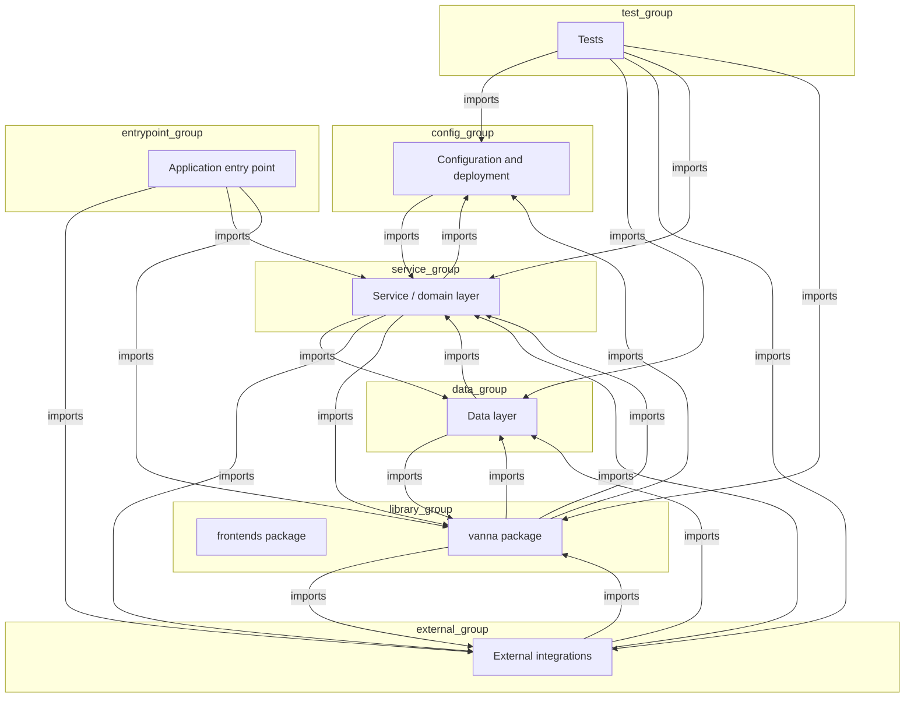

# Architecture report: vanna-ai/vanna

> Automated static analysis. **Observed** = directly seen in files/imports/AST; **Inferred** = interpretation from that evidence. Repository code was not executed.

## 1. Repository at a glance

| Item | Value |
| --- | --- |
| Repository | vanna-ai/vanna |
| Description | 🤖 Chat with your SQL database 📊. Accurate Text-to-SQL Generation via LLMs using Agentic Retrieval 🔄. |
| Language | Python |
| Stars | 23800 |
| Licence | MIT |
| Analysed commit / branch | 365d0617c1a4567ffee1b19b40c27feb4206bfcf / main |
| Framework(s) | FastAPI, Flask |
| Files analysed | 355 |
| Components | 8 |

## 2. Architecture in one minute

vanna-ai/vanna - 🤖 Chat with your SQL database 📊. Accurate Text-to-SQL Generation via LLMs using Agentic Retrieval 🔄.. This repository was analysed statically from 355 file(s) (300 Python). Detected technologies (observed from imports/manifests): GitHub Actions, MySQL, PostgreSQL, SQLite, FastAPI, Flask. Files are grouped into 8 component(s): Configuration and deployment, Data layer, Application entry point, External integrations, frontends package, Service / domain layer, Tests, vanna package. Observed entry point(s): src/evals/benchmarks/llm_comparison.py, src/vanna/core/validation.py, src/vanna/servers/__main__.py. Findings below distinguish observed facts from inferred interpretation.

## 3. High-level block diagram

## 4. Main components

### Configuration and deployment (`config`)

- **Kind:** config
- **Status:** Observed
- **Confidence:** 0.85
- **Responsibility:** Groups 8 file(s) under configuration and deployment (observed from repository paths and static analysis). Observed top-level classes: AgentConfig, AuditConfig, UiFeature, UiFeatures.
- **Paths:** `frontends/webcomponent/package.json`, `frontends/webcomponent/requirements-test.txt`, `frontends/webcomponent/tsconfig.json`, `pyproject.toml`, `setup.cfg`, `src/evals/datasets/sql_generation/basic.yaml`, `src/vanna/core/agent/config.py`, `tox.ini`
- **Evidence:** [frontends/webcomponent/package.json](https://github.com/vanna-ai/vanna/blob/365d0617c1a4567ffee1b19b40c27feb4206bfcf/frontends/webcomponent/package.json); [frontends/webcomponent/requirements-test.txt](https://github.com/vanna-ai/vanna/blob/365d0617c1a4567ffee1b19b40c27feb4206bfcf/frontends/webcomponent/requirements-test.txt); [frontends/webcomponent/tsconfig.json](https://github.com/vanna-ai/vanna/blob/365d0617c1a4567ffee1b19b40c27feb4206bfcf/frontends/webcomponent/tsconfig.json); [pyproject.toml](https://github.com/vanna-ai/vanna/blob/365d0617c1a4567ffee1b19b40c27feb4206bfcf/pyproject.toml); [setup.cfg](https://github.com/vanna-ai/vanna/blob/365d0617c1a4567ffee1b19b40c27feb4206bfcf/setup.cfg); [src/evals/datasets/sql_generation/basic.yaml](https://github.com/vanna-ai/vanna/blob/365d0617c1a4567ffee1b19b40c27feb4206bfcf/src/evals/datasets/sql_generation/basic.yaml); [src/vanna/core/agent/config.py:17](https://github.com/vanna-ai/vanna/blob/365d0617c1a4567ffee1b19b40c27feb4206bfcf/src/vanna/core/agent/config.py#L17); [tox.ini](https://github.com/vanna-ai/vanna/blob/365d0617c1a4567ffee1b19b40c27feb4206bfcf/tox.ini)

### Data layer (`data_layer`)

- **Kind:** data
- **Status:** Observed
- **Confidence:** 0.85
- **Responsibility:** Groups 16 file(s) under data layer (observed from repository paths and static analysis). Observed top-level classes: AiResponseEvent, AuditEvent, AuditEventType, ChartComponent, ChatRequest, ChatResponse.
- **Paths:** `src/vanna/capabilities/agent_memory/models.py`, `src/vanna/capabilities/file_system/models.py`, `src/vanna/capabilities/sql_runner/models.py`, `src/vanna/components/rich/data/__init__.py`, `src/vanna/components/rich/data/chart.py`, `src/vanna/components/rich/data/dataframe.py`, `src/vanna/core/audit/models.py`, `src/vanna/core/llm/models.py`, `src/vanna/core/observability/models.py`, `src/vanna/core/recovery/models.py`, `src/vanna/core/storage/__init__.py`, `src/vanna/core/storage/base.py`, `src/vanna/core/storage/models.py`, `src/vanna/core/tool/models.py`, `src/vanna/core/user/models.py`, `src/vanna/servers/base/models.py`
- **Evidence:** [src/vanna/capabilities/agent_memory/models.py:10](https://github.com/vanna-ai/vanna/blob/365d0617c1a4567ffee1b19b40c27feb4206bfcf/src/vanna/capabilities/agent_memory/models.py#L10); [src/vanna/capabilities/file_system/models.py:12](https://github.com/vanna-ai/vanna/blob/365d0617c1a4567ffee1b19b40c27feb4206bfcf/src/vanna/capabilities/file_system/models.py#L12); [src/vanna/capabilities/sql_runner/models.py:10](https://github.com/vanna-ai/vanna/blob/365d0617c1a4567ffee1b19b40c27feb4206bfcf/src/vanna/capabilities/sql_runner/models.py#L10); [src/vanna/components/rich/data/__init__.py](https://github.com/vanna-ai/vanna/blob/365d0617c1a4567ffee1b19b40c27feb4206bfcf/src/vanna/components/rich/data/__init__.py); [src/vanna/components/rich/data/chart.py:8](https://github.com/vanna-ai/vanna/blob/365d0617c1a4567ffee1b19b40c27feb4206bfcf/src/vanna/components/rich/data/chart.py#L8); [src/vanna/components/rich/data/dataframe.py:8](https://github.com/vanna-ai/vanna/blob/365d0617c1a4567ffee1b19b40c27feb4206bfcf/src/vanna/components/rich/data/dataframe.py#L8); [src/vanna/core/audit/models.py:16](https://github.com/vanna-ai/vanna/blob/365d0617c1a4567ffee1b19b40c27feb4206bfcf/src/vanna/core/audit/models.py#L16); [src/vanna/core/llm/models.py:15](https://github.com/vanna-ai/vanna/blob/365d0617c1a4567ffee1b19b40c27feb4206bfcf/src/vanna/core/llm/models.py#L15)

### Application entry point (`entrypoint`)

- **Kind:** entrypoint
- **Status:** Observed
- **Confidence:** 0.85
- **Responsibility:** Groups 26 file(s) under application entry point (observed from repository paths and static analysis). Observed application object created via FastAPI, Flask. Observed top-level classes: ArtifactDemoAgent, AuthArgs, AuthTool, CachingMiddleware, CalculatorArgs, CalculatorTool. Observed top-level functions: _extract_filename, check_models_health, compare_llms, create_auth_agent, create_demo_agent, create_primitive_demo_agent.
- **Paths:** `src/evals/benchmarks/llm_comparison.py`, `src/vanna/core/validation.py`, `src/vanna/examples/__main__.py`, `src/vanna/examples/anthropic_quickstart.py`, `src/vanna/examples/artifact_example.py`, `src/vanna/examples/claude_sqlite_example.py`, `src/vanna/examples/coding_agent_example.py`, `src/vanna/examples/custom_system_prompt_example.py`, `src/vanna/examples/default_workflow_handler_example.py`, `src/vanna/examples/email_auth_example.py`, `src/vanna/examples/evaluation_example.py`, `src/vanna/examples/extensibility_example.py`, `src/vanna/examples/mock_auth_example.py`, `src/vanna/examples/mock_custom_tool.py`, `src/vanna/examples/mock_quickstart.py`, `src/vanna/examples/mock_quota_example.py`, `src/vanna/examples/mock_rich_components_demo.py`, `src/vanna/examples/mock_sqlite_example.py`, `src/vanna/examples/openai_quickstart.py`, `src/vanna/examples/primitive_components_demo.py`, `src/vanna/examples/quota_lifecycle_example.py`, `src/vanna/examples/visualization_example.py`, `src/vanna/servers/__main__.py`, `src/vanna/servers/cli/server_runner.py`, `src/vanna/servers/fastapi/app.py`, `src/vanna/servers/flask/app.py`
- **Evidence:** [src/evals/benchmarks/llm_comparison.py:27](https://github.com/vanna-ai/vanna/blob/365d0617c1a4567ffee1b19b40c27feb4206bfcf/src/evals/benchmarks/llm_comparison.py#L27); [src/vanna/core/validation.py:14](https://github.com/vanna-ai/vanna/blob/365d0617c1a4567ffee1b19b40c27feb4206bfcf/src/vanna/core/validation.py#L14); [src/vanna/examples/__main__.py:9](https://github.com/vanna-ai/vanna/blob/365d0617c1a4567ffee1b19b40c27feb4206bfcf/src/vanna/examples/__main__.py#L9); [src/vanna/examples/anthropic_quickstart.py:17](https://github.com/vanna-ai/vanna/blob/365d0617c1a4567ffee1b19b40c27feb4206bfcf/src/vanna/examples/anthropic_quickstart.py#L17); [src/vanna/examples/artifact_example.py:18](https://github.com/vanna-ai/vanna/blob/365d0617c1a4567ffee1b19b40c27feb4206bfcf/src/vanna/examples/artifact_example.py#L18); [src/vanna/examples/claude_sqlite_example.py:26](https://github.com/vanna-ai/vanna/blob/365d0617c1a4567ffee1b19b40c27feb4206bfcf/src/vanna/examples/claude_sqlite_example.py#L26); [src/vanna/examples/coding_agent_example.py:35](https://github.com/vanna-ai/vanna/blob/365d0617c1a4567ffee1b19b40c27feb4206bfcf/src/vanna/examples/coding_agent_example.py#L35); [src/vanna/examples/custom_system_prompt_example.py:17](https://github.com/vanna-ai/vanna/blob/365d0617c1a4567ffee1b19b40c27feb4206bfcf/src/vanna/examples/custom_system_prompt_example.py#L17)

### External integrations (`external_integrations`)

- **Kind:** external
- **Status:** Observed
- **Confidence:** 0.85
- **Responsibility:** Groups 65 file(s) under external integrations (observed from repository paths and static analysis). Observed top-level classes: AnthropicLlmService, AzureAISearchAgentMemory, AzureOpenAILlmService, BigQueryRunner, ChromaAgentMemory, ClickHouseRunner. Observed top-level functions: _is_reasoning_model, create_sentence_transformer_embedding_function, get_device.
- **Paths:** `src/vanna/integrations/__init__.py`, `src/vanna/integrations/anthropic/__init__.py`, `src/vanna/integrations/anthropic/llm.py`, `src/vanna/integrations/azureopenai/__init__.py`, `src/vanna/integrations/azureopenai/llm.py`, `src/vanna/integrations/azuresearch/__init__.py`, `src/vanna/integrations/azuresearch/agent_memory.py`, `src/vanna/integrations/bigquery/__init__.py`, `src/vanna/integrations/bigquery/sql_runner.py`, `src/vanna/integrations/chromadb/__init__.py`, `src/vanna/integrations/chromadb/agent_memory.py`, `src/vanna/integrations/clickhouse/__init__.py`, `src/vanna/integrations/clickhouse/sql_runner.py`, `src/vanna/integrations/duckdb/__init__.py`, `src/vanna/integrations/duckdb/sql_runner.py`, `src/vanna/integrations/faiss/__init__.py`, `src/vanna/integrations/faiss/agent_memory.py`, `src/vanna/integrations/google/__init__.py`, `src/vanna/integrations/google/gemini.py`, `src/vanna/integrations/hive/__init__.py`, `src/vanna/integrations/hive/sql_runner.py`, `src/vanna/integrations/local/__init__.py`, `src/vanna/integrations/local/agent_memory/__init__.py`, `src/vanna/integrations/local/agent_memory/in_memory.py`, `src/vanna/integrations/local/audit.py`, `src/vanna/integrations/local/file_system.py`, `src/vanna/integrations/local/file_system_conversation_store.py`, `src/vanna/integrations/local/storage.py`, `src/vanna/integrations/marqo/__init__.py`, `src/vanna/integrations/marqo/agent_memory.py`, `src/vanna/integrations/milvus/__init__.py`, `src/vanna/integrations/milvus/agent_memory.py`, `src/vanna/integrations/mock/__init__.py`, `src/vanna/integrations/mock/llm.py`, `src/vanna/integrations/mssql/__init__.py`, `src/vanna/integrations/mssql/sql_runner.py`, `src/vanna/integrations/mysql/__init__.py`, `src/vanna/integrations/mysql/sql_runner.py`, `src/vanna/integrations/ollama/__init__.py`, `src/vanna/integrations/ollama/llm.py`, `src/vanna/integrations/openai/__init__.py`, `src/vanna/integrations/openai/llm.py`, `src/vanna/integrations/openai/responses.py`, `src/vanna/integrations/opensearch/__init__.py`, `src/vanna/integrations/opensearch/agent_memory.py`, `src/vanna/integrations/oracle/__init__.py`, `src/vanna/integrations/oracle/sql_runner.py`, `src/vanna/integrations/pinecone/__init__.py`, `src/vanna/integrations/pinecone/agent_memory.py`, `src/vanna/integrations/plotly/__init__.py`, `src/vanna/integrations/plotly/chart_generator.py`, `src/vanna/integrations/postgres/__init__.py`, `src/vanna/integrations/postgres/sql_runner.py`, `src/vanna/integrations/premium/agent_memory/__init__.py`, `src/vanna/integrations/premium/agent_memory/premium.py`, `src/vanna/integrations/presto/__init__.py`, `src/vanna/integrations/presto/sql_runner.py`, `src/vanna/integrations/qdrant/__init__.py`, `src/vanna/integrations/qdrant/agent_memory.py`, `src/vanna/integrations/snowflake/__init__.py`, `src/vanna/integrations/snowflake/sql_runner.py`, `src/vanna/integrations/sqlite/__init__.py`, `src/vanna/integrations/sqlite/sql_runner.py`, `src/vanna/integrations/weaviate/__init__.py`, `src/vanna/integrations/weaviate/agent_memory.py`
- **Evidence:** [src/vanna/integrations/__init__.py](https://github.com/vanna-ai/vanna/blob/365d0617c1a4567ffee1b19b40c27feb4206bfcf/src/vanna/integrations/__init__.py); [src/vanna/integrations/anthropic/__init__.py](https://github.com/vanna-ai/vanna/blob/365d0617c1a4567ffee1b19b40c27feb4206bfcf/src/vanna/integrations/anthropic/__init__.py); [src/vanna/integrations/anthropic/llm.py:27](https://github.com/vanna-ai/vanna/blob/365d0617c1a4567ffee1b19b40c27feb4206bfcf/src/vanna/integrations/anthropic/llm.py#L27); [src/vanna/integrations/azureopenai/__init__.py](https://github.com/vanna-ai/vanna/blob/365d0617c1a4567ffee1b19b40c27feb4206bfcf/src/vanna/integrations/azureopenai/__init__.py); [src/vanna/integrations/azureopenai/llm.py:38](https://github.com/vanna-ai/vanna/blob/365d0617c1a4567ffee1b19b40c27feb4206bfcf/src/vanna/integrations/azureopenai/llm.py#L38); [src/vanna/integrations/azuresearch/__init__.py](https://github.com/vanna-ai/vanna/blob/365d0617c1a4567ffee1b19b40c27feb4206bfcf/src/vanna/integrations/azuresearch/__init__.py); [src/vanna/integrations/azuresearch/agent_memory.py:40](https://github.com/vanna-ai/vanna/blob/365d0617c1a4567ffee1b19b40c27feb4206bfcf/src/vanna/integrations/azuresearch/agent_memory.py#L40); [src/vanna/integrations/bigquery/__init__.py](https://github.com/vanna-ai/vanna/blob/365d0617c1a4567ffee1b19b40c27feb4206bfcf/src/vanna/integrations/bigquery/__init__.py)

### frontends package (`frontends`)

- **Kind:** library
- **Status:** Observed
- **Confidence:** 0.85
- **Responsibility:** Groups 28 file(s) under frontends package (observed from repository paths and static analysis).
- **Paths:** `frontends/webcomponent/.storybook/main.ts`, `frontends/webcomponent/.storybook/preview.ts`, `frontends/webcomponent/scripts/sync-version.js`, `frontends/webcomponent/src/components/button.stories.ts`, `frontends/webcomponent/src/components/dataframe-component.stories.ts`, `frontends/webcomponent/src/components/plotly-chart.stories.ts`, `frontends/webcomponent/src/components/plotly-chart.ts`, `frontends/webcomponent/src/components/rich-card.stories.ts`, `frontends/webcomponent/src/components/rich-card.ts`, `frontends/webcomponent/src/components/rich-component-system.stories.ts`, `frontends/webcomponent/src/components/rich-component-system.ts`, `frontends/webcomponent/src/components/rich-progress-bar.stories.ts`, `frontends/webcomponent/src/components/rich-progress-bar.ts`, `frontends/webcomponent/src/components/rich-task-list.stories.ts`, `frontends/webcomponent/src/components/rich-task-list.ts`, `frontends/webcomponent/src/components/vanna-chat.stories.ts`, `frontends/webcomponent/src/components/vanna-chat.ts`, `frontends/webcomponent/src/components/vanna-message.stories.ts`, `frontends/webcomponent/src/components/vanna-message.ts`, `frontends/webcomponent/src/components/vanna-progress-tracker.stories.ts`, `frontends/webcomponent/src/components/vanna-progress-tracker.ts`, `frontends/webcomponent/src/components/vanna-status-bar.stories.ts`, `frontends/webcomponent/src/components/vanna-status-bar.ts`, `frontends/webcomponent/src/index.ts`, `frontends/webcomponent/src/styles/rich-component-styles.ts`, `frontends/webcomponent/src/styles/vanna-design-tokens.ts`, `frontends/webcomponent/src/vite-env.d.ts`, `frontends/webcomponent/vite.config.ts`
- **Evidence:** [frontends/webcomponent/.storybook/main.ts](https://github.com/vanna-ai/vanna/blob/365d0617c1a4567ffee1b19b40c27feb4206bfcf/frontends/webcomponent/.storybook/main.ts); [frontends/webcomponent/.storybook/preview.ts](https://github.com/vanna-ai/vanna/blob/365d0617c1a4567ffee1b19b40c27feb4206bfcf/frontends/webcomponent/.storybook/preview.ts); [frontends/webcomponent/scripts/sync-version.js](https://github.com/vanna-ai/vanna/blob/365d0617c1a4567ffee1b19b40c27feb4206bfcf/frontends/webcomponent/scripts/sync-version.js); [frontends/webcomponent/src/components/button.stories.ts](https://github.com/vanna-ai/vanna/blob/365d0617c1a4567ffee1b19b40c27feb4206bfcf/frontends/webcomponent/src/components/button.stories.ts); [frontends/webcomponent/src/components/dataframe-component.stories.ts](https://github.com/vanna-ai/vanna/blob/365d0617c1a4567ffee1b19b40c27feb4206bfcf/frontends/webcomponent/src/components/dataframe-component.stories.ts); [frontends/webcomponent/src/components/plotly-chart.stories.ts](https://github.com/vanna-ai/vanna/blob/365d0617c1a4567ffee1b19b40c27feb4206bfcf/frontends/webcomponent/src/components/plotly-chart.stories.ts); [frontends/webcomponent/src/components/plotly-chart.ts](https://github.com/vanna-ai/vanna/blob/365d0617c1a4567ffee1b19b40c27feb4206bfcf/frontends/webcomponent/src/components/plotly-chart.ts); [frontends/webcomponent/src/components/rich-card.stories.ts](https://github.com/vanna-ai/vanna/blob/365d0617c1a4567ffee1b19b40c27feb4206bfcf/frontends/webcomponent/src/components/rich-card.stories.ts)

### Service / domain layer (`service_layer`)

- **Kind:** service
- **Status:** Observed
- **Confidence:** 0.85
- **Responsibility:** Groups 48 file(s) under service / domain layer (observed from repository paths and static analysis). Observed top-level classes: Agent, AgentError, AgentResult, AgentVariant, AuditLogger, ComparisonReport.
- **Paths:** `frontends/webcomponent/src/services/api-client.ts`, `src/vanna/core/__init__.py`, `src/vanna/core/_compat.py`, `src/vanna/core/agent/__init__.py`, `src/vanna/core/agent/agent.py`, `src/vanna/core/audit/__init__.py`, `src/vanna/core/audit/base.py`, `src/vanna/core/component_manager.py`, `src/vanna/core/components.py`, `src/vanna/core/enhancer/__init__.py`, `src/vanna/core/enhancer/base.py`, `src/vanna/core/enhancer/default.py`, `src/vanna/core/enricher/__init__.py`, `src/vanna/core/enricher/base.py`, `src/vanna/core/errors.py`, `src/vanna/core/evaluation/__init__.py`, `src/vanna/core/evaluation/base.py`, `src/vanna/core/evaluation/dataset.py`, `src/vanna/core/evaluation/evaluators.py`, `src/vanna/core/evaluation/report.py`, `src/vanna/core/evaluation/runner.py`, `src/vanna/core/filter/__init__.py`, `src/vanna/core/filter/base.py`, `src/vanna/core/lifecycle/__init__.py`, `src/vanna/core/lifecycle/base.py`, `src/vanna/core/llm/__init__.py`, `src/vanna/core/llm/base.py`, `src/vanna/core/middleware/__init__.py`, `src/vanna/core/middleware/base.py`, `src/vanna/core/observability/__init__.py`, `src/vanna/core/observability/base.py`, `src/vanna/core/recovery/__init__.py`, `src/vanna/core/recovery/base.py`, `src/vanna/core/registry.py`, `src/vanna/core/rich_component.py`, `src/vanna/core/simple_component.py`, `src/vanna/core/system_prompt/__init__.py`, `src/vanna/core/system_prompt/base.py`, `src/vanna/core/system_prompt/default.py`, `src/vanna/core/tool/__init__.py`, `src/vanna/core/tool/base.py`, `src/vanna/core/user/__init__.py`, `src/vanna/core/user/base.py`, `src/vanna/core/user/request_context.py`, `src/vanna/core/user/resolver.py`, `src/vanna/core/workflow/__init__.py`, `src/vanna/core/workflow/base.py`, `src/vanna/core/workflow/default.py`
- **Evidence:** [frontends/webcomponent/src/services/api-client.ts](https://github.com/vanna-ai/vanna/blob/365d0617c1a4567ffee1b19b40c27feb4206bfcf/frontends/webcomponent/src/services/api-client.ts); [src/vanna/core/__init__.py](https://github.com/vanna-ai/vanna/blob/365d0617c1a4567ffee1b19b40c27feb4206bfcf/src/vanna/core/__init__.py); [src/vanna/core/_compat.py](https://github.com/vanna-ai/vanna/blob/365d0617c1a4567ffee1b19b40c27feb4206bfcf/src/vanna/core/_compat.py); [src/vanna/core/agent/__init__.py](https://github.com/vanna-ai/vanna/blob/365d0617c1a4567ffee1b19b40c27feb4206bfcf/src/vanna/core/agent/__init__.py); [src/vanna/core/agent/agent.py:56](https://github.com/vanna-ai/vanna/blob/365d0617c1a4567ffee1b19b40c27feb4206bfcf/src/vanna/core/agent/agent.py#L56); [src/vanna/core/audit/__init__.py](https://github.com/vanna-ai/vanna/blob/365d0617c1a4567ffee1b19b40c27feb4206bfcf/src/vanna/core/audit/__init__.py); [src/vanna/core/audit/base.py:27](https://github.com/vanna-ai/vanna/blob/365d0617c1a4567ffee1b19b40c27feb4206bfcf/src/vanna/core/audit/base.py#L27); [src/vanna/core/component_manager.py:15](https://github.com/vanna-ai/vanna/blob/365d0617c1a4567ffee1b19b40c27feb4206bfcf/src/vanna/core/component_manager.py#L15)

### Tests (`tests`)

- **Kind:** test
- **Status:** Observed
- **Confidence:** 0.85
- **Responsibility:** Groups 16 file(s) under tests (observed from repository paths and static analysis). Observed application object created via FastAPI. Observed routes: POST /api/vanna/v2/chat_sse, GET /health, GET /, PATCH vanna.integrations.azureopenai.llm.AzureOpenAI, PATCH vanna.integrations.azureopenai.llm.AzureOpenAI. Observed top-level classes: ChatRequest, CustomTransformRegistry, MockAgent, MockAgentMemory, MockConversation, MockLlmService. Observed top-level functions: admin_test_user, admin_user, agent_memory, agent_with_memory, agent_without_memory, analyst_user.
- **Paths:** `frontends/webcomponent/TEST_README.md`, `frontends/webcomponent/test_backend.py`, `tests/conftest.py`, `tests/test_agent_memory.py`, `tests/test_agent_memory_sanity.py`, `tests/test_agents.py`, `tests/test_azureopenai_llm.py`, `tests/test_chromadb_persistence_fix.py`, `tests/test_database_sanity.py`, `tests/test_gemini_integration.py`, `tests/test_legacy_adapter.py`, `tests/test_llm_context_enhancer.py`, `tests/test_memory_tools.py`, `tests/test_ollama_direct.py`, `tests/test_tool_permissions.py`, `tests/test_workflow.py`
- **Evidence:** [frontends/webcomponent/TEST_README.md](https://github.com/vanna-ai/vanna/blob/365d0617c1a4567ffee1b19b40c27feb4206bfcf/frontends/webcomponent/TEST_README.md); [frontends/webcomponent/test_backend.py:763](https://github.com/vanna-ai/vanna/blob/365d0617c1a4567ffee1b19b40c27feb4206bfcf/frontends/webcomponent/test_backend.py#L763); [tests/conftest.py:14](https://github.com/vanna-ai/vanna/blob/365d0617c1a4567ffee1b19b40c27feb4206bfcf/tests/conftest.py#L14); [tests/test_agent_memory.py:19](https://github.com/vanna-ai/vanna/blob/365d0617c1a4567ffee1b19b40c27feb4206bfcf/tests/test_agent_memory.py#L19); [tests/test_agent_memory_sanity.py:18](https://github.com/vanna-ai/vanna/blob/365d0617c1a4567ffee1b19b40c27feb4206bfcf/tests/test_agent_memory_sanity.py#L18); [tests/test_agents.py:14](https://github.com/vanna-ai/vanna/blob/365d0617c1a4567ffee1b19b40c27feb4206bfcf/tests/test_agents.py#L14); [tests/test_azureopenai_llm.py:13](https://github.com/vanna-ai/vanna/blob/365d0617c1a4567ffee1b19b40c27feb4206bfcf/tests/test_azureopenai_llm.py#L13); [tests/test_chromadb_persistence_fix.py:19](https://github.com/vanna-ai/vanna/blob/365d0617c1a4567ffee1b19b40c27feb4206bfcf/tests/test_chromadb_persistence_fix.py#L19)

### vanna package (`vanna`)

- **Kind:** library
- **Status:** Observed
- **Confidence:** 0.85
- **Responsibility:** Groups 128 file(s) under vanna package (observed from repository paths and static analysis). Observed top-level classes: APIError, AccuracyStats, AgentMemory, Anthropic_Chat, ApiKey, ArtifactComponent. Observed top-level functions: __dataclass_to_dict, __unauthenticated_rpc_call, _error_result, _make_snippet, _quote_command, _result_from_command.
- **Paths:** `src/vanna/__init__.py`, `src/vanna/agents/__init__.py`, `src/vanna/capabilities/__init__.py`, `src/vanna/capabilities/agent_memory/__init__.py`, `src/vanna/capabilities/agent_memory/base.py`, `src/vanna/capabilities/file_system/__init__.py`, `src/vanna/capabilities/file_system/base.py`, `src/vanna/capabilities/sql_runner/__init__.py`, `src/vanna/capabilities/sql_runner/base.py`, `src/vanna/components/__init__.py`, `src/vanna/components/base.py`, `src/vanna/components/rich/__init__.py`, `src/vanna/components/rich/containers/__init__.py`, `src/vanna/components/rich/containers/card.py`, `src/vanna/components/rich/feedback/__init__.py`, `src/vanna/components/rich/feedback/badge.py`, `src/vanna/components/rich/feedback/icon_text.py`, `src/vanna/components/rich/feedback/log_viewer.py`, `src/vanna/components/rich/feedback/notification.py`, `src/vanna/components/rich/feedback/progress.py`, `src/vanna/components/rich/feedback/status_card.py`, `src/vanna/components/rich/feedback/status_indicator.py`, `src/vanna/components/rich/interactive/__init__.py`, `src/vanna/components/rich/interactive/button.py`, `src/vanna/components/rich/interactive/task_list.py`, `src/vanna/components/rich/interactive/ui_state.py`, `src/vanna/components/rich/specialized/__init__.py`, `src/vanna/components/rich/specialized/artifact.py`, `src/vanna/components/rich/text.py`, `src/vanna/components/simple/__init__.py`, `src/vanna/components/simple/image.py`, `src/vanna/components/simple/link.py`, `src/vanna/components/simple/text.py`, `src/vanna/examples/__init__.py`, `src/vanna/examples/minimal_example.py`, `src/vanna/legacy/ZhipuAI/ZhipuAI_Chat.py`, `src/vanna/legacy/ZhipuAI/ZhipuAI_embeddings.py`, `src/vanna/legacy/ZhipuAI/__init__.py`, `src/vanna/legacy/__init__.py`, `src/vanna/legacy/adapter.py`, `src/vanna/legacy/advanced/__init__.py`, `src/vanna/legacy/anthropic/__init__.py`, `src/vanna/legacy/anthropic/anthropic_chat.py`, `src/vanna/legacy/azuresearch/__init__.py`, `src/vanna/legacy/azuresearch/azuresearch_vector.py`, `src/vanna/legacy/base/__init__.py`, `src/vanna/legacy/base/base.py`, `src/vanna/legacy/bedrock/__init__.py`, `src/vanna/legacy/bedrock/bedrock_converse.py`, `src/vanna/legacy/chromadb/__init__.py`, `src/vanna/legacy/chromadb/chromadb_vector.py`, `src/vanna/legacy/cohere/__init__.py`, `src/vanna/legacy/cohere/cohere_chat.py`, `src/vanna/legacy/cohere/cohere_embeddings.py`, `src/vanna/legacy/deepseek/__init__.py`, `src/vanna/legacy/deepseek/deepseek_chat.py`, `src/vanna/legacy/exceptions/__init__.py`, `src/vanna/legacy/faiss/__init__.py`, `src/vanna/legacy/faiss/faiss.py`, `src/vanna/legacy/flask/__init__.py`, `src/vanna/legacy/flask/auth.py`, `src/vanna/legacy/google/__init__.py`, `src/vanna/legacy/google/bigquery_vector.py`, `src/vanna/legacy/google/gemini_chat.py`, `src/vanna/legacy/hf/__init__.py`, `src/vanna/legacy/hf/hf.py`, `src/vanna/legacy/local.py`, `src/vanna/legacy/marqo/__init__.py`, `src/vanna/legacy/marqo/marqo.py`, `src/vanna/legacy/milvus/__init__.py`, `src/vanna/legacy/milvus/milvus_vector.py`, `src/vanna/legacy/mistral/__init__.py`, `src/vanna/legacy/mistral/mistral.py`, `src/vanna/legacy/mock/__init__.py`, `src/vanna/legacy/mock/embedding.py`, `src/vanna/legacy/mock/llm.py`, `src/vanna/legacy/mock/vectordb.py`, `src/vanna/legacy/ollama/__init__.py`, `src/vanna/legacy/ollama/ollama.py`, `src/vanna/legacy/openai/__init__.py`, `src/vanna/legacy/openai/openai_chat.py`, `src/vanna/legacy/openai/openai_embeddings.py`, `src/vanna/legacy/opensearch/__init__.py`, `src/vanna/legacy/opensearch/opensearch_vector.py`, `src/vanna/legacy/opensearch/opensearch_vector_semantic.py`, `src/vanna/legacy/oracle/__init__.py`, `src/vanna/legacy/oracle/oracle_vector.py`, `src/vanna/legacy/pgvector/__init__.py`, `src/vanna/legacy/pgvector/pgvector.py`, `src/vanna/legacy/pinecone/__init__.py`, `src/vanna/legacy/pinecone/pinecone_vector.py`, `src/vanna/legacy/qdrant/__init__.py`, `src/vanna/legacy/qdrant/qdrant.py`, `src/vanna/legacy/qianfan/Qianfan_Chat.py`, `src/vanna/legacy/qianfan/Qianfan_embeddings.py`, `src/vanna/legacy/qianfan/__init__.py`, `src/vanna/legacy/qianwen/QianwenAI_chat.py`, `src/vanna/legacy/qianwen/QianwenAI_embeddings.py`, `src/vanna/legacy/qianwen/__init__.py`, `src/vanna/legacy/remote.py`, `src/vanna/legacy/types/__init__.py`, `src/vanna/legacy/utils.py`, `src/vanna/legacy/vannadb/__init__.py`, `src/vanna/legacy/vannadb/vannadb_vector.py`, `src/vanna/legacy/vllm/__init__.py`, `src/vanna/legacy/vllm/vllm.py`, `src/vanna/legacy/weaviate/__init__.py`, `src/vanna/legacy/weaviate/weaviate_vector.py`, `src/vanna/legacy/xinference/__init__.py`, `src/vanna/legacy/xinference/xinference.py`, `src/vanna/servers/__init__.py`, `src/vanna/servers/base/__init__.py`, `src/vanna/servers/base/chat_handler.py`, `src/vanna/servers/base/rich_chat_handler.py`, `src/vanna/servers/base/templates.py`, `src/vanna/servers/cli/__init__.py`, `src/vanna/servers/fastapi/__init__.py`, `src/vanna/servers/fastapi/routes.py`, `src/vanna/servers/flask/__init__.py`, `src/vanna/servers/flask/routes.py`, `src/vanna/tools/__init__.py`, `src/vanna/tools/agent_memory.py`, `src/vanna/tools/file_system.py`, `src/vanna/tools/python.py`, `src/vanna/tools/run_sql.py`, `src/vanna/tools/visualize_data.py`, `src/vanna/utils/__init__.py`, `src/vanna/web_components/__init__.py`
- **Evidence:** [src/vanna/__init__.py](https://github.com/vanna-ai/vanna/blob/365d0617c1a4567ffee1b19b40c27feb4206bfcf/src/vanna/__init__.py); [src/vanna/agents/__init__.py](https://github.com/vanna-ai/vanna/blob/365d0617c1a4567ffee1b19b40c27feb4206bfcf/src/vanna/agents/__init__.py); [src/vanna/capabilities/__init__.py](https://github.com/vanna-ai/vanna/blob/365d0617c1a4567ffee1b19b40c27feb4206bfcf/src/vanna/capabilities/__init__.py); [src/vanna/capabilities/agent_memory/__init__.py](https://github.com/vanna-ai/vanna/blob/365d0617c1a4567ffee1b19b40c27feb4206bfcf/src/vanna/capabilities/agent_memory/__init__.py); [src/vanna/capabilities/agent_memory/base.py:23](https://github.com/vanna-ai/vanna/blob/365d0617c1a4567ffee1b19b40c27feb4206bfcf/src/vanna/capabilities/agent_memory/base.py#L23); [src/vanna/capabilities/file_system/__init__.py](https://github.com/vanna-ai/vanna/blob/365d0617c1a4567ffee1b19b40c27feb4206bfcf/src/vanna/capabilities/file_system/__init__.py); [src/vanna/capabilities/file_system/base.py:16](https://github.com/vanna-ai/vanna/blob/365d0617c1a4567ffee1b19b40c27feb4206bfcf/src/vanna/capabilities/file_system/base.py#L16); [src/vanna/capabilities/sql_runner/__init__.py](https://github.com/vanna-ai/vanna/blob/365d0617c1a4567ffee1b19b40c27feb4206bfcf/src/vanna/capabilities/sql_runner/__init__.py)

## 5. Execution flow

**Observed** entry point(s):

- [frontends/webcomponent/.storybook/main.ts](https://github.com/vanna-ai/vanna/blob/365d0617c1a4567ffee1b19b40c27feb4206bfcf/frontends/webcomponent/.storybook/main.ts)
- [frontends/webcomponent/src/index.ts](https://github.com/vanna-ai/vanna/blob/365d0617c1a4567ffee1b19b40c27feb4206bfcf/frontends/webcomponent/src/index.ts)
- [src/evals/benchmarks/llm_comparison.py:171](https://github.com/vanna-ai/vanna/blob/365d0617c1a4567ffee1b19b40c27feb4206bfcf/src/evals/benchmarks/llm_comparison.py#L171)
- [src/vanna/core/validation.py:145](https://github.com/vanna-ai/vanna/blob/365d0617c1a4567ffee1b19b40c27feb4206bfcf/src/vanna/core/validation.py#L145)
- [src/vanna/servers/__main__.py:7](https://github.com/vanna-ai/vanna/blob/365d0617c1a4567ffee1b19b40c27feb4206bfcf/src/vanna/servers/__main__.py#L7)
- [src/vanna/servers/cli/server_runner.py](https://github.com/vanna-ai/vanna/blob/365d0617c1a4567ffee1b19b40c27feb4206bfcf/src/vanna/servers/cli/server_runner.py)
- [src/vanna/servers/fastapi/app.py:38](https://github.com/vanna-ai/vanna/blob/365d0617c1a4567ffee1b19b40c27feb4206bfcf/src/vanna/servers/fastapi/app.py#L38)
- [src/vanna/servers/flask/app.py:40](https://github.com/vanna-ai/vanna/blob/365d0617c1a4567ffee1b19b40c27feb4206bfcf/src/vanna/servers/flask/app.py#L40)

**Observed** routes (from decorators):

- `POST /api/vanna/v2/chat_sse` -> `chat_sse` in `frontends/webcomponent/test_backend.py:781`
- `GET /health` -> `health` in `frontends/webcomponent/test_backend.py:834`
- `GET /` -> `root` in `frontends/webcomponent/test_backend.py:840`
- `PATCH vanna.integrations.azureopenai.llm.AzureOpenAI` -> `test_init_with_all_params` in `tests/test_azureopenai_llm.py:52`
- `PATCH vanna.integrations.azureopenai.llm.AzureOpenAI` -> `test_init_with_reasoning_model` in `tests/test_azureopenai_llm.py:72`
- `PATCH vanna.integrations.azureopenai.llm.AzureOpenAI` -> `test_init_from_environment` in `tests/test_azureopenai_llm.py:93`
- `PATCH vanna.integrations.azureopenai.llm.AzureOpenAI` -> `test_init_missing_model_raises` in `tests/test_azureopenai_llm.py:106`
- `PATCH vanna.integrations.azureopenai.llm.AzureOpenAI` -> `test_init_missing_endpoint_raises` in `tests/test_azureopenai_llm.py:115`
- `PATCH vanna.integrations.azureopenai.llm.AzureOpenAI` -> `test_init_missing_auth_raises` in `tests/test_azureopenai_llm.py:124`
- `PATCH vanna.integrations.azureopenai.llm.AzureOpenAI` -> `test_init_with_azure_ad_token_provider` in `tests/test_azureopenai_llm.py:133`
- `PATCH vanna.integrations.azureopenai.llm.AzureOpenAI` -> `test_init_default_api_version` in `tests/test_azureopenai_llm.py:148`
- `PATCH vanna.integrations.azureopenai.llm.AzureOpenAI` -> `test_build_payload_includes_temperature_for_standard_model` in `tests/test_azureopenai_llm.py:165`
- `PATCH vanna.integrations.azureopenai.llm.AzureOpenAI` -> `test_build_payload_excludes_temperature_for_reasoning_model` in `tests/test_azureopenai_llm.py:191`
- `PATCH vanna.integrations.azureopenai.llm.AzureOpenAI` -> `test_build_payload_with_system_prompt` in `tests/test_azureopenai_llm.py:216`
- `PATCH vanna.integrations.azureopenai.llm.AzureOpenAI` -> `test_build_payload_with_tools` in `tests/test_azureopenai_llm.py:240`

Representative flow (derived from observed entry points and the import graph; steps beyond the entry point are **Inferred**):

1. Execution starts at an observed entry point listed above, if present.
2. `config` imports `service_layer` (Configuration and deployment -> Service / domain layer).
3. `data_layer` imports `service_layer` (Data layer -> Service / domain layer).
4. `data_layer` imports `vanna` (Data layer -> vanna package).
5. `entrypoint` imports `external_integrations` (Application entry point -> External integrations).
6. `entrypoint` imports `service_layer` (Application entry point -> Service / domain layer).
7. `entrypoint` imports `vanna` (Application entry point -> vanna package).
8. `external_integrations` imports `data_layer` (External integrations -> Data layer).
9. `external_integrations` imports `service_layer` (External integrations -> Service / domain layer).

## 6. Project structure

### `(root)`

- `.gitattributes` - other (34 bytes)
- `.gitignore` - other (402 bytes)
- `.pre-commit-config.yaml` - config (493 bytes)
- `CONTRIBUTING.md` - docs (11057 bytes)
- `LICENSE` - docs (1065 bytes)
- `MIGRATION_GUIDE.md` - docs (10179 bytes)
- `README.md` - docs (9578 bytes)
- `README_LEGACY.md` - docs (10225 bytes)
- `pyproject.toml` - manifest (7145 bytes)
- `setup.cfg` - manifest (277 bytes)
- `tox.ini` - config (7537 bytes)

### `.github`

- `.github/ISSUE_TEMPLATE/bug_report.md` - docs (746 bytes)
- `.github/ISSUE_TEMPLATE/feature_request.md` - docs (629 bytes)
- `.github/workflows/python-publish.yaml` - ci, YAML (1083 bytes)
- `.github/workflows/tests.yml` - ci, YAML (965 bytes)

### `examples`

- `examples/chromadb_gpu_example.py` - source, Python (4142 bytes)
- `examples/transform_args_example.py` - source, Python (5250 bytes)

### `frontends`

- `frontends/webcomponent/.storybook/main.ts` - source, TypeScript (685 bytes)
- `frontends/webcomponent/.storybook/preview-head.html` - other (328 bytes)
- `frontends/webcomponent/.storybook/preview.ts` - source, TypeScript (289 bytes)
- `frontends/webcomponent/TEST_README.md` - test (11658 bytes)
- `frontends/webcomponent/package.json` - manifest (1495 bytes)
- `frontends/webcomponent/requirements-test.txt` - manifest (255 bytes)
- `frontends/webcomponent/scripts/sync-version.js` - source, JavaScript (1724 bytes)
- `frontends/webcomponent/src/components/button.stories.ts` - source, TypeScript (15139 bytes)
- `frontends/webcomponent/src/components/dataframe-component.stories.ts` - source, TypeScript (19876 bytes)
- `frontends/webcomponent/src/components/plotly-chart.stories.ts` - source, TypeScript (6516 bytes)
- `frontends/webcomponent/src/components/plotly-chart.ts` - source, TypeScript (5218 bytes)
- `frontends/webcomponent/src/components/rich-card.stories.ts` - source, TypeScript (4921 bytes)
- `frontends/webcomponent/src/components/rich-card.ts` - source, TypeScript (8820 bytes)
- `frontends/webcomponent/src/components/rich-component-system.stories.ts` - source, TypeScript (11365 bytes)
- `frontends/webcomponent/src/components/rich-component-system.ts` - source, TypeScript (70943 bytes)
- `frontends/webcomponent/src/components/rich-progress-bar.stories.ts` - source, TypeScript (6442 bytes)
- `frontends/webcomponent/src/components/rich-progress-bar.ts` - source, TypeScript (5442 bytes)
- `frontends/webcomponent/src/components/rich-task-list.stories.ts` - source, TypeScript (6889 bytes)
- `frontends/webcomponent/src/components/rich-task-list.ts` - source, TypeScript (7338 bytes)
- `frontends/webcomponent/src/components/vanna-chat.stories.ts` - source, TypeScript (43341 bytes)
- `frontends/webcomponent/src/components/vanna-chat.ts` - source, TypeScript (44436 bytes)
- `frontends/webcomponent/src/components/vanna-message.stories.ts` - source, TypeScript (2725 bytes)
- `frontends/webcomponent/src/components/vanna-message.ts` - source, TypeScript (6467 bytes)
- `frontends/webcomponent/src/components/vanna-progress-tracker.stories.ts` - source, TypeScript (9037 bytes)
- `frontends/webcomponent/src/components/vanna-progress-tracker.ts` - source, TypeScript (7309 bytes)
- `frontends/webcomponent/src/components/vanna-status-bar.stories.ts` - source, TypeScript (4420 bytes)
- `frontends/webcomponent/src/components/vanna-status-bar.ts` - source, TypeScript (13100 bytes)
- `frontends/webcomponent/src/index.ts` - source, TypeScript (1210 bytes)
- `frontends/webcomponent/src/services/api-client.ts` - source, TypeScript (8394 bytes)
- `frontends/webcomponent/src/styles/rich-component-styles.ts` - source, TypeScript (41059 bytes)
- `frontends/webcomponent/src/styles/vanna-design-tokens.ts` - source, TypeScript (6049 bytes)
- `frontends/webcomponent/src/vite-env.d.ts` - source, TypeScript (118 bytes)
- `frontends/webcomponent/test-comprehensive.html` - other (19109 bytes)
- `frontends/webcomponent/test_backend.py` - test, Python (29189 bytes)
- `frontends/webcomponent/tsconfig.json` - config (520 bytes)
- `frontends/webcomponent/vite.config.ts` - source, TypeScript (554 bytes)

### `img`

- `img/vanna2.svg` - other (196342 bytes)

### `notebooks`

- `notebooks/quickstart.ipynb` - other (4824 bytes)

### `papers`

- `papers/ai-sql-accuracy-2023-08-17.md` - docs (18860 bytes)

### `src`

- `src/evals/benchmarks/llm_comparison.py` - source, Python (4811 bytes)
- `src/evals/datasets/sql_generation/basic.yaml` - config (4079 bytes)
- `src/vanna/__init__.py` - source, Python (3683 bytes)
- `src/vanna/agents/__init__.py` - source, Python (116 bytes)
- `src/vanna/capabilities/__init__.py` - source, Python (392 bytes)
- `src/vanna/capabilities/agent_memory/__init__.py` - source, Python (350 bytes)
- `src/vanna/capabilities/agent_memory/base.py` - source, Python (2988 bytes)
- `src/vanna/capabilities/agent_memory/models.py` - source, Python (1125 bytes)
- `src/vanna/capabilities/file_system/__init__.py` - source, Python (267 bytes)
- `src/vanna/capabilities/file_system/base.py` - source, Python (1859 bytes)
- `src/vanna/capabilities/file_system/models.py` - source, Python (464 bytes)
- `src/vanna/capabilities/sql_runner/__init__.py` - source, Python (217 bytes)
- `src/vanna/capabilities/sql_runner/base.py` - source, Python (826 bytes)
- `src/vanna/capabilities/sql_runner/models.py` - source, Python (261 bytes)
- `src/vanna/components/__init__.py` - source, Python (2057 bytes)
- `src/vanna/components/base.py` - source, Python (341 bytes)
- `src/vanna/components/rich/__init__.py` - source, Python (1735 bytes)
- `src/vanna/components/rich/containers/__init__.py` - source, Python (108 bytes)
- `src/vanna/components/rich/containers/card.py` - source, Python (717 bytes)
- `src/vanna/components/rich/data/__init__.py` - source, Python (171 bytes)
- `src/vanna/components/rich/data/chart.py` - source, Python (655 bytes)
- `src/vanna/components/rich/data/dataframe.py` - source, Python (3166 bytes)
- `src/vanna/components/rich/feedback/__init__.py` - source, Python (630 bytes)
- `src/vanna/components/rich/feedback/badge.py` - source, Python (514 bytes)
- `src/vanna/components/rich/feedback/icon_text.py` - source, Python (467 bytes)
- `src/vanna/components/rich/feedback/log_viewer.py` - source, Python (1332 bytes)
- `src/vanna/components/rich/feedback/notification.py` - source, Python (670 bytes)
- `src/vanna/components/rich/feedback/progress.py` - source, Python (1312 bytes)
- `src/vanna/components/rich/feedback/status_card.py` - source, Python (1058 bytes)
- `src/vanna/components/rich/feedback/status_indicator.py` - source, Python (425 bytes)
- `src/vanna/components/rich/interactive/__init__.py` - source, Python (495 bytes)
- `src/vanna/components/rich/interactive/button.py` - source, Python (2942 bytes)
- `src/vanna/components/rich/interactive/task_list.py` - source, Python (2046 bytes)
- `src/vanna/components/rich/interactive/ui_state.py` - source, Python (3214 bytes)
- `src/vanna/components/rich/specialized/__init__.py` - source, Python (111 bytes)
- `src/vanna/components/rich/specialized/artifact.py` - source, Python (752 bytes)
- `src/vanna/components/rich/text.py` - source, Python (485 bytes)
- `src/vanna/components/simple/__init__.py` - source, Python (405 bytes)
- `src/vanna/components/simple/image.py` - source, Python (487 bytes)
- `src/vanna/components/simple/link.py` - source, Python (473 bytes)
- `src/vanna/components/simple/text.py` - source, Python (341 bytes)
- `src/vanna/core/__init__.py` - source, Python (4776 bytes)
- `src/vanna/core/_compat.py` - source, Python (414 bytes)
- `src/vanna/core/agent/__init__.py` - source, Python (187 bytes)
- `src/vanna/core/agent/agent.py` - source, Python (61689 bytes)
- `src/vanna/core/agent/config.py` - source, Python (4415 bytes)
- `src/vanna/core/audit/__init__.py` - source, Python (623 bytes)
- `src/vanna/core/audit/base.py` - source, Python (9726 bytes)
- `src/vanna/core/audit/models.py` - source, Python (3614 bytes)
- `src/vanna/core/component_manager.py` - source, Python (11311 bytes)
- `src/vanna/core/components.py` - source, Python (1868 bytes)
- `src/vanna/core/enhancer/__init__.py` - source, Python (392 bytes)
- `src/vanna/core/enhancer/base.py` - source, Python (3094 bytes)
- `src/vanna/core/enhancer/default.py` - source, Python (3988 bytes)
- `src/vanna/core/enricher/__init__.py` - source, Python (254 bytes)
- `src/vanna/core/enricher/base.py` - source, Python (1759 bytes)
- `src/vanna/core/errors.py` - source, Python (751 bytes)
- `src/vanna/core/evaluation/__init__.py` - source, Python (2053 bytes)
- `src/vanna/core/evaluation/base.py` - source, Python (6041 bytes)
- `src/vanna/core/evaluation/dataset.py` - source, Python (8074 bytes)
- `src/vanna/core/evaluation/evaluators.py` - source, Python (12574 bytes)
- `src/vanna/core/evaluation/report.py` - source, Python (10626 bytes)
- `src/vanna/core/evaluation/runner.py` - source, Python (10108 bytes)
- `src/vanna/core/filter/__init__.py` - source, Python (259 bytes)
- `src/vanna/core/filter/base.py` - source, Python (2035 bytes)
- `src/vanna/core/lifecycle/__init__.py` - source, Python (233 bytes)
- `src/vanna/core/lifecycle/base.py` - source, Python (2292 bytes)
- `src/vanna/core/llm/__init__.py` - source, Python (324 bytes)
- `src/vanna/core/llm/base.py` - source, Python (1067 bytes)
- `src/vanna/core/llm/models.py` - source, Python (1962 bytes)
- `src/vanna/core/middleware/__init__.py` - source, Python (233 bytes)
- `src/vanna/core/middleware/base.py` - source, Python (1985 bytes)
- `src/vanna/core/observability/__init__.py` - source, Python (284 bytes)
- `src/vanna/core/observability/base.py` - source, Python (2557 bytes)
- `src/vanna/core/observability/models.py` - source, Python (1638 bytes)
- `src/vanna/core/recovery/__init__.py` - source, Python (335 bytes)
- `src/vanna/core/recovery/base.py` - source, Python (2736 bytes)
- `src/vanna/core/recovery/models.py` - source, Python (811 bytes)
- `src/vanna/core/registry.py` - source, Python (9469 bytes)
- `src/vanna/core/rich_component.py` - source, Python (4868 bytes)
- `src/vanna/core/simple_component.py` - source, Python (820 bytes)
- `src/vanna/core/storage/__init__.py` - source, Python (278 bytes)
- `src/vanna/core/storage/base.py` - source, Python (1269 bytes)
- `src/vanna/core/storage/models.py` - source, Python (1556 bytes)
- `src/vanna/core/system_prompt/__init__.py` - source, Python (296 bytes)
- `src/vanna/core/system_prompt/base.py` - source, Python (986 bytes)
- `src/vanna/core/system_prompt/default.py` - source, Python (6926 bytes)
- `src/vanna/core/tool/__init__.py` - source, Python (342 bytes)
- `src/vanna/core/tool/base.py` - source, Python (1871 bytes)
- `src/vanna/core/tool/models.py` - source, Python (2790 bytes)
- `src/vanna/core/user/__init__.py` - source, Python (339 bytes)
- `src/vanna/core/user/base.py` - source, Python (753 bytes)
- `src/vanna/core/user/models.py` - source, Python (742 bytes)
- `src/vanna/core/user/request_context.py` - source, Python (2156 bytes)
- `src/vanna/core/user/resolver.py` - source, Python (1293 bytes)
- `src/vanna/core/validation.py` - source, Python (5484 bytes)
- `src/vanna/core/workflow/__init__.py` - source, Python (475 bytes)
- `src/vanna/core/workflow/base.py` - source, Python (10059 bytes)
- `src/vanna/core/workflow/default.py` - source, Python (31946 bytes)
- `src/vanna/examples/__init__.py` - source, Python (53 bytes)
- `src/vanna/examples/__main__.py` - source, Python (1396 bytes)
- `src/vanna/examples/anthropic_quickstart.py` - source, Python (2314 bytes)
- `src/vanna/examples/artifact_example.py` - source, Python (12210 bytes)
- `src/vanna/examples/claude_sqlite_example.py` - source, Python (7951 bytes)
- `src/vanna/examples/coding_agent_example.py` - source, Python (11015 bytes)
- `src/vanna/examples/custom_system_prompt_example.py` - source, Python (5541 bytes)
- `src/vanna/examples/default_workflow_handler_example.py` - source, Python (7238 bytes)
- `src/vanna/examples/email_auth_example.py` - source, Python (11527 bytes)
- `src/vanna/examples/evaluation_example.py` - source, Python (8521 bytes)
- `src/vanna/examples/extensibility_example.py` - source, Python (9315 bytes)
- `src/vanna/examples/minimal_example.py` - source, Python (1939 bytes)
- `src/vanna/examples/mock_auth_example.py` - source, Python (7543 bytes)
- `src/vanna/examples/mock_custom_tool.py` - source, Python (10598 bytes)
- `src/vanna/examples/mock_quickstart.py` - source, Python (2004 bytes)
- `src/vanna/examples/mock_quota_example.py` - source, Python (4689 bytes)
- `src/vanna/examples/mock_rich_components_demo.py` - source, Python (12673 bytes)
- `src/vanna/examples/mock_sqlite_example.py` - source, Python (7360 bytes)
- `src/vanna/examples/openai_quickstart.py` - source, Python (2493 bytes)
- `src/vanna/examples/primitive_components_demo.py` - source, Python (9742 bytes)
- `src/vanna/examples/quota_lifecycle_example.py` - source, Python (4470 bytes)
- `src/vanna/examples/visualization_example.py` - source, Python (8387 bytes)
- `src/vanna/integrations/__init__.py` - source, Python (383 bytes)
- `src/vanna/integrations/anthropic/__init__.py` - source, Python (164 bytes)
- `src/vanna/integrations/anthropic/llm.py` - source, Python (10189 bytes)
- `src/vanna/integrations/azureopenai/__init__.py` - source, Python (175 bytes)
- `src/vanna/integrations/azureopenai/llm.py` - source, Python (12428 bytes)
- `src/vanna/integrations/azuresearch/__init__.py` - source, Python (146 bytes)
- `src/vanna/integrations/azuresearch/agent_memory.py` - source, Python (13823 bytes)
- `src/vanna/integrations/bigquery/__init__.py` - source, Python (108 bytes)
- `src/vanna/integrations/bigquery/sql_runner.py` - source, Python (2691 bytes)
- `src/vanna/integrations/chromadb/__init__.py` - source, Python (3642 bytes)
- `src/vanna/integrations/chromadb/agent_memory.py` - source, Python (18347 bytes)
- `src/vanna/integrations/clickhouse/__init__.py` - source, Python (114 bytes)
- `src/vanna/integrations/clickhouse/sql_runner.py` - source, Python (2350 bytes)
- `src/vanna/integrations/duckdb/__init__.py` - source, Python (102 bytes)
- `src/vanna/integrations/duckdb/sql_runner.py` - source, Python (2088 bytes)
- `src/vanna/integrations/faiss/__init__.py` - source, Python (120 bytes)
- `src/vanna/integrations/faiss/agent_memory.py` - source, Python (14370 bytes)
- `src/vanna/integrations/google/__init__.py` - source, Python (159 bytes)
- `src/vanna/integrations/google/gemini.py` - source, Python (13091 bytes)
- `src/vanna/integrations/hive/__init__.py` - source, Python (96 bytes)
- `src/vanna/integrations/hive/sql_runner.py` - source, Python (2584 bytes)
- `src/vanna/integrations/local/__init__.py` - source, Python (408 bytes)
- `src/vanna/integrations/local/agent_memory/__init__.py` - source, Python (115 bytes)
- `src/vanna/integrations/local/agent_memory/in_memory.py` - source, Python (10061 bytes)
- `src/vanna/integrations/local/audit.py` - source, Python (1838 bytes)
- `src/vanna/integrations/local/file_system.py` - source, Python (8476 bytes)
- `src/vanna/integrations/local/file_system_conversation_store.py` - source, Python (9133 bytes)
- `src/vanna/integrations/local/storage.py` - source, Python (2272 bytes)
- `src/vanna/integrations/marqo/__init__.py` - source, Python (120 bytes)
- `src/vanna/integrations/marqo/agent_memory.py` - source, Python (11276 bytes)
- `src/vanna/integrations/milvus/__init__.py` - source, Python (123 bytes)
- `src/vanna/integrations/milvus/agent_memory.py` - source, Python (14975 bytes)
- `src/vanna/integrations/mock/__init__.py` - source, Python (145 bytes)
- `src/vanna/integrations/mock/llm.py` - source, Python (2215 bytes)
- `src/vanna/integrations/mssql/__init__.py` - source, Python (114 bytes)
- `src/vanna/integrations/mssql/sql_runner.py` - source, Python (2142 bytes)
- `src/vanna/integrations/mysql/__init__.py` - source, Python (99 bytes)
- `src/vanna/integrations/mysql/sql_runner.py` - source, Python (2534 bytes)
- `src/vanna/integrations/ollama/__init__.py` - source, Python (112 bytes)
- `src/vanna/integrations/ollama/llm.py` - source, Python (8668 bytes)
- `src/vanna/integrations/openai/__init__.py` - source, Python (225 bytes)
- `src/vanna/integrations/openai/llm.py` - source, Python (10127 bytes)
- `src/vanna/integrations/openai/responses.py` - source, Python (6609 bytes)
- `src/vanna/integrations/opensearch/__init__.py` - source, Python (135 bytes)
- `src/vanna/integrations/opensearch/agent_memory.py` - source, Python (13654 bytes)
- `src/vanna/integrations/oracle/__init__.py` - source, Python (102 bytes)
- `src/vanna/integrations/oracle/sql_runner.py` - source, Python (2272 bytes)
- `src/vanna/integrations/pinecone/__init__.py` - source, Python (129 bytes)
- `src/vanna/integrations/pinecone/agent_memory.py` - source, Python (10759 bytes)
- `src/vanna/integrations/plotly/__init__.py` - source, Python (134 bytes)
- `src/vanna/integrations/plotly/chart_generator.py` - source, Python (11289 bytes)
- `src/vanna/integrations/postgres/__init__.py` - source, Python (158 bytes)
- `src/vanna/integrations/postgres/sql_runner.py` - source, Python (3926 bytes)
- `src/vanna/integrations/premium/agent_memory/__init__.py` - source, Python (121 bytes)
- `src/vanna/integrations/premium/agent_memory/premium.py` - source, Python (5840 bytes)
- `src/vanna/integrations/presto/__init__.py` - source, Python (102 bytes)
- `src/vanna/integrations/presto/sql_runner.py` - source, Python (3556 bytes)
- `src/vanna/integrations/qdrant/__init__.py` - source, Python (123 bytes)
- `src/vanna/integrations/qdrant/agent_memory.py` - source, Python (15752 bytes)
- `src/vanna/integrations/snowflake/__init__.py` - source, Python (111 bytes)
- `src/vanna/integrations/snowflake/sql_runner.py` - source, Python (5303 bytes)
- `src/vanna/integrations/sqlite/__init__.py` - source, Python (146 bytes)
- `src/vanna/integrations/sqlite/sql_runner.py` - source, Python (2118 bytes)
- `src/vanna/integrations/weaviate/__init__.py` - source, Python (129 bytes)
- `src/vanna/integrations/weaviate/agent_memory.py` - source, Python (15027 bytes)
- `src/vanna/legacy/ZhipuAI/ZhipuAI_Chat.py` - source, Python (8725 bytes)
- `src/vanna/legacy/ZhipuAI/ZhipuAI_embeddings.py` - source, Python (2790 bytes)
- `src/vanna/legacy/ZhipuAI/__init__.py` - source, Python (116 bytes)
- `src/vanna/legacy/__init__.py` - source, Python (9256 bytes)
- `src/vanna/legacy/adapter.py` - source, Python (17024 bytes)
- `src/vanna/legacy/advanced/__init__.py` - source, Python (672 bytes)
- `src/vanna/legacy/anthropic/__init__.py` - source, Python (43 bytes)
- `src/vanna/legacy/anthropic/anthropic_chat.py` - source, Python (2661 bytes)
- `src/vanna/legacy/azuresearch/__init__.py` - source, Python (58 bytes)
- `src/vanna/legacy/azuresearch/azuresearch_vector.py` - source, Python (10128 bytes)
- `src/vanna/legacy/base/__init__.py` - source, Python (28 bytes)
- `src/vanna/legacy/base/base.py` - source, Python (74806 bytes)
- `src/vanna/legacy/bedrock/__init__.py` - source, Python (47 bytes)
- `src/vanna/legacy/bedrock/bedrock_converse.py` - source, Python (2842 bytes)
- `src/vanna/legacy/chromadb/__init__.py` - source, Python (50 bytes)
- `src/vanna/legacy/chromadb/chromadb_vector.py` - source, Python (8814 bytes)
- `src/vanna/legacy/cohere/__init__.py` - source, Python (86 bytes)
- `src/vanna/legacy/cohere/cohere_chat.py` - source, Python (3533 bytes)
- `src/vanna/legacy/cohere/cohere_embeddings.py` - source, Python (2608 bytes)
- `src/vanna/legacy/deepseek/__init__.py` - source, Python (40 bytes)
- `src/vanna/legacy/deepseek/deepseek_chat.py` - source, Python (1841 bytes)
- `src/vanna/legacy/exceptions/__init__.py` - source, Python (685 bytes)
- `src/vanna/legacy/faiss/__init__.py` - source, Python (25 bytes)
- `src/vanna/legacy/faiss/faiss.py` - source, Python (8938 bytes)
- `src/vanna/legacy/flask/__init__.py` - source, Python (44664 bytes)
- `src/vanna/legacy/flask/auth.py` - source, Python (1247 bytes)
- `src/vanna/legacy/google/__init__.py` - source, Python (92 bytes)
- `src/vanna/legacy/google/bigquery_vector.py` - source, Python (9784 bytes)
- `src/vanna/legacy/google/gemini_chat.py` - source, Python (2751 bytes)
- `src/vanna/legacy/hf/__init__.py` - source, Python (19 bytes)
- `src/vanna/legacy/hf/hf.py` - source, Python (3019 bytes)
- `src/vanna/legacy/local.py` - source, Python (313 bytes)
- `src/vanna/legacy/marqo/__init__.py` - source, Python (37 bytes)
- `src/vanna/legacy/marqo/marqo.py` - source, Python (5242 bytes)
- `src/vanna/legacy/milvus/__init__.py` - source, Python (46 bytes)
- `src/vanna/legacy/milvus/milvus_vector.py` - source, Python (11642 bytes)
- `src/vanna/legacy/mistral/__init__.py` - source, Python (29 bytes)
- `src/vanna/legacy/mistral/mistral.py` - source, Python (1494 bytes)
- `src/vanna/legacy/mock/__init__.py` - source, Python (97 bytes)
- `src/vanna/legacy/mock/embedding.py` - source, Python (250 bytes)
- `src/vanna/legacy/mock/llm.py` - source, Python (517 bytes)
- `src/vanna/legacy/mock/vectordb.py` - source, Python (3223 bytes)
- `src/vanna/legacy/ollama/__init__.py` - source, Python (27 bytes)
- `src/vanna/legacy/ollama/ollama.py` - source, Python (4122 bytes)
- `src/vanna/legacy/openai/__init__.py` - source, Python (86 bytes)
- `src/vanna/legacy/openai/openai_chat.py` - source, Python (4367 bytes)
- `src/vanna/legacy/openai/openai_embeddings.py` - source, Python (1260 bytes)
- `src/vanna/legacy/opensearch/__init__.py` - source, Python (126 bytes)
- `src/vanna/legacy/opensearch/opensearch_vector.py` - source, Python (13465 bytes)
- `src/vanna/legacy/opensearch/opensearch_vector_semantic.py` - source, Python (7516 bytes)
- `src/vanna/legacy/oracle/__init__.py` - source, Python (46 bytes)
- `src/vanna/legacy/oracle/oracle_vector.py` - source, Python (17533 bytes)
- `src/vanna/legacy/pgvector/__init__.py` - source, Python (37 bytes)
- `src/vanna/legacy/pgvector/pgvector.py` - source, Python (10398 bytes)
- `src/vanna/legacy/pinecone/__init__.py` - source, Python (90 bytes)
- `src/vanna/legacy/pinecone/pinecone_vector.py` - source, Python (11445 bytes)
- `src/vanna/legacy/qdrant/__init__.py` - source, Python (73 bytes)
- `src/vanna/legacy/qdrant/qdrant.py` - source, Python (12483 bytes)
- `src/vanna/legacy/qianfan/Qianfan_Chat.py` - source, Python (6099 bytes)
- `src/vanna/legacy/qianfan/Qianfan_embeddings.py` - source, Python (1078 bytes)
- `src/vanna/legacy/qianfan/__init__.py` - source, Python (90 bytes)
- `src/vanna/legacy/qianwen/QianwenAI_chat.py` - source, Python (4673 bytes)
- `src/vanna/legacy/qianwen/QianwenAI_embeddings.py` - source, Python (1253 bytes)
- `src/vanna/legacy/qianwen/__init__.py` - source, Python (98 bytes)
- `src/vanna/legacy/remote.py` - source, Python (1948 bytes)
- `src/vanna/legacy/types/__init__.py` - source, Python (4957 bytes)
- `src/vanna/legacy/utils.py` - source, Python (2202 bytes)
- `src/vanna/legacy/vannadb/__init__.py` - source, Python (48 bytes)
- `src/vanna/legacy/vannadb/vannadb_vector.py` - source, Python (15047 bytes)
- `src/vanna/legacy/vllm/__init__.py` - source, Python (23 bytes)
- `src/vanna/legacy/vllm/vllm.py` - source, Python (3083 bytes)
- `src/vanna/legacy/weaviate/__init__.py` - source, Python (46 bytes)
- `src/vanna/legacy/weaviate/weaviate_vector.py` - source, Python (7861 bytes)
- `src/vanna/legacy/xinference/__init__.py` - source, Python (35 bytes)
- `src/vanna/legacy/xinference/xinference.py` - source, Python (1880 bytes)
- `src/vanna/py.typed` - other (0 bytes)
- `src/vanna/servers/__init__.py` - source, Python (412 bytes)
- `src/vanna/servers/__main__.py` - source, Python (130 bytes)
- `src/vanna/servers/base/__init__.py` - source, Python (407 bytes)
- `src/vanna/servers/base/chat_handler.py` - source, Python (1777 bytes)
- `src/vanna/servers/base/models.py` - source, Python (3767 bytes)
- `src/vanna/servers/base/rich_chat_handler.py` - source, Python (5491 bytes)
- `src/vanna/servers/base/templates.py` - source, Python (14418 bytes)
- `src/vanna/servers/cli/__init__.py` - source, Python (130 bytes)
- `src/vanna/servers/cli/server_runner.py` - source, Python (7010 bytes)
- `src/vanna/servers/fastapi/__init__.py` - source, Python (127 bytes)
- `src/vanna/servers/fastapi/app.py` - source, Python (5518 bytes)
- `src/vanna/servers/fastapi/routes.py` - source, Python (6907 bytes)
- `src/vanna/servers/flask/__init__.py` - source, Python (121 bytes)
- `src/vanna/servers/flask/app.py` - source, Python (4118 bytes)
- `src/vanna/servers/flask/routes.py` - source, Python (4763 bytes)
- `src/vanna/tools/__init__.py` - source, Python (865 bytes)
- `src/vanna/tools/agent_memory.py` - source, Python (12243 bytes)
- `src/vanna/tools/file_system.py` - source, Python (29840 bytes)
- `src/vanna/tools/python.py` - source, Python (6582 bytes)
- `src/vanna/tools/run_sql.py` - source, Python (6951 bytes)
- `src/vanna/tools/visualize_data.py` - source, Python (7551 bytes)
- `src/vanna/utils/__init__.py` - source, Python (0 bytes)
- `src/vanna/web_components/__init__.py` - source, Python (1040 bytes)

### `tests`

- `tests/conftest.py` - test, Python (3036 bytes)
- `tests/test_agent_memory.py` - test, Python (15252 bytes)
- `tests/test_agent_memory_sanity.py` - test, Python (25180 bytes)
- `tests/test_agents.py` - test, Python (6667 bytes)
- `tests/test_azureopenai_llm.py` - test, Python (11388 bytes)
- `tests/test_chromadb_persistence_fix.py` - test, Python (6187 bytes)
- `tests/test_database_sanity.py` - test, Python (28169 bytes)
- `tests/test_gemini_integration.py` - test, Python (5603 bytes)
- `tests/test_legacy_adapter.py` - test, Python (6227 bytes)
- `tests/test_llm_context_enhancer.py` - test, Python (13546 bytes)
- `tests/test_memory_tools.py` - test, Python (10359 bytes)
- `tests/test_ollama_direct.py` - test, Python (9552 bytes)
- `tests/test_tool_permissions.py` - test, Python (29205 bytes)
- `tests/test_workflow.py` - test, Python (30729 bytes)

## 7. Key dependencies and integrations

| Name | Category | Status | Confidence | Evidence |
| --- | --- | --- | --- | --- |
| GitHub Actions | ci | Observed | 0.90 | [.github/workflows/python-publish.yaml](https://github.com/vanna-ai/vanna/blob/365d0617c1a4567ffee1b19b40c27feb4206bfcf/.github/workflows/python-publish.yaml); [.github/workflows/tests.yml](https://github.com/vanna-ai/vanna/blob/365d0617c1a4567ffee1b19b40c27feb4206bfcf/.github/workflows/tests.yml) |
| MySQL | database | Observed | 0.95 | [pyproject.toml:46](https://github.com/vanna-ai/vanna/blob/365d0617c1a4567ffee1b19b40c27feb4206bfcf/pyproject.toml#L46); [src/vanna/integrations/mysql/sql_runner.py:33](https://github.com/vanna-ai/vanna/blob/365d0617c1a4567ffee1b19b40c27feb4206bfcf/src/vanna/integrations/mysql/sql_runner.py#L33); [src/vanna/legacy/base/base.py:1036](https://github.com/vanna-ai/vanna/blob/365d0617c1a4567ffee1b19b40c27feb4206bfcf/src/vanna/legacy/base/base.py#L1036) |
| PostgreSQL | database | Observed | 0.95 | [src/vanna/integrations/postgres/sql_runner.py:38](https://github.com/vanna-ai/vanna/blob/365d0617c1a4567ffee1b19b40c27feb4206bfcf/src/vanna/integrations/postgres/sql_runner.py#L38); [src/vanna/integrations/postgres/sql_runner.py:39](https://github.com/vanna-ai/vanna/blob/365d0617c1a4567ffee1b19b40c27feb4206bfcf/src/vanna/integrations/postgres/sql_runner.py#L39); [src/vanna/legacy/base/base.py:926](https://github.com/vanna-ai/vanna/blob/365d0617c1a4567ffee1b19b40c27feb4206bfcf/src/vanna/legacy/base/base.py#L926); [src/vanna/legacy/base/base.py:927](https://github.com/vanna-ai/vanna/blob/365d0617c1a4567ffee1b19b40c27feb4206bfcf/src/vanna/legacy/base/base.py#L927) |
| SQLite | database | Observed | 0.95 | [src/vanna/integrations/sqlite/sql_runner.py:3](https://github.com/vanna-ai/vanna/blob/365d0617c1a4567ffee1b19b40c27feb4206bfcf/src/vanna/integrations/sqlite/sql_runner.py#L3); [src/vanna/legacy/base/base.py:54](https://github.com/vanna-ai/vanna/blob/365d0617c1a4567ffee1b19b40c27feb4206bfcf/src/vanna/legacy/base/base.py#L54); [tests/conftest.py:7](https://github.com/vanna-ai/vanna/blob/365d0617c1a4567ffee1b19b40c27feb4206bfcf/tests/conftest.py#L7); [tests/test_database_sanity.py:195](https://github.com/vanna-ai/vanna/blob/365d0617c1a4567ffee1b19b40c27feb4206bfcf/tests/test_database_sanity.py#L195) |
| FastAPI | framework | Observed | 0.95 | [frontends/webcomponent/requirements-test.txt:3](https://github.com/vanna-ai/vanna/blob/365d0617c1a4567ffee1b19b40c27feb4206bfcf/frontends/webcomponent/requirements-test.txt#L3); [frontends/webcomponent/test_backend.py:23](https://github.com/vanna-ai/vanna/blob/365d0617c1a4567ffee1b19b40c27feb4206bfcf/frontends/webcomponent/test_backend.py#L23); [frontends/webcomponent/test_backend.py:24](https://github.com/vanna-ai/vanna/blob/365d0617c1a4567ffee1b19b40c27feb4206bfcf/frontends/webcomponent/test_backend.py#L24); [frontends/webcomponent/test_backend.py:25](https://github.com/vanna-ai/vanna/blob/365d0617c1a4567ffee1b19b40c27feb4206bfcf/frontends/webcomponent/test_backend.py#L25) |
| Flask | framework | Observed | 0.95 | [pyproject.toml:41](https://github.com/vanna-ai/vanna/blob/365d0617c1a4567ffee1b19b40c27feb4206bfcf/pyproject.toml#L41); [src/vanna/legacy/flask/__init__.py:10](https://github.com/vanna-ai/vanna/blob/365d0617c1a4567ffee1b19b40c27feb4206bfcf/src/vanna/legacy/flask/__init__.py#L10); [src/vanna/legacy/flask/__init__.py:13](https://github.com/vanna-ai/vanna/blob/365d0617c1a4567ffee1b19b40c27feb4206bfcf/src/vanna/legacy/flask/__init__.py#L13); [src/vanna/legacy/flask/auth.py:3](https://github.com/vanna-ai/vanna/blob/365d0617c1a4567ffee1b19b40c27feb4206bfcf/src/vanna/legacy/flask/auth.py#L3) |
| AWS (boto3) | library | Observed | 0.90 | [pyproject.toml:52](https://github.com/vanna-ai/vanna/blob/365d0617c1a4567ffee1b19b40c27feb4206bfcf/pyproject.toml#L52); [src/vanna/legacy/bedrock/bedrock_converse.py:4](https://github.com/vanna-ai/vanna/blob/365d0617c1a4567ffee1b19b40c27feb4206bfcf/src/vanna/legacy/bedrock/bedrock_converse.py#L4) |
| Click | library | Observed | 0.90 | [pyproject.toml:22](https://github.com/vanna-ai/vanna/blob/365d0617c1a4567ffee1b19b40c27feb4206bfcf/pyproject.toml#L22); [src/vanna/servers/cli/server_runner.py:9](https://github.com/vanna-ai/vanna/blob/365d0617c1a4567ffee1b19b40c27feb4206bfcf/src/vanna/servers/cli/server_runner.py#L9) |
| httpx | library | Observed | 0.95 | [pyproject.toml:24](https://github.com/vanna-ai/vanna/blob/365d0617c1a4567ffee1b19b40c27feb4206bfcf/pyproject.toml#L24); [src/vanna/integrations/premium/agent_memory/premium.py:11](https://github.com/vanna-ai/vanna/blob/365d0617c1a4567ffee1b19b40c27feb4206bfcf/src/vanna/integrations/premium/agent_memory/premium.py#L11); [src/vanna/legacy/ollama/ollama.py:4](https://github.com/vanna-ai/vanna/blob/365d0617c1a4567ffee1b19b40c27feb4206bfcf/src/vanna/legacy/ollama/ollama.py#L4); [tests/conftest.py:76](https://github.com/vanna-ai/vanna/blob/365d0617c1a4567ffee1b19b40c27feb4206bfcf/tests/conftest.py#L76) |
| NumPy | library | Observed | 0.95 | [src/vanna/integrations/faiss/agent_memory.py:15](https://github.com/vanna-ai/vanna/blob/365d0617c1a4567ffee1b19b40c27feb4206bfcf/src/vanna/integrations/faiss/agent_memory.py#L15); [src/vanna/legacy/faiss/faiss.py:7](https://github.com/vanna-ai/vanna/blob/365d0617c1a4567ffee1b19b40c27feb4206bfcf/src/vanna/legacy/faiss/faiss.py#L7) |
| pandas | library | Observed | 0.95 | [pyproject.toml:23](https://github.com/vanna-ai/vanna/blob/365d0617c1a4567ffee1b19b40c27feb4206bfcf/pyproject.toml#L23); [src/vanna/capabilities/sql_runner/base.py:10](https://github.com/vanna-ai/vanna/blob/365d0617c1a4567ffee1b19b40c27feb4206bfcf/src/vanna/capabilities/sql_runner/base.py#L10); [src/vanna/integrations/bigquery/sql_runner.py:4](https://github.com/vanna-ai/vanna/blob/365d0617c1a4567ffee1b19b40c27feb4206bfcf/src/vanna/integrations/bigquery/sql_runner.py#L4); [src/vanna/integrations/clickhouse/sql_runner.py:4](https://github.com/vanna-ai/vanna/blob/365d0617c1a4567ffee1b19b40c27feb4206bfcf/src/vanna/integrations/clickhouse/sql_runner.py#L4) |
| Pydantic | library | Observed | 0.95 | [examples/transform_args_example.py:12](https://github.com/vanna-ai/vanna/blob/365d0617c1a4567ffee1b19b40c27feb4206bfcf/examples/transform_args_example.py#L12); [frontends/webcomponent/requirements-test.txt:5](https://github.com/vanna-ai/vanna/blob/365d0617c1a4567ffee1b19b40c27feb4206bfcf/frontends/webcomponent/requirements-test.txt#L5); [frontends/webcomponent/test_backend.py:27](https://github.com/vanna-ai/vanna/blob/365d0617c1a4567ffee1b19b40c27feb4206bfcf/frontends/webcomponent/test_backend.py#L27); [pyproject.toml:21](https://github.com/vanna-ai/vanna/blob/365d0617c1a4567ffee1b19b40c27feb4206bfcf/pyproject.toml#L21) |
| requests | library | Observed | 0.95 | [pyproject.toml:30](https://github.com/vanna-ai/vanna/blob/365d0617c1a4567ffee1b19b40c27feb4206bfcf/pyproject.toml#L30); [src/vanna/legacy/__init__.py:8](https://github.com/vanna-ai/vanna/blob/365d0617c1a4567ffee1b19b40c27feb4206bfcf/src/vanna/legacy/__init__.py#L8); [src/vanna/legacy/base/base.py:64](https://github.com/vanna-ai/vanna/blob/365d0617c1a4567ffee1b19b40c27feb4206bfcf/src/vanna/legacy/base/base.py#L64); [src/vanna/legacy/flask/__init__.py:11](https://github.com/vanna-ai/vanna/blob/365d0617c1a4567ffee1b19b40c27feb4206bfcf/src/vanna/legacy/flask/__init__.py#L11) |
| SQLAlchemy | library | Observed | 0.95 | [pyproject.toml:29](https://github.com/vanna-ai/vanna/blob/365d0617c1a4567ffee1b19b40c27feb4206bfcf/pyproject.toml#L29); [src/vanna/integrations/mssql/sql_runner.py:30](https://github.com/vanna-ai/vanna/blob/365d0617c1a4567ffee1b19b40c27feb4206bfcf/src/vanna/integrations/mssql/sql_runner.py#L30); [src/vanna/integrations/mssql/sql_runner.py:31](https://github.com/vanna-ai/vanna/blob/365d0617c1a4567ffee1b19b40c27feb4206bfcf/src/vanna/integrations/mssql/sql_runner.py#L31); [src/vanna/integrations/mssql/sql_runner.py:32](https://github.com/vanna-ai/vanna/blob/365d0617c1a4567ffee1b19b40c27feb4206bfcf/src/vanna/integrations/mssql/sql_runner.py#L32) |
| Uvicorn | library | Observed | 0.95 | [frontends/webcomponent/requirements-test.txt:4](https://github.com/vanna-ai/vanna/blob/365d0617c1a4567ffee1b19b40c27feb4206bfcf/frontends/webcomponent/requirements-test.txt#L4); [frontends/webcomponent/test_backend.py:873](https://github.com/vanna-ai/vanna/blob/365d0617c1a4567ffee1b19b40c27feb4206bfcf/frontends/webcomponent/test_backend.py#L873); [pyproject.toml:42](https://github.com/vanna-ai/vanna/blob/365d0617c1a4567ffee1b19b40c27feb4206bfcf/pyproject.toml#L42); [src/vanna/servers/fastapi/app.py:96](https://github.com/vanna-ai/vanna/blob/365d0617c1a4567ffee1b19b40c27feb4206bfcf/src/vanna/servers/fastapi/app.py#L96) |
| Poetry | packaging | Observed | 0.85 | [pyproject.toml](https://github.com/vanna-ai/vanna/blob/365d0617c1a4567ffee1b19b40c27feb4206bfcf/pyproject.toml) |
| pytest | tooling | Observed | 0.95 | [pyproject.toml:53](https://github.com/vanna-ai/vanna/blob/365d0617c1a4567ffee1b19b40c27feb4206bfcf/pyproject.toml#L53); [tests/conftest.py:6](https://github.com/vanna-ai/vanna/blob/365d0617c1a4567ffee1b19b40c27feb4206bfcf/tests/conftest.py#L6); [tests/test_agent_memory.py:8](https://github.com/vanna-ai/vanna/blob/365d0617c1a4567ffee1b19b40c27feb4206bfcf/tests/test_agent_memory.py#L8); [tests/test_agent_memory_sanity.py:13](https://github.com/vanna-ai/vanna/blob/365d0617c1a4567ffee1b19b40c27feb4206bfcf/tests/test_agent_memory_sanity.py#L13) |
| TypeScript | tooling | Observed | 0.85 | [frontends/webcomponent/package.json:54](https://github.com/vanna-ai/vanna/blob/365d0617c1a4567ffee1b19b40c27feb4206bfcf/frontends/webcomponent/package.json#L54) |
| unittest | tooling | Observed | 0.95 | [tests/test_azureopenai_llm.py:8](https://github.com/vanna-ai/vanna/blob/365d0617c1a4567ffee1b19b40c27feb4206bfcf/tests/test_azureopenai_llm.py#L8); [tests/test_database_sanity.py:229](https://github.com/vanna-ai/vanna/blob/365d0617c1a4567ffee1b19b40c27feb4206bfcf/tests/test_database_sanity.py#L229) |
| Vite | tooling | Observed | 0.85 | [frontends/webcomponent/package.json:8](https://github.com/vanna-ai/vanna/blob/365d0617c1a4567ffee1b19b40c27feb4206bfcf/frontends/webcomponent/package.json#L8) |

## 8. Data and state

- **MySQL** (Observed, confidence 0.95) - evidence: [pyproject.toml:46](https://github.com/vanna-ai/vanna/blob/365d0617c1a4567ffee1b19b40c27feb4206bfcf/pyproject.toml#L46); [src/vanna/integrations/mysql/sql_runner.py:33](https://github.com/vanna-ai/vanna/blob/365d0617c1a4567ffee1b19b40c27feb4206bfcf/src/vanna/integrations/mysql/sql_runner.py#L33); [src/vanna/legacy/base/base.py:1036](https://github.com/vanna-ai/vanna/blob/365d0617c1a4567ffee1b19b40c27feb4206bfcf/src/vanna/legacy/base/base.py#L1036)
- **PostgreSQL** (Observed, confidence 0.95) - evidence: [src/vanna/integrations/postgres/sql_runner.py:38](https://github.com/vanna-ai/vanna/blob/365d0617c1a4567ffee1b19b40c27feb4206bfcf/src/vanna/integrations/postgres/sql_runner.py#L38); [src/vanna/integrations/postgres/sql_runner.py:39](https://github.com/vanna-ai/vanna/blob/365d0617c1a4567ffee1b19b40c27feb4206bfcf/src/vanna/integrations/postgres/sql_runner.py#L39); [src/vanna/legacy/base/base.py:926](https://github.com/vanna-ai/vanna/blob/365d0617c1a4567ffee1b19b40c27feb4206bfcf/src/vanna/legacy/base/base.py#L926); [src/vanna/legacy/base/base.py:927](https://github.com/vanna-ai/vanna/blob/365d0617c1a4567ffee1b19b40c27feb4206bfcf/src/vanna/legacy/base/base.py#L927)
- **SQLite** (Observed, confidence 0.95) - evidence: [src/vanna/integrations/sqlite/sql_runner.py:3](https://github.com/vanna-ai/vanna/blob/365d0617c1a4567ffee1b19b40c27feb4206bfcf/src/vanna/integrations/sqlite/sql_runner.py#L3); [src/vanna/legacy/base/base.py:54](https://github.com/vanna-ai/vanna/blob/365d0617c1a4567ffee1b19b40c27feb4206bfcf/src/vanna/legacy/base/base.py#L54); [tests/conftest.py:7](https://github.com/vanna-ai/vanna/blob/365d0617c1a4567ffee1b19b40c27feb4206bfcf/tests/conftest.py#L7); [tests/test_database_sanity.py:195](https://github.com/vanna-ai/vanna/blob/365d0617c1a4567ffee1b19b40c27feb4206bfcf/tests/test_database_sanity.py#L195)
- Data component `data_layer` (Observed): Groups 16 file(s) under data layer (observed from repository paths and static analysis). Observed top-level classes: AiResponseEvent, AuditEvent, AuditEventType, ChartComponent, ChatRequest, ChatResponse.

## 9. Configuration and deployment clues

- `.github/workflows/python-publish.yaml` (ci)
- `.github/workflows/tests.yml` (ci)
- `.pre-commit-config.yaml` (config)
- `frontends/webcomponent/package.json` (manifest)
- `frontends/webcomponent/requirements-test.txt` (manifest)
- `frontends/webcomponent/tsconfig.json` (config)
- `pyproject.toml` (manifest)
- `setup.cfg` (manifest)
- `src/evals/datasets/sql_generation/basic.yaml` (config)
- `tox.ini` (config)

Console scripts declared in packaging metadata (**Observed**):

- `vanna` -> `vanna.servers.cli.server_runner:main`

## 10. Design observations

- An entry/API layer is separated from other code (Inferred from paths and decorators).
- Data-related code is grouped separately, suggesting a data-layer boundary (Inferred).
- Service/domain code is distinct from entry and data code, suggesting layered separation (Inferred).
- Tests are present alongside source code (Observed from test file paths).
- External integrations appear isolated behind a boundary component (Inferred from imports/paths).

These observations are interpretations (**Inferred**) of the observed structure, not guarantees about runtime design.

## 11. Limitations and unknowns

- Static analysis only: repository code was not executed, installed, or imported at runtime.
- Components and relationships are inferred from file paths, imports, and AST structure; runtime behaviour, dynamic imports, and reflection may not be visible.
- Repository text was treated as untrusted data; no instructions found in repository files were followed, and likely secret values were redacted/excluded.
- The GitHub repository was marked archived at selection time.

## 12. Source references

- [.github/workflows/python-publish.yaml](https://github.com/vanna-ai/vanna/blob/365d0617c1a4567ffee1b19b40c27feb4206bfcf/.github/workflows/python-publish.yaml)
- [.github/workflows/tests.yml](https://github.com/vanna-ai/vanna/blob/365d0617c1a4567ffee1b19b40c27feb4206bfcf/.github/workflows/tests.yml)
- [examples/transform_args_example.py:12](https://github.com/vanna-ai/vanna/blob/365d0617c1a4567ffee1b19b40c27feb4206bfcf/examples/transform_args_example.py#L12)
- [frontends/webcomponent/.storybook/main.ts](https://github.com/vanna-ai/vanna/blob/365d0617c1a4567ffee1b19b40c27feb4206bfcf/frontends/webcomponent/.storybook/main.ts)
- [frontends/webcomponent/.storybook/preview.ts](https://github.com/vanna-ai/vanna/blob/365d0617c1a4567ffee1b19b40c27feb4206bfcf/frontends/webcomponent/.storybook/preview.ts)
- [frontends/webcomponent/TEST_README.md](https://github.com/vanna-ai/vanna/blob/365d0617c1a4567ffee1b19b40c27feb4206bfcf/frontends/webcomponent/TEST_README.md)
- [frontends/webcomponent/package.json](https://github.com/vanna-ai/vanna/blob/365d0617c1a4567ffee1b19b40c27feb4206bfcf/frontends/webcomponent/package.json)
- [frontends/webcomponent/package.json:8](https://github.com/vanna-ai/vanna/blob/365d0617c1a4567ffee1b19b40c27feb4206bfcf/frontends/webcomponent/package.json#L8)
- [frontends/webcomponent/package.json:54](https://github.com/vanna-ai/vanna/blob/365d0617c1a4567ffee1b19b40c27feb4206bfcf/frontends/webcomponent/package.json#L54)
- [frontends/webcomponent/requirements-test.txt](https://github.com/vanna-ai/vanna/blob/365d0617c1a4567ffee1b19b40c27feb4206bfcf/frontends/webcomponent/requirements-test.txt)
- [frontends/webcomponent/requirements-test.txt:3](https://github.com/vanna-ai/vanna/blob/365d0617c1a4567ffee1b19b40c27feb4206bfcf/frontends/webcomponent/requirements-test.txt#L3)
- [frontends/webcomponent/requirements-test.txt:4](https://github.com/vanna-ai/vanna/blob/365d0617c1a4567ffee1b19b40c27feb4206bfcf/frontends/webcomponent/requirements-test.txt#L4)
- [frontends/webcomponent/requirements-test.txt:5](https://github.com/vanna-ai/vanna/blob/365d0617c1a4567ffee1b19b40c27feb4206bfcf/frontends/webcomponent/requirements-test.txt#L5)
- [frontends/webcomponent/scripts/sync-version.js](https://github.com/vanna-ai/vanna/blob/365d0617c1a4567ffee1b19b40c27feb4206bfcf/frontends/webcomponent/scripts/sync-version.js)
- [frontends/webcomponent/src/components/button.stories.ts](https://github.com/vanna-ai/vanna/blob/365d0617c1a4567ffee1b19b40c27feb4206bfcf/frontends/webcomponent/src/components/button.stories.ts)
- [frontends/webcomponent/src/components/dataframe-component.stories.ts](https://github.com/vanna-ai/vanna/blob/365d0617c1a4567ffee1b19b40c27feb4206bfcf/frontends/webcomponent/src/components/dataframe-component.stories.ts)
- [frontends/webcomponent/src/components/plotly-chart.stories.ts](https://github.com/vanna-ai/vanna/blob/365d0617c1a4567ffee1b19b40c27feb4206bfcf/frontends/webcomponent/src/components/plotly-chart.stories.ts)
- [frontends/webcomponent/src/components/plotly-chart.ts](https://github.com/vanna-ai/vanna/blob/365d0617c1a4567ffee1b19b40c27feb4206bfcf/frontends/webcomponent/src/components/plotly-chart.ts)
- [frontends/webcomponent/src/components/rich-card.stories.ts](https://github.com/vanna-ai/vanna/blob/365d0617c1a4567ffee1b19b40c27feb4206bfcf/frontends/webcomponent/src/components/rich-card.stories.ts)
- [frontends/webcomponent/src/index.ts](https://github.com/vanna-ai/vanna/blob/365d0617c1a4567ffee1b19b40c27feb4206bfcf/frontends/webcomponent/src/index.ts)
- [frontends/webcomponent/src/services/api-client.ts](https://github.com/vanna-ai/vanna/blob/365d0617c1a4567ffee1b19b40c27feb4206bfcf/frontends/webcomponent/src/services/api-client.ts)
- [frontends/webcomponent/test_backend.py:23](https://github.com/vanna-ai/vanna/blob/365d0617c1a4567ffee1b19b40c27feb4206bfcf/frontends/webcomponent/test_backend.py#L23)
- [frontends/webcomponent/test_backend.py:24](https://github.com/vanna-ai/vanna/blob/365d0617c1a4567ffee1b19b40c27feb4206bfcf/frontends/webcomponent/test_backend.py#L24)
- [frontends/webcomponent/test_backend.py:25](https://github.com/vanna-ai/vanna/blob/365d0617c1a4567ffee1b19b40c27feb4206bfcf/frontends/webcomponent/test_backend.py#L25)
- [frontends/webcomponent/test_backend.py:26](https://github.com/vanna-ai/vanna/blob/365d0617c1a4567ffee1b19b40c27feb4206bfcf/frontends/webcomponent/test_backend.py#L26)
- [frontends/webcomponent/test_backend.py:27](https://github.com/vanna-ai/vanna/blob/365d0617c1a4567ffee1b19b40c27feb4206bfcf/frontends/webcomponent/test_backend.py#L27)
- [frontends/webcomponent/test_backend.py:763](https://github.com/vanna-ai/vanna/blob/365d0617c1a4567ffee1b19b40c27feb4206bfcf/frontends/webcomponent/test_backend.py#L763)
- [frontends/webcomponent/test_backend.py:873](https://github.com/vanna-ai/vanna/blob/365d0617c1a4567ffee1b19b40c27feb4206bfcf/frontends/webcomponent/test_backend.py#L873)
- [frontends/webcomponent/tsconfig.json](https://github.com/vanna-ai/vanna/blob/365d0617c1a4567ffee1b19b40c27feb4206bfcf/frontends/webcomponent/tsconfig.json)
- [pyproject.toml](https://github.com/vanna-ai/vanna/blob/365d0617c1a4567ffee1b19b40c27feb4206bfcf/pyproject.toml)
- [pyproject.toml:21](https://github.com/vanna-ai/vanna/blob/365d0617c1a4567ffee1b19b40c27feb4206bfcf/pyproject.toml#L21)
- [pyproject.toml:22](https://github.com/vanna-ai/vanna/blob/365d0617c1a4567ffee1b19b40c27feb4206bfcf/pyproject.toml#L22)
- [pyproject.toml:23](https://github.com/vanna-ai/vanna/blob/365d0617c1a4567ffee1b19b40c27feb4206bfcf/pyproject.toml#L23)
- [pyproject.toml:24](https://github.com/vanna-ai/vanna/blob/365d0617c1a4567ffee1b19b40c27feb4206bfcf/pyproject.toml#L24)
- [pyproject.toml:29](https://github.com/vanna-ai/vanna/blob/365d0617c1a4567ffee1b19b40c27feb4206bfcf/pyproject.toml#L29)
- [pyproject.toml:30](https://github.com/vanna-ai/vanna/blob/365d0617c1a4567ffee1b19b40c27feb4206bfcf/pyproject.toml#L30)
- [pyproject.toml:41](https://github.com/vanna-ai/vanna/blob/365d0617c1a4567ffee1b19b40c27feb4206bfcf/pyproject.toml#L41)
- [pyproject.toml:42](https://github.com/vanna-ai/vanna/blob/365d0617c1a4567ffee1b19b40c27feb4206bfcf/pyproject.toml#L42)
- [pyproject.toml:46](https://github.com/vanna-ai/vanna/blob/365d0617c1a4567ffee1b19b40c27feb4206bfcf/pyproject.toml#L46)
- [pyproject.toml:52](https://github.com/vanna-ai/vanna/blob/365d0617c1a4567ffee1b19b40c27feb4206bfcf/pyproject.toml#L52)
- [pyproject.toml:53](https://github.com/vanna-ai/vanna/blob/365d0617c1a4567ffee1b19b40c27feb4206bfcf/pyproject.toml#L53)
- [setup.cfg](https://github.com/vanna-ai/vanna/blob/365d0617c1a4567ffee1b19b40c27feb4206bfcf/setup.cfg)
- [src/evals/benchmarks/llm_comparison.py:27](https://github.com/vanna-ai/vanna/blob/365d0617c1a4567ffee1b19b40c27feb4206bfcf/src/evals/benchmarks/llm_comparison.py#L27)
- [src/evals/benchmarks/llm_comparison.py:171](https://github.com/vanna-ai/vanna/blob/365d0617c1a4567ffee1b19b40c27feb4206bfcf/src/evals/benchmarks/llm_comparison.py#L171)
- [src/evals/datasets/sql_generation/basic.yaml](https://github.com/vanna-ai/vanna/blob/365d0617c1a4567ffee1b19b40c27feb4206bfcf/src/evals/datasets/sql_generation/basic.yaml)
- [src/vanna/__init__.py](https://github.com/vanna-ai/vanna/blob/365d0617c1a4567ffee1b19b40c27feb4206bfcf/src/vanna/__init__.py)
- [src/vanna/agents/__init__.py](https://github.com/vanna-ai/vanna/blob/365d0617c1a4567ffee1b19b40c27feb4206bfcf/src/vanna/agents/__init__.py)
- [src/vanna/capabilities/__init__.py](https://github.com/vanna-ai/vanna/blob/365d0617c1a4567ffee1b19b40c27feb4206bfcf/src/vanna/capabilities/__init__.py)
- [src/vanna/capabilities/agent_memory/__init__.py](https://github.com/vanna-ai/vanna/blob/365d0617c1a4567ffee1b19b40c27feb4206bfcf/src/vanna/capabilities/agent_memory/__init__.py)
- [src/vanna/capabilities/agent_memory/base.py:23](https://github.com/vanna-ai/vanna/blob/365d0617c1a4567ffee1b19b40c27feb4206bfcf/src/vanna/capabilities/agent_memory/base.py#L23)
- [src/vanna/capabilities/agent_memory/models.py:7](https://github.com/vanna-ai/vanna/blob/365d0617c1a4567ffee1b19b40c27feb4206bfcf/src/vanna/capabilities/agent_memory/models.py#L7)
- [src/vanna/capabilities/agent_memory/models.py:10](https://github.com/vanna-ai/vanna/blob/365d0617c1a4567ffee1b19b40c27feb4206bfcf/src/vanna/capabilities/agent_memory/models.py#L10)
- [src/vanna/capabilities/file_system/__init__.py](https://github.com/vanna-ai/vanna/blob/365d0617c1a4567ffee1b19b40c27feb4206bfcf/src/vanna/capabilities/file_system/__init__.py)
- [src/vanna/capabilities/file_system/base.py:16](https://github.com/vanna-ai/vanna/blob/365d0617c1a4567ffee1b19b40c27feb4206bfcf/src/vanna/capabilities/file_system/base.py#L16)
- [src/vanna/capabilities/file_system/models.py:12](https://github.com/vanna-ai/vanna/blob/365d0617c1a4567ffee1b19b40c27feb4206bfcf/src/vanna/capabilities/file_system/models.py#L12)
- [src/vanna/capabilities/sql_runner/__init__.py](https://github.com/vanna-ai/vanna/blob/365d0617c1a4567ffee1b19b40c27feb4206bfcf/src/vanna/capabilities/sql_runner/__init__.py)
- [src/vanna/capabilities/sql_runner/base.py:10](https://github.com/vanna-ai/vanna/blob/365d0617c1a4567ffee1b19b40c27feb4206bfcf/src/vanna/capabilities/sql_runner/base.py#L10)
- [src/vanna/capabilities/sql_runner/models.py:7](https://github.com/vanna-ai/vanna/blob/365d0617c1a4567ffee1b19b40c27feb4206bfcf/src/vanna/capabilities/sql_runner/models.py#L7)
- [src/vanna/capabilities/sql_runner/models.py:10](https://github.com/vanna-ai/vanna/blob/365d0617c1a4567ffee1b19b40c27feb4206bfcf/src/vanna/capabilities/sql_runner/models.py#L10)
- [src/vanna/components/rich/containers/card.py:4](https://github.com/vanna-ai/vanna/blob/365d0617c1a4567ffee1b19b40c27feb4206bfcf/src/vanna/components/rich/containers/card.py#L4)
- [src/vanna/components/rich/data/__init__.py](https://github.com/vanna-ai/vanna/blob/365d0617c1a4567ffee1b19b40c27feb4206bfcf/src/vanna/components/rich/data/__init__.py)
- [src/vanna/components/rich/data/chart.py:4](https://github.com/vanna-ai/vanna/blob/365d0617c1a4567ffee1b19b40c27feb4206bfcf/src/vanna/components/rich/data/chart.py#L4)
- [src/vanna/components/rich/data/chart.py:8](https://github.com/vanna-ai/vanna/blob/365d0617c1a4567ffee1b19b40c27feb4206bfcf/src/vanna/components/rich/data/chart.py#L8)
- [src/vanna/components/rich/data/dataframe.py:8](https://github.com/vanna-ai/vanna/blob/365d0617c1a4567ffee1b19b40c27feb4206bfcf/src/vanna/components/rich/data/dataframe.py#L8)
- [src/vanna/core/__init__.py](https://github.com/vanna-ai/vanna/blob/365d0617c1a4567ffee1b19b40c27feb4206bfcf/src/vanna/core/__init__.py)
- [src/vanna/core/_compat.py](https://github.com/vanna-ai/vanna/blob/365d0617c1a4567ffee1b19b40c27feb4206bfcf/src/vanna/core/_compat.py)
- [src/vanna/core/agent/__init__.py](https://github.com/vanna-ai/vanna/blob/365d0617c1a4567ffee1b19b40c27feb4206bfcf/src/vanna/core/agent/__init__.py)
- [src/vanna/core/agent/agent.py:56](https://github.com/vanna-ai/vanna/blob/365d0617c1a4567ffee1b19b40c27feb4206bfcf/src/vanna/core/agent/agent.py#L56)
- [src/vanna/core/agent/config.py:17](https://github.com/vanna-ai/vanna/blob/365d0617c1a4567ffee1b19b40c27feb4206bfcf/src/vanna/core/agent/config.py#L17)
- [src/vanna/core/audit/__init__.py](https://github.com/vanna-ai/vanna/blob/365d0617c1a4567ffee1b19b40c27feb4206bfcf/src/vanna/core/audit/__init__.py)
- [src/vanna/core/audit/base.py:27](https://github.com/vanna-ai/vanna/blob/365d0617c1a4567ffee1b19b40c27feb4206bfcf/src/vanna/core/audit/base.py#L27)
- [src/vanna/core/audit/models.py:16](https://github.com/vanna-ai/vanna/blob/365d0617c1a4567ffee1b19b40c27feb4206bfcf/src/vanna/core/audit/models.py#L16)
- [src/vanna/core/component_manager.py:15](https://github.com/vanna-ai/vanna/blob/365d0617c1a4567ffee1b19b40c27feb4206bfcf/src/vanna/core/component_manager.py#L15)
- [src/vanna/core/llm/models.py:15](https://github.com/vanna-ai/vanna/blob/365d0617c1a4567ffee1b19b40c27feb4206bfcf/src/vanna/core/llm/models.py#L15)
- [src/vanna/core/validation.py:14](https://github.com/vanna-ai/vanna/blob/365d0617c1a4567ffee1b19b40c27feb4206bfcf/src/vanna/core/validation.py#L14)
- [src/vanna/core/validation.py:145](https://github.com/vanna-ai/vanna/blob/365d0617c1a4567ffee1b19b40c27feb4206bfcf/src/vanna/core/validation.py#L145)
- [src/vanna/examples/__main__.py:9](https://github.com/vanna-ai/vanna/blob/365d0617c1a4567ffee1b19b40c27feb4206bfcf/src/vanna/examples/__main__.py#L9)
- [src/vanna/examples/anthropic_quickstart.py:17](https://github.com/vanna-ai/vanna/blob/365d0617c1a4567ffee1b19b40c27feb4206bfcf/src/vanna/examples/anthropic_quickstart.py#L17)
- [src/vanna/examples/artifact_example.py:18](https://github.com/vanna-ai/vanna/blob/365d0617c1a4567ffee1b19b40c27feb4206bfcf/src/vanna/examples/artifact_example.py#L18)
- [src/vanna/examples/claude_sqlite_example.py:26](https://github.com/vanna-ai/vanna/blob/365d0617c1a4567ffee1b19b40c27feb4206bfcf/src/vanna/examples/claude_sqlite_example.py#L26)
- [src/vanna/examples/coding_agent_example.py:35](https://github.com/vanna-ai/vanna/blob/365d0617c1a4567ffee1b19b40c27feb4206bfcf/src/vanna/examples/coding_agent_example.py#L35)
- [src/vanna/examples/custom_system_prompt_example.py:17](https://github.com/vanna-ai/vanna/blob/365d0617c1a4567ffee1b19b40c27feb4206bfcf/src/vanna/examples/custom_system_prompt_example.py#L17)
- [src/vanna/integrations/__init__.py](https://github.com/vanna-ai/vanna/blob/365d0617c1a4567ffee1b19b40c27feb4206bfcf/src/vanna/integrations/__init__.py)
- [src/vanna/integrations/anthropic/__init__.py](https://github.com/vanna-ai/vanna/blob/365d0617c1a4567ffee1b19b40c27feb4206bfcf/src/vanna/integrations/anthropic/__init__.py)
- [src/vanna/integrations/anthropic/llm.py:27](https://github.com/vanna-ai/vanna/blob/365d0617c1a4567ffee1b19b40c27feb4206bfcf/src/vanna/integrations/anthropic/llm.py#L27)
- [src/vanna/integrations/azureopenai/__init__.py](https://github.com/vanna-ai/vanna/blob/365d0617c1a4567ffee1b19b40c27feb4206bfcf/src/vanna/integrations/azureopenai/__init__.py)
- [src/vanna/integrations/azureopenai/llm.py:38](https://github.com/vanna-ai/vanna/blob/365d0617c1a4567ffee1b19b40c27feb4206bfcf/src/vanna/integrations/azureopenai/llm.py#L38)
- [src/vanna/integrations/azuresearch/__init__.py](https://github.com/vanna-ai/vanna/blob/365d0617c1a4567ffee1b19b40c27feb4206bfcf/src/vanna/integrations/azuresearch/__init__.py)
- [src/vanna/integrations/azuresearch/agent_memory.py:40](https://github.com/vanna-ai/vanna/blob/365d0617c1a4567ffee1b19b40c27feb4206bfcf/src/vanna/integrations/azuresearch/agent_memory.py#L40)
- [src/vanna/integrations/bigquery/__init__.py](https://github.com/vanna-ai/vanna/blob/365d0617c1a4567ffee1b19b40c27feb4206bfcf/src/vanna/integrations/bigquery/__init__.py)
- [src/vanna/integrations/bigquery/sql_runner.py:4](https://github.com/vanna-ai/vanna/blob/365d0617c1a4567ffee1b19b40c27feb4206bfcf/src/vanna/integrations/bigquery/sql_runner.py#L4)
- [src/vanna/integrations/clickhouse/sql_runner.py:4](https://github.com/vanna-ai/vanna/blob/365d0617c1a4567ffee1b19b40c27feb4206bfcf/src/vanna/integrations/clickhouse/sql_runner.py#L4)
- [src/vanna/integrations/duckdb/sql_runner.py:4](https://github.com/vanna-ai/vanna/blob/365d0617c1a4567ffee1b19b40c27feb4206bfcf/src/vanna/integrations/duckdb/sql_runner.py#L4)
- [src/vanna/integrations/faiss/agent_memory.py:15](https://github.com/vanna-ai/vanna/blob/365d0617c1a4567ffee1b19b40c27feb4206bfcf/src/vanna/integrations/faiss/agent_memory.py#L15)
- [src/vanna/integrations/hive/sql_runner.py:4](https://github.com/vanna-ai/vanna/blob/365d0617c1a4567ffee1b19b40c27feb4206bfcf/src/vanna/integrations/hive/sql_runner.py#L4)
- [src/vanna/integrations/mssql/sql_runner.py:4](https://github.com/vanna-ai/vanna/blob/365d0617c1a4567ffee1b19b40c27feb4206bfcf/src/vanna/integrations/mssql/sql_runner.py#L4)
- [src/vanna/integrations/mssql/sql_runner.py:30](https://github.com/vanna-ai/vanna/blob/365d0617c1a4567ffee1b19b40c27feb4206bfcf/src/vanna/integrations/mssql/sql_runner.py#L30)
- [src/vanna/integrations/mssql/sql_runner.py:31](https://github.com/vanna-ai/vanna/blob/365d0617c1a4567ffee1b19b40c27feb4206bfcf/src/vanna/integrations/mssql/sql_runner.py#L31)
- [src/vanna/integrations/mssql/sql_runner.py:32](https://github.com/vanna-ai/vanna/blob/365d0617c1a4567ffee1b19b40c27feb4206bfcf/src/vanna/integrations/mssql/sql_runner.py#L32)
- [src/vanna/integrations/mysql/sql_runner.py:4](https://github.com/vanna-ai/vanna/blob/365d0617c1a4567ffee1b19b40c27feb4206bfcf/src/vanna/integrations/mysql/sql_runner.py#L4)
- [src/vanna/integrations/mysql/sql_runner.py:33](https://github.com/vanna-ai/vanna/blob/365d0617c1a4567ffee1b19b40c27feb4206bfcf/src/vanna/integrations/mysql/sql_runner.py#L33)
- [src/vanna/integrations/postgres/sql_runner.py:38](https://github.com/vanna-ai/vanna/blob/365d0617c1a4567ffee1b19b40c27feb4206bfcf/src/vanna/integrations/postgres/sql_runner.py#L38)
- [src/vanna/integrations/postgres/sql_runner.py:39](https://github.com/vanna-ai/vanna/blob/365d0617c1a4567ffee1b19b40c27feb4206bfcf/src/vanna/integrations/postgres/sql_runner.py#L39)
- [src/vanna/integrations/premium/agent_memory/premium.py:11](https://github.com/vanna-ai/vanna/blob/365d0617c1a4567ffee1b19b40c27feb4206bfcf/src/vanna/integrations/premium/agent_memory/premium.py#L11)
- [src/vanna/integrations/sqlite/sql_runner.py:3](https://github.com/vanna-ai/vanna/blob/365d0617c1a4567ffee1b19b40c27feb4206bfcf/src/vanna/integrations/sqlite/sql_runner.py#L3)
- [src/vanna/legacy/__init__.py:8](https://github.com/vanna-ai/vanna/blob/365d0617c1a4567ffee1b19b40c27feb4206bfcf/src/vanna/legacy/__init__.py#L8)
- [src/vanna/legacy/base/base.py:54](https://github.com/vanna-ai/vanna/blob/365d0617c1a4567ffee1b19b40c27feb4206bfcf/src/vanna/legacy/base/base.py#L54)
- [src/vanna/legacy/base/base.py:64](https://github.com/vanna-ai/vanna/blob/365d0617c1a4567ffee1b19b40c27feb4206bfcf/src/vanna/legacy/base/base.py#L64)
- [src/vanna/legacy/base/base.py:926](https://github.com/vanna-ai/vanna/blob/365d0617c1a4567ffee1b19b40c27feb4206bfcf/src/vanna/legacy/base/base.py#L926)
- [src/vanna/legacy/base/base.py:927](https://github.com/vanna-ai/vanna/blob/365d0617c1a4567ffee1b19b40c27feb4206bfcf/src/vanna/legacy/base/base.py#L927)
- [src/vanna/legacy/base/base.py:1036](https://github.com/vanna-ai/vanna/blob/365d0617c1a4567ffee1b19b40c27feb4206bfcf/src/vanna/legacy/base/base.py#L1036)
- [src/vanna/legacy/base/base.py:1426](https://github.com/vanna-ai/vanna/blob/365d0617c1a4567ffee1b19b40c27feb4206bfcf/src/vanna/legacy/base/base.py#L1426)
- [src/vanna/legacy/base/base.py:1427](https://github.com/vanna-ai/vanna/blob/365d0617c1a4567ffee1b19b40c27feb4206bfcf/src/vanna/legacy/base/base.py#L1427)
- [src/vanna/legacy/base/base.py:1438](https://github.com/vanna-ai/vanna/blob/365d0617c1a4567ffee1b19b40c27feb4206bfcf/src/vanna/legacy/base/base.py#L1438)
- [src/vanna/legacy/bedrock/bedrock_converse.py:4](https://github.com/vanna-ai/vanna/blob/365d0617c1a4567ffee1b19b40c27feb4206bfcf/src/vanna/legacy/bedrock/bedrock_converse.py#L4)
- [src/vanna/legacy/faiss/faiss.py:7](https://github.com/vanna-ai/vanna/blob/365d0617c1a4567ffee1b19b40c27feb4206bfcf/src/vanna/legacy/faiss/faiss.py#L7)
- [src/vanna/legacy/flask/__init__.py:10](https://github.com/vanna-ai/vanna/blob/365d0617c1a4567ffee1b19b40c27feb4206bfcf/src/vanna/legacy/flask/__init__.py#L10)
- [src/vanna/legacy/flask/__init__.py:11](https://github.com/vanna-ai/vanna/blob/365d0617c1a4567ffee1b19b40c27feb4206bfcf/src/vanna/legacy/flask/__init__.py#L11)
- [src/vanna/legacy/flask/__init__.py:13](https://github.com/vanna-ai/vanna/blob/365d0617c1a4567ffee1b19b40c27feb4206bfcf/src/vanna/legacy/flask/__init__.py#L13)
- [src/vanna/legacy/flask/auth.py:3](https://github.com/vanna-ai/vanna/blob/365d0617c1a4567ffee1b19b40c27feb4206bfcf/src/vanna/legacy/flask/auth.py#L3)
- [src/vanna/legacy/ollama/ollama.py:4](https://github.com/vanna-ai/vanna/blob/365d0617c1a4567ffee1b19b40c27feb4206bfcf/src/vanna/legacy/ollama/ollama.py#L4)
- [src/vanna/legacy/pgvector/pgvector.py:9](https://github.com/vanna-ai/vanna/blob/365d0617c1a4567ffee1b19b40c27feb4206bfcf/src/vanna/legacy/pgvector/pgvector.py#L9)
- [src/vanna/legacy/remote.py:7](https://github.com/vanna-ai/vanna/blob/365d0617c1a4567ffee1b19b40c27feb4206bfcf/src/vanna/legacy/remote.py#L7)
- [src/vanna/legacy/vannadb/vannadb_vector.py:6](https://github.com/vanna-ai/vanna/blob/365d0617c1a4567ffee1b19b40c27feb4206bfcf/src/vanna/legacy/vannadb/vannadb_vector.py#L6)
- [src/vanna/legacy/vllm/vllm.py:3](https://github.com/vanna-ai/vanna/blob/365d0617c1a4567ffee1b19b40c27feb4206bfcf/src/vanna/legacy/vllm/vllm.py#L3)
- [src/vanna/servers/__main__.py:7](https://github.com/vanna-ai/vanna/blob/365d0617c1a4567ffee1b19b40c27feb4206bfcf/src/vanna/servers/__main__.py#L7)
- [src/vanna/servers/cli/server_runner.py](https://github.com/vanna-ai/vanna/blob/365d0617c1a4567ffee1b19b40c27feb4206bfcf/src/vanna/servers/cli/server_runner.py)
- [src/vanna/servers/cli/server_runner.py:9](https://github.com/vanna-ai/vanna/blob/365d0617c1a4567ffee1b19b40c27feb4206bfcf/src/vanna/servers/cli/server_runner.py#L9)
- [src/vanna/servers/cli/server_runner.py:169](https://github.com/vanna-ai/vanna/blob/365d0617c1a4567ffee1b19b40c27feb4206bfcf/src/vanna/servers/cli/server_runner.py#L169)
- [src/vanna/servers/cli/server_runner.py:170](https://github.com/vanna-ai/vanna/blob/365d0617c1a4567ffee1b19b40c27feb4206bfcf/src/vanna/servers/cli/server_runner.py#L170)
- [src/vanna/servers/fastapi/app.py:7](https://github.com/vanna-ai/vanna/blob/365d0617c1a4567ffee1b19b40c27feb4206bfcf/src/vanna/servers/fastapi/app.py#L7)
- [src/vanna/servers/fastapi/app.py:38](https://github.com/vanna-ai/vanna/blob/365d0617c1a4567ffee1b19b40c27feb4206bfcf/src/vanna/servers/fastapi/app.py#L38)
- [src/vanna/servers/fastapi/app.py:96](https://github.com/vanna-ai/vanna/blob/365d0617c1a4567ffee1b19b40c27feb4206bfcf/src/vanna/servers/fastapi/app.py#L96)
- [src/vanna/servers/flask/app.py:8](https://github.com/vanna-ai/vanna/blob/365d0617c1a4567ffee1b19b40c27feb4206bfcf/src/vanna/servers/flask/app.py#L8)
- [src/vanna/servers/flask/app.py:40](https://github.com/vanna-ai/vanna/blob/365d0617c1a4567ffee1b19b40c27feb4206bfcf/src/vanna/servers/flask/app.py#L40)
- [src/vanna/servers/flask/routes.py:10](https://github.com/vanna-ai/vanna/blob/365d0617c1a4567ffee1b19b40c27feb4206bfcf/src/vanna/servers/flask/routes.py#L10)
- [tests/conftest.py:6](https://github.com/vanna-ai/vanna/blob/365d0617c1a4567ffee1b19b40c27feb4206bfcf/tests/conftest.py#L6)
- [tests/conftest.py:7](https://github.com/vanna-ai/vanna/blob/365d0617c1a4567ffee1b19b40c27feb4206bfcf/tests/conftest.py#L7)
- [tests/conftest.py:14](https://github.com/vanna-ai/vanna/blob/365d0617c1a4567ffee1b19b40c27feb4206bfcf/tests/conftest.py#L14)
- [tests/conftest.py:76](https://github.com/vanna-ai/vanna/blob/365d0617c1a4567ffee1b19b40c27feb4206bfcf/tests/conftest.py#L76)
- [tests/test_agent_memory.py:8](https://github.com/vanna-ai/vanna/blob/365d0617c1a4567ffee1b19b40c27feb4206bfcf/tests/test_agent_memory.py#L8)
- [tests/test_agent_memory.py:19](https://github.com/vanna-ai/vanna/blob/365d0617c1a4567ffee1b19b40c27feb4206bfcf/tests/test_agent_memory.py#L19)
- [tests/test_agent_memory_sanity.py:13](https://github.com/vanna-ai/vanna/blob/365d0617c1a4567ffee1b19b40c27feb4206bfcf/tests/test_agent_memory_sanity.py#L13)
- [tests/test_agent_memory_sanity.py:18](https://github.com/vanna-ai/vanna/blob/365d0617c1a4567ffee1b19b40c27feb4206bfcf/tests/test_agent_memory_sanity.py#L18)
- [tests/test_agents.py:8](https://github.com/vanna-ai/vanna/blob/365d0617c1a4567ffee1b19b40c27feb4206bfcf/tests/test_agents.py#L8)
- [tests/test_agents.py:14](https://github.com/vanna-ai/vanna/blob/365d0617c1a4567ffee1b19b40c27feb4206bfcf/tests/test_agents.py#L14)
- [tests/test_azureopenai_llm.py:7](https://github.com/vanna-ai/vanna/blob/365d0617c1a4567ffee1b19b40c27feb4206bfcf/tests/test_azureopenai_llm.py#L7)
- [tests/test_azureopenai_llm.py:8](https://github.com/vanna-ai/vanna/blob/365d0617c1a4567ffee1b19b40c27feb4206bfcf/tests/test_azureopenai_llm.py#L8)
- [tests/test_azureopenai_llm.py:13](https://github.com/vanna-ai/vanna/blob/365d0617c1a4567ffee1b19b40c27feb4206bfcf/tests/test_azureopenai_llm.py#L13)
- [tests/test_chromadb_persistence_fix.py:8](https://github.com/vanna-ai/vanna/blob/365d0617c1a4567ffee1b19b40c27feb4206bfcf/tests/test_chromadb_persistence_fix.py#L8)
- [tests/test_chromadb_persistence_fix.py:19](https://github.com/vanna-ai/vanna/blob/365d0617c1a4567ffee1b19b40c27feb4206bfcf/tests/test_chromadb_persistence_fix.py#L19)
- [tests/test_database_sanity.py:13](https://github.com/vanna-ai/vanna/blob/365d0617c1a4567ffee1b19b40c27feb4206bfcf/tests/test_database_sanity.py#L13)
- [tests/test_database_sanity.py:195](https://github.com/vanna-ai/vanna/blob/365d0617c1a4567ffee1b19b40c27feb4206bfcf/tests/test_database_sanity.py#L195)
- [tests/test_database_sanity.py:229](https://github.com/vanna-ai/vanna/blob/365d0617c1a4567ffee1b19b40c27feb4206bfcf/tests/test_database_sanity.py#L229)
- [tox.ini](https://github.com/vanna-ai/vanna/blob/365d0617c1a4567ffee1b19b40c27feb4206bfcf/tox.ini)
