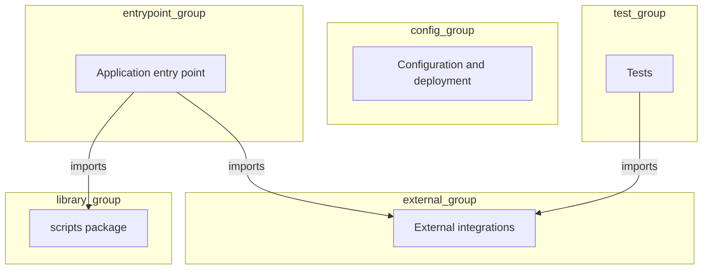

# Architecture report: verl-project/verl

> Automated static analysis. **Observed** = directly seen in files/imports/AST; **Inferred** = interpretation from that evidence. Repository code was not executed.

## 1. Repository at a glance

| Item | Value |
| --- | --- |
| Repository | verl-project/verl |
| Description | verl/HybridFlow: A Flexible and Efficient RL Post-Training Framework  |
| Language | Python |
| Stars | 24230 |
| Licence | Apache-2.0 |
| Analysed commit / branch | 4191e7f910d85d69acb8c45f4840f10faa535165 / main |
| Framework(s) | FastAPI, Typer |
| Files analysed | 799 |
| Components | 5 |

## 2. Architecture in one minute

verl-project/verl - verl/HybridFlow: A Flexible and Efficient RL Post-Training Framework . This repository was analysed statically from 799 file(s) (283 Python). Detected technologies (observed from imports/manifests): GitHub Actions, FastAPI, Typer, aiohttp, NumPy, pandas. Files are grouped into 5 component(s): Configuration and deployment, Application entry point, External integrations, scripts package, Tests. Observed entry point(s): manage_envs.py, scripts/chat_template_checker.py, scripts/converter_hf_to_mcore.py. Findings below distinguish observed facts from inferred interpretation.

## 3. High-level block diagram

## 4. Main components

### Configuration and deployment (`config`)

- **Kind:** config
- **Status:** Observed
- **Confidence:** 0.85
- **Responsibility:** Groups 66 file(s) under configuration and deployment (observed from repository paths and static analysis).
- **Paths:** `docker/Dockerfile.isaaclab230`, `docker/Dockerfile.stable.sglang`, `docker/Dockerfile.stable.trtllm`, `docker/Dockerfile.stable.vllm`, `docker/Dockerfile.uv.cu130`, `docker/ascend/Dockerfile.ascend.sglang_8.3.rc1_a2`, `docker/ascend/Dockerfile.ascend.sglang_8.3.rc1_a3`, `docker/ascend/Dockerfile.ascend.sglang_8.5.0_a2`, `docker/ascend/Dockerfile.ascend.sglang_8.5.0_a3`, `docker/ascend/Dockerfile.ascend_8.2.rc1_a2`, `docker/ascend/Dockerfile.ascend_8.2.rc1_a3`, `docker/ascend/Dockerfile.ascend_8.3.rc1_a2`, `docker/ascend/Dockerfile.ascend_8.3.rc1_a3`, `docker/ascend/Dockerfile.ascend_8.5.0_a2`, `docker/ascend/Dockerfile.ascend_8.5.0_a2_v0.7.1`, `docker/ascend/Dockerfile.ascend_8.5.0_a3`, `docker/ascend/Dockerfile.ascend_8.5.0_a3_v0.7.1`, `docker/ascend/Dockerfile.ascend_8.5.2_a2_qwen3-5`, `docker/ascend/Dockerfile.ascend_8.5.2_a3_qwen3-5`, `docker/ascend/Dockerfile.ascend_9.0.0_a2_v0.8.0`, `docker/ascend/Dockerfile.ascend_9.0.0_a3_v0.8.0`, `docker/ascend/Dockerfile.ascend_9.1.0_a2`, `docker/ascend/Dockerfile.ascend_9.1.0_a2_v0.9.1`, `docker/ascend/Dockerfile.ascend_9.1.0_a3`, `docker/ascend/Dockerfile.ascend_9.1.0_a3_v0.9.1`, `docker/ascend/Dockerfile.ascend_9.1.0_a5`, `docker/ascend/Dockerfile.ascend_9.1.0_a5_v0.9.1`, `docker/ascend/Dockerfile.ascend_9.2.1_a2`, `docker/ascend/Dockerfile.ascend_9.2.1_a3`, `docker/ascend/Dockerfile.ascend_9.2.1_a5`, `docker/aws/Dockerfile.extention.awsefa`, `docker/aws/Dockerfile.ngc.vllm0.8.sagemaker`, `docker/rocm/Dockerfile.rocm`, `docker/rocm/Dockerfile.rocm.deepseek-v4`, `docker/rocm/Dockerfile.rocm6`, `docker/rocm/Dockerfile.rocm702`, `docker/rocm/Dockerfile.rocm_verl-0.3.0.post1`, `docker/rocm/Dockerfile.rocm_verl-0.4.1`, `docker/verl0.4-cu124-torch2.6-fa2.7.4/Dockerfile.app.sglang.vllm.mcore0.12`, `docker/verl0.4-cu124-torch2.6-fa2.7.4/Dockerfile.app.sglang.vllm.mcore0.12.deepep`, `docker/verl0.4-cu124-torch2.6-fa2.7.4/Dockerfile.app.sglang.vllm.mcore0.13.preview`, `docker/verl0.4-cu124-torch2.6-fa2.7.4/Dockerfile.app.vllm.mcore0.12`, `docker/verl0.4-cu124-torch2.6-fa2.7.4/Dockerfile.app.vllm.mcore0.12.deepep`, `docker/verl0.4-cu124-torch2.6-fa2.7.4/Dockerfile.app.vllm.mcore0.13.preview`, `docker/verl0.4-cu124-torch2.6-fa2.7.4/Dockerfile.base`, `docker/verl0.5-cu126-torch2.7-fa2.7.4/Dockerfile.app.sglang0.4.10.post2.mcore0.13`, `docker/verl0.5-cu126-torch2.7-fa2.7.4/Dockerfile.app.sglang0.4.9.post6.mcore0.13`, `docker/verl0.5-cu126-torch2.7-fa2.7.4/Dockerfile.app.vllm.mcore0.13`, `docker/verl0.5-cu126-torch2.7-fa2.7.4/Dockerfile.app.vllm.mcore0.15`, `docker/verl0.5-cu126-torch2.7-fa2.7.4/Dockerfile.base.torch2.7.1`, `docker/verl0.5-cu126-torch2.7.1-fa2.8.0/Dockerfile.app.sglang.mcore0.12`, `docker/verl0.5-cu126-torch2.7.1-fa2.8.0/Dockerfile.app.sglang.mcore0.13.preview`, `docker/verl0.5-cu126-torch2.7.1-fa2.8.0/Dockerfile.base`, `docker/verl0.5-preview-cu128-torch2.7.1-fa2.8.0/Dockerfile.app.sglang.megatron`, `docker/verl0.5-preview-cu128-torch2.7.1-fa2.8.0/Dockerfile.base`, `docker/verl0.6-cu128-torch2.8.0-fa2.7.4/Dockerfile.app.sglang`, `docker/verl0.6-cu128-torch2.8.0-fa2.7.4/Dockerfile.base`, `docker/verl0.6-cu128-torch2.8.0-fa2.7.4/Dockerfile.vllm011.mcore_gpt-oss`, `docker/verl0.6.1-experimental/Dockerfile.sglang056exp`, `docker/verl0.6.1-experimental/Dockerfile.vllm012exp`, `docker/xpu/Dockerfile.stable.vllm`, `pyproject.toml`, `requirements-npu.txt`, `requirements-test.txt`, `requirements.txt`, `setup.py`
- **Evidence:** [docker/Dockerfile.isaaclab230](https://github.com/verl-project/verl/blob/4191e7f910d85d69acb8c45f4840f10faa535165/docker/Dockerfile.isaaclab230); [docker/Dockerfile.stable.sglang](https://github.com/verl-project/verl/blob/4191e7f910d85d69acb8c45f4840f10faa535165/docker/Dockerfile.stable.sglang); [docker/Dockerfile.stable.trtllm](https://github.com/verl-project/verl/blob/4191e7f910d85d69acb8c45f4840f10faa535165/docker/Dockerfile.stable.trtllm); [docker/Dockerfile.stable.vllm](https://github.com/verl-project/verl/blob/4191e7f910d85d69acb8c45f4840f10faa535165/docker/Dockerfile.stable.vllm); [docker/Dockerfile.uv.cu130](https://github.com/verl-project/verl/blob/4191e7f910d85d69acb8c45f4840f10faa535165/docker/Dockerfile.uv.cu130); [docker/ascend/Dockerfile.ascend.sglang_8.3.rc1_a2](https://github.com/verl-project/verl/blob/4191e7f910d85d69acb8c45f4840f10faa535165/docker/ascend/Dockerfile.ascend.sglang_8.3.rc1_a2); [docker/ascend/Dockerfile.ascend.sglang_8.3.rc1_a3](https://github.com/verl-project/verl/blob/4191e7f910d85d69acb8c45f4840f10faa535165/docker/ascend/Dockerfile.ascend.sglang_8.3.rc1_a3); [docker/ascend/Dockerfile.ascend.sglang_8.5.0_a2](https://github.com/verl-project/verl/blob/4191e7f910d85d69acb8c45f4840f10faa535165/docker/ascend/Dockerfile.ascend.sglang_8.5.0_a2)

### Application entry point (`entrypoint`)

- **Kind:** entrypoint
- **Status:** Observed
- **Confidence:** 0.85
- **Responsibility:** Groups 13 file(s) under application entry point (observed from repository paths and static analysis). Observed application object created via Typer. Observed top-level classes: BaseModelMerger, CheckResult, CustomSaveWorker, FSDPModelMerger, Highlighter, JsonLineViewer. Observed top-level functions: _append_ct_result, _assemble_text_messages, _assemble_vl_messages, _assistant_message_for_single_turn, _build_parser, _clone.
- **Paths:** `manage_envs.py`, `scripts/chat_template_checker.py`, `scripts/converter_hf_to_mcore.py`, `scripts/diagnose.py`, `scripts/init_random_model.py`, `scripts/legacy_model_merger.py`, `scripts/megatron_merge_lora.py`, `scripts/migrate_megatron_checkpoint_layout.py`, `scripts/print_cfg.py`, `scripts/rollout_logprob_diff.py`, `scripts/rollout_viewer.py`, `scripts/veomni/moe_merge.py`, `scripts/veomni/moe_split.py`
- **Evidence:** [manage_envs.py:248](https://github.com/verl-project/verl/blob/4191e7f910d85d69acb8c45f4840f10faa535165/manage_envs.py#L248); [scripts/chat_template_checker.py:99](https://github.com/verl-project/verl/blob/4191e7f910d85d69acb8c45f4840f10faa535165/scripts/chat_template_checker.py#L99); [scripts/converter_hf_to_mcore.py:36](https://github.com/verl-project/verl/blob/4191e7f910d85d69acb8c45f4840f10faa535165/scripts/converter_hf_to_mcore.py#L36); [scripts/diagnose.py:50](https://github.com/verl-project/verl/blob/4191e7f910d85d69acb8c45f4840f10faa535165/scripts/diagnose.py#L50); [scripts/init_random_model.py:37](https://github.com/verl-project/verl/blob/4191e7f910d85d69acb8c45f4840f10faa535165/scripts/init_random_model.py#L37); [scripts/legacy_model_merger.py:73](https://github.com/verl-project/verl/blob/4191e7f910d85d69acb8c45f4840f10faa535165/scripts/legacy_model_merger.py#L73); [scripts/megatron_merge_lora.py:42](https://github.com/verl-project/verl/blob/4191e7f910d85d69acb8c45f4840f10faa535165/scripts/megatron_merge_lora.py#L42); [scripts/migrate_megatron_checkpoint_layout.py:75](https://github.com/verl-project/verl/blob/4191e7f910d85d69acb8c45f4840f10faa535165/scripts/migrate_megatron_checkpoint_layout.py#L75)

### External integrations (`external_integrations`)

- **Kind:** external
- **Status:** Inferred
- **Confidence:** 0.70
- **Responsibility:** Groups 0 file(s) under external integrations (observed from repository paths and static analysis).
- **Evidence:** [examples/tutorial/agent_loop_get_started/sandbox.py:16](https://github.com/verl-project/verl/blob/4191e7f910d85d69acb8c45f4840f10faa535165/examples/tutorial/agent_loop_get_started/sandbox.py#L16); [scripts/diagnose.py:20](https://github.com/verl-project/verl/blob/4191e7f910d85d69acb8c45f4840f10faa535165/scripts/diagnose.py#L20); [tests/experimental/reward_loop/reward_fn.py:18](https://github.com/verl-project/verl/blob/4191e7f910d85d69acb8c45f4840f10faa535165/tests/experimental/reward_loop/reward_fn.py#L18); [tests/utils/test_nvtx_profile.py:18](https://github.com/verl-project/verl/blob/4191e7f910d85d69acb8c45f4840f10faa535165/tests/utils/test_nvtx_profile.py#L18)

### scripts package (`scripts`)

- **Kind:** library
- **Status:** Observed
- **Confidence:** 0.85
- **Responsibility:** Groups 6 file(s) under scripts package (observed from repository paths and static analysis). Observed top-level classes: SingleTurnTrajectory, ToolAgentTrajectory, TrajectoryStep, VLSingleTurnTrajectory, VLToolResponseSpec, VLToolStep. Observed top-level functions: _assistant, _clone_message, _format_assistant_content, _format_tool_call_text, _make_query_tool, _schema.
- **Paths:** `scripts/__init__.py`, `scripts/chat_template_mock_trajectories.py`, `scripts/generate_trainer_config.sh`, `scripts/install_sglang_mcore_npu.sh`, `scripts/install_vllm_mcore_npu.sh`, `scripts/install_vllm_sglang_mcore.sh`
- **Evidence:** [scripts/__init__.py](https://github.com/verl-project/verl/blob/4191e7f910d85d69acb8c45f4840f10faa535165/scripts/__init__.py); [scripts/chat_template_mock_trajectories.py:36](https://github.com/verl-project/verl/blob/4191e7f910d85d69acb8c45f4840f10faa535165/scripts/chat_template_mock_trajectories.py#L36); [scripts/generate_trainer_config.sh](https://github.com/verl-project/verl/blob/4191e7f910d85d69acb8c45f4840f10faa535165/scripts/generate_trainer_config.sh); [scripts/install_sglang_mcore_npu.sh](https://github.com/verl-project/verl/blob/4191e7f910d85d69acb8c45f4840f10faa535165/scripts/install_sglang_mcore_npu.sh); [scripts/install_vllm_mcore_npu.sh](https://github.com/verl-project/verl/blob/4191e7f910d85d69acb8c45f4840f10faa535165/scripts/install_vllm_mcore_npu.sh); [scripts/install_vllm_sglang_mcore.sh](https://github.com/verl-project/verl/blob/4191e7f910d85d69acb8c45f4840f10faa535165/scripts/install_vllm_sglang_mcore.sh)

### Tests (`tests`)

- **Kind:** test
- **Status:** Observed
- **Confidence:** 0.85
- **Responsibility:** Groups 293 file(s) under tests (observed from repository paths and static analysis). Observed routes: PATCH verl.trainer.ppo.metric_utils._compute_response_info, PATCH verl.trainer.ppo.metric_utils._compute_response_info, PATCH verl.utils.checkpoint.megatron_checkpoint_manager.save_dist_checkpointing, PATCH verl.utils.checkpoint.megatron_checkpoint_manager.save_dist_checkpointing, PATCH verl.utils.checkpoint.megatron_checkpoint_manager.save_dist_checkpointing. Observed top-level classes: Actor, Batch, CharTokenizer, ChatMLTokenizer, ChatTraceClass, CheckpointEngineWorkerTest. Observed top-lev…
- **Paths:** `tests/README.md`, `tests/__init__.py`, `tests/checkpoint_engine/__init__.py`, `tests/checkpoint_engine/d2h_checkpoint_engine.py`, `tests/checkpoint_engine/test_block_placement.py`, `tests/checkpoint_engine/test_correctness_on_gpu.py`, `tests/checkpoint_engine/test_correctness_on_npu.py`, `tests/checkpoint_engine/test_d2h_checkpoint_engine.py`, `tests/checkpoint_engine/test_fsdp_lora_only_checkpoint_on_cpu.py`, `tests/checkpoint_engine/test_global_steps_on_cpu.py`, `tests/checkpoint_engine/test_sglang_fusion_bucketing_on_cpu.py`, `tests/checkpoint_engine/test_sglang_loader.py`, `tests/checkpoint_engine/test_sharded_delta.py`, `tests/checkpoint_engine/test_special_server_adapter.py`, `tests/checkpoint_engine/test_utils.py`, `tests/experimental/__init__.py`, `tests/experimental/agent_loop/__init__.py`, `tests/experimental/agent_loop/agent_utils.py`, `tests/experimental/agent_loop/function_tool_examples.py`, `tests/experimental/agent_loop/qwen_vl_tool_chat_template.jinja2`, `tests/experimental/agent_loop/test_agent_loop_extra_fields_schema_on_cpu.py`, `tests/experimental/agent_loop/test_audio_server_contract_on_cpu.py`, `tests/experimental/agent_loop/test_basic_agent_loop.py`, `tests/experimental/agent_loop/test_call_tool_on_cpu.py`, `tests/experimental/agent_loop/test_continuous_token_check_gating_on_cpu.py`, `tests/experimental/agent_loop/test_gpt_oss_tool_parser.py`, `tests/experimental/agent_loop/test_multi_modal.py`, `tests/experimental/agent_loop/test_multimodal_position_ids_on_cpu.py`, `tests/experimental/agent_loop/test_qwen3_tool_parser_on_cpu.py`, `tests/experimental/agent_loop/test_standalone_rollout.py`, `tests/experimental/agent_loop/test_tool_call_id_on_cpu.py`, `tests/experimental/fully_async_policy/__init__.py`, `tests/experimental/fully_async_policy/test_async_genrm_config_on_cpu.py`, `tests/experimental/reward_loop/reward_fn.py`, `tests/experimental/reward_loop/run_determinism_e2e_with_rm.py`, `tests/experimental/reward_loop/test_agent_reward_loop_colocate.py`, `tests/experimental/reward_loop/test_agent_reward_loop_standalone.py`, `tests/experimental/reward_loop/test_async_token_bucket_on_cpu.py`, `tests/experimental/reward_loop/test_math_verify.py`, `tests/experimental/reward_loop/test_rate_limited_reward_manager_on_cpu.py`, `tests/experimental/reward_loop/test_reward_model_disrm.py`, `tests/experimental/reward_loop/test_reward_model_genrm.py`, `tests/experimental/vla/test_sim_envs.py`, `tests/kill_github_tests.sh`, `tests/model_merger/test_fsdp_merge_non_dtensor_shards_on_cpu.py`, `tests/model_merger/test_output_validation_on_cpu.py`, `tests/model_merger/test_shard_configuration_on_cpu.py`, `tests/models/test_engine.py`, `tests/models/test_fsdp_no_padding_on_gpu.py`, `tests/models/test_fused_kernels_ulysses_sp_on_cpu.py`, `tests/models/test_liger_vl_compat.py`, `tests/models/test_model_forward_fused.py`, `tests/models/test_moe_zloss_per_token_loss.py`, `tests/models/test_tiled_mlp_accuracy.py`, `tests/models/test_transformer.py`, `tests/models/test_transformers_ulysses.py`, `tests/plugin/__init__.py`, `tests/plugin/test_platform_abstraction.py`, `tests/single_controller/__init__.py`, `tests/single_controller/base/test_decorator.py`, `tests/single_controller/check_worker_alive/main.py`, `tests/single_controller/detached_worker/README.md`, `tests/single_controller/detached_worker/client.py`, `tests/single_controller/detached_worker/run.sh`, `tests/single_controller/detached_worker/server.py`, `tests/single_controller/test_auto_padding_on_cpu.py`, `tests/single_controller/test_colocated_workers.py`, `tests/single_controller/test_colocated_workers_fused.py`, `tests/single_controller/test_data_transfer.py`, `tests/single_controller/test_decorator_on_cpu.py`, `tests/single_controller/test_device_agnostic_resources_on_cpu.py`, `tests/single_controller/test_device_mesh_register.py`, `tests/single_controller/test_driverfunc_to_worker.py`, `tests/single_controller/test_fused_workers_on_cpu.py`, `tests/single_controller/test_get_set_dispatch_collect_cpu.py`, `tests/single_controller/test_high_level_scheduling_api.py`, `tests/single_controller/test_nested_worker.py`, `tests/single_controller/test_ray_collectives.py`, `tests/single_controller/test_ray_local_envs_on_cpu.py`, `tests/single_controller/test_ray_utils_on_cpu.py`, `tests/single_controller/test_rvdz.py`, `tests/single_controller/test_split_resource_pool.py`, `tests/single_controller/test_worker_group_basics.py`, `tests/single_controller/test_worker_group_torch.py`, `tests/special_distributed/README.md`, `tests/special_distributed/run_all.sh`, `tests/special_distributed/test_fsdp2_cpu_offload_state_dict.py`, `tests/special_distributed/test_fsdp2_model_cpu_offload.py`, `tests/special_distributed/test_fsdp2_pinned_model_transfer.py`, `tests/special_distributed/test_fsdp_ckpt.py`, `tests/special_distributed/test_fused_kernels_ulysses_sp.py`, `tests/special_distributed/test_mcore_probe_differential.py`, `tests/special_distributed/test_megatron_dynamic_cp_features.py`, `tests/special_distributed/test_qwen35_linear_attention_ulysses_sp.py`, `tests/special_distributed/test_router_replay_empty_pp.py`, `tests/special_distributed/test_sglang_delta_loop.py`, `tests/special_distributed/test_sharded_delta_gather.py`, `tests/special_distributed/test_tensor_dict.py`, `tests/special_distributed/test_torch_functional.py`, `tests/special_e2e/README.md`, `tests/special_e2e/__init__.py`, `tests/special_e2e/check_custom_rwd_fn.py`, `tests/special_e2e/check_results.py`, `tests/special_e2e/envs/__init__.py`, `tests/special_e2e/envs/digit_completion/__init__.py`, `tests/special_e2e/envs/digit_completion/task.py`, `tests/special_e2e/envs/digit_completion/tokenizer.py`, `tests/special_e2e/ppo_trainer/expert_parallel/qwen2moe_minimal.json`, `tests/special_e2e/ppo_trainer/expert_parallel/qwen3moe_minimal.json`, `tests/special_e2e/ppo_trainer/run_function_reward.sh`, `tests/special_e2e/profiler_finish_hook_marker.sh`, `tests/special_e2e/run_ppo_trainer_megatron.sh`, `tests/special_e2e/run_ppo_trainer_torchtitan.sh`, `tests/special_e2e/run_ppo_trainer_veomni.sh`, `tests/special_e2e/run_v1_colocate_async_disrm.sh`, `tests/special_e2e/run_v1_separate_async.sh`, `tests/special_e2e/run_v1_separate_async_ascend.sh`, `tests/special_e2e/run_v1_separate_async_opd.sh`, `tests/special_e2e/sft/compare_sft_engine_results.py`, `tests/special_e2e/sft/run_sft.sh`, `tests/special_e2e/sft/run_sft_engine.sh`, `tests/special_e2e/sft/test_sft_engine_all.sh`, `tests/special_npu/nightly_ci_ascend/run_dapo_moonlight-16b_megatron_npu.sh`, `tests/special_npu/nightly_ci_ascend/run_grpo_glm52_top16_megatron_npu_multinode.sh`, `tests/special_npu/nightly_ci_ascend/run_grpo_qwen3_30b_megatron_sglang_npu.sh`, `tests/special_npu/nightly_ci_ascend/run_grpo_qwen3_30b_veomni_fsdp.sh`, `tests/special_npu/nightly_ci_ascend/run_grpo_qwen3_5_2b_fsdp2_npu.sh`, `tests/special_npu/nightly_ci_ascend/run_grpo_qwen3_5_2b_fsdp_turbo_npu.sh`, `tests/special_npu/nightly_ci_ascend/run_grpo_qwen3_5_35b_megatron_npu.sh`, `tests/special_npu/nightly_ci_ascend/run_gspo_qwen3_30b_megatron_npu.sh`, `tests/special_npu/nightly_ci_ascend/run_gspo_qwen3_30b_megatron_npu_multinode.sh`, `tests/special_npu/nightly_ci_ascend/run_gspo_qwen3_8b_fsdp2_npu.sh`, `tests/special_npu/nightly_ci_ascend/run_ppo_qwen3-8b_fsdp_npu.sh`, `tests/special_npu/quick_start/run_qwen3_0_6b_fsdp2_sglang_ascend.sh`, `tests/special_npu/quick_start/run_qwen3_0_6b_fsdp2_vllm_ascend.sh`, `tests/special_npu/quick_start/run_qwen3_0_6b_megatron_sglang_ascend.sh`, `tests/special_npu/quick_start/run_qwen3_0_6b_megatron_vllm_ascend.sh`, `tests/special_npu/run_qwen3_06b_grpo_mindspeed.sh`, `tests/special_npu/run_qwen3_06b_ppo.sh`, `tests/special_npu/run_qwen3_30b_grpo_mindspeed.sh`, `tests/special_npu/run_qwen3_5_2b_fsdp_turbo.sh`, `tests/special_npu/run_qwen3_5_35b_grpo_megatron.sh`, `tests/special_npu/run_qwen3_8b_grpo_profiling.sh`, `tests/special_npu/run_qwen3_vl_8b_Instruct_fsdp2_npu.sh`, `tests/special_sanity/check_api_docs.py`, `tests/special_sanity/check_dataproto_usage.py`, `tests/special_sanity/check_device_api_usage.py`, `tests/special_sanity/check_docs_time_info.py`, `tests/special_sanity/check_docstrings.py`, `tests/special_sanity/check_example_naming.py`, `tests/special_sanity/check_license.py`, `tests/special_sanity/check_pr_description.py`, `tests/special_sanity/check_pr_title.py`, `tests/special_sanity/check_uv_gpu_only.py`, `tests/special_sanity/test_check_example_naming.py`, `tests/special_sanity/test_config_docs.py`, `tests/special_sanity/test_import.py`, `tests/special_sanity/type_coverage_check.py`, `tests/special_sanity/validate_imported_docs.py`, `tests/special_sanity/validate_structure.py`, `tests/special_standalone/README.md`, `tests/special_standalone/test_memory_buffers.py`, `tests/test_base_config_on_cpu.py`, `tests/test_protocol_on_cpu.py`, `tests/test_protocol_v2_on_cpu.py`, `tests/tools/__init__.py`, `tests/tools/_stub_search_tools.py`, `tests/tools/test_function_tool_on_cpu.py`, `tests/tools/test_mixed_tools_on_cpu.py`, `tests/trainer/__init__.py`, `tests/trainer/ppo/__init__.py`, `tests/trainer/ppo/test_core_algos_on_cpu.py`, `tests/trainer/ppo/test_dynamic_policy_losses_on_cpu.py`, `tests/trainer/ppo/test_loss_aggregation_on_cpu.py`, `tests/trainer/ppo/test_metric_utils_on_cpu.py`, `tests/trainer/ppo/test_reinforce_pp_multiturn_on_cpu.py`, `tests/trainer/ppo/test_rollout_corr.py`, `tests/trainer/ppo/test_rollout_corr_integration.py`, `tests/trainer/ppo/test_rollout_moe_lb_metrics_on_cpu.py`, `tests/trainer/ppo/test_score_centering_alignment_on_cpu.py`, `tests/trainer/ppo/test_score_centering_config_on_cpu.py`, `tests/trainer/ppo/test_score_centering_metrics_on_cpu.py`, `tests/trainer/ppo/test_score_centering_numerics_on_cpu.py`, `tests/trainer/ppo/test_score_centering_on_cpu.py`, `tests/trainer/ppo/test_spec_decode_metrics_on_cpu.py`, `tests/trainer/ppo/test_value_loss_normalization_on_cpu.py`, `tests/trainer/ppo/v1/test_agent_loop_tq_on_cpu.py`, `tests/trainer/ppo/v1/test_checkpoint_callback_on_cpu.py`, `tests/trainer/ppo/v1/test_compute_reward_colocate_on_cpu.py`, `tests/trainer/ppo/v1/test_metrics_aggregator_on_cpu.py`, `tests/trainer/ppo/v1/test_reissue_inflight_on_cpu.py`, `tests/trainer/ppo/v1/test_replay_buffer_on_cpu.py`, `tests/trainer/ppo/v1/test_rollout_profiling_on_cpu.py`, `tests/trainer/ppo/v1/test_separate_async_step_switch_on_cpu.py`, `tests/trainer/ppo/v1/test_streaming_feed_on_cpu.py`, `tests/trainer/ppo/v1/test_trainer_base_on_cpu.py`, `tests/trainer/ppo/v1/test_v1_async_alignment_on_cpu.py`, `tests/trainer/ppo/v1/test_v1_async_warmup_on_cpu.py`, `tests/trainer/test_constants_ppo_on_cpu.py`, `tests/trainer/test_multi_trajectories_advantage_on_cpu.py`, `tests/utils/_test_module.py`, `tests/utils/ckpt/test_checkpoint_cleanup_on_cpu.py`, `tests/utils/ckpt/test_esi_save_ckpt_on_cpu.py`, `tests/utils/ckpt/test_lora_custom_object_save_on_cpu.py`, `tests/utils/ckpt/test_megatron_checkpoint_manager_on_cpu.py`, `tests/utils/dataset/test_custom_dataloader_on_cpu.py`, `tests/utils/dataset/test_multiturn_sft_dataset_on_cpu.py`, `tests/utils/dataset/test_rl_collate_fn_on_cpu.py`, `tests/utils/dataset/test_rl_dataset_on_cpu.py`, `tests/utils/debug/test_metrics.py`, `tests/utils/kernel/tilelang/test_linear_cross_entropy_on_gpu.py`, `tests/utils/megatron/muon_optim_gpu_smoke.py`, `tests/utils/megatron/test_muon_layerwise_bridge_ddp_on_cpu.py`, `tests/utils/megatron/test_muon_optim_realcfg_on_cpu.py`, `tests/utils/megatron/test_muon_optim_wiring_on_cpu.py`, `tests/utils/megatron/test_optimizer.py`, `tests/utils/megatron/test_optimizer_offload_and_load.py`, `tests/utils/megatron/test_pipeline_parallel.py`, `tests/utils/megatron/test_router_replay_model_walk_on_cpu.py`, `tests/utils/qat/test_modelopt_mxfp8_on_gpu.py`, `tests/utils/qat/test_nvfp4_qat_fake_quant_on_gpu.py`, `tests/utils/qat/test_qat_export_kernels_on_gpu.py`, `tests/utils/qat/test_qat_fp4_on_gpu.py`, `tests/utils/qat/test_qat_fp8_on_gpu.py`, `tests/utils/real_nvfp4/test_nvfp4_per_token_export_on_gpu.py`, `tests/utils/real_nvfp4/test_nvfp4_per_token_on_cpu.py`, `tests/utils/real_nvfp4/test_nvfp4_per_token_refit_on_gpu.py`, `tests/utils/real_nvfp4/test_training_guards_on_cpu.py`, `tests/utils/reward_score/reward_score/test_sandbox_fusion_on_cpu.py`, `tests/utils/reward_score/test_math_dapo_bold_label_on_cpu.py`, `tests/utils/reward_score/test_preset_reward_routing_on_cpu.py`, `tests/utils/reward_score/test_sandbox_on_cpu.py`, `tests/utils/test_activation_offload.py`, `tests/utils/test_attention_utils.py`, `tests/utils/test_audio_input_support_on_cpu.py`, `tests/utils/test_bucketed_weight_transfer.py`, `tests/utils/test_cann_linear_ce_on_cpu.py`, `tests/utils/test_cann_linear_ce_on_npu.py`, `tests/utils/test_check_ipc_version_support_on_npu.py`, `tests/utils/test_check_profiler_output.py`, `tests/utils/test_config_on_cpu.py`, `tests/utils/test_config_router_replay_on_cpu.py`, `tests/utils/test_continuous_token_check_on_cpu.py`, `tests/utils/test_continuous_token_on_cpu.py`, `tests/utils/test_dynamic_cp_scheduler.py`, `tests/utils/test_experimental_torch_functional_on_cpu.py`, `tests/utils/test_flops_counter.py`, `tests/utils/test_fs_on_cpu.py`, `tests/utils/test_fsdp2_model_transfer_on_cpu.py`, `tests/utils/test_fsdp2_peft_wrapping.py`, `tests/utils/test_fsdp_lora_merge.py`, `tests/utils/test_fsdp_wrap_policy_on_cpu.py`, `tests/utils/test_groupwise.py`, `tests/utils/test_import_utils_on_cpu.py`, `tests/utils/test_linear_cross_entropy.py`, `tests/utils/test_linear_cross_entropy_on_cpu.py`, `tests/utils/test_logprobs_from_logits_batch_invariant_on_cpu.py`, `tests/utils/test_megatron_bshd_preprocess.py`, `tests/utils/test_megatron_fp8_padding_on_cpu.py`, `tests/utils/test_megatron_mtp_dcp.py`, `tests/utils/test_megatron_router_replay_dcp.py`, `tests/utils/test_megatron_utils_nested_config.py`, `tests/utils/test_mlflow_key_sanitization.py`, `tests/utils/test_model_on_cpu.py`, `tests/utils/test_mxfp8_ignored_layers_on_cpu.py`, `tests/utils/test_normalize_peft_param_name.py`, `tests/utils/test_normalize_peft_param_name_on_cpu.py`, `tests/utils/test_npu_vllm_patch_on_cpu.py`, `tests/utils/test_nvtx_profile.py`, `tests/utils/test_padding_on_cpu.py`, `tests/utils/test_precision_debugger_profile.py`, `tests/utils/test_prepare_micro_batches_with_group_size.py`, `tests/utils/test_profiler_markers.py`, `tests/utils/test_rl_insight_logger_on_cpu.py`, `tests/utils/test_rollout_trace_on_cpu.py`, `tests/utils/test_seqlen_balancing.py`, `tests/utils/test_server_profiler.py`, `tests/utils/test_shared_memory.py`, `tests/utils/test_special_adapter_path_integration.py`, `tests/utils/test_special_linear_cross_entropy_tp.py`, `tests/utils/test_special_megatron_kl_loss_tp.py`, `tests/utils/test_special_mstx_profile.py`, `tests/utils/test_temp_env_on_cpu.py`, `tests/utils/test_timeout_decorator_cpu.py`, `tests/utils/test_tokenizer_normalize_on_cpu.py`, `tests/utils/test_torch_functional.py`, `tests/utils/test_torch_memory_profile.py`, `tests/utils/test_torch_profile.py`, `tests/utils/test_tracking_on_cpu.py`, `tests/utils/test_transferqueue_utils_on_cpu.py`, `tests/utils/test_turn_separator_on_cpu.py`, `tests/utils/test_utils_skip.py`, `tests/utils/test_vllm_fp8_restage_same_shape_on_cpu.py`
- **Evidence:** [tests/README.md](https://github.com/verl-project/verl/blob/4191e7f910d85d69acb8c45f4840f10faa535165/tests/README.md); [tests/__init__.py](https://github.com/verl-project/verl/blob/4191e7f910d85d69acb8c45f4840f10faa535165/tests/__init__.py); [tests/checkpoint_engine/__init__.py](https://github.com/verl-project/verl/blob/4191e7f910d85d69acb8c45f4840f10faa535165/tests/checkpoint_engine/__init__.py); [tests/checkpoint_engine/d2h_checkpoint_engine.py:35](https://github.com/verl-project/verl/blob/4191e7f910d85d69acb8c45f4840f10faa535165/tests/checkpoint_engine/d2h_checkpoint_engine.py#L35); [tests/checkpoint_engine/test_block_placement.py:32](https://github.com/verl-project/verl/blob/4191e7f910d85d69acb8c45f4840f10faa535165/tests/checkpoint_engine/test_block_placement.py#L32); [tests/checkpoint_engine/test_correctness_on_gpu.py:40](https://github.com/verl-project/verl/blob/4191e7f910d85d69acb8c45f4840f10faa535165/tests/checkpoint_engine/test_correctness_on_gpu.py#L40); [tests/checkpoint_engine/test_correctness_on_npu.py:37](https://github.com/verl-project/verl/blob/4191e7f910d85d69acb8c45f4840f10faa535165/tests/checkpoint_engine/test_correctness_on_npu.py#L37); [tests/checkpoint_engine/test_d2h_checkpoint_engine.py:27](https://github.com/verl-project/verl/blob/4191e7f910d85d69acb8c45f4840f10faa535165/tests/checkpoint_engine/test_d2h_checkpoint_engine.py#L27)

## 5. Execution flow

**Observed** entry point(s):

- [manage_envs.py:945](https://github.com/verl-project/verl/blob/4191e7f910d85d69acb8c45f4840f10faa535165/manage_envs.py#L945)
- [scripts/chat_template_checker.py:1140](https://github.com/verl-project/verl/blob/4191e7f910d85d69acb8c45f4840f10faa535165/scripts/chat_template_checker.py#L1140)
- [scripts/converter_hf_to_mcore.py:113](https://github.com/verl-project/verl/blob/4191e7f910d85d69acb8c45f4840f10faa535165/scripts/converter_hf_to_mcore.py#L113)
- [scripts/diagnose.py:286](https://github.com/verl-project/verl/blob/4191e7f910d85d69acb8c45f4840f10faa535165/scripts/diagnose.py#L286)
- [scripts/init_random_model.py:100](https://github.com/verl-project/verl/blob/4191e7f910d85d69acb8c45f4840f10faa535165/scripts/init_random_model.py#L100)
- [scripts/legacy_model_merger.py:807](https://github.com/verl-project/verl/blob/4191e7f910d85d69acb8c45f4840f10faa535165/scripts/legacy_model_merger.py#L807)
- [scripts/megatron_merge_lora.py:126](https://github.com/verl-project/verl/blob/4191e7f910d85d69acb8c45f4840f10faa535165/scripts/megatron_merge_lora.py#L126)
- [scripts/migrate_megatron_checkpoint_layout.py:247](https://github.com/verl-project/verl/blob/4191e7f910d85d69acb8c45f4840f10faa535165/scripts/migrate_megatron_checkpoint_layout.py#L247)
- [scripts/print_cfg.py:34](https://github.com/verl-project/verl/blob/4191e7f910d85d69acb8c45f4840f10faa535165/scripts/print_cfg.py#L34)
- [scripts/rollout_logprob_diff.py:306](https://github.com/verl-project/verl/blob/4191e7f910d85d69acb8c45f4840f10faa535165/scripts/rollout_logprob_diff.py#L306)
- [scripts/rollout_viewer.py:552](https://github.com/verl-project/verl/blob/4191e7f910d85d69acb8c45f4840f10faa535165/scripts/rollout_viewer.py#L552)
- [scripts/veomni/moe_merge.py:116](https://github.com/verl-project/verl/blob/4191e7f910d85d69acb8c45f4840f10faa535165/scripts/veomni/moe_merge.py#L116)

**Observed** routes (from decorators):

- `PATCH verl.trainer.ppo.metric_utils._compute_response_info` -> `test_compute_timing_metrics` in `tests/trainer/ppo/test_metric_utils_on_cpu.py:378`
- `PATCH verl.trainer.ppo.metric_utils._compute_response_info` -> `test_compute_timing_metrics_zero_tokens` in `tests/trainer/ppo/test_metric_utils_on_cpu.py:404`
- `PATCH verl.utils.checkpoint.megatron_checkpoint_manager.save_dist_checkpointing` -> `test_bridge_split_optimizer_extra` in `tests/utils/ckpt/test_megatron_checkpoint_manager_on_cpu.py:296`
- `PATCH verl.utils.checkpoint.megatron_checkpoint_manager.save_dist_checkpointing` -> `test_bridge_model_only_no_dist_ckpt` in `tests/utils/ckpt/test_megatron_checkpoint_manager_on_cpu.py:311`
- `PATCH verl.utils.checkpoint.megatron_checkpoint_manager.save_dist_checkpointing` -> `test_optimizer_only_writes_only_optimizer_subdir` in `tests/utils/ckpt/test_megatron_checkpoint_manager_on_cpu.py:320`
- `PATCH verl.utils.checkpoint.megatron_checkpoint_manager.save_dist_checkpointing` -> `test_extra_only` in `tests/utils/ckpt/test_megatron_checkpoint_manager_on_cpu.py:332`
- `PATCH verl.utils.checkpoint.megatron_checkpoint_manager.save_dist_checkpointing` -> `test_dist_ckpt_backend_splits_into_three` in `tests/utils/ckpt/test_megatron_checkpoint_manager_on_cpu.py:345`
- `PATCH verl.utils.checkpoint.megatron_checkpoint_manager.save_dist_checkpointing` -> `test_hf_model_with_bridge_deduplicates` in `tests/utils/ckpt/test_megatron_checkpoint_manager_on_cpu.py:361`
- `PATCH verl.utils.checkpoint.megatron_checkpoint_manager.save_dist_checkpointing` -> `test_hf_model_and_dist_ckpt_saves_both` in `tests/utils/ckpt/test_megatron_checkpoint_manager_on_cpu.py:370`
- `PATCH verl.utils.checkpoint.megatron_checkpoint_manager.save_dist_checkpointing` -> `test_peft_adapters_under_model_subdir` in `tests/utils/ckpt/test_megatron_checkpoint_manager_on_cpu.py:385`
- `PATCH verl.utils.checkpoint.megatron_checkpoint_manager.save_dist_checkpointing` -> `test_empty_save_contents` in `tests/utils/ckpt/test_megatron_checkpoint_manager_on_cpu.py:398`
- `PATCH ` -> `test_hf_weight_load_model_via_bridge` in `tests/utils/ckpt/test_megatron_checkpoint_manager_on_cpu.py:452`
- `PATCH verl.utils.checkpoint.megatron_checkpoint_manager.load_dist_checkpointing` -> `test_hf_weight_load_model_via_bridge` in `tests/utils/ckpt/test_megatron_checkpoint_manager_on_cpu.py:452`
- `PATCH ` -> `test_dist_ckpt_load_model_from_each_subdir` in `tests/utils/ckpt/test_megatron_checkpoint_manager_on_cpu.py:481`
- `PATCH verl.utils.checkpoint.megatron_checkpoint_manager.load_dist_checkpointing` -> `test_dist_ckpt_load_model_from_each_subdir` in `tests/utils/ckpt/test_megatron_checkpoint_manager_on_cpu.py:481`
- `PATCH ` -> `test_load_optimizer_only` in `tests/utils/ckpt/test_megatron_checkpoint_manager_on_cpu.py:512`
- `PATCH verl.utils.checkpoint.megatron_checkpoint_manager.load_dist_checkpointing` -> `test_load_optimizer_only` in `tests/utils/ckpt/test_megatron_checkpoint_manager_on_cpu.py:512`
- `PATCH ` -> `test_load_extra_only` in `tests/utils/ckpt/test_megatron_checkpoint_manager_on_cpu.py:527`
- `PATCH verl.utils.checkpoint.megatron_checkpoint_manager.load_dist_checkpointing` -> `test_load_extra_only` in `tests/utils/ckpt/test_megatron_checkpoint_manager_on_cpu.py:527`
- `PATCH ` -> `test_load_rejects_legacy_layout` in `tests/utils/ckpt/test_megatron_checkpoint_manager_on_cpu.py:543`
- `PATCH verl.utils.checkpoint.megatron_checkpoint_manager.load_dist_checkpointing` -> `test_load_rejects_legacy_layout` in `tests/utils/ckpt/test_megatron_checkpoint_manager_on_cpu.py:543`
- `PATCH verl.utils.checkpoint.megatron_checkpoint_manager.save_dist_checkpointing` -> `test_hf_config_saved_with_bridge` in `tests/utils/ckpt/test_megatron_checkpoint_manager_on_cpu.py:573`
- `PATCH verl.utils.checkpoint.megatron_checkpoint_manager.save_dist_checkpointing` -> `test_hf_config_not_saved_without_model` in `tests/utils/ckpt/test_megatron_checkpoint_manager_on_cpu.py:581`
- `PATCH verl.utils.checkpoint.megatron_checkpoint_manager.save_dist_checkpointing` -> `test_transformer_config_saved_with_extra` in `tests/utils/ckpt/test_megatron_checkpoint_manager_on_cpu.py:588`
- `PATCH verl.utils.checkpoint.megatron_checkpoint_manager.save_dist_checkpointing` -> `test_transformer_config_not_saved_without_extra` in `tests/utils/ckpt/test_megatron_checkpoint_manager_on_cpu.py:595`
- `PATCH verl.utils.checkpoint.megatron_checkpoint_manager.save_dist_checkpointing` -> `test_extra_only_does_not_build_model_sd` in `tests/utils/ckpt/test_megatron_checkpoint_manager_on_cpu.py:615`
- `PATCH verl.utils.checkpoint.megatron_checkpoint_manager.save_dist_checkpointing` -> `test_model_only_bridge_does_not_build_model_sd` in `tests/utils/ckpt/test_megatron_checkpoint_manager_on_cpu.py:622`
- `PATCH verl.utils.checkpoint.megatron_checkpoint_manager.save_dist_checkpointing` -> `test_optimizer_does_build_model_sd` in `tests/utils/ckpt/test_megatron_checkpoint_manager_on_cpu.py:629`
- `PATCH ` -> `test_load_extra_only_does_not_build_model_sd` in `tests/utils/ckpt/test_megatron_checkpoint_manager_on_cpu.py:637`
- `PATCH verl.utils.checkpoint.megatron_checkpoint_manager.load_dist_checkpointing` -> `test_load_extra_only_does_not_build_model_sd` in `tests/utils/ckpt/test_megatron_checkpoint_manager_on_cpu.py:637`
- `PATCH ` -> `test_load_optimizer_builds_model_sd` in `tests/utils/ckpt/test_megatron_checkpoint_manager_on_cpu.py:649`
- `PATCH verl.utils.checkpoint.megatron_checkpoint_manager.load_dist_checkpointing` -> `test_load_optimizer_builds_model_sd` in `tests/utils/ckpt/test_megatron_checkpoint_manager_on_cpu.py:649`
- `PATCH verl.utils.reward_score.sandbox_fusion.utils.call_sandbox_api` -> `test_unit_concurrency_order` in `tests/utils/reward_score/reward_score/test_sandbox_fusion_on_cpu.py:254`
- `PATCH verl.utils.reward_score.sandbox_fusion.utils.call_sandbox_api` -> `test_unit_api_timeout_error_concurrent` in `tests/utils/reward_score/reward_score/test_sandbox_fusion_on_cpu.py:298`
- `PATCH subprocess.run` -> `test_get_npu_versions_success` in `tests/utils/test_check_ipc_version_support_on_npu.py:154`
- `PATCH platform.machine` -> `test_get_npu_versions_success` in `tests/utils/test_check_ipc_version_support_on_npu.py:154`
- `PATCH os.path.exists` -> `test_get_npu_versions_success` in `tests/utils/test_check_ipc_version_support_on_npu.py:154`
- `PATCH builtins.open` -> `test_get_npu_versions_success` in `tests/utils/test_check_ipc_version_support_on_npu.py:154`
- `PATCH subprocess.run` -> `test_get_npu_versions_missing_software_version` in `tests/utils/test_check_ipc_version_support_on_npu.py:171`
- `PATCH subprocess.run` -> `test_get_npu_versions_unsupported_architecture` in `tests/utils/test_check_ipc_version_support_on_npu.py:184`
- `PATCH platform.machine` -> `test_get_npu_versions_unsupported_architecture` in `tests/utils/test_check_ipc_version_support_on_npu.py:184`
- `PATCH os.path.exists` -> `test_get_npu_versions_unsupported_architecture` in `tests/utils/test_check_ipc_version_support_on_npu.py:184`
- `PATCH builtins.open` -> `test_get_npu_versions_unsupported_architecture` in `tests/utils/test_check_ipc_version_support_on_npu.py:184`
- `PATCH subprocess.run` -> `test_get_npu_versions_cann_path_not_exists` in `tests/utils/test_check_ipc_version_support_on_npu.py:200`
- `PATCH platform.machine` -> `test_get_npu_versions_cann_path_not_exists` in `tests/utils/test_check_ipc_version_support_on_npu.py:200`
- `PATCH os.path.exists` -> `test_get_npu_versions_cann_path_not_exists` in `tests/utils/test_check_ipc_version_support_on_npu.py:200`
- `PATCH builtins.open` -> `test_get_npu_versions_cann_path_not_exists` in `tests/utils/test_check_ipc_version_support_on_npu.py:200`
- `PATCH subprocess.run` -> `test_get_npu_versions_info_file_not_exists` in `tests/utils/test_check_ipc_version_support_on_npu.py:216`
- `PATCH platform.machine` -> `test_get_npu_versions_info_file_not_exists` in `tests/utils/test_check_ipc_version_support_on_npu.py:216`
- `PATCH os.path.exists` -> `test_get_npu_versions_info_file_not_exists` in `tests/utils/test_check_ipc_version_support_on_npu.py:216`
- `PATCH builtins.open` -> `test_get_npu_versions_info_file_not_exists` in `tests/utils/test_check_ipc_version_support_on_npu.py:216`
- `PATCH subprocess.run` -> `test_get_npu_versions_missing_cann_version` in `tests/utils/test_check_ipc_version_support_on_npu.py:234`
- `PATCH platform.machine` -> `test_get_npu_versions_missing_cann_version` in `tests/utils/test_check_ipc_version_support_on_npu.py:234`
- `PATCH os.path.exists` -> `test_get_npu_versions_missing_cann_version` in `tests/utils/test_check_ipc_version_support_on_npu.py:234`
- `PATCH builtins.open` -> `test_get_npu_versions_missing_cann_version` in `tests/utils/test_check_ipc_version_support_on_npu.py:234`
- `PATCH subprocess.run` -> `test_hardware_version_a5_910_95` in `tests/utils/test_check_ipc_version_support_on_npu.py:251`
- `PATCH platform.machine` -> `test_hardware_version_a5_910_95` in `tests/utils/test_check_ipc_version_support_on_npu.py:251`
- `PATCH os.path.exists` -> `test_hardware_version_a5_910_95` in `tests/utils/test_check_ipc_version_support_on_npu.py:251`
- `PATCH builtins.open` -> `test_hardware_version_a5_910_95` in `tests/utils/test_check_ipc_version_support_on_npu.py:251`
- `PATCH subprocess.run` -> `test_hardware_version_a5_950` in `tests/utils/test_check_ipc_version_support_on_npu.py:263`
- `PATCH platform.machine` -> `test_hardware_version_a5_950` in `tests/utils/test_check_ipc_version_support_on_npu.py:263`
- `PATCH os.path.exists` -> `test_hardware_version_a5_950` in `tests/utils/test_check_ipc_version_support_on_npu.py:263`
- `PATCH builtins.open` -> `test_hardware_version_a5_950` in `tests/utils/test_check_ipc_version_support_on_npu.py:263`
- `PATCH subprocess.run` -> `test_hardware_version_a3` in `tests/utils/test_check_ipc_version_support_on_npu.py:275`
- `PATCH platform.machine` -> `test_hardware_version_a3` in `tests/utils/test_check_ipc_version_support_on_npu.py:275`
- `PATCH os.path.exists` -> `test_hardware_version_a3` in `tests/utils/test_check_ipc_version_support_on_npu.py:275`
- `PATCH builtins.open` -> `test_hardware_version_a3` in `tests/utils/test_check_ipc_version_support_on_npu.py:275`
- `PATCH subprocess.run` -> `test_hardware_version_a2_910b` in `tests/utils/test_check_ipc_version_support_on_npu.py:287`
- `PATCH platform.machine` -> `test_hardware_version_a2_910b` in `tests/utils/test_check_ipc_version_support_on_npu.py:287`
- `PATCH os.path.exists` -> `test_hardware_version_a2_910b` in `tests/utils/test_check_ipc_version_support_on_npu.py:287`
- `PATCH builtins.open` -> `test_hardware_version_a2_910b` in `tests/utils/test_check_ipc_version_support_on_npu.py:287`
- `PATCH subprocess.run` -> `test_hardware_version_a2_a2g` in `tests/utils/test_check_ipc_version_support_on_npu.py:299`
- `PATCH platform.machine` -> `test_hardware_version_a2_a2g` in `tests/utils/test_check_ipc_version_support_on_npu.py:299`
- `PATCH os.path.exists` -> `test_hardware_version_a2_a2g` in `tests/utils/test_check_ipc_version_support_on_npu.py:299`
- `PATCH builtins.open` -> `test_hardware_version_a2_a2g` in `tests/utils/test_check_ipc_version_support_on_npu.py:299`
- `PATCH subprocess.run` -> `test_hardware_version_max_version` in `tests/utils/test_check_ipc_version_support_on_npu.py:311`
- `PATCH platform.machine` -> `test_hardware_version_max_version` in `tests/utils/test_check_ipc_version_support_on_npu.py:311`
- `PATCH os.path.exists` -> `test_hardware_version_max_version` in `tests/utils/test_check_ipc_version_support_on_npu.py:311`
- `PATCH builtins.open` -> `test_hardware_version_max_version` in `tests/utils/test_check_ipc_version_support_on_npu.py:311`
- `PATCH subprocess.run` -> `test_hardware_version_none_when_torch_npu_unavailable` in `tests/utils/test_check_ipc_version_support_on_npu.py:323`
- `PATCH platform.machine` -> `test_hardware_version_none_when_torch_npu_unavailable` in `tests/utils/test_check_ipc_version_support_on_npu.py:323`
- `PATCH os.path.exists` -> `test_hardware_version_none_when_torch_npu_unavailable` in `tests/utils/test_check_ipc_version_support_on_npu.py:323`
- `PATCH builtins.open` -> `test_hardware_version_none_when_torch_npu_unavailable` in `tests/utils/test_check_ipc_version_support_on_npu.py:323`
- `PATCH verl.utils.device.check_ipc_version_support` -> `test_a5_short_circuit_returns_true` in `tests/utils/test_check_ipc_version_support_on_npu.py:336`
- `PATCH verl.utils.device.get_npu_versions` -> `test_a5_short_circuit_returns_true` in `tests/utils/test_check_ipc_version_support_on_npu.py:336`
- `PATCH verl.utils.device.check_ipc_version_support` -> `test_non_a5_delegates_to_version_check_true` in `tests/utils/test_check_ipc_version_support_on_npu.py:346`
- `PATCH verl.utils.device.get_npu_versions` -> `test_non_a5_delegates_to_version_check_true` in `tests/utils/test_check_ipc_version_support_on_npu.py:346`
- `PATCH verl.utils.device.check_ipc_version_support` -> `test_non_a5_delegates_to_version_check_false` in `tests/utils/test_check_ipc_version_support_on_npu.py:356`
- `PATCH verl.utils.device.get_npu_versions` -> `test_non_a5_delegates_to_version_check_false` in `tests/utils/test_check_ipc_version_support_on_npu.py:356`
- `PATCH verl.utils.profiler.mstx_profile.get_npu_profiler` -> `test_start_when_enabled_and_this_rank` in `tests/utils/test_special_mstx_profile.py:65`
- `PATCH verl.utils.profiler.mstx_profile.get_npu_profiler` -> `test_start_when_not_this_rank` in `tests/utils/test_special_mstx_profile.py:73`
- `PATCH verl.utils.profiler.mstx_profile.get_npu_profiler` -> `test_start_discrete_mode_does_not_increase_count` in `tests/utils/test_special_mstx_profile.py:81`
- `PATCH verl.utils.profiler.mstx_profile.get_npu_profiler` -> `test_multiple_start_calls_do_not_increase_count` in `tests/utils/test_special_mstx_profile.py:89`
- `PATCH verl.utils.profiler.mstx_profile.get_npu_profiler` -> `test_start_stop_cycle` in `tests/utils/test_special_mstx_profile.py:104`
- `PATCH verl.utils.profiler.mstx_profile.get_npu_profiler` -> `test_multiple_instances_share_define_count` in `tests/utils/test_special_mstx_profile.py:118`
- `PATCH verl.utils.profiler.mstx_profile.get_npu_profiler` -> `test_step_after_start_does_not_drive_backend` in `tests/utils/test_special_mstx_profile.py:153`
- `PATCH verl.utils.profiler.torch_profile.get_platform` -> `test_get_torch_profiler` in `tests/utils/test_torch_profile.py:86`
- `PATCH torch.profiler.profile` -> `test_get_torch_profiler` in `tests/utils/test_torch_profile.py:86`
- `PATCH torch.profiler.profile` -> `test_role_goes_in_filename_not_a_directory` in `tests/utils/test_torch_profile.py:103`
- `PATCH verl.utils.profiler.torch_profile.get_torch_profiler` -> `test_profiler_lifecycle` in `tests/utils/test_torch_profile.py:121`
- `PATCH verl.utils.profiler.torch_profile.get_torch_profiler` -> `test_start_forwards_training_step` in `tests/utils/test_torch_profile.py:145`
- `PATCH torch.profiler.record_function` -> `test_continuous_annotate_range_names_role_and_function` in `tests/utils/test_torch_profile.py:160`
- `PATCH verl.utils.profiler.torch_profile.get_torch_profiler` -> `test_discrete_annotate_names_stage_and_step` in `tests/utils/test_torch_profile.py:184`
- `PATCH verl.utils.profiler.torch_profile.get_torch_profiler` -> `test_discrete_mode` in `tests/utils/test_torch_profile.py:212`
- `PATCH verl.utils.profiler.torch_profile.get_torch_profiler` -> `test_discrete_annotate_stops_profiler_on_exception` in `tests/utils/test_torch_profile.py:229`
- `PATCH torch.profiler.schedule` -> `test_no_schedule_collects_continuously` in `tests/utils/test_torch_profile.py:326`
- `PATCH torch.profiler.profile` -> `test_no_schedule_collects_continuously` in `tests/utils/test_torch_profile.py:326`
- `PATCH torch.profiler.schedule` -> `test_schedule_is_passed_through_when_provided` in `tests/utils/test_torch_profile.py:336`
- `PATCH torch.profiler.profile` -> `test_schedule_is_passed_through_when_provided` in `tests/utils/test_torch_profile.py:336`
- `PATCH torch.profiler.schedule` -> `test_schedule_suppresses_profiler_step_rows` in `tests/utils/test_torch_profile.py:347`
- `PATCH torch.profiler.profile` -> `test_schedule_suppresses_profiler_step_rows` in `tests/utils/test_torch_profile.py:347`
- `PATCH torch.profiler.schedule` -> `test_no_schedule_leaves_record_steps_untouched` in `tests/utils/test_torch_profile.py:357`
- `PATCH torch.profiler.profile` -> `test_no_schedule_leaves_record_steps_untouched` in `tests/utils/test_torch_profile.py:357`
- `PATCH verl.utils.profiler.torch_profile.get_torch_profiler` -> `test_discrete_update_stage_is_scheduled_and_drives_active_prof` in `tests/utils/test_torch_profile.py:411`
- `PATCH verl.utils.profiler.torch_profile.get_torch_profiler` -> `test_discrete_non_update_stage_is_not_scheduled` in `tests/utils/test_torch_profile.py:443`
- `PATCH verl.utils.profiler.torch_profile.get_torch_profiler` -> `test_continuous_stop_flushes_partial_window_when_scheduled` in `tests/utils/test_torch_profile.py:468`
- `PATCH torch.profiler.profile` -> `test_scheduled_files_are_named_by_mini_batch_window` in `tests/utils/test_torch_profile.py:492`
- `PATCH torch.profiler.profile` -> `test_second_flush_does_not_overwrite_the_first` in `tests/utils/test_torch_profile.py:509`
- `PATCH verl.utils.profiler.torch_profile.get_torch_profiler` -> `test_colocated_roles_share_one_collection` in `tests/utils/test_torch_profile.py:526`
- `PATCH verl.utils.profiler.torch_profile.get_torch_profiler` -> `test_dist_profiler_forwards_save_file_prefix` in `tests/utils/test_torch_profile.py:609`
- `PATCH verl.utils.profiler.torch_profile.get_torch_profiler` -> `test_dist_profiler_step_torch_delegates` in `tests/utils/test_torch_profile.py:643`
- `PATCH verl.utils.profiler.torch_profile.get_platform` -> `test_cpu_activity_added_for_device_only_contents` in `tests/utils/test_torch_profile.py:670`
- `PATCH torch.profiler.profile` -> `test_cpu_activity_added_for_device_only_contents` in `tests/utils/test_torch_profile.py:670`
- `PATCH torch.profiler.profile` -> `test_contents_are_not_rewritten` in `tests/utils/test_torch_profile.py:680`
- `PATCH verl.utils.profiler.torch_profile.get_platform` -> `test_non_cuda_device_recorded` in `tests/utils/test_torch_profile.py:704`
- `PATCH torch.profiler.profile` -> `test_non_cuda_device_recorded` in `tests/utils/test_torch_profile.py:704`
- `PATCH verl.utils.profiler.torch_profile.get_platform` -> `test_cuda_platform_unchanged` in `tests/utils/test_torch_profile.py:719`
- `PATCH torch.profiler.profile` -> `test_cuda_platform_unchanged` in `tests/utils/test_torch_profile.py:719`
- `PATCH verl.utils.profiler.torch_profile.get_platform` -> `test_other_platforms_device_keyword_warns` in `tests/utils/test_torch_profile.py:731`
- `PATCH torch.profiler.profile` -> `test_other_platforms_device_keyword_warns` in `tests/utils/test_torch_profile.py:731`
- `PATCH verl.utils.profiler.torch_profile.get_platform` -> `test_device_without_profiler_activity_warns` in `tests/utils/test_torch_profile.py:741`
- `PATCH torch.profiler.profile` -> `test_device_without_profiler_activity_warns` in `tests/utils/test_torch_profile.py:741`
- `PATCH verl.utils.profiler.torch_profile.get_platform` -> `test_non_device_contents_select_no_device` in `tests/utils/test_torch_profile.py:751`
- `PATCH torch.profiler.profile` -> `test_non_device_contents_select_no_device` in `tests/utils/test_torch_profile.py:751`
- `PATCH verl.utils.profiler.torch_profile.get_platform` -> `test_every_device_keyword_resolves_its_activity` in `tests/utils/test_torch_profile.py:762`
- `PATCH torch.profiler.profile` -> `test_every_device_keyword_resolves_its_activity` in `tests/utils/test_torch_profile.py:762`
- `PATCH verl.utils.profiler.torch_profile.get_platform` -> `test_cpu_device_not_added_twice` in `tests/utils/test_torch_profile.py:773`
- `PATCH torch.profiler.profile` -> `test_cpu_device_not_added_twice` in `tests/utils/test_torch_profile.py:773`

Representative flow (derived from observed entry points and the import graph; steps beyond the entry point are **Inferred**):

1. Execution starts at an observed entry point listed above, if present.
2. `entrypoint` imports `external_integrations` (Application entry point -> External integrations).
3. `entrypoint` imports `scripts` (Application entry point -> scripts package).
4. `tests` imports `external_integrations` (Tests -> External integrations).

## 6. Project structure

### `(root)`

- `.dockerignore` - container (675 bytes)
- `.git-blame-ignore-revs` - other (556 bytes)
- `.gitignore` - other (1394 bytes)
- `.gitmodules` - other (91 bytes)
- `.pre-commit-config.yaml` - config (3179 bytes)
- `.readthedocs.yaml` - config (333 bytes)
- `AGENTS.md` - docs (2883 bytes)
- `CONTRIBUTING.md` - docs (4053 bytes)
- `LICENSE` - docs (11358 bytes)
- `Notice.txt` - docs (57 bytes)
- `README.md` - docs (39444 bytes)
- `manage_envs.py` - source, Python (42979 bytes)
- `pyproject.toml` - manifest (24618 bytes)
- `requirements-npu.txt` - manifest (370 bytes)
- `requirements-test.txt` - manifest (61 bytes)
- `requirements.txt` - manifest (570 bytes)
- `setup.py` - manifest, Python (3358 bytes)

### `.agent`

- `.agent/skills/issue/SKILL.md` - docs (1703 bytes)
- `.agent/skills/pr/SKILL.md` - docs (2234 bytes)
- `.agent/skills/upgrade-deps/SKILL.md` - docs (5662 bytes)

### `.github`

- `.github/CODEOWNERS` - other (1529 bytes)
- `.github/ISSUE_TEMPLATE/bug-report.yml` - config (2304 bytes)
- `.github/ISSUE_TEMPLATE/config.yml` - config (40 bytes)
- `.github/ISSUE_TEMPLATE/feature-request.yml` - config (1205 bytes)
- `.github/PULL_REQUEST_TEMPLATE.md` - docs (2920 bytes)
- `.github/dependabot.yml` - config (245 bytes)
- `.github/workflows/README.md` - ci, YAML (9143 bytes)
- `.github/workflows/check-pr-title.yml` - ci, YAML (2494 bytes)
- `.github/workflows/cpu_unit_tests.yml` - ci, YAML (5309 bytes)
- `.github/workflows/doc.yml` - ci, YAML (4277 bytes)
- `.github/workflows/docker-build-ascend-a2.yml` - ci, YAML (11774 bytes)
- `.github/workflows/docker-build-ascend-a3.yml` - ci, YAML (11824 bytes)
- `.github/workflows/docker-build-ascend-a5.yml` - ci, YAML (11844 bytes)
- `.github/workflows/docker-build-ascend-sglang-a2.yml` - ci, YAML (2607 bytes)
- `.github/workflows/docker-build-ascend-sglang-a3.yml` - ci, YAML (2605 bytes)
- `.github/workflows/e2e_ascend.yml` - ci, YAML (9289 bytes)
- `.github/workflows/e2e_ppo_grpo_trainer_trtllm.yml` - ci, YAML (12514 bytes)
- `.github/workflows/e2e_ppo_trainer.yml` - ci, YAML (2266 bytes)
- `.github/workflows/e2e_ppo_trainer_megatron_sglang.yml` - ci, YAML (10104 bytes)
- `.github/workflows/e2e_ppo_trainer_megatron_sglang_2.yml` - ci, YAML (10010 bytes)
- `.github/workflows/e2e_ppo_trainer_megatron_sglang_2_ascend.yml` - ci, YAML (5795 bytes)
- `.github/workflows/e2e_ppo_trainer_megatron_sglang_ascend.yml` - ci, YAML (9826 bytes)
- `.github/workflows/e2e_ppo_trainer_megatron_vllm.yml` - ci, YAML (11466 bytes)
- `.github/workflows/e2e_ppo_trainer_megatron_vllm_2.yml` - ci, YAML (19068 bytes)
- `.github/workflows/e2e_ppo_trainer_megatron_vllm_2_ascend.yml` - ci, YAML (12726 bytes)
- `.github/workflows/e2e_ppo_trainer_megatron_vllm_ascend.yml` - ci, YAML (5806 bytes)
- `.github/workflows/e2e_ppo_trainer_megatron_vllm_rocm.yml` - ci, YAML (12842 bytes)
- `.github/workflows/e2e_ppo_trainer_torchtitan_vllm.yml` - ci, YAML (5448 bytes)
- `.github/workflows/e2e_ppo_trainer_veomni_vllm.yml` - ci, YAML (7023 bytes)
- `.github/workflows/e2e_ppo_trainer_veomni_vllm_ascend.yml` - ci, YAML (6548 bytes)
- `.github/workflows/e2e_sft_llm.yml` - ci, YAML (6864 bytes)
- `.github/workflows/e2e_sft_llm_ascend.yml` - ci, YAML (9177 bytes)
- `.github/workflows/e2e_sft_vlm.yml` - ci, YAML (5704 bytes)
- `.github/workflows/e2e_v1_separate_async.yml` - ci, YAML (5940 bytes)
- `.github/workflows/e2e_v1_separate_async_ascend.yml` - ci, YAML (6106 bytes)
- `.github/workflows/e2e_v1_separate_async_opd.yml` - ci, YAML (4996 bytes)
- `.github/workflows/gpu_unit_tests.yml` - ci, YAML (7097 bytes)
- `.github/workflows/model.yml` - ci, YAML (9251 bytes)
- `.github/workflows/model_ascend.yml` - ci, YAML (7498 bytes)
- `.github/workflows/nightly_ascend.yml` - ci, YAML (34780 bytes)
- `.github/workflows/nightly_ascend_multinode.yml` - ci, YAML (16491 bytes)
- `.github/workflows/npu_unit_tests.yml` - ci, YAML (8677 bytes)
- `.github/workflows/pre-commit.yml` - ci, YAML (1204 bytes)
- `.github/workflows/precommit-autofix.yml` - ci, YAML (1257 bytes)
- `.github/workflows/reward_model_sglang.yml` - ci, YAML (6065 bytes)
- `.github/workflows/reward_model_sglang_ascend.yml` - ci, YAML (5647 bytes)
- `.github/workflows/reward_model_vllm.yml` - ci, YAML (6283 bytes)
- `.github/workflows/reward_model_vllm_ascend.yml` - ci, YAML (5222 bytes)
- `.github/workflows/sanity.yml` - ci, YAML (4239 bytes)
- `.github/workflows/schedule_doc_translate_ascend.yaml` - ci, YAML (20592 bytes)
- `.github/workflows/scorecard.yml` - ci, YAML (2759 bytes)
- `.github/workflows/sgl.yml` - ci, YAML (7755 bytes)
- `.github/workflows/sgl_ascend.yml` - ci, YAML (5373 bytes)
- `.github/workflows/type-coverage-check.yml` - ci, YAML (937 bytes)
- `.github/workflows/vllm.yml` - ci, YAML (9055 bytes)
- `.github/workflows/vllm_ascend.yml` - ci, YAML (6414 bytes)

### `.vscode`

- `.vscode/settings.json` - config (354 bytes)

### `docker`

- `docker/Dockerfile.isaaclab230` - container (5353 bytes)
- `docker/Dockerfile.stable.sglang` - container (5255 bytes)
- `docker/Dockerfile.stable.trtllm` - container (5632 bytes)
- `docker/Dockerfile.stable.vllm` - container (8433 bytes)
- `docker/Dockerfile.uv.cu130` - container (22384 bytes)
- `docker/README.md` - docs (9955 bytes)
- `docker/ascend/Dockerfile.ascend.sglang_8.3.rc1_a2` - container (3787 bytes)
- `docker/ascend/Dockerfile.ascend.sglang_8.3.rc1_a3` - container (3572 bytes)
- `docker/ascend/Dockerfile.ascend.sglang_8.5.0_a2` - container (4290 bytes)
- `docker/ascend/Dockerfile.ascend.sglang_8.5.0_a3` - container (4285 bytes)
- `docker/ascend/Dockerfile.ascend_8.2.rc1_a2` - container (2580 bytes)
- `docker/ascend/Dockerfile.ascend_8.2.rc1_a3` - container (2578 bytes)
- `docker/ascend/Dockerfile.ascend_8.3.rc1_a2` - container (2799 bytes)
- `docker/ascend/Dockerfile.ascend_8.3.rc1_a3` - container (2797 bytes)
- `docker/ascend/Dockerfile.ascend_8.5.0_a2` - container (3119 bytes)
- `docker/ascend/Dockerfile.ascend_8.5.0_a2_v0.7.1` - container (3215 bytes)
- `docker/ascend/Dockerfile.ascend_8.5.0_a3` - container (3413 bytes)
- `docker/ascend/Dockerfile.ascend_8.5.0_a3_v0.7.1` - container (3208 bytes)
- `docker/ascend/Dockerfile.ascend_8.5.2_a2_qwen3-5` - container (5519 bytes)
- `docker/ascend/Dockerfile.ascend_8.5.2_a3_qwen3-5` - container (5491 bytes)
- `docker/ascend/Dockerfile.ascend_9.0.0_a2_v0.8.0` - container (4166 bytes)
- `docker/ascend/Dockerfile.ascend_9.0.0_a3_v0.8.0` - container (4167 bytes)
- `docker/ascend/Dockerfile.ascend_9.1.0_a2` - container (3921 bytes)
- `docker/ascend/Dockerfile.ascend_9.1.0_a2_v0.9.1` - container (3945 bytes)
- `docker/ascend/Dockerfile.ascend_9.1.0_a3` - container (3923 bytes)
- `docker/ascend/Dockerfile.ascend_9.1.0_a3_v0.9.1` - container (3947 bytes)
- `docker/ascend/Dockerfile.ascend_9.1.0_a5` - container (3926 bytes)
- `docker/ascend/Dockerfile.ascend_9.1.0_a5_v0.9.1` - container (3042 bytes)
- `docker/ascend/Dockerfile.ascend_9.2.1_a2` - container (5036 bytes)
- `docker/ascend/Dockerfile.ascend_9.2.1_a3` - container (5038 bytes)
- `docker/ascend/Dockerfile.ascend_9.2.1_a5` - container (4915 bytes)
- `docker/ascend/patches/megatron_bridge_qwen3_asr.patch` - other (804 bytes)
- `docker/ascend/quay-description.md` - docs (6286 bytes)
- `docker/ascend/supported_tags.md` - docs (7608 bytes)
- `docker/aws/Dockerfile.extention.awsefa` - container (2105 bytes)
- `docker/aws/Dockerfile.ngc.vllm0.8.sagemaker` - container (1791 bytes)
- `docker/rocm/Apptainerfile.rocm` - other (1521 bytes)
- `docker/rocm/Dockerfile.rocm` - container (9686 bytes)
- `docker/rocm/Dockerfile.rocm.deepseek-v4` - container (3740 bytes)
- `docker/rocm/Dockerfile.rocm6` - container (10460 bytes)
- `docker/rocm/Dockerfile.rocm702` - container (7916 bytes)
- `docker/rocm/Dockerfile.rocm_verl-0.3.0.post1` - container (1501 bytes)
- `docker/rocm/Dockerfile.rocm_verl-0.4.1` - container (10482 bytes)
- `docker/rocm/README.md` - docs (3682 bytes)
- `docker/rocm/patches/non-leaf-fix.patch` - other (1651 bytes)
- `docker/rocm/patches/vllm-cumem-wake-empty-cache.patch` - other (1043 bytes)
- `docker/rocm/patches/vllm-dsv4-indexer-blockflat-layout.patch` - other (11751 bytes)
- `docker/rocm/patches/vllm-dsv4-rocm-sparse-topk-guard.patch` - other (1141 bytes)
- `docker/rocm/patches/vllm-dsv4-triton-moe-swiglu-clamp.patch` - other (2011 bytes)
- `docker/verl0.4-cu124-torch2.6-fa2.7.4/Dockerfile.app.sglang.vllm.mcore0.12` - container (1926 bytes)
- `docker/verl0.4-cu124-torch2.6-fa2.7.4/Dockerfile.app.sglang.vllm.mcore0.12.deepep` - container (3447 bytes)
- `docker/verl0.4-cu124-torch2.6-fa2.7.4/Dockerfile.app.sglang.vllm.mcore0.13.preview` - container (3453 bytes)
- `docker/verl0.4-cu124-torch2.6-fa2.7.4/Dockerfile.app.vllm.mcore0.12` - container (2229 bytes)
- `docker/verl0.4-cu124-torch2.6-fa2.7.4/Dockerfile.app.vllm.mcore0.12.deepep` - container (3750 bytes)
- `docker/verl0.4-cu124-torch2.6-fa2.7.4/Dockerfile.app.vllm.mcore0.13.preview` - container (3663 bytes)
- `docker/verl0.4-cu124-torch2.6-fa2.7.4/Dockerfile.base` - container (5477 bytes)
- `docker/verl0.4-cu124-torch2.6-fa2.7.4/README.md` - docs (1005 bytes)
- `docker/verl0.5-cu126-torch2.7-fa2.7.4/Dockerfile.app.sglang0.4.10.post2.mcore0.13` - container (1680 bytes)
- `docker/verl0.5-cu126-torch2.7-fa2.7.4/Dockerfile.app.sglang0.4.9.post6.mcore0.13` - container (1679 bytes)
- `docker/verl0.5-cu126-torch2.7-fa2.7.4/Dockerfile.app.vllm.mcore0.13` - container (1575 bytes)
- `docker/verl0.5-cu126-torch2.7-fa2.7.4/Dockerfile.app.vllm.mcore0.15` - container (1627 bytes)
- `docker/verl0.5-cu126-torch2.7-fa2.7.4/Dockerfile.base.torch2.7.1` - container (6184 bytes)
- `docker/verl0.5-cu126-torch2.7-fa2.7.4/README.md` - docs (721 bytes)
- `docker/verl0.5-cu126-torch2.7.1-fa2.8.0/Dockerfile.app.sglang.mcore0.12` - container (1724 bytes)
- `docker/verl0.5-cu126-torch2.7.1-fa2.8.0/Dockerfile.app.sglang.mcore0.13.preview` - container (1732 bytes)
- `docker/verl0.5-cu126-torch2.7.1-fa2.8.0/Dockerfile.base` - container (6053 bytes)
- `docker/verl0.5-cu126-torch2.7.1-fa2.8.0/README.md` - docs (621 bytes)
- `docker/verl0.5-preview-cu128-torch2.7.1-fa2.8.0/Dockerfile.app.sglang.megatron` - container (1691 bytes)
- `docker/verl0.5-preview-cu128-torch2.7.1-fa2.8.0/Dockerfile.base` - container (4587 bytes)
- `docker/verl0.5-preview-cu128-torch2.7.1-fa2.8.0/README.md` - docs (657 bytes)
- `docker/verl0.6-cu128-torch2.8.0-fa2.7.4/Dockerfile.app.sglang` - container (179 bytes)
- `docker/verl0.6-cu128-torch2.8.0-fa2.7.4/Dockerfile.base` - container (4068 bytes)
- `docker/verl0.6-cu128-torch2.8.0-fa2.7.4/Dockerfile.vllm011.mcore_gpt-oss` - container (514 bytes)
- `docker/verl0.6.1-experimental/Dockerfile.sglang056exp` - container (2696 bytes)
- `docker/verl0.6.1-experimental/Dockerfile.vllm012exp` - container (2667 bytes)
- `docker/xpu/Dockerfile.stable.vllm` - container (12874 bytes)

### `docs`

- `docs/Makefile` - docs (602 bytes)
- `docs/README.md` - docs (618 bytes)
- `docs/README_vllm0.7.md` - docs (3022 bytes)
- `docs/README_vllm0.8.md` - docs (1529 bytes)
- `docs/_static/custom.css` - docs (4891 bytes)
- `docs/_static/js/resizable-sidebar.js` - docs (9323 bytes)
- `docs/_static/js/runllm-widget.js` - docs (618 bytes)
- `docs/advance/agent_loop.rst` - docs (9919 bytes)
- `docs/advance/async-on-policy-distill.md` - docs (13499 bytes)
- `docs/advance/attention_implementation.rst` - docs (4358 bytes)
- `docs/advance/checkpoint.rst` - docs (25167 bytes)
- `docs/advance/deepseek_v4_integration.rst` - docs (12985 bytes)
- `docs/advance/delta_weight_sync.md` - docs (14783 bytes)
- `docs/advance/determinism.md` - docs (14082 bytes)
- `docs/advance/dpo_extension.rst` - docs (9711 bytes)
- `docs/advance/dynamic_context_parallel.rst` - docs (3575 bytes)
- `docs/advance/dynamic_schedule.md` - docs (32301 bytes)
- `docs/advance/fsdp_extension.rst` - docs (5679 bytes)
- `docs/advance/fsdp_turbo_backend.rst` - docs (13255 bytes)
- `docs/advance/fully_async.md` - docs (38857 bytes)
- `docs/advance/grafana_prometheus.md` - docs (8496 bytes)
- `docs/advance/megatron_extension.rst` - docs (768 bytes)
- `docs/advance/megatron_lite_backend.rst` - docs (3017 bytes)
- `docs/advance/mtp.md` - docs (7357 bytes)
- `docs/advance/one_step_off.md` - docs (15277 bytes)
- `docs/advance/placement.rst` - docs (467 bytes)
- `docs/advance/ppo_lora.rst` - docs (11055 bytes)
- `docs/advance/reward_loop.rst` - docs (13775 bytes)
- `docs/advance/rl_insight.md` - docs (7632 bytes)
- `docs/advance/rollout_trace.rst` - docs (10188 bytes)
- `docs/advance/rope.rst` - docs (1168 bytes)
- `docs/advance/skip_manager.rst` - docs (24874 bytes)
- `docs/advance/v1_async_trainer.md` - docs (21848 bytes)
- `docs/algo/baseline.md` - docs (12040 bytes)
- `docs/algo/dapo.md` - docs (10572 bytes)
- `docs/algo/dppo.md` - docs (5008 bytes)
- `docs/algo/dro.md` - docs (624 bytes)
- `docs/algo/entropy.md` - docs (7999 bytes)
- `docs/algo/gpg.md` - docs (1565 bytes)
- `docs/algo/grpo.md` - docs (5768 bytes)
- `docs/algo/opd.md` - docs (38622 bytes)
- `docs/algo/opo.md` - docs (2250 bytes)
- `docs/algo/otb.md` - docs (4640 bytes)
- `docs/algo/ppo.md` - docs (6888 bytes)
- `docs/algo/rollout_corr.md` - docs (61320 bytes)
- `docs/algo/rollout_corr_math.md` - docs (47791 bytes)
- `docs/algo/spin.md` - docs (11478 bytes)
- `docs/algo/sppo.md` - docs (3216 bytes)
- `docs/amd_tutorial/amd_quick_start.rst` - docs (5242 bytes)
- `docs/amd_tutorial/amd_vllm_page.rst` - docs (2579 bytes)
- `docs/amd_tutorial/index.rst` - docs (173 bytes)
- `docs/api/data.rst` - docs (2276 bytes)
- `docs/api/single_controller.rst` - docs (1040 bytes)
- `docs/api/trainer.rst` - docs (855 bytes)
- `docs/api/utils.rst` - docs (1843 bytes)
- `docs/ascend_tutorial/en/README.md` - docs (3859 bytes)
- `docs/ascend_tutorial/en/contribution_guide/ascend_ci_guide.rst` - docs (11914 bytes)
- `docs/ascend_tutorial/en/dev_guide/model_dev/evaluation.md` - docs (3316 bytes)
- `docs/ascend_tutorial/en/dev_guide/model_dev/parameter_and_metrics.md` - docs (55540 bytes)
- `docs/ascend_tutorial/en/dev_guide/model_dev/transfer_to_npu_guide.md` - docs (28607 bytes)
- `docs/ascend_tutorial/en/dev_guide/performance/ascend_performance_analysis_guide.md` - docs (15332 bytes)
- `docs/ascend_tutorial/en/dev_guide/performance/ascend_profiling.rst` - docs (26375 bytes)
- `docs/ascend_tutorial/en/dev_guide/performance/perf_tuning_on_ascend.rst` - docs (13267 bytes)
- `docs/ascend_tutorial/en/dev_guide/precision_analysis/precision_alignment.md` - docs (5935 bytes)
- `docs/ascend_tutorial/en/dev_guide/precision_analysis/precision_debugger.md` - docs (11282 bytes)
- `docs/ascend_tutorial/en/faq/faq.rst` - docs (8135 bytes)
- `docs/ascend_tutorial/en/feature_support/ascend_backend_features.md` - docs (29673 bytes)
- `docs/ascend_tutorial/en/feature_support/npu_advance_features.md` - docs (15881 bytes)
- `docs/ascend_tutorial/en/get_start/dockerfile_build_guidance.rst` - container (13962 bytes)
- `docs/ascend_tutorial/en/get_start/install_guidance.rst` - docs (15843 bytes)
- `docs/ascend_tutorial/en/get_start/install_guidance_950.rst` - docs (9886 bytes)
- `docs/ascend_tutorial/en/get_start/quick_start.rst` - docs (5910 bytes)
- `docs/ascend_tutorial/en/index.rst` - docs (1462 bytes)
- `docs/ascend_tutorial/en/model_support/examples/ascend_retool_best_practice.rst` - docs (8899 bytes)
- `docs/ascend_tutorial/en/model_support/examples/ascend_sglang_best_practices.rst` - docs (11483 bytes)
- `docs/ascend_tutorial/en/model_support/examples/ascend_vllm_best_practices.rst` - docs (12030 bytes)
- `docs/ascend_tutorial/en/model_support/examples/dapo_multi_model_optimization_practice.md` - docs (15215 bytes)
- `docs/ascend_tutorial/en/model_support/examples/gspo_optimization_practice.md` - docs (18640 bytes)
- `docs/ascend_tutorial/en/model_support/examples/multi-machine_task_startup_practice.rst` - docs (8808 bytes)
- `docs/ascend_tutorial/en/model_support/examples/qwen3_5_megatron_npu.md` - docs (5548 bytes)
- `docs/ascend_tutorial/en/model_support/model_and_algorithm_support.md` - docs (12655 bytes)
- `docs/ascend_tutorial/index.rst` - docs (214 bytes)
- `docs/ascend_tutorial/zh/README.md` - docs (3507 bytes)
- `docs/ascend_tutorial/zh/contribution_guide/ascend_ci_guide.rst` - docs (11473 bytes)
- `docs/ascend_tutorial/zh/dev_guide/model_dev/evaluation.md` - docs (2981 bytes)
- `docs/ascend_tutorial/zh/dev_guide/model_dev/parameter_and_metrics.md` - docs (50894 bytes)
- `docs/ascend_tutorial/zh/dev_guide/model_dev/transfer_to_npu_guide.md` - docs (22384 bytes)
- `docs/ascend_tutorial/zh/dev_guide/performance/ascend_performance_analysis_guide.md` - docs (12963 bytes)
- `docs/ascend_tutorial/zh/dev_guide/performance/ascend_profiling.rst` - docs (24348 bytes)
- `docs/ascend_tutorial/zh/dev_guide/performance/perf_tuning_on_ascend.rst` - docs (11846 bytes)
- `docs/ascend_tutorial/zh/dev_guide/precision_analysis/precision_alignment.md` - docs (4720 bytes)
- `docs/ascend_tutorial/zh/faq/faq.rst` - docs (7607 bytes)
- `docs/ascend_tutorial/zh/feature_support/ascend_backend_features.md` - docs (26447 bytes)
- `docs/ascend_tutorial/zh/feature_support/npu_advance_features.md` - docs (13681 bytes)
- `docs/ascend_tutorial/zh/get_start/dockerfile_build_guidance.rst` - container (13125 bytes)
- `docs/ascend_tutorial/zh/get_start/install_guidance.rst` - docs (14340 bytes)
- `docs/ascend_tutorial/zh/get_start/install_guidance_950.rst` - docs (9065 bytes)
- `docs/ascend_tutorial/zh/get_start/quick_start.rst` - docs (5128 bytes)
- `docs/ascend_tutorial/zh/index.rst` - docs (1392 bytes)
- `docs/ascend_tutorial/zh/model_support/examples/ascend_retool_best_practice.rst` - docs (8590 bytes)
- `docs/ascend_tutorial/zh/model_support/examples/ascend_sglang_best_practices.rst` - docs (10485 bytes)
- `docs/ascend_tutorial/zh/model_support/examples/ascend_vllm_best_practices.rst` - docs (10897 bytes)
- `docs/ascend_tutorial/zh/model_support/examples/dapo_multi_model_optimization_practice.md` - docs (14341 bytes)
- `docs/ascend_tutorial/zh/model_support/examples/gspo_optimization_practice.md` - docs (17136 bytes)
- `docs/ascend_tutorial/zh/model_support/examples/multi-machine_task_startup_practice.rst` - docs (7473 bytes)
- `docs/ascend_tutorial/zh/model_support/examples/qwen3_5_megatron_npu.md` - docs (5140 bytes)
- `docs/ascend_tutorial/zh/model_support/model_and_algorithm_support.md` - docs (12929 bytes)
- `docs/blog/v0.7.md` - docs (16945 bytes)
- `docs/conf.py` - docs (3870 bytes)
- `docs/contributing/editing-agent-instructions.md` - docs (5719 bytes)
- `docs/data/transfer_queue.md` - docs (22650 bytes)
- `docs/examples/config.rst` - docs (38719 bytes)
- `docs/examples/gsm8k_example.rst` - docs (6840 bytes)
- `docs/examples/megatron_fsdp_example.rst` - docs (2438 bytes)
- `docs/examples/multi_modal_example.rst` - docs (949 bytes)
- `docs/examples/ppo_code_architecture.rst` - docs (8976 bytes)
- `docs/examples/sandbox_fusion_example.rst` - docs (2780 bytes)
- `docs/examples/skypilot_examples.rst` - docs (4383 bytes)
- `docs/extend_guide.rst` - docs (12761 bytes)
- `docs/faq/faq.rst` - docs (10866 bytes)
- `docs/hardware/multi_chip_support.rst` - docs (7250 bytes)
- `docs/hybrid_flow.rst` - docs (15050 bytes)
- `docs/index.rst` - docs (6690 bytes)
- `docs/low_precision/fp8.md` - docs (10881 bytes)
- `docs/low_precision/mxfp4_qat.md` - docs (6457 bytes)
- `docs/low_precision/mxfp8.md` - docs (8735 bytes)
- `docs/low_precision/nvfp4.md` - docs (5364 bytes)
- `docs/low_precision/qat.md` - docs (19477 bytes)
- `docs/perf/best_practices.rst` - docs (16826 bytes)
- `docs/perf/device_tuning.rst` - docs (8017 bytes)
- `docs/perf/dpsk.md` - docs (5043 bytes)
- `docs/perf/nsight_profiling.md` - docs (10887 bytes)
- `docs/perf/perf_tuning.rst` - docs (21215 bytes)
- `docs/perf/rollout_kv_offload.md` - docs (1952 bytes)
- `docs/perf/torch_profiling.md` - docs (24316 bytes)
- `docs/perf/verl_profiler_system.md` - docs (3481 bytes)
- `docs/preparation/prepare_data.rst` - docs (4482 bytes)
- `docs/preparation/reward_function.rst` - docs (4921 bytes)
- `docs/requirements-docs.txt` - manifest (238 bytes)
- `docs/sglang_multiturn/multiturn.rst` - docs (18466 bytes)
- `docs/sglang_multiturn/sandbox_fusion.rst` - docs (17012 bytes)
- `docs/sglang_multiturn/search_tool_example.rst` - docs (8046 bytes)
- `docs/single_controller.rst` - docs (12901 bytes)
- `docs/start/agentic_rl.rst` - docs (7416 bytes)
- `docs/start/install.rst` - docs (23955 bytes)
- `docs/start/more_resources.rst` - docs (295 bytes)
- `docs/start/multinode.rst` - docs (32565 bytes)
- `docs/start/quickstart.rst` - docs (9334 bytes)
- `docs/start/ray_debug_tutorial.rst` - docs (3545 bytes)
- `docs/workers/automodel_workers.rst` - docs (1974 bytes)
- `docs/workers/engine_workers.rst` - docs (12709 bytes)
- `docs/workers/model_engine.rst` - docs (5035 bytes)
- `docs/workers/ray_trainer.rst` - docs (11742 bytes)
- `docs/workers/sglang_worker.rst` - docs (10776 bytes)
- `docs/workers/torchtitan_workers.rst` - docs (3520 bytes)
- `docs/workers/trtllm_worker.rst` - docs (3422 bytes)

### `examples`

- `examples/README.md` - docs (8196 bytes)
- `examples/ascend_extras/grpo_trainer/run_deepseek_v4_flash_fsdp_turbo.sh` - source, Shell (9136 bytes)
- `examples/ascend_extras/grpo_trainer/run_glm5_2_megatron.sh` - source, Shell (12156 bytes)
- `examples/ascend_extras/grpo_trainer/run_qwen3_235b_256k_megatron.sh` - source, Shell (8419 bytes)
- `examples/ascend_extras/grpo_trainer/run_qwen3_30b_a3b_megatron.sh` - source, Shell (8686 bytes)
- `examples/ascend_extras/grpo_trainer/run_qwen3_32b_fsdp.sh` - source, Shell (2705 bytes)
- `examples/ascend_extras/grpo_trainer/run_qwen3_5_122b_a10b_32k_megatron.sh` - source, Shell (7236 bytes)
- `examples/ascend_extras/grpo_trainer/run_qwen3_next_80b_fsdp.sh` - source, Shell (5843 bytes)
- `examples/ascend_extras/gspo_trainer/run_qwen3_32b_fsdp.sh` - source, Shell (6708 bytes)
- `examples/ascend_extras/low_precision/run_qwen3_30b_mxfp8_megatron.sh` - source, Shell (10026 bytes)
- `examples/ascend_extras/ppo_trainer/run_qwen3_8b_fsdp.sh` - source, Shell (2589 bytes)
- `examples/cispo_trainer/README.md` - docs (732 bytes)
- `examples/cispo_trainer/run_qwen3_8b_fsdp.sh` - source, Shell (4576 bytes)
- `examples/data_preprocess/aime2024_multiturn_w_tool.py` - source, Python (2857 bytes)
- `examples/data_preprocess/dapo_multiturn_w_tool.py` - source, Python (2857 bytes)
- `examples/data_preprocess/full_hh_rlhf.py` - source, Python (5986 bytes)
- `examples/data_preprocess/geo3k.py` - source, Python (3547 bytes)
- `examples/data_preprocess/geo3k_multiturn_w_tool.py` - source, Python (4711 bytes)
- `examples/data_preprocess/gsm8k.py` - source, Python (3641 bytes)
- `examples/data_preprocess/gsm8k_multiturn_sft.py` - source, Python (3369 bytes)
- `examples/data_preprocess/gsm8k_multiturn_w_tool.py` - source, Python (4801 bytes)
- `examples/data_preprocess/gsm8k_tool_agent_loop.py` - source, Python (4845 bytes)
- `examples/data_preprocess/hellaswag.py` - source, Python (3921 bytes)
- `examples/data_preprocess/math_dataset.py` - source, Python (3855 bytes)
- `examples/data_preprocess/multiturn.py` - source, Python (4674 bytes)
- `examples/data_preprocess/openr1mm.py` - source, Python (3727 bytes)
- `examples/data_preprocess/pokemon.py` - source, Python (2309 bytes)
- `examples/data_preprocess/preprocess_search_r1_dataset.py` - source, Python (6939 bytes)
- `examples/data_preprocess/tinyllava_video_r1.py` - source, Python (7067 bytes)
- `examples/dppo_trainer/README.md` - docs (4981 bytes)
- `examples/dppo_trainer/run_qwen3_30b_a3b_megatron.sh` - source, Shell (6138 bytes)
- `examples/gdpo_trainer/README.md` - docs (738 bytes)
- `examples/gdpo_trainer/run_qwen3_8b_fsdp.sh` - source, Shell (4422 bytes)
- `examples/generation/run_deepseek_llm_7b.sh` - source, Shell (1883 bytes)
- `examples/gmpo_trainer/README.md` - docs (3108 bytes)
- `examples/gmpo_trainer/run_qwen3_8b_fsdp.sh` - source, Shell (4502 bytes)
- `examples/gpg_trainer/README.md` - docs (1538 bytes)
- `examples/gpg_trainer/run_qwen3_8b_fsdp.sh` - source, Shell (4138 bytes)
- `examples/gpg_trainer/run_qwen3_8b_megatron.sh` - source, Shell (4331 bytes)
- `examples/grpo_trainer/README.md` - docs (6624 bytes)
- `examples/grpo_trainer/run_deepseek_v3_671b_megatron.sh` - source, Shell (9204 bytes)
- `examples/grpo_trainer/run_deepseek_v4_flash_megatron.sh` - source, Shell (10443 bytes)
- `examples/grpo_trainer/run_deepseek_v4_flash_megatron_rocm.sh` - source, Shell (14828 bytes)
- `examples/grpo_trainer/run_deepseek_v4_megatron_lite.sh` - source, Shell (485 bytes)
- `examples/grpo_trainer/run_deepseek_v4_pro_megatron.sh` - source, Shell (20070 bytes)
- `examples/grpo_trainer/run_deepseek_v4_veomni.sh` - source, Shell (8281 bytes)
- `examples/grpo_trainer/run_glm4_1v_9b_fsdp.sh` - source, Shell (4228 bytes)
- `examples/grpo_trainer/run_gpt_oss_20b_fsdp.sh` - source, Shell (5313 bytes)
- `examples/grpo_trainer/run_gpt_oss_20b_veomni.sh` - source, Shell (5620 bytes)
- `examples/grpo_trainer/run_hy_v3_megatron.sh` - source, Shell (10674 bytes)
- `examples/grpo_trainer/run_kimi_k2_6_glm5_1_megatron_lite.sh` - source, Shell (7854 bytes)
- `examples/grpo_trainer/run_minicpm_o_2_6_fsdp.sh` - source, Shell (4361 bytes)
- `examples/grpo_trainer/run_mistral_nemo_12b_skyworkrm_fsdp.sh` - source, Shell (4338 bytes)
- `examples/grpo_trainer/run_moonlight_16b_a3b_megatron.sh` - source, Shell (4870 bytes)
- `examples/grpo_trainer/run_nemotron_nano_v3_30b_a3b_megatron.sh` - source, Shell (9358 bytes)
- `examples/grpo_trainer/run_qwen2-7b_math_megatron_fsdp.sh` - source, Shell (4229 bytes)
- `examples/grpo_trainer/run_qwen2_5_32b_fsdp.sh` - source, Shell (4792 bytes)
- `examples/grpo_trainer/run_qwen2_5_vl_7b_fsdp.sh` - source, Shell (5790 bytes)
- `examples/grpo_trainer/run_qwen2_5_vl_7b_megatron.sh` - source, Shell (4372 bytes)
- `examples/grpo_trainer/run_qwen3_235b_a22b_megatron.sh` - source, Shell (8308 bytes)
- `examples/grpo_trainer/run_qwen3_30b_a3b_fsdp.sh` - source, Shell (4258 bytes)
- `examples/grpo_trainer/run_qwen3_30b_a3b_megatron.sh` - source, Shell (12354 bytes)
- `examples/grpo_trainer/run_qwen3_30b_veomni.sh` - source, Shell (5474 bytes)
- `examples/grpo_trainer/run_qwen3_4b_fsdp.sh` - source, Shell (5368 bytes)
- `examples/grpo_trainer/run_qwen3_5-122b-a10b_veomni.sh` - source, Shell (5580 bytes)
- `examples/grpo_trainer/run_qwen3_5_122b_a10b_megatron.sh` - source, Shell (13093 bytes)
- `examples/grpo_trainer/run_qwen3_5_27b_fsdp.sh` - source, Shell (6183 bytes)
- `examples/grpo_trainer/run_qwen3_5_27b_fsdp_turbo.sh` - source, Shell (8882 bytes)
- `examples/grpo_trainer/run_qwen3_5_2b_openr1_fsdp.sh` - source, Shell (6787 bytes)
- `examples/grpo_trainer/run_qwen3_5_2b_video_fsdp.sh` - source, Shell (6926 bytes)
- `examples/grpo_trainer/run_qwen3_5_35b_a3b_veomni.sh` - source, Shell (5271 bytes)
- `examples/grpo_trainer/run_qwen3_5_35b_fsdp.sh` - source, Shell (6471 bytes)
- `examples/grpo_trainer/run_qwen3_5_35b_fsdp_turbo.sh` - source, Shell (10044 bytes)
- `examples/grpo_trainer/run_qwen3_5_35b_megatron.sh` - source, Shell (13817 bytes)
- `examples/grpo_trainer/run_qwen3_5_35b_megatron_lite.sh` - source, Shell (7291 bytes)
- `examples/grpo_trainer/run_qwen3_5_397b_megatron.sh` - source, Shell (11344 bytes)
- `examples/grpo_trainer/run_qwen3_8_27b_megatron.sh` - source, Shell (9880 bytes)
- `examples/grpo_trainer/run_qwen3_8b_fsdp.sh` - source, Shell (8081 bytes)
- `examples/grpo_trainer/run_qwen3_8b_megatron.sh` - source, Shell (4586 bytes)
- `examples/grpo_trainer/run_qwen3_next_80b_a3b_fsdp.sh` - source, Shell (7304 bytes)
- `examples/grpo_trainer/run_qwen3_vl_235b_a22b_megatron.sh` - source, Shell (6446 bytes)
- `examples/grpo_trainer/run_qwen3_vl_30b_a3b_fsdp.sh` - source, Shell (7555 bytes)
- `examples/grpo_trainer/run_qwen3_vl_30b_a3b_megatron.sh` - source, Shell (7137 bytes)
- `examples/grpo_trainer/run_qwen3_vl_30b_moe_veomni.sh` - source, Shell (5728 bytes)
- `examples/grpo_trainer/run_qwen3_vl_8b_fsdp.sh` - source, Shell (5911 bytes)
- `examples/grpo_trainer/run_qwen3_vl_8b_megatron.sh` - source, Shell (4368 bytes)
- `examples/grpo_trainer/run_seed_oss_36b_fsdp.sh` - source, Shell (4293 bytes)
- `examples/gspo_trainer/README.md` - docs (1014 bytes)
- `examples/gspo_trainer/run_qwen3_30b_a3b_megatron.sh` - source, Shell (5947 bytes)
- `examples/gspo_trainer/run_qwen3_8b_fsdp.sh` - source, Shell (6886 bytes)
- `examples/mtp_trainer/README.md` - docs (1762 bytes)
- `examples/mtp_trainer/run_mimo_7b_mtp_fully_async_megatron_multinode.sh` - source, Shell (7868 bytes)
- `examples/mtp_trainer/run_mimo_7b_mtp_megatron.sh` - source, Shell (5976 bytes)
- `examples/mtp_trainer/run_mimo_7b_mtp_rl_vllm_sgl_megatron.sh` - source, Shell (8163 bytes)
- `examples/muon/README.md` - docs (4208 bytes)
- `examples/mxfp4/run_qwen3_30b_a3b_megatron.sh` - source, Shell (7816 bytes)
- `examples/mxfp8/run_qwen3_30b_a3b_megatron.sh` - source, Shell (7334 bytes)
- `examples/mxfp8/run_qwen3_8b_megatron.sh` - source, Shell (6339 bytes)
- `examples/on_policy_distillation_trainer/README.md` - docs (1500 bytes)
- `examples/on_policy_distillation_trainer/run_qwen3_0.6b_opd_veomni.sh` - source, Shell (5924 bytes)
- `examples/on_policy_distillation_trainer/run_qwen3_5_2b_fsdp.sh` - source, Shell (7767 bytes)
- `examples/on_policy_distillation_trainer/run_qwen3_5_4b_fsdp.sh` - source, Shell (5692 bytes)
- `examples/on_policy_distillation_trainer/run_qwen3_8b_fsdp.sh` - source, Shell (5184 bytes)
- `examples/on_policy_distillation_trainer/run_qwen3_8b_megatron.sh` - source, Shell (5342 bytes)
- `examples/on_policy_distillation_trainer/run_qwen3_8b_mopd_fsdp.sh` - source, Shell (6700 bytes)
- `examples/on_policy_distillation_trainer/run_qwen3_8b_mopd_veomni.sh` - source, Shell (6142 bytes)
- `examples/on_policy_distillation_trainer/run_qwen3_vl_8b_fsdp.sh` - source, Shell (5036 bytes)
- `examples/otb_trainer/README.md` - docs (613 bytes)
- `examples/otb_trainer/run_qwen3_8b_fsdp.sh` - source, Shell (4236 bytes)
- `examples/ppo_trainer/README.md` - docs (7230 bytes)
- `examples/ppo_trainer/run_qwen3_8b_fsdp.sh` - source, Shell (5132 bytes)
- `examples/ppo_trainer/run_qwen3_8b_megatron.sh` - source, Shell (4821 bytes)
- `examples/prefix_grouper/README.md` - docs (3414 bytes)
- `examples/prefix_grouper/run_qwen3_8b_fsdp.sh` - source, Shell (4172 bytes)
- `examples/profile/README.md` - docs (5063 bytes)
- `examples/profile/run_qwen2_5_7b_torch_profile.sh` - source, Shell (10062 bytes)
- `examples/profile/run_qwen2_5_vl_7b_torch_memory.sh` - source, Shell (4812 bytes)
- `examples/profile/run_qwen3_8b_npu_profile_discrete.sh` - source, Shell (4876 bytes)
- `examples/profile/run_qwen3_8b_npu_profile_e2e.sh` - source, Shell (4709 bytes)
- `examples/real_nvfp4/README.md` - docs (4963 bytes)
- `examples/real_nvfp4/run_qwen3_30b_megatron.sh` - source, Shell (9804 bytes)
- `examples/real_nvfp4/runtime_env.yaml` - config (511 bytes)
- `examples/reinforce_plus_plus_trainer/README.md` - docs (605 bytes)
- `examples/reinforce_plus_plus_trainer/run_qwen3_8b_fsdp.sh` - source, Shell (4252 bytes)
- `examples/remax_trainer/README.md` - docs (835 bytes)
- `examples/remax_trainer/run_qwen2.5_math_7b_sync_fsdp.sh` - source, Shell (4342 bytes)
- `examples/remax_trainer/run_qwen3_8b_fsdp.sh` - source, Shell (4153 bytes)
- `examples/rewards/custome_reward_fn/aime_reward.py` - source, Python (1757 bytes)
- `examples/rloo_trainer/README.md` - docs (1023 bytes)
- `examples/rloo_trainer/run_qwen3_8b_fsdp.sh` - source, Shell (4150 bytes)
- `examples/rollout_correction/run_qwen2_5_0_5b_score_centering_fsdp.sh` - source, Shell (6420 bytes)
- `examples/rollout_correction/run_qwen2_5_7b_fsdp.sh` - source, Shell (5436 bytes)
- `examples/rollout_correction/run_qwen2_5_7b_fsdp_multi_rs.sh` - source, Shell (5292 bytes)
- `examples/rollout_correction/run_qwen3_30b_score_centering_megatron.sh` - source, Shell (7828 bytes)
- `examples/router_replay/README.md` - docs (3011 bytes)
- `examples/router_replay/run_qwen3_30b_a3b_megatron.sh` - source, Shell (8082 bytes)
- `examples/router_replay/run_qwen3_5_35b_a3b_veomni.sh` - source, Shell (7959 bytes)
- `examples/sapo_trainer/README.md` - docs (804 bytes)
- `examples/sapo_trainer/run_qwen3_30b_a3b_fsdp.sh` - source, Shell (4452 bytes)
- `examples/sapo_trainer/run_qwen3_8b_fsdp.sh` - source, Shell (4669 bytes)
- `examples/sft/gsm8k/run_deepseek_coder_6_7b_fsdp.sh` - source, Shell (829 bytes)
- `examples/sft/gsm8k/run_deepseek_v4_megatron_lite.sh` - source, Shell (5714 bytes)
- `examples/sft/gsm8k/run_gemma_2b_fsdp.sh` - source, Shell (805 bytes)
- `examples/sft/gsm8k/run_gemma_7b_fsdp.sh` - source, Shell (788 bytes)
- `examples/sft/gsm8k/run_mimo_7b_mtp_megatron.sh` - source, Shell (3418 bytes)
- `examples/sft/gsm8k/run_nemotron_nano_v3_megatron.sh` - source, Shell (3596 bytes)
- `examples/sft/gsm8k/run_qwen2_5_0_5b_automodel.sh` - source, Shell (1682 bytes)
- `examples/sft/gsm8k/run_qwen2_5_0_5b_fsdp.sh` - source, Shell (2278 bytes)
- `examples/sft/gsm8k/run_qwen3_30b_automodel.sh` - source, Shell (2488 bytes)
- `examples/sft/gsm8k/run_qwen3_5_397b_a17b_megatron.sh` - source, Shell (5982 bytes)
- `examples/sft/gsm8k/run_qwen3_8b_fsdp.sh` - source, Shell (2007 bytes)
- `examples/sft/gsm8k/run_qwen_megatron_fsdp.sh` - source, Shell (1980 bytes)
- `examples/sft/gsm8k/run_seed_oss_36b_fsdp.sh` - source, Shell (842 bytes)
- `examples/sft/multiturn/run_qwen2_5_0_5b_fsdp.sh` - source, Shell (1389 bytes)
- `examples/sft/vlm/run_qwen3_vl_2b_fsdp.sh` - source, Shell (1983 bytes)
- `examples/tpu/grpo/Dockerfile` - container (3786 bytes)
- `examples/tpu/grpo/README.md` - docs (15570 bytes)
- `examples/tpu/grpo/ray-tpu-v6e-2slice.yaml` - config (3426 bytes)
- `examples/tpu/grpo/run_qwen3_30b_a3b_torchtitan.sh` - source, Shell (17522 bytes)
- `examples/tpu/grpo/run_qwen3_5_torchtitan.sh` - source, Shell (20541 bytes)
- `examples/tpu/grpo/run_qwen3_torchtitan.sh` - source, Shell (22769 bytes)
- `examples/tpu/sft/README.md` - docs (6404 bytes)
- `examples/tpu/sft/run_qwen3_0_6b_torchtitan.sh` - source, Shell (5833 bytes)
- `examples/tuning/README.md` - docs (2409 bytes)
- `examples/tuning/lora/run_qwen2_5_vl_7b_fsdp.sh` - source, Shell (4482 bytes)
- `examples/tuning/lora/run_qwen3_30b_a3b_megatron.sh` - source, Shell (5721 bytes)
- `examples/tuning/lora/run_qwen3_8b_from_adapter_fsdp.sh` - source, Shell (4391 bytes)
- `examples/tuning/lora/run_qwen3_8b_fsdp.sh` - source, Shell (4357 bytes)
- `examples/tuning/lora/run_qwen3_8b_merge_fsdp.sh` - source, Shell (4640 bytes)
- `examples/tuning/scaling/run_qwen2_5_32b_megatron.sh` - source, Shell (4620 bytes)
- `examples/tuning/scaling/run_qwen2_5_72b_fsdp.sh` - source, Shell (4336 bytes)
- `examples/tutorial/README.md` - docs (902 bytes)
- `examples/tutorial/agent_loop_get_started/agent_loop_tutorial.ipynb` - other (46554 bytes)
- `examples/tutorial/agent_loop_get_started/sandbox.py` - source, Python (2767 bytes)
- `examples/tutorial/ray/tutorial.ipynb` - other (31467 bytes)
- `examples/tutorial/skypilot/README.md` - docs (3243 bytes)
- `examples/tutorial/skypilot/verl-grpo.yaml` - config (3576 bytes)
- `examples/tutorial/skypilot/verl-ppo.yaml` - config (3821 bytes)
- `examples/tutorial/slurm/ray_on_slurm.slurm` - other (4630 bytes)

### `scripts`

- `scripts/__init__.py` - source, Python (600 bytes)
- `scripts/chat_template_checker.py` - source, Python (45217 bytes)
- `scripts/chat_template_mock_trajectories.py` - source, Python (32232 bytes)
- `scripts/converter_hf_to_mcore.py` - source, Python (5235 bytes)
- `scripts/diagnose.py` - source, Python (10050 bytes)
- `scripts/generate_trainer_config.sh` - source, Shell (1950 bytes)
- `scripts/init_random_model.py` - source, Python (4264 bytes)
- `scripts/install_sglang_mcore_npu.sh` - source, Shell (2674 bytes)
- `scripts/install_vllm_mcore_npu.sh` - source, Shell (3862 bytes)
- `scripts/install_vllm_sglang_mcore.sh` - source, Shell (1862 bytes)
- `scripts/legacy_model_merger.py` - source, Python (35604 bytes)
- `scripts/megatron_merge_lora.py` - source, Python (5471 bytes)
- `scripts/migrate_megatron_checkpoint_layout.py` - source, Python (9022 bytes)
- `scripts/print_cfg.py` - source, Python (1255 bytes)
- `scripts/rollout_logprob_diff.py` - source, Python (15266 bytes)
- `scripts/rollout_viewer.py` - source, Python (20341 bytes)
- `scripts/veomni/moe_merge.py` - source, Python (4723 bytes)
- `scripts/veomni/moe_split.py` - source, Python (3826 bytes)

### `tests`

- `tests/README.md` - test (2191 bytes)
- `tests/__init__.py` - test, Python (600 bytes)
- `tests/checkpoint_engine/__init__.py` - test, Python (600 bytes)
- `tests/checkpoint_engine/d2h_checkpoint_engine.py` - test, Python (5246 bytes)
- `tests/checkpoint_engine/test_block_placement.py` - test, Python (21712 bytes)
- `tests/checkpoint_engine/test_correctness_on_gpu.py` - test, Python (8263 bytes)
- `tests/checkpoint_engine/test_correctness_on_npu.py` - test, Python (7398 bytes)
- `tests/checkpoint_engine/test_d2h_checkpoint_engine.py` - test, Python (5567 bytes)
- `tests/checkpoint_engine/test_fsdp_lora_only_checkpoint_on_cpu.py` - test, Python (11237 bytes)
- `tests/checkpoint_engine/test_global_steps_on_cpu.py` - test, Python (3658 bytes)
- `tests/checkpoint_engine/test_sglang_fusion_bucketing_on_cpu.py` - test, Python (1953 bytes)
- `tests/checkpoint_engine/test_sglang_loader.py` - test, Python (8521 bytes)
- `tests/checkpoint_engine/test_sharded_delta.py` - test, Python (12480 bytes)
- `tests/checkpoint_engine/test_special_server_adapter.py` - test, Python (9811 bytes)
- `tests/checkpoint_engine/test_utils.py` - test, Python (7477 bytes)
- `tests/experimental/__init__.py` - test, Python (600 bytes)
- `tests/experimental/agent_loop/__init__.py` - test, Python (600 bytes)
- `tests/experimental/agent_loop/agent_utils.py` - test, Python (5314 bytes)
- `tests/experimental/agent_loop/function_tool_examples.py` - test, Python (3087 bytes)
- `tests/experimental/agent_loop/qwen_vl_tool_chat_template.jinja2` - test (5927 bytes)
- `tests/experimental/agent_loop/test_agent_loop_extra_fields_schema_on_cpu.py` - test, Python (20536 bytes)
- `tests/experimental/agent_loop/test_audio_server_contract_on_cpu.py` - test, Python (2890 bytes)
- `tests/experimental/agent_loop/test_basic_agent_loop.py` - test, Python (25286 bytes)
- `tests/experimental/agent_loop/test_call_tool_on_cpu.py` - test, Python (7633 bytes)
- `tests/experimental/agent_loop/test_continuous_token_check_gating_on_cpu.py` - test, Python (5426 bytes)
- `tests/experimental/agent_loop/test_gpt_oss_tool_parser.py` - test, Python (1517 bytes)
- `tests/experimental/agent_loop/test_multi_modal.py` - test, Python (19732 bytes)
- `tests/experimental/agent_loop/test_multimodal_position_ids_on_cpu.py` - test, Python (1895 bytes)
- `tests/experimental/agent_loop/test_qwen3_tool_parser_on_cpu.py` - test, Python (4396 bytes)
- `tests/experimental/agent_loop/test_standalone_rollout.py` - test, Python (6037 bytes)
- `tests/experimental/agent_loop/test_tool_call_id_on_cpu.py` - test, Python (6849 bytes)
- `tests/experimental/fully_async_policy/__init__.py` - test, Python (600 bytes)
- `tests/experimental/fully_async_policy/test_async_genrm_config_on_cpu.py` - test, Python (4015 bytes)
- `tests/experimental/reward_loop/reward_fn.py` - test, Python (3213 bytes)
- `tests/experimental/reward_loop/run_determinism_e2e_with_rm.py` - test, Python (20483 bytes)
- `tests/experimental/reward_loop/test_agent_reward_loop_colocate.py` - test, Python (7199 bytes)
- `tests/experimental/reward_loop/test_agent_reward_loop_standalone.py` - test, Python (5277 bytes)
- `tests/experimental/reward_loop/test_async_token_bucket_on_cpu.py` - test, Python (9885 bytes)
- `tests/experimental/reward_loop/test_math_verify.py` - test, Python (3706 bytes)
- `tests/experimental/reward_loop/test_rate_limited_reward_manager_on_cpu.py` - test, Python (18899 bytes)
- `tests/experimental/reward_loop/test_reward_model_disrm.py` - test, Python (6413 bytes)
- `tests/experimental/reward_loop/test_reward_model_genrm.py` - test, Python (6564 bytes)
- `tests/experimental/vla/test_sim_envs.py` - test, Python (4642 bytes)
- `tests/kill_github_tests.sh` - test, Shell (1174 bytes)
- `tests/model_merger/test_fsdp_merge_non_dtensor_shards_on_cpu.py` - test, Python (1974 bytes)
- `tests/model_merger/test_output_validation_on_cpu.py` - test, Python (9657 bytes)
- `tests/model_merger/test_shard_configuration_on_cpu.py` - test, Python (1640 bytes)
- `tests/models/test_engine.py` - test, Python (27558 bytes)
- `tests/models/test_fsdp_no_padding_on_gpu.py` - test, Python (7790 bytes)
- `tests/models/test_fused_kernels_ulysses_sp_on_cpu.py` - test, Python (16255 bytes)
- `tests/models/test_liger_vl_compat.py` - test, Python (3188 bytes)
- `tests/models/test_model_forward_fused.py` - test, Python (17180 bytes)
- `tests/models/test_moe_zloss_per_token_loss.py` - test, Python (6653 bytes)
- `tests/models/test_tiled_mlp_accuracy.py` - test, Python (7024 bytes)
- `tests/models/test_transformer.py` - test, Python (9597 bytes)
- `tests/models/test_transformers_ulysses.py` - test, Python (11257 bytes)
- `tests/plugin/__init__.py` - test, Python (48 bytes)
- `tests/plugin/test_platform_abstraction.py` - test, Python (6334 bytes)
- `tests/single_controller/__init__.py` - test, Python (600 bytes)
- `tests/single_controller/base/test_decorator.py` - test, Python (2394 bytes)
- `tests/single_controller/check_worker_alive/main.py` - test, Python (1866 bytes)
- `tests/single_controller/detached_worker/README.md` - test (242 bytes)
- `tests/single_controller/detached_worker/client.py` - test, Python (2002 bytes)
- `tests/single_controller/detached_worker/run.sh` - test, Shell (93 bytes)
- `tests/single_controller/detached_worker/server.py` - test, Python (5811 bytes)
- `tests/single_controller/test_auto_padding_on_cpu.py` - test, Python (6036 bytes)
- `tests/single_controller/test_colocated_workers.py` - test, Python (2928 bytes)
- `tests/single_controller/test_colocated_workers_fused.py` - test, Python (2940 bytes)
- `tests/single_controller/test_data_transfer.py` - test, Python (3650 bytes)
- `tests/single_controller/test_decorator_on_cpu.py` - test, Python (8795 bytes)
- `tests/single_controller/test_device_agnostic_resources_on_cpu.py` - test, Python (5224 bytes)
- `tests/single_controller/test_device_mesh_register.py` - test, Python (6992 bytes)
- `tests/single_controller/test_driverfunc_to_worker.py` - test, Python (2487 bytes)
- `tests/single_controller/test_fused_workers_on_cpu.py` - test, Python (2478 bytes)
- `tests/single_controller/test_get_set_dispatch_collect_cpu.py` - test, Python (1864 bytes)
- `tests/single_controller/test_high_level_scheduling_api.py` - test, Python (3812 bytes)
- `tests/single_controller/test_nested_worker.py` - test, Python (2315 bytes)
- `tests/single_controller/test_ray_collectives.py` - test, Python (5379 bytes)
- `tests/single_controller/test_ray_local_envs_on_cpu.py` - test, Python (3686 bytes)
- `tests/single_controller/test_ray_utils_on_cpu.py` - test, Python (1693 bytes)
- `tests/single_controller/test_rvdz.py` - test, Python (1576 bytes)
- `tests/single_controller/test_split_resource_pool.py` - test, Python (7553 bytes)
- `tests/single_controller/test_worker_group_basics.py` - test, Python (4549 bytes)
- `tests/single_controller/test_worker_group_torch.py` - test, Python (4065 bytes)
- `tests/special_distributed/README.md` - test (97 bytes)
- `tests/special_distributed/run_all.sh` - test, Shell (1552 bytes)
- `tests/special_distributed/test_fsdp2_cpu_offload_state_dict.py` - test, Python (5656 bytes)
- `tests/special_distributed/test_fsdp2_model_cpu_offload.py` - test, Python (7761 bytes)
- `tests/special_distributed/test_fsdp2_pinned_model_transfer.py` - test, Python (3789 bytes)
- `tests/special_distributed/test_fsdp_ckpt.py` - test, Python (6329 bytes)
- `tests/special_distributed/test_fused_kernels_ulysses_sp.py` - test, Python (6654 bytes)
- `tests/special_distributed/test_mcore_probe_differential.py` - test, Python (17312 bytes)
- `tests/special_distributed/test_megatron_dynamic_cp_features.py` - test, Python (7812 bytes)
- `tests/special_distributed/test_qwen35_linear_attention_ulysses_sp.py` - test, Python (7327 bytes)
- `tests/special_distributed/test_router_replay_empty_pp.py` - test, Python (4164 bytes)
- `tests/special_distributed/test_sglang_delta_loop.py` - test, Python (7761 bytes)
- `tests/special_distributed/test_sharded_delta_gather.py` - test, Python (7931 bytes)
- `tests/special_distributed/test_tensor_dict.py` - test, Python (7393 bytes)
- `tests/special_distributed/test_torch_functional.py` - test, Python (1197 bytes)
- `tests/special_e2e/README.md` - test (83 bytes)
- `tests/special_e2e/__init__.py` - test, Python (600 bytes)
- `tests/special_e2e/check_custom_rwd_fn.py` - test, Python (1172 bytes)
- `tests/special_e2e/check_results.py` - test, Python (1753 bytes)
- `tests/special_e2e/envs/__init__.py` - test, Python (678 bytes)
- `tests/special_e2e/envs/digit_completion/__init__.py` - test, Python (906 bytes)
- `tests/special_e2e/envs/digit_completion/task.py` - test, Python (6361 bytes)
- `tests/special_e2e/envs/digit_completion/tokenizer.py` - test, Python (5543 bytes)
- `tests/special_e2e/ppo_trainer/expert_parallel/qwen2moe_minimal.json` - test (58 bytes)
- `tests/special_e2e/ppo_trainer/expert_parallel/qwen3moe_minimal.json` - test (58 bytes)
- `tests/special_e2e/ppo_trainer/run_function_reward.sh` - test, Shell (8118 bytes)
- `tests/special_e2e/profiler_finish_hook_marker.sh` - test, Shell (1070 bytes)
- `tests/special_e2e/run_ppo_trainer_megatron.sh` - test, Shell (14877 bytes)
- `tests/special_e2e/run_ppo_trainer_torchtitan.sh` - test, Shell (4476 bytes)
- `tests/special_e2e/run_ppo_trainer_veomni.sh` - test, Shell (7220 bytes)
- `tests/special_e2e/run_v1_colocate_async_disrm.sh` - test, Shell (5678 bytes)
- `tests/special_e2e/run_v1_separate_async.sh` - test, Shell (6798 bytes)
- `tests/special_e2e/run_v1_separate_async_ascend.sh` - test, Shell (2993 bytes)
- `tests/special_e2e/run_v1_separate_async_opd.sh` - test, Shell (10425 bytes)
- `tests/special_e2e/sft/compare_sft_engine_results.py` - test, Python (2002 bytes)
- `tests/special_e2e/sft/run_sft.sh` - test, Shell (1809 bytes)
- `tests/special_e2e/sft/run_sft_engine.sh` - test, Shell (6566 bytes)
- `tests/special_e2e/sft/test_sft_engine_all.sh` - test, Shell (3415 bytes)
- `tests/special_npu/nightly_ci_ascend/run_dapo_moonlight-16b_megatron_npu.sh` - test, Shell (8714 bytes)
- `tests/special_npu/nightly_ci_ascend/run_grpo_glm52_top16_megatron_npu_multinode.sh` - test, Shell (10908 bytes)
- `tests/special_npu/nightly_ci_ascend/run_grpo_qwen3_30b_megatron_sglang_npu.sh` - test, Shell (9002 bytes)
- `tests/special_npu/nightly_ci_ascend/run_grpo_qwen3_30b_veomni_fsdp.sh` - test, Shell (4852 bytes)
- `tests/special_npu/nightly_ci_ascend/run_grpo_qwen3_5_2b_fsdp2_npu.sh` - test, Shell (4913 bytes)
- `tests/special_npu/nightly_ci_ascend/run_grpo_qwen3_5_2b_fsdp_turbo_npu.sh` - test, Shell (7787 bytes)
- `tests/special_npu/nightly_ci_ascend/run_grpo_qwen3_5_35b_megatron_npu.sh` - test, Shell (6447 bytes)
- `tests/special_npu/nightly_ci_ascend/run_gspo_qwen3_30b_megatron_npu.sh` - test, Shell (5481 bytes)
- `tests/special_npu/nightly_ci_ascend/run_gspo_qwen3_30b_megatron_npu_multinode.sh` - test, Shell (5482 bytes)
- `tests/special_npu/nightly_ci_ascend/run_gspo_qwen3_8b_fsdp2_npu.sh` - test, Shell (6405 bytes)
- `tests/special_npu/nightly_ci_ascend/run_ppo_qwen3-8b_fsdp_npu.sh` - test, Shell (2881 bytes)
- `tests/special_npu/quick_start/run_qwen3_0_6b_fsdp2_sglang_ascend.sh` - test, Shell (3833 bytes)
- `tests/special_npu/quick_start/run_qwen3_0_6b_fsdp2_vllm_ascend.sh` - test, Shell (4239 bytes)
- `tests/special_npu/quick_start/run_qwen3_0_6b_megatron_sglang_ascend.sh` - test, Shell (3552 bytes)
- `tests/special_npu/quick_start/run_qwen3_0_6b_megatron_vllm_ascend.sh` - test, Shell (3574 bytes)
- `tests/special_npu/run_qwen3_06b_grpo_mindspeed.sh` - test, Shell (3179 bytes)
- `tests/special_npu/run_qwen3_06b_ppo.sh` - test, Shell (2603 bytes)
- `tests/special_npu/run_qwen3_30b_grpo_mindspeed.sh` - test, Shell (5514 bytes)
- `tests/special_npu/run_qwen3_5_2b_fsdp_turbo.sh` - test, Shell (7759 bytes)
- `tests/special_npu/run_qwen3_5_35b_grpo_megatron.sh` - test, Shell (6586 bytes)
- `tests/special_npu/run_qwen3_8b_grpo_profiling.sh` - test, Shell (4253 bytes)
- `tests/special_npu/run_qwen3_vl_8b_Instruct_fsdp2_npu.sh` - test, Shell (4660 bytes)
- `tests/special_sanity/check_api_docs.py` - test, Python (4545 bytes)
- `tests/special_sanity/check_dataproto_usage.py` - test, Python (2372 bytes)
- `tests/special_sanity/check_device_api_usage.py` - test, Python (5798 bytes)
- `tests/special_sanity/check_docs_time_info.py` - test, Python (2477 bytes)
- `tests/special_sanity/check_docstrings.py` - test, Python (5468 bytes)
- `tests/special_sanity/check_example_naming.py` - test, Python (9777 bytes)
- `tests/special_sanity/check_license.py` - test, Python (4684 bytes)
- `tests/special_sanity/check_pr_description.py` - test, Python (2924 bytes)
- `tests/special_sanity/check_pr_title.py` - test, Python (3185 bytes)
- `tests/special_sanity/check_uv_gpu_only.py` - test, Python (7589 bytes)
- `tests/special_sanity/test_check_example_naming.py` - test, Python (4042 bytes)
- `tests/special_sanity/test_config_docs.py` - test, Python (3256 bytes)
- `tests/special_sanity/test_import.py` - test, Python (786 bytes)
- `tests/special_sanity/type_coverage_check.py` - test, Python (6966 bytes)
- `tests/special_sanity/validate_imported_docs.py` - test, Python (4513 bytes)
- `tests/special_sanity/validate_structure.py` - test, Python (4245 bytes)
- `tests/special_standalone/README.md` - test (111 bytes)
- `tests/special_standalone/test_memory_buffers.py` - test, Python (2465 bytes)
- `tests/test_base_config_on_cpu.py` - test, Python (1471 bytes)
- `tests/test_protocol_on_cpu.py` - test, Python (53580 bytes)
- `tests/test_protocol_v2_on_cpu.py` - test, Python (46548 bytes)
- `tests/tools/__init__.py` - test, Python (600 bytes)
- `tests/tools/_stub_search_tools.py` - test, Python (1905 bytes)
- `tests/tools/test_function_tool_on_cpu.py` - test, Python (19313 bytes)
- `tests/tools/test_mixed_tools_on_cpu.py` - test, Python (12499 bytes)
- `tests/trainer/__init__.py` - test, Python (638 bytes)
- `tests/trainer/ppo/__init__.py` - test, Python (642 bytes)
- `tests/trainer/ppo/test_core_algos_on_cpu.py` - test, Python (13397 bytes)
- `tests/trainer/ppo/test_dynamic_policy_losses_on_cpu.py` - test, Python (2196 bytes)
- `tests/trainer/ppo/test_loss_aggregation_on_cpu.py` - test, Python (2383 bytes)
- `tests/trainer/ppo/test_metric_utils_on_cpu.py` - test, Python (22348 bytes)
- `tests/trainer/ppo/test_reinforce_pp_multiturn_on_cpu.py` - test, Python (6271 bytes)
- `tests/trainer/ppo/test_rollout_corr.py` - test, Python (19732 bytes)
- `tests/trainer/ppo/test_rollout_corr_integration.py` - test, Python (13093 bytes)
- `tests/trainer/ppo/test_rollout_moe_lb_metrics_on_cpu.py` - test, Python (12431 bytes)
- `tests/trainer/ppo/test_score_centering_alignment_on_cpu.py` - test, Python (5050 bytes)
- `tests/trainer/ppo/test_score_centering_config_on_cpu.py` - test, Python (2605 bytes)
- `tests/trainer/ppo/test_score_centering_metrics_on_cpu.py` - test, Python (4797 bytes)
- `tests/trainer/ppo/test_score_centering_numerics_on_cpu.py` - test, Python (2709 bytes)
- `tests/trainer/ppo/test_score_centering_on_cpu.py` - test, Python (44135 bytes)
- `tests/trainer/ppo/test_spec_decode_metrics_on_cpu.py` - test, Python (1848 bytes)
- `tests/trainer/ppo/test_value_loss_normalization_on_cpu.py` - test, Python (11756 bytes)
- `tests/trainer/ppo/v1/test_agent_loop_tq_on_cpu.py` - test, Python (5659 bytes)
- `tests/trainer/ppo/v1/test_checkpoint_callback_on_cpu.py` - test, Python (3874 bytes)
- `tests/trainer/ppo/v1/test_compute_reward_colocate_on_cpu.py` - test, Python (9687 bytes)
- `tests/trainer/ppo/v1/test_metrics_aggregator_on_cpu.py` - test, Python (10256 bytes)
- `tests/trainer/ppo/v1/test_reissue_inflight_on_cpu.py` - test, Python (16743 bytes)
- `tests/trainer/ppo/v1/test_replay_buffer_on_cpu.py` - test, Python (54759 bytes)
- `tests/trainer/ppo/v1/test_rollout_profiling_on_cpu.py` - test, Python (8977 bytes)
- `tests/trainer/ppo/v1/test_separate_async_step_switch_on_cpu.py` - test, Python (25624 bytes)
- `tests/trainer/ppo/v1/test_streaming_feed_on_cpu.py` - test, Python (8452 bytes)
- `tests/trainer/ppo/v1/test_trainer_base_on_cpu.py` - test, Python (7743 bytes)
- `tests/trainer/ppo/v1/test_v1_async_alignment_on_cpu.py` - test, Python (11719 bytes)
- `tests/trainer/ppo/v1/test_v1_async_warmup_on_cpu.py` - test, Python (5220 bytes)
- `tests/trainer/test_constants_ppo_on_cpu.py` - test, Python (4306 bytes)
- `tests/trainer/test_multi_trajectories_advantage_on_cpu.py` - test, Python (3041 bytes)
- `tests/utils/_test_module.py` - test, Python (963 bytes)
- `tests/utils/ckpt/test_checkpoint_cleanup_on_cpu.py` - test, Python (5241 bytes)
- `tests/utils/ckpt/test_esi_save_ckpt_on_cpu.py` - test, Python (3271 bytes)
- `tests/utils/ckpt/test_lora_custom_object_save_on_cpu.py` - test, Python (3617 bytes)
- `tests/utils/ckpt/test_megatron_checkpoint_manager_on_cpu.py` - test, Python (28144 bytes)
- `tests/utils/dataset/test_custom_dataloader_on_cpu.py` - test, Python (48965 bytes)
- `tests/utils/dataset/test_multiturn_sft_dataset_on_cpu.py` - test, Python (22707 bytes)
- `tests/utils/dataset/test_rl_collate_fn_on_cpu.py` - test, Python (2493 bytes)
- `tests/utils/dataset/test_rl_dataset_on_cpu.py` - test, Python (11087 bytes)
- `tests/utils/debug/test_metrics.py` - test, Python (4260 bytes)
- `tests/utils/kernel/tilelang/test_linear_cross_entropy_on_gpu.py` - test, Python (11970 bytes)
- `tests/utils/megatron/muon_optim_gpu_smoke.py` - test, Python (4527 bytes)
- `tests/utils/megatron/test_muon_layerwise_bridge_ddp_on_cpu.py` - test, Python (6844 bytes)
- `tests/utils/megatron/test_muon_optim_realcfg_on_cpu.py` - test, Python (4685 bytes)
- `tests/utils/megatron/test_muon_optim_wiring_on_cpu.py` - test, Python (5842 bytes)
- `tests/utils/megatron/test_optimizer.py` - test, Python (8504 bytes)
- `tests/utils/megatron/test_optimizer_offload_and_load.py` - test, Python (9387 bytes)
- `tests/utils/megatron/test_pipeline_parallel.py` - test, Python (2374 bytes)
- `tests/utils/megatron/test_router_replay_model_walk_on_cpu.py` - test, Python (5832 bytes)
- `tests/utils/qat/test_modelopt_mxfp8_on_gpu.py` - test, Python (24236 bytes)
- `tests/utils/qat/test_nvfp4_qat_fake_quant_on_gpu.py` - test, Python (4219 bytes)
- `tests/utils/qat/test_qat_export_kernels_on_gpu.py` - test, Python (7756 bytes)
- `tests/utils/qat/test_qat_fp4_on_gpu.py` - test, Python (3462 bytes)
- `tests/utils/qat/test_qat_fp8_on_gpu.py` - test, Python (4829 bytes)
- `tests/utils/real_nvfp4/test_nvfp4_per_token_export_on_gpu.py` - test, Python (4964 bytes)
- `tests/utils/real_nvfp4/test_nvfp4_per_token_on_cpu.py` - test, Python (18086 bytes)
- `tests/utils/real_nvfp4/test_nvfp4_per_token_refit_on_gpu.py` - test, Python (9034 bytes)
- `tests/utils/real_nvfp4/test_training_guards_on_cpu.py` - test, Python (12379 bytes)
- `tests/utils/reward_score/reward_score/test_sandbox_fusion_on_cpu.py` - test, Python (30500 bytes)
- `tests/utils/reward_score/test_math_dapo_bold_label_on_cpu.py` - test, Python (2168 bytes)
- `tests/utils/reward_score/test_preset_reward_routing_on_cpu.py` - test, Python (4814 bytes)
- `tests/utils/reward_score/test_sandbox_on_cpu.py` - test, Python (10072 bytes)
- `tests/utils/test_activation_offload.py` - test, Python (6692 bytes)
- `tests/utils/test_attention_utils.py` - test, Python (4929 bytes)
- `tests/utils/test_audio_input_support_on_cpu.py` - test, Python (4562 bytes)
- `tests/utils/test_bucketed_weight_transfer.py` - test, Python (11308 bytes)
- `tests/utils/test_cann_linear_ce_on_cpu.py` - test, Python (6555 bytes)
- `tests/utils/test_cann_linear_ce_on_npu.py` - test, Python (12107 bytes)
- `tests/utils/test_check_ipc_version_support_on_npu.py` - test, Python (15936 bytes)
- `tests/utils/test_check_profiler_output.py` - test, Python (6221 bytes)
- `tests/utils/test_config_on_cpu.py` - test, Python (3177 bytes)
- `tests/utils/test_config_router_replay_on_cpu.py` - test, Python (1378 bytes)
- `tests/utils/test_continuous_token_check_on_cpu.py` - test, Python (11262 bytes)
- `tests/utils/test_continuous_token_on_cpu.py` - test, Python (102356 bytes)
- `tests/utils/test_dynamic_cp_scheduler.py` - test, Python (7969 bytes)
- `tests/utils/test_experimental_torch_functional_on_cpu.py` - test, Python (6374 bytes)
- `tests/utils/test_flops_counter.py` - test, Python (24791 bytes)
- `tests/utils/test_fs_on_cpu.py` - test, Python (3279 bytes)
- `tests/utils/test_fsdp2_model_transfer_on_cpu.py` - test, Python (5346 bytes)
- `tests/utils/test_fsdp2_peft_wrapping.py` - test, Python (5648 bytes)
- `tests/utils/test_fsdp_lora_merge.py` - test, Python (17108 bytes)
- `tests/utils/test_fsdp_wrap_policy_on_cpu.py` - test, Python (2886 bytes)
- `tests/utils/test_groupwise.py` - test, Python (4473 bytes)
- `tests/utils/test_import_utils_on_cpu.py` - test, Python (3170 bytes)
- `tests/utils/test_linear_cross_entropy.py` - test, Python (18397 bytes)
- `tests/utils/test_linear_cross_entropy_on_cpu.py` - test, Python (12168 bytes)
- `tests/utils/test_logprobs_from_logits_batch_invariant_on_cpu.py` - test, Python (4037 bytes)
- `tests/utils/test_megatron_bshd_preprocess.py` - test, Python (16943 bytes)
- `tests/utils/test_megatron_fp8_padding_on_cpu.py` - test, Python (17504 bytes)
- `tests/utils/test_megatron_mtp_dcp.py` - test, Python (4816 bytes)
- `tests/utils/test_megatron_router_replay_dcp.py` - test, Python (8750 bytes)
- `tests/utils/test_megatron_utils_nested_config.py` - test, Python (3638 bytes)
- `tests/utils/test_mlflow_key_sanitization.py` - test, Python (3812 bytes)
- `tests/utils/test_model_on_cpu.py` - test, Python (2539 bytes)
- `tests/utils/test_mxfp8_ignored_layers_on_cpu.py` - test, Python (3275 bytes)
- `tests/utils/test_normalize_peft_param_name.py` - test, Python (8258 bytes)
- `tests/utils/test_normalize_peft_param_name_on_cpu.py` - test, Python (7123 bytes)
- `tests/utils/test_npu_vllm_patch_on_cpu.py` - test, Python (8260 bytes)
- `tests/utils/test_nvtx_profile.py` - test, Python (18780 bytes)
- `tests/utils/test_padding_on_cpu.py` - test, Python (16132 bytes)
- `tests/utils/test_precision_debugger_profile.py` - test, Python (1511 bytes)
- `tests/utils/test_prepare_micro_batches_with_group_size.py` - test, Python (8762 bytes)
- `tests/utils/test_profiler_markers.py` - test, Python (4785 bytes)
- `tests/utils/test_rl_insight_logger_on_cpu.py` - test, Python (8854 bytes)
- `tests/utils/test_rollout_trace_on_cpu.py` - test, Python (13815 bytes)
- `tests/utils/test_seqlen_balancing.py` - test, Python (12661 bytes)
- `tests/utils/test_server_profiler.py` - test, Python (31551 bytes)
- `tests/utils/test_shared_memory.py` - test, Python (9795 bytes)
- `tests/utils/test_special_adapter_path_integration.py` - test, Python (8030 bytes)
- `tests/utils/test_special_linear_cross_entropy_tp.py` - test, Python (26966 bytes)
- `tests/utils/test_special_megatron_kl_loss_tp.py` - test, Python (14536 bytes)
- `tests/utils/test_special_mstx_profile.py` - test, Python (13628 bytes)
- `tests/utils/test_temp_env_on_cpu.py` - test, Python (4698 bytes)
- `tests/utils/test_timeout_decorator_cpu.py` - test, Python (9941 bytes)
- `tests/utils/test_tokenizer_normalize_on_cpu.py` - test, Python (2213 bytes)
- `tests/utils/test_torch_functional.py` - test, Python (6492 bytes)
- `tests/utils/test_torch_memory_profile.py` - test, Python (10592 bytes)
- `tests/utils/test_torch_profile.py` - test, Python (44564 bytes)
- `tests/utils/test_tracking_on_cpu.py` - test, Python (4202 bytes)
- `tests/utils/test_transferqueue_utils_on_cpu.py` - test, Python (2046 bytes)
- `tests/utils/test_turn_separator_on_cpu.py` - test, Python (11807 bytes)
- `tests/utils/test_utils_skip.py` - test, Python (21584 bytes)
- `tests/utils/test_vllm_fp8_restage_same_shape_on_cpu.py` - test, Python (9779 bytes)

## 7. Key dependencies and integrations

| Name | Category | Status | Confidence | Evidence |
| --- | --- | --- | --- | --- |
| GitHub Actions | ci | Observed | 0.90 | [.github/workflows/README.md](https://github.com/verl-project/verl/blob/4191e7f910d85d69acb8c45f4840f10faa535165/.github/workflows/README.md); [.github/workflows/check-pr-title.yml](https://github.com/verl-project/verl/blob/4191e7f910d85d69acb8c45f4840f10faa535165/.github/workflows/check-pr-title.yml); [.github/workflows/cpu_unit_tests.yml](https://github.com/verl-project/verl/blob/4191e7f910d85d69acb8c45f4840f10faa535165/.github/workflows/cpu_unit_tests.yml); [.github/workflows/doc.yml](https://github.com/verl-project/verl/blob/4191e7f910d85d69acb8c45f4840f10faa535165/.github/workflows/doc.yml) |
| FastAPI | framework | Observed | 0.90 | [pyproject.toml:56](https://github.com/verl-project/verl/blob/4191e7f910d85d69acb8c45f4840f10faa535165/pyproject.toml#L56); [requirements.txt:24](https://github.com/verl-project/verl/blob/4191e7f910d85d69acb8c45f4840f10faa535165/requirements.txt#L24) |
| Typer | framework | Observed | 0.90 | [scripts/rollout_viewer.py:28](https://github.com/verl-project/verl/blob/4191e7f910d85d69acb8c45f4840f10faa535165/scripts/rollout_viewer.py#L28) |
| aiohttp | library | Observed | 0.95 | [examples/tutorial/agent_loop_get_started/sandbox.py:16](https://github.com/verl-project/verl/blob/4191e7f910d85d69acb8c45f4840f10faa535165/examples/tutorial/agent_loop_get_started/sandbox.py#L16); [tests/experimental/reward_loop/reward_fn.py:18](https://github.com/verl-project/verl/blob/4191e7f910d85d69acb8c45f4840f10faa535165/tests/experimental/reward_loop/reward_fn.py#L18) |
| NumPy | library | Observed | 0.95 | [pyproject.toml:42](https://github.com/verl-project/verl/blob/4191e7f910d85d69acb8c45f4840f10faa535165/pyproject.toml#L42); [requirements-npu.txt:9](https://github.com/verl-project/verl/blob/4191e7f910d85d69acb8c45f4840f10faa535165/requirements-npu.txt#L9); [requirements.txt:8](https://github.com/verl-project/verl/blob/4191e7f910d85d69acb8c45f4840f10faa535165/requirements.txt#L8); [scripts/legacy_model_merger.py:49](https://github.com/verl-project/verl/blob/4191e7f910d85d69acb8c45f4840f10faa535165/scripts/legacy_model_merger.py#L49) |
| pandas | library | Observed | 0.95 | [examples/data_preprocess/full_hh_rlhf.py:23](https://github.com/verl-project/verl/blob/4191e7f910d85d69acb8c45f4840f10faa535165/examples/data_preprocess/full_hh_rlhf.py#L23); [examples/data_preprocess/multiturn.py:21](https://github.com/verl-project/verl/blob/4191e7f910d85d69acb8c45f4840f10faa535165/examples/data_preprocess/multiturn.py#L21); [examples/data_preprocess/preprocess_search_r1_dataset.py:21](https://github.com/verl-project/verl/blob/4191e7f910d85d69acb8c45f4840f10faa535165/examples/data_preprocess/preprocess_search_r1_dataset.py#L21); [pyproject.toml:43](https://github.com/verl-project/verl/blob/4191e7f910d85d69acb8c45f4840f10faa535165/pyproject.toml#L43) |
| Pydantic | library | Observed | 0.90 | [tests/utils/test_rollout_trace_on_cpu.py:21](https://github.com/verl-project/verl/blob/4191e7f910d85d69acb8c45f4840f10faa535165/tests/utils/test_rollout_trace_on_cpu.py#L21) |
| Uvicorn | library | Observed | 0.90 | [pyproject.toml:57](https://github.com/verl-project/verl/blob/4191e7f910d85d69acb8c45f4840f10faa535165/pyproject.toml#L57); [requirements.txt:23](https://github.com/verl-project/verl/blob/4191e7f910d85d69acb8c45f4840f10faa535165/requirements.txt#L23) |
| Poetry | packaging | Observed | 0.85 | [pyproject.toml](https://github.com/verl-project/verl/blob/4191e7f910d85d69acb8c45f4840f10faa535165/pyproject.toml) |
| setuptools | packaging | Observed | 0.90 | [pyproject.toml:2](https://github.com/verl-project/verl/blob/4191e7f910d85d69acb8c45f4840f10faa535165/pyproject.toml#L2); [setup.py:19](https://github.com/verl-project/verl/blob/4191e7f910d85d69acb8c45f4840f10faa535165/setup.py#L19) |
| Docker | tooling | Observed | 0.90 | [.github/workflows/README.md:148](https://github.com/verl-project/verl/blob/4191e7f910d85d69acb8c45f4840f10faa535165/.github/workflows/README.md#L148); [.github/workflows/docker-build-ascend-a2.yml:1](https://github.com/verl-project/verl/blob/4191e7f910d85d69acb8c45f4840f10faa535165/.github/workflows/docker-build-ascend-a2.yml#L1); [.github/workflows/docker-build-ascend-a3.yml:1](https://github.com/verl-project/verl/blob/4191e7f910d85d69acb8c45f4840f10faa535165/.github/workflows/docker-build-ascend-a3.yml#L1); [.github/workflows/docker-build-ascend-a5.yml:1](https://github.com/verl-project/verl/blob/4191e7f910d85d69acb8c45f4840f10faa535165/.github/workflows/docker-build-ascend-a5.yml#L1) |
| pytest | tooling | Observed | 0.95 | [.github/workflows/check-pr-title.yml:26](https://github.com/verl-project/verl/blob/4191e7f910d85d69acb8c45f4840f10faa535165/.github/workflows/check-pr-title.yml#L26); [.github/workflows/cpu_unit_tests.yml:26](https://github.com/verl-project/verl/blob/4191e7f910d85d69acb8c45f4840f10faa535165/.github/workflows/cpu_unit_tests.yml#L26); [.github/workflows/doc.yml:26](https://github.com/verl-project/verl/blob/4191e7f910d85d69acb8c45f4840f10faa535165/.github/workflows/doc.yml#L26); [.github/workflows/e2e_ascend.yml:26](https://github.com/verl-project/verl/blob/4191e7f910d85d69acb8c45f4840f10faa535165/.github/workflows/e2e_ascend.yml#L26) |
| unittest | tooling | Observed | 0.95 | [tests/experimental/agent_loop/test_call_tool_on_cpu.py:21](https://github.com/verl-project/verl/blob/4191e7f910d85d69acb8c45f4840f10faa535165/tests/experimental/agent_loop/test_call_tool_on_cpu.py#L21); [tests/experimental/agent_loop/test_call_tool_on_cpu.py:24](https://github.com/verl-project/verl/blob/4191e7f910d85d69acb8c45f4840f10faa535165/tests/experimental/agent_loop/test_call_tool_on_cpu.py#L24); [tests/experimental/agent_loop/test_tool_call_id_on_cpu.py:15](https://github.com/verl-project/verl/blob/4191e7f910d85d69acb8c45f4840f10faa535165/tests/experimental/agent_loop/test_tool_call_id_on_cpu.py#L15); [tests/experimental/fully_async_policy/test_async_genrm_config_on_cpu.py:21](https://github.com/verl-project/verl/blob/4191e7f910d85d69acb8c45f4840f10faa535165/tests/experimental/fully_async_policy/test_async_genrm_config_on_cpu.py#L21) |

## 8. Data and state

No database, cache, queue, or persistent-state usage was observed in the analysed files. State handling, if any, may be in-memory or in files that were not analysed.

## 9. Configuration and deployment clues

- `.dockerignore` (container)
- `.github/ISSUE_TEMPLATE/bug-report.yml` (config)
- `.github/ISSUE_TEMPLATE/config.yml` (config)
- `.github/ISSUE_TEMPLATE/feature-request.yml` (config)
- `.github/dependabot.yml` (config)
- `.github/workflows/README.md` (ci)
- `.github/workflows/check-pr-title.yml` (ci)
- `.github/workflows/cpu_unit_tests.yml` (ci)
- `.github/workflows/doc.yml` (ci)
- `.github/workflows/docker-build-ascend-a2.yml` (ci)
- `.github/workflows/docker-build-ascend-a3.yml` (ci)
- `.github/workflows/docker-build-ascend-a5.yml` (ci)
- `.github/workflows/docker-build-ascend-sglang-a2.yml` (ci)
- `.github/workflows/docker-build-ascend-sglang-a3.yml` (ci)
- `.github/workflows/e2e_ascend.yml` (ci)
- `.github/workflows/e2e_ppo_grpo_trainer_trtllm.yml` (ci)
- `.github/workflows/e2e_ppo_trainer.yml` (ci)
- `.github/workflows/e2e_ppo_trainer_megatron_sglang.yml` (ci)
- `.github/workflows/e2e_ppo_trainer_megatron_sglang_2.yml` (ci)
- `.github/workflows/e2e_ppo_trainer_megatron_sglang_2_ascend.yml` (ci)
- `.github/workflows/e2e_ppo_trainer_megatron_sglang_ascend.yml` (ci)
- `.github/workflows/e2e_ppo_trainer_megatron_vllm.yml` (ci)
- `.github/workflows/e2e_ppo_trainer_megatron_vllm_2.yml` (ci)
- `.github/workflows/e2e_ppo_trainer_megatron_vllm_2_ascend.yml` (ci)
- `.github/workflows/e2e_ppo_trainer_megatron_vllm_ascend.yml` (ci)
- `.github/workflows/e2e_ppo_trainer_megatron_vllm_rocm.yml` (ci)
- `.github/workflows/e2e_ppo_trainer_torchtitan_vllm.yml` (ci)
- `.github/workflows/e2e_ppo_trainer_veomni_vllm.yml` (ci)
- `.github/workflows/e2e_ppo_trainer_veomni_vllm_ascend.yml` (ci)
- `.github/workflows/e2e_sft_llm.yml` (ci)
- `.github/workflows/e2e_sft_llm_ascend.yml` (ci)
- `.github/workflows/e2e_sft_vlm.yml` (ci)
- `.github/workflows/e2e_v1_separate_async.yml` (ci)
- `.github/workflows/e2e_v1_separate_async_ascend.yml` (ci)
- `.github/workflows/e2e_v1_separate_async_opd.yml` (ci)
- `.github/workflows/gpu_unit_tests.yml` (ci)
- `.github/workflows/model.yml` (ci)
- `.github/workflows/model_ascend.yml` (ci)
- `.github/workflows/nightly_ascend.yml` (ci)
- `.github/workflows/nightly_ascend_multinode.yml` (ci)
- `.github/workflows/npu_unit_tests.yml` (ci)
- `.github/workflows/pre-commit.yml` (ci)
- `.github/workflows/precommit-autofix.yml` (ci)
- `.github/workflows/reward_model_sglang.yml` (ci)
- `.github/workflows/reward_model_sglang_ascend.yml` (ci)
- `.github/workflows/reward_model_vllm.yml` (ci)
- `.github/workflows/reward_model_vllm_ascend.yml` (ci)
- `.github/workflows/sanity.yml` (ci)
- `.github/workflows/schedule_doc_translate_ascend.yaml` (ci)
- `.github/workflows/scorecard.yml` (ci)
- `.github/workflows/sgl.yml` (ci)
- `.github/workflows/sgl_ascend.yml` (ci)
- `.github/workflows/type-coverage-check.yml` (ci)
- `.github/workflows/vllm.yml` (ci)
- `.github/workflows/vllm_ascend.yml` (ci)
- `.pre-commit-config.yaml` (config)
- `.readthedocs.yaml` (config)
- `.vscode/settings.json` (config)
- `docker/Dockerfile.isaaclab230` (container)
- `docker/Dockerfile.stable.sglang` (container)
- `docker/Dockerfile.stable.trtllm` (container)
- `docker/Dockerfile.stable.vllm` (container)
- `docker/Dockerfile.uv.cu130` (container)
- `docker/ascend/Dockerfile.ascend.sglang_8.3.rc1_a2` (container)
- `docker/ascend/Dockerfile.ascend.sglang_8.3.rc1_a3` (container)
- `docker/ascend/Dockerfile.ascend.sglang_8.5.0_a2` (container)
- `docker/ascend/Dockerfile.ascend.sglang_8.5.0_a3` (container)
- `docker/ascend/Dockerfile.ascend_8.2.rc1_a2` (container)
- `docker/ascend/Dockerfile.ascend_8.2.rc1_a3` (container)
- `docker/ascend/Dockerfile.ascend_8.3.rc1_a2` (container)
- `docker/ascend/Dockerfile.ascend_8.3.rc1_a3` (container)
- `docker/ascend/Dockerfile.ascend_8.5.0_a2` (container)
- `docker/ascend/Dockerfile.ascend_8.5.0_a2_v0.7.1` (container)
- `docker/ascend/Dockerfile.ascend_8.5.0_a3` (container)
- `docker/ascend/Dockerfile.ascend_8.5.0_a3_v0.7.1` (container)
- `docker/ascend/Dockerfile.ascend_8.5.2_a2_qwen3-5` (container)
- `docker/ascend/Dockerfile.ascend_8.5.2_a3_qwen3-5` (container)
- `docker/ascend/Dockerfile.ascend_9.0.0_a2_v0.8.0` (container)
- `docker/ascend/Dockerfile.ascend_9.0.0_a3_v0.8.0` (container)
- `docker/ascend/Dockerfile.ascend_9.1.0_a2` (container)
- `docker/ascend/Dockerfile.ascend_9.1.0_a2_v0.9.1` (container)
- `docker/ascend/Dockerfile.ascend_9.1.0_a3` (container)
- `docker/ascend/Dockerfile.ascend_9.1.0_a3_v0.9.1` (container)
- `docker/ascend/Dockerfile.ascend_9.1.0_a5` (container)
- `docker/ascend/Dockerfile.ascend_9.1.0_a5_v0.9.1` (container)
- `docker/ascend/Dockerfile.ascend_9.2.1_a2` (container)
- `docker/ascend/Dockerfile.ascend_9.2.1_a3` (container)
- `docker/ascend/Dockerfile.ascend_9.2.1_a5` (container)
- `docker/aws/Dockerfile.extention.awsefa` (container)
- `docker/aws/Dockerfile.ngc.vllm0.8.sagemaker` (container)
- `docker/rocm/Dockerfile.rocm` (container)
- `docker/rocm/Dockerfile.rocm.deepseek-v4` (container)
- `docker/rocm/Dockerfile.rocm6` (container)
- `docker/rocm/Dockerfile.rocm702` (container)
- `docker/rocm/Dockerfile.rocm_verl-0.3.0.post1` (container)
- `docker/rocm/Dockerfile.rocm_verl-0.4.1` (container)
- `docker/verl0.4-cu124-torch2.6-fa2.7.4/Dockerfile.app.sglang.vllm.mcore0.12` (container)
- `docker/verl0.4-cu124-torch2.6-fa2.7.4/Dockerfile.app.sglang.vllm.mcore0.12.deepep` (container)
- `docker/verl0.4-cu124-torch2.6-fa2.7.4/Dockerfile.app.sglang.vllm.mcore0.13.preview` (container)
- `docker/verl0.4-cu124-torch2.6-fa2.7.4/Dockerfile.app.vllm.mcore0.12` (container)
- `docker/verl0.4-cu124-torch2.6-fa2.7.4/Dockerfile.app.vllm.mcore0.12.deepep` (container)
- `docker/verl0.4-cu124-torch2.6-fa2.7.4/Dockerfile.app.vllm.mcore0.13.preview` (container)
- `docker/verl0.4-cu124-torch2.6-fa2.7.4/Dockerfile.base` (container)
- `docker/verl0.5-cu126-torch2.7-fa2.7.4/Dockerfile.app.sglang0.4.10.post2.mcore0.13` (container)
- `docker/verl0.5-cu126-torch2.7-fa2.7.4/Dockerfile.app.sglang0.4.9.post6.mcore0.13` (container)
- `docker/verl0.5-cu126-torch2.7-fa2.7.4/Dockerfile.app.vllm.mcore0.13` (container)
- `docker/verl0.5-cu126-torch2.7-fa2.7.4/Dockerfile.app.vllm.mcore0.15` (container)
- `docker/verl0.5-cu126-torch2.7-fa2.7.4/Dockerfile.base.torch2.7.1` (container)
- `docker/verl0.5-cu126-torch2.7.1-fa2.8.0/Dockerfile.app.sglang.mcore0.12` (container)
- `docker/verl0.5-cu126-torch2.7.1-fa2.8.0/Dockerfile.app.sglang.mcore0.13.preview` (container)
- `docker/verl0.5-cu126-torch2.7.1-fa2.8.0/Dockerfile.base` (container)
- `docker/verl0.5-preview-cu128-torch2.7.1-fa2.8.0/Dockerfile.app.sglang.megatron` (container)
- `docker/verl0.5-preview-cu128-torch2.7.1-fa2.8.0/Dockerfile.base` (container)
- `docker/verl0.6-cu128-torch2.8.0-fa2.7.4/Dockerfile.app.sglang` (container)
- `docker/verl0.6-cu128-torch2.8.0-fa2.7.4/Dockerfile.base` (container)
- `docker/verl0.6-cu128-torch2.8.0-fa2.7.4/Dockerfile.vllm011.mcore_gpt-oss` (container)
- `docker/verl0.6.1-experimental/Dockerfile.sglang056exp` (container)
- `docker/verl0.6.1-experimental/Dockerfile.vllm012exp` (container)
- `docker/xpu/Dockerfile.stable.vllm` (container)
- `docs/ascend_tutorial/en/get_start/dockerfile_build_guidance.rst` (container)
- `docs/ascend_tutorial/zh/get_start/dockerfile_build_guidance.rst` (container)
- `docs/requirements-docs.txt` (manifest)
- `examples/real_nvfp4/runtime_env.yaml` (config)
- `examples/tpu/grpo/Dockerfile` (container)
- `examples/tpu/grpo/ray-tpu-v6e-2slice.yaml` (config)
- `examples/tutorial/skypilot/verl-grpo.yaml` (config)
- `examples/tutorial/skypilot/verl-ppo.yaml` (config)
- `pyproject.toml` (manifest)
- `requirements-npu.txt` (manifest)
- `requirements-test.txt` (manifest)
- `requirements.txt` (manifest)
- `setup.py` (manifest)

## 10. Design observations

- An entry/API layer is separated from other code (Inferred from paths and decorators).
- Tests are present alongside source code (Observed from test file paths).
- External integrations appear isolated behind a boundary component (Inferred from imports/paths).

These observations are interpretations (**Inferred**) of the observed structure, not guarantees about runtime design.

## 11. Limitations and unknowns

- Static analysis only: repository code was not executed, installed, or imported at runtime.
- Components and relationships are inferred from file paths, imports, and AST structure; runtime behaviour, dynamic imports, and reflection may not be visible.
- 1 file(s) were skipped during inventory (1 x likely secret file excluded).
- Repository text was treated as untrusted data; no instructions found in repository files were followed, and likely secret values were redacted/excluded.

## 12. Source references

- [.github/workflows/README.md](https://github.com/verl-project/verl/blob/4191e7f910d85d69acb8c45f4840f10faa535165/.github/workflows/README.md)
- [.github/workflows/README.md:148](https://github.com/verl-project/verl/blob/4191e7f910d85d69acb8c45f4840f10faa535165/.github/workflows/README.md#L148)
- [.github/workflows/check-pr-title.yml](https://github.com/verl-project/verl/blob/4191e7f910d85d69acb8c45f4840f10faa535165/.github/workflows/check-pr-title.yml)
- [.github/workflows/check-pr-title.yml:26](https://github.com/verl-project/verl/blob/4191e7f910d85d69acb8c45f4840f10faa535165/.github/workflows/check-pr-title.yml#L26)
- [.github/workflows/cpu_unit_tests.yml](https://github.com/verl-project/verl/blob/4191e7f910d85d69acb8c45f4840f10faa535165/.github/workflows/cpu_unit_tests.yml)
- [.github/workflows/cpu_unit_tests.yml:26](https://github.com/verl-project/verl/blob/4191e7f910d85d69acb8c45f4840f10faa535165/.github/workflows/cpu_unit_tests.yml#L26)
- [.github/workflows/doc.yml](https://github.com/verl-project/verl/blob/4191e7f910d85d69acb8c45f4840f10faa535165/.github/workflows/doc.yml)
- [.github/workflows/doc.yml:26](https://github.com/verl-project/verl/blob/4191e7f910d85d69acb8c45f4840f10faa535165/.github/workflows/doc.yml#L26)
- [.github/workflows/docker-build-ascend-a2.yml](https://github.com/verl-project/verl/blob/4191e7f910d85d69acb8c45f4840f10faa535165/.github/workflows/docker-build-ascend-a2.yml)
- [.github/workflows/docker-build-ascend-a2.yml:1](https://github.com/verl-project/verl/blob/4191e7f910d85d69acb8c45f4840f10faa535165/.github/workflows/docker-build-ascend-a2.yml#L1)
- [.github/workflows/docker-build-ascend-a3.yml](https://github.com/verl-project/verl/blob/4191e7f910d85d69acb8c45f4840f10faa535165/.github/workflows/docker-build-ascend-a3.yml)
- [.github/workflows/docker-build-ascend-a3.yml:1](https://github.com/verl-project/verl/blob/4191e7f910d85d69acb8c45f4840f10faa535165/.github/workflows/docker-build-ascend-a3.yml#L1)
- [.github/workflows/docker-build-ascend-a5.yml](https://github.com/verl-project/verl/blob/4191e7f910d85d69acb8c45f4840f10faa535165/.github/workflows/docker-build-ascend-a5.yml)
- [.github/workflows/docker-build-ascend-a5.yml:1](https://github.com/verl-project/verl/blob/4191e7f910d85d69acb8c45f4840f10faa535165/.github/workflows/docker-build-ascend-a5.yml#L1)
- [.github/workflows/docker-build-ascend-sglang-a2.yml](https://github.com/verl-project/verl/blob/4191e7f910d85d69acb8c45f4840f10faa535165/.github/workflows/docker-build-ascend-sglang-a2.yml)
- [.github/workflows/docker-build-ascend-sglang-a2.yml:1](https://github.com/verl-project/verl/blob/4191e7f910d85d69acb8c45f4840f10faa535165/.github/workflows/docker-build-ascend-sglang-a2.yml#L1)
- [.github/workflows/docker-build-ascend-sglang-a3.yml:1](https://github.com/verl-project/verl/blob/4191e7f910d85d69acb8c45f4840f10faa535165/.github/workflows/docker-build-ascend-sglang-a3.yml#L1)
- [.github/workflows/e2e_ascend.yml:26](https://github.com/verl-project/verl/blob/4191e7f910d85d69acb8c45f4840f10faa535165/.github/workflows/e2e_ascend.yml#L26)
- [.github/workflows/e2e_ppo_grpo_trainer_trtllm.yml:26](https://github.com/verl-project/verl/blob/4191e7f910d85d69acb8c45f4840f10faa535165/.github/workflows/e2e_ppo_grpo_trainer_trtllm.yml#L26)
- [.github/workflows/e2e_ppo_grpo_trainer_trtllm.yml:58](https://github.com/verl-project/verl/blob/4191e7f910d85d69acb8c45f4840f10faa535165/.github/workflows/e2e_ppo_grpo_trainer_trtllm.yml#L58)
- [.github/workflows/e2e_ppo_trainer.yml:28](https://github.com/verl-project/verl/blob/4191e7f910d85d69acb8c45f4840f10faa535165/.github/workflows/e2e_ppo_trainer.yml#L28)
- [.github/workflows/e2e_ppo_trainer_megatron_sglang.yml:26](https://github.com/verl-project/verl/blob/4191e7f910d85d69acb8c45f4840f10faa535165/.github/workflows/e2e_ppo_trainer_megatron_sglang.yml#L26)
- [.github/workflows/e2e_ppo_trainer_megatron_sglang_2.yml:26](https://github.com/verl-project/verl/blob/4191e7f910d85d69acb8c45f4840f10faa535165/.github/workflows/e2e_ppo_trainer_megatron_sglang_2.yml#L26)
- [.github/workflows/e2e_ppo_trainer_megatron_sglang_2_ascend.yml:26](https://github.com/verl-project/verl/blob/4191e7f910d85d69acb8c45f4840f10faa535165/.github/workflows/e2e_ppo_trainer_megatron_sglang_2_ascend.yml#L26)
- [docker/Dockerfile.isaaclab230](https://github.com/verl-project/verl/blob/4191e7f910d85d69acb8c45f4840f10faa535165/docker/Dockerfile.isaaclab230)
- [docker/Dockerfile.stable.sglang](https://github.com/verl-project/verl/blob/4191e7f910d85d69acb8c45f4840f10faa535165/docker/Dockerfile.stable.sglang)
- [docker/Dockerfile.stable.trtllm](https://github.com/verl-project/verl/blob/4191e7f910d85d69acb8c45f4840f10faa535165/docker/Dockerfile.stable.trtllm)
- [docker/Dockerfile.stable.vllm](https://github.com/verl-project/verl/blob/4191e7f910d85d69acb8c45f4840f10faa535165/docker/Dockerfile.stable.vllm)
- [docker/Dockerfile.uv.cu130](https://github.com/verl-project/verl/blob/4191e7f910d85d69acb8c45f4840f10faa535165/docker/Dockerfile.uv.cu130)
- [docker/ascend/Dockerfile.ascend.sglang_8.3.rc1_a2](https://github.com/verl-project/verl/blob/4191e7f910d85d69acb8c45f4840f10faa535165/docker/ascend/Dockerfile.ascend.sglang_8.3.rc1_a2)
- [docker/ascend/Dockerfile.ascend.sglang_8.3.rc1_a3](https://github.com/verl-project/verl/blob/4191e7f910d85d69acb8c45f4840f10faa535165/docker/ascend/Dockerfile.ascend.sglang_8.3.rc1_a3)
- [docker/ascend/Dockerfile.ascend.sglang_8.5.0_a2](https://github.com/verl-project/verl/blob/4191e7f910d85d69acb8c45f4840f10faa535165/docker/ascend/Dockerfile.ascend.sglang_8.5.0_a2)
- [examples/data_preprocess/full_hh_rlhf.py:23](https://github.com/verl-project/verl/blob/4191e7f910d85d69acb8c45f4840f10faa535165/examples/data_preprocess/full_hh_rlhf.py#L23)
- [examples/data_preprocess/multiturn.py:21](https://github.com/verl-project/verl/blob/4191e7f910d85d69acb8c45f4840f10faa535165/examples/data_preprocess/multiturn.py#L21)
- [examples/data_preprocess/preprocess_search_r1_dataset.py:21](https://github.com/verl-project/verl/blob/4191e7f910d85d69acb8c45f4840f10faa535165/examples/data_preprocess/preprocess_search_r1_dataset.py#L21)
- [examples/tutorial/agent_loop_get_started/sandbox.py:16](https://github.com/verl-project/verl/blob/4191e7f910d85d69acb8c45f4840f10faa535165/examples/tutorial/agent_loop_get_started/sandbox.py#L16)
- [manage_envs.py:248](https://github.com/verl-project/verl/blob/4191e7f910d85d69acb8c45f4840f10faa535165/manage_envs.py#L248)
- [manage_envs.py:945](https://github.com/verl-project/verl/blob/4191e7f910d85d69acb8c45f4840f10faa535165/manage_envs.py#L945)
- [pyproject.toml](https://github.com/verl-project/verl/blob/4191e7f910d85d69acb8c45f4840f10faa535165/pyproject.toml)
- [pyproject.toml:2](https://github.com/verl-project/verl/blob/4191e7f910d85d69acb8c45f4840f10faa535165/pyproject.toml#L2)
- [pyproject.toml:42](https://github.com/verl-project/verl/blob/4191e7f910d85d69acb8c45f4840f10faa535165/pyproject.toml#L42)
- [pyproject.toml:43](https://github.com/verl-project/verl/blob/4191e7f910d85d69acb8c45f4840f10faa535165/pyproject.toml#L43)
- [pyproject.toml:56](https://github.com/verl-project/verl/blob/4191e7f910d85d69acb8c45f4840f10faa535165/pyproject.toml#L56)
- [pyproject.toml:57](https://github.com/verl-project/verl/blob/4191e7f910d85d69acb8c45f4840f10faa535165/pyproject.toml#L57)
- [requirements-npu.txt:9](https://github.com/verl-project/verl/blob/4191e7f910d85d69acb8c45f4840f10faa535165/requirements-npu.txt#L9)
- [requirements-npu.txt:10](https://github.com/verl-project/verl/blob/4191e7f910d85d69acb8c45f4840f10faa535165/requirements-npu.txt#L10)
- [requirements.txt:8](https://github.com/verl-project/verl/blob/4191e7f910d85d69acb8c45f4840f10faa535165/requirements.txt#L8)
- [requirements.txt:9](https://github.com/verl-project/verl/blob/4191e7f910d85d69acb8c45f4840f10faa535165/requirements.txt#L9)
- [requirements.txt:23](https://github.com/verl-project/verl/blob/4191e7f910d85d69acb8c45f4840f10faa535165/requirements.txt#L23)
- [requirements.txt:24](https://github.com/verl-project/verl/blob/4191e7f910d85d69acb8c45f4840f10faa535165/requirements.txt#L24)
- [scripts/__init__.py](https://github.com/verl-project/verl/blob/4191e7f910d85d69acb8c45f4840f10faa535165/scripts/__init__.py)
- [scripts/chat_template_checker.py:99](https://github.com/verl-project/verl/blob/4191e7f910d85d69acb8c45f4840f10faa535165/scripts/chat_template_checker.py#L99)
- [scripts/chat_template_checker.py:1140](https://github.com/verl-project/verl/blob/4191e7f910d85d69acb8c45f4840f10faa535165/scripts/chat_template_checker.py#L1140)
- [scripts/chat_template_mock_trajectories.py:36](https://github.com/verl-project/verl/blob/4191e7f910d85d69acb8c45f4840f10faa535165/scripts/chat_template_mock_trajectories.py#L36)
- [scripts/converter_hf_to_mcore.py:36](https://github.com/verl-project/verl/blob/4191e7f910d85d69acb8c45f4840f10faa535165/scripts/converter_hf_to_mcore.py#L36)
- [scripts/converter_hf_to_mcore.py:113](https://github.com/verl-project/verl/blob/4191e7f910d85d69acb8c45f4840f10faa535165/scripts/converter_hf_to_mcore.py#L113)
- [scripts/diagnose.py:20](https://github.com/verl-project/verl/blob/4191e7f910d85d69acb8c45f4840f10faa535165/scripts/diagnose.py#L20)
- [scripts/diagnose.py:50](https://github.com/verl-project/verl/blob/4191e7f910d85d69acb8c45f4840f10faa535165/scripts/diagnose.py#L50)
- [scripts/diagnose.py:286](https://github.com/verl-project/verl/blob/4191e7f910d85d69acb8c45f4840f10faa535165/scripts/diagnose.py#L286)
- [scripts/generate_trainer_config.sh](https://github.com/verl-project/verl/blob/4191e7f910d85d69acb8c45f4840f10faa535165/scripts/generate_trainer_config.sh)
- [scripts/init_random_model.py:37](https://github.com/verl-project/verl/blob/4191e7f910d85d69acb8c45f4840f10faa535165/scripts/init_random_model.py#L37)
- [scripts/init_random_model.py:100](https://github.com/verl-project/verl/blob/4191e7f910d85d69acb8c45f4840f10faa535165/scripts/init_random_model.py#L100)
- [scripts/install_sglang_mcore_npu.sh](https://github.com/verl-project/verl/blob/4191e7f910d85d69acb8c45f4840f10faa535165/scripts/install_sglang_mcore_npu.sh)
- [scripts/install_vllm_mcore_npu.sh](https://github.com/verl-project/verl/blob/4191e7f910d85d69acb8c45f4840f10faa535165/scripts/install_vllm_mcore_npu.sh)
- [scripts/install_vllm_sglang_mcore.sh](https://github.com/verl-project/verl/blob/4191e7f910d85d69acb8c45f4840f10faa535165/scripts/install_vllm_sglang_mcore.sh)
- [scripts/legacy_model_merger.py:49](https://github.com/verl-project/verl/blob/4191e7f910d85d69acb8c45f4840f10faa535165/scripts/legacy_model_merger.py#L49)
- [scripts/legacy_model_merger.py:73](https://github.com/verl-project/verl/blob/4191e7f910d85d69acb8c45f4840f10faa535165/scripts/legacy_model_merger.py#L73)
- [scripts/legacy_model_merger.py:807](https://github.com/verl-project/verl/blob/4191e7f910d85d69acb8c45f4840f10faa535165/scripts/legacy_model_merger.py#L807)
- [scripts/megatron_merge_lora.py:42](https://github.com/verl-project/verl/blob/4191e7f910d85d69acb8c45f4840f10faa535165/scripts/megatron_merge_lora.py#L42)
- [scripts/megatron_merge_lora.py:126](https://github.com/verl-project/verl/blob/4191e7f910d85d69acb8c45f4840f10faa535165/scripts/megatron_merge_lora.py#L126)
- [scripts/migrate_megatron_checkpoint_layout.py:75](https://github.com/verl-project/verl/blob/4191e7f910d85d69acb8c45f4840f10faa535165/scripts/migrate_megatron_checkpoint_layout.py#L75)
- [scripts/migrate_megatron_checkpoint_layout.py:247](https://github.com/verl-project/verl/blob/4191e7f910d85d69acb8c45f4840f10faa535165/scripts/migrate_megatron_checkpoint_layout.py#L247)
- [scripts/print_cfg.py:34](https://github.com/verl-project/verl/blob/4191e7f910d85d69acb8c45f4840f10faa535165/scripts/print_cfg.py#L34)
- [scripts/rollout_logprob_diff.py:51](https://github.com/verl-project/verl/blob/4191e7f910d85d69acb8c45f4840f10faa535165/scripts/rollout_logprob_diff.py#L51)
- [scripts/rollout_logprob_diff.py:306](https://github.com/verl-project/verl/blob/4191e7f910d85d69acb8c45f4840f10faa535165/scripts/rollout_logprob_diff.py#L306)
- [scripts/rollout_viewer.py:28](https://github.com/verl-project/verl/blob/4191e7f910d85d69acb8c45f4840f10faa535165/scripts/rollout_viewer.py#L28)
- [scripts/rollout_viewer.py:552](https://github.com/verl-project/verl/blob/4191e7f910d85d69acb8c45f4840f10faa535165/scripts/rollout_viewer.py#L552)
- [scripts/veomni/moe_merge.py:116](https://github.com/verl-project/verl/blob/4191e7f910d85d69acb8c45f4840f10faa535165/scripts/veomni/moe_merge.py#L116)
- [setup.py:19](https://github.com/verl-project/verl/blob/4191e7f910d85d69acb8c45f4840f10faa535165/setup.py#L19)
- [setup.py:32](https://github.com/verl-project/verl/blob/4191e7f910d85d69acb8c45f4840f10faa535165/setup.py#L32)
- [setup.py:33](https://github.com/verl-project/verl/blob/4191e7f910d85d69acb8c45f4840f10faa535165/setup.py#L33)
- [tests/README.md](https://github.com/verl-project/verl/blob/4191e7f910d85d69acb8c45f4840f10faa535165/tests/README.md)
- [tests/__init__.py](https://github.com/verl-project/verl/blob/4191e7f910d85d69acb8c45f4840f10faa535165/tests/__init__.py)
- [tests/checkpoint_engine/__init__.py](https://github.com/verl-project/verl/blob/4191e7f910d85d69acb8c45f4840f10faa535165/tests/checkpoint_engine/__init__.py)
- [tests/checkpoint_engine/d2h_checkpoint_engine.py:35](https://github.com/verl-project/verl/blob/4191e7f910d85d69acb8c45f4840f10faa535165/tests/checkpoint_engine/d2h_checkpoint_engine.py#L35)
- [tests/checkpoint_engine/test_block_placement.py:32](https://github.com/verl-project/verl/blob/4191e7f910d85d69acb8c45f4840f10faa535165/tests/checkpoint_engine/test_block_placement.py#L32)
- [tests/checkpoint_engine/test_correctness_on_gpu.py:40](https://github.com/verl-project/verl/blob/4191e7f910d85d69acb8c45f4840f10faa535165/tests/checkpoint_engine/test_correctness_on_gpu.py#L40)
- [tests/checkpoint_engine/test_correctness_on_npu.py:37](https://github.com/verl-project/verl/blob/4191e7f910d85d69acb8c45f4840f10faa535165/tests/checkpoint_engine/test_correctness_on_npu.py#L37)
- [tests/checkpoint_engine/test_d2h_checkpoint_engine.py:27](https://github.com/verl-project/verl/blob/4191e7f910d85d69acb8c45f4840f10faa535165/tests/checkpoint_engine/test_d2h_checkpoint_engine.py#L27)
- [tests/experimental/agent_loop/test_agent_loop_extra_fields_schema_on_cpu.py:21](https://github.com/verl-project/verl/blob/4191e7f910d85d69acb8c45f4840f10faa535165/tests/experimental/agent_loop/test_agent_loop_extra_fields_schema_on_cpu.py#L21)
- [tests/experimental/agent_loop/test_basic_agent_loop.py:18](https://github.com/verl-project/verl/blob/4191e7f910d85d69acb8c45f4840f10faa535165/tests/experimental/agent_loop/test_basic_agent_loop.py#L18)
- [tests/experimental/agent_loop/test_call_tool_on_cpu.py:21](https://github.com/verl-project/verl/blob/4191e7f910d85d69acb8c45f4840f10faa535165/tests/experimental/agent_loop/test_call_tool_on_cpu.py#L21)
- [tests/experimental/agent_loop/test_call_tool_on_cpu.py:24](https://github.com/verl-project/verl/blob/4191e7f910d85d69acb8c45f4840f10faa535165/tests/experimental/agent_loop/test_call_tool_on_cpu.py#L24)
- [tests/experimental/agent_loop/test_tool_call_id_on_cpu.py:15](https://github.com/verl-project/verl/blob/4191e7f910d85d69acb8c45f4840f10faa535165/tests/experimental/agent_loop/test_tool_call_id_on_cpu.py#L15)
- [tests/experimental/fully_async_policy/test_async_genrm_config_on_cpu.py:21](https://github.com/verl-project/verl/blob/4191e7f910d85d69acb8c45f4840f10faa535165/tests/experimental/fully_async_policy/test_async_genrm_config_on_cpu.py#L21)
- [tests/experimental/reward_loop/reward_fn.py:18](https://github.com/verl-project/verl/blob/4191e7f910d85d69acb8c45f4840f10faa535165/tests/experimental/reward_loop/reward_fn.py#L18)
- [tests/experimental/vla/test_sim_envs.py:16](https://github.com/verl-project/verl/blob/4191e7f910d85d69acb8c45f4840f10faa535165/tests/experimental/vla/test_sim_envs.py#L16)
- [tests/models/test_fused_kernels_ulysses_sp_on_cpu.py:45](https://github.com/verl-project/verl/blob/4191e7f910d85d69acb8c45f4840f10faa535165/tests/models/test_fused_kernels_ulysses_sp_on_cpu.py#L45)
- [tests/plugin/test_platform_abstraction.py:6](https://github.com/verl-project/verl/blob/4191e7f910d85d69acb8c45f4840f10faa535165/tests/plugin/test_platform_abstraction.py#L6)
- [tests/single_controller/test_ray_local_envs_on_cpu.py:19](https://github.com/verl-project/verl/blob/4191e7f910d85d69acb8c45f4840f10faa535165/tests/single_controller/test_ray_local_envs_on_cpu.py#L19)
- [tests/utils/dataset/test_multiturn_sft_dataset_on_cpu.py:22](https://github.com/verl-project/verl/blob/4191e7f910d85d69acb8c45f4840f10faa535165/tests/utils/dataset/test_multiturn_sft_dataset_on_cpu.py#L22)
- [tests/utils/test_nvtx_profile.py:18](https://github.com/verl-project/verl/blob/4191e7f910d85d69acb8c45f4840f10faa535165/tests/utils/test_nvtx_profile.py#L18)
- [tests/utils/test_rollout_trace_on_cpu.py:21](https://github.com/verl-project/verl/blob/4191e7f910d85d69acb8c45f4840f10faa535165/tests/utils/test_rollout_trace_on_cpu.py#L21)
