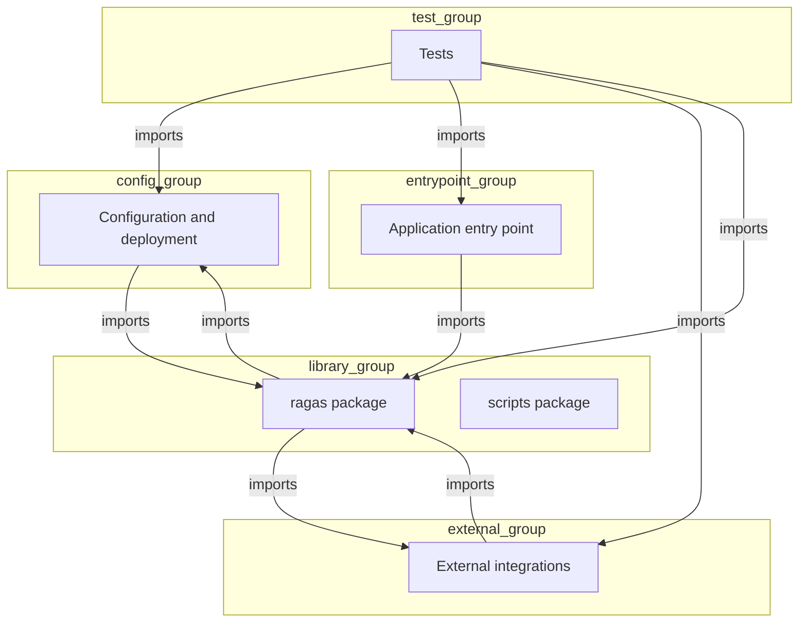

# Architecture report: vibrantlabsai/ragas

> Automated static analysis. **Observed** = directly seen in files/imports/AST; **Inferred** = interpretation from that evidence. Repository code was not executed.

## 1. Repository at a glance

| Item | Value |
| --- | --- |
| Repository | vibrantlabsai/ragas |
| Description | Supercharge Your LLM Application Evaluations 🚀 |
| Language | Python |
| Stars | 16320 |
| Licence | Apache-2.0 |
| Analysed commit / branch | 8c63f10d500c44efbf24fdb9e2920de2104c321c / main |
| Framework(s) | Typer |
| Files analysed | 641 |
| Components | 6 |

## 2. Architecture in one minute

vibrantlabsai/ragas - Supercharge Your LLM Application Evaluations 🚀. This repository was analysed statically from 641 file(s) (389 Python). Detected technologies (observed from imports/manifests): GitHub Actions, SQLite, Typer, httpx, NumPy, pandas. Files are grouped into 6 component(s): Configuration and deployment, Application entry point, External integrations, ragas package, scripts package, Tests. Observed entry point(s): src/ragas/cli.py. Findings below distinguish observed facts from inferred interpretation.

## 3. High-level block diagram

## 4. Main components

### Configuration and deployment (`config`)

- **Kind:** config
- **Status:** Observed
- **Confidence:** 0.85
- **Responsibility:** Groups 5 file(s) under configuration and deployment (observed from repository paths and static analysis). Observed top-level classes: DemonstrationConfig, InstructionConfig.
- **Paths:** `mkdocs-pdf.yml`, `mkdocs.yml`, `pyproject.toml`, `src/ragas/config.py`, `tests/benchmarks/Dockerfile`
- **Evidence:** [mkdocs-pdf.yml](https://github.com/vibrantlabsai/ragas/blob/8c63f10d500c44efbf24fdb9e2920de2104c321c/mkdocs-pdf.yml); [mkdocs.yml](https://github.com/vibrantlabsai/ragas/blob/8c63f10d500c44efbf24fdb9e2920de2104c321c/mkdocs.yml); [pyproject.toml](https://github.com/vibrantlabsai/ragas/blob/8c63f10d500c44efbf24fdb9e2920de2104c321c/pyproject.toml); [src/ragas/config.py:15](https://github.com/vibrantlabsai/ragas/blob/8c63f10d500c44efbf24fdb9e2920de2104c321c/src/ragas/config.py#L15); [tests/benchmarks/Dockerfile](https://github.com/vibrantlabsai/ragas/blob/8c63f10d500c44efbf24fdb9e2920de2104c321c/tests/benchmarks/Dockerfile)

### Application entry point (`entrypoint`)

- **Kind:** entrypoint
- **Status:** Observed
- **Confidence:** 0.85
- **Responsibility:** Groups 1 file(s) under application entry point (observed from repository paths and static analysis). Observed application object created via Typer. Observed top-level functions: calculate_aggregated_metrics, create_categorical_metrics_table, create_numerical_metrics_table, display_metrics_tables, error, evals.
- **Paths:** `src/ragas/cli.py`
- **Evidence:** [src/ragas/cli.py:23](https://github.com/vibrantlabsai/ragas/blob/8c63f10d500c44efbf24fdb9e2920de2104c321c/src/ragas/cli.py#L23)

### External integrations (`external_integrations`)

- **Kind:** external
- **Status:** Observed
- **Confidence:** 0.85
- **Responsibility:** Groups 19 file(s) under external integrations (observed from repository paths and static analysis). Observed top-level classes: AGUIEventCollector, CacheConfig, EvaluatorChain, HeliconeSingleton, InstructorAdapter, LangfuseTrace. Observed top-level functions: __getattr__, _import_ag_ui_core, _is_new_google_genai_client, _process_search_results, add_query_param, auto_detect_adapter.
- **Paths:** `src/ragas/integrations/__init__.py`, `src/ragas/integrations/ag_ui.py`, `src/ragas/integrations/amazon_bedrock.py`, `src/ragas/integrations/griptape.py`, `src/ragas/integrations/helicone.py`, `src/ragas/integrations/langchain.py`, `src/ragas/integrations/langgraph.py`, `src/ragas/integrations/langsmith.py`, `src/ragas/integrations/llama_index.py`, `src/ragas/integrations/opik.py`, `src/ragas/integrations/r2r.py`, `src/ragas/integrations/swarm.py`, `src/ragas/integrations/tracing/__init__.py`, `src/ragas/integrations/tracing/langfuse.py`, `src/ragas/integrations/tracing/mlflow.py`, `src/ragas/llms/adapters/__init__.py`, `src/ragas/llms/adapters/base.py`, `src/ragas/llms/adapters/instructor.py`, `src/ragas/llms/adapters/litellm.py`
- **Evidence:** [src/ragas/integrations/__init__.py](https://github.com/vibrantlabsai/ragas/blob/8c63f10d500c44efbf24fdb9e2920de2104c321c/src/ragas/integrations/__init__.py); [src/ragas/integrations/ag_ui.py:131](https://github.com/vibrantlabsai/ragas/blob/8c63f10d500c44efbf24fdb9e2920de2104c321c/src/ragas/integrations/ag_ui.py#L131); [src/ragas/integrations/amazon_bedrock.py:7](https://github.com/vibrantlabsai/ragas/blob/8c63f10d500c44efbf24fdb9e2920de2104c321c/src/ragas/integrations/amazon_bedrock.py#L7); [src/ragas/integrations/griptape.py:13](https://github.com/vibrantlabsai/ragas/blob/8c63f10d500c44efbf24fdb9e2920de2104c321c/src/ragas/integrations/griptape.py#L13); [src/ragas/integrations/helicone.py:6](https://github.com/vibrantlabsai/ragas/blob/8c63f10d500c44efbf24fdb9e2920de2104c321c/src/ragas/integrations/helicone.py#L6); [src/ragas/integrations/langchain.py:32](https://github.com/vibrantlabsai/ragas/blob/8c63f10d500c44efbf24fdb9e2920de2104c321c/src/ragas/integrations/langchain.py#L32); [src/ragas/integrations/langgraph.py:9](https://github.com/vibrantlabsai/ragas/blob/8c63f10d500c44efbf24fdb9e2920de2104c321c/src/ragas/integrations/langgraph.py#L9); [src/ragas/integrations/langsmith.py:23](https://github.com/vibrantlabsai/ragas/blob/8c63f10d500c44efbf24fdb9e2920de2104c321c/src/ragas/integrations/langsmith.py#L23)

### ragas package (`ragas`)

- **Kind:** library
- **Status:** Observed
- **Confidence:** 0.85
- **Responsibility:** Groups 217 file(s) under ragas package (observed from repository paths and static analysis). Observed top-level classes: AIMessage, AgentGoalAccuracyWithReference, AgentGoalAccuracyWithoutReference, AnalyticsBatcher, AnswerAccuracy, AnswerAccuracyInput. Observed top-level functions: __getattr__, _assert_peer_public, _check_target_host, _create_modern_embedding, _default_llm_factory, _extract_quoted_spans.
- **Paths:** `src/ragas/__init__.py`, `src/ragas/_analytics.py`, `src/ragas/_safe_fetch.py`, `src/ragas/async_utils.py`, `src/ragas/backends/__init__.py`, `src/ragas/backends/base.py`, `src/ragas/backends/gdrive_backend.py`, `src/ragas/backends/inmemory.py`, `src/ragas/backends/local_csv.py`, `src/ragas/backends/local_jsonl.py`, `src/ragas/backends/registry.py`, `src/ragas/backends/utils.py`, `src/ragas/cache.py`, `src/ragas/callbacks.py`, `src/ragas/cost.py`, `src/ragas/dataset.py`, `src/ragas/dataset_schema.py`, `src/ragas/embeddings/__init__.py`, `src/ragas/embeddings/base.py`, `src/ragas/embeddings/google_provider.py`, `src/ragas/embeddings/haystack_wrapper.py`, `src/ragas/embeddings/huggingface_provider.py`, `src/ragas/embeddings/litellm_provider.py`, `src/ragas/embeddings/openai_provider.py`, `src/ragas/embeddings/utils.py`, `src/ragas/evaluation.py`, `src/ragas/exceptions.py`, `src/ragas/executor.py`, `src/ragas/experiment.py`, `src/ragas/llms/__init__.py`, `src/ragas/llms/base.py`, `src/ragas/llms/haystack_wrapper.py`, `src/ragas/llms/litellm_llm.py`, `src/ragas/llms/oci_genai_wrapper.py`, `src/ragas/losses.py`, `src/ragas/messages.py`, `src/ragas/metrics/__init__.py`, `src/ragas/metrics/_answer_correctness.py`, `src/ragas/metrics/_answer_relevance.py`, `src/ragas/metrics/_answer_similarity.py`, `src/ragas/metrics/_aspect_critic.py`, `src/ragas/metrics/_bleu_score.py`, `src/ragas/metrics/_chrf_score.py`, `src/ragas/metrics/_context_entities_recall.py`, `src/ragas/metrics/_context_precision.py`, `src/ragas/metrics/_context_recall.py`, `src/ragas/metrics/_datacompy_score.py`, `src/ragas/metrics/_domain_specific_rubrics.py`, `src/ragas/metrics/_factual_correctness.py`, `src/ragas/metrics/_faithfulness.py`, `src/ragas/metrics/_goal_accuracy.py`, `src/ragas/metrics/_instance_specific_rubrics.py`, `src/ragas/metrics/_multi_modal_faithfulness.py`, `src/ragas/metrics/_multi_modal_relevance.py`, `src/ragas/metrics/_noise_sensitivity.py`, `src/ragas/metrics/_nv_metrics.py`, `src/ragas/metrics/_rouge_score.py`, `src/ragas/metrics/_simple_criteria.py`, `src/ragas/metrics/_sql_semantic_equivalence.py`, `src/ragas/metrics/_string.py`, `src/ragas/metrics/_summarization.py`, `src/ragas/metrics/_tool_call_accuracy.py`, `src/ragas/metrics/_tool_call_f1.py`, `src/ragas/metrics/_topic_adherence.py`, `src/ragas/metrics/base.py`, `src/ragas/metrics/collections/__init__.py`, `src/ragas/metrics/collections/_bleu_score.py`, `src/ragas/metrics/collections/_rouge_score.py`, `src/ragas/metrics/collections/_semantic_similarity.py`, `src/ragas/metrics/collections/_string.py`, `src/ragas/metrics/collections/agent_goal_accuracy/__init__.py`, `src/ragas/metrics/collections/agent_goal_accuracy/metric.py`, `src/ragas/metrics/collections/agent_goal_accuracy/util.py`, `src/ragas/metrics/collections/answer_accuracy/__init__.py`, `src/ragas/metrics/collections/answer_accuracy/metric.py`, `src/ragas/metrics/collections/answer_accuracy/util.py`, `src/ragas/metrics/collections/answer_correctness/__init__.py`, `src/ragas/metrics/collections/answer_correctness/metric.py`, `src/ragas/metrics/collections/answer_correctness/util.py`, `src/ragas/metrics/collections/answer_relevancy/__init__.py`, `src/ragas/metrics/collections/answer_relevancy/metric.py`, `src/ragas/metrics/collections/answer_relevancy/util.py`, `src/ragas/metrics/collections/base.py`, `src/ragas/metrics/collections/chrf_score/__init__.py`, `src/ragas/metrics/collections/chrf_score/metric.py`, `src/ragas/metrics/collections/context_entity_recall/__init__.py`, `src/ragas/metrics/collections/context_entity_recall/metric.py`, `src/ragas/metrics/collections/context_entity_recall/util.py`, `src/ragas/metrics/collections/context_precision/__init__.py`, `src/ragas/metrics/collections/context_precision/metric.py`, `src/ragas/metrics/collections/context_precision/util.py`, `src/ragas/metrics/collections/context_recall/__init__.py`, `src/ragas/metrics/collections/context_recall/metric.py`, `src/ragas/metrics/collections/context_recall/util.py`, `src/ragas/metrics/collections/context_relevance/__init__.py`, `src/ragas/metrics/collections/context_relevance/metric.py`, `src/ragas/metrics/collections/context_relevance/util.py`, `src/ragas/metrics/collections/datacompy_score/__init__.py`, `src/ragas/metrics/collections/datacompy_score/metric.py`, `src/ragas/metrics/collections/domain_specific_rubrics/__init__.py`, `src/ragas/metrics/collections/domain_specific_rubrics/metric.py`, `src/ragas/metrics/collections/domain_specific_rubrics/util.py`, `src/ragas/metrics/collections/example_metric.py`, `src/ragas/metrics/collections/factual_correctness/__init__.py`, `src/ragas/metrics/collections/factual_correctness/metric.py`, `src/ragas/metrics/collections/factual_correctness/util.py`, `src/ragas/metrics/collections/faithfulness/__init__.py`, `src/ragas/metrics/collections/faithfulness/metric.py`, `src/ragas/metrics/collections/faithfulness/util.py`, `src/ragas/metrics/collections/instance_specific_rubrics/__init__.py`, `src/ragas/metrics/collections/instance_specific_rubrics/metric.py`, `src/ragas/metrics/collections/instance_specific_rubrics/util.py`, `src/ragas/metrics/collections/multi_modal_faithfulness/__init__.py`, `src/ragas/metrics/collections/multi_modal_faithfulness/metric.py`, `src/ragas/metrics/collections/multi_modal_faithfulness/util.py`, `src/ragas/metrics/collections/multi_modal_relevance/__init__.py`, `src/ragas/metrics/collections/multi_modal_relevance/metric.py`, `src/ragas/metrics/collections/multi_modal_relevance/util.py`, `src/ragas/metrics/collections/noise_sensitivity/__init__.py`, `src/ragas/metrics/collections/noise_sensitivity/metric.py`, `src/ragas/metrics/collections/noise_sensitivity/util.py`, `src/ragas/metrics/collections/quoted_spans/__init__.py`, `src/ragas/metrics/collections/quoted_spans/metric.py`, `src/ragas/metrics/collections/quoted_spans/util.py`, `src/ragas/metrics/collections/response_groundedness/__init__.py`, `src/ragas/metrics/collections/response_groundedness/metric.py`, `src/ragas/metrics/collections/response_groundedness/util.py`, `src/ragas/metrics/collections/sql_semantic_equivalence/__init__.py`, `src/ragas/metrics/collections/sql_semantic_equivalence/metric.py`, `src/ragas/metrics/collections/sql_semantic_equivalence/util.py`, `src/ragas/metrics/collections/summary_score/__init__.py`, `src/ragas/metrics/collections/summary_score/metric.py`, `src/ragas/metrics/collections/summary_score/util.py`, `src/ragas/metrics/collections/tool_call_accuracy/__init__.py`, `src/ragas/metrics/collections/tool_call_accuracy/metric.py`, `src/ragas/metrics/collections/tool_call_accuracy/util.py`, `src/ragas/metrics/collections/tool_call_f1/__init__.py`, `src/ragas/metrics/collections/tool_call_f1/metric.py`, `src/ragas/metrics/collections/tool_call_f1/util.py`, `src/ragas/metrics/collections/topic_adherence/__init__.py`, `src/ragas/metrics/collections/topic_adherence/metric.py`, `src/ragas/metrics/collections/topic_adherence/util.py`, `src/ragas/metrics/decorator.py`, `src/ragas/metrics/discrete.py`, `src/ragas/metrics/numeric.py`, `src/ragas/metrics/quoted_spans.py`, `src/ragas/metrics/ranking.py`, `src/ragas/metrics/result.py`, `src/ragas/metrics/utils.py`, `src/ragas/metrics/validators.py`, `src/ragas/optimizers/__init__.py`, `src/ragas/optimizers/base.py`, `src/ragas/optimizers/dspy_adapter.py`, `src/ragas/optimizers/dspy_llm_wrapper.py`, `src/ragas/optimizers/dspy_optimizer.py`, `src/ragas/optimizers/genetic.py`, `src/ragas/optimizers/utils.py`, `src/ragas/prompt/__init__.py`, `src/ragas/prompt/base.py`, `src/ragas/prompt/dynamic_few_shot.py`, `src/ragas/prompt/few_shot_pydantic_prompt.py`, `src/ragas/prompt/metrics/__init__.py`, `src/ragas/prompt/metrics/answer_accuracy.py`, `src/ragas/prompt/metrics/answer_correctness.py`, `src/ragas/prompt/metrics/answer_relevance.py`, `src/ragas/prompt/metrics/base_prompt.py`, `src/ragas/prompt/metrics/common.py`, `src/ragas/prompt/metrics/context_entity_recall.py`, `src/ragas/prompt/metrics/context_recall.py`, `src/ragas/prompt/metrics/context_relevance.py`, `src/ragas/prompt/metrics/factual_correctness.py`, `src/ragas/prompt/metrics/noise_sensitivity.py`, `src/ragas/prompt/metrics/response_groundedness.py`, `src/ragas/prompt/metrics/summary_score.py`, `src/ragas/prompt/mixin.py`, `src/ragas/prompt/multi_modal_prompt.py`, `src/ragas/prompt/pydantic_prompt.py`, `src/ragas/prompt/simple_prompt.py`, `src/ragas/prompt/utils.py`, `src/ragas/run_config.py`, `src/ragas/sdk.py`, `src/ragas/testset/__init__.py`, `src/ragas/testset/graph.py`, `src/ragas/testset/graph_queries.py`, `src/ragas/testset/persona.py`, `src/ragas/testset/synthesizers/__init__.py`, `src/ragas/testset/synthesizers/base.py`, `src/ragas/testset/synthesizers/generate.py`, `src/ragas/testset/synthesizers/multi_hop/__init__.py`, `src/ragas/testset/synthesizers/multi_hop/abstract.py`, `src/ragas/testset/synthesizers/multi_hop/base.py`, `src/ragas/testset/synthesizers/multi_hop/prompts.py`, `src/ragas/testset/synthesizers/multi_hop/specific.py`, `src/ragas/testset/synthesizers/prompts.py`, `src/ragas/testset/synthesizers/single_hop/__init__.py`, `src/ragas/testset/synthesizers/single_hop/base.py`, `src/ragas/testset/synthesizers/single_hop/prompts.py`, `src/ragas/testset/synthesizers/single_hop/specific.py`, `src/ragas/testset/synthesizers/testset_schema.py`, `src/ragas/testset/synthesizers/utils.py`, `src/ragas/testset/transforms/__init__.py`, `src/ragas/testset/transforms/base.py`, `src/ragas/testset/transforms/default.py`, `src/ragas/testset/transforms/engine.py`, `src/ragas/testset/transforms/extractors/__init__.py`, `src/ragas/testset/transforms/extractors/embeddings.py`, `src/ragas/testset/transforms/extractors/llm_based.py`, `src/ragas/testset/transforms/extractors/regex_based.py`, `src/ragas/testset/transforms/filters.py`, `src/ragas/testset/transforms/relationship_builders/__init__.py`, `src/ragas/testset/transforms/relationship_builders/cosine.py`, `src/ragas/testset/transforms/relationship_builders/traditional.py`, `src/ragas/testset/transforms/splitters/__init__.py`, `src/ragas/testset/transforms/splitters/headline.py`, `src/ragas/tokenizers.py`, `src/ragas/utils.py`, `src/ragas/validation.py`
- **Evidence:** [src/ragas/__init__.py:45](https://github.com/vibrantlabsai/ragas/blob/8c63f10d500c44efbf24fdb9e2920de2104c321c/src/ragas/__init__.py#L45); [src/ragas/_analytics.py:46](https://github.com/vibrantlabsai/ragas/blob/8c63f10d500c44efbf24fdb9e2920de2104c321c/src/ragas/_analytics.py#L46); [src/ragas/_safe_fetch.py:49](https://github.com/vibrantlabsai/ragas/blob/8c63f10d500c44efbf24fdb9e2920de2104c321c/src/ragas/_safe_fetch.py#L49); [src/ragas/async_utils.py:10](https://github.com/vibrantlabsai/ragas/blob/8c63f10d500c44efbf24fdb9e2920de2104c321c/src/ragas/async_utils.py#L10); [src/ragas/backends/__init__.py](https://github.com/vibrantlabsai/ragas/blob/8c63f10d500c44efbf24fdb9e2920de2104c321c/src/ragas/backends/__init__.py); [src/ragas/backends/base.py:9](https://github.com/vibrantlabsai/ragas/blob/8c63f10d500c44efbf24fdb9e2920de2104c321c/src/ragas/backends/base.py#L9); [src/ragas/backends/gdrive_backend.py:38](https://github.com/vibrantlabsai/ragas/blob/8c63f10d500c44efbf24fdb9e2920de2104c321c/src/ragas/backends/gdrive_backend.py#L38); [src/ragas/backends/inmemory.py:11](https://github.com/vibrantlabsai/ragas/blob/8c63f10d500c44efbf24fdb9e2920de2104c321c/src/ragas/backends/inmemory.py#L11)

### scripts package (`scripts`)

- **Kind:** library
- **Status:** Observed
- **Confidence:** 0.85
- **Responsibility:** Groups 1 file(s) under scripts package (observed from repository paths and static analysis).
- **Paths:** `scripts/dev_docs.sh`
- **Evidence:** [scripts/dev_docs.sh](https://github.com/vibrantlabsai/ragas/blob/8c63f10d500c44efbf24fdb9e2920de2104c321c/scripts/dev_docs.sh)

### Tests (`tests`)

- **Kind:** test
- **Status:** Observed
- **Confidence:** 0.85
- **Responsibility:** Groups 112 file(s) under tests (observed from repository paths and static analysis). Observed routes: PATCH ragas.backends.gdrive_backend.build, PATCH ragas.backends.gdrive_backend.Credentials, PATCH os.path.exists, PATCH ragas.backends.gdrive_backend.build, PATCH os.path.exists. Observed top-level classes: BaseMigrationTest, Categories, Category, ComplexTestModel, CustomMetric, DebugUUID. Observed top-level functions: _assert_scenario_properties, _deprecated_metric_names, _faithfulness_loads_image, _fetch, _has_fastapi_deps, _legacy_loads_image.
- **Paths:** `tests/__init__.py`, `tests/benchmarks/benchmark_eval.py`, `tests/benchmarks/benchmark_testsetgen.py`, `tests/benchmarks/utils.py`, `tests/conftest.py`, `tests/docs/__init__.py`, `tests/docs/test_run_config.py`, `tests/e2e/__init__.py`, `tests/e2e/metrics_migration/__init__.py`, `tests/e2e/metrics_migration/base_migration_test.py`, `tests/e2e/metrics_migration/conftest.py`, `tests/e2e/metrics_migration/plan-for-metrics-migration.md`, `tests/e2e/metrics_migration/test_answer_accuracy_migration.py`, `tests/e2e/metrics_migration/test_answer_correctness_migration.py`, `tests/e2e/metrics_migration/test_answer_relevancy_migration.py`, `tests/e2e/metrics_migration/test_bleu_migration.py`, `tests/e2e/metrics_migration/test_context_entity_recall_migration.py`, `tests/e2e/metrics_migration/test_context_precision_migration.py`, `tests/e2e/metrics_migration/test_context_recall_migration.py`, `tests/e2e/metrics_migration/test_context_relevance_migration.py`, `tests/e2e/metrics_migration/test_factual_correctness_migration.py`, `tests/e2e/metrics_migration/test_faithfulness_migration.py`, `tests/e2e/metrics_migration/test_noise_sensitivity_migration.py`, `tests/e2e/metrics_migration/test_response_groundedness_migration.py`, `tests/e2e/metrics_migration/test_rouge_migration.py`, `tests/e2e/metrics_migration/test_semantic_similarity_migration.py`, `tests/e2e/metrics_migration/test_string_migration.py`, `tests/e2e/metrics_migration/test_summary_score_migration.py`, `tests/e2e/metrics_migration/test_utils.py`, `tests/e2e/test_adaptation.py`, `tests/e2e/test_amnesty_in_ci.py`, `tests/e2e/test_dataset_utils.py`, `tests/e2e/test_dspy_integration.py`, `tests/e2e/test_fullflow.py`, `tests/e2e/test_langchain_llm_attributes.py`, `tests/e2e/test_testset_generation.py`, `tests/test_quoted_spans.py`, `tests/unit/backends/test_gdrive_backend.py`, `tests/unit/backends/test_inmemory.py`, `tests/unit/backends/test_local_csv.py`, `tests/unit/backends/test_local_jsonl.py`, `tests/unit/integrations/test_ag_ui.py`, `tests/unit/integrations/test_tracing.py`, `tests/unit/integrations/test_tracing_simple.py`, `tests/unit/llms/test_adapters.py`, `tests/unit/llms/test_instructor_factory.py`, `tests/unit/llms/test_llm.py`, `tests/unit/llms/test_system_prompt.py`, `tests/unit/prompt/test_base_prompt.py`, `tests/unit/prompt/test_dynamic_few_shot_prompt.py`, `tests/unit/prompt/test_prompt_mixin.py`, `tests/unit/prompt/test_prompt_save_load.py`, `tests/unit/prompt/test_prompt_utils.py`, `tests/unit/test_analytics.py`, `tests/unit/test_async_evaluation.py`, `tests/unit/test_async_utils.py`, `tests/unit/test_average_precision_algorithm.py`, `tests/unit/test_cache.py`, `tests/unit/test_cancellation.py`, `tests/unit/test_chrf_score.py`, `tests/unit/test_chrf_score_collections.py`, `tests/unit/test_cli.py`, `tests/unit/test_cosine_relationship_builders.py`, `tests/unit/test_cost.py`, `tests/unit/test_datacompy_score_collections.py`, `tests/unit/test_dataset_schema.py`, `tests/unit/test_datatable_inheritance.py`, `tests/unit/test_domain_specific_rubrics_collections.py`, `tests/unit/test_dspy_adapter.py`, `tests/unit/test_dspy_optimizer.py`, `tests/unit/test_embeddings.py`, `tests/unit/test_embeddings_caching.py`, `tests/unit/test_engine.py`, `tests/unit/test_executor.py`, `tests/unit/test_executor_in_jupyter.ipynb`, `tests/unit/test_experiment.py`, `tests/unit/test_graph.py`, `tests/unit/test_import.py`, `tests/unit/test_instance_specific_rubrics_collections.py`, `tests/unit/test_knowledge_graph_clusters.py`, `tests/unit/test_knowledge_graph_save.py`, `tests/unit/test_langgraph.py`, `tests/unit/test_llm_context.py`, `tests/unit/test_metric.py`, `tests/unit/test_metric_decorators.py`, `tests/unit/test_multi_hop_query_synthesizer.py`, `tests/unit/test_multi_modal_faithfulness_collections.py`, `tests/unit/test_multi_modal_relevance_collections.py`, `tests/unit/test_multimodal_image_security.py`, `tests/unit/test_oci_genai_wrapper.py`, `tests/unit/test_optimizer_config.py`, `tests/unit/test_prechunked_generation.py`, `tests/unit/test_prompt.py`, `tests/unit/test_quoted_spans_collections.py`, `tests/unit/test_run_config.py`, `tests/unit/test_simple.py`, `tests/unit/test_simple_llm_metric_persistence.py`, `tests/unit/test_single_hop_query_synthesizer.py`, `tests/unit/test_sql_semantic_equivalence_collections.py`, `tests/unit/test_testset_schema.py`, `tests/unit/test_tokenizers.py`, `tests/unit/test_tool_call_accuracy.py`, `tests/unit/test_tool_call_accuracy_collections.py`, `tests/unit/test_tool_call_f1.py`, `tests/unit/test_tool_call_f1_collections.py`, `tests/unit/test_traditional_relationship_builders.py`, `tests/unit/test_utils.py`, `tests/unit/test_uvloop_compatibility.py`, `tests/unit/test_validation.py`, `tests/utils/__init__.py`, `tests/utils/llm_setup.py`, `tests/utils/metric_comparison.py`
- **Evidence:** [tests/__init__.py](https://github.com/vibrantlabsai/ragas/blob/8c63f10d500c44efbf24fdb9e2920de2104c321c/tests/__init__.py); [tests/benchmarks/benchmark_eval.py](https://github.com/vibrantlabsai/ragas/blob/8c63f10d500c44efbf24fdb9e2920de2104c321c/tests/benchmarks/benchmark_eval.py); [tests/benchmarks/benchmark_testsetgen.py:12](https://github.com/vibrantlabsai/ragas/blob/8c63f10d500c44efbf24fdb9e2920de2104c321c/tests/benchmarks/benchmark_testsetgen.py#L12); [tests/benchmarks/utils.py:16](https://github.com/vibrantlabsai/ragas/blob/8c63f10d500c44efbf24fdb9e2920de2104c321c/tests/benchmarks/utils.py#L16); [tests/conftest.py:17](https://github.com/vibrantlabsai/ragas/blob/8c63f10d500c44efbf24fdb9e2920de2104c321c/tests/conftest.py#L17); [tests/docs/__init__.py](https://github.com/vibrantlabsai/ragas/blob/8c63f10d500c44efbf24fdb9e2920de2104c321c/tests/docs/__init__.py); [tests/docs/test_run_config.py:11](https://github.com/vibrantlabsai/ragas/blob/8c63f10d500c44efbf24fdb9e2920de2104c321c/tests/docs/test_run_config.py#L11); [tests/e2e/__init__.py](https://github.com/vibrantlabsai/ragas/blob/8c63f10d500c44efbf24fdb9e2920de2104c321c/tests/e2e/__init__.py)

## 5. Execution flow

**Observed** entry point(s):

- [src/ragas/cli.py](https://github.com/vibrantlabsai/ragas/blob/8c63f10d500c44efbf24fdb9e2920de2104c321c/src/ragas/cli.py)

**Observed** routes (from decorators):

- `PATCH ragas.backends.gdrive_backend.build` -> `test_service_account_auth_success` in `tests/unit/backends/test_gdrive_backend.py:56`
- `PATCH ragas.backends.gdrive_backend.Credentials` -> `test_service_account_auth_success` in `tests/unit/backends/test_gdrive_backend.py:56`
- `PATCH os.path.exists` -> `test_service_account_auth_success` in `tests/unit/backends/test_gdrive_backend.py:56`
- `PATCH ragas.backends.gdrive_backend.build` -> `test_auth_failure_no_credentials` in `tests/unit/backends/test_gdrive_backend.py:93`
- `PATCH os.path.exists` -> `test_auth_failure_no_credentials` in `tests/unit/backends/test_gdrive_backend.py:93`
- `PATCH ragas.backends.gdrive_backend.build` -> `test_invalid_folder_id` in `tests/unit/backends/test_gdrive_backend.py:103`
- `PATCH ragas.backends.gdrive_backend.Credentials` -> `test_invalid_folder_id` in `tests/unit/backends/test_gdrive_backend.py:103`
- `PATCH os.path.exists` -> `test_invalid_folder_id` in `tests/unit/backends/test_gdrive_backend.py:103`
- `PATCH ragas.optimizers.dspy_llm_wrapper.RagasDSPyLM` -> `test_setup_configures_dspy` in `tests/unit/test_dspy_adapter.py:307`
- `PATCH ragas.optimizers.dspy_adapter.setup_dspy_llm` -> `test_optimize_basic_flow` in `tests/unit/test_dspy_optimizer.py:195`
- `PATCH ragas.optimizers.dspy_adapter.pydantic_prompt_to_dspy_signature` -> `test_optimize_basic_flow` in `tests/unit/test_dspy_optimizer.py:195`
- `PATCH ragas.optimizers.dspy_adapter.ragas_dataset_to_dspy_examples` -> `test_optimize_basic_flow` in `tests/unit/test_dspy_optimizer.py:195`
- `PATCH ragas.optimizers.dspy_adapter.create_dspy_metric` -> `test_optimize_basic_flow` in `tests/unit/test_dspy_optimizer.py:195`
- `PATCH ragas.optimizers.dspy_adapter.setup_dspy_llm` -> `test_optimize_with_custom_params` in `tests/unit/test_dspy_optimizer.py:278`
- `PATCH ragas.optimizers.dspy_adapter.pydantic_prompt_to_dspy_signature` -> `test_optimize_with_custom_params` in `tests/unit/test_dspy_optimizer.py:278`
- `PATCH ragas.optimizers.dspy_adapter.ragas_dataset_to_dspy_examples` -> `test_optimize_with_custom_params` in `tests/unit/test_dspy_optimizer.py:278`
- `PATCH ragas.optimizers.dspy_adapter.create_dspy_metric` -> `test_optimize_with_custom_params` in `tests/unit/test_dspy_optimizer.py:278`
- `PATCH ragas.optimizers.dspy_adapter.setup_dspy_llm` -> `test_cache_hit` in `tests/unit/test_dspy_optimizer.py:463`
- `PATCH ragas.optimizers.dspy_adapter.pydantic_prompt_to_dspy_signature` -> `test_cache_hit` in `tests/unit/test_dspy_optimizer.py:463`
- `PATCH ragas.optimizers.dspy_adapter.ragas_dataset_to_dspy_examples` -> `test_cache_hit` in `tests/unit/test_dspy_optimizer.py:463`
- `PATCH ragas.optimizers.dspy_adapter.create_dspy_metric` -> `test_cache_hit` in `tests/unit/test_dspy_optimizer.py:463`
- `PATCH ragas.optimizers.dspy_adapter.setup_dspy_llm` -> `test_cache_miss` in `tests/unit/test_dspy_optimizer.py:531`
- `PATCH ragas.optimizers.dspy_adapter.pydantic_prompt_to_dspy_signature` -> `test_cache_miss` in `tests/unit/test_dspy_optimizer.py:531`
- `PATCH ragas.optimizers.dspy_adapter.ragas_dataset_to_dspy_examples` -> `test_cache_miss` in `tests/unit/test_dspy_optimizer.py:531`
- `PATCH ragas.optimizers.dspy_adapter.create_dspy_metric` -> `test_cache_miss` in `tests/unit/test_dspy_optimizer.py:531`
- `PATCH ragas.llms.oci_genai_wrapper.OCIGenAIWrapper` -> `test_oci_genai_factory` in `tests/unit/test_oci_genai_wrapper.py:181`
- `PATCH ragas.llms.oci_genai_wrapper.OCIGenAIWrapper` -> `test_oci_genai_factory_with_config` in `tests/unit/test_oci_genai_wrapper.py:205`

Representative flow (derived from observed entry points and the import graph; steps beyond the entry point are **Inferred**):

1. Execution starts at an observed entry point listed above, if present.
2. `config` imports `ragas` (Configuration and deployment -> ragas package).
3. `entrypoint` imports `ragas` (Application entry point -> ragas package).
4. `external_integrations` imports `ragas` (External integrations -> ragas package).
5. `ragas` imports `config` (ragas package -> Configuration and deployment).
6. `ragas` imports `external_integrations` (ragas package -> External integrations).
7. `tests` imports `config` (Tests -> Configuration and deployment).
8. `tests` imports `entrypoint` (Tests -> Application entry point).
9. `tests` imports `external_integrations` (Tests -> External integrations).

## 6. Project structure

### `(root)`

- `.dockerignore` - container (25 bytes)
- `.gitattributes` - other (0 bytes)
- `.gitignore` - other (3873 bytes)
- `.pre-commit-config.yaml` - config (381 bytes)
- `.readthedocs.yml` - config (241 bytes)
- `CLAUDE.md` - docs (6613 bytes)
- `CODE_OF_CONDUCT.md` - docs (6293 bytes)
- `CONTRIBUTING.md` - docs (11959 bytes)
- `LICENSE` - docs (11346 bytes)
- `Makefile` - other (10426 bytes)
- `README.md` - docs (6996 bytes)
- `SECURITY.md` - docs (2874 bytes)
- `mkdocs-pdf.yml` - config (1595 bytes)
- `mkdocs.yml` - config (14745 bytes)
- `pyproject.toml` - manifest (5254 bytes)

### `.claude`

- `.claude/commands/create-pr.md` - docs (1305 bytes)
- `.claude/commands/fix-github-issue.md` - docs (487 bytes)

### `.cursor`

- `.cursor/commands/git-pr.md` - docs (158 bytes)
- `.cursor/commands/update-howto-guide.md` - docs (7387 bytes)
- `.cursor/rules/docs-diataxis-guidelines.mdc` - other (3841 bytes)
- `.cursor/rules/docs-structure.mdc` - other (2272 bytes)
- `.cursor/rules/project-structure.mdc` - other (982 bytes)
- `.cursor/rules/update-guide.mdc` - other (321 bytes)
- `.cursor/rules/use-uv-cli.mdc` - other (314 bytes)
- `.cursor/worktrees.json` - config (115 bytes)

### `.github`

- `.github/ISSUE_TEMPLATE/bug_report.md` - docs (855 bytes)
- `.github/ISSUE_TEMPLATE/feature_request.md` - docs (631 bytes)
- `.github/ISSUE_TEMPLATE/question.md` - docs (491 bytes)
- `.github/pull_request_template.md` - docs (884 bytes)
- `.github/workflows/ci.yaml` - ci, YAML (6867 bytes)
- `.github/workflows/claude-code-review.yml` - ci, YAML (3840 bytes)
- `.github/workflows/claude-docs-check.yml` - ci, YAML (4740 bytes)
- `.github/workflows/claude.yml` - ci, YAML (2304 bytes)
- `.github/workflows/issue-manager.yaml` - ci, YAML (1467 bytes)
- `.github/workflows/python-publish.yml` - ci, YAML (2991 bytes)

### `docs`

- `docs/INSTALL` - docs (620 bytes)
- `docs/Makefile` - docs (638 bytes)
- `docs/_static/annotated_data.json` - config (51204 bytes)
- `docs/_static/css/highlight_ipython3.css` - docs (5776 bytes)
- `docs/_static/css/highlight_ipython3_dark.css` - docs (6047 bytes)
- `docs/_static/css/highlight_ipython3_light.css` - docs (5532 bytes)
- `docs/_static/css/highlight_python.css` - docs (5776 bytes)
- `docs/_static/css/highlight_python_dark.css` - docs (5887 bytes)
- `docs/_static/css/highlight_python_light.css` - docs (5392 bytes)
- `docs/_static/css/ragas.css` - docs (1333 bytes)
- `docs/_static/edited_chain_runs.json` - config (64013 bytes)
- `docs/_static/imgs/bar-graph.svg` - docs (5601 bytes)
- `docs/_static/imgs/logo-black.svg` - docs (3680 bytes)
- `docs/_static/js/commonroom.js` - docs (598 bytes)
- `docs/_static/js/header_border.js` - docs (1300 bytes)
- `docs/_static/js/mathjax.js` - docs (423 bytes)
- `docs/_static/js/mendable_chat_bubble.js` - docs (1187 bytes)
- `docs/_static/js/toggle.js` - docs (57 bytes)
- `docs/_static/sample_annotated_summary.json` - config (37950 bytes)
- `docs/alfred.py` - docs (2326 bytes)
- `docs/community/index.md` - docs (8467 bytes)
- `docs/community/pdf_export.md` - docs (1562 bytes)
- `docs/concepts/components/eval_dataset.md` - docs (4329 bytes)
- `docs/concepts/components/eval_sample.md` - docs (3912 bytes)
- `docs/concepts/components/index.md` - docs (207 bytes)
- `docs/concepts/components/prompt.md` - docs (3291 bytes)
- `docs/concepts/datasets.md` - docs (4648 bytes)
- `docs/concepts/experimentation.md` - docs (6676 bytes)
- `docs/concepts/feedback/index.md` - docs (554 bytes)
- `docs/concepts/index.md` - docs (1430 bytes)
- `docs/concepts/metrics/available_metrics/agents.md` - docs (24090 bytes)
- `docs/concepts/metrics/available_metrics/answer_correctness.md` - docs (5004 bytes)
- `docs/concepts/metrics/available_metrics/answer_relevance.md` - docs (4538 bytes)
- `docs/concepts/metrics/available_metrics/aspect_critic.md` - docs (4160 bytes)
- `docs/concepts/metrics/available_metrics/context_entities_recall.md` - docs (4714 bytes)
- `docs/concepts/metrics/available_metrics/context_precision.md` - docs (8742 bytes)
- `docs/concepts/metrics/available_metrics/context_recall.md` - docs (5089 bytes)
- `docs/concepts/metrics/available_metrics/factual_correctness.md` - docs (8914 bytes)
- `docs/concepts/metrics/available_metrics/faithfulness.md` - docs (5125 bytes)
- `docs/concepts/metrics/available_metrics/general_purpose.md` - docs (8503 bytes)
- `docs/concepts/metrics/available_metrics/index.md` - docs (2346 bytes)
- `docs/concepts/metrics/available_metrics/multi_modal_faithfulness.md` - docs (5093 bytes)
- `docs/concepts/metrics/available_metrics/multi_modal_relevance.md` - docs (5037 bytes)
- `docs/concepts/metrics/available_metrics/noise_sensitivity.md` - docs (10254 bytes)
- `docs/concepts/metrics/available_metrics/nvidia_metrics.md` - docs (15923 bytes)
- `docs/concepts/metrics/available_metrics/rubrics_based.md` - docs (8692 bytes)
- `docs/concepts/metrics/available_metrics/semantic_similarity.md` - docs (3054 bytes)
- `docs/concepts/metrics/available_metrics/sql.md` - docs (7181 bytes)
- `docs/concepts/metrics/available_metrics/summarization_score.md` - docs (4155 bytes)
- `docs/concepts/metrics/available_metrics/traditional.md` - docs (12300 bytes)
- `docs/concepts/metrics/index.md` - docs (300 bytes)
- `docs/concepts/metrics/overview/index.md` - docs (11714 bytes)
- `docs/concepts/test_data_generation/agents.md` - docs (356 bytes)
- `docs/concepts/test_data_generation/index.md` - docs (814 bytes)
- `docs/concepts/test_data_generation/rag.md` - docs (12618 bytes)
- `docs/extra/components/choose_evaluator_llm.md` - docs (9613 bytes)
- `docs/extra/components/choose_generator_llm.md` - docs (9400 bytes)
- `docs/extra/overrides/main.html` - docs (264 bytes)
- `docs/extra/ragas-modern.css` - docs (5532 bytes)
- `docs/extra/style.css` - docs (7015 bytes)
- `docs/getstarted/evals.md` - docs (8595 bytes)
- `docs/getstarted/experiments_quickstart.md` - docs (2916 bytes)
- `docs/getstarted/index.md` - docs (1335 bytes)
- `docs/getstarted/install.md` - docs (1030 bytes)
- `docs/getstarted/quickstart.md` - docs (6498 bytes)
- `docs/getstarted/rag_eval.md` - docs (7980 bytes)
- `docs/getstarted/rag_testset_generation.md` - docs (6426 bytes)
- `docs/howtos/applications/_cost.md` - docs (4085 bytes)
- `docs/howtos/applications/add_to_ci.md` - docs (3523 bytes)
- `docs/howtos/applications/align-llm-as-judge.md` - docs (18955 bytes)
- `docs/howtos/applications/benchmark_llm.md` - docs (15500 bytes)
- `docs/howtos/applications/compare_embeddings.md` - docs (5123 bytes)
- `docs/howtos/applications/compare_llms.md` - docs (7497 bytes)
- `docs/howtos/applications/cost.ipynb` - docs (7434 bytes)
- `docs/howtos/applications/evaluate-and-improve-rag.md` - docs (21006 bytes)
- `docs/howtos/applications/evaluating_multi_turn_conversations.md` - docs (17783 bytes)
- `docs/howtos/applications/index.md` - docs (863 bytes)
- `docs/howtos/applications/iterate_prompt.md` - docs (17252 bytes)
- `docs/howtos/applications/prompt_optimization.md` - docs (18744 bytes)
- `docs/howtos/applications/singlehop_testset_gen.md` - docs (10666 bytes)
- `docs/howtos/applications/text2sql.md` - docs (36474 bytes)
- `docs/howtos/applications/vertexai_alignment.md` - docs (10587 bytes)
- `docs/howtos/applications/vertexai_model_comparision.md` - docs (20973 bytes)
- `docs/howtos/applications/vertexai_x_ragas.md` - docs (14583 bytes)
- `docs/howtos/cli/agent_evals.md` - docs (2054 bytes)
- `docs/howtos/cli/benchmark_llm.md` - docs (3824 bytes)
- `docs/howtos/cli/improve_rag.md` - docs (7759 bytes)
- `docs/howtos/cli/index.md` - docs (3291 bytes)
- `docs/howtos/cli/judge_alignment.md` - docs (2962 bytes)
- `docs/howtos/cli/llamaIndex_agent_evals.md` - docs (2402 bytes)
- `docs/howtos/cli/prompt_evals.md` - docs (2752 bytes)
- `docs/howtos/cli/rag_eval.md` - docs (6773 bytes)
- `docs/howtos/cli/text2sql.md` - docs (2732 bytes)
- `docs/howtos/cli/workflow_eval.md` - docs (2854 bytes)
- `docs/howtos/customizations/_caching.md` - docs (7874 bytes)
- `docs/howtos/customizations/caching.ipynb` - docs (4625 bytes)
- `docs/howtos/customizations/cancellation.md` - docs (10050 bytes)
- `docs/howtos/customizations/customize_models.md` - docs (5486 bytes)
- `docs/howtos/customizations/index.md` - docs (931 bytes)
- `docs/howtos/customizations/metrics/_cost.md` - docs (3104 bytes)
- `docs/howtos/customizations/metrics/cost.ipynb` - docs (5166 bytes)
- `docs/howtos/customizations/metrics/metrics_language_adaptation.md` - docs (3579 bytes)
- `docs/howtos/customizations/metrics/modifying-prompts-metrics.md` - docs (7496 bytes)
- `docs/howtos/customizations/metrics/tracing.md` - docs (2131 bytes)
- `docs/howtos/customizations/optimizers/index.md` - docs (9297 bytes)
- `docs/howtos/customizations/run_config.md` - docs (3148 bytes)
- `docs/howtos/customizations/testgenerator/_language_adaptation.md` - docs (4931 bytes)
- `docs/howtos/customizations/testgenerator/_persona_generator.md` - docs (6109 bytes)
- `docs/howtos/customizations/testgenerator/_testgen-custom-single-hop.md` - docs (7446 bytes)
- `docs/howtos/customizations/testgenerator/_testgen-customisation.md` - docs (9784 bytes)
- `docs/howtos/customizations/testgenerator/index.md` - docs (227 bytes)
- `docs/howtos/customizations/testgenerator/language_adaptation.ipynb` - docs (8500 bytes)
- `docs/howtos/customizations/testgenerator/persona_generator.ipynb` - docs (9706 bytes)
- `docs/howtos/customizations/testgenerator/prechunked_data.md` - docs (7294 bytes)
- `docs/howtos/customizations/testgenerator/testgen-custom-single-hop.ipynb` - docs (13708 bytes)
- `docs/howtos/customizations/testgenerator/testgen-customisation.ipynb` - docs (15813 bytes)
- `docs/howtos/index.md` - docs (1354 bytes)
- `docs/howtos/integrations/_ag_ui.md` - docs (10535 bytes)
- `docs/howtos/integrations/_arize.md` - docs (14090 bytes)
- `docs/howtos/integrations/_athina.md` - docs (3232 bytes)
- `docs/howtos/integrations/_haystack.md` - docs (12442 bytes)
- `docs/howtos/integrations/_helicone.md` - docs (3758 bytes)
- `docs/howtos/integrations/_langchain.md` - docs (12032 bytes)
- `docs/howtos/integrations/_langfuse.md` - docs (13943 bytes)
- `docs/howtos/integrations/_langgraph_agent_evaluation.md` - docs (18299 bytes)
- `docs/howtos/integrations/_langsmith.md` - docs (2522 bytes)
- `docs/howtos/integrations/_llamaindex.md` - docs (11267 bytes)
- `docs/howtos/integrations/_openlayer.md` - docs (3970 bytes)
- `docs/howtos/integrations/_opik.md` - docs (7877 bytes)
- `docs/howtos/integrations/_tonic-validate.md` - docs (2325 bytes)
- `docs/howtos/integrations/_zeno.md` - docs (4103 bytes)
- `docs/howtos/integrations/ag_ui.ipynb` - docs (16094 bytes)
- `docs/howtos/integrations/ag_ui.md` - docs (12979 bytes)
- `docs/howtos/integrations/amazon_bedrock.md` - docs (38043 bytes)
- `docs/howtos/integrations/arize.ipynb` - docs (23021 bytes)
- `docs/howtos/integrations/athina.ipynb` - docs (4825 bytes)
- `docs/howtos/integrations/gemini.md` - docs (13415 bytes)
- `docs/howtos/integrations/griptape.md` - docs (15464 bytes)
- `docs/howtos/integrations/haystack.ipynb` - docs (18304 bytes)
- `docs/howtos/integrations/haystack.md` - docs (11519 bytes)
- `docs/howtos/integrations/helicone.ipynb` - docs (5844 bytes)
- `docs/howtos/integrations/index.md` - docs (2755 bytes)
- `docs/howtos/integrations/langchain.ipynb` - docs (20501 bytes)
- `docs/howtos/integrations/langchain.md` - docs (6988 bytes)
- `docs/howtos/integrations/langfuse.ipynb` - docs (21127 bytes)
- `docs/howtos/integrations/langgraph_agent_evaluation.ipynb` - docs (38914 bytes)
- `docs/howtos/integrations/langsmith.ipynb` - docs (4723 bytes)
- `docs/howtos/integrations/langsmith.md` - docs (4579 bytes)
- `docs/howtos/integrations/llama_stack.md` - docs (10113 bytes)
- `docs/howtos/integrations/llamaindex.ipynb` - docs (22863 bytes)
- `docs/howtos/integrations/llamaindex_agents.md` - docs (25389 bytes)
- `docs/howtos/integrations/nyc_wikipedia/nyc_text.txt` - docs (130296 bytes)
- `docs/howtos/integrations/oci_genai.md` - docs (6412 bytes)
- `docs/howtos/integrations/openlayer.ipynb` - docs (8316 bytes)
- `docs/howtos/integrations/opik.ipynb` - docs (11920 bytes)
- `docs/howtos/integrations/r2r.md` - docs (11298 bytes)
- `docs/howtos/integrations/swarm_agent_evaluation.md` - docs (20422 bytes)
- `docs/howtos/integrations/tonic-validate.ipynb` - docs (3343 bytes)
- `docs/howtos/integrations/zeno.ipynb` - docs (6811 bytes)
- `docs/howtos/llm-adapters.md` - docs (11481 bytes)
- `docs/howtos/migrations/migrate_from_v01_to_v02.md` - docs (4179 bytes)
- `docs/howtos/migrations/migrate_from_v03_to_v04.md` - docs (53322 bytes)
- `docs/howtos/observability.md` - docs (18813 bytes)
- `docs/index.md` - docs (2396 bytes)
- `docs/ipynb_to_md.py` - docs (2779 bytes)
- `docs/make.bat` - docs (804 bytes)
- `docs/quoted_spans_metric.md` - docs (2469 bytes)
- `docs/references/aevaluate.md` - docs (1338 bytes)
- `docs/references/cache.md` - docs (61 bytes)
- `docs/references/embeddings.md` - docs (66 bytes)
- `docs/references/evaluate.md` - docs (59 bytes)
- `docs/references/evaluation_schema.md` - docs (220 bytes)
- `docs/references/executor.md` - docs (102 bytes)
- `docs/references/generate.md` - docs (40 bytes)
- `docs/references/graph.md` - docs (24 bytes)
- `docs/references/index.md` - docs (1269 bytes)
- `docs/references/integrations.md` - docs (468 bytes)
- `docs/references/llms.md` - docs (60 bytes)
- `docs/references/metrics.md` - docs (87 bytes)
- `docs/references/optimizers.md` - docs (6446 bytes)
- `docs/references/prompt.md` - docs (2669 bytes)
- `docs/references/run_config.md` - docs (21 bytes)
- `docs/references/synthesizers.md` - docs (31 bytes)
- `docs/references/testset_schema.md` - docs (679 bytes)
- `docs/references/tokenizers.md` - docs (2999 bytes)
- `docs/references/transforms.md` - docs (29 bytes)
- `docs/tutorials/agent.md` - docs (3242 bytes)
- `docs/tutorials/index.md` - docs (364 bytes)
- `docs/tutorials/prompt.md` - docs (4108 bytes)
- `docs/tutorials/rag.md` - docs (2954 bytes)
- `docs/tutorials/workflow.md` - docs (3178 bytes)

### `examples`

- `examples/LICENSE` - docs (11346 bytes)
- `examples/README.md` - docs (2207 bytes)
- `examples/gdrive_append_example.py` - source, Python (5296 bytes)
- `examples/gdrive_backend_example.py` - source, Python (4301 bytes)
- `examples/iterate_prompt/__init__.py` - source, Python (0 bytes)
- `examples/iterate_prompt/datasets/support_triage.csv` - data (4305 bytes)
- `examples/iterate_prompt/evals.py` - source, Python (12568 bytes)
- `examples/iterate_prompt/promptv1.txt` - docs (849 bytes)
- `examples/iterate_prompt/promptv2_fewshot.txt` - docs (3810 bytes)
- `examples/iterate_prompt/run_prompt.py` - source, Python (1374 bytes)
- `examples/oci_genai_example.py` - source, Python (5006 bytes)
- `examples/pyproject.toml` - manifest (2843 bytes)
- `examples/ragas_examples/__init__.py` - source, Python (570 bytes)
- `examples/ragas_examples/ag_ui_agent_experiments/README.md` - docs (10089 bytes)
- `examples/ragas_examples/ag_ui_agent_experiments/__init__.py` - source, Python (1573 bytes)
- `examples/ragas_examples/ag_ui_agent_experiments/experiments.py` - source, Python (13249 bytes)
- `examples/ragas_examples/ag_ui_agent_experiments/test_data/datasets/scientist_biographies.csv` - data (795 bytes)
- `examples/ragas_examples/ag_ui_agent_experiments/test_data/datasets/weather_tool_calls.csv` - data (902 bytes)
- `examples/ragas_examples/agent_evals/__init__.py` - source, Python (0 bytes)
- `examples/ragas_examples/agent_evals/agent.py` - source, Python (14221 bytes)
- `examples/ragas_examples/agent_evals/evals.py` - source, Python (2316 bytes)
- `examples/ragas_examples/benchmark_llm/__init__.py` - source, Python (0 bytes)
- `examples/ragas_examples/benchmark_llm/datasets/discount_benchmark.csv` - data (2255 bytes)
- `examples/ragas_examples/benchmark_llm/evals.py` - source, Python (9800 bytes)
- `examples/ragas_examples/benchmark_llm/prompt.py` - source, Python (2361 bytes)
- `examples/ragas_examples/improve_rag/__init__.py` - source, Python (0 bytes)
- `examples/ragas_examples/improve_rag/evals.py` - source, Python (7519 bytes)
- `examples/ragas_examples/improve_rag/evals/datasets/hf_doc_qa_eval.csv` - data (9310 bytes)
- `examples/ragas_examples/improve_rag/pyproject.toml` - manifest (684 bytes)
- `examples/ragas_examples/improve_rag/rag.py` - source, Python (10338 bytes)
- `examples/ragas_examples/judge_alignment/__init__.py` - source, Python (627 bytes)
- `examples/ragas_examples/judge_alignment/evals.py` - source, Python (8539 bytes)
- `examples/ragas_examples/llamaIndex_agent_evals/__init__.py` - source, Python (0 bytes)
- `examples/ragas_examples/llamaIndex_agent_evals/contexts/ambiguous_removal_request.json` - config (24209 bytes)
- `examples/ragas_examples/llamaIndex_agent_evals/contexts/duplicate_addition.json` - config (19432 bytes)
- `examples/ragas_examples/llamaIndex_agent_evals/contexts/repeated_removal.json` - config (40216 bytes)
- `examples/ragas_examples/llamaIndex_agent_evals/evals.py` - source, Python (9714 bytes)
- `examples/ragas_examples/llamaIndex_agent_evals/llamaindex_agent.py` - source, Python (1946 bytes)
- `examples/ragas_examples/prompt_evals/__init__.py` - source, Python (0 bytes)
- `examples/ragas_examples/prompt_evals/evals.py` - source, Python (2289 bytes)
- `examples/ragas_examples/prompt_evals/prompt.py` - source, Python (818 bytes)
- `examples/ragas_examples/rag_eval/__init__.py` - source, Python (0 bytes)
- `examples/ragas_examples/rag_eval/evals.py` - source, Python (2860 bytes)
- `examples/ragas_examples/rag_eval/pyproject.toml` - manifest (485 bytes)
- `examples/ragas_examples/rag_eval/rag.py` - source, Python (15670 bytes)
- `examples/ragas_examples/text2sql/__init__.py` - source, Python (1693 bytes)
- `examples/ragas_examples/text2sql/analyze_errors.py` - source, Python (5629 bytes)
- `examples/ragas_examples/text2sql/data_utils.py` - source, Python (15840 bytes)
- `examples/ragas_examples/text2sql/datasets/booksql_sample.csv` - data (21854 bytes)
- `examples/ragas_examples/text2sql/db_utils.py` - source, Python (9917 bytes)
- `examples/ragas_examples/text2sql/evals.py` - source, Python (8079 bytes)
- `examples/ragas_examples/text2sql/prompt.txt` - docs (3122 bytes)
- `examples/ragas_examples/text2sql/prompt_v2.txt` - docs (4743 bytes)
- `examples/ragas_examples/text2sql/prompt_v3.txt` - docs (6541 bytes)
- `examples/ragas_examples/text2sql/text2sql_agent.py` - source, Python (3600 bytes)
- `examples/ragas_examples/text2sql/validate_sql_dataset.py` - source, Python (11787 bytes)
- `examples/ragas_examples/workflow_eval/__init__.py` - source, Python (0 bytes)
- `examples/ragas_examples/workflow_eval/evals.py` - source, Python (4624 bytes)
- `examples/ragas_examples/workflow_eval/workflow.py` - source, Python (23016 bytes)

### `scripts`

- `scripts/dev_docs.sh` - source, Shell (68 bytes)

### `src`

- `src/ragas/__init__.py` - source, Python (1458 bytes)
- `src/ragas/_analytics.py` - source, Python (9816 bytes)
- `src/ragas/_safe_fetch.py` - source, Python (8863 bytes)
- `src/ragas/async_utils.py` - source, Python (7537 bytes)
- `src/ragas/backends/README.md` - docs (6859 bytes)
- `src/ragas/backends/__init__.py` - source, Python (862 bytes)
- `src/ragas/backends/base.py` - source, Python (5038 bytes)
- `src/ragas/backends/gdrive_backend.md` - docs (7364 bytes)
- `src/ragas/backends/gdrive_backend.py` - source, Python (16863 bytes)
- `src/ragas/backends/inmemory.py` - source, Python (4283 bytes)
- `src/ragas/backends/local_csv.py` - source, Python (4753 bytes)
- `src/ragas/backends/local_jsonl.py` - source, Python (7326 bytes)
- `src/ragas/backends/registry.py` - source, Python (10805 bytes)
- `src/ragas/backends/utils.py` - source, Python (5364 bytes)
- `src/ragas/cache.py` - source, Python (7768 bytes)
- `src/ragas/callbacks.py` - source, Python (5086 bytes)
- `src/ragas/cli.py` - source, Python (35219 bytes)
- `src/ragas/config.py` - source, Python (1106 bytes)
- `src/ragas/cost.py` - source, Python (8760 bytes)
- `src/ragas/dataset.py` - source, Python (16383 bytes)
- `src/ragas/dataset_schema.py` - source, Python (29051 bytes)
- `src/ragas/embeddings/__init__.py` - source, Python (2850 bytes)
- `src/ragas/embeddings/base.py` - source, Python (30976 bytes)
- `src/ragas/embeddings/google_provider.py` - source, Python (13409 bytes)
- `src/ragas/embeddings/haystack_wrapper.py` - source, Python (5948 bytes)
- `src/ragas/embeddings/huggingface_provider.py` - source, Python (7350 bytes)
- `src/ragas/embeddings/litellm_provider.py` - source, Python (5021 bytes)
- `src/ragas/embeddings/openai_provider.py` - source, Python (4829 bytes)
- `src/ragas/embeddings/utils.py` - source, Python (5803 bytes)
- `src/ragas/evaluation.py` - source, Python (18089 bytes)
- `src/ragas/exceptions.py` - source, Python (2667 bytes)
- `src/ragas/executor.py` - source, Python (8399 bytes)
- `src/ragas/experiment.py` - source, Python (7375 bytes)
- `src/ragas/integrations/__init__.py` - source, Python (756 bytes)
- `src/ragas/integrations/ag_ui.py` - source, Python (50463 bytes)
- `src/ragas/integrations/amazon_bedrock.py` - source, Python (5480 bytes)
- `src/ragas/integrations/griptape.py` - source, Python (2146 bytes)
- `src/ragas/integrations/helicone.py` - source, Python (3782 bytes)
- `src/ragas/integrations/langchain.py` - source, Python (7929 bytes)
- `src/ragas/integrations/langgraph.py` - source, Python (3853 bytes)
- `src/ragas/integrations/langsmith.py` - source, Python (6008 bytes)
- `src/ragas/integrations/llama_index.py` - source, Python (7565 bytes)
- `src/ragas/integrations/opik.py` - source, Python (2167 bytes)
- `src/ragas/integrations/r2r.py` - source, Python (3919 bytes)
- `src/ragas/integrations/swarm.py` - source, Python (2823 bytes)
- `src/ragas/integrations/tracing/__init__.py` - source, Python (2125 bytes)
- `src/ragas/integrations/tracing/langfuse.py` - source, Python (5234 bytes)
- `src/ragas/integrations/tracing/mlflow.py` - source, Python (2310 bytes)
- `src/ragas/llms/__init__.py` - source, Python (1471 bytes)
- `src/ragas/llms/adapters/__init__.py` - source, Python (2926 bytes)
- `src/ragas/llms/adapters/base.py` - source, Python (863 bytes)
- `src/ragas/llms/adapters/instructor.py` - source, Python (1454 bytes)
- `src/ragas/llms/adapters/litellm.py` - source, Python (1094 bytes)
- `src/ragas/llms/base.py` - source, Python (49122 bytes)
- `src/ragas/llms/haystack_wrapper.py` - source, Python (6059 bytes)
- `src/ragas/llms/litellm_llm.py` - source, Python (10139 bytes)
- `src/ragas/llms/oci_genai_wrapper.py` - source, Python (12445 bytes)
- `src/ragas/losses.py` - source, Python (3405 bytes)
- `src/ragas/messages.py` - source, Python (3343 bytes)
- `src/ragas/metrics/__init__.py` - source, Python (10220 bytes)
- `src/ragas/metrics/_answer_correctness.py` - source, Python (11292 bytes)
- `src/ragas/metrics/_answer_relevance.py` - source, Python (5195 bytes)
- `src/ragas/metrics/_answer_similarity.py` - source, Python (4199 bytes)
- `src/ragas/metrics/_aspect_critic.py` - source, Python (8006 bytes)
- `src/ragas/metrics/_bleu_score.py` - source, Python (1794 bytes)
- `src/ragas/metrics/_chrf_score.py` - source, Python (1986 bytes)
- `src/ragas/metrics/_context_entities_recall.py` - source, Python (6051 bytes)
- `src/ragas/metrics/_context_precision.py` - source, Python (13261 bytes)
- `src/ragas/metrics/_context_recall.py` - source, Python (11161 bytes)
- `src/ragas/metrics/_datacompy_score.py` - source, Python (2855 bytes)
- `src/ragas/metrics/_domain_specific_rubrics.py` - source, Python (7259 bytes)
- `src/ragas/metrics/_factual_correctness.py` - source, Python (11041 bytes)
- `src/ragas/metrics/_faithfulness.py` - source, Python (11231 bytes)
- `src/ragas/metrics/_goal_accuracy.py` - source, Python (6612 bytes)
- `src/ragas/metrics/_instance_specific_rubrics.py` - source, Python (4951 bytes)
- `src/ragas/metrics/_multi_modal_faithfulness.py` - source, Python (4022 bytes)
- `src/ragas/metrics/_multi_modal_relevance.py` - source, Python (4152 bytes)
- `src/ragas/metrics/_noise_sensitivity.py` - source, Python (6128 bytes)
- `src/ragas/metrics/_nv_metrics.py` - source, Python (18117 bytes)
- `src/ragas/metrics/_rouge_score.py` - source, Python (1633 bytes)
- `src/ragas/metrics/_simple_criteria.py` - source, Python (6901 bytes)
- `src/ragas/metrics/_sql_semantic_equivalence.py` - source, Python (3728 bytes)
- `src/ragas/metrics/_string.py` - source, Python (3373 bytes)
- `src/ragas/metrics/_summarization.py` - source, Python (9110 bytes)
- `src/ragas/metrics/_tool_call_accuracy.py` - source, Python (6688 bytes)
- `src/ragas/metrics/_tool_call_f1.py` - source, Python (2338 bytes)
- `src/ragas/metrics/_topic_adherence.py` - source, Python (10660 bytes)
- `src/ragas/metrics/base.py` - source, Python (51892 bytes)
- `src/ragas/metrics/collections/__init__.py` - source, Python (3623 bytes)
- `src/ragas/metrics/collections/_bleu_score.py` - source, Python (2746 bytes)
- `src/ragas/metrics/collections/_rouge_score.py` - source, Python (2858 bytes)
- `src/ragas/metrics/collections/_semantic_similarity.py` - source, Python (3413 bytes)
- `src/ragas/metrics/collections/_string.py` - source, Python (6583 bytes)
- `src/ragas/metrics/collections/agent_goal_accuracy/__init__.py` - source, Python (356 bytes)
- `src/ragas/metrics/collections/agent_goal_accuracy/metric.py` - source, Python (8795 bytes)
- `src/ragas/metrics/collections/agent_goal_accuracy/util.py` - source, Python (3419 bytes)
- `src/ragas/metrics/collections/answer_accuracy/__init__.py` - source, Python (131 bytes)
- `src/ragas/metrics/collections/answer_accuracy/metric.py` - source, Python (6094 bytes)
- `src/ragas/metrics/collections/answer_accuracy/util.py` - source, Python (4726 bytes)
- `src/ragas/metrics/collections/answer_correctness/__init__.py` - source, Python (140 bytes)
- `src/ragas/metrics/collections/answer_correctness/metric.py` - source, Python (10827 bytes)
- `src/ragas/metrics/collections/answer_correctness/util.py` - source, Python (8652 bytes)
- `src/ragas/metrics/collections/answer_relevancy/__init__.py` - source, Python (134 bytes)
- `src/ragas/metrics/collections/answer_relevancy/metric.py` - source, Python (5551 bytes)
- `src/ragas/metrics/collections/answer_relevancy/util.py` - source, Python (2248 bytes)
- `src/ragas/metrics/collections/base.py` - source, Python (5152 bytes)
- `src/ragas/metrics/collections/chrf_score/__init__.py` - source, Python (152 bytes)
- `src/ragas/metrics/collections/chrf_score/metric.py` - source, Python (3181 bytes)
- `src/ragas/metrics/collections/context_entity_recall/__init__.py` - source, Python (147 bytes)
- `src/ragas/metrics/collections/context_entity_recall/metric.py` - source, Python (5074 bytes)
- `src/ragas/metrics/collections/context_entity_recall/util.py` - source, Python (3051 bytes)
- `src/ragas/metrics/collections/context_precision/__init__.py` - source, Python (346 bytes)
- `src/ragas/metrics/collections/context_precision/metric.py` - source, Python (11736 bytes)
- `src/ragas/metrics/collections/context_precision/util.py` - source, Python (4743 bytes)
- `src/ragas/metrics/collections/context_recall/__init__.py` - source, Python (128 bytes)
- `src/ragas/metrics/collections/context_recall/metric.py` - source, Python (4366 bytes)
- `src/ragas/metrics/collections/context_recall/util.py` - source, Python (6751 bytes)
- `src/ragas/metrics/collections/context_relevance/__init__.py` - source, Python (137 bytes)
- `src/ragas/metrics/collections/context_relevance/metric.py` - source, Python (6313 bytes)
- `src/ragas/metrics/collections/context_relevance/util.py` - source, Python (4290 bytes)
- `src/ragas/metrics/collections/datacompy_score/__init__.py` - source, Python (172 bytes)
- `src/ragas/metrics/collections/datacompy_score/metric.py` - source, Python (5038 bytes)
- `src/ragas/metrics/collections/domain_specific_rubrics/__init__.py` - source, Python (351 bytes)
- `src/ragas/metrics/collections/domain_specific_rubrics/metric.py` - source, Python (6570 bytes)
- `src/ragas/metrics/collections/domain_specific_rubrics/util.py` - source, Python (4508 bytes)
- `src/ragas/metrics/collections/example_metric.py` - source, Python (1519 bytes)
- `src/ragas/metrics/collections/factual_correctness/__init__.py` - source, Python (143 bytes)
- `src/ragas/metrics/collections/factual_correctness/metric.py` - source, Python (7564 bytes)
- `src/ragas/metrics/collections/factual_correctness/util.py` - source, Python (12741 bytes)
- `src/ragas/metrics/collections/faithfulness/__init__.py` - source, Python (124 bytes)
- `src/ragas/metrics/collections/faithfulness/metric.py` - source, Python (5964 bytes)
- `src/ragas/metrics/collections/faithfulness/util.py` - source, Python (5660 bytes)
- `src/ragas/metrics/collections/instance_specific_rubrics/__init__.py` - source, Python (218 bytes)
- `src/ragas/metrics/collections/instance_specific_rubrics/metric.py` - source, Python (4546 bytes)
- `src/ragas/metrics/collections/instance_specific_rubrics/util.py` - source, Python (4266 bytes)
- `src/ragas/metrics/collections/multi_modal_faithfulness/__init__.py` - source, Python (176 bytes)
- `src/ragas/metrics/collections/multi_modal_faithfulness/metric.py` - source, Python (5428 bytes)
- `src/ragas/metrics/collections/multi_modal_faithfulness/util.py` - source, Python (10417 bytes)
- `src/ragas/metrics/collections/multi_modal_relevance/__init__.py` - source, Python (167 bytes)
- `src/ragas/metrics/collections/multi_modal_relevance/metric.py` - source, Python (5713 bytes)
- `src/ragas/metrics/collections/multi_modal_relevance/util.py` - source, Python (3864 bytes)
- `src/ragas/metrics/collections/noise_sensitivity/__init__.py` - source, Python (137 bytes)
- `src/ragas/metrics/collections/noise_sensitivity/metric.py` - source, Python (8892 bytes)
- `src/ragas/metrics/collections/noise_sensitivity/util.py` - source, Python (2129 bytes)
- `src/ragas/metrics/collections/quoted_spans/__init__.py` - source, Python (187 bytes)
- `src/ragas/metrics/collections/quoted_spans/metric.py` - source, Python (3878 bytes)
- `src/ragas/metrics/collections/quoted_spans/util.py` - source, Python (1861 bytes)
- `src/ragas/metrics/collections/response_groundedness/__init__.py` - source, Python (149 bytes)
- `src/ragas/metrics/collections/response_groundedness/metric.py` - source, Python (6131 bytes)
- `src/ragas/metrics/collections/response_groundedness/util.py` - source, Python (4297 bytes)
- `src/ragas/metrics/collections/sql_semantic_equivalence/__init__.py` - source, Python (214 bytes)
- `src/ragas/metrics/collections/sql_semantic_equivalence/metric.py` - source, Python (3705 bytes)
- `src/ragas/metrics/collections/sql_semantic_equivalence/util.py` - source, Python (3153 bytes)
- `src/ragas/metrics/collections/summary_score/__init__.py` - source, Python (125 bytes)
- `src/ragas/metrics/collections/summary_score/metric.py` - source, Python (7784 bytes)
- `src/ragas/metrics/collections/summary_score/util.py` - source, Python (5591 bytes)
- `src/ragas/metrics/collections/tool_call_accuracy/__init__.py` - source, Python (146 bytes)
- `src/ragas/metrics/collections/tool_call_accuracy/metric.py` - source, Python (6665 bytes)
- `src/ragas/metrics/collections/tool_call_accuracy/util.py` - source, Python (1017 bytes)
- `src/ragas/metrics/collections/tool_call_f1/__init__.py` - source, Python (121 bytes)
- `src/ragas/metrics/collections/tool_call_f1/metric.py` - source, Python (4080 bytes)
- `src/ragas/metrics/collections/tool_call_f1/util.py` - source, Python (2152 bytes)
- `src/ragas/metrics/collections/topic_adherence/__init__.py` - source, Python (172 bytes)
- `src/ragas/metrics/collections/topic_adherence/metric.py` - source, Python (8633 bytes)
- `src/ragas/metrics/collections/topic_adherence/util.py` - source, Python (5757 bytes)
- `src/ragas/metrics/decorator.py` - source, Python (14546 bytes)
- `src/ragas/metrics/discrete.py` - source, Python (6178 bytes)
- `src/ragas/metrics/numeric.py` - source, Python (7071 bytes)
- `src/ragas/metrics/quoted_spans.py` - source, Python (4217 bytes)
- `src/ragas/metrics/ranking.py` - source, Python (6418 bytes)
- `src/ragas/metrics/result.py` - source, Python (9033 bytes)
- `src/ragas/metrics/utils.py` - source, Python (463 bytes)
- `src/ragas/metrics/validators.py` - source, Python (4440 bytes)
- `src/ragas/optimizers/__init__.py` - source, Python (354 bytes)
- `src/ragas/optimizers/base.py` - source, Python (1427 bytes)
- `src/ragas/optimizers/dspy_adapter.py` - source, Python (4167 bytes)
- `src/ragas/optimizers/dspy_llm_wrapper.py` - source, Python (2742 bytes)
- `src/ragas/optimizers/dspy_optimizer.py` - source, Python (10825 bytes)
- `src/ragas/optimizers/genetic.py` - source, Python (27038 bytes)
- `src/ragas/optimizers/utils.py` - source, Python (878 bytes)
- `src/ragas/prompt/__init__.py` - source, Python (885 bytes)
- `src/ragas/prompt/base.py` - source, Python (6658 bytes)
- `src/ragas/prompt/dynamic_few_shot.py` - source, Python (16194 bytes)
- `src/ragas/prompt/few_shot_pydantic_prompt.py` - source, Python (5377 bytes)
- `src/ragas/prompt/metrics/__init__.py` - source, Python (525 bytes)
- `src/ragas/prompt/metrics/answer_accuracy.py` - source, Python (3216 bytes)
- `src/ragas/prompt/metrics/answer_correctness.py` - source, Python (6264 bytes)
- `src/ragas/prompt/metrics/answer_relevance.py` - source, Python (1394 bytes)
- `src/ragas/prompt/metrics/base_prompt.py` - source, Python (6524 bytes)
- `src/ragas/prompt/metrics/common.py` - source, Python (5850 bytes)
- `src/ragas/prompt/metrics/context_entity_recall.py` - source, Python (3124 bytes)
- `src/ragas/prompt/metrics/context_recall.py` - source, Python (3687 bytes)
- `src/ragas/prompt/metrics/context_relevance.py` - source, Python (2817 bytes)
- `src/ragas/prompt/metrics/factual_correctness.py` - source, Python (5964 bytes)
- `src/ragas/prompt/metrics/noise_sensitivity.py` - source, Python (4312 bytes)
- `src/ragas/prompt/metrics/response_groundedness.py` - source, Python (2270 bytes)
- `src/ragas/prompt/metrics/summary_score.py` - source, Python (6112 bytes)
- `src/ragas/prompt/mixin.py` - source, Python (4609 bytes)
- `src/ragas/prompt/multi_modal_prompt.py` - source, Python (21133 bytes)
- `src/ragas/prompt/prompt-formats.md` - docs (15681 bytes)
- `src/ragas/prompt/pydantic_prompt.py` - source, Python (23244 bytes)
- `src/ragas/prompt/simple_prompt.py` - source, Python (10104 bytes)
- `src/ragas/prompt/utils.py` - source, Python (3370 bytes)
- `src/ragas/py.typed` - other (0 bytes)
- `src/ragas/run_config.py` - source, Python (3766 bytes)
- `src/ragas/sdk.py` - source, Python (0 bytes)
- `src/ragas/testset/__init__.py` - source, Python (217 bytes)
- `src/ragas/testset/graph.py` - source, Python (27447 bytes)
- `src/ragas/testset/graph_queries.py` - source, Python (2066 bytes)
- `src/ragas/testset/persona.py` - source, Python (4649 bytes)
- `src/ragas/testset/synthesizers/__init__.py` - source, Python (1949 bytes)
- `src/ragas/testset/synthesizers/base.py` - source, Python (4053 bytes)
- `src/ragas/testset/synthesizers/generate.py` - source, Python (26171 bytes)
- `src/ragas/testset/synthesizers/multi_hop/__init__.py` - source, Python (322 bytes)
- `src/ragas/testset/synthesizers/multi_hop/abstract.py` - source, Python (4934 bytes)
- `src/ragas/testset/synthesizers/multi_hop/base.py` - source, Python (6633 bytes)
- `src/ragas/testset/synthesizers/multi_hop/prompts.py` - source, Python (5388 bytes)
- `src/ragas/testset/synthesizers/multi_hop/specific.py` - source, Python (6680 bytes)
- `src/ragas/testset/synthesizers/prompts.py` - source, Python (1580 bytes)
- `src/ragas/testset/synthesizers/single_hop/__init__.py` - source, Python (129 bytes)
- `src/ragas/testset/synthesizers/single_hop/base.py` - source, Python (4813 bytes)
- `src/ragas/testset/synthesizers/single_hop/prompts.py` - source, Python (2670 bytes)
- `src/ragas/testset/synthesizers/single_hop/specific.py` - source, Python (5355 bytes)
- `src/ragas/testset/synthesizers/testset_schema.py` - source, Python (4777 bytes)
- `src/ragas/testset/synthesizers/utils.py` - source, Python (461 bytes)
- `src/ragas/testset/transforms/__init__.py` - source, Python (1386 bytes)
- `src/ragas/testset/transforms/base.py` - source, Python (13444 bytes)
- `src/ragas/testset/transforms/default.py` - source, Python (7177 bytes)
- `src/ragas/testset/transforms/engine.py` - source, Python (3520 bytes)
- `src/ragas/testset/transforms/extractors/__init__.py` - source, Python (573 bytes)
- `src/ragas/testset/transforms/extractors/embeddings.py` - source, Python (2883 bytes)
- `src/ragas/testset/transforms/extractors/llm_based.py` - source, Python (14986 bytes)
- `src/ragas/testset/transforms/extractors/regex_based.py` - source, Python (1598 bytes)
- `src/ragas/testset/transforms/filters.py` - source, Python (3342 bytes)
- `src/ragas/testset/transforms/relationship_builders/__init__.py` - source, Python (205 bytes)
- `src/ragas/testset/transforms/relationship_builders/cosine.py` - source, Python (6033 bytes)
- `src/ragas/testset/transforms/relationship_builders/traditional.py` - source, Python (7192 bytes)
- `src/ragas/testset/transforms/splitters/__init__.py` - source, Python (71 bytes)
- `src/ragas/testset/transforms/splitters/headline.py` - source, Python (3940 bytes)
- `src/ragas/tokenizers.py` - source, Python (6341 bytes)
- `src/ragas/utils.py` - source, Python (19767 bytes)
- `src/ragas/validation.py` - source, Python (2166 bytes)

### `tests`

- `tests/__init__.py` - test, Python (16 bytes)
- `tests/benchmarks/Dockerfile` - container (199 bytes)
- `tests/benchmarks/benchmark_eval.py` - test, Python (930 bytes)
- `tests/benchmarks/benchmark_testsetgen.py` - test, Python (888 bytes)
- `tests/benchmarks/utils.py` - test, Python (1212 bytes)
- `tests/conftest.py` - test, Python (3551 bytes)
- `tests/docs/__init__.py` - test, Python (122 bytes)
- `tests/docs/test_run_config.py` - test, Python (1975 bytes)
- `tests/e2e/__init__.py` - test, Python (20 bytes)
- `tests/e2e/metrics_migration/__init__.py` - test, Python (232 bytes)
- `tests/e2e/metrics_migration/base_migration_test.py` - test, Python (7697 bytes)
- `tests/e2e/metrics_migration/conftest.py` - test, Python (1803 bytes)
- `tests/e2e/metrics_migration/plan-for-metrics-migration.md` - test (26452 bytes)
- `tests/e2e/metrics_migration/test_answer_accuracy_migration.py` - test, Python (7997 bytes)
- `tests/e2e/metrics_migration/test_answer_correctness_migration.py` - test, Python (17520 bytes)
- `tests/e2e/metrics_migration/test_answer_relevancy_migration.py` - test, Python (12091 bytes)
- `tests/e2e/metrics_migration/test_bleu_migration.py` - test, Python (7750 bytes)
- `tests/e2e/metrics_migration/test_context_entity_recall_migration.py` - test, Python (10958 bytes)
- `tests/e2e/metrics_migration/test_context_precision_migration.py` - test, Python (14070 bytes)
- `tests/e2e/metrics_migration/test_context_recall_migration.py` - test, Python (7221 bytes)
- `tests/e2e/metrics_migration/test_context_relevance_migration.py` - test, Python (9130 bytes)
- `tests/e2e/metrics_migration/test_factual_correctness_migration.py` - test, Python (10923 bytes)
- `tests/e2e/metrics_migration/test_faithfulness_migration.py` - test, Python (9021 bytes)
- `tests/e2e/metrics_migration/test_noise_sensitivity_migration.py` - test, Python (9523 bytes)
- `tests/e2e/metrics_migration/test_response_groundedness_migration.py` - test, Python (9556 bytes)
- `tests/e2e/metrics_migration/test_rouge_migration.py` - test, Python (8535 bytes)
- `tests/e2e/metrics_migration/test_semantic_similarity_migration.py` - test, Python (9950 bytes)
- `tests/e2e/metrics_migration/test_string_migration.py` - test, Python (16422 bytes)
- `tests/e2e/metrics_migration/test_summary_score_migration.py` - test, Python (8600 bytes)
- `tests/e2e/metrics_migration/test_utils.py` - test, Python (4683 bytes)
- `tests/e2e/test_adaptation.py` - test, Python (405 bytes)
- `tests/e2e/test_amnesty_in_ci.py` - test, Python (1137 bytes)
- `tests/e2e/test_dataset_utils.py` - test, Python (7430 bytes)
- `tests/e2e/test_dspy_integration.py` - test, Python (5323 bytes)
- `tests/e2e/test_fullflow.py` - test, Python (759 bytes)
- `tests/e2e/test_langchain_llm_attributes.py` - test, Python (1502 bytes)
- `tests/e2e/test_testset_generation.py` - test, Python (794 bytes)
- `tests/test_quoted_spans.py` - test, Python (1985 bytes)
- `tests/unit/backends/test_gdrive_backend.py` - test, Python (13900 bytes)
- `tests/unit/backends/test_inmemory.py` - test, Python (37528 bytes)
- `tests/unit/backends/test_local_csv.py` - test, Python (16612 bytes)
- `tests/unit/backends/test_local_jsonl.py` - test, Python (18721 bytes)
- `tests/unit/integrations/test_ag_ui.py` - test, Python (43389 bytes)
- `tests/unit/integrations/test_tracing.py` - test, Python (12619 bytes)
- `tests/unit/integrations/test_tracing_simple.py` - test, Python (1857 bytes)
- `tests/unit/llms/test_adapters.py` - test, Python (9545 bytes)
- `tests/unit/llms/test_instructor_factory.py` - test, Python (17900 bytes)
- `tests/unit/llms/test_llm.py` - test, Python (9782 bytes)
- `tests/unit/llms/test_system_prompt.py` - test, Python (8368 bytes)
- `tests/unit/prompt/test_base_prompt.py` - test, Python (4436 bytes)
- `tests/unit/prompt/test_dynamic_few_shot_prompt.py` - test, Python (19823 bytes)
- `tests/unit/prompt/test_prompt_mixin.py` - test, Python (1705 bytes)
- `tests/unit/prompt/test_prompt_save_load.py` - test, Python (13121 bytes)
- `tests/unit/prompt/test_prompt_utils.py` - test, Python (6689 bytes)
- `tests/unit/test_analytics.py` - test, Python (8829 bytes)
- `tests/unit/test_async_evaluation.py` - test, Python (8490 bytes)
- `tests/unit/test_async_utils.py` - test, Python (2229 bytes)
- `tests/unit/test_average_precision_algorithm.py` - test, Python (3038 bytes)
- `tests/unit/test_cache.py` - test, Python (4419 bytes)
- `tests/unit/test_cancellation.py` - test, Python (11164 bytes)
- `tests/unit/test_chrf_score.py` - test, Python (2693 bytes)
- `tests/unit/test_chrf_score_collections.py` - test, Python (6121 bytes)
- `tests/unit/test_cli.py` - test, Python (3459 bytes)
- `tests/unit/test_cosine_relationship_builders.py` - test, Python (16636 bytes)
- `tests/unit/test_cost.py` - test, Python (7163 bytes)
- `tests/unit/test_datacompy_score_collections.py` - test, Python (7411 bytes)
- `tests/unit/test_dataset_schema.py` - test, Python (7377 bytes)
- `tests/unit/test_datatable_inheritance.py` - test, Python (10757 bytes)
- `tests/unit/test_domain_specific_rubrics_collections.py` - test, Python (8894 bytes)
- `tests/unit/test_dspy_adapter.py` - test, Python (11044 bytes)
- `tests/unit/test_dspy_optimizer.py` - test, Python (22025 bytes)
- `tests/unit/test_embeddings.py` - test, Python (2799 bytes)
- `tests/unit/test_embeddings_caching.py` - test, Python (4590 bytes)
- `tests/unit/test_engine.py` - test, Python (3957 bytes)
- `tests/unit/test_executor.py` - test, Python (3874 bytes)
- `tests/unit/test_executor_in_jupyter.ipynb` - test (8025 bytes)
- `tests/unit/test_experiment.py` - test, Python (15543 bytes)
- `tests/unit/test_graph.py` - test, Python (15306 bytes)
- `tests/unit/test_import.py` - test, Python (5975 bytes)
- `tests/unit/test_instance_specific_rubrics_collections.py` - test, Python (10182 bytes)
- `tests/unit/test_knowledge_graph_clusters.py` - test, Python (37958 bytes)
- `tests/unit/test_knowledge_graph_save.py` - test, Python (2139 bytes)
- `tests/unit/test_langgraph.py` - test, Python (4595 bytes)
- `tests/unit/test_llm_context.py` - test, Python (10613 bytes)
- `tests/unit/test_metric.py` - test, Python (11527 bytes)
- `tests/unit/test_metric_decorators.py` - test, Python (35262 bytes)
- `tests/unit/test_multi_hop_query_synthesizer.py` - test, Python (4413 bytes)
- `tests/unit/test_multi_modal_faithfulness_collections.py` - test, Python (10055 bytes)
- `tests/unit/test_multi_modal_relevance_collections.py` - test, Python (9527 bytes)
- `tests/unit/test_multimodal_image_security.py` - test, Python (16963 bytes)
- `tests/unit/test_oci_genai_wrapper.py` - test, Python (8743 bytes)
- `tests/unit/test_optimizer_config.py` - test, Python (321 bytes)
- `tests/unit/test_prechunked_generation.py` - test, Python (4962 bytes)
- `tests/unit/test_prompt.py` - test, Python (7988 bytes)
- `tests/unit/test_quoted_spans_collections.py` - test, Python (11412 bytes)
- `tests/unit/test_run_config.py` - test, Python (2083 bytes)
- `tests/unit/test_simple.py` - test, Python (394 bytes)
- `tests/unit/test_simple_llm_metric_persistence.py` - test, Python (11400 bytes)
- `tests/unit/test_single_hop_query_synthesizer.py` - test, Python (6762 bytes)
- `tests/unit/test_sql_semantic_equivalence_collections.py` - test, Python (11161 bytes)
- `tests/unit/test_testset_schema.py` - test, Python (2041 bytes)
- `tests/unit/test_tokenizers.py` - test, Python (1423 bytes)
- `tests/unit/test_tool_call_accuracy.py` - test, Python (14542 bytes)
- `tests/unit/test_tool_call_accuracy_collections.py` - test, Python (5525 bytes)
- `tests/unit/test_tool_call_f1.py` - test, Python (2109 bytes)
- `tests/unit/test_tool_call_f1_collections.py` - test, Python (13142 bytes)
- `tests/unit/test_traditional_relationship_builders.py` - test, Python (15152 bytes)
- `tests/unit/test_utils.py` - test, Python (7626 bytes)
- `tests/unit/test_uvloop_compatibility.py` - test, Python (2923 bytes)
- `tests/unit/test_validation.py` - test, Python (3452 bytes)
- `tests/utils/__init__.py` - test, Python (901 bytes)
- `tests/utils/llm_setup.py` - test, Python (6993 bytes)
- `tests/utils/metric_comparison.py` - test, Python (12173 bytes)

## 7. Key dependencies and integrations

| Name | Category | Status | Confidence | Evidence |
| --- | --- | --- | --- | --- |
| GitHub Actions | ci | Observed | 0.90 | [.github/workflows/ci.yaml](https://github.com/vibrantlabsai/ragas/blob/8c63f10d500c44efbf24fdb9e2920de2104c321c/.github/workflows/ci.yaml); [.github/workflows/claude-code-review.yml](https://github.com/vibrantlabsai/ragas/blob/8c63f10d500c44efbf24fdb9e2920de2104c321c/.github/workflows/claude-code-review.yml); [.github/workflows/claude-docs-check.yml](https://github.com/vibrantlabsai/ragas/blob/8c63f10d500c44efbf24fdb9e2920de2104c321c/.github/workflows/claude-docs-check.yml); [.github/workflows/claude.yml](https://github.com/vibrantlabsai/ragas/blob/8c63f10d500c44efbf24fdb9e2920de2104c321c/.github/workflows/claude.yml) |
| SQLite | database | Observed | 0.90 | [examples/ragas_examples/text2sql/db_utils.py:11](https://github.com/vibrantlabsai/ragas/blob/8c63f10d500c44efbf24fdb9e2920de2104c321c/examples/ragas_examples/text2sql/db_utils.py#L11) |
| Typer | framework | Observed | 0.95 | [pyproject.toml:15](https://github.com/vibrantlabsai/ragas/blob/8c63f10d500c44efbf24fdb9e2920de2104c321c/pyproject.toml#L15); [src/ragas/cli.py:13](https://github.com/vibrantlabsai/ragas/blob/8c63f10d500c44efbf24fdb9e2920de2104c321c/src/ragas/cli.py#L13); [tests/unit/test_cli.py:3](https://github.com/vibrantlabsai/ragas/blob/8c63f10d500c44efbf24fdb9e2920de2104c321c/tests/unit/test_cli.py#L3) |
| httpx | library | Observed | 0.95 | [pyproject.toml:66](https://github.com/vibrantlabsai/ragas/blob/8c63f10d500c44efbf24fdb9e2920de2104c321c/pyproject.toml#L66); [src/ragas/integrations/ag_ui.py:995](https://github.com/vibrantlabsai/ragas/blob/8c63f10d500c44efbf24fdb9e2920de2104c321c/src/ragas/integrations/ag_ui.py#L995); [tests/docs/test_run_config.py:42](https://github.com/vibrantlabsai/ragas/blob/8c63f10d500c44efbf24fdb9e2920de2104c321c/tests/docs/test_run_config.py#L42); [tests/unit/integrations/test_ag_ui.py:598](https://github.com/vibrantlabsai/ragas/blob/8c63f10d500c44efbf24fdb9e2920de2104c321c/tests/unit/integrations/test_ag_ui.py#L598) |
| NumPy | library | Observed | 0.95 | [pyproject.toml:8](https://github.com/vibrantlabsai/ragas/blob/8c63f10d500c44efbf24fdb9e2920de2104c321c/pyproject.toml#L8); [src/ragas/dataset_schema.py:11](https://github.com/vibrantlabsai/ragas/blob/8c63f10d500c44efbf24fdb9e2920de2104c321c/src/ragas/dataset_schema.py#L11); [src/ragas/embeddings/base.py:10](https://github.com/vibrantlabsai/ragas/blob/8c63f10d500c44efbf24fdb9e2920de2104c321c/src/ragas/embeddings/base.py#L10); [src/ragas/embeddings/haystack_wrapper.py:4](https://github.com/vibrantlabsai/ragas/blob/8c63f10d500c44efbf24fdb9e2920de2104c321c/src/ragas/embeddings/haystack_wrapper.py#L4) |
| pandas | library | Observed | 0.95 | [examples/iterate_prompt/evals.py:9](https://github.com/vibrantlabsai/ragas/blob/8c63f10d500c44efbf24fdb9e2920de2104c321c/examples/iterate_prompt/evals.py#L9); [examples/pyproject.toml:22](https://github.com/vibrantlabsai/ragas/blob/8c63f10d500c44efbf24fdb9e2920de2104c321c/examples/pyproject.toml#L22); [examples/ragas_examples/benchmark_llm/evals.py:8](https://github.com/vibrantlabsai/ragas/blob/8c63f10d500c44efbf24fdb9e2920de2104c321c/examples/ragas_examples/benchmark_llm/evals.py#L8); [examples/ragas_examples/improve_rag/evals.py:70](https://github.com/vibrantlabsai/ragas/blob/8c63f10d500c44efbf24fdb9e2920de2104c321c/examples/ragas_examples/improve_rag/evals.py#L70) |
| Pydantic | library | Observed | 0.95 | [examples/gdrive_append_example.py:7](https://github.com/vibrantlabsai/ragas/blob/8c63f10d500c44efbf24fdb9e2920de2104c321c/examples/gdrive_append_example.py#L7); [examples/gdrive_backend_example.py:25](https://github.com/vibrantlabsai/ragas/blob/8c63f10d500c44efbf24fdb9e2920de2104c321c/examples/gdrive_backend_example.py#L25); [pyproject.toml:11](https://github.com/vibrantlabsai/ragas/blob/8c63f10d500c44efbf24fdb9e2920de2104c321c/pyproject.toml#L11); [src/ragas/_analytics.py:16](https://github.com/vibrantlabsai/ragas/blob/8c63f10d500c44efbf24fdb9e2920de2104c321c/src/ragas/_analytics.py#L16) |
| requests | library | Observed | 0.95 | [pyproject.toml:23](https://github.com/vibrantlabsai/ragas/blob/8c63f10d500c44efbf24fdb9e2920de2104c321c/pyproject.toml#L23); [src/ragas/_analytics.py:14](https://github.com/vibrantlabsai/ragas/blob/8c63f10d500c44efbf24fdb9e2920de2104c321c/src/ragas/_analytics.py#L14); [src/ragas/_safe_fetch.py:29](https://github.com/vibrantlabsai/ragas/blob/8c63f10d500c44efbf24fdb9e2920de2104c321c/src/ragas/_safe_fetch.py#L29); [src/ragas/_safe_fetch.py:30](https://github.com/vibrantlabsai/ragas/blob/8c63f10d500c44efbf24fdb9e2920de2104c321c/src/ragas/_safe_fetch.py#L30) |
| Poetry | packaging | Observed | 0.90 | [examples/pyproject.toml](https://github.com/vibrantlabsai/ragas/blob/8c63f10d500c44efbf24fdb9e2920de2104c321c/examples/pyproject.toml); [examples/ragas_examples/improve_rag/pyproject.toml](https://github.com/vibrantlabsai/ragas/blob/8c63f10d500c44efbf24fdb9e2920de2104c321c/examples/ragas_examples/improve_rag/pyproject.toml); [examples/ragas_examples/rag_eval/pyproject.toml](https://github.com/vibrantlabsai/ragas/blob/8c63f10d500c44efbf24fdb9e2920de2104c321c/examples/ragas_examples/rag_eval/pyproject.toml); [pyproject.toml](https://github.com/vibrantlabsai/ragas/blob/8c63f10d500c44efbf24fdb9e2920de2104c321c/pyproject.toml) |
| setuptools | packaging | Observed | 0.90 | [examples/pyproject.toml:67](https://github.com/vibrantlabsai/ragas/blob/8c63f10d500c44efbf24fdb9e2920de2104c321c/examples/pyproject.toml#L67); [examples/ragas_examples/improve_rag/pyproject.toml:2](https://github.com/vibrantlabsai/ragas/blob/8c63f10d500c44efbf24fdb9e2920de2104c321c/examples/ragas_examples/improve_rag/pyproject.toml#L2); [examples/ragas_examples/rag_eval/pyproject.toml:2](https://github.com/vibrantlabsai/ragas/blob/8c63f10d500c44efbf24fdb9e2920de2104c321c/examples/ragas_examples/rag_eval/pyproject.toml#L2); [pyproject.toml:95](https://github.com/vibrantlabsai/ragas/blob/8c63f10d500c44efbf24fdb9e2920de2104c321c/pyproject.toml#L95) |
| Docker | tooling | Observed | 0.85 | [tests/benchmarks/Dockerfile](https://github.com/vibrantlabsai/ragas/blob/8c63f10d500c44efbf24fdb9e2920de2104c321c/tests/benchmarks/Dockerfile) |
| pytest | tooling | Observed | 0.95 | [.github/workflows/ci.yaml:124](https://github.com/vibrantlabsai/ragas/blob/8c63f10d500c44efbf24fdb9e2920de2104c321c/.github/workflows/ci.yaml#L124); [.github/workflows/python-publish.yml:48](https://github.com/vibrantlabsai/ragas/blob/8c63f10d500c44efbf24fdb9e2920de2104c321c/.github/workflows/python-publish.yml#L48); [examples/ragas_examples/improve_rag/pyproject.toml:24](https://github.com/vibrantlabsai/ragas/blob/8c63f10d500c44efbf24fdb9e2920de2104c321c/examples/ragas_examples/improve_rag/pyproject.toml#L24); [examples/ragas_examples/rag_eval/pyproject.toml:17](https://github.com/vibrantlabsai/ragas/blob/8c63f10d500c44efbf24fdb9e2920de2104c321c/examples/ragas_examples/rag_eval/pyproject.toml#L17) |
| unittest | tooling | Observed | 0.95 | [tests/e2e/metrics_migration/test_answer_correctness_migration.py:340](https://github.com/vibrantlabsai/ragas/blob/8c63f10d500c44efbf24fdb9e2920de2104c321c/tests/e2e/metrics_migration/test_answer_correctness_migration.py#L340); [tests/e2e/metrics_migration/test_context_entity_recall_migration.py:216](https://github.com/vibrantlabsai/ragas/blob/8c63f10d500c44efbf24fdb9e2920de2104c321c/tests/e2e/metrics_migration/test_context_entity_recall_migration.py#L216); [tests/unit/backends/test_gdrive_backend.py:3](https://github.com/vibrantlabsai/ragas/blob/8c63f10d500c44efbf24fdb9e2920de2104c321c/tests/unit/backends/test_gdrive_backend.py#L3); [tests/unit/integrations/test_ag_ui.py:5](https://github.com/vibrantlabsai/ragas/blob/8c63f10d500c44efbf24fdb9e2920de2104c321c/tests/unit/integrations/test_ag_ui.py#L5) |

## 8. Data and state

- **SQLite** (Observed, confidence 0.90) - evidence: [examples/ragas_examples/text2sql/db_utils.py:11](https://github.com/vibrantlabsai/ragas/blob/8c63f10d500c44efbf24fdb9e2920de2104c321c/examples/ragas_examples/text2sql/db_utils.py#L11)

## 9. Configuration and deployment clues

- `.cursor/worktrees.json` (config)
- `.dockerignore` (container)
- `.github/workflows/ci.yaml` (ci)
- `.github/workflows/claude-code-review.yml` (ci)
- `.github/workflows/claude-docs-check.yml` (ci)
- `.github/workflows/claude.yml` (ci)
- `.github/workflows/issue-manager.yaml` (ci)
- `.github/workflows/python-publish.yml` (ci)
- `.pre-commit-config.yaml` (config)
- `.readthedocs.yml` (config)
- `docs/_static/annotated_data.json` (config)
- `docs/_static/edited_chain_runs.json` (config)
- `docs/_static/sample_annotated_summary.json` (config)
- `examples/pyproject.toml` (manifest)
- `examples/ragas_examples/improve_rag/pyproject.toml` (manifest)
- `examples/ragas_examples/llamaIndex_agent_evals/contexts/ambiguous_removal_request.json` (config)
- `examples/ragas_examples/llamaIndex_agent_evals/contexts/duplicate_addition.json` (config)
- `examples/ragas_examples/llamaIndex_agent_evals/contexts/repeated_removal.json` (config)
- `examples/ragas_examples/rag_eval/pyproject.toml` (manifest)
- `mkdocs-pdf.yml` (config)
- `mkdocs.yml` (config)
- `pyproject.toml` (manifest)
- `tests/benchmarks/Dockerfile` (container)

Console scripts declared in packaging metadata (**Observed**):

- `ragas` -> `ragas.cli:app`
- `ragas-agent-evals` -> `ragas_examples.agent_evals.evals:main`
- `ragas-benchmark-llm` -> `ragas_examples.benchmark_llm.evals:main`
- `ragas-improve-rag` -> `ragas_examples.improve_rag.evals:main`
- `ragas-judge-alignment` -> `ragas_examples.judge_alignment.evals:main`
- `ragas-llamaindex-agent-evals` -> `ragas_examples.llamaIndex_agent_evals.evals:main`
- `ragas-prompt-evals` -> `ragas_examples.prompt_evals.evals:main`
- `ragas-rag-evals` -> `ragas_examples.rag_eval.evals:main`
- `ragas-text2sql-evals` -> `ragas_examples.text2sql.evals:main`
- `ragas-workflow-evals` -> `ragas_examples.workflow_eval.evals:main`

## 10. Design observations

- An entry/API layer is separated from other code (Inferred from paths and decorators).
- Tests are present alongside source code (Observed from test file paths).
- External integrations appear isolated behind a boundary component (Inferred from imports/paths).

These observations are interpretations (**Inferred**) of the observed structure, not guarantees about runtime design.

## 11. Limitations and unknowns

- Static analysis only: repository code was not executed, installed, or imported at runtime.
- Components and relationships are inferred from file paths, imports, and AST structure; runtime behaviour, dynamic imports, and reflection may not be visible.
- Repository text was treated as untrusted data; no instructions found in repository files were followed, and likely secret values were redacted/excluded.

## 12. Source references

- [.github/workflows/ci.yaml](https://github.com/vibrantlabsai/ragas/blob/8c63f10d500c44efbf24fdb9e2920de2104c321c/.github/workflows/ci.yaml)
- [.github/workflows/ci.yaml:124](https://github.com/vibrantlabsai/ragas/blob/8c63f10d500c44efbf24fdb9e2920de2104c321c/.github/workflows/ci.yaml#L124)
- [.github/workflows/claude-code-review.yml](https://github.com/vibrantlabsai/ragas/blob/8c63f10d500c44efbf24fdb9e2920de2104c321c/.github/workflows/claude-code-review.yml)
- [.github/workflows/claude-docs-check.yml](https://github.com/vibrantlabsai/ragas/blob/8c63f10d500c44efbf24fdb9e2920de2104c321c/.github/workflows/claude-docs-check.yml)
- [.github/workflows/claude.yml](https://github.com/vibrantlabsai/ragas/blob/8c63f10d500c44efbf24fdb9e2920de2104c321c/.github/workflows/claude.yml)
- [.github/workflows/issue-manager.yaml](https://github.com/vibrantlabsai/ragas/blob/8c63f10d500c44efbf24fdb9e2920de2104c321c/.github/workflows/issue-manager.yaml)
- [.github/workflows/python-publish.yml](https://github.com/vibrantlabsai/ragas/blob/8c63f10d500c44efbf24fdb9e2920de2104c321c/.github/workflows/python-publish.yml)
- [.github/workflows/python-publish.yml:48](https://github.com/vibrantlabsai/ragas/blob/8c63f10d500c44efbf24fdb9e2920de2104c321c/.github/workflows/python-publish.yml#L48)
- [examples/gdrive_append_example.py:7](https://github.com/vibrantlabsai/ragas/blob/8c63f10d500c44efbf24fdb9e2920de2104c321c/examples/gdrive_append_example.py#L7)
- [examples/gdrive_backend_example.py:25](https://github.com/vibrantlabsai/ragas/blob/8c63f10d500c44efbf24fdb9e2920de2104c321c/examples/gdrive_backend_example.py#L25)
- [examples/iterate_prompt/evals.py:9](https://github.com/vibrantlabsai/ragas/blob/8c63f10d500c44efbf24fdb9e2920de2104c321c/examples/iterate_prompt/evals.py#L9)
- [examples/pyproject.toml](https://github.com/vibrantlabsai/ragas/blob/8c63f10d500c44efbf24fdb9e2920de2104c321c/examples/pyproject.toml)
- [examples/pyproject.toml:22](https://github.com/vibrantlabsai/ragas/blob/8c63f10d500c44efbf24fdb9e2920de2104c321c/examples/pyproject.toml#L22)
- [examples/pyproject.toml:67](https://github.com/vibrantlabsai/ragas/blob/8c63f10d500c44efbf24fdb9e2920de2104c321c/examples/pyproject.toml#L67)
- [examples/ragas_examples/benchmark_llm/evals.py:8](https://github.com/vibrantlabsai/ragas/blob/8c63f10d500c44efbf24fdb9e2920de2104c321c/examples/ragas_examples/benchmark_llm/evals.py#L8)
- [examples/ragas_examples/improve_rag/evals.py:70](https://github.com/vibrantlabsai/ragas/blob/8c63f10d500c44efbf24fdb9e2920de2104c321c/examples/ragas_examples/improve_rag/evals.py#L70)
- [examples/ragas_examples/improve_rag/pyproject.toml](https://github.com/vibrantlabsai/ragas/blob/8c63f10d500c44efbf24fdb9e2920de2104c321c/examples/ragas_examples/improve_rag/pyproject.toml)
- [examples/ragas_examples/improve_rag/pyproject.toml:2](https://github.com/vibrantlabsai/ragas/blob/8c63f10d500c44efbf24fdb9e2920de2104c321c/examples/ragas_examples/improve_rag/pyproject.toml#L2)
- [examples/ragas_examples/improve_rag/pyproject.toml:24](https://github.com/vibrantlabsai/ragas/blob/8c63f10d500c44efbf24fdb9e2920de2104c321c/examples/ragas_examples/improve_rag/pyproject.toml#L24)
- [examples/ragas_examples/judge_alignment/evals.py:15](https://github.com/vibrantlabsai/ragas/blob/8c63f10d500c44efbf24fdb9e2920de2104c321c/examples/ragas_examples/judge_alignment/evals.py#L15)
- [examples/ragas_examples/rag_eval/pyproject.toml](https://github.com/vibrantlabsai/ragas/blob/8c63f10d500c44efbf24fdb9e2920de2104c321c/examples/ragas_examples/rag_eval/pyproject.toml)
- [examples/ragas_examples/rag_eval/pyproject.toml:2](https://github.com/vibrantlabsai/ragas/blob/8c63f10d500c44efbf24fdb9e2920de2104c321c/examples/ragas_examples/rag_eval/pyproject.toml#L2)
- [examples/ragas_examples/rag_eval/pyproject.toml:17](https://github.com/vibrantlabsai/ragas/blob/8c63f10d500c44efbf24fdb9e2920de2104c321c/examples/ragas_examples/rag_eval/pyproject.toml#L17)
- [examples/ragas_examples/text2sql/analyze_errors.py:17](https://github.com/vibrantlabsai/ragas/blob/8c63f10d500c44efbf24fdb9e2920de2104c321c/examples/ragas_examples/text2sql/analyze_errors.py#L17)
- [examples/ragas_examples/text2sql/data_utils.py:42](https://github.com/vibrantlabsai/ragas/blob/8c63f10d500c44efbf24fdb9e2920de2104c321c/examples/ragas_examples/text2sql/data_utils.py#L42)
- [examples/ragas_examples/text2sql/data_utils.py:43](https://github.com/vibrantlabsai/ragas/blob/8c63f10d500c44efbf24fdb9e2920de2104c321c/examples/ragas_examples/text2sql/data_utils.py#L43)
- [examples/ragas_examples/text2sql/db_utils.py:11](https://github.com/vibrantlabsai/ragas/blob/8c63f10d500c44efbf24fdb9e2920de2104c321c/examples/ragas_examples/text2sql/db_utils.py#L11)
- [mkdocs-pdf.yml](https://github.com/vibrantlabsai/ragas/blob/8c63f10d500c44efbf24fdb9e2920de2104c321c/mkdocs-pdf.yml)
- [mkdocs.yml](https://github.com/vibrantlabsai/ragas/blob/8c63f10d500c44efbf24fdb9e2920de2104c321c/mkdocs.yml)
- [pyproject.toml](https://github.com/vibrantlabsai/ragas/blob/8c63f10d500c44efbf24fdb9e2920de2104c321c/pyproject.toml)
- [pyproject.toml:8](https://github.com/vibrantlabsai/ragas/blob/8c63f10d500c44efbf24fdb9e2920de2104c321c/pyproject.toml#L8)
- [pyproject.toml:11](https://github.com/vibrantlabsai/ragas/blob/8c63f10d500c44efbf24fdb9e2920de2104c321c/pyproject.toml#L11)
- [pyproject.toml:15](https://github.com/vibrantlabsai/ragas/blob/8c63f10d500c44efbf24fdb9e2920de2104c321c/pyproject.toml#L15)
- [pyproject.toml:23](https://github.com/vibrantlabsai/ragas/blob/8c63f10d500c44efbf24fdb9e2920de2104c321c/pyproject.toml#L23)
- [pyproject.toml:66](https://github.com/vibrantlabsai/ragas/blob/8c63f10d500c44efbf24fdb9e2920de2104c321c/pyproject.toml#L66)
- [pyproject.toml:74](https://github.com/vibrantlabsai/ragas/blob/8c63f10d500c44efbf24fdb9e2920de2104c321c/pyproject.toml#L74)
- [pyproject.toml:95](https://github.com/vibrantlabsai/ragas/blob/8c63f10d500c44efbf24fdb9e2920de2104c321c/pyproject.toml#L95)
- [scripts/dev_docs.sh](https://github.com/vibrantlabsai/ragas/blob/8c63f10d500c44efbf24fdb9e2920de2104c321c/scripts/dev_docs.sh)
- [src/ragas/__init__.py:45](https://github.com/vibrantlabsai/ragas/blob/8c63f10d500c44efbf24fdb9e2920de2104c321c/src/ragas/__init__.py#L45)
- [src/ragas/_analytics.py:14](https://github.com/vibrantlabsai/ragas/blob/8c63f10d500c44efbf24fdb9e2920de2104c321c/src/ragas/_analytics.py#L14)
- [src/ragas/_analytics.py:16](https://github.com/vibrantlabsai/ragas/blob/8c63f10d500c44efbf24fdb9e2920de2104c321c/src/ragas/_analytics.py#L16)
- [src/ragas/_analytics.py:46](https://github.com/vibrantlabsai/ragas/blob/8c63f10d500c44efbf24fdb9e2920de2104c321c/src/ragas/_analytics.py#L46)
- [src/ragas/_safe_fetch.py:29](https://github.com/vibrantlabsai/ragas/blob/8c63f10d500c44efbf24fdb9e2920de2104c321c/src/ragas/_safe_fetch.py#L29)
- [src/ragas/_safe_fetch.py:30](https://github.com/vibrantlabsai/ragas/blob/8c63f10d500c44efbf24fdb9e2920de2104c321c/src/ragas/_safe_fetch.py#L30)
- [src/ragas/_safe_fetch.py:31](https://github.com/vibrantlabsai/ragas/blob/8c63f10d500c44efbf24fdb9e2920de2104c321c/src/ragas/_safe_fetch.py#L31)
- [src/ragas/_safe_fetch.py:49](https://github.com/vibrantlabsai/ragas/blob/8c63f10d500c44efbf24fdb9e2920de2104c321c/src/ragas/_safe_fetch.py#L49)
- [src/ragas/async_utils.py:10](https://github.com/vibrantlabsai/ragas/blob/8c63f10d500c44efbf24fdb9e2920de2104c321c/src/ragas/async_utils.py#L10)
- [src/ragas/backends/__init__.py](https://github.com/vibrantlabsai/ragas/blob/8c63f10d500c44efbf24fdb9e2920de2104c321c/src/ragas/backends/__init__.py)
- [src/ragas/backends/base.py:6](https://github.com/vibrantlabsai/ragas/blob/8c63f10d500c44efbf24fdb9e2920de2104c321c/src/ragas/backends/base.py#L6)
- [src/ragas/backends/base.py:9](https://github.com/vibrantlabsai/ragas/blob/8c63f10d500c44efbf24fdb9e2920de2104c321c/src/ragas/backends/base.py#L9)
- [src/ragas/backends/gdrive_backend.py:8](https://github.com/vibrantlabsai/ragas/blob/8c63f10d500c44efbf24fdb9e2920de2104c321c/src/ragas/backends/gdrive_backend.py#L8)
- [src/ragas/backends/gdrive_backend.py:38](https://github.com/vibrantlabsai/ragas/blob/8c63f10d500c44efbf24fdb9e2920de2104c321c/src/ragas/backends/gdrive_backend.py#L38)
- [src/ragas/backends/inmemory.py:6](https://github.com/vibrantlabsai/ragas/blob/8c63f10d500c44efbf24fdb9e2920de2104c321c/src/ragas/backends/inmemory.py#L6)
- [src/ragas/backends/inmemory.py:11](https://github.com/vibrantlabsai/ragas/blob/8c63f10d500c44efbf24fdb9e2920de2104c321c/src/ragas/backends/inmemory.py#L11)
- [src/ragas/backends/local_csv.py:7](https://github.com/vibrantlabsai/ragas/blob/8c63f10d500c44efbf24fdb9e2920de2104c321c/src/ragas/backends/local_csv.py#L7)
- [src/ragas/cli.py](https://github.com/vibrantlabsai/ragas/blob/8c63f10d500c44efbf24fdb9e2920de2104c321c/src/ragas/cli.py)
- [src/ragas/cli.py:13](https://github.com/vibrantlabsai/ragas/blob/8c63f10d500c44efbf24fdb9e2920de2104c321c/src/ragas/cli.py#L13)
- [src/ragas/cli.py:23](https://github.com/vibrantlabsai/ragas/blob/8c63f10d500c44efbf24fdb9e2920de2104c321c/src/ragas/cli.py#L23)
- [src/ragas/config.py:15](https://github.com/vibrantlabsai/ragas/blob/8c63f10d500c44efbf24fdb9e2920de2104c321c/src/ragas/config.py#L15)
- [src/ragas/dataset_schema.py:11](https://github.com/vibrantlabsai/ragas/blob/8c63f10d500c44efbf24fdb9e2920de2104c321c/src/ragas/dataset_schema.py#L11)
- [src/ragas/embeddings/base.py:10](https://github.com/vibrantlabsai/ragas/blob/8c63f10d500c44efbf24fdb9e2920de2104c321c/src/ragas/embeddings/base.py#L10)
- [src/ragas/embeddings/haystack_wrapper.py:4](https://github.com/vibrantlabsai/ragas/blob/8c63f10d500c44efbf24fdb9e2920de2104c321c/src/ragas/embeddings/haystack_wrapper.py#L4)
- [src/ragas/executor.py:8](https://github.com/vibrantlabsai/ragas/blob/8c63f10d500c44efbf24fdb9e2920de2104c321c/src/ragas/executor.py#L8)
- [src/ragas/integrations/__init__.py](https://github.com/vibrantlabsai/ragas/blob/8c63f10d500c44efbf24fdb9e2920de2104c321c/src/ragas/integrations/__init__.py)
- [src/ragas/integrations/ag_ui.py:131](https://github.com/vibrantlabsai/ragas/blob/8c63f10d500c44efbf24fdb9e2920de2104c321c/src/ragas/integrations/ag_ui.py#L131)
- [src/ragas/integrations/ag_ui.py:995](https://github.com/vibrantlabsai/ragas/blob/8c63f10d500c44efbf24fdb9e2920de2104c321c/src/ragas/integrations/ag_ui.py#L995)
- [src/ragas/integrations/amazon_bedrock.py:7](https://github.com/vibrantlabsai/ragas/blob/8c63f10d500c44efbf24fdb9e2920de2104c321c/src/ragas/integrations/amazon_bedrock.py#L7)
- [src/ragas/integrations/griptape.py:13](https://github.com/vibrantlabsai/ragas/blob/8c63f10d500c44efbf24fdb9e2920de2104c321c/src/ragas/integrations/griptape.py#L13)
- [src/ragas/integrations/helicone.py:6](https://github.com/vibrantlabsai/ragas/blob/8c63f10d500c44efbf24fdb9e2920de2104c321c/src/ragas/integrations/helicone.py#L6)
- [src/ragas/integrations/langchain.py:32](https://github.com/vibrantlabsai/ragas/blob/8c63f10d500c44efbf24fdb9e2920de2104c321c/src/ragas/integrations/langchain.py#L32)
- [src/ragas/integrations/langgraph.py:9](https://github.com/vibrantlabsai/ragas/blob/8c63f10d500c44efbf24fdb9e2920de2104c321c/src/ragas/integrations/langgraph.py#L9)
- [src/ragas/integrations/langsmith.py:23](https://github.com/vibrantlabsai/ragas/blob/8c63f10d500c44efbf24fdb9e2920de2104c321c/src/ragas/integrations/langsmith.py#L23)
- [src/ragas/metrics/_answer_correctness.py:7](https://github.com/vibrantlabsai/ragas/blob/8c63f10d500c44efbf24fdb9e2920de2104c321c/src/ragas/metrics/_answer_correctness.py#L7)
- [src/ragas/metrics/_answer_relevance.py:7](https://github.com/vibrantlabsai/ragas/blob/8c63f10d500c44efbf24fdb9e2920de2104c321c/src/ragas/metrics/_answer_relevance.py#L7)
- [src/ragas/metrics/_answer_similarity.py:7](https://github.com/vibrantlabsai/ragas/blob/8c63f10d500c44efbf24fdb9e2920de2104c321c/src/ragas/metrics/_answer_similarity.py#L7)
- [src/ragas/metrics/collections/multi_modal_faithfulness/util.py:12](https://github.com/vibrantlabsai/ragas/blob/8c63f10d500c44efbf24fdb9e2920de2104c321c/src/ragas/metrics/collections/multi_modal_faithfulness/util.py#L12)
- [src/ragas/prompt/multi_modal_prompt.py:12](https://github.com/vibrantlabsai/ragas/blob/8c63f10d500c44efbf24fdb9e2920de2104c321c/src/ragas/prompt/multi_modal_prompt.py#L12)
- [tests/__init__.py](https://github.com/vibrantlabsai/ragas/blob/8c63f10d500c44efbf24fdb9e2920de2104c321c/tests/__init__.py)
- [tests/benchmarks/Dockerfile](https://github.com/vibrantlabsai/ragas/blob/8c63f10d500c44efbf24fdb9e2920de2104c321c/tests/benchmarks/Dockerfile)
- [tests/benchmarks/benchmark_eval.py](https://github.com/vibrantlabsai/ragas/blob/8c63f10d500c44efbf24fdb9e2920de2104c321c/tests/benchmarks/benchmark_eval.py)
- [tests/benchmarks/benchmark_testsetgen.py:12](https://github.com/vibrantlabsai/ragas/blob/8c63f10d500c44efbf24fdb9e2920de2104c321c/tests/benchmarks/benchmark_testsetgen.py#L12)
- [tests/benchmarks/utils.py:16](https://github.com/vibrantlabsai/ragas/blob/8c63f10d500c44efbf24fdb9e2920de2104c321c/tests/benchmarks/utils.py#L16)
- [tests/conftest.py:6](https://github.com/vibrantlabsai/ragas/blob/8c63f10d500c44efbf24fdb9e2920de2104c321c/tests/conftest.py#L6)
- [tests/conftest.py:17](https://github.com/vibrantlabsai/ragas/blob/8c63f10d500c44efbf24fdb9e2920de2104c321c/tests/conftest.py#L17)
- [tests/docs/__init__.py](https://github.com/vibrantlabsai/ragas/blob/8c63f10d500c44efbf24fdb9e2920de2104c321c/tests/docs/__init__.py)
- [tests/docs/test_run_config.py:11](https://github.com/vibrantlabsai/ragas/blob/8c63f10d500c44efbf24fdb9e2920de2104c321c/tests/docs/test_run_config.py#L11)
- [tests/docs/test_run_config.py:42](https://github.com/vibrantlabsai/ragas/blob/8c63f10d500c44efbf24fdb9e2920de2104c321c/tests/docs/test_run_config.py#L42)
- [tests/e2e/__init__.py](https://github.com/vibrantlabsai/ragas/blob/8c63f10d500c44efbf24fdb9e2920de2104c321c/tests/e2e/__init__.py)
- [tests/e2e/metrics_migration/base_migration_test.py:5](https://github.com/vibrantlabsai/ragas/blob/8c63f10d500c44efbf24fdb9e2920de2104c321c/tests/e2e/metrics_migration/base_migration_test.py#L5)
- [tests/e2e/metrics_migration/conftest.py:7](https://github.com/vibrantlabsai/ragas/blob/8c63f10d500c44efbf24fdb9e2920de2104c321c/tests/e2e/metrics_migration/conftest.py#L7)
- [tests/e2e/metrics_migration/test_answer_correctness_migration.py:340](https://github.com/vibrantlabsai/ragas/blob/8c63f10d500c44efbf24fdb9e2920de2104c321c/tests/e2e/metrics_migration/test_answer_correctness_migration.py#L340)
- [tests/e2e/metrics_migration/test_context_entity_recall_migration.py:216](https://github.com/vibrantlabsai/ragas/blob/8c63f10d500c44efbf24fdb9e2920de2104c321c/tests/e2e/metrics_migration/test_context_entity_recall_migration.py#L216)
- [tests/unit/backends/test_gdrive_backend.py:3](https://github.com/vibrantlabsai/ragas/blob/8c63f10d500c44efbf24fdb9e2920de2104c321c/tests/unit/backends/test_gdrive_backend.py#L3)
- [tests/unit/integrations/test_ag_ui.py:5](https://github.com/vibrantlabsai/ragas/blob/8c63f10d500c44efbf24fdb9e2920de2104c321c/tests/unit/integrations/test_ag_ui.py#L5)
- [tests/unit/integrations/test_ag_ui.py:598](https://github.com/vibrantlabsai/ragas/blob/8c63f10d500c44efbf24fdb9e2920de2104c321c/tests/unit/integrations/test_ag_ui.py#L598)
- [tests/unit/integrations/test_ag_ui.py:611](https://github.com/vibrantlabsai/ragas/blob/8c63f10d500c44efbf24fdb9e2920de2104c321c/tests/unit/integrations/test_ag_ui.py#L611)
- [tests/unit/integrations/test_ag_ui.py:668](https://github.com/vibrantlabsai/ragas/blob/8c63f10d500c44efbf24fdb9e2920de2104c321c/tests/unit/integrations/test_ag_ui.py#L668)
- [tests/unit/integrations/test_ag_ui.py:713](https://github.com/vibrantlabsai/ragas/blob/8c63f10d500c44efbf24fdb9e2920de2104c321c/tests/unit/integrations/test_ag_ui.py#L713)
- [tests/unit/integrations/test_tracing.py:10](https://github.com/vibrantlabsai/ragas/blob/8c63f10d500c44efbf24fdb9e2920de2104c321c/tests/unit/integrations/test_tracing.py#L10)
- [tests/unit/test_cli.py:3](https://github.com/vibrantlabsai/ragas/blob/8c63f10d500c44efbf24fdb9e2920de2104c321c/tests/unit/test_cli.py#L3)
- [tests/unit/test_multimodal_image_security.py:29](https://github.com/vibrantlabsai/ragas/blob/8c63f10d500c44efbf24fdb9e2920de2104c321c/tests/unit/test_multimodal_image_security.py#L29)
