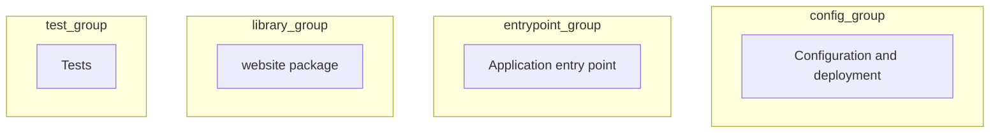

# Architecture report: vinta/awesome-python

> Automated static analysis. **Observed** = directly seen in files/imports/AST; **Inferred** = interpretation from that evidence. Repository code was not executed.

## 1. Repository at a glance

| Item | Value |
| --- | --- |
| Repository | vinta/awesome-python |
| Description | The definitive list that answers "I want to do X in Python, which tool should I use?" |
| Language | Python |
| Stars | 334732 |
| Licence | Other |
| Analysed commit / branch | 234dee17f146c30669fe44bac81eda8114727d02 / master |
| Framework(s) | None detected |
| Files analysed | 127 |
| Components | 4 |

## 2. Architecture in one minute

vinta/awesome-python - The definitive list that answers "I want to do X in Python, which tool should I use?". This repository was analysed statically from 127 file(s) (13 Python). Detected technologies (observed from imports/manifests): GitHub Actions, Poetry, pytest, unittest. Files are grouped into 4 component(s): Configuration and deployment, Application entry point, Tests, website package. Observed entry point(s): .claude/skills/audit-the-list/scripts/audit_priority.py, .claude/skills/scan-github-stars/scripts/scan_github_stars.py, website/build.py. Findings below distinguish observed facts from inferred interpretation.

## 3. High-level block diagram

## 4. Main components

### Configuration and deployment (`config`)

- **Kind:** config
- **Status:** Observed
- **Confidence:** 0.85
- **Responsibility:** Groups 3 file(s) under configuration and deployment (observed from repository paths and static analysis).
- **Paths:** `pyproject.toml`, `website/data/pypi_name_overrides.json`, `website/data/redirects.json`
- **Evidence:** [pyproject.toml](https://github.com/vinta/awesome-python/blob/234dee17f146c30669fe44bac81eda8114727d02/pyproject.toml); [website/data/pypi_name_overrides.json](https://github.com/vinta/awesome-python/blob/234dee17f146c30669fe44bac81eda8114727d02/website/data/pypi_name_overrides.json); [website/data/redirects.json](https://github.com/vinta/awesome-python/blob/234dee17f146c30669fe44bac81eda8114727d02/website/data/redirects.json)

### Application entry point (`entrypoint`)

- **Kind:** entrypoint
- **Status:** Observed
- **Confidence:** 0.85
- **Responsibility:** Groups 5 file(s) under application entry point (observed from repository paths and static analysis). Observed top-level classes: EntryGroup, SyntheticCategory, TemplateEntry, TemplateSubcategory. Observed top-level functions: _item_list_payload, _website_node, annotate_entries_with_stats, build, build_breadcrumb_json_ld, build_category_json_ld.
- **Paths:** `website/build.py`, `website/fetch_github_stars.py`, `website/fetch_pypi_downloads_via_bigquery.py`, `website/fetch_pypi_downloads_via_clickpy.py`, `website/fetch_pypi_downloads_via_pepy.py`
- **Evidence:** [website/build.py:86](https://github.com/vinta/awesome-python/blob/234dee17f146c30669fe44bac81eda8114727d02/website/build.py#L86); [website/fetch_github_stars.py:35](https://github.com/vinta/awesome-python/blob/234dee17f146c30669fe44bac81eda8114727d02/website/fetch_github_stars.py#L35); [website/fetch_pypi_downloads_via_bigquery.py:36](https://github.com/vinta/awesome-python/blob/234dee17f146c30669fe44bac81eda8114727d02/website/fetch_pypi_downloads_via_bigquery.py#L36); [website/fetch_pypi_downloads_via_clickpy.py:53](https://github.com/vinta/awesome-python/blob/234dee17f146c30669fe44bac81eda8114727d02/website/fetch_pypi_downloads_via_clickpy.py#L53); [website/fetch_pypi_downloads_via_pepy.py:34](https://github.com/vinta/awesome-python/blob/234dee17f146c30669fe44bac81eda8114727d02/website/fetch_pypi_downloads_via_pepy.py#L34)

### Tests (`tests`)

- **Kind:** test
- **Status:** Observed
- **Confidence:** 0.85
- **Responsibility:** Groups 5 file(s) under tests (observed from repository paths and static analysis). Observed top-level classes: HeadMetadataParser, TestAnnotateEntriesWithStats, TestBuild, TestBuildGraphqlQuery, TestDetectSourceType, TestExtractEntries. Observed top-level functions: _content_nodes, _parse_inline, _template_entry, preview, scan, test_comment_only_feedback_preserves_parked_kind_and_clears_highlight.
- **Paths:** `website/tests/test_build.py`, `website/tests/test_fetch_github_stars.py`, `website/tests/test_preview_verdicts.py`, `website/tests/test_readme_parser.py`, `website/tests/test_scan_github_stars.py`
- **Evidence:** [website/tests/test_build.py:35](https://github.com/vinta/awesome-python/blob/234dee17f146c30669fe44bac81eda8114727d02/website/tests/test_build.py#L35); [website/tests/test_fetch_github_stars.py:14](https://github.com/vinta/awesome-python/blob/234dee17f146c30669fe44bac81eda8114727d02/website/tests/test_fetch_github_stars.py#L14); [website/tests/test_preview_verdicts.py:47](https://github.com/vinta/awesome-python/blob/234dee17f146c30669fe44bac81eda8114727d02/website/tests/test_preview_verdicts.py#L47); [website/tests/test_readme_parser.py:21](https://github.com/vinta/awesome-python/blob/234dee17f146c30669fe44bac81eda8114727d02/website/tests/test_readme_parser.py#L21); [website/tests/test_scan_github_stars.py:10](https://github.com/vinta/awesome-python/blob/234dee17f146c30669fe44bac81eda8114727d02/website/tests/test_scan_github_stars.py#L10)

### website package (`website`)

- **Kind:** library
- **Status:** Observed
- **Confidence:** 0.85
- **Responsibility:** Groups 2 file(s) under website package (observed from repository paths and static analysis). Observed top-level classes: AlsoSee, ParsedEntry, ParsedGroup, ParsedSection, ParsedSponsor. Observed top-level functions: _build_section, _extract_description_children, _extract_description_html, _find_child, _find_inline, _find_link_deep.
- **Paths:** `website/readme_parser.py`, `website/static/main.js`
- **Evidence:** [website/readme_parser.py:22](https://github.com/vinta/awesome-python/blob/234dee17f146c30669fe44bac81eda8114727d02/website/readme_parser.py#L22); [website/static/main.js](https://github.com/vinta/awesome-python/blob/234dee17f146c30669fe44bac81eda8114727d02/website/static/main.js)

## 5. Execution flow

**Observed** entry point(s):

- [.claude/skills/audit-the-list/scripts/audit_priority.py:127](https://github.com/vinta/awesome-python/blob/234dee17f146c30669fe44bac81eda8114727d02/.claude/skills/audit-the-list/scripts/audit_priority.py#L127)
- [.claude/skills/scan-github-stars/scripts/scan_github_stars.py:157](https://github.com/vinta/awesome-python/blob/234dee17f146c30669fe44bac81eda8114727d02/.claude/skills/scan-github-stars/scripts/scan_github_stars.py#L157)
- [website/build.py:1042](https://github.com/vinta/awesome-python/blob/234dee17f146c30669fe44bac81eda8114727d02/website/build.py#L1042)
- [website/fetch_github_stars.py:179](https://github.com/vinta/awesome-python/blob/234dee17f146c30669fe44bac81eda8114727d02/website/fetch_github_stars.py#L179)
- [website/fetch_pypi_downloads_via_bigquery.py:81](https://github.com/vinta/awesome-python/blob/234dee17f146c30669fe44bac81eda8114727d02/website/fetch_pypi_downloads_via_bigquery.py#L81)
- [website/fetch_pypi_downloads_via_clickpy.py:107](https://github.com/vinta/awesome-python/blob/234dee17f146c30669fe44bac81eda8114727d02/website/fetch_pypi_downloads_via_clickpy.py#L107)
- [website/fetch_pypi_downloads_via_pepy.py:75](https://github.com/vinta/awesome-python/blob/234dee17f146c30669fe44bac81eda8114727d02/website/fetch_pypi_downloads_via_pepy.py#L75)
- [website/static/main.js](https://github.com/vinta/awesome-python/blob/234dee17f146c30669fe44bac81eda8114727d02/website/static/main.js)

Representative flow (derived from observed entry points and the import graph; steps beyond the entry point are **Inferred**):

1. Execution starts at an observed entry point listed above, if present.
2. No internal import relationships between components were observed.

## 6. Project structure

### `(root)`

- `.gitignore` - other (249 bytes)
- `AGENTS.md` - docs (2042 bytes)
- `CLAUDE.md` - docs (11 bytes)
- `CODE_OF_CONDUCT.md` - docs (1467 bytes)
- `CONTRIBUTING.md` - docs (9123 bytes)
- `DESIGN.md` - docs (18435 bytes)
- `LICENSE` - docs (112 bytes)
- `Makefile` - other (569 bytes)
- `README.md` - docs (84620 bytes)
- `SPONSORSHIP.md` - docs (3783 bytes)
- `pyproject.toml` - manifest (1251 bytes)

### `.claude`

- `.claude/skills/audit-the-list/SKILL.md` - docs (8673 bytes)
- `.claude/skills/audit-the-list/scripts/audit_priority.py` - source, Python (5928 bytes)
- `.claude/skills/preview-verdicts/SKILL.md` - docs (4089 bytes)
- `.claude/skills/preview-verdicts/template.html` - other (9310 bytes)
- `.claude/skills/review-prs/SKILL.md` - docs (4789 bytes)
- `.claude/skills/scan-github-stars/SKILL.md` - docs (4493 bytes)
- `.claude/skills/scan-github-stars/scripts/scan_github_stars.py` - source, Python (6398 bytes)

### `.github`

- `.github/FUNDING.yml` - config (80 bytes)
- `.github/PULL_REQUEST_TEMPLATE.md` - docs (1029 bytes)
- `.github/workflows/ci.yml` - ci, YAML (626 bytes)
- `.github/workflows/deploy-website.yml` - ci, YAML (2915 bytes)

### `docs`

- `docs/adr/0001-shortlist-not-catalog.md` - docs (3624 bytes)
- `docs/audit-logs.md` - docs (17033 bytes)

### `website`

- `website/build.py` - source, Python (41468 bytes)
- `website/data/category_intros/admin-panels.md` - docs (3234 bytes)
- `website/data/category_intros/ai-and-agents.md` - docs (9192 bytes)
- `website/data/category_intros/algorithms-and-design-patterns.md` - docs (3468 bytes)
- `website/data/category_intros/asynchronous-programming.md` - docs (6620 bytes)
- `website/data/category_intros/audio-video-processing.md` - docs (3722 bytes)
- `website/data/category_intros/authentication.md` - docs (6383 bytes)
- `website/data/category_intros/build-tools.md` - docs (2266 bytes)
- `website/data/category_intros/built-in-classes-enhancement.md` - docs (3381 bytes)
- `website/data/category_intros/caching.md` - docs (4345 bytes)
- `website/data/category_intros/cli-development.md` - docs (5929 bytes)
- `website/data/category_intros/cli-tools.md` - docs (3706 bytes)
- `website/data/category_intros/cms.md` - docs (3311 bytes)
- `website/data/category_intros/code-analysis.md` - docs (8187 bytes)
- `website/data/category_intros/computer-vision.md` - docs (3110 bytes)
- `website/data/category_intros/configuration-files.md` - docs (4478 bytes)
- `website/data/category_intros/cryptography.md` - docs (5014 bytes)
- `website/data/category_intros/data-analysis.md` - docs (3886 bytes)
- `website/data/category_intros/data-ingestion-etl.md` - docs (4106 bytes)
- `website/data/category_intros/data-validation.md` - docs (3325 bytes)
- `website/data/category_intros/data-visualization.md` - docs (5706 bytes)
- `website/data/category_intros/database-drivers.md` - docs (5859 bytes)
- `website/data/category_intros/database.md` - docs (3076 bytes)
- `website/data/category_intros/date-and-time.md` - docs (4149 bytes)
- `website/data/category_intros/debugging-tools.md` - docs (6137 bytes)
- `website/data/category_intros/deep-learning.md` - docs (3863 bytes)
- `website/data/category_intros/devops-tools.md` - docs (7150 bytes)
- `website/data/category_intros/distributed-computing.md` - docs (4933 bytes)
- `website/data/category_intros/distribution.md` - docs (4204 bytes)
- `website/data/category_intros/documentation.md` - docs (4577 bytes)
- `website/data/category_intros/email.md` - docs (2124 bytes)
- `website/data/category_intros/environment-management.md` - docs (4507 bytes)
- `website/data/category_intros/erp.md` - docs (3828 bytes)
- `website/data/category_intros/file-format-processing.md` - docs (8127 bytes)
- `website/data/category_intros/file-manipulation.md` - docs (8925 bytes)
- `website/data/category_intros/functional-programming.md` - docs (4738 bytes)
- `website/data/category_intros/game-development.md` - docs (3058 bytes)
- `website/data/category_intros/geolocation.md` - docs (4530 bytes)
- `website/data/category_intros/gui-development.md` - docs (5487 bytes)
- `website/data/category_intros/hardware.md` - docs (2622 bytes)
- `website/data/category_intros/html-manipulation.md` - docs (4064 bytes)
- `website/data/category_intros/http-clients.md` - docs (2799 bytes)
- `website/data/category_intros/image-processing.md` - docs (5367 bytes)
- `website/data/category_intros/implementations.md` - docs (3924 bytes)
- `website/data/category_intros/interactive-interpreter.md` - docs (3442 bytes)
- `website/data/category_intros/job-schedulers.md` - docs (5440 bytes)
- `website/data/category_intros/logging.md` - docs (5700 bytes)
- `website/data/category_intros/machine-learning.md` - docs (6792 bytes)
- `website/data/category_intros/messaging.md` - docs (3198 bytes)
- `website/data/category_intros/microsoft-windows.md` - docs (2854 bytes)
- `website/data/category_intros/miscellaneous.md` - docs (1805 bytes)
- `website/data/category_intros/natural-language-processing.md` - docs (5389 bytes)
- `website/data/category_intros/network-virtualization.md` - docs (2287 bytes)
- `website/data/category_intros/orm.md` - docs (6021 bytes)
- `website/data/category_intros/package-management.md` - docs (5247 bytes)
- `website/data/category_intros/package-repositories.md` - docs (3203 bytes)
- `website/data/category_intros/penetration-testing.md` - docs (3049 bytes)
- `website/data/category_intros/quantum-computing.md` - docs (4184 bytes)
- `website/data/category_intros/recommender-systems.md` - docs (2428 bytes)
- `website/data/category_intros/science.md` - docs (10663 bytes)
- `website/data/category_intros/search.md` - docs (4719 bytes)
- `website/data/category_intros/serialization.md` - docs (4113 bytes)
- `website/data/category_intros/static-site-generators.md` - docs (3444 bytes)
- `website/data/category_intros/supply-chain-security.md` - docs (2115 bytes)
- `website/data/category_intros/task-queues.md` - docs (5045 bytes)
- `website/data/category_intros/template-engines.md` - docs (2743 bytes)
- `website/data/category_intros/testing.md` - docs (7422 bytes)
- `website/data/category_intros/text-processing.md` - docs (6059 bytes)
- `website/data/category_intros/web-apis.md` - docs (4010 bytes)
- `website/data/category_intros/web-asset-management.md` - docs (2855 bytes)
- `website/data/category_intros/web-frameworks.md` - docs (6437 bytes)
- `website/data/category_intros/web-scraping.md` - docs (5156 bytes)
- `website/data/category_intros/web-security.md` - docs (4123 bytes)
- `website/data/category_intros/web-servers.md` - docs (4156 bytes)
- `website/data/category_intros/websocket.md` - docs (4645 bytes)
- `website/data/pypi_name_overrides.json` - config (4790 bytes)
- `website/data/redirects.json` - config (1784 bytes)
- `website/fetch_github_stars.py` - source, Python (6450 bytes)
- `website/fetch_pypi_downloads_via_bigquery.py` - source, Python (3233 bytes)
- `website/fetch_pypi_downloads_via_clickpy.py` - source, Python (4713 bytes)
- `website/fetch_pypi_downloads_via_pepy.py` - source, Python (2901 bytes)
- `website/readme_parser.py` - source, Python (15423 bytes)
- `website/static/favicon.svg` - other (320 bytes)
- `website/static/main.js` - source, JavaScript (13958 bytes)
- `website/static/og-image.svg` - other (2703 bytes)
- `website/static/style.css` - other (38648 bytes)
- `website/templates/_category_nav.html` - other (849 bytes)
- `website/templates/_entry_rows.html` - other (5840 bytes)
- `website/templates/_final_cta.html` - other (696 bytes)
- `website/templates/_projects_table.html` - other (2372 bytes)
- `website/templates/_sponsor_band.html` - other (765 bytes)
- `website/templates/_topbar.html` - other (772 bytes)
- `website/templates/base.html` - other (3917 bytes)
- `website/templates/category.html` - other (4269 bytes)
- `website/templates/index.html` - other (2362 bytes)
- `website/templates/llms.txt` - docs (796 bytes)
- `website/templates/redirect.html` - other (360 bytes)
- `website/templates/sponsorship.html` - other (10556 bytes)
- `website/tests/test_build.py` - test, Python (63735 bytes)
- `website/tests/test_fetch_github_stars.py` - test, Python (9779 bytes)
- `website/tests/test_preview_verdicts.py` - test, Python (4970 bytes)
- `website/tests/test_readme_parser.py` - test, Python (17557 bytes)
- `website/tests/test_scan_github_stars.py` - test, Python (6012 bytes)

## 7. Key dependencies and integrations

| Name | Category | Status | Confidence | Evidence |
| --- | --- | --- | --- | --- |
| GitHub Actions | ci | Observed | 0.90 | [.github/workflows/ci.yml](https://github.com/vinta/awesome-python/blob/234dee17f146c30669fe44bac81eda8114727d02/.github/workflows/ci.yml); [.github/workflows/deploy-website.yml](https://github.com/vinta/awesome-python/blob/234dee17f146c30669fe44bac81eda8114727d02/.github/workflows/deploy-website.yml) |
| Poetry | packaging | Observed | 0.85 | [pyproject.toml](https://github.com/vinta/awesome-python/blob/234dee17f146c30669fe44bac81eda8114727d02/pyproject.toml) |
| pytest | tooling | Observed | 0.95 | [website/tests/test_build.py:14](https://github.com/vinta/awesome-python/blob/234dee17f146c30669fe44bac81eda8114727d02/website/tests/test_build.py#L14); [website/tests/test_preview_verdicts.py:7](https://github.com/vinta/awesome-python/blob/234dee17f146c30669fe44bac81eda8114727d02/website/tests/test_preview_verdicts.py#L7); [website/tests/test_readme_parser.py:7](https://github.com/vinta/awesome-python/blob/234dee17f146c30669fe44bac81eda8114727d02/website/tests/test_readme_parser.py#L7); [website/tests/test_scan_github_stars.py:6](https://github.com/vinta/awesome-python/blob/234dee17f146c30669fe44bac81eda8114727d02/website/tests/test_scan_github_stars.py#L6) |
| unittest | tooling | Observed | 0.90 | [website/tests/test_fetch_github_stars.py:205](https://github.com/vinta/awesome-python/blob/234dee17f146c30669fe44bac81eda8114727d02/website/tests/test_fetch_github_stars.py#L205) |

## 8. Data and state

No database, cache, queue, or persistent-state usage was observed in the analysed files. State handling, if any, may be in-memory or in files that were not analysed.

## 9. Configuration and deployment clues

- `.github/FUNDING.yml` (config)
- `.github/workflows/ci.yml` (ci)
- `.github/workflows/deploy-website.yml` (ci)
- `pyproject.toml` (manifest)
- `website/data/pypi_name_overrides.json` (config)
- `website/data/redirects.json` (config)

## 10. Design observations

- An entry/API layer is separated from other code (Inferred from paths and decorators).
- Tests are present alongside source code (Observed from test file paths).

These observations are interpretations (**Inferred**) of the observed structure, not guarantees about runtime design.

## 11. Limitations and unknowns

- Static analysis only: repository code was not executed, installed, or imported at runtime.
- Components and relationships are inferred from file paths, imports, and AST structure; runtime behaviour, dynamic imports, and reflection may not be visible.
- 1 file(s) were skipped during inventory (1 x lockfile excluded).
- Repository text was treated as untrusted data; no instructions found in repository files were followed, and likely secret values were redacted/excluded.

## 12. Source references

- [.claude/skills/audit-the-list/scripts/audit_priority.py:127](https://github.com/vinta/awesome-python/blob/234dee17f146c30669fe44bac81eda8114727d02/.claude/skills/audit-the-list/scripts/audit_priority.py#L127)
- [.claude/skills/scan-github-stars/scripts/scan_github_stars.py:157](https://github.com/vinta/awesome-python/blob/234dee17f146c30669fe44bac81eda8114727d02/.claude/skills/scan-github-stars/scripts/scan_github_stars.py#L157)
- [.github/workflows/ci.yml](https://github.com/vinta/awesome-python/blob/234dee17f146c30669fe44bac81eda8114727d02/.github/workflows/ci.yml)
- [.github/workflows/deploy-website.yml](https://github.com/vinta/awesome-python/blob/234dee17f146c30669fe44bac81eda8114727d02/.github/workflows/deploy-website.yml)
- [pyproject.toml](https://github.com/vinta/awesome-python/blob/234dee17f146c30669fe44bac81eda8114727d02/pyproject.toml)
- [website/build.py:86](https://github.com/vinta/awesome-python/blob/234dee17f146c30669fe44bac81eda8114727d02/website/build.py#L86)
- [website/build.py:1042](https://github.com/vinta/awesome-python/blob/234dee17f146c30669fe44bac81eda8114727d02/website/build.py#L1042)
- [website/data/pypi_name_overrides.json](https://github.com/vinta/awesome-python/blob/234dee17f146c30669fe44bac81eda8114727d02/website/data/pypi_name_overrides.json)
- [website/data/redirects.json](https://github.com/vinta/awesome-python/blob/234dee17f146c30669fe44bac81eda8114727d02/website/data/redirects.json)
- [website/fetch_github_stars.py:35](https://github.com/vinta/awesome-python/blob/234dee17f146c30669fe44bac81eda8114727d02/website/fetch_github_stars.py#L35)
- [website/fetch_github_stars.py:179](https://github.com/vinta/awesome-python/blob/234dee17f146c30669fe44bac81eda8114727d02/website/fetch_github_stars.py#L179)
- [website/fetch_pypi_downloads_via_bigquery.py:36](https://github.com/vinta/awesome-python/blob/234dee17f146c30669fe44bac81eda8114727d02/website/fetch_pypi_downloads_via_bigquery.py#L36)
- [website/fetch_pypi_downloads_via_bigquery.py:81](https://github.com/vinta/awesome-python/blob/234dee17f146c30669fe44bac81eda8114727d02/website/fetch_pypi_downloads_via_bigquery.py#L81)
- [website/fetch_pypi_downloads_via_clickpy.py:53](https://github.com/vinta/awesome-python/blob/234dee17f146c30669fe44bac81eda8114727d02/website/fetch_pypi_downloads_via_clickpy.py#L53)
- [website/fetch_pypi_downloads_via_clickpy.py:107](https://github.com/vinta/awesome-python/blob/234dee17f146c30669fe44bac81eda8114727d02/website/fetch_pypi_downloads_via_clickpy.py#L107)
- [website/fetch_pypi_downloads_via_pepy.py:34](https://github.com/vinta/awesome-python/blob/234dee17f146c30669fe44bac81eda8114727d02/website/fetch_pypi_downloads_via_pepy.py#L34)
- [website/fetch_pypi_downloads_via_pepy.py:75](https://github.com/vinta/awesome-python/blob/234dee17f146c30669fe44bac81eda8114727d02/website/fetch_pypi_downloads_via_pepy.py#L75)
- [website/readme_parser.py:22](https://github.com/vinta/awesome-python/blob/234dee17f146c30669fe44bac81eda8114727d02/website/readme_parser.py#L22)
- [website/static/main.js](https://github.com/vinta/awesome-python/blob/234dee17f146c30669fe44bac81eda8114727d02/website/static/main.js)
- [website/tests/test_build.py:14](https://github.com/vinta/awesome-python/blob/234dee17f146c30669fe44bac81eda8114727d02/website/tests/test_build.py#L14)
- [website/tests/test_build.py:35](https://github.com/vinta/awesome-python/blob/234dee17f146c30669fe44bac81eda8114727d02/website/tests/test_build.py#L35)
- [website/tests/test_fetch_github_stars.py:14](https://github.com/vinta/awesome-python/blob/234dee17f146c30669fe44bac81eda8114727d02/website/tests/test_fetch_github_stars.py#L14)
- [website/tests/test_fetch_github_stars.py:205](https://github.com/vinta/awesome-python/blob/234dee17f146c30669fe44bac81eda8114727d02/website/tests/test_fetch_github_stars.py#L205)
- [website/tests/test_preview_verdicts.py:7](https://github.com/vinta/awesome-python/blob/234dee17f146c30669fe44bac81eda8114727d02/website/tests/test_preview_verdicts.py#L7)
- [website/tests/test_preview_verdicts.py:47](https://github.com/vinta/awesome-python/blob/234dee17f146c30669fe44bac81eda8114727d02/website/tests/test_preview_verdicts.py#L47)
- [website/tests/test_readme_parser.py:7](https://github.com/vinta/awesome-python/blob/234dee17f146c30669fe44bac81eda8114727d02/website/tests/test_readme_parser.py#L7)
- [website/tests/test_readme_parser.py:21](https://github.com/vinta/awesome-python/blob/234dee17f146c30669fe44bac81eda8114727d02/website/tests/test_readme_parser.py#L21)
- [website/tests/test_scan_github_stars.py:6](https://github.com/vinta/awesome-python/blob/234dee17f146c30669fe44bac81eda8114727d02/website/tests/test_scan_github_stars.py#L6)
- [website/tests/test_scan_github_stars.py:10](https://github.com/vinta/awesome-python/blob/234dee17f146c30669fe44bac81eda8114727d02/website/tests/test_scan_github_stars.py#L10)
