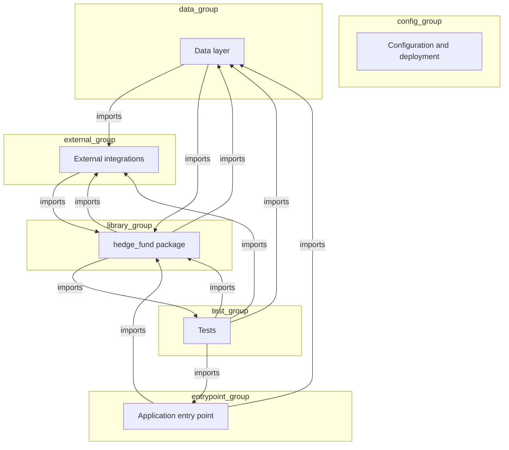

# Architecture report: virattt/ai-hedge-fund

> Automated static analysis. **Observed** = directly seen in files/imports/AST; **Inferred** = interpretation from that evidence. Repository code was not executed.

## 1. Repository at a glance

| Item | Value |
| --- | --- |
| Repository | virattt/ai-hedge-fund |
| Description | An AI Hedge Fund Team |
| Language | Python |
| Stars | 64674 |
| Licence | MIT |
| Analysed commit / branch | 5c553b5222044f6a5527bd377b4104c50ee0ad28 / main |
| Framework(s) | None detected |
| Files analysed | 150 |
| Components | 6 |

## 2. Architecture in one minute

virattt/ai-hedge-fund - An AI Hedge Fund Team. This repository was analysed statically from 150 file(s) (130 Python). Detected technologies (observed from imports/manifests): NumPy, pandas, Pydantic, requests, Poetry, pytest. Files are grouped into 6 component(s): Configuration and deployment, Data layer, Application entry point, External integrations, hedge_fund package, Tests. Observed entry point(s): hedge_fund/run.py, hedge_fund/tui/__main__.py. Findings below distinguish observed facts from inferred interpretation.

## 3. High-level block diagram

## 4. Main components

### Configuration and deployment (`config`)

- **Kind:** config
- **Status:** Observed
- **Confidence:** 0.85
- **Responsibility:** Groups 8 file(s) under configuration and deployment (observed from repository paths and static analysis).
- **Paths:** `hedge_fund/fund/example.yaml`, `hedge_fund/llm/api_models.json`, `hedge_fund/pipeline/fixtures/record_before_intraday.json`, `hedge_fund/strategies/deep-value.yaml`, `hedge_fund/strategies/earnings-drift.yaml`, `hedge_fund/strategies/fundamental-ls.yaml`, `hedge_fund/strategies/inflections.yaml`, `pyproject.toml`
- **Evidence:** [hedge_fund/fund/example.yaml](https://github.com/virattt/ai-hedge-fund/blob/5c553b5222044f6a5527bd377b4104c50ee0ad28/hedge_fund/fund/example.yaml); [hedge_fund/llm/api_models.json](https://github.com/virattt/ai-hedge-fund/blob/5c553b5222044f6a5527bd377b4104c50ee0ad28/hedge_fund/llm/api_models.json); [hedge_fund/pipeline/fixtures/record_before_intraday.json](https://github.com/virattt/ai-hedge-fund/blob/5c553b5222044f6a5527bd377b4104c50ee0ad28/hedge_fund/pipeline/fixtures/record_before_intraday.json); [hedge_fund/strategies/deep-value.yaml](https://github.com/virattt/ai-hedge-fund/blob/5c553b5222044f6a5527bd377b4104c50ee0ad28/hedge_fund/strategies/deep-value.yaml); [hedge_fund/strategies/earnings-drift.yaml](https://github.com/virattt/ai-hedge-fund/blob/5c553b5222044f6a5527bd377b4104c50ee0ad28/hedge_fund/strategies/earnings-drift.yaml); [hedge_fund/strategies/fundamental-ls.yaml](https://github.com/virattt/ai-hedge-fund/blob/5c553b5222044f6a5527bd377b4104c50ee0ad28/hedge_fund/strategies/fundamental-ls.yaml); [hedge_fund/strategies/inflections.yaml](https://github.com/virattt/ai-hedge-fund/blob/5c553b5222044f6a5527bd377b4104c50ee0ad28/hedge_fund/strategies/inflections.yaml); [pyproject.toml](https://github.com/virattt/ai-hedge-fund/blob/5c553b5222044f6a5527bd377b4104c50ee0ad28/pyproject.toml)

### Data layer (`data_layer`)

- **Kind:** data
- **Status:** Observed
- **Confidence:** 0.85
- **Responsibility:** Groups 13 file(s) under data layer (observed from repository paths and static analysis). Observed top-level classes: Allocated, AllocationRecord, AnalystScore, CachedDataClient, CallMeter, CompanyFacts. Observed top-level functions: _all_numbers, _all_strings, _at, _grid_seconds, _is_number, _key.
- **Paths:** `hedge_fund/brokers/models.py`, `hedge_fund/data/__init__.py`, `hedge_fund/data/bars.py`, `hedge_fund/data/cached.py`, `hedge_fund/data/client.py`, `hedge_fund/data/models.py`, `hedge_fund/data/protocol.py`, `hedge_fund/data/screener.py`, `hedge_fund/data/sessions.py`, `hedge_fund/data/wallet.py`, `hedge_fund/models.py`, `hedge_fund/pipeline/models.py`, `hedge_fund/scorecard/models.py`
- **Evidence:** [hedge_fund/brokers/models.py:15](https://github.com/virattt/ai-hedge-fund/blob/5c553b5222044f6a5527bd377b4104c50ee0ad28/hedge_fund/brokers/models.py#L15); [hedge_fund/data/__init__.py](https://github.com/virattt/ai-hedge-fund/blob/5c553b5222044f6a5527bd377b4104c50ee0ad28/hedge_fund/data/__init__.py); [hedge_fund/data/bars.py:29](https://github.com/virattt/ai-hedge-fund/blob/5c553b5222044f6a5527bd377b4104c50ee0ad28/hedge_fund/data/bars.py#L29); [hedge_fund/data/cached.py:48](https://github.com/virattt/ai-hedge-fund/blob/5c553b5222044f6a5527bd377b4104c50ee0ad28/hedge_fund/data/cached.py#L48); [hedge_fund/data/client.py:37](https://github.com/virattt/ai-hedge-fund/blob/5c553b5222044f6a5527bd377b4104c50ee0ad28/hedge_fund/data/client.py#L37); [hedge_fund/data/models.py:19](https://github.com/virattt/ai-hedge-fund/blob/5c553b5222044f6a5527bd377b4104c50ee0ad28/hedge_fund/data/models.py#L19); [hedge_fund/data/protocol.py:36](https://github.com/virattt/ai-hedge-fund/blob/5c553b5222044f6a5527bd377b4104c50ee0ad28/hedge_fund/data/protocol.py#L36); [hedge_fund/data/screener.py:38](https://github.com/virattt/ai-hedge-fund/blob/5c553b5222044f6a5527bd377b4104c50ee0ad28/hedge_fund/data/screener.py#L38)

### Application entry point (`entrypoint`)

- **Kind:** entrypoint
- **Status:** Observed
- **Confidence:** 0.85
- **Responsibility:** Groups 3 file(s) under application entry point (observed from repository paths and static analysis). Observed top-level classes: HedgeFundApp. Observed top-level functions: _backtest, _fund_dir, _paper, _parser, _status_line, _tick_summary.
- **Paths:** `hedge_fund/run.py`, `hedge_fund/tui/__main__.py`, `hedge_fund/tui/app.py`
- **Evidence:** [hedge_fund/run.py:91](https://github.com/virattt/ai-hedge-fund/blob/5c553b5222044f6a5527bd377b4104c50ee0ad28/hedge_fund/run.py#L91); [hedge_fund/tui/__main__.py:6](https://github.com/virattt/ai-hedge-fund/blob/5c553b5222044f6a5527bd377b4104c50ee0ad28/hedge_fund/tui/__main__.py#L6); [hedge_fund/tui/app.py:15](https://github.com/virattt/ai-hedge-fund/blob/5c553b5222044f6a5527bd377b4104c50ee0ad28/hedge_fund/tui/app.py#L15)

### External integrations (`external_integrations`)

- **Kind:** external
- **Status:** Observed
- **Confidence:** 0.85
- **Responsibility:** Groups 1 file(s) under external integrations (observed from repository paths and static analysis). Observed top-level classes: ChatLLM, JevLLM, LLMCallError, LLMClient, LLMParseError. Observed top-level functions: AnthropicLLM, _flatten, _require_key, _retry_delay, extract_json, make_llm.
- **Paths:** `hedge_fund/llm/client.py`
- **Evidence:** [hedge_fund/llm/client.py:42](https://github.com/virattt/ai-hedge-fund/blob/5c553b5222044f6a5527bd377b4104c50ee0ad28/hedge_fund/llm/client.py#L42)

### hedge_fund package (`hedge_fund`)

- **Kind:** library
- **Status:** Observed
- **Confidence:** 0.85
- **Responsibility:** Groups 67 file(s) under hedge_fund package (observed from repository paths and static analysis). Observed top-level classes: AllocationPolicy, AlphaModel, BacktestDecisionsScreen, BacktestScorecardScreen, BacktestScreen, BarClock. Observed top-level functions: _allocated, _allocated_line, _allocation_detail, _at_phrase, _average_ranks, _avg.
- **Paths:** `hedge_fund/__init__.py`, `hedge_fund/backtesting/__init__.py`, `hedge_fund/backtesting/fund.py`, `hedge_fund/backtesting/research.py`, `hedge_fund/brokers/__init__.py`, `hedge_fund/brokers/costs.py`, `hedge_fund/brokers/paper.py`, `hedge_fund/brokers/protocol.py`, `hedge_fund/brokers/sim.py`, `hedge_fund/features/__init__.py`, `hedge_fund/features/breakpoints.py`, `hedge_fund/features/intraday.py`, `hedge_fund/features/snapshot.py`, `hedge_fund/fund/__init__.py`, `hedge_fund/fund/spec.py`, `hedge_fund/fund/storage.py`, `hedge_fund/llm/__init__.py`, `hedge_fund/llm/cache.py`, `hedge_fund/llm/contract.py`, `hedge_fund/llm/registry.py`, `hedge_fund/llm/watch.py`, `hedge_fund/paper/__init__.py`, `hedge_fund/paper/deployed.py`, `hedge_fund/paper/ledger.py`, `hedge_fund/paper/runner.py`, `hedge_fund/paper/tick.py`, `hedge_fund/paths.py`, `hedge_fund/pipeline/__init__.py`, `hedge_fund/pipeline/clock.py`, `hedge_fund/pipeline/execution.py`, `hedge_fund/pipeline/session.py`, `hedge_fund/pipeline/stages.py`, `hedge_fund/portfolio/__init__.py`, `hedge_fund/portfolio/construction.py`, `hedge_fund/portfolio/validation.py`, `hedge_fund/risk/__init__.py`, `hedge_fund/risk/exposures.py`, `hedge_fund/risk/limits.py`, `hedge_fund/scorecard/__init__.py`, `hedge_fund/scorecard/allocation.py`, `hedge_fund/scorecard/analysts.py`, `hedge_fund/scorecard/strategies.py`, `hedge_fund/signals/__init__.py`, `hedge_fund/signals/base.py`, `hedge_fund/signals/buffett.py`, `hedge_fund/signals/druckenmiller.py`, `hedge_fund/signals/graham.py`, `hedge_fund/signals/llm_agent.py`, `hedge_fund/signals/lynch.py`, `hedge_fund/signals/munger.py`, `hedge_fund/signals/pead.py`, `hedge_fund/tui/__init__.py`, `hedge_fund/tui/backtest.py`, `hedge_fund/tui/builder.py`, `hedge_fund/tui/fixtures.py`, `hedge_fund/tui/funds.py`, `hedge_fund/tui/home.py`, `hedge_fund/tui/keys.py`, `hedge_fund/tui/palette.py`, `hedge_fund/tui/paper.py`, `hedge_fund/tui/paper_view.py`, `hedge_fund/tui/report.py`, `hedge_fund/tui/scorecard_view.py`, `hedge_fund/tui/session_report.py`, `hedge_fund/tui/shared.py`, `hedge_fund/tui/widgets.py`, `hedge_fund/validation/__init__.py`
- **Evidence:** [hedge_fund/__init__.py](https://github.com/virattt/ai-hedge-fund/blob/5c553b5222044f6a5527bd377b4104c50ee0ad28/hedge_fund/__init__.py); [hedge_fund/backtesting/__init__.py](https://github.com/virattt/ai-hedge-fund/blob/5c553b5222044f6a5527bd377b4104c50ee0ad28/hedge_fund/backtesting/__init__.py); [hedge_fund/backtesting/fund.py:41](https://github.com/virattt/ai-hedge-fund/blob/5c553b5222044f6a5527bd377b4104c50ee0ad28/hedge_fund/backtesting/fund.py#L41); [hedge_fund/backtesting/research.py:18](https://github.com/virattt/ai-hedge-fund/blob/5c553b5222044f6a5527bd377b4104c50ee0ad28/hedge_fund/backtesting/research.py#L18); [hedge_fund/brokers/__init__.py](https://github.com/virattt/ai-hedge-fund/blob/5c553b5222044f6a5527bd377b4104c50ee0ad28/hedge_fund/brokers/__init__.py); [hedge_fund/brokers/costs.py:36](https://github.com/virattt/ai-hedge-fund/blob/5c553b5222044f6a5527bd377b4104c50ee0ad28/hedge_fund/brokers/costs.py#L36); [hedge_fund/brokers/paper.py:27](https://github.com/virattt/ai-hedge-fund/blob/5c553b5222044f6a5527bd377b4104c50ee0ad28/hedge_fund/brokers/paper.py#L27); [hedge_fund/brokers/protocol.py:16](https://github.com/virattt/ai-hedge-fund/blob/5c553b5222044f6a5527bd377b4104c50ee0ad28/hedge_fund/brokers/protocol.py#L16)

### Tests (`tests`)

- **Kind:** test
- **Status:** Observed
- **Confidence:** 0.85
- **Responsibility:** Groups 46 file(s) under tests (observed from repository paths and static analysis). Observed top-level classes: BarClient, CountingClient, DailyOnly, DailyTape, DatedAnalyst, DayClient. Observed top-level functions: SPEC, _aapl, _advance_through, _agent, _analyst_ledger, _at.
- **Paths:** `hedge_fund/backtesting/test_fund.py`, `hedge_fund/backtesting/test_research.py`, `hedge_fund/brokers/test_costs.py`, `hedge_fund/brokers/test_models.py`, `hedge_fund/brokers/test_paper.py`, `hedge_fund/brokers/test_sim.py`, `hedge_fund/conftest.py`, `hedge_fund/data/test_bars.py`, `hedge_fund/data/test_cached.py`, `hedge_fund/data/test_client.py`, `hedge_fund/data/test_client_contract.py`, `hedge_fund/data/test_screener.py`, `hedge_fund/data/test_wallet.py`, `hedge_fund/features/test_breakpoints.py`, `hedge_fund/features/test_intraday.py`, `hedge_fund/features/test_snapshot.py`, `hedge_fund/fund/test_spec.py`, `hedge_fund/fund/test_strategy_library.py`, `hedge_fund/llm/test_client.py`, `hedge_fund/llm/test_contract.py`, `hedge_fund/llm/test_watch.py`, `hedge_fund/paper/test_ledger.py`, `hedge_fund/paper/test_runner.py`, `hedge_fund/paper/test_tick.py`, `hedge_fund/pipeline/test_clock.py`, `hedge_fund/pipeline/test_execution.py`, `hedge_fund/pipeline/test_session.py`, `hedge_fund/pipeline/test_stages.py`, `hedge_fund/pipeline/test_timing.py`, `hedge_fund/portfolio/test_construction.py`, `hedge_fund/risk/test_exposures.py`, `hedge_fund/risk/test_limits.py`, `hedge_fund/scorecard/test_allocation.py`, `hedge_fund/scorecard/test_scorecard.py`, `hedge_fund/signals/test_llm_agents.py`, `hedge_fund/signals/test_signals.py`, `hedge_fund/test_run.py`, `hedge_fund/tui/conftest.py`, `hedge_fund/tui/test_backtest.py`, `hedge_fund/tui/test_builder.py`, `hedge_fund/tui/test_funds.py`, `hedge_fund/tui/test_home.py`, `hedge_fund/tui/test_paper.py`, `hedge_fund/tui/test_paper_view.py`, `hedge_fund/tui/test_report.py`, `hedge_fund/tui/test_scorecard_view.py`
- **Evidence:** [hedge_fund/backtesting/test_fund.py:14](https://github.com/virattt/ai-hedge-fund/blob/5c553b5222044f6a5527bd377b4104c50ee0ad28/hedge_fund/backtesting/test_fund.py#L14); [hedge_fund/backtesting/test_research.py:12](https://github.com/virattt/ai-hedge-fund/blob/5c553b5222044f6a5527bd377b4104c50ee0ad28/hedge_fund/backtesting/test_research.py#L12); [hedge_fund/brokers/test_costs.py:9](https://github.com/virattt/ai-hedge-fund/blob/5c553b5222044f6a5527bd377b4104c50ee0ad28/hedge_fund/brokers/test_costs.py#L9); [hedge_fund/brokers/test_models.py:6](https://github.com/virattt/ai-hedge-fund/blob/5c553b5222044f6a5527bd377b4104c50ee0ad28/hedge_fund/brokers/test_models.py#L6); [hedge_fund/brokers/test_paper.py:12](https://github.com/virattt/ai-hedge-fund/blob/5c553b5222044f6a5527bd377b4104c50ee0ad28/hedge_fund/brokers/test_paper.py#L12); [hedge_fund/brokers/test_sim.py:10](https://github.com/virattt/ai-hedge-fund/blob/5c553b5222044f6a5527bd377b4104c50ee0ad28/hedge_fund/brokers/test_sim.py#L10); [hedge_fund/conftest.py:12](https://github.com/virattt/ai-hedge-fund/blob/5c553b5222044f6a5527bd377b4104c50ee0ad28/hedge_fund/conftest.py#L12); [hedge_fund/data/test_bars.py:26](https://github.com/virattt/ai-hedge-fund/blob/5c553b5222044f6a5527bd377b4104c50ee0ad28/hedge_fund/data/test_bars.py#L26)

## 5. Execution flow

**Observed** entry point(s):

- [hedge_fund/run.py:404](https://github.com/virattt/ai-hedge-fund/blob/5c553b5222044f6a5527bd377b4104c50ee0ad28/hedge_fund/run.py#L404)
- [hedge_fund/tui/__main__.py:10](https://github.com/virattt/ai-hedge-fund/blob/5c553b5222044f6a5527bd377b4104c50ee0ad28/hedge_fund/tui/__main__.py#L10)

Representative flow (derived from observed entry points and the import graph; steps beyond the entry point are **Inferred**):

1. Execution starts at an observed entry point listed above, if present.
2. `data_layer` imports `external_integrations` (Data layer -> External integrations).
3. `data_layer` imports `hedge_fund` (Data layer -> hedge_fund package).
4. `entrypoint` imports `data_layer` (Application entry point -> Data layer).
5. `entrypoint` imports `hedge_fund` (Application entry point -> hedge_fund package).
6. `external_integrations` imports `hedge_fund` (External integrations -> hedge_fund package).
7. `hedge_fund` imports `data_layer` (hedge_fund package -> Data layer).
8. `hedge_fund` imports `external_integrations` (hedge_fund package -> External integrations).
9. `hedge_fund` imports `tests` (hedge_fund package -> Tests).

## 6. Project structure

### `(root)`

- `.env.example` - config (1982 bytes)
- `.gitignore` - other (653 bytes)
- `LICENSE` - docs (1068 bytes)
- `Makefile` - other (537 bytes)
- `README.md` - docs (3465 bytes)
- `ROADMAP.md` - docs (8363 bytes)
- `VISION.md` - docs (9176 bytes)
- `pyproject.toml` - manifest (1629 bytes)

### `.github`

- `.github/ISSUE_TEMPLATE/bug_report.md` - docs (322 bytes)
- `.github/ISSUE_TEMPLATE/feature_request.md` - docs (212 bytes)

### `assets`

- `assets/ai-hedge-fund-system.svg` - other (5064 bytes)

### `hedge_fund`

- `hedge_fund/README.md` - docs (9239 bytes)
- `hedge_fund/__init__.py` - source, Python (253 bytes)
- `hedge_fund/backtesting/__init__.py` - source, Python (697 bytes)
- `hedge_fund/backtesting/fund.py` - source, Python (10527 bytes)
- `hedge_fund/backtesting/research.py` - source, Python (3175 bytes)
- `hedge_fund/backtesting/test_fund.py` - test, Python (18915 bytes)
- `hedge_fund/backtesting/test_research.py` - test, Python (1013 bytes)
- `hedge_fund/brokers/__init__.py` - source, Python (429 bytes)
- `hedge_fund/brokers/costs.py` - source, Python (3340 bytes)
- `hedge_fund/brokers/models.py` - source, Python (2230 bytes)
- `hedge_fund/brokers/paper.py` - source, Python (3130 bytes)
- `hedge_fund/brokers/protocol.py` - source, Python (1173 bytes)
- `hedge_fund/brokers/sim.py` - source, Python (2658 bytes)
- `hedge_fund/brokers/test_costs.py` - test, Python (2598 bytes)
- `hedge_fund/brokers/test_models.py` - test, Python (585 bytes)
- `hedge_fund/brokers/test_paper.py` - test, Python (2585 bytes)
- `hedge_fund/brokers/test_sim.py` - test, Python (4757 bytes)
- `hedge_fund/conftest.py` - test, Python (621 bytes)
- `hedge_fund/data/__init__.py` - source, Python (970 bytes)
- `hedge_fund/data/bars.py` - source, Python (6015 bytes)
- `hedge_fund/data/cached.py` - source, Python (9379 bytes)
- `hedge_fund/data/client.py` - source, Python (16852 bytes)
- `hedge_fund/data/models.py` - source, Python (8873 bytes)
- `hedge_fund/data/protocol.py` - source, Python (2908 bytes)
- `hedge_fund/data/screener.py` - source, Python (6754 bytes)
- `hedge_fund/data/sessions.py` - source, Python (1243 bytes)
- `hedge_fund/data/test_bars.py` - test, Python (4462 bytes)
- `hedge_fund/data/test_cached.py` - test, Python (8927 bytes)
- `hedge_fund/data/test_client.py` - test, Python (5015 bytes)
- `hedge_fund/data/test_client_contract.py` - test, Python (18822 bytes)
- `hedge_fund/data/test_screener.py` - test, Python (4677 bytes)
- `hedge_fund/data/test_wallet.py` - test, Python (1541 bytes)
- `hedge_fund/data/wallet.py` - source, Python (2247 bytes)
- `hedge_fund/features/__init__.py` - source, Python (446 bytes)
- `hedge_fund/features/breakpoints.py` - source, Python (5423 bytes)
- `hedge_fund/features/intraday.py` - source, Python (9243 bytes)
- `hedge_fund/features/snapshot.py` - source, Python (13107 bytes)
- `hedge_fund/features/test_breakpoints.py` - test, Python (3675 bytes)
- `hedge_fund/features/test_intraday.py` - test, Python (7901 bytes)
- `hedge_fund/features/test_snapshot.py` - test, Python (11012 bytes)
- `hedge_fund/fund/__init__.py` - source, Python (824 bytes)
- `hedge_fund/fund/example.yaml` - config (2743 bytes)
- `hedge_fund/fund/spec.py` - source, Python (14946 bytes)
- `hedge_fund/fund/storage.py` - source, Python (1490 bytes)
- `hedge_fund/fund/test_spec.py` - test, Python (17811 bytes)
- `hedge_fund/fund/test_strategy_library.py` - test, Python (2376 bytes)
- `hedge_fund/llm/__init__.py` - source, Python (894 bytes)
- `hedge_fund/llm/api_models.json` - config (924 bytes)
- `hedge_fund/llm/cache.py` - source, Python (1661 bytes)
- `hedge_fund/llm/client.py` - source, Python (14611 bytes)
- `hedge_fund/llm/contract.py` - source, Python (6372 bytes)
- `hedge_fund/llm/registry.py` - source, Python (2448 bytes)
- `hedge_fund/llm/test_client.py` - test, Python (29067 bytes)
- `hedge_fund/llm/test_contract.py` - test, Python (10220 bytes)
- `hedge_fund/llm/test_watch.py` - test, Python (4697 bytes)
- `hedge_fund/llm/watch.py` - source, Python (3682 bytes)
- `hedge_fund/models.py` - source, Python (1929 bytes)
- `hedge_fund/paper/__init__.py` - source, Python (1868 bytes)
- `hedge_fund/paper/deployed.py` - source, Python (3507 bytes)
- `hedge_fund/paper/ledger.py` - source, Python (12045 bytes)
- `hedge_fund/paper/runner.py` - source, Python (11325 bytes)
- `hedge_fund/paper/test_ledger.py` - test, Python (7353 bytes)
- `hedge_fund/paper/test_runner.py` - test, Python (12517 bytes)
- `hedge_fund/paper/test_tick.py` - test, Python (14916 bytes)
- `hedge_fund/paper/tick.py` - source, Python (12985 bytes)
- `hedge_fund/paths.py` - source, Python (1846 bytes)
- `hedge_fund/pipeline/__init__.py` - source, Python (856 bytes)
- `hedge_fund/pipeline/clock.py` - source, Python (11968 bytes)
- `hedge_fund/pipeline/execution.py` - source, Python (3134 bytes)
- `hedge_fund/pipeline/fixtures/record_before_intraday.json` - config (2024 bytes)
- `hedge_fund/pipeline/models.py` - source, Python (7297 bytes)
- `hedge_fund/pipeline/session.py` - source, Python (12755 bytes)
- `hedge_fund/pipeline/stages.py` - source, Python (14964 bytes)
- `hedge_fund/pipeline/test_clock.py` - test, Python (11458 bytes)
- `hedge_fund/pipeline/test_execution.py` - test, Python (4484 bytes)
- `hedge_fund/pipeline/test_session.py` - test, Python (15987 bytes)
- `hedge_fund/pipeline/test_stages.py` - test, Python (32354 bytes)
- `hedge_fund/pipeline/test_timing.py` - test, Python (9656 bytes)
- `hedge_fund/portfolio/__init__.py` - source, Python (262 bytes)
- `hedge_fund/portfolio/construction.py` - source, Python (5101 bytes)
- `hedge_fund/portfolio/test_construction.py` - test, Python (7527 bytes)
- `hedge_fund/portfolio/validation.py` - source, Python (5361 bytes)
- `hedge_fund/risk/__init__.py` - source, Python (455 bytes)
- `hedge_fund/risk/exposures.py` - source, Python (5777 bytes)
- `hedge_fund/risk/limits.py` - source, Python (12425 bytes)
- `hedge_fund/risk/test_exposures.py` - test, Python (3324 bytes)
- `hedge_fund/risk/test_limits.py` - test, Python (10766 bytes)
- `hedge_fund/run.py` - source, Python (17297 bytes)
- `hedge_fund/scorecard/__init__.py` - source, Python (1499 bytes)
- `hedge_fund/scorecard/allocation.py` - source, Python (3438 bytes)
- `hedge_fund/scorecard/analysts.py` - source, Python (7150 bytes)
- `hedge_fund/scorecard/models.py` - source, Python (2488 bytes)
- `hedge_fund/scorecard/strategies.py` - source, Python (4356 bytes)
- `hedge_fund/scorecard/test_allocation.py` - test, Python (5384 bytes)
- `hedge_fund/scorecard/test_scorecard.py` - test, Python (16938 bytes)
- `hedge_fund/signals/__init__.py` - source, Python (2529 bytes)
- `hedge_fund/signals/base.py` - source, Python (3438 bytes)
- `hedge_fund/signals/buffett.py` - source, Python (2428 bytes)
- `hedge_fund/signals/druckenmiller.py` - source, Python (3085 bytes)
- `hedge_fund/signals/graham.py` - source, Python (2680 bytes)
- `hedge_fund/signals/llm_agent.py` - source, Python (9346 bytes)
- `hedge_fund/signals/lynch.py` - source, Python (2740 bytes)
- `hedge_fund/signals/munger.py` - source, Python (2623 bytes)
- `hedge_fund/signals/pead.py` - source, Python (6346 bytes)
- `hedge_fund/signals/test_llm_agents.py` - test, Python (12735 bytes)
- `hedge_fund/signals/test_signals.py` - test, Python (5479 bytes)
- `hedge_fund/strategies/deep-value.yaml` - config (398 bytes)
- `hedge_fund/strategies/earnings-drift.yaml` - config (343 bytes)
- `hedge_fund/strategies/fundamental-ls.yaml` - config (520 bytes)
- `hedge_fund/strategies/inflections.yaml` - config (340 bytes)
- `hedge_fund/test_run.py` - test, Python (12451 bytes)
- `hedge_fund/tui/__init__.py` - source, Python (1594 bytes)
- `hedge_fund/tui/__main__.py` - source, Python (187 bytes)
- `hedge_fund/tui/app.py` - source, Python (1277 bytes)
- `hedge_fund/tui/app.tcss` - other (8896 bytes)
- `hedge_fund/tui/backtest.py` - source, Python (28698 bytes)
- `hedge_fund/tui/builder.py` - source, Python (30051 bytes)
- `hedge_fund/tui/conftest.py` - test, Python (1422 bytes)
- `hedge_fund/tui/fixtures.py` - source, Python (4499 bytes)
- `hedge_fund/tui/funds.py` - source, Python (20427 bytes)
- `hedge_fund/tui/home.py` - source, Python (13517 bytes)
- `hedge_fund/tui/keys.py` - source, Python (3559 bytes)
- `hedge_fund/tui/palette.py` - source, Python (1372 bytes)
- `hedge_fund/tui/paper.py` - source, Python (31897 bytes)
- `hedge_fund/tui/paper_view.py` - source, Python (19173 bytes)
- `hedge_fund/tui/report.py` - source, Python (35722 bytes)
- `hedge_fund/tui/scorecard_view.py` - source, Python (4833 bytes)
- `hedge_fund/tui/session_report.py` - source, Python (2357 bytes)
- `hedge_fund/tui/shared.py` - source, Python (11786 bytes)
- `hedge_fund/tui/test_backtest.py` - test, Python (9797 bytes)
- `hedge_fund/tui/test_builder.py` - test, Python (20418 bytes)
- `hedge_fund/tui/test_funds.py` - test, Python (7404 bytes)
- `hedge_fund/tui/test_home.py` - test, Python (7109 bytes)
- `hedge_fund/tui/test_paper.py` - test, Python (19924 bytes)
- `hedge_fund/tui/test_paper_view.py` - test, Python (8982 bytes)
- `hedge_fund/tui/test_report.py` - test, Python (10363 bytes)
- `hedge_fund/tui/test_scorecard_view.py` - test, Python (2371 bytes)
- `hedge_fund/tui/widgets.py` - source, Python (2025 bytes)
- `hedge_fund/validation/__init__.py` - source, Python (122 bytes)

## 7. Key dependencies and integrations

| Name | Category | Status | Confidence | Evidence |
| --- | --- | --- | --- | --- |
| NumPy | library | Observed | 0.95 | [hedge_fund/backtesting/fund.py:22](https://github.com/virattt/ai-hedge-fund/blob/5c553b5222044f6a5527bd377b4104c50ee0ad28/hedge_fund/backtesting/fund.py#L22); [hedge_fund/backtesting/test_fund.py:311](https://github.com/virattt/ai-hedge-fund/blob/5c553b5222044f6a5527bd377b4104c50ee0ad28/hedge_fund/backtesting/test_fund.py#L311); [hedge_fund/risk/exposures.py:28](https://github.com/virattt/ai-hedge-fund/blob/5c553b5222044f6a5527bd377b4104c50ee0ad28/hedge_fund/risk/exposures.py#L28); [hedge_fund/scorecard/analysts.py:40](https://github.com/virattt/ai-hedge-fund/blob/5c553b5222044f6a5527bd377b4104c50ee0ad28/hedge_fund/scorecard/analysts.py#L40) |
| pandas | library | Observed | 0.90 | [hedge_fund/signals/base.py:9](https://github.com/virattt/ai-hedge-fund/blob/5c553b5222044f6a5527bd377b4104c50ee0ad28/hedge_fund/signals/base.py#L9); [pyproject.toml:26](https://github.com/virattt/ai-hedge-fund/blob/5c553b5222044f6a5527bd377b4104c50ee0ad28/pyproject.toml#L26) |
| Pydantic | library | Observed | 0.95 | [hedge_fund/backtesting/fund.py:23](https://github.com/virattt/ai-hedge-fund/blob/5c553b5222044f6a5527bd377b4104c50ee0ad28/hedge_fund/backtesting/fund.py#L23); [hedge_fund/brokers/costs.py:33](https://github.com/virattt/ai-hedge-fund/blob/5c553b5222044f6a5527bd377b4104c50ee0ad28/hedge_fund/brokers/costs.py#L33); [hedge_fund/brokers/models.py:12](https://github.com/virattt/ai-hedge-fund/blob/5c553b5222044f6a5527bd377b4104c50ee0ad28/hedge_fund/brokers/models.py#L12); [hedge_fund/brokers/test_costs.py:4](https://github.com/virattt/ai-hedge-fund/blob/5c553b5222044f6a5527bd377b4104c50ee0ad28/hedge_fund/brokers/test_costs.py#L4) |
| requests | library | Observed | 0.95 | [hedge_fund/data/client.py:14](https://github.com/virattt/ai-hedge-fund/blob/5c553b5222044f6a5527bd377b4104c50ee0ad28/hedge_fund/data/client.py#L14); [hedge_fund/data/test_client_contract.py:17](https://github.com/virattt/ai-hedge-fund/blob/5c553b5222044f6a5527bd377b4104c50ee0ad28/hedge_fund/data/test_client_contract.py#L17); [hedge_fund/data/test_wallet.py:7](https://github.com/virattt/ai-hedge-fund/blob/5c553b5222044f6a5527bd377b4104c50ee0ad28/hedge_fund/data/test_wallet.py#L7); [hedge_fund/data/wallet.py:15](https://github.com/virattt/ai-hedge-fund/blob/5c553b5222044f6a5527bd377b4104c50ee0ad28/hedge_fund/data/wallet.py#L15) |
| Poetry | packaging | Observed | 0.85 | [pyproject.toml:1](https://github.com/virattt/ai-hedge-fund/blob/5c553b5222044f6a5527bd377b4104c50ee0ad28/pyproject.toml#L1) |
| pytest | tooling | Observed | 0.95 | [hedge_fund/backtesting/test_fund.py:3](https://github.com/virattt/ai-hedge-fund/blob/5c553b5222044f6a5527bd377b4104c50ee0ad28/hedge_fund/backtesting/test_fund.py#L3); [hedge_fund/backtesting/test_research.py:5](https://github.com/virattt/ai-hedge-fund/blob/5c553b5222044f6a5527bd377b4104c50ee0ad28/hedge_fund/backtesting/test_research.py#L5); [hedge_fund/brokers/test_costs.py:3](https://github.com/virattt/ai-hedge-fund/blob/5c553b5222044f6a5527bd377b4104c50ee0ad28/hedge_fund/brokers/test_costs.py#L3); [hedge_fund/brokers/test_paper.py:5](https://github.com/virattt/ai-hedge-fund/blob/5c553b5222044f6a5527bd377b4104c50ee0ad28/hedge_fund/brokers/test_paper.py#L5) |
| unittest | tooling | Observed | 0.95 | [hedge_fund/fund/test_spec.py:4](https://github.com/virattt/ai-hedge-fund/blob/5c553b5222044f6a5527bd377b4104c50ee0ad28/hedge_fund/fund/test_spec.py#L4); [hedge_fund/llm/test_client.py:14](https://github.com/virattt/ai-hedge-fund/blob/5c553b5222044f6a5527bd377b4104c50ee0ad28/hedge_fund/llm/test_client.py#L14); [hedge_fund/pipeline/test_session.py:3](https://github.com/virattt/ai-hedge-fund/blob/5c553b5222044f6a5527bd377b4104c50ee0ad28/hedge_fund/pipeline/test_session.py#L3); [hedge_fund/pipeline/test_stages.py:429](https://github.com/virattt/ai-hedge-fund/blob/5c553b5222044f6a5527bd377b4104c50ee0ad28/hedge_fund/pipeline/test_stages.py#L429) |

## 8. Data and state

- Data component `data_layer` (Observed): Groups 13 file(s) under data layer (observed from repository paths and static analysis). Observed top-level classes: Allocated, AllocationRecord, AnalystScore, CachedDataClient, CallMeter, CompanyFacts. Observed top-level functions: _all_numbers, _all_strings, _at, _grid_seconds, _is_number, _key.

## 9. Configuration and deployment clues

- `.env.example` (config)
- `hedge_fund/fund/example.yaml` (config)
- `hedge_fund/llm/api_models.json` (config)
- `hedge_fund/pipeline/fixtures/record_before_intraday.json` (config)
- `hedge_fund/strategies/deep-value.yaml` (config)
- `hedge_fund/strategies/earnings-drift.yaml` (config)
- `hedge_fund/strategies/fundamental-ls.yaml` (config)
- `hedge_fund/strategies/inflections.yaml` (config)
- `pyproject.toml` (manifest)

Environment variable *names* seen in example env files (values never recorded):

- `.env.example`: `ANTHROPIC_API_KEY`, `DEEPSEEK_API_KEY`, `FINANCIAL_DATASETS_API_KEY`, `GOOGLE_API_KEY`, `MOONSHOT_API_KEY`, `OPENAI_API_KEY`, `TYPESAFE_API_KEY`, `X402_WALLET_PRIVATE_KEY`, `XAI_API_KEY`

## 10. Design observations

- An entry/API layer is separated from other code (Inferred from paths and decorators).
- Data-related code is grouped separately, suggesting a data-layer boundary (Inferred).
- Tests are present alongside source code (Observed from test file paths).
- External integrations appear isolated behind a boundary component (Inferred from imports/paths).

These observations are interpretations (**Inferred**) of the observed structure, not guarantees about runtime design.

## 11. Limitations and unknowns

- Static analysis only: repository code was not executed, installed, or imported at runtime.
- Components and relationships are inferred from file paths, imports, and AST structure; runtime behaviour, dynamic imports, and reflection may not be visible.
- Repository text was treated as untrusted data; no instructions found in repository files were followed, and likely secret values were redacted/excluded.

## 12. Source references

- [hedge_fund/__init__.py](https://github.com/virattt/ai-hedge-fund/blob/5c553b5222044f6a5527bd377b4104c50ee0ad28/hedge_fund/__init__.py)
- [hedge_fund/backtesting/__init__.py](https://github.com/virattt/ai-hedge-fund/blob/5c553b5222044f6a5527bd377b4104c50ee0ad28/hedge_fund/backtesting/__init__.py)
- [hedge_fund/backtesting/fund.py:22](https://github.com/virattt/ai-hedge-fund/blob/5c553b5222044f6a5527bd377b4104c50ee0ad28/hedge_fund/backtesting/fund.py#L22)
- [hedge_fund/backtesting/fund.py:23](https://github.com/virattt/ai-hedge-fund/blob/5c553b5222044f6a5527bd377b4104c50ee0ad28/hedge_fund/backtesting/fund.py#L23)
- [hedge_fund/backtesting/fund.py:41](https://github.com/virattt/ai-hedge-fund/blob/5c553b5222044f6a5527bd377b4104c50ee0ad28/hedge_fund/backtesting/fund.py#L41)
- [hedge_fund/backtesting/research.py:18](https://github.com/virattt/ai-hedge-fund/blob/5c553b5222044f6a5527bd377b4104c50ee0ad28/hedge_fund/backtesting/research.py#L18)
- [hedge_fund/backtesting/test_fund.py:3](https://github.com/virattt/ai-hedge-fund/blob/5c553b5222044f6a5527bd377b4104c50ee0ad28/hedge_fund/backtesting/test_fund.py#L3)
- [hedge_fund/backtesting/test_fund.py:14](https://github.com/virattt/ai-hedge-fund/blob/5c553b5222044f6a5527bd377b4104c50ee0ad28/hedge_fund/backtesting/test_fund.py#L14)
- [hedge_fund/backtesting/test_fund.py:311](https://github.com/virattt/ai-hedge-fund/blob/5c553b5222044f6a5527bd377b4104c50ee0ad28/hedge_fund/backtesting/test_fund.py#L311)
- [hedge_fund/backtesting/test_research.py:5](https://github.com/virattt/ai-hedge-fund/blob/5c553b5222044f6a5527bd377b4104c50ee0ad28/hedge_fund/backtesting/test_research.py#L5)
- [hedge_fund/backtesting/test_research.py:12](https://github.com/virattt/ai-hedge-fund/blob/5c553b5222044f6a5527bd377b4104c50ee0ad28/hedge_fund/backtesting/test_research.py#L12)
- [hedge_fund/brokers/__init__.py](https://github.com/virattt/ai-hedge-fund/blob/5c553b5222044f6a5527bd377b4104c50ee0ad28/hedge_fund/brokers/__init__.py)
- [hedge_fund/brokers/costs.py:33](https://github.com/virattt/ai-hedge-fund/blob/5c553b5222044f6a5527bd377b4104c50ee0ad28/hedge_fund/brokers/costs.py#L33)
- [hedge_fund/brokers/costs.py:36](https://github.com/virattt/ai-hedge-fund/blob/5c553b5222044f6a5527bd377b4104c50ee0ad28/hedge_fund/brokers/costs.py#L36)
- [hedge_fund/brokers/models.py:12](https://github.com/virattt/ai-hedge-fund/blob/5c553b5222044f6a5527bd377b4104c50ee0ad28/hedge_fund/brokers/models.py#L12)
- [hedge_fund/brokers/models.py:15](https://github.com/virattt/ai-hedge-fund/blob/5c553b5222044f6a5527bd377b4104c50ee0ad28/hedge_fund/brokers/models.py#L15)
- [hedge_fund/brokers/paper.py:27](https://github.com/virattt/ai-hedge-fund/blob/5c553b5222044f6a5527bd377b4104c50ee0ad28/hedge_fund/brokers/paper.py#L27)
- [hedge_fund/brokers/protocol.py:16](https://github.com/virattt/ai-hedge-fund/blob/5c553b5222044f6a5527bd377b4104c50ee0ad28/hedge_fund/brokers/protocol.py#L16)
- [hedge_fund/brokers/test_costs.py:3](https://github.com/virattt/ai-hedge-fund/blob/5c553b5222044f6a5527bd377b4104c50ee0ad28/hedge_fund/brokers/test_costs.py#L3)
- [hedge_fund/brokers/test_costs.py:4](https://github.com/virattt/ai-hedge-fund/blob/5c553b5222044f6a5527bd377b4104c50ee0ad28/hedge_fund/brokers/test_costs.py#L4)
- [hedge_fund/brokers/test_costs.py:9](https://github.com/virattt/ai-hedge-fund/blob/5c553b5222044f6a5527bd377b4104c50ee0ad28/hedge_fund/brokers/test_costs.py#L9)
- [hedge_fund/brokers/test_models.py:6](https://github.com/virattt/ai-hedge-fund/blob/5c553b5222044f6a5527bd377b4104c50ee0ad28/hedge_fund/brokers/test_models.py#L6)
- [hedge_fund/brokers/test_paper.py:5](https://github.com/virattt/ai-hedge-fund/blob/5c553b5222044f6a5527bd377b4104c50ee0ad28/hedge_fund/brokers/test_paper.py#L5)
- [hedge_fund/brokers/test_paper.py:12](https://github.com/virattt/ai-hedge-fund/blob/5c553b5222044f6a5527bd377b4104c50ee0ad28/hedge_fund/brokers/test_paper.py#L12)
- [hedge_fund/brokers/test_sim.py:3](https://github.com/virattt/ai-hedge-fund/blob/5c553b5222044f6a5527bd377b4104c50ee0ad28/hedge_fund/brokers/test_sim.py#L3)
- [hedge_fund/brokers/test_sim.py:10](https://github.com/virattt/ai-hedge-fund/blob/5c553b5222044f6a5527bd377b4104c50ee0ad28/hedge_fund/brokers/test_sim.py#L10)
- [hedge_fund/conftest.py:3](https://github.com/virattt/ai-hedge-fund/blob/5c553b5222044f6a5527bd377b4104c50ee0ad28/hedge_fund/conftest.py#L3)
- [hedge_fund/conftest.py:12](https://github.com/virattt/ai-hedge-fund/blob/5c553b5222044f6a5527bd377b4104c50ee0ad28/hedge_fund/conftest.py#L12)
- [hedge_fund/data/__init__.py](https://github.com/virattt/ai-hedge-fund/blob/5c553b5222044f6a5527bd377b4104c50ee0ad28/hedge_fund/data/__init__.py)
- [hedge_fund/data/bars.py:29](https://github.com/virattt/ai-hedge-fund/blob/5c553b5222044f6a5527bd377b4104c50ee0ad28/hedge_fund/data/bars.py#L29)
- [hedge_fund/data/cached.py:48](https://github.com/virattt/ai-hedge-fund/blob/5c553b5222044f6a5527bd377b4104c50ee0ad28/hedge_fund/data/cached.py#L48)
- [hedge_fund/data/client.py:14](https://github.com/virattt/ai-hedge-fund/blob/5c553b5222044f6a5527bd377b4104c50ee0ad28/hedge_fund/data/client.py#L14)
- [hedge_fund/data/client.py:37](https://github.com/virattt/ai-hedge-fund/blob/5c553b5222044f6a5527bd377b4104c50ee0ad28/hedge_fund/data/client.py#L37)
- [hedge_fund/data/models.py:9](https://github.com/virattt/ai-hedge-fund/blob/5c553b5222044f6a5527bd377b4104c50ee0ad28/hedge_fund/data/models.py#L9)
- [hedge_fund/data/models.py:19](https://github.com/virattt/ai-hedge-fund/blob/5c553b5222044f6a5527bd377b4104c50ee0ad28/hedge_fund/data/models.py#L19)
- [hedge_fund/data/protocol.py:36](https://github.com/virattt/ai-hedge-fund/blob/5c553b5222044f6a5527bd377b4104c50ee0ad28/hedge_fund/data/protocol.py#L36)
- [hedge_fund/data/screener.py:27](https://github.com/virattt/ai-hedge-fund/blob/5c553b5222044f6a5527bd377b4104c50ee0ad28/hedge_fund/data/screener.py#L27)
- [hedge_fund/data/screener.py:38](https://github.com/virattt/ai-hedge-fund/blob/5c553b5222044f6a5527bd377b4104c50ee0ad28/hedge_fund/data/screener.py#L38)
- [hedge_fund/data/test_bars.py:5](https://github.com/virattt/ai-hedge-fund/blob/5c553b5222044f6a5527bd377b4104c50ee0ad28/hedge_fund/data/test_bars.py#L5)
- [hedge_fund/data/test_bars.py:26](https://github.com/virattt/ai-hedge-fund/blob/5c553b5222044f6a5527bd377b4104c50ee0ad28/hedge_fund/data/test_bars.py#L26)
- [hedge_fund/data/test_client.py:3](https://github.com/virattt/ai-hedge-fund/blob/5c553b5222044f6a5527bd377b4104c50ee0ad28/hedge_fund/data/test_client.py#L3)
- [hedge_fund/data/test_client_contract.py:17](https://github.com/virattt/ai-hedge-fund/blob/5c553b5222044f6a5527bd377b4104c50ee0ad28/hedge_fund/data/test_client_contract.py#L17)
- [hedge_fund/data/test_screener.py:4](https://github.com/virattt/ai-hedge-fund/blob/5c553b5222044f6a5527bd377b4104c50ee0ad28/hedge_fund/data/test_screener.py#L4)
- [hedge_fund/data/test_wallet.py:7](https://github.com/virattt/ai-hedge-fund/blob/5c553b5222044f6a5527bd377b4104c50ee0ad28/hedge_fund/data/test_wallet.py#L7)
- [hedge_fund/data/wallet.py:15](https://github.com/virattt/ai-hedge-fund/blob/5c553b5222044f6a5527bd377b4104c50ee0ad28/hedge_fund/data/wallet.py#L15)
- [hedge_fund/features/breakpoints.py:28](https://github.com/virattt/ai-hedge-fund/blob/5c553b5222044f6a5527bd377b4104c50ee0ad28/hedge_fund/features/breakpoints.py#L28)
- [hedge_fund/features/snapshot.py:20](https://github.com/virattt/ai-hedge-fund/blob/5c553b5222044f6a5527bd377b4104c50ee0ad28/hedge_fund/features/snapshot.py#L20)
- [hedge_fund/fund/example.yaml](https://github.com/virattt/ai-hedge-fund/blob/5c553b5222044f6a5527bd377b4104c50ee0ad28/hedge_fund/fund/example.yaml)
- [hedge_fund/fund/test_spec.py:4](https://github.com/virattt/ai-hedge-fund/blob/5c553b5222044f6a5527bd377b4104c50ee0ad28/hedge_fund/fund/test_spec.py#L4)
- [hedge_fund/llm/api_models.json](https://github.com/virattt/ai-hedge-fund/blob/5c553b5222044f6a5527bd377b4104c50ee0ad28/hedge_fund/llm/api_models.json)
- [hedge_fund/llm/client.py:26](https://github.com/virattt/ai-hedge-fund/blob/5c553b5222044f6a5527bd377b4104c50ee0ad28/hedge_fund/llm/client.py#L26)
- [hedge_fund/llm/client.py:42](https://github.com/virattt/ai-hedge-fund/blob/5c553b5222044f6a5527bd377b4104c50ee0ad28/hedge_fund/llm/client.py#L42)
- [hedge_fund/llm/test_client.py:14](https://github.com/virattt/ai-hedge-fund/blob/5c553b5222044f6a5527bd377b4104c50ee0ad28/hedge_fund/llm/test_client.py#L14)
- [hedge_fund/llm/test_client.py:17](https://github.com/virattt/ai-hedge-fund/blob/5c553b5222044f6a5527bd377b4104c50ee0ad28/hedge_fund/llm/test_client.py#L17)
- [hedge_fund/pipeline/fixtures/record_before_intraday.json](https://github.com/virattt/ai-hedge-fund/blob/5c553b5222044f6a5527bd377b4104c50ee0ad28/hedge_fund/pipeline/fixtures/record_before_intraday.json)
- [hedge_fund/pipeline/test_session.py:3](https://github.com/virattt/ai-hedge-fund/blob/5c553b5222044f6a5527bd377b4104c50ee0ad28/hedge_fund/pipeline/test_session.py#L3)
- [hedge_fund/pipeline/test_stages.py:429](https://github.com/virattt/ai-hedge-fund/blob/5c553b5222044f6a5527bd377b4104c50ee0ad28/hedge_fund/pipeline/test_stages.py#L429)
- [hedge_fund/pipeline/test_stages.py:456](https://github.com/virattt/ai-hedge-fund/blob/5c553b5222044f6a5527bd377b4104c50ee0ad28/hedge_fund/pipeline/test_stages.py#L456)
- [hedge_fund/pipeline/test_stages.py:474](https://github.com/virattt/ai-hedge-fund/blob/5c553b5222044f6a5527bd377b4104c50ee0ad28/hedge_fund/pipeline/test_stages.py#L474)
- [hedge_fund/pipeline/test_timing.py:4](https://github.com/virattt/ai-hedge-fund/blob/5c553b5222044f6a5527bd377b4104c50ee0ad28/hedge_fund/pipeline/test_timing.py#L4)
- [hedge_fund/risk/exposures.py:28](https://github.com/virattt/ai-hedge-fund/blob/5c553b5222044f6a5527bd377b4104c50ee0ad28/hedge_fund/risk/exposures.py#L28)
- [hedge_fund/run.py:91](https://github.com/virattt/ai-hedge-fund/blob/5c553b5222044f6a5527bd377b4104c50ee0ad28/hedge_fund/run.py#L91)
- [hedge_fund/run.py:404](https://github.com/virattt/ai-hedge-fund/blob/5c553b5222044f6a5527bd377b4104c50ee0ad28/hedge_fund/run.py#L404)
- [hedge_fund/scorecard/analysts.py:40](https://github.com/virattt/ai-hedge-fund/blob/5c553b5222044f6a5527bd377b4104c50ee0ad28/hedge_fund/scorecard/analysts.py#L40)
- [hedge_fund/scorecard/test_allocation.py:7](https://github.com/virattt/ai-hedge-fund/blob/5c553b5222044f6a5527bd377b4104c50ee0ad28/hedge_fund/scorecard/test_allocation.py#L7)
- [hedge_fund/scorecard/test_scorecard.py:8](https://github.com/virattt/ai-hedge-fund/blob/5c553b5222044f6a5527bd377b4104c50ee0ad28/hedge_fund/scorecard/test_scorecard.py#L8)
- [hedge_fund/signals/base.py:8](https://github.com/virattt/ai-hedge-fund/blob/5c553b5222044f6a5527bd377b4104c50ee0ad28/hedge_fund/signals/base.py#L8)
- [hedge_fund/signals/base.py:9](https://github.com/virattt/ai-hedge-fund/blob/5c553b5222044f6a5527bd377b4104c50ee0ad28/hedge_fund/signals/base.py#L9)
- [hedge_fund/strategies/deep-value.yaml](https://github.com/virattt/ai-hedge-fund/blob/5c553b5222044f6a5527bd377b4104c50ee0ad28/hedge_fund/strategies/deep-value.yaml)
- [hedge_fund/strategies/earnings-drift.yaml](https://github.com/virattt/ai-hedge-fund/blob/5c553b5222044f6a5527bd377b4104c50ee0ad28/hedge_fund/strategies/earnings-drift.yaml)
- [hedge_fund/strategies/fundamental-ls.yaml](https://github.com/virattt/ai-hedge-fund/blob/5c553b5222044f6a5527bd377b4104c50ee0ad28/hedge_fund/strategies/fundamental-ls.yaml)
- [hedge_fund/strategies/inflections.yaml](https://github.com/virattt/ai-hedge-fund/blob/5c553b5222044f6a5527bd377b4104c50ee0ad28/hedge_fund/strategies/inflections.yaml)
- [hedge_fund/tui/__main__.py:6](https://github.com/virattt/ai-hedge-fund/blob/5c553b5222044f6a5527bd377b4104c50ee0ad28/hedge_fund/tui/__main__.py#L6)
- [hedge_fund/tui/__main__.py:10](https://github.com/virattt/ai-hedge-fund/blob/5c553b5222044f6a5527bd377b4104c50ee0ad28/hedge_fund/tui/__main__.py#L10)
- [hedge_fund/tui/app.py:15](https://github.com/virattt/ai-hedge-fund/blob/5c553b5222044f6a5527bd377b4104c50ee0ad28/hedge_fund/tui/app.py#L15)
- [hedge_fund/tui/conftest.py:6](https://github.com/virattt/ai-hedge-fund/blob/5c553b5222044f6a5527bd377b4104c50ee0ad28/hedge_fund/tui/conftest.py#L6)
- [pyproject.toml](https://github.com/virattt/ai-hedge-fund/blob/5c553b5222044f6a5527bd377b4104c50ee0ad28/pyproject.toml)
- [pyproject.toml:1](https://github.com/virattt/ai-hedge-fund/blob/5c553b5222044f6a5527bd377b4104c50ee0ad28/pyproject.toml#L1)
- [pyproject.toml:26](https://github.com/virattt/ai-hedge-fund/blob/5c553b5222044f6a5527bd377b4104c50ee0ad28/pyproject.toml#L26)
- [pyproject.toml:27](https://github.com/virattt/ai-hedge-fund/blob/5c553b5222044f6a5527bd377b4104c50ee0ad28/pyproject.toml#L27)
