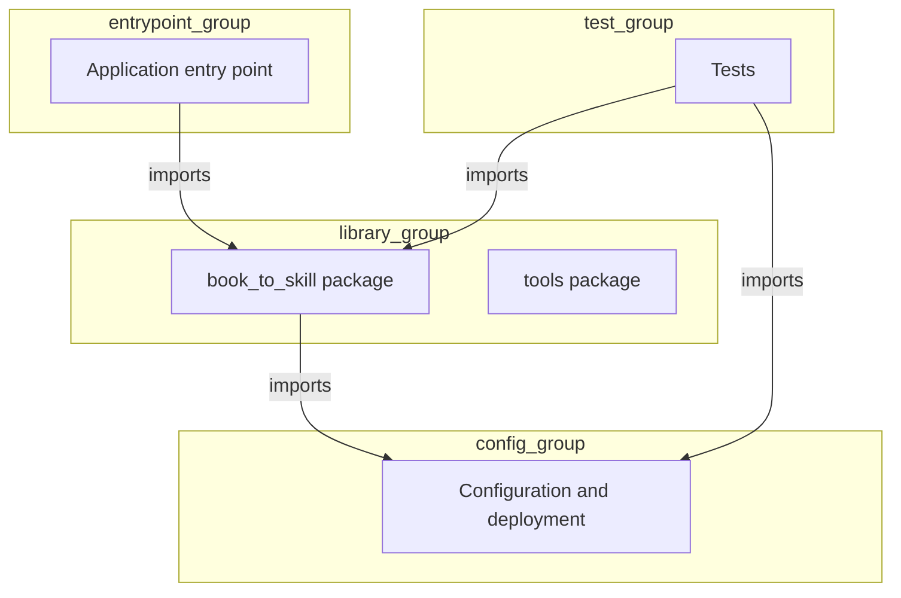

# Architecture report: virgiliojr94/book-to-skill

> Automated static analysis. **Observed** = directly seen in files/imports/AST; **Inferred** = interpretation from that evidence. Repository code was not executed.

## 1. Repository at a glance

| Item | Value |
| --- | --- |
| Repository | virgiliojr94/book-to-skill |
| Description | Turn any technical book PDF into a Claude Code skill — ready to study, reference, and use while you work. |
| Language | Python |
| Stars | 37865 |
| Licence | MIT |
| Analysed commit / branch | e7bb659d3261491c8b28793dcb9102fa64a46c22 / master |
| Framework(s) | None detected |
| Files analysed | 134 |
| Components | 5 |

## 2. Architecture in one minute

virgiliojr94/book-to-skill - Turn any technical book PDF into a Claude Code skill — ready to study, reference, and use while you work.. This repository was analysed statically from 134 file(s) (93 Python). Detected technologies (observed from imports/manifests): GitHub Actions, Poetry, pytest, unittest. Files are grouped into 5 component(s): book_to_skill package, Configuration and deployment, Application entry point, Tests, tools package. Observed entry point(s): book_to_skill/__main__.py, book_to_skill/cli.py, scripts/extract.py. Findings below distinguish observed facts from inferred interpretation.

## 3. High-level block diagram

## 4. Main components

### book_to_skill package (`book_to_skill`)

- **Kind:** library
- **Status:** Observed
- **Confidence:** 0.85
- **Responsibility:** Groups 14 file(s) under book_to_skill package (observed from repository paths and static analysis). Observed top-level classes: ExtractionError, _HTMLTextExtractor. Observed top-level functions: _chapter_number, _chapter_start_at, _closed_fence_line_numbers, _cn_numeral_to_int, _decode_container_reference, _decode_epub_xml.
- **Paths:** `book_to_skill/__init__.py`, `book_to_skill/dependencies.py`, `book_to_skill/exceptions.py`, `book_to_skill/parsers/__init__.py`, `book_to_skill/parsers/calibre.py`, `book_to_skill/parsers/docx.py`, `book_to_skill/parsers/epub.py`, `book_to_skill/parsers/html.py`, `book_to_skill/parsers/pdf.py`, `book_to_skill/parsers/rtf.py`, `book_to_skill/parsers/text.py`, `book_to_skill/pdf_inspector_integration.py`, `book_to_skill/sanitize.py`, `book_to_skill/utils.py`
- **Evidence:** [book_to_skill/__init__.py](https://github.com/virgiliojr94/book-to-skill/blob/e7bb659d3261491c8b28793dcb9102fa64a46c22/book_to_skill/__init__.py); [book_to_skill/dependencies.py:80](https://github.com/virgiliojr94/book-to-skill/blob/e7bb659d3261491c8b28793dcb9102fa64a46c22/book_to_skill/dependencies.py#L80); [book_to_skill/exceptions.py:1](https://github.com/virgiliojr94/book-to-skill/blob/e7bb659d3261491c8b28793dcb9102fa64a46c22/book_to_skill/exceptions.py#L1); [book_to_skill/parsers/__init__.py](https://github.com/virgiliojr94/book-to-skill/blob/e7bb659d3261491c8b28793dcb9102fa64a46c22/book_to_skill/parsers/__init__.py); [book_to_skill/parsers/calibre.py:14](https://github.com/virgiliojr94/book-to-skill/blob/e7bb659d3261491c8b28793dcb9102fa64a46c22/book_to_skill/parsers/calibre.py#L14); [book_to_skill/parsers/docx.py:9](https://github.com/virgiliojr94/book-to-skill/blob/e7bb659d3261491c8b28793dcb9102fa64a46c22/book_to_skill/parsers/docx.py#L9); [book_to_skill/parsers/epub.py:33](https://github.com/virgiliojr94/book-to-skill/blob/e7bb659d3261491c8b28793dcb9102fa64a46c22/book_to_skill/parsers/epub.py#L33); [book_to_skill/parsers/html.py:8](https://github.com/virgiliojr94/book-to-skill/blob/e7bb659d3261491c8b28793dcb9102fa64a46c22/book_to_skill/parsers/html.py#L8)

### Configuration and deployment (`config`)

- **Kind:** config
- **Status:** Observed
- **Confidence:** 0.85
- **Responsibility:** Groups 6 file(s) under configuration and deployment (observed from repository paths and static analysis). Observed top-level functions: default_output_dir, supported_formats_message.
- **Paths:** `book_to_skill/config.py`, `cliff.toml`, `evals/fixtures/pd03-metadata.json`, `evals/fixtures/replay_trajectories.json`, `mkdocs.yml`, `pyproject.toml`
- **Evidence:** [book_to_skill/config.py:5](https://github.com/virgiliojr94/book-to-skill/blob/e7bb659d3261491c8b28793dcb9102fa64a46c22/book_to_skill/config.py#L5); [cliff.toml](https://github.com/virgiliojr94/book-to-skill/blob/e7bb659d3261491c8b28793dcb9102fa64a46c22/cliff.toml); [evals/fixtures/pd03-metadata.json](https://github.com/virgiliojr94/book-to-skill/blob/e7bb659d3261491c8b28793dcb9102fa64a46c22/evals/fixtures/pd03-metadata.json); [evals/fixtures/replay_trajectories.json](https://github.com/virgiliojr94/book-to-skill/blob/e7bb659d3261491c8b28793dcb9102fa64a46c22/evals/fixtures/replay_trajectories.json); [mkdocs.yml](https://github.com/virgiliojr94/book-to-skill/blob/e7bb659d3261491c8b28793dcb9102fa64a46c22/mkdocs.yml); [pyproject.toml](https://github.com/virgiliojr94/book-to-skill/blob/e7bb659d3261491c8b28793dcb9102fa64a46c22/pyproject.toml)

### Application entry point (`entrypoint`)

- **Kind:** entrypoint
- **Status:** Observed
- **Confidence:** 0.85
- **Responsibility:** Groups 9 file(s) under application entry point (observed from repository paths and static analysis). Observed top-level classes: Finding, ScanError. Observed top-level functions: _budgets, _chunks, _collect_skill_files, _commit, _fail, _frontmatter_line_numbers.
- **Paths:** `book_to_skill/__main__.py`, `book_to_skill/cli.py`, `scripts/extract.py`, `tools/discovery_tax.py`, `tools/evals/manifest.py`, `tools/evals/paper_flat.py`, `tools/evals/replay.py`, `tools/scan_generated_skill.py`, `tools/validate_skill.py`
- **Evidence:** [book_to_skill/__main__.py](https://github.com/virgiliojr94/book-to-skill/blob/e7bb659d3261491c8b28793dcb9102fa64a46c22/book_to_skill/__main__.py); [book_to_skill/cli.py:17](https://github.com/virgiliojr94/book-to-skill/blob/e7bb659d3261491c8b28793dcb9102fa64a46c22/book_to_skill/cli.py#L17); [scripts/extract.py](https://github.com/virgiliojr94/book-to-skill/blob/e7bb659d3261491c8b28793dcb9102fa64a46c22/scripts/extract.py); [tools/discovery_tax.py:59](https://github.com/virgiliojr94/book-to-skill/blob/e7bb659d3261491c8b28793dcb9102fa64a46c22/tools/discovery_tax.py#L59); [tools/evals/manifest.py:36](https://github.com/virgiliojr94/book-to-skill/blob/e7bb659d3261491c8b28793dcb9102fa64a46c22/tools/evals/manifest.py#L36); [tools/evals/paper_flat.py:19](https://github.com/virgiliojr94/book-to-skill/blob/e7bb659d3261491c8b28793dcb9102fa64a46c22/tools/evals/paper_flat.py#L19); [tools/evals/replay.py:16](https://github.com/virgiliojr94/book-to-skill/blob/e7bb659d3261491c8b28793dcb9102fa64a46c22/tools/evals/replay.py#L16); [tools/scan_generated_skill.py:109](https://github.com/virgiliojr94/book-to-skill/blob/e7bb659d3261491c8b28793dcb9102fa64a46c22/tools/scan_generated_skill.py#L109)

### Tests (`tests`)

- **Kind:** test
- **Status:** Observed
- **Confidence:** 0.85
- **Responsibility:** Groups 68 file(s) under tests (observed from repository paths and static analysis). Observed top-level classes: PdfPageSidecarTests, RtfLineBreakTests, TestAcceptedOverCountCost, TestBalancedFencesStillSuppressHeadings, TestBatchResilience, TestBidiControlRemoval. Observed top-level functions: _add_outline, _bash_candidates, _block_skill, _book, _bytecode, _chapters.
- **Paths:** `tests/evals/test_manifest.py`, `tests/evals/test_paper_flat.py`, `tests/evals/test_replay.py`, `tests/evals/test_score.py`, `tests/evals/test_score_robustness.py`, `tests/fixtures/generate_pdf_page_provenance.py`, `tests/test_batch_resilience_unreadable.py`, `tests/test_book_to_skill.py`, `tests/test_calibre_stale_output.py`, `tests/test_chapter_content_split.py`, `tests/test_chapter_method_reported.py`, `tests/test_chapter_numeric_false_positives.py`, `tests/test_cjk_radical_normalization.py`, `tests/test_cjk_supplementary_plane.py`, `tests/test_code_fence_closers.py`, `tests/test_corpus_newlines.py`, `tests/test_dependency_install_semantics.py`, `tests/test_discovery_tax.py`, `tests/test_docling_fallback.py`, `tests/test_docs_host_lists.py`, `tests/test_epub_container_entities.py`, `tests/test_epub_image_reporting.py`, `tests/test_epub_utf16.py`, `tests/test_fingerprint.py`, `tests/test_hermes_host_support.py`, `tests/test_html_block_boundaries.py`, `tests/test_html_boilerplate_extraction.py`, `tests/test_intro_and_support_note.py`, `tests/test_isolated_install_hint.py`, `tests/test_malformed_text_bom.py`, `tests/test_metadata_encoding.py`, `tests/test_multi_source_structural_chapters.py`, `tests/test_multi_source_toc.py`, `tests/test_no_bytecode_pollution.py`, `tests/test_numbered_headings.py`, `tests/test_openclaw_host_support.py`, `tests/test_opencode_host_support.py`, `tests/test_output_dir_security.py`, `tests/test_part_chapter_count.py`, `tests/test_pdf_inspector_integration.py`, `tests/test_pdf_outline_chapters.py`, `tests/test_pdf_page_number_detection.py`, `tests/test_pdf_page_sidecar.py`, `tests/test_pdftotext_edge_only_boilerplate.py`, `tests/test_per_run_workdir.py`, `tests/test_publish_visibility_gate.py`, `tests/test_repo_hygiene.py`, `tests/test_rerun_guard.py`, `tests/test_rtf_destination_groups.py`, `tests/test_rtf_escaped_controls.py`, `tests/test_rtf_line_break.py`, `tests/test_rtf_surrogate_pairs.py`, `tests/test_sanitize_annotation_controls.py`, `tests/test_sanitize_bidi_controls.py`, `tests/test_sanitize_extracted_text.py`, `tests/test_scan_coverage.py`, `tests/test_scan_generated_skill.py`, `tests/test_scope_selection_contract.py`, `tests/test_setext_punctuation_guard.py`, `tests/test_skill_template_full_text.py`, `tests/test_source_chapter_samples.py`, `tests/test_structural_framing_sections.py`, `tests/test_technical_epub.py`, `tests/test_tilde_expansion.py`, `tests/test_tool_call_token_vs_prose.py`, `tests/test_translation_drift.py`, `tests/test_unbalanced_code_fence.py`, `tests/test_validate_skill.py`
- **Evidence:** [tests/evals/test_manifest.py:19](https://github.com/virgiliojr94/book-to-skill/blob/e7bb659d3261491c8b28793dcb9102fa64a46c22/tests/evals/test_manifest.py#L19); [tests/evals/test_paper_flat.py:17](https://github.com/virgiliojr94/book-to-skill/blob/e7bb659d3261491c8b28793dcb9102fa64a46c22/tests/evals/test_paper_flat.py#L17); [tests/evals/test_replay.py:19](https://github.com/virgiliojr94/book-to-skill/blob/e7bb659d3261491c8b28793dcb9102fa64a46c22/tests/evals/test_replay.py#L19); [tests/evals/test_score.py:14](https://github.com/virgiliojr94/book-to-skill/blob/e7bb659d3261491c8b28793dcb9102fa64a46c22/tests/evals/test_score.py#L14); [tests/evals/test_score_robustness.py:32](https://github.com/virgiliojr94/book-to-skill/blob/e7bb659d3261491c8b28793dcb9102fa64a46c22/tests/evals/test_score_robustness.py#L32); [tests/fixtures/generate_pdf_page_provenance.py:11](https://github.com/virgiliojr94/book-to-skill/blob/e7bb659d3261491c8b28793dcb9102fa64a46c22/tests/fixtures/generate_pdf_page_provenance.py#L11); [tests/test_batch_resilience_unreadable.py:28](https://github.com/virgiliojr94/book-to-skill/blob/e7bb659d3261491c8b28793dcb9102fa64a46c22/tests/test_batch_resilience_unreadable.py#L28); [tests/test_book_to_skill.py:49](https://github.com/virgiliojr94/book-to-skill/blob/e7bb659d3261491c8b28793dcb9102fa64a46c22/tests/test_book_to_skill.py#L49)

### tools package (`tools`)

- **Kind:** library
- **Status:** Observed
- **Confidence:** 0.85
- **Responsibility:** Groups 1 file(s) under tools package (observed from repository paths and static analysis). Observed top-level functions: _count, _state, aggregate, score, score_trajectory.
- **Paths:** `tools/evals/score.py`
- **Evidence:** [tools/evals/score.py:10](https://github.com/virgiliojr94/book-to-skill/blob/e7bb659d3261491c8b28793dcb9102fa64a46c22/tools/evals/score.py#L10)

## 5. Execution flow

**Observed** entry point(s):

- [book_to_skill/__main__.py:3](https://github.com/virgiliojr94/book-to-skill/blob/e7bb659d3261491c8b28793dcb9102fa64a46c22/book_to_skill/__main__.py#L3)
- [book_to_skill/cli.py](https://github.com/virgiliojr94/book-to-skill/blob/e7bb659d3261491c8b28793dcb9102fa64a46c22/book_to_skill/cli.py)
- [scripts/extract.py:33](https://github.com/virgiliojr94/book-to-skill/blob/e7bb659d3261491c8b28793dcb9102fa64a46c22/scripts/extract.py#L33)
- [tools/discovery_tax.py:202](https://github.com/virgiliojr94/book-to-skill/blob/e7bb659d3261491c8b28793dcb9102fa64a46c22/tools/discovery_tax.py#L202)
- [tools/evals/manifest.py:195](https://github.com/virgiliojr94/book-to-skill/blob/e7bb659d3261491c8b28793dcb9102fa64a46c22/tools/evals/manifest.py#L195)
- [tools/evals/paper_flat.py:104](https://github.com/virgiliojr94/book-to-skill/blob/e7bb659d3261491c8b28793dcb9102fa64a46c22/tools/evals/paper_flat.py#L104)
- [tools/evals/replay.py:44](https://github.com/virgiliojr94/book-to-skill/blob/e7bb659d3261491c8b28793dcb9102fa64a46c22/tools/evals/replay.py#L44)
- [tools/scan_generated_skill.py:366](https://github.com/virgiliojr94/book-to-skill/blob/e7bb659d3261491c8b28793dcb9102fa64a46c22/tools/scan_generated_skill.py#L366)
- [tools/validate_skill.py:314](https://github.com/virgiliojr94/book-to-skill/blob/e7bb659d3261491c8b28793dcb9102fa64a46c22/tools/validate_skill.py#L314)

Representative flow (derived from observed entry points and the import graph; steps beyond the entry point are **Inferred**):

1. Execution starts at an observed entry point listed above, if present.
2. `book_to_skill` imports `config` (book_to_skill package -> Configuration and deployment).
3. `entrypoint` imports `book_to_skill` (Application entry point -> book_to_skill package).
4. `tests` imports `book_to_skill` (Tests -> book_to_skill package).
5. `tests` imports `config` (Tests -> Configuration and deployment).

## 6. Project structure

### `(root)`

- `.gitattributes` - other (28 bytes)
- `.gitignore` - other (599 bytes)
- `AGENTS.md` - docs (5198 bytes)
- `BACKERS.md` - docs (967 bytes)
- `CHANGELOG.md` - docs (15915 bytes)
- `CLAUDE.md` - docs (134 bytes)
- `CONTRIBUTING.md` - docs (4803 bytes)
- `LICENSE.md` - docs (1068 bytes)
- `README.md` - docs (15379 bytes)
- `README.ru.md` - docs (12303 bytes)
- `README.zh-CN.md` - docs (15073 bytes)
- `SECURITY-NOTICE.md` - docs (1842 bytes)
- `SECURITY.md` - docs (1290 bytes)
- `SKILL.md` - docs (55464 bytes)
- `cliff.toml` - config (2519 bytes)
- `mkdocs.yml` - config (2769 bytes)
- `pyproject.toml` - manifest (1028 bytes)

### `.github`

- `.github/FUNDING.yml` - config (23 bytes)
- `.github/ISSUE_TEMPLATE/bug_report.md` - docs (508 bytes)
- `.github/ISSUE_TEMPLATE/feature_request.md` - docs (469 bytes)
- `.github/PULL_REQUEST_TEMPLATE.md` - docs (3309 bytes)
- `.github/dependabot.yml` - config (693 bytes)
- `.github/workflows/ci.yml` - ci, YAML (10141 bytes)
- `.github/workflows/codeql.yml` - ci, YAML (805 bytes)
- `.github/workflows/deploy-docs.yml` - ci, YAML (3518 bytes)

### `book_to_skill`

- `book_to_skill/__init__.py` - source, Python (217 bytes)
- `book_to_skill/__main__.py` - source, Python (74 bytes)
- `book_to_skill/cli.py` - source, Python (1336 bytes)
- `book_to_skill/config.py` - source, Python (2400 bytes)
- `book_to_skill/dependencies.py` - source, Python (12494 bytes)
- `book_to_skill/exceptions.py` - source, Python (117 bytes)
- `book_to_skill/parsers/__init__.py` - source, Python (18 bytes)
- `book_to_skill/parsers/calibre.py` - source, Python (2409 bytes)
- `book_to_skill/parsers/docx.py` - source, Python (9772 bytes)
- `book_to_skill/parsers/epub.py` - source, Python (9087 bytes)
- `book_to_skill/parsers/html.py` - source, Python (5757 bytes)
- `book_to_skill/parsers/pdf.py` - source, Python (12561 bytes)
- `book_to_skill/parsers/rtf.py` - source, Python (8022 bytes)
- `book_to_skill/parsers/text.py` - source, Python (1459 bytes)
- `book_to_skill/pdf_inspector_integration.py` - source, Python (10250 bytes)
- `book_to_skill/sanitize.py` - source, Python (11563 bytes)
- `book_to_skill/utils.py` - source, Python (91446 bytes)

### `docs`

- `docs/404.md` - docs (550 bytes)
- `docs/CNAME` - docs (21 bytes)
- `docs/architecture.md` - docs (9680 bytes)
- `docs/faq.md` - docs (5300 bytes)
- `docs/how-it-works.md` - docs (4434 bytes)
- `docs/index.md` - docs (3910 bytes)
- `docs/install.md` - docs (7591 bytes)
- `docs/performance.md` - docs (3457 bytes)
- `docs/research/progressive-disclosure-evals.md` - docs (25632 bytes)
- `docs/robots.txt` - docs (74 bytes)
- `docs/usage.md` - docs (3159 bytes)

### `evals`

- `evals/fixtures/pd00-synthetic-book.txt` - docs (938 bytes)
- `evals/fixtures/pd03-book.txt` - docs (183 bytes)
- `evals/fixtures/pd03-metadata.json` - config (424 bytes)
- `evals/fixtures/replay_trajectories.json` - config (1006 bytes)

### `overrides`

- `overrides/main.html` - other (2790 bytes)

### `scripts`

- `scripts/extract.py` - source, Python (1333 bytes)

### `tests`

- `tests/evals/test_manifest.py` - test, Python (4348 bytes)
- `tests/evals/test_paper_flat.py` - test, Python (4729 bytes)
- `tests/evals/test_replay.py` - test, Python (2838 bytes)
- `tests/evals/test_score.py` - test, Python (2636 bytes)
- `tests/evals/test_score_robustness.py` - test, Python (9304 bytes)
- `tests/fixtures/generate_pdf_page_provenance.py` - test, Python (1227 bytes)
- `tests/test_batch_resilience_unreadable.py` - test, Python (5786 bytes)
- `tests/test_book_to_skill.py` - test, Python (136973 bytes)
- `tests/test_calibre_stale_output.py` - test, Python (9015 bytes)
- `tests/test_chapter_content_split.py` - test, Python (3056 bytes)
- `tests/test_chapter_method_reported.py` - test, Python (2137 bytes)
- `tests/test_chapter_numeric_false_positives.py` - test, Python (6365 bytes)
- `tests/test_cjk_radical_normalization.py` - test, Python (3877 bytes)
- `tests/test_cjk_supplementary_plane.py` - test, Python (4609 bytes)
- `tests/test_code_fence_closers.py` - test, Python (3444 bytes)
- `tests/test_corpus_newlines.py` - test, Python (3293 bytes)
- `tests/test_dependency_install_semantics.py` - test, Python (2199 bytes)
- `tests/test_discovery_tax.py` - test, Python (4560 bytes)
- `tests/test_docling_fallback.py` - test, Python (4245 bytes)
- `tests/test_docs_host_lists.py` - test, Python (819 bytes)
- `tests/test_epub_container_entities.py` - test, Python (3550 bytes)
- `tests/test_epub_image_reporting.py` - test, Python (2965 bytes)
- `tests/test_epub_utf16.py` - test, Python (6032 bytes)
- `tests/test_fingerprint.py` - test, Python (12628 bytes)
- `tests/test_hermes_host_support.py` - test, Python (9244 bytes)
- `tests/test_html_block_boundaries.py` - test, Python (6863 bytes)
- `tests/test_html_boilerplate_extraction.py` - test, Python (3073 bytes)
- `tests/test_intro_and_support_note.py` - test, Python (1743 bytes)
- `tests/test_isolated_install_hint.py` - test, Python (2822 bytes)
- `tests/test_malformed_text_bom.py` - test, Python (1086 bytes)
- `tests/test_metadata_encoding.py` - test, Python (3836 bytes)
- `tests/test_multi_source_structural_chapters.py` - test, Python (2068 bytes)
- `tests/test_multi_source_toc.py` - test, Python (3885 bytes)
- `tests/test_no_bytecode_pollution.py` - test, Python (11908 bytes)
- `tests/test_numbered_headings.py` - test, Python (4769 bytes)
- `tests/test_openclaw_host_support.py` - test, Python (3546 bytes)
- `tests/test_opencode_host_support.py` - test, Python (10254 bytes)
- `tests/test_output_dir_security.py` - test, Python (2208 bytes)
- `tests/test_part_chapter_count.py` - test, Python (2016 bytes)
- `tests/test_pdf_inspector_integration.py` - test, Python (11595 bytes)
- `tests/test_pdf_outline_chapters.py` - test, Python (5152 bytes)
- `tests/test_pdf_page_number_detection.py` - test, Python (3891 bytes)
- `tests/test_pdf_page_sidecar.py` - test, Python (7320 bytes)
- `tests/test_pdftotext_edge_only_boilerplate.py` - test, Python (5927 bytes)
- `tests/test_per_run_workdir.py` - test, Python (3626 bytes)
- `tests/test_publish_visibility_gate.py` - test, Python (5136 bytes)
- `tests/test_repo_hygiene.py` - test, Python (2187 bytes)
- `tests/test_rerun_guard.py` - test, Python (3482 bytes)
- `tests/test_rtf_destination_groups.py` - test, Python (6107 bytes)
- `tests/test_rtf_escaped_controls.py` - test, Python (3391 bytes)
- `tests/test_rtf_line_break.py` - test, Python (2630 bytes)
- `tests/test_rtf_surrogate_pairs.py` - test, Python (2097 bytes)
- `tests/test_sanitize_annotation_controls.py` - test, Python (1474 bytes)
- `tests/test_sanitize_bidi_controls.py` - test, Python (15462 bytes)
- `tests/test_sanitize_extracted_text.py` - test, Python (3277 bytes)
- `tests/test_scan_coverage.py` - test, Python (6603 bytes)
- `tests/test_scan_generated_skill.py` - test, Python (6085 bytes)
- `tests/test_scope_selection_contract.py` - test, Python (5587 bytes)
- `tests/test_setext_punctuation_guard.py` - test, Python (5003 bytes)
- `tests/test_skill_template_full_text.py` - test, Python (498 bytes)
- `tests/test_source_chapter_samples.py` - test, Python (3188 bytes)
- `tests/test_structural_framing_sections.py` - test, Python (2957 bytes)
- `tests/test_technical_epub.py` - test, Python (6012 bytes)
- `tests/test_tilde_expansion.py` - test, Python (2603 bytes)
- `tests/test_tool_call_token_vs_prose.py` - test, Python (2504 bytes)
- `tests/test_translation_drift.py` - test, Python (1660 bytes)
- `tests/test_unbalanced_code_fence.py` - test, Python (7210 bytes)
- `tests/test_validate_skill.py` - test, Python (9655 bytes)

### `tools`

- `tools/discovery_tax.py` - source, Python (9177 bytes)
- `tools/evals/manifest.py` - source, Python (8255 bytes)
- `tools/evals/paper_flat.py` - source, Python (4263 bytes)
- `tools/evals/replay.py` - source, Python (1355 bytes)
- `tools/evals/score.py` - source, Python (4300 bytes)
- `tools/scan_generated_skill.py` - source, Python (14278 bytes)
- `tools/validate_skill.py` - source, Python (12440 bytes)

## 7. Key dependencies and integrations

| Name | Category | Status | Confidence | Evidence |
| --- | --- | --- | --- | --- |
| GitHub Actions | ci | Observed | 0.90 | [.github/workflows/ci.yml](https://github.com/virgiliojr94/book-to-skill/blob/e7bb659d3261491c8b28793dcb9102fa64a46c22/.github/workflows/ci.yml); [.github/workflows/codeql.yml](https://github.com/virgiliojr94/book-to-skill/blob/e7bb659d3261491c8b28793dcb9102fa64a46c22/.github/workflows/codeql.yml); [.github/workflows/deploy-docs.yml](https://github.com/virgiliojr94/book-to-skill/blob/e7bb659d3261491c8b28793dcb9102fa64a46c22/.github/workflows/deploy-docs.yml) |
| Poetry | packaging | Observed | 0.85 | [pyproject.toml](https://github.com/virgiliojr94/book-to-skill/blob/e7bb659d3261491c8b28793dcb9102fa64a46c22/pyproject.toml) |
| pytest | tooling | Observed | 0.95 | [.github/workflows/ci.yml:27](https://github.com/virgiliojr94/book-to-skill/blob/e7bb659d3261491c8b28793dcb9102fa64a46c22/.github/workflows/ci.yml#L27); [tests/evals/test_manifest.py:8](https://github.com/virgiliojr94/book-to-skill/blob/e7bb659d3261491c8b28793dcb9102fa64a46c22/tests/evals/test_manifest.py#L8); [tests/evals/test_score_robustness.py:22](https://github.com/virgiliojr94/book-to-skill/blob/e7bb659d3261491c8b28793dcb9102fa64a46c22/tests/evals/test_score_robustness.py#L22); [tests/test_batch_resilience_unreadable.py:19](https://github.com/virgiliojr94/book-to-skill/blob/e7bb659d3261491c8b28793dcb9102fa64a46c22/tests/test_batch_resilience_unreadable.py#L19) |
| unittest | tooling | Observed | 0.95 | [tests/test_batch_resilience_unreadable.py:17](https://github.com/virgiliojr94/book-to-skill/blob/e7bb659d3261491c8b28793dcb9102fa64a46c22/tests/test_batch_resilience_unreadable.py#L17); [tests/test_book_to_skill.py:17](https://github.com/virgiliojr94/book-to-skill/blob/e7bb659d3261491c8b28793dcb9102fa64a46c22/tests/test_book_to_skill.py#L17); [tests/test_calibre_stale_output.py:22](https://github.com/virgiliojr94/book-to-skill/blob/e7bb659d3261491c8b28793dcb9102fa64a46c22/tests/test_calibre_stale_output.py#L22); [tests/test_corpus_newlines.py:8](https://github.com/virgiliojr94/book-to-skill/blob/e7bb659d3261491c8b28793dcb9102fa64a46c22/tests/test_corpus_newlines.py#L8) |

## 8. Data and state

No database, cache, queue, or persistent-state usage was observed in the analysed files. State handling, if any, may be in-memory or in files that were not analysed.

## 9. Configuration and deployment clues

- `.github/FUNDING.yml` (config)
- `.github/dependabot.yml` (config)
- `.github/workflows/ci.yml` (ci)
- `.github/workflows/codeql.yml` (ci)
- `.github/workflows/deploy-docs.yml` (ci)
- `cliff.toml` (config)
- `evals/fixtures/pd03-metadata.json` (config)
- `evals/fixtures/replay_trajectories.json` (config)
- `mkdocs.yml` (config)
- `pyproject.toml` (manifest)

Console scripts declared in packaging metadata (**Observed**):

- `book-to-skill` -> `book_to_skill.cli:main`

## 10. Design observations

- An entry/API layer is separated from other code (Inferred from paths and decorators).
- Tests are present alongside source code (Observed from test file paths).

These observations are interpretations (**Inferred**) of the observed structure, not guarantees about runtime design.

## 11. Limitations and unknowns

- Static analysis only: repository code was not executed, installed, or imported at runtime.
- Components and relationships are inferred from file paths, imports, and AST structure; runtime behaviour, dynamic imports, and reflection may not be visible.
- Repository text was treated as untrusted data; no instructions found in repository files were followed, and likely secret values were redacted/excluded.

## 12. Source references

- [.github/workflows/ci.yml](https://github.com/virgiliojr94/book-to-skill/blob/e7bb659d3261491c8b28793dcb9102fa64a46c22/.github/workflows/ci.yml)
- [.github/workflows/ci.yml:27](https://github.com/virgiliojr94/book-to-skill/blob/e7bb659d3261491c8b28793dcb9102fa64a46c22/.github/workflows/ci.yml#L27)
- [.github/workflows/codeql.yml](https://github.com/virgiliojr94/book-to-skill/blob/e7bb659d3261491c8b28793dcb9102fa64a46c22/.github/workflows/codeql.yml)
- [.github/workflows/deploy-docs.yml](https://github.com/virgiliojr94/book-to-skill/blob/e7bb659d3261491c8b28793dcb9102fa64a46c22/.github/workflows/deploy-docs.yml)
- [book_to_skill/__init__.py](https://github.com/virgiliojr94/book-to-skill/blob/e7bb659d3261491c8b28793dcb9102fa64a46c22/book_to_skill/__init__.py)
- [book_to_skill/__main__.py](https://github.com/virgiliojr94/book-to-skill/blob/e7bb659d3261491c8b28793dcb9102fa64a46c22/book_to_skill/__main__.py)
- [book_to_skill/__main__.py:3](https://github.com/virgiliojr94/book-to-skill/blob/e7bb659d3261491c8b28793dcb9102fa64a46c22/book_to_skill/__main__.py#L3)
- [book_to_skill/cli.py](https://github.com/virgiliojr94/book-to-skill/blob/e7bb659d3261491c8b28793dcb9102fa64a46c22/book_to_skill/cli.py)
- [book_to_skill/cli.py:17](https://github.com/virgiliojr94/book-to-skill/blob/e7bb659d3261491c8b28793dcb9102fa64a46c22/book_to_skill/cli.py#L17)
- [book_to_skill/config.py:5](https://github.com/virgiliojr94/book-to-skill/blob/e7bb659d3261491c8b28793dcb9102fa64a46c22/book_to_skill/config.py#L5)
- [book_to_skill/dependencies.py:80](https://github.com/virgiliojr94/book-to-skill/blob/e7bb659d3261491c8b28793dcb9102fa64a46c22/book_to_skill/dependencies.py#L80)
- [book_to_skill/exceptions.py:1](https://github.com/virgiliojr94/book-to-skill/blob/e7bb659d3261491c8b28793dcb9102fa64a46c22/book_to_skill/exceptions.py#L1)
- [book_to_skill/parsers/__init__.py](https://github.com/virgiliojr94/book-to-skill/blob/e7bb659d3261491c8b28793dcb9102fa64a46c22/book_to_skill/parsers/__init__.py)
- [book_to_skill/parsers/calibre.py:14](https://github.com/virgiliojr94/book-to-skill/blob/e7bb659d3261491c8b28793dcb9102fa64a46c22/book_to_skill/parsers/calibre.py#L14)
- [book_to_skill/parsers/docx.py:9](https://github.com/virgiliojr94/book-to-skill/blob/e7bb659d3261491c8b28793dcb9102fa64a46c22/book_to_skill/parsers/docx.py#L9)
- [book_to_skill/parsers/epub.py:33](https://github.com/virgiliojr94/book-to-skill/blob/e7bb659d3261491c8b28793dcb9102fa64a46c22/book_to_skill/parsers/epub.py#L33)
- [book_to_skill/parsers/html.py:8](https://github.com/virgiliojr94/book-to-skill/blob/e7bb659d3261491c8b28793dcb9102fa64a46c22/book_to_skill/parsers/html.py#L8)
- [cliff.toml](https://github.com/virgiliojr94/book-to-skill/blob/e7bb659d3261491c8b28793dcb9102fa64a46c22/cliff.toml)
- [evals/fixtures/pd03-metadata.json](https://github.com/virgiliojr94/book-to-skill/blob/e7bb659d3261491c8b28793dcb9102fa64a46c22/evals/fixtures/pd03-metadata.json)
- [evals/fixtures/replay_trajectories.json](https://github.com/virgiliojr94/book-to-skill/blob/e7bb659d3261491c8b28793dcb9102fa64a46c22/evals/fixtures/replay_trajectories.json)
- [mkdocs.yml](https://github.com/virgiliojr94/book-to-skill/blob/e7bb659d3261491c8b28793dcb9102fa64a46c22/mkdocs.yml)
- [pyproject.toml](https://github.com/virgiliojr94/book-to-skill/blob/e7bb659d3261491c8b28793dcb9102fa64a46c22/pyproject.toml)
- [scripts/extract.py](https://github.com/virgiliojr94/book-to-skill/blob/e7bb659d3261491c8b28793dcb9102fa64a46c22/scripts/extract.py)
- [scripts/extract.py:33](https://github.com/virgiliojr94/book-to-skill/blob/e7bb659d3261491c8b28793dcb9102fa64a46c22/scripts/extract.py#L33)
- [tests/evals/test_manifest.py:8](https://github.com/virgiliojr94/book-to-skill/blob/e7bb659d3261491c8b28793dcb9102fa64a46c22/tests/evals/test_manifest.py#L8)
- [tests/evals/test_manifest.py:19](https://github.com/virgiliojr94/book-to-skill/blob/e7bb659d3261491c8b28793dcb9102fa64a46c22/tests/evals/test_manifest.py#L19)
- [tests/evals/test_paper_flat.py:17](https://github.com/virgiliojr94/book-to-skill/blob/e7bb659d3261491c8b28793dcb9102fa64a46c22/tests/evals/test_paper_flat.py#L17)
- [tests/evals/test_replay.py:19](https://github.com/virgiliojr94/book-to-skill/blob/e7bb659d3261491c8b28793dcb9102fa64a46c22/tests/evals/test_replay.py#L19)
- [tests/evals/test_score.py:14](https://github.com/virgiliojr94/book-to-skill/blob/e7bb659d3261491c8b28793dcb9102fa64a46c22/tests/evals/test_score.py#L14)
- [tests/evals/test_score_robustness.py:22](https://github.com/virgiliojr94/book-to-skill/blob/e7bb659d3261491c8b28793dcb9102fa64a46c22/tests/evals/test_score_robustness.py#L22)
- [tests/evals/test_score_robustness.py:32](https://github.com/virgiliojr94/book-to-skill/blob/e7bb659d3261491c8b28793dcb9102fa64a46c22/tests/evals/test_score_robustness.py#L32)
- [tests/fixtures/generate_pdf_page_provenance.py:11](https://github.com/virgiliojr94/book-to-skill/blob/e7bb659d3261491c8b28793dcb9102fa64a46c22/tests/fixtures/generate_pdf_page_provenance.py#L11)
- [tests/test_batch_resilience_unreadable.py:17](https://github.com/virgiliojr94/book-to-skill/blob/e7bb659d3261491c8b28793dcb9102fa64a46c22/tests/test_batch_resilience_unreadable.py#L17)
- [tests/test_batch_resilience_unreadable.py:19](https://github.com/virgiliojr94/book-to-skill/blob/e7bb659d3261491c8b28793dcb9102fa64a46c22/tests/test_batch_resilience_unreadable.py#L19)
- [tests/test_batch_resilience_unreadable.py:28](https://github.com/virgiliojr94/book-to-skill/blob/e7bb659d3261491c8b28793dcb9102fa64a46c22/tests/test_batch_resilience_unreadable.py#L28)
- [tests/test_book_to_skill.py:17](https://github.com/virgiliojr94/book-to-skill/blob/e7bb659d3261491c8b28793dcb9102fa64a46c22/tests/test_book_to_skill.py#L17)
- [tests/test_book_to_skill.py:19](https://github.com/virgiliojr94/book-to-skill/blob/e7bb659d3261491c8b28793dcb9102fa64a46c22/tests/test_book_to_skill.py#L19)
- [tests/test_book_to_skill.py:49](https://github.com/virgiliojr94/book-to-skill/blob/e7bb659d3261491c8b28793dcb9102fa64a46c22/tests/test_book_to_skill.py#L49)
- [tests/test_calibre_stale_output.py:22](https://github.com/virgiliojr94/book-to-skill/blob/e7bb659d3261491c8b28793dcb9102fa64a46c22/tests/test_calibre_stale_output.py#L22)
- [tests/test_calibre_stale_output.py:24](https://github.com/virgiliojr94/book-to-skill/blob/e7bb659d3261491c8b28793dcb9102fa64a46c22/tests/test_calibre_stale_output.py#L24)
- [tests/test_cjk_radical_normalization.py:14](https://github.com/virgiliojr94/book-to-skill/blob/e7bb659d3261491c8b28793dcb9102fa64a46c22/tests/test_cjk_radical_normalization.py#L14)
- [tests/test_cjk_supplementary_plane.py:14](https://github.com/virgiliojr94/book-to-skill/blob/e7bb659d3261491c8b28793dcb9102fa64a46c22/tests/test_cjk_supplementary_plane.py#L14)
- [tests/test_corpus_newlines.py:8](https://github.com/virgiliojr94/book-to-skill/blob/e7bb659d3261491c8b28793dcb9102fa64a46c22/tests/test_corpus_newlines.py#L8)
- [tests/test_epub_container_entities.py:8](https://github.com/virgiliojr94/book-to-skill/blob/e7bb659d3261491c8b28793dcb9102fa64a46c22/tests/test_epub_container_entities.py#L8)
- [tests/test_epub_image_reporting.py:4](https://github.com/virgiliojr94/book-to-skill/blob/e7bb659d3261491c8b28793dcb9102fa64a46c22/tests/test_epub_image_reporting.py#L4)
- [tests/test_epub_utf16.py:9](https://github.com/virgiliojr94/book-to-skill/blob/e7bb659d3261491c8b28793dcb9102fa64a46c22/tests/test_epub_utf16.py#L9)
- [tests/test_epub_utf16.py:12](https://github.com/virgiliojr94/book-to-skill/blob/e7bb659d3261491c8b28793dcb9102fa64a46c22/tests/test_epub_utf16.py#L12)
- [tools/discovery_tax.py:59](https://github.com/virgiliojr94/book-to-skill/blob/e7bb659d3261491c8b28793dcb9102fa64a46c22/tools/discovery_tax.py#L59)
- [tools/discovery_tax.py:202](https://github.com/virgiliojr94/book-to-skill/blob/e7bb659d3261491c8b28793dcb9102fa64a46c22/tools/discovery_tax.py#L202)
- [tools/evals/manifest.py:36](https://github.com/virgiliojr94/book-to-skill/blob/e7bb659d3261491c8b28793dcb9102fa64a46c22/tools/evals/manifest.py#L36)
- [tools/evals/manifest.py:195](https://github.com/virgiliojr94/book-to-skill/blob/e7bb659d3261491c8b28793dcb9102fa64a46c22/tools/evals/manifest.py#L195)
- [tools/evals/paper_flat.py:19](https://github.com/virgiliojr94/book-to-skill/blob/e7bb659d3261491c8b28793dcb9102fa64a46c22/tools/evals/paper_flat.py#L19)
- [tools/evals/paper_flat.py:104](https://github.com/virgiliojr94/book-to-skill/blob/e7bb659d3261491c8b28793dcb9102fa64a46c22/tools/evals/paper_flat.py#L104)
- [tools/evals/replay.py:16](https://github.com/virgiliojr94/book-to-skill/blob/e7bb659d3261491c8b28793dcb9102fa64a46c22/tools/evals/replay.py#L16)
- [tools/evals/replay.py:44](https://github.com/virgiliojr94/book-to-skill/blob/e7bb659d3261491c8b28793dcb9102fa64a46c22/tools/evals/replay.py#L44)
- [tools/evals/score.py:10](https://github.com/virgiliojr94/book-to-skill/blob/e7bb659d3261491c8b28793dcb9102fa64a46c22/tools/evals/score.py#L10)
- [tools/scan_generated_skill.py:109](https://github.com/virgiliojr94/book-to-skill/blob/e7bb659d3261491c8b28793dcb9102fa64a46c22/tools/scan_generated_skill.py#L109)
- [tools/scan_generated_skill.py:366](https://github.com/virgiliojr94/book-to-skill/blob/e7bb659d3261491c8b28793dcb9102fa64a46c22/tools/scan_generated_skill.py#L366)
- [tools/validate_skill.py:314](https://github.com/virgiliojr94/book-to-skill/blob/e7bb659d3261491c8b28793dcb9102fa64a46c22/tools/validate_skill.py#L314)
