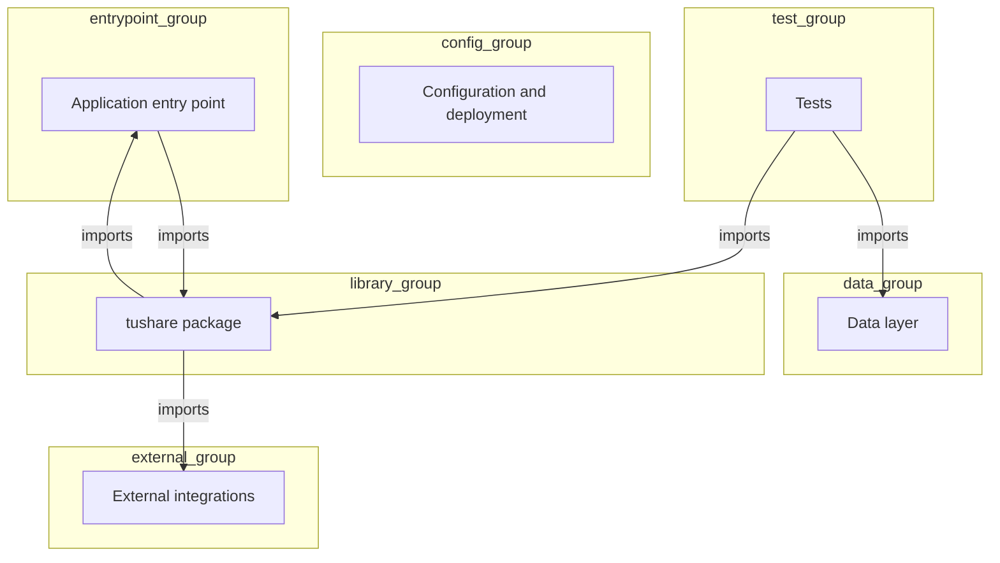

# Architecture report: waditu/tushare

> Automated static analysis. **Observed** = directly seen in files/imports/AST; **Inferred** = interpretation from that evidence. Repository code was not executed.

## 1. Repository at a glance

| Item | Value |
| --- | --- |
| Repository | waditu/tushare |
| Description | TuShare is a utility for crawling historical data of China stocks |
| Language | Python |
| Stars | 15493 |
| Licence | BSD-3-Clause |
| Analysed commit / branch | 093856995af0811d3ebbe8c179b8febf4ae706f0 / master |
| Framework(s) | None detected |
| Files analysed | 91 |
| Components | 6 |

## 2. Architecture in one minute

waditu/tushare - TuShare is a utility for crawling historical data of China stocks. This repository was analysed statically from 91 file(s) (67 Python). Detected technologies (observed from imports/manifests): MongoDB, NumPy, pandas, requests, SQLAlchemy, setuptools. Files are grouped into 6 component(s): Configuration and deployment, Data layer, Application entry point, External integrations, Tests, tushare package. Observed entry point(s): test_unittest.py, tushare/bond/bonds.py, tushare/pro/data_pro.py. Findings below distinguish observed facts from inferred interpretation.

## 3. High-level block diagram

## 4. Main components

### Configuration and deployment (`config`)

- **Kind:** config
- **Status:** Observed
- **Confidence:** 0.85
- **Responsibility:** Groups 2 file(s) under configuration and deployment (observed from repository paths and static analysis). Observed top-level functions: read, read_install_requires.
- **Paths:** `requirements.txt`, `setup.py`
- **Evidence:** [requirements.txt](https://github.com/waditu/tushare/blob/093856995af0811d3ebbe8c179b8febf4ae706f0/requirements.txt); [setup.py:6](https://github.com/waditu/tushare/blob/093856995af0811d3ebbe8c179b8febf4ae706f0/setup.py#L6)

### Data layer (`data_layer`)

- **Kind:** data
- **Status:** Observed
- **Confidence:** 0.85
- **Responsibility:** Groups 1 file(s) under data layer (observed from repository paths and static analysis).
- **Paths:** `tushare/data/__init__.py`
- **Evidence:** [tushare/data/__init__.py](https://github.com/waditu/tushare/blob/093856995af0811d3ebbe8c179b8febf4ae706f0/tushare/data/__init__.py)

### Application entry point (`entrypoint`)

- **Kind:** entrypoint
- **Status:** Observed
- **Confidence:** 0.85
- **Responsibility:** Groups 3 file(s) under application entry point (observed from repository paths and static analysis). Observed top-level functions: _ema, _ma, _md, adtm, arbr, asi.
- **Paths:** `tushare/bond/bonds.py`, `tushare/pro/data_pro.py`, `tushare/stock/trendline.py`
- **Evidence:** [tushare/bond/bonds.py:11](https://github.com/waditu/tushare/blob/093856995af0811d3ebbe8c179b8febf4ae706f0/tushare/bond/bonds.py#L11); [tushare/pro/data_pro.py:21](https://github.com/waditu/tushare/blob/093856995af0811d3ebbe8c179b8febf4ae706f0/tushare/pro/data_pro.py#L21); [tushare/stock/trendline.py:17](https://github.com/waditu/tushare/blob/093856995af0811d3ebbe8c179b8febf4ae706f0/tushare/stock/trendline.py#L17)

### External integrations (`external_integrations`)

- **Kind:** external
- **Status:** Observed
- **Confidence:** 0.85
- **Responsibility:** Groups 1 file(s) under external integrations (observed from repository paths and static analysis). Observed top-level classes: DataApi.
- **Paths:** `tushare/pro/client.py`
- **Evidence:** [tushare/pro/client.py:17](https://github.com/waditu/tushare/blob/093856995af0811d3ebbe8c179b8febf4ae706f0/tushare/pro/client.py#L17)

### Tests (`tests`)

- **Kind:** test
- **Status:** Observed
- **Confidence:** 0.85
- **Responsibility:** Groups 15 file(s) under tests (observed from repository paths and static analysis). Observed top-level classes: Test, TestTrading, Test_Is_holiday. Observed top-level functions: appends, csv, db, hdf, json, nosql.
- **Paths:** `test/__init__.py`, `test/bar_test.py`, `test/billboard_test.py`, `test/classifying_test.py`, `test/dateu_test.py`, `test/fund_test.py`, `test/indictor_test.py`, `test/macro_test.py`, `test/nav_test.py`, `test/news_test.py`, `test/ref_test.py`, `test/shibor_test.py`, `test/storing_test.py`, `test/trading_test.py`, `test_unittest.py`
- **Evidence:** [test/__init__.py](https://github.com/waditu/tushare/blob/093856995af0811d3ebbe8c179b8febf4ae706f0/test/__init__.py); [test/bar_test.py:9](https://github.com/waditu/tushare/blob/093856995af0811d3ebbe8c179b8febf4ae706f0/test/bar_test.py#L9); [test/billboard_test.py:9](https://github.com/waditu/tushare/blob/093856995af0811d3ebbe8c179b8febf4ae706f0/test/billboard_test.py#L9); [test/classifying_test.py:9](https://github.com/waditu/tushare/blob/093856995af0811d3ebbe8c179b8febf4ae706f0/test/classifying_test.py#L9); [test/dateu_test.py:12](https://github.com/waditu/tushare/blob/093856995af0811d3ebbe8c179b8febf4ae706f0/test/dateu_test.py#L12); [test/fund_test.py:6](https://github.com/waditu/tushare/blob/093856995af0811d3ebbe8c179b8febf4ae706f0/test/fund_test.py#L6); [test/indictor_test.py:11](https://github.com/waditu/tushare/blob/093856995af0811d3ebbe8c179b8febf4ae706f0/test/indictor_test.py#L11); [test/macro_test.py:9](https://github.com/waditu/tushare/blob/093856995af0811d3ebbe8c179b8febf4ae706f0/test/macro_test.py#L9)

### tushare package (`tushare`)

- **Kind:** library
- **Status:** Observed
- **Confidence:** 0.85
- **Responsibility:** Groups 46 file(s) under tushare package (observed from repository paths and static analysis). Observed top-level classes: Client, MailMerge, NotLoginError, Store, TraderAPI. Observed top-level functions: ABS, ADTM, ATR, BBI, BBIBOLL, BIAS.
- **Paths:** `tushare/__init__.py`, `tushare/bond/__init__.py`, `tushare/coins/__init__.py`, `tushare/coins/market.py`, `tushare/fund/__init__.py`, `tushare/fund/cons.py`, `tushare/fund/nav.py`, `tushare/futures/__init__.py`, `tushare/futures/cons.py`, `tushare/futures/domestic.py`, `tushare/futures/domestic_cons.py`, `tushare/futures/intlfutures.py`, `tushare/internet/__init__.py`, `tushare/internet/boxoffice.py`, `tushare/internet/caixinnews.py`, `tushare/internet/indexes.py`, `tushare/pro/__init__.py`, `tushare/stock/__init__.py`, `tushare/stock/billboard.py`, `tushare/stock/classifying.py`, `tushare/stock/cons.py`, `tushare/stock/fundamental.py`, `tushare/stock/globals.py`, `tushare/stock/indictor.py`, `tushare/stock/macro.py`, `tushare/stock/macro_vars.py`, `tushare/stock/news_vars.py`, `tushare/stock/newsevent.py`, `tushare/stock/ref_vars.py`, `tushare/stock/reference.py`, `tushare/stock/shibor.py`, `tushare/stock/trading.py`, `tushare/trader/__init__.py`, `tushare/trader/trader.py`, `tushare/trader/utils.py`, `tushare/trader/vars.py`, `tushare/util/__init__.py`, `tushare/util/common.py`, `tushare/util/conns.py`, `tushare/util/dateu.py`, `tushare/util/formula.py`, `tushare/util/mailmerge.py`, `tushare/util/netbase.py`, `tushare/util/store.py`, `tushare/util/upass.py`, `tushare/util/vars.py`
- **Evidence:** [tushare/__init__.py](https://github.com/waditu/tushare/blob/093856995af0811d3ebbe8c179b8febf4ae706f0/tushare/__init__.py); [tushare/bond/__init__.py](https://github.com/waditu/tushare/blob/093856995af0811d3ebbe8c179b8febf4ae706f0/tushare/bond/__init__.py); [tushare/coins/__init__.py](https://github.com/waditu/tushare/blob/093856995af0811d3ebbe8c179b8febf4ae706f0/tushare/coins/__init__.py); [tushare/coins/market.py:86](https://github.com/waditu/tushare/blob/093856995af0811d3ebbe8c179b8febf4ae706f0/tushare/coins/market.py#L86); [tushare/fund/__init__.py](https://github.com/waditu/tushare/blob/093856995af0811d3ebbe8c179b8febf4ae706f0/tushare/fund/__init__.py); [tushare/fund/cons.py:125](https://github.com/waditu/tushare/blob/093856995af0811d3ebbe8c179b8febf4ae706f0/tushare/fund/cons.py#L125); [tushare/fund/nav.py:25](https://github.com/waditu/tushare/blob/093856995af0811d3ebbe8c179b8febf4ae706f0/tushare/fund/nav.py#L25); [tushare/futures/__init__.py](https://github.com/waditu/tushare/blob/093856995af0811d3ebbe8c179b8febf4ae706f0/tushare/futures/__init__.py)

## 5. Execution flow

**Observed** entry point(s):

- [test_unittest.py:23](https://github.com/waditu/tushare/blob/093856995af0811d3ebbe8c179b8febf4ae706f0/test_unittest.py#L23)
- [tushare/bond/bonds.py:16](https://github.com/waditu/tushare/blob/093856995af0811d3ebbe8c179b8febf4ae706f0/tushare/bond/bonds.py#L16)
- [tushare/pro/data_pro.py:143](https://github.com/waditu/tushare/blob/093856995af0811d3ebbe8c179b8febf4ae706f0/tushare/pro/data_pro.py#L143)
- [tushare/stock/trendline.py:981](https://github.com/waditu/tushare/blob/093856995af0811d3ebbe8c179b8febf4ae706f0/tushare/stock/trendline.py#L981)

Representative flow (derived from observed entry points and the import graph; steps beyond the entry point are **Inferred**):

1. Execution starts at an observed entry point listed above, if present.
2. `entrypoint` imports `tushare` (Application entry point -> tushare package).
3. `tests` imports `data_layer` (Tests -> Data layer).
4. `tests` imports `tushare` (Tests -> tushare package).
5. `tushare` imports `entrypoint` (tushare package -> Application entry point).
6. `tushare` imports `external_integrations` (tushare package -> External integrations).

## 6. Project structure

### `(root)`

- `.gitignore` - other (848 bytes)
- `.travis.yml` - ci, YAML (965 bytes)
- `LICENSE` - docs (1475 bytes)
- `MANIFEST` - other (233 bytes)
- `README.md` - docs (13254 bytes)
- `requirements.txt` - manifest (93 bytes)
- `setup.py` - manifest, Python (2947 bytes)
- `test_unittest.py` - test, Python (597 bytes)
- `whats_new.md` - docs (3048 bytes)

### `docs`

- `docs/billboard.rst` - docs (9617 bytes)
- `docs/boxoffice.rst` - docs (8328 bytes)
- `docs/classifying.rst` - docs (9827 bytes)
- `docs/datayes.rst` - docs (31891 bytes)
- `docs/donate.rst` - docs (2161 bytes)
- `docs/fundamental.rst` - docs (12105 bytes)
- `docs/index.rst` - docs (7466 bytes)
- `docs/macro.rst` - docs (14893 bytes)
- `docs/newsevent.rst` - docs (6396 bytes)
- `docs/preface.rst` - docs (7241 bytes)
- `docs/reference.rst` - docs (20367 bytes)
- `docs/shibor.rst` - docs (7908 bytes)
- `docs/storing.rst` - docs (6943 bytes)
- `docs/trading.rst` - docs (21473 bytes)

### `issues`

- `issues/from_email.txt` - docs (1976 bytes)
- `issues/from_sns.txt` - docs (2314 bytes)

### `test`

- `test/__init__.py` - test, Python (0 bytes)
- `test/bar_test.py` - test, Python (477 bytes)
- `test/billboard_test.py` - test, Python (811 bytes)
- `test/classifying_test.py` - test, Python (1288 bytes)
- `test/dateu_test.py` - test, Python (538 bytes)
- `test/fund_test.py` - test, Python (1232 bytes)
- `test/indictor_test.py` - test, Python (505 bytes)
- `test/macro_test.py` - test, Python (1185 bytes)
- `test/nav_test.py` - test, Python (3849 bytes)
- `test/news_test.py` - test, Python (864 bytes)
- `test/ref_test.py` - test, Python (1507 bytes)
- `test/shibor_test.py` - test, Python (762 bytes)
- `test/storing_test.py` - test, Python (1729 bytes)
- `test/trading_test.py` - test, Python (1105 bytes)

### `tushare`

- `tushare/VERSION.txt` - docs (6 bytes)
- `tushare/__init__.py` - source, Python (4617 bytes)
- `tushare/bond/__init__.py` - source, Python (0 bytes)
- `tushare/bond/bonds.py` - source, Python (216 bytes)
- `tushare/coins/__init__.py` - source, Python (0 bytes)
- `tushare/coins/market.py` - source, Python (7998 bytes)
- `tushare/data/__init__.py` - source, Python (21 bytes)
- `tushare/fund/__init__.py` - source, Python (0 bytes)
- `tushare/fund/cons.py` - source, Python (5696 bytes)
- `tushare/fund/nav.py` - source, Python (14431 bytes)
- `tushare/futures/__init__.py` - source, Python (0 bytes)
- `tushare/futures/cons.py` - source, Python (781 bytes)
- `tushare/futures/domestic.py` - source, Python (17517 bytes)
- `tushare/futures/domestic_cons.py` - source, Python (5300 bytes)
- `tushare/futures/intlfutures.py` - source, Python (1379 bytes)
- `tushare/internet/__init__.py` - source, Python (0 bytes)
- `tushare/internet/boxoffice.py` - source, Python (7205 bytes)
- `tushare/internet/caixinnews.py` - source, Python (4031 bytes)
- `tushare/internet/indexes.py` - source, Python (3392 bytes)
- `tushare/pro/__init__.py` - source, Python (0 bytes)
- `tushare/pro/client.py` - source, Python (1176 bytes)
- `tushare/pro/data_pro.py` - source, Python (7867 bytes)
- `tushare/stock/__init__.py` - source, Python (0 bytes)
- `tushare/stock/billboard.py` - source, Python (12366 bytes)
- `tushare/stock/classifying.py` - source, Python (10615 bytes)
- `tushare/stock/cons.py` - source, Python (32229 bytes)
- `tushare/stock/fundamental.py` - source, Python (19133 bytes)
- `tushare/stock/globals.py` - source, Python (2061 bytes)
- `tushare/stock/indictor.py` - source, Python (24445 bytes)
- `tushare/stock/macro.py` - source, Python (13605 bytes)
- `tushare/stock/macro_vars.py` - source, Python (1429 bytes)
- `tushare/stock/news_vars.py` - source, Python (445 bytes)
- `tushare/stock/newsevent.py` - source, Python (6724 bytes)
- `tushare/stock/ref_vars.py` - source, Python (4449 bytes)
- `tushare/stock/reference.py` - source, Python (37917 bytes)
- `tushare/stock/shibor.py` - source, Python (6095 bytes)
- `tushare/stock/trading.py` - source, Python (52594 bytes)
- `tushare/stock/trendline.py` - source, Python (33104 bytes)
- `tushare/trader/__init__.py` - source, Python (0 bytes)
- `tushare/trader/trader.py` - source, Python (11032 bytes)
- `tushare/trader/utils.py` - source, Python (716 bytes)
- `tushare/trader/vars.py` - source, Python (1746 bytes)
- `tushare/util/__init__.py` - source, Python (0 bytes)
- `tushare/util/common.py` - source, Python (2496 bytes)
- `tushare/util/conns.py` - source, Python (1348 bytes)
- `tushare/util/dateu.py` - source, Python (2931 bytes)
- `tushare/util/formula.py` - source, Python (6604 bytes)
- `tushare/util/mailmerge.py` - source, Python (8762 bytes)
- `tushare/util/netbase.py` - source, Python (914 bytes)
- `tushare/util/store.py` - source, Python (1124 bytes)
- `tushare/util/upass.py` - source, Python (1453 bytes)
- `tushare/util/vars.py` - source, Python (69349 bytes)

## 7. Key dependencies and integrations

| Name | Category | Status | Confidence | Evidence |
| --- | --- | --- | --- | --- |
| MongoDB | database | Observed | 0.90 | [test/storing_test.py:50](https://github.com/waditu/tushare/blob/093856995af0811d3ebbe8c179b8febf4ae706f0/test/storing_test.py#L50) |
| NumPy | library | Observed | 0.95 | [tushare/fund/nav.py:16](https://github.com/waditu/tushare/blob/093856995af0811d3ebbe8c179b8febf4ae706f0/tushare/fund/nav.py#L16); [tushare/stock/billboard.py:14](https://github.com/waditu/tushare/blob/093856995af0811d3ebbe8c179b8febf4ae706f0/tushare/stock/billboard.py#L14); [tushare/stock/indictor.py:13](https://github.com/waditu/tushare/blob/093856995af0811d3ebbe8c179b8febf4ae706f0/tushare/stock/indictor.py#L13); [tushare/stock/indictor.py:46](https://github.com/waditu/tushare/blob/093856995af0811d3ebbe8c179b8febf4ae706f0/tushare/stock/indictor.py#L46) |
| pandas | library | Observed | 0.95 | [requirements.txt:1](https://github.com/waditu/tushare/blob/093856995af0811d3ebbe8c179b8febf4ae706f0/requirements.txt#L1); [setup.py:19](https://github.com/waditu/tushare/blob/093856995af0811d3ebbe8c179b8febf4ae706f0/setup.py#L19); [test/storing_test.py:5](https://github.com/waditu/tushare/blob/093856995af0811d3ebbe8c179b8febf4ae706f0/test/storing_test.py#L5); [tushare/coins/market.py:11](https://github.com/waditu/tushare/blob/093856995af0811d3ebbe8c179b8febf4ae706f0/tushare/coins/market.py#L11) |
| requests | library | Observed | 0.95 | [requirements.txt:2](https://github.com/waditu/tushare/blob/093856995af0811d3ebbe8c179b8febf4ae706f0/requirements.txt#L2); [setup.py:68](https://github.com/waditu/tushare/blob/093856995af0811d3ebbe8c179b8febf4ae706f0/setup.py#L68); [tushare/pro/client.py:14](https://github.com/waditu/tushare/blob/093856995af0811d3ebbe8c179b8febf4ae706f0/tushare/pro/client.py#L14); [tushare/trader/trader.py:12](https://github.com/waditu/tushare/blob/093856995af0811d3ebbe8c179b8febf4ae706f0/tushare/trader/trader.py#L12) |
| SQLAlchemy | library | Observed | 0.90 | [test/storing_test.py:4](https://github.com/waditu/tushare/blob/093856995af0811d3ebbe8c179b8febf4ae706f0/test/storing_test.py#L4) |
| setuptools | packaging | Observed | 0.90 | [setup.py:1](https://github.com/waditu/tushare/blob/093856995af0811d3ebbe8c179b8febf4ae706f0/setup.py#L1) |
| unittest | tooling | Observed | 0.95 | [test/bar_test.py:6](https://github.com/waditu/tushare/blob/093856995af0811d3ebbe8c179b8febf4ae706f0/test/bar_test.py#L6); [test/billboard_test.py:6](https://github.com/waditu/tushare/blob/093856995af0811d3ebbe8c179b8febf4ae706f0/test/billboard_test.py#L6); [test/classifying_test.py:6](https://github.com/waditu/tushare/blob/093856995af0811d3ebbe8c179b8febf4ae706f0/test/classifying_test.py#L6); [test/dateu_test.py:6](https://github.com/waditu/tushare/blob/093856995af0811d3ebbe8c179b8febf4ae706f0/test/dateu_test.py#L6) |

## 8. Data and state

- **MongoDB** (Observed, confidence 0.90) - evidence: [test/storing_test.py:50](https://github.com/waditu/tushare/blob/093856995af0811d3ebbe8c179b8febf4ae706f0/test/storing_test.py#L50)
- Data component `data_layer` (Observed): Groups 1 file(s) under data layer (observed from repository paths and static analysis).

## 9. Configuration and deployment clues

- `.travis.yml` (ci)
- `requirements.txt` (manifest)
- `setup.py` (manifest)

## 10. Design observations

- An entry/API layer is separated from other code (Inferred from paths and decorators).
- Data-related code is grouped separately, suggesting a data-layer boundary (Inferred).
- Tests are present alongside source code (Observed from test file paths).
- External integrations appear isolated behind a boundary component (Inferred from imports/paths).

These observations are interpretations (**Inferred**) of the observed structure, not guarantees about runtime design.

## 11. Limitations and unknowns

- Static analysis only: repository code was not executed, installed, or imported at runtime.
- Components and relationships are inferred from file paths, imports, and AST structure; runtime behaviour, dynamic imports, and reflection may not be visible.
- File tushare/internet/caixinnews.py could not be parsed as Python (possible SyntaxError) and was skipped for AST analysis.
- Repository text was treated as untrusted data; no instructions found in repository files were followed, and likely secret values were redacted/excluded.

## 12. Source references

- [requirements.txt](https://github.com/waditu/tushare/blob/093856995af0811d3ebbe8c179b8febf4ae706f0/requirements.txt)
- [requirements.txt:1](https://github.com/waditu/tushare/blob/093856995af0811d3ebbe8c179b8febf4ae706f0/requirements.txt#L1)
- [requirements.txt:2](https://github.com/waditu/tushare/blob/093856995af0811d3ebbe8c179b8febf4ae706f0/requirements.txt#L2)
- [setup.py:1](https://github.com/waditu/tushare/blob/093856995af0811d3ebbe8c179b8febf4ae706f0/setup.py#L1)
- [setup.py:6](https://github.com/waditu/tushare/blob/093856995af0811d3ebbe8c179b8febf4ae706f0/setup.py#L6)
- [setup.py:19](https://github.com/waditu/tushare/blob/093856995af0811d3ebbe8c179b8febf4ae706f0/setup.py#L19)
- [setup.py:68](https://github.com/waditu/tushare/blob/093856995af0811d3ebbe8c179b8febf4ae706f0/setup.py#L68)
- [test/__init__.py](https://github.com/waditu/tushare/blob/093856995af0811d3ebbe8c179b8febf4ae706f0/test/__init__.py)
- [test/bar_test.py:6](https://github.com/waditu/tushare/blob/093856995af0811d3ebbe8c179b8febf4ae706f0/test/bar_test.py#L6)
- [test/bar_test.py:9](https://github.com/waditu/tushare/blob/093856995af0811d3ebbe8c179b8febf4ae706f0/test/bar_test.py#L9)
- [test/billboard_test.py:6](https://github.com/waditu/tushare/blob/093856995af0811d3ebbe8c179b8febf4ae706f0/test/billboard_test.py#L6)
- [test/billboard_test.py:9](https://github.com/waditu/tushare/blob/093856995af0811d3ebbe8c179b8febf4ae706f0/test/billboard_test.py#L9)
- [test/classifying_test.py:6](https://github.com/waditu/tushare/blob/093856995af0811d3ebbe8c179b8febf4ae706f0/test/classifying_test.py#L6)
- [test/classifying_test.py:9](https://github.com/waditu/tushare/blob/093856995af0811d3ebbe8c179b8febf4ae706f0/test/classifying_test.py#L9)
- [test/dateu_test.py:6](https://github.com/waditu/tushare/blob/093856995af0811d3ebbe8c179b8febf4ae706f0/test/dateu_test.py#L6)
- [test/dateu_test.py:12](https://github.com/waditu/tushare/blob/093856995af0811d3ebbe8c179b8febf4ae706f0/test/dateu_test.py#L12)
- [test/fund_test.py:3](https://github.com/waditu/tushare/blob/093856995af0811d3ebbe8c179b8febf4ae706f0/test/fund_test.py#L3)
- [test/fund_test.py:6](https://github.com/waditu/tushare/blob/093856995af0811d3ebbe8c179b8febf4ae706f0/test/fund_test.py#L6)
- [test/indictor_test.py:6](https://github.com/waditu/tushare/blob/093856995af0811d3ebbe8c179b8febf4ae706f0/test/indictor_test.py#L6)
- [test/indictor_test.py:11](https://github.com/waditu/tushare/blob/093856995af0811d3ebbe8c179b8febf4ae706f0/test/indictor_test.py#L11)
- [test/macro_test.py:6](https://github.com/waditu/tushare/blob/093856995af0811d3ebbe8c179b8febf4ae706f0/test/macro_test.py#L6)
- [test/macro_test.py:9](https://github.com/waditu/tushare/blob/093856995af0811d3ebbe8c179b8febf4ae706f0/test/macro_test.py#L9)
- [test/nav_test.py:6](https://github.com/waditu/tushare/blob/093856995af0811d3ebbe8c179b8febf4ae706f0/test/nav_test.py#L6)
- [test/storing_test.py:4](https://github.com/waditu/tushare/blob/093856995af0811d3ebbe8c179b8febf4ae706f0/test/storing_test.py#L4)
- [test/storing_test.py:5](https://github.com/waditu/tushare/blob/093856995af0811d3ebbe8c179b8febf4ae706f0/test/storing_test.py#L5)
- [test/storing_test.py:50](https://github.com/waditu/tushare/blob/093856995af0811d3ebbe8c179b8febf4ae706f0/test/storing_test.py#L50)
- [test_unittest.py:23](https://github.com/waditu/tushare/blob/093856995af0811d3ebbe8c179b8febf4ae706f0/test_unittest.py#L23)
- [tushare/__init__.py](https://github.com/waditu/tushare/blob/093856995af0811d3ebbe8c179b8febf4ae706f0/tushare/__init__.py)
- [tushare/bond/__init__.py](https://github.com/waditu/tushare/blob/093856995af0811d3ebbe8c179b8febf4ae706f0/tushare/bond/__init__.py)
- [tushare/bond/bonds.py:11](https://github.com/waditu/tushare/blob/093856995af0811d3ebbe8c179b8febf4ae706f0/tushare/bond/bonds.py#L11)
- [tushare/bond/bonds.py:16](https://github.com/waditu/tushare/blob/093856995af0811d3ebbe8c179b8febf4ae706f0/tushare/bond/bonds.py#L16)
- [tushare/coins/__init__.py](https://github.com/waditu/tushare/blob/093856995af0811d3ebbe8c179b8febf4ae706f0/tushare/coins/__init__.py)
- [tushare/coins/market.py:11](https://github.com/waditu/tushare/blob/093856995af0811d3ebbe8c179b8febf4ae706f0/tushare/coins/market.py#L11)
- [tushare/coins/market.py:86](https://github.com/waditu/tushare/blob/093856995af0811d3ebbe8c179b8febf4ae706f0/tushare/coins/market.py#L86)
- [tushare/data/__init__.py](https://github.com/waditu/tushare/blob/093856995af0811d3ebbe8c179b8febf4ae706f0/tushare/data/__init__.py)
- [tushare/fund/__init__.py](https://github.com/waditu/tushare/blob/093856995af0811d3ebbe8c179b8febf4ae706f0/tushare/fund/__init__.py)
- [tushare/fund/cons.py:125](https://github.com/waditu/tushare/blob/093856995af0811d3ebbe8c179b8febf4ae706f0/tushare/fund/cons.py#L125)
- [tushare/fund/nav.py:15](https://github.com/waditu/tushare/blob/093856995af0811d3ebbe8c179b8febf4ae706f0/tushare/fund/nav.py#L15)
- [tushare/fund/nav.py:16](https://github.com/waditu/tushare/blob/093856995af0811d3ebbe8c179b8febf4ae706f0/tushare/fund/nav.py#L16)
- [tushare/fund/nav.py:25](https://github.com/waditu/tushare/blob/093856995af0811d3ebbe8c179b8febf4ae706f0/tushare/fund/nav.py#L25)
- [tushare/futures/__init__.py](https://github.com/waditu/tushare/blob/093856995af0811d3ebbe8c179b8febf4ae706f0/tushare/futures/__init__.py)
- [tushare/futures/domestic.py:12](https://github.com/waditu/tushare/blob/093856995af0811d3ebbe8c179b8febf4ae706f0/tushare/futures/domestic.py#L12)
- [tushare/futures/intlfutures.py:13](https://github.com/waditu/tushare/blob/093856995af0811d3ebbe8c179b8febf4ae706f0/tushare/futures/intlfutures.py#L13)
- [tushare/internet/boxoffice.py:9](https://github.com/waditu/tushare/blob/093856995af0811d3ebbe8c179b8febf4ae706f0/tushare/internet/boxoffice.py#L9)
- [tushare/pro/client.py:14](https://github.com/waditu/tushare/blob/093856995af0811d3ebbe8c179b8febf4ae706f0/tushare/pro/client.py#L14)
- [tushare/pro/client.py:17](https://github.com/waditu/tushare/blob/093856995af0811d3ebbe8c179b8febf4ae706f0/tushare/pro/client.py#L17)
- [tushare/pro/data_pro.py:21](https://github.com/waditu/tushare/blob/093856995af0811d3ebbe8c179b8febf4ae706f0/tushare/pro/data_pro.py#L21)
- [tushare/pro/data_pro.py:143](https://github.com/waditu/tushare/blob/093856995af0811d3ebbe8c179b8febf4ae706f0/tushare/pro/data_pro.py#L143)
- [tushare/stock/billboard.py:14](https://github.com/waditu/tushare/blob/093856995af0811d3ebbe8c179b8febf4ae706f0/tushare/stock/billboard.py#L14)
- [tushare/stock/indictor.py:13](https://github.com/waditu/tushare/blob/093856995af0811d3ebbe8c179b8febf4ae706f0/tushare/stock/indictor.py#L13)
- [tushare/stock/indictor.py:46](https://github.com/waditu/tushare/blob/093856995af0811d3ebbe8c179b8febf4ae706f0/tushare/stock/indictor.py#L46)
- [tushare/stock/indictor.py:89](https://github.com/waditu/tushare/blob/093856995af0811d3ebbe8c179b8febf4ae706f0/tushare/stock/indictor.py#L89)
- [tushare/stock/indictor.py:126](https://github.com/waditu/tushare/blob/093856995af0811d3ebbe8c179b8febf4ae706f0/tushare/stock/indictor.py#L126)
- [tushare/stock/indictor.py:162](https://github.com/waditu/tushare/blob/093856995af0811d3ebbe8c179b8febf4ae706f0/tushare/stock/indictor.py#L162)
- [tushare/stock/indictor.py:204](https://github.com/waditu/tushare/blob/093856995af0811d3ebbe8c179b8febf4ae706f0/tushare/stock/indictor.py#L204)
- [tushare/stock/trendline.py:17](https://github.com/waditu/tushare/blob/093856995af0811d3ebbe8c179b8febf4ae706f0/tushare/stock/trendline.py#L17)
- [tushare/stock/trendline.py:981](https://github.com/waditu/tushare/blob/093856995af0811d3ebbe8c179b8febf4ae706f0/tushare/stock/trendline.py#L981)
- [tushare/trader/trader.py:12](https://github.com/waditu/tushare/blob/093856995af0811d3ebbe8c179b8febf4ae706f0/tushare/trader/trader.py#L12)
