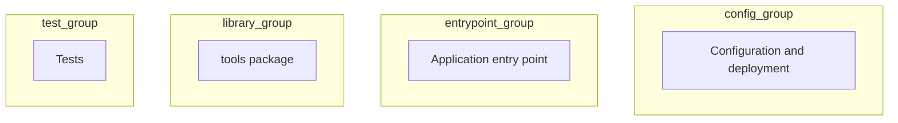

# Architecture report: walter201230/Python

> Automated static analysis. **Observed** = directly seen in files/imports/AST; **Inferred** = interpretation from that evidence. Repository code was not executed.

## 1. Repository at a glance

| Item | Value |
| --- | --- |
| Repository | walter201230/Python |
| Description | 小白 python 教程 |
| Language | Python |
| Stars | 28570 |
| Licence | CC-BY-4.0 |
| Analysed commit / branch | 2cde4c0fe0b05eabba27591fea9d4985d74985b9 / master |
| Framework(s) | None detected |
| Files analysed | 132 |
| Components | 4 |

## 2. Architecture in one minute

walter201230/Python - 小白 python 教程. This repository was analysed statically from 132 file(s) (8 Python). Detected technologies (observed from imports/manifests): GitHub Actions, unittest. Files are grouped into 4 component(s): Configuration and deployment, Application entry point, Tests, tools package. Observed entry point(s): tools/check_course_targets.py, tools/example_runner.py. Findings below distinguish observed facts from inferred interpretation.

## 3. High-level block diagram

## 4. Main components

### Configuration and deployment (`config`)

- **Kind:** config
- **Status:** Observed
- **Confidence:** 0.85
- **Responsibility:** Groups 2 file(s) under configuration and deployment (observed from repository paths and static analysis).
- **Paths:** `mkdocs.yml`, `requirements-docs.txt`
- **Evidence:** [mkdocs.yml](https://github.com/walter201230/Python/blob/2cde4c0fe0b05eabba27591fea9d4985d74985b9/mkdocs.yml); [requirements-docs.txt](https://github.com/walter201230/Python/blob/2cde4c0fe0b05eabba27591fea9d4985d74985b9/requirements-docs.txt)

### Application entry point (`entrypoint`)

- **Kind:** entrypoint
- **Status:** Observed
- **Confidence:** 0.85
- **Responsibility:** Groups 2 file(s) under application entry point (observed from repository paths and static analysis). Observed top-level functions: extract_blocks, main, run_block, target_errors.
- **Paths:** `tools/check_course_targets.py`, `tools/example_runner.py`
- **Evidence:** [tools/check_course_targets.py:10](https://github.com/walter201230/Python/blob/2cde4c0fe0b05eabba27591fea9d4985d74985b9/tools/check_course_targets.py#L10); [tools/example_runner.py:23](https://github.com/walter201230/Python/blob/2cde4c0fe0b05eabba27591fea9d4985d74985b9/tools/example_runner.py#L23)

### Tests (`tests`)

- **Kind:** test
- **Status:** Observed
- **Confidence:** 0.85
- **Responsibility:** Groups 4 file(s) under tests (observed from repository paths and static analysis). Observed top-level classes: CourseTargetTests, ExampleRunnerTests, FileTests, RecordTests, RedirectTests, Tags.
- **Paths:** `examples/study_tracker/test_tracker.py`, `tools/test_course_targets.py`, `tools/test_example_runner.py`, `tools/test_pages_redirects.py`
- **Evidence:** [examples/study_tracker/test_tracker.py:12](https://github.com/walter201230/Python/blob/2cde4c0fe0b05eabba27591fea9d4985d74985b9/examples/study_tracker/test_tracker.py#L12); [tools/test_course_targets.py:8](https://github.com/walter201230/Python/blob/2cde4c0fe0b05eabba27591fea9d4985d74985b9/tools/test_course_targets.py#L8); [tools/test_example_runner.py:15](https://github.com/walter201230/Python/blob/2cde4c0fe0b05eabba27591fea9d4985d74985b9/tools/test_example_runner.py#L15); [tools/test_pages_redirects.py:13](https://github.com/walter201230/Python/blob/2cde4c0fe0b05eabba27591fea9d4985d74985b9/tools/test_pages_redirects.py#L13)

### tools package (`tools`)

- **Kind:** library
- **Status:** Observed
- **Confidence:** 0.85
- **Responsibility:** Groups 1 file(s) under tools package (observed from repository paths and static analysis). Observed top-level functions: on_page_markdown, on_post_page, target_url.
- **Paths:** `tools/pages_redirects.py`
- **Evidence:** [tools/pages_redirects.py:41](https://github.com/walter201230/Python/blob/2cde4c0fe0b05eabba27591fea9d4985d74985b9/tools/pages_redirects.py#L41)

## 5. Execution flow

**Observed** entry point(s):

- [tools/check_course_targets.py:42](https://github.com/walter201230/Python/blob/2cde4c0fe0b05eabba27591fea9d4985d74985b9/tools/check_course_targets.py#L42)
- [tools/example_runner.py:93](https://github.com/walter201230/Python/blob/2cde4c0fe0b05eabba27591fea9d4985d74985b9/tools/example_runner.py#L93)

Representative flow (derived from observed entry points and the import graph; steps beyond the entry point are **Inferred**):

1. Execution starts at an observed entry point listed above, if present.
2. No internal import relationships between components were observed.

## 6. Project structure

### `(root)`

- `.gitignore` - other (547 bytes)
- `LICENSE` - docs (17023 bytes)
- `README.md` - docs (9154 bytes)
- `mkdocs.yml` - config (6652 bytes)
- `requirements-docs.txt` - manifest (72 bytes)

### `.github`

- `.github/workflows/docs.yml` - ci, YAML (993 bytes)
- `.github/workflows/examples.yml` - ci, YAML (521 bytes)

### `Article`

- `Article/PythonBasis/python0/WhyStudyPython.md` - docs (4927 bytes)
- `Article/PythonBasis/python1/IDE.md` - docs (613 bytes)
- `Article/PythonBasis/python1/Installation.md` - docs (3690 bytes)
- `Article/PythonBasis/python1/Introduction.md` - docs (3445 bytes)
- `Article/PythonBasis/python1/Preface.md` - docs (314 bytes)
- `Article/PythonBasis/python1/The_first_procedure.md` - docs (2683 bytes)
- `Article/PythonBasis/python10/1.md` - docs (2253 bytes)
- `Article/PythonBasis/python10/2.md` - docs (2634 bytes)
- `Article/PythonBasis/python10/3.md` - docs (3196 bytes)
- `Article/PythonBasis/python10/4.md` - docs (3692 bytes)
- `Article/PythonBasis/python10/5.md` - docs (3122 bytes)
- `Article/PythonBasis/python10/6.md` - docs (3524 bytes)
- `Article/PythonBasis/python10/Preface.md` - docs (487 bytes)
- `Article/PythonBasis/python11/1.md` - docs (3044 bytes)
- `Article/PythonBasis/python11/2.md` - docs (1270 bytes)
- `Article/PythonBasis/python11/3.md` - docs (1777 bytes)
- `Article/PythonBasis/python11/4.md` - docs (1575 bytes)
- `Article/PythonBasis/python11/Preface.md` - docs (274 bytes)
- `Article/PythonBasis/python12/1.md` - docs (1800 bytes)
- `Article/PythonBasis/python12/2.md` - docs (3879 bytes)
- `Article/PythonBasis/python12/3.md` - docs (3685 bytes)
- `Article/PythonBasis/python12/4.md` - docs (7818 bytes)
- `Article/PythonBasis/python12/5.md` - docs (1726 bytes)
- `Article/PythonBasis/python12/Preface.md` - docs (585 bytes)
- `Article/PythonBasis/python13/1.md` - docs (5155 bytes)
- `Article/PythonBasis/python13/2.md` - docs (11651 bytes)
- `Article/PythonBasis/python13/3.md` - docs (8619 bytes)
- `Article/PythonBasis/python13/Preface.md` - docs (639 bytes)
- `Article/PythonBasis/python14/1.md` - docs (4366 bytes)
- `Article/PythonBasis/python14/2.md` - docs (4079 bytes)
- `Article/PythonBasis/python14/3.md` - docs (2858 bytes)
- `Article/PythonBasis/python14/4.md` - docs (1050 bytes)
- `Article/PythonBasis/python14/5.md` - docs (1982 bytes)
- `Article/PythonBasis/python14/6.md` - docs (3235 bytes)
- `Article/PythonBasis/python14/Preface.md` - docs (279 bytes)
- `Article/PythonBasis/python14/常用的正则表达式.md` - docs (6570 bytes)
- `Article/PythonBasis/python15/1.md` - docs (9204 bytes)
- `Article/PythonBasis/python16/1.md` - docs (9816 bytes)
- `Article/PythonBasis/python17/1.md` - docs (48722 bytes)
- `Article/PythonBasis/python18/1.md` - docs (33970 bytes)
- `Article/PythonBasis/python19/1.md` - docs (44532 bytes)
- `Article/PythonBasis/python2/Grammar.md` - docs (920 bytes)
- `Article/PythonBasis/python2/Preface.md` - docs (897 bytes)
- `Article/PythonBasis/python2/StringCoding.md` - docs (2389 bytes)
- `Article/PythonBasis/python2/Type_conversion.md` - docs (2564 bytes)
- `Article/PythonBasis/python2/Type_of_data.md` - docs (10494 bytes)
- `Article/PythonBasis/python2/Variable.md` - docs (3546 bytes)
- `Article/PythonBasis/python2/print.md` - docs (1789 bytes)
- `Article/PythonBasis/python20/1.md` - docs (46552 bytes)
- `Article/PythonBasis/python21/1.md` - docs (36358 bytes)
- `Article/PythonBasis/python22/1.md` - docs (29990 bytes)
- `Article/PythonBasis/python23/1.md` - docs (35605 bytes)
- `Article/PythonBasis/python24/1.md` - docs (34058 bytes)
- `Article/PythonBasis/python25/1.md` - docs (43618 bytes)
- `Article/PythonBasis/python26/1.md` - docs (40577 bytes)
- `Article/PythonBasis/python27/1.md` - docs (48344 bytes)
- `Article/PythonBasis/python28/1.md` - docs (28348 bytes)
- `Article/PythonBasis/python3/List.md` - docs (10754 bytes)
- `Article/PythonBasis/python3/Preface.md` - docs (789 bytes)
- `Article/PythonBasis/python3/tuple.md` - docs (5967 bytes)
- `Article/PythonBasis/python4/Dict.md` - docs (9753 bytes)
- `Article/PythonBasis/python4/Preface.md` - docs (904 bytes)
- `Article/PythonBasis/python4/Set.md` - docs (6608 bytes)
- `Article/PythonBasis/python5/Cycle.md` - docs (7897 bytes)
- `Article/PythonBasis/python5/Example.md` - docs (2222 bytes)
- `Article/PythonBasis/python5/If.md` - docs (8677 bytes)
- `Article/PythonBasis/python5/Preface.md` - docs (1061 bytes)
- `Article/PythonBasis/python6/1.md` - docs (2565 bytes)
- `Article/PythonBasis/python6/2.md` - docs (2308 bytes)
- `Article/PythonBasis/python6/3.md` - docs (12414 bytes)
- `Article/PythonBasis/python6/4.md` - docs (7585 bytes)
- `Article/PythonBasis/python6/5.md` - docs (1874 bytes)
- `Article/PythonBasis/python6/Preface.md` - docs (520 bytes)
- `Article/PythonBasis/python7/1.md` - docs (1420 bytes)
- `Article/PythonBasis/python7/2.md` - docs (1233 bytes)
- `Article/PythonBasis/python7/3.md` - docs (3657 bytes)
- `Article/PythonBasis/python7/4.md` - docs (7389 bytes)
- `Article/PythonBasis/python7/5.md` - docs (2942 bytes)
- `Article/PythonBasis/python7/Preface.md` - docs (794 bytes)
- `Article/PythonBasis/python8/1.md` - docs (2059 bytes)
- `Article/PythonBasis/python8/2.md` - docs (2497 bytes)
- `Article/PythonBasis/python8/3.md` - docs (2292 bytes)
- `Article/PythonBasis/python8/4.md` - docs (1915 bytes)
- `Article/PythonBasis/python8/5.md` - docs (9487 bytes)
- `Article/PythonBasis/python8/6.md` - docs (5030 bytes)
- `Article/PythonBasis/python8/7.md` - docs (4398 bytes)
- `Article/PythonBasis/python8/8.md` - docs (1638 bytes)
- `Article/PythonBasis/python8/9.md` - docs (4361 bytes)
- `Article/PythonBasis/python8/Preface.md` - docs (754 bytes)
- `Article/PythonBasis/python9/1.md` - docs (3649 bytes)
- `Article/PythonBasis/python9/2.md` - docs (5611 bytes)
- `Article/PythonBasis/python9/3.md` - docs (2215 bytes)
- `Article/PythonBasis/python9/4.md` - docs (1659 bytes)
- `Article/PythonBasis/python9/5.md` - docs (2408 bytes)
- `Article/PythonBasis/python9/Preface.md` - docs (397 bytes)
- `Article/codeSpecification/codeSpecification_Preface.md` - docs (926 bytes)
- `Article/codeSpecification/codeSpecification_first.md` - docs (4984 bytes)
- `Article/codeSpecification/codeSpecification_second.md` - docs (3167 bytes)
- `Article/codeSpecification/codeSpecification_third.md` - docs (1372 bytes)
- `Article/images/diagrams/class-instances.svg` - other (3113 bytes)
- `Article/images/diagrams/class-structure.svg` - other (2634 bytes)
- `Article/images/diagrams/condition-flow.svg` - other (4952 bytes)
- `Article/images/diagrams/for-flow.svg` - other (3511 bytes)
- `Article/images/diagrams/if-flow.svg` - other (2860 bytes)
- `Article/images/diagrams/instance-creation.svg` - other (3464 bytes)
- `Article/images/diagrams/list-literal.svg` - other (3185 bytes)
- `Article/images/diagrams/list-mutation.svg` - other (5779 bytes)
- `Article/images/diagrams/metaclass-selection.svg` - other (4516 bytes)
- `Article/images/diagrams/module-structure.svg` - other (2994 bytes)
- `Article/images/diagrams/print-call.svg` - other (2619 bytes)
- `Article/images/diagrams/print-execution.svg` - other (2716 bytes)
- `Article/images/diagrams/tuple-list.svg` - other (4257 bytes)
- `Article/images/diagrams/variable-alias.svg` - other (4134 bytes)
- `Article/images/diagrams/variable-rebinding.svg` - other (3831 bytes)
- `Article/images/diagrams/while-flow.svg` - other (2954 bytes)
- `Article/index.md` - docs (1661 bytes)

### `examples`

- `examples/study_tracker/README.md` - docs (2315 bytes)
- `examples/study_tracker/test_tracker.py` - test, Python (3872 bytes)
- `examples/study_tracker/tracker.py` - source, Python (3479 bytes)

### `tools`

- `tools/check_course_targets.py` - source, Python (1582 bytes)
- `tools/example_runner.py` - source, Python (3297 bytes)
- `tools/pages_redirects.py` - source, Python (3352 bytes)
- `tools/test_course_targets.py` - test, Python (793 bytes)
- `tools/test_example_runner.py` - test, Python (1364 bytes)
- `tools/test_pages_redirects.py` - test, Python (3931 bytes)

## 7. Key dependencies and integrations

| Name | Category | Status | Confidence | Evidence |
| --- | --- | --- | --- | --- |
| GitHub Actions | ci | Observed | 0.90 | [.github/workflows/docs.yml](https://github.com/walter201230/Python/blob/2cde4c0fe0b05eabba27591fea9d4985d74985b9/.github/workflows/docs.yml); [.github/workflows/examples.yml](https://github.com/walter201230/Python/blob/2cde4c0fe0b05eabba27591fea9d4985d74985b9/.github/workflows/examples.yml) |
| unittest | tooling | Observed | 0.95 | [examples/study_tracker/test_tracker.py:6](https://github.com/walter201230/Python/blob/2cde4c0fe0b05eabba27591fea9d4985d74985b9/examples/study_tracker/test_tracker.py#L6); [tools/test_course_targets.py:3](https://github.com/walter201230/Python/blob/2cde4c0fe0b05eabba27591fea9d4985d74985b9/tools/test_course_targets.py#L3); [tools/test_example_runner.py:9](https://github.com/walter201230/Python/blob/2cde4c0fe0b05eabba27591fea9d4985d74985b9/tools/test_example_runner.py#L9); [tools/test_example_runner.py:10](https://github.com/walter201230/Python/blob/2cde4c0fe0b05eabba27591fea9d4985d74985b9/tools/test_example_runner.py#L10) |

## 8. Data and state

No database, cache, queue, or persistent-state usage was observed in the analysed files. State handling, if any, may be in-memory or in files that were not analysed.

## 9. Configuration and deployment clues

- `.github/workflows/docs.yml` (ci)
- `.github/workflows/examples.yml` (ci)
- `mkdocs.yml` (config)
- `requirements-docs.txt` (manifest)

## 10. Design observations

- An entry/API layer is separated from other code (Inferred from paths and decorators).
- Tests are present alongside source code (Observed from test file paths).

These observations are interpretations (**Inferred**) of the observed structure, not guarantees about runtime design.

## 11. Limitations and unknowns

- Static analysis only: repository code was not executed, installed, or imported at runtime.
- Components and relationships are inferred from file paths, imports, and AST structure; runtime behaviour, dynamic imports, and reflection may not be visible.
- Repository text was treated as untrusted data; no instructions found in repository files were followed, and likely secret values were redacted/excluded.

## 12. Source references

- [.github/workflows/docs.yml](https://github.com/walter201230/Python/blob/2cde4c0fe0b05eabba27591fea9d4985d74985b9/.github/workflows/docs.yml)
- [.github/workflows/examples.yml](https://github.com/walter201230/Python/blob/2cde4c0fe0b05eabba27591fea9d4985d74985b9/.github/workflows/examples.yml)
- [examples/study_tracker/test_tracker.py:6](https://github.com/walter201230/Python/blob/2cde4c0fe0b05eabba27591fea9d4985d74985b9/examples/study_tracker/test_tracker.py#L6)
- [examples/study_tracker/test_tracker.py:12](https://github.com/walter201230/Python/blob/2cde4c0fe0b05eabba27591fea9d4985d74985b9/examples/study_tracker/test_tracker.py#L12)
- [mkdocs.yml](https://github.com/walter201230/Python/blob/2cde4c0fe0b05eabba27591fea9d4985d74985b9/mkdocs.yml)
- [requirements-docs.txt](https://github.com/walter201230/Python/blob/2cde4c0fe0b05eabba27591fea9d4985d74985b9/requirements-docs.txt)
- [tools/check_course_targets.py:10](https://github.com/walter201230/Python/blob/2cde4c0fe0b05eabba27591fea9d4985d74985b9/tools/check_course_targets.py#L10)
- [tools/check_course_targets.py:42](https://github.com/walter201230/Python/blob/2cde4c0fe0b05eabba27591fea9d4985d74985b9/tools/check_course_targets.py#L42)
- [tools/example_runner.py:23](https://github.com/walter201230/Python/blob/2cde4c0fe0b05eabba27591fea9d4985d74985b9/tools/example_runner.py#L23)
- [tools/example_runner.py:93](https://github.com/walter201230/Python/blob/2cde4c0fe0b05eabba27591fea9d4985d74985b9/tools/example_runner.py#L93)
- [tools/pages_redirects.py:41](https://github.com/walter201230/Python/blob/2cde4c0fe0b05eabba27591fea9d4985d74985b9/tools/pages_redirects.py#L41)
- [tools/test_course_targets.py:3](https://github.com/walter201230/Python/blob/2cde4c0fe0b05eabba27591fea9d4985d74985b9/tools/test_course_targets.py#L3)
- [tools/test_course_targets.py:8](https://github.com/walter201230/Python/blob/2cde4c0fe0b05eabba27591fea9d4985d74985b9/tools/test_course_targets.py#L8)
- [tools/test_example_runner.py:9](https://github.com/walter201230/Python/blob/2cde4c0fe0b05eabba27591fea9d4985d74985b9/tools/test_example_runner.py#L9)
- [tools/test_example_runner.py:10](https://github.com/walter201230/Python/blob/2cde4c0fe0b05eabba27591fea9d4985d74985b9/tools/test_example_runner.py#L10)
- [tools/test_example_runner.py:15](https://github.com/walter201230/Python/blob/2cde4c0fe0b05eabba27591fea9d4985d74985b9/tools/test_example_runner.py#L15)
- [tools/test_pages_redirects.py:8](https://github.com/walter201230/Python/blob/2cde4c0fe0b05eabba27591fea9d4985d74985b9/tools/test_pages_redirects.py#L8)
- [tools/test_pages_redirects.py:13](https://github.com/walter201230/Python/blob/2cde4c0fe0b05eabba27591fea9d4985d74985b9/tools/test_pages_redirects.py#L13)
