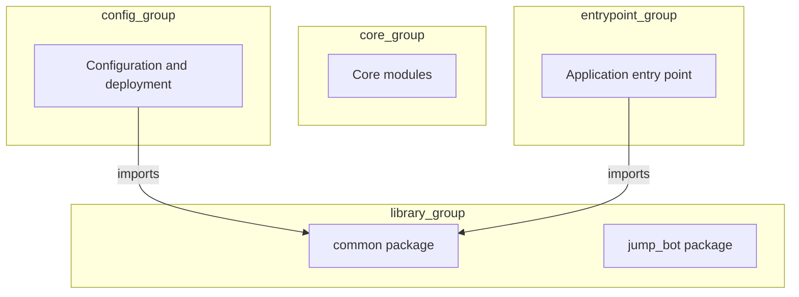

# Architecture report: wangshub/wechat_jump_game

> Automated static analysis. **Observed** = directly seen in files/imports/AST; **Inferred** = interpretation from that evidence. Repository code was not executed.

## 1. Repository at a glance

| Item | Value |
| --- | --- |
| Repository | wangshub/wechat_jump_game |
| Description | 微信《跳一跳》Python 辅助 |
| Language | Python |
| Stars | 13847 |
| Licence | Apache-2.0 |
| Analysed commit / branch | 3cbbb07957901821542fcfc231a09b4f3c9318c9 / master |
| Framework(s) | None detected |
| Files analysed | 63 |
| Components | 5 |

## 2. Architecture in one minute

wangshub/wechat_jump_game - 微信《跳一跳》Python 辅助. This repository was analysed statically from 63 file(s) (21 Python). Detected technologies (observed from imports/manifests): NumPy, pandas. Files are grouped into 5 component(s): common package, Configuration and deployment, Core modules, Application entry point, jump_bot package. Observed entry point(s): jump_bot/jumpbot/bot.py, wechat_jump_auto.py, wechat_jump_auto_ai.py. Findings below distinguish observed facts from inferred interpretation.

## 3. High-level block diagram

## 4. Main components

### common package (`common`)

- **Kind:** library
- **Status:** Observed
- **Confidence:** 0.85
- **Responsibility:** Groups 6 file(s) under common package (observed from repository paths and static analysis). Observed top-level classes: auto_adb. Observed top-level functions: add_data, backup_screenshot, check_screenshot, computing_error, computing_k_b_v, dump_device_info.
- **Paths:** `common/UnicodeStreamFilter.py`, `common/__init__.py`, `common/ai.py`, `common/auto_adb.py`, `common/debug.py`, `common/screenshot.py`
- **Evidence:** [common/UnicodeStreamFilter.py](https://github.com/wangshub/wechat_jump_game/blob/3cbbb07957901821542fcfc231a09b4f3c9318c9/common/UnicodeStreamFilter.py); [common/__init__.py](https://github.com/wangshub/wechat_jump_game/blob/3cbbb07957901821542fcfc231a09b4f3c9318c9/common/__init__.py); [common/ai.py:10](https://github.com/wangshub/wechat_jump_game/blob/3cbbb07957901821542fcfc231a09b4f3c9318c9/common/ai.py#L10); [common/auto_adb.py:7](https://github.com/wangshub/wechat_jump_game/blob/3cbbb07957901821542fcfc231a09b4f3c9318c9/common/auto_adb.py#L7); [common/debug.py:29](https://github.com/wangshub/wechat_jump_game/blob/3cbbb07957901821542fcfc231a09b4f3c9318c9/common/debug.py#L29); [common/screenshot.py:23](https://github.com/wangshub/wechat_jump_game/blob/3cbbb07957901821542fcfc231a09b4f3c9318c9/common/screenshot.py#L23)

### Configuration and deployment (`config`)

- **Kind:** config
- **Status:** Observed
- **Confidence:** 0.85
- **Responsibility:** Groups 28 file(s) under configuration and deployment (observed from repository paths and static analysis). Observed top-level functions: _get_screen_size, get_bot_params, open_accordant_config.
- **Paths:** `common/config.py`, `config/1280x720/config.json`, `config/1440x720/config.json`, `config/1800x1080/config.json`, `config/1920x1080/config.json`, `config/2160x1080/config.json`, `config/2560x1440/config.json`, `config/960x540/config.json`, `config/default.json`, `config/huawei/honor_note8_config.json`, `config/iPhone/6_config.json`, `config/iPhone/8P_7P_6sP_6P_config.json`, `config/iPhone/8_config.json`, `config/iPhone/SE_config.json`, `config/iPhone/X_config.json`, `config/mi/max2_config.json`, `config/mi/mi5_config.json`, `config/mi/mi5s_config.json`, `config/mi/mi5x_config.json`, `config/mi/mi6_config.json`, `config/mi/mix2_config.json`, `config/mi/note2_config.json`, `config/samsung/s7edge_config.json`, `config/samsung/s8.json`, `config/smartisan/pro2_config.json`, `jump_bot/jumpbot/settings.py`, `jump_bot/requirements.txt`, `requirements.txt`
- **Evidence:** [common/config.py:15](https://github.com/wangshub/wechat_jump_game/blob/3cbbb07957901821542fcfc231a09b4f3c9318c9/common/config.py#L15); [config/1280x720/config.json](https://github.com/wangshub/wechat_jump_game/blob/3cbbb07957901821542fcfc231a09b4f3c9318c9/config/1280x720/config.json); [config/1440x720/config.json](https://github.com/wangshub/wechat_jump_game/blob/3cbbb07957901821542fcfc231a09b4f3c9318c9/config/1440x720/config.json); [config/1800x1080/config.json](https://github.com/wangshub/wechat_jump_game/blob/3cbbb07957901821542fcfc231a09b4f3c9318c9/config/1800x1080/config.json); [config/1920x1080/config.json](https://github.com/wangshub/wechat_jump_game/blob/3cbbb07957901821542fcfc231a09b4f3c9318c9/config/1920x1080/config.json); [config/2160x1080/config.json](https://github.com/wangshub/wechat_jump_game/blob/3cbbb07957901821542fcfc231a09b4f3c9318c9/config/2160x1080/config.json); [config/2560x1440/config.json](https://github.com/wangshub/wechat_jump_game/blob/3cbbb07957901821542fcfc231a09b4f3c9318c9/config/2560x1440/config.json); [config/960x540/config.json](https://github.com/wangshub/wechat_jump_game/blob/3cbbb07957901821542fcfc231a09b4f3c9318c9/config/960x540/config.json)

### Core modules (`core`)

- **Kind:** core
- **Status:** Observed
- **Confidence:** 0.85
- **Responsibility:** Groups 3 file(s) under core modules (observed from repository paths and static analysis). Observed top-level functions: jump, on_click, pull_screenshot, search, update_data, updatefig.
- **Paths:** `wechat_jump.py`, `wechat_jump_iOS_py3.py`, `wechat_jump_py3.py`
- **Evidence:** [wechat_jump.py:18](https://github.com/wangshub/wechat_jump_game/blob/3cbbb07957901821542fcfc231a09b4f3c9318c9/wechat_jump.py#L18); [wechat_jump_iOS_py3.py:21](https://github.com/wangshub/wechat_jump_game/blob/3cbbb07957901821542fcfc231a09b4f3c9318c9/wechat_jump_iOS_py3.py#L21); [wechat_jump_py3.py:10](https://github.com/wangshub/wechat_jump_game/blob/3cbbb07957901821542fcfc231a09b4f3c9318c9/wechat_jump_py3.py#L10)

### Application entry point (`entrypoint`)

- **Kind:** entrypoint
- **Status:** Observed
- **Confidence:** 0.85
- **Responsibility:** Groups 6 file(s) under application entry point (observed from repository paths and static analysis). Observed top-level functions: backup_screenshot, check_screenshot, config, find_piece, find_piece_and_board, hsv2rgb.
- **Paths:** `jump_bot/jumpbot/bot.py`, `wechat_jump_auto.py`, `wechat_jump_auto_ai.py`, `wechat_jump_auto_curves.py`, `wechat_jump_auto_iOS.py`, `wechat_jump_auto_slim.py`
- **Evidence:** [jump_bot/jumpbot/bot.py:8](https://github.com/wangshub/wechat_jump_game/blob/3cbbb07957901821542fcfc231a09b4f3c9318c9/jump_bot/jumpbot/bot.py#L8); [wechat_jump_auto.py:63](https://github.com/wangshub/wechat_jump_game/blob/3cbbb07957901821542fcfc231a09b4f3c9318c9/wechat_jump_auto.py#L63); [wechat_jump_auto_ai.py:48](https://github.com/wangshub/wechat_jump_game/blob/3cbbb07957901821542fcfc231a09b4f3c9318c9/wechat_jump_auto_ai.py#L48); [wechat_jump_auto_curves.py:66](https://github.com/wangshub/wechat_jump_game/blob/3cbbb07957901821542fcfc231a09b4f3c9318c9/wechat_jump_auto_curves.py#L66); [wechat_jump_auto_iOS.py:58](https://github.com/wangshub/wechat_jump_game/blob/3cbbb07957901821542fcfc231a09b4f3c9318c9/wechat_jump_auto_iOS.py#L58); [wechat_jump_auto_slim.py:24](https://github.com/wangshub/wechat_jump_game/blob/3cbbb07957901821542fcfc231a09b4f3c9318c9/wechat_jump_auto_slim.py#L24)

### jump_bot package (`jump_bot`)

- **Kind:** library
- **Status:** Observed
- **Confidence:** 0.85
- **Responsibility:** Groups 4 file(s) under jump_bot package (observed from repository paths and static analysis). Observed top-level classes: AutoBot, Connector, ManualBot. Observed top-level functions: get_press_time.
- **Paths:** `jump_bot/jumpbot/algos.py`, `jump_bot/jumpbot/auto.py`, `jump_bot/jumpbot/connector.py`, `jump_bot/jumpbot/manual.py`
- **Evidence:** [jump_bot/jumpbot/algos.py:3](https://github.com/wangshub/wechat_jump_game/blob/3cbbb07957901821542fcfc231a09b4f3c9318c9/jump_bot/jumpbot/algos.py#L3); [jump_bot/jumpbot/auto.py:12](https://github.com/wangshub/wechat_jump_game/blob/3cbbb07957901821542fcfc231a09b4f3c9318c9/jump_bot/jumpbot/auto.py#L12); [jump_bot/jumpbot/connector.py:6](https://github.com/wangshub/wechat_jump_game/blob/3cbbb07957901821542fcfc231a09b4f3c9318c9/jump_bot/jumpbot/connector.py#L6); [jump_bot/jumpbot/manual.py:14](https://github.com/wangshub/wechat_jump_game/blob/3cbbb07957901821542fcfc231a09b4f3c9318c9/jump_bot/jumpbot/manual.py#L14)

## 5. Execution flow

**Observed** entry point(s):

- [jump_bot/jumpbot/bot.py:37](https://github.com/wangshub/wechat_jump_game/blob/3cbbb07957901821542fcfc231a09b4f3c9318c9/jump_bot/jumpbot/bot.py#L37)
- [wechat_jump_auto.py:254](https://github.com/wangshub/wechat_jump_game/blob/3cbbb07957901821542fcfc231a09b4f3c9318c9/wechat_jump_auto.py#L254)
- [wechat_jump_auto_ai.py:421](https://github.com/wangshub/wechat_jump_game/blob/3cbbb07957901821542fcfc231a09b4f3c9318c9/wechat_jump_auto_ai.py#L421)
- [wechat_jump_auto_curves.py:382](https://github.com/wangshub/wechat_jump_game/blob/3cbbb07957901821542fcfc231a09b4f3c9318c9/wechat_jump_auto_curves.py#L382)
- [wechat_jump_auto_iOS.py:208](https://github.com/wangshub/wechat_jump_game/blob/3cbbb07957901821542fcfc231a09b4f3c9318c9/wechat_jump_auto_iOS.py#L208)
- [wechat_jump_auto_slim.py:219](https://github.com/wangshub/wechat_jump_game/blob/3cbbb07957901821542fcfc231a09b4f3c9318c9/wechat_jump_auto_slim.py#L219)

Representative flow (derived from observed entry points and the import graph; steps beyond the entry point are **Inferred**):

1. Execution starts at an observed entry point listed above, if present.
2. `config` imports `common` (Configuration and deployment -> common package).
3. `entrypoint` imports `common` (Application entry point -> common package).

## 6. Project structure

### `(root)`

- `.gitignore` - other (1333 bytes)
- `LICENSE` - docs (11361 bytes)
- `Makefile` - other (52 bytes)
- `README.md` - docs (3338 bytes)
- `README.rst` - docs (2951 bytes)
- `changelog.md` - docs (823 bytes)
- `requirements.txt` - manifest (281 bytes)
- `wechat_jump.py` - source, Python (2138 bytes)
- `wechat_jump_auto.py` - source, Python (10350 bytes)
- `wechat_jump_auto_ai.py` - source, Python (16057 bytes)
- `wechat_jump_auto_curves.py` - source, Python (13962 bytes)
- `wechat_jump_auto_iOS.py` - source, Python (7445 bytes)
- `wechat_jump_auto_slim.py` - source, Python (8072 bytes)
- `wechat_jump_iOS_py3.py` - source, Python (1684 bytes)
- `wechat_jump_py3.py` - source, Python (1579 bytes)

### `.github`

- `.github/CONTRIBUTING.md` - docs (0 bytes)
- `.github/ISSUE_TEMPLATE.md` - docs (1103 bytes)
- `.github/PULL_REQUEST_TEMPLATE.md` - docs (673 bytes)

### `Tools`

- `Tools/README.md` - docs (764 bytes)

### `common`

- `common/UnicodeStreamFilter.py` - source, Python (589 bytes)
- `common/__init__.py` - source, Python (0 bytes)
- `common/ai.py` - source, Python (1804 bytes)
- `common/auto_adb.py` - source, Python (2571 bytes)
- `common/config.py` - source, Python (1405 bytes)
- `common/debug.py` - source, Python (3619 bytes)
- `common/screenshot.py` - source, Python (1939 bytes)

### `config`

- `config/1280x720/config.json` - config (226 bytes)
- `config/1440x720/config.json` - config (219 bytes)
- `config/1800x1080/config.json` - config (223 bytes)
- `config/1920x1080/config.json` - config (251 bytes)
- `config/2160x1080/config.json` - config (128 bytes)
- `config/2560x1440/config.json` - config (225 bytes)
- `config/720x1280` - other (220 bytes)
- `config/960x540/config.json` - config (130 bytes)
- `config/default.json` - config (130 bytes)
- `config/huawei/honorV8` - other (226 bytes)
- `config/huawei/honor_note8_config.json` - config (226 bytes)
- `config/iPhone/6_config.json` - config (225 bytes)
- `config/iPhone/8P_7P_6sP_6P_config.json` - config (222 bytes)
- `config/iPhone/8_config.json` - config (225 bytes)
- `config/iPhone/SE_config.json` - config (225 bytes)
- `config/iPhone/X_config.json` - config (223 bytes)
- `config/mi/max2_config.json` - config (224 bytes)
- `config/mi/mi5_config.json` - config (226 bytes)
- `config/mi/mi5s_config.json` - config (226 bytes)
- `config/mi/mi5x_config.json` - config (224 bytes)
- `config/mi/mi6_config.json` - config (225 bytes)
- `config/mi/mix2_config.json` - config (128 bytes)
- `config/mi/note2_config.json` - config (225 bytes)
- `config/samsung/s7edge_config.json` - config (124 bytes)
- `config/samsung/s8.json` - config (127 bytes)
- `config/samsung/s8在设置里关闭曲面侧屏` - other (0 bytes)
- `config/smartisan/pro2_config.json` - config (217 bytes)

### `jump_bot`

- `jump_bot/Makefile` - other (52 bytes)
- `jump_bot/README.rst` - docs (2955 bytes)
- `jump_bot/jumpbot/algos.py` - source, Python (239 bytes)
- `jump_bot/jumpbot/auto.py` - source, Python (4268 bytes)
- `jump_bot/jumpbot/bot.py` - source, Python (972 bytes)
- `jump_bot/jumpbot/connector.py` - source, Python (393 bytes)
- `jump_bot/jumpbot/manual.py` - source, Python (2223 bytes)
- `jump_bot/jumpbot/settings.py` - source, Python (2475 bytes)
- `jump_bot/requirements.txt` - manifest (199 bytes)

### `resource`

- `resource/model/checkpoint` - other (77 bytes)

## 7. Key dependencies and integrations

| Name | Category | Status | Confidence | Evidence |
| --- | --- | --- | --- | --- |
| NumPy | library | Observed | 0.95 | [jump_bot/jumpbot/manual.py:4](https://github.com/wangshub/wechat_jump_game/blob/3cbbb07957901821542fcfc231a09b4f3c9318c9/jump_bot/jumpbot/manual.py#L4); [jump_bot/requirements.txt:4](https://github.com/wangshub/wechat_jump_game/blob/3cbbb07957901821542fcfc231a09b4f3c9318c9/jump_bot/requirements.txt#L4); [requirements.txt:4](https://github.com/wangshub/wechat_jump_game/blob/3cbbb07957901821542fcfc231a09b4f3c9318c9/requirements.txt#L4); [wechat_jump_auto_curves.py:31](https://github.com/wangshub/wechat_jump_game/blob/3cbbb07957901821542fcfc231a09b4f3c9318c9/wechat_jump_auto_curves.py#L31) |
| pandas | library | Observed | 0.95 | [common/ai.py:6](https://github.com/wangshub/wechat_jump_game/blob/3cbbb07957901821542fcfc231a09b4f3c9318c9/common/ai.py#L6); [requirements.txt:13](https://github.com/wangshub/wechat_jump_game/blob/3cbbb07957901821542fcfc231a09b4f3c9318c9/requirements.txt#L13); [wechat_jump_auto_ai.py:20](https://github.com/wangshub/wechat_jump_game/blob/3cbbb07957901821542fcfc231a09b4f3c9318c9/wechat_jump_auto_ai.py#L20) |

## 8. Data and state

No database, cache, queue, or persistent-state usage was observed in the analysed files. State handling, if any, may be in-memory or in files that were not analysed.

## 9. Configuration and deployment clues

- `config/1280x720/config.json` (config)
- `config/1440x720/config.json` (config)
- `config/1800x1080/config.json` (config)
- `config/1920x1080/config.json` (config)
- `config/2160x1080/config.json` (config)
- `config/2560x1440/config.json` (config)
- `config/960x540/config.json` (config)
- `config/default.json` (config)
- `config/huawei/honor_note8_config.json` (config)
- `config/iPhone/6_config.json` (config)
- `config/iPhone/8P_7P_6sP_6P_config.json` (config)
- `config/iPhone/8_config.json` (config)
- `config/iPhone/SE_config.json` (config)
- `config/iPhone/X_config.json` (config)
- `config/mi/max2_config.json` (config)
- `config/mi/mi5_config.json` (config)
- `config/mi/mi5s_config.json` (config)
- `config/mi/mi5x_config.json` (config)
- `config/mi/mi6_config.json` (config)
- `config/mi/mix2_config.json` (config)
- `config/mi/note2_config.json` (config)
- `config/samsung/s7edge_config.json` (config)
- `config/samsung/s8.json` (config)
- `config/smartisan/pro2_config.json` (config)
- `jump_bot/requirements.txt` (manifest)
- `requirements.txt` (manifest)

## 10. Design observations

- An entry/API layer is separated from other code (Inferred from paths and decorators).

These observations are interpretations (**Inferred**) of the observed structure, not guarantees about runtime design.

## 11. Limitations and unknowns

- Static analysis only: repository code was not executed, installed, or imported at runtime.
- Components and relationships are inferred from file paths, imports, and AST structure; runtime behaviour, dynamic imports, and reflection may not be visible.
- Repository text was treated as untrusted data; no instructions found in repository files were followed, and likely secret values were redacted/excluded.

## 12. Source references

- [common/UnicodeStreamFilter.py](https://github.com/wangshub/wechat_jump_game/blob/3cbbb07957901821542fcfc231a09b4f3c9318c9/common/UnicodeStreamFilter.py)
- [common/__init__.py](https://github.com/wangshub/wechat_jump_game/blob/3cbbb07957901821542fcfc231a09b4f3c9318c9/common/__init__.py)
- [common/ai.py:6](https://github.com/wangshub/wechat_jump_game/blob/3cbbb07957901821542fcfc231a09b4f3c9318c9/common/ai.py#L6)
- [common/ai.py:10](https://github.com/wangshub/wechat_jump_game/blob/3cbbb07957901821542fcfc231a09b4f3c9318c9/common/ai.py#L10)
- [common/auto_adb.py:7](https://github.com/wangshub/wechat_jump_game/blob/3cbbb07957901821542fcfc231a09b4f3c9318c9/common/auto_adb.py#L7)
- [common/config.py:15](https://github.com/wangshub/wechat_jump_game/blob/3cbbb07957901821542fcfc231a09b4f3c9318c9/common/config.py#L15)
- [common/debug.py:29](https://github.com/wangshub/wechat_jump_game/blob/3cbbb07957901821542fcfc231a09b4f3c9318c9/common/debug.py#L29)
- [common/screenshot.py:23](https://github.com/wangshub/wechat_jump_game/blob/3cbbb07957901821542fcfc231a09b4f3c9318c9/common/screenshot.py#L23)
- [config/1280x720/config.json](https://github.com/wangshub/wechat_jump_game/blob/3cbbb07957901821542fcfc231a09b4f3c9318c9/config/1280x720/config.json)
- [config/1440x720/config.json](https://github.com/wangshub/wechat_jump_game/blob/3cbbb07957901821542fcfc231a09b4f3c9318c9/config/1440x720/config.json)
- [config/1800x1080/config.json](https://github.com/wangshub/wechat_jump_game/blob/3cbbb07957901821542fcfc231a09b4f3c9318c9/config/1800x1080/config.json)
- [config/1920x1080/config.json](https://github.com/wangshub/wechat_jump_game/blob/3cbbb07957901821542fcfc231a09b4f3c9318c9/config/1920x1080/config.json)
- [config/2160x1080/config.json](https://github.com/wangshub/wechat_jump_game/blob/3cbbb07957901821542fcfc231a09b4f3c9318c9/config/2160x1080/config.json)
- [config/2560x1440/config.json](https://github.com/wangshub/wechat_jump_game/blob/3cbbb07957901821542fcfc231a09b4f3c9318c9/config/2560x1440/config.json)
- [config/960x540/config.json](https://github.com/wangshub/wechat_jump_game/blob/3cbbb07957901821542fcfc231a09b4f3c9318c9/config/960x540/config.json)
- [jump_bot/jumpbot/algos.py:3](https://github.com/wangshub/wechat_jump_game/blob/3cbbb07957901821542fcfc231a09b4f3c9318c9/jump_bot/jumpbot/algos.py#L3)
- [jump_bot/jumpbot/auto.py:12](https://github.com/wangshub/wechat_jump_game/blob/3cbbb07957901821542fcfc231a09b4f3c9318c9/jump_bot/jumpbot/auto.py#L12)
- [jump_bot/jumpbot/bot.py:8](https://github.com/wangshub/wechat_jump_game/blob/3cbbb07957901821542fcfc231a09b4f3c9318c9/jump_bot/jumpbot/bot.py#L8)
- [jump_bot/jumpbot/bot.py:37](https://github.com/wangshub/wechat_jump_game/blob/3cbbb07957901821542fcfc231a09b4f3c9318c9/jump_bot/jumpbot/bot.py#L37)
- [jump_bot/jumpbot/connector.py:6](https://github.com/wangshub/wechat_jump_game/blob/3cbbb07957901821542fcfc231a09b4f3c9318c9/jump_bot/jumpbot/connector.py#L6)
- [jump_bot/jumpbot/manual.py:4](https://github.com/wangshub/wechat_jump_game/blob/3cbbb07957901821542fcfc231a09b4f3c9318c9/jump_bot/jumpbot/manual.py#L4)
- [jump_bot/jumpbot/manual.py:14](https://github.com/wangshub/wechat_jump_game/blob/3cbbb07957901821542fcfc231a09b4f3c9318c9/jump_bot/jumpbot/manual.py#L14)
- [jump_bot/requirements.txt:4](https://github.com/wangshub/wechat_jump_game/blob/3cbbb07957901821542fcfc231a09b4f3c9318c9/jump_bot/requirements.txt#L4)
- [requirements.txt:4](https://github.com/wangshub/wechat_jump_game/blob/3cbbb07957901821542fcfc231a09b4f3c9318c9/requirements.txt#L4)
- [requirements.txt:13](https://github.com/wangshub/wechat_jump_game/blob/3cbbb07957901821542fcfc231a09b4f3c9318c9/requirements.txt#L13)
- [wechat_jump.py:18](https://github.com/wangshub/wechat_jump_game/blob/3cbbb07957901821542fcfc231a09b4f3c9318c9/wechat_jump.py#L18)
- [wechat_jump_auto.py:63](https://github.com/wangshub/wechat_jump_game/blob/3cbbb07957901821542fcfc231a09b4f3c9318c9/wechat_jump_auto.py#L63)
- [wechat_jump_auto.py:254](https://github.com/wangshub/wechat_jump_game/blob/3cbbb07957901821542fcfc231a09b4f3c9318c9/wechat_jump_auto.py#L254)
- [wechat_jump_auto_ai.py:20](https://github.com/wangshub/wechat_jump_game/blob/3cbbb07957901821542fcfc231a09b4f3c9318c9/wechat_jump_auto_ai.py#L20)
- [wechat_jump_auto_ai.py:48](https://github.com/wangshub/wechat_jump_game/blob/3cbbb07957901821542fcfc231a09b4f3c9318c9/wechat_jump_auto_ai.py#L48)
- [wechat_jump_auto_ai.py:421](https://github.com/wangshub/wechat_jump_game/blob/3cbbb07957901821542fcfc231a09b4f3c9318c9/wechat_jump_auto_ai.py#L421)
- [wechat_jump_auto_curves.py:31](https://github.com/wangshub/wechat_jump_game/blob/3cbbb07957901821542fcfc231a09b4f3c9318c9/wechat_jump_auto_curves.py#L31)
- [wechat_jump_auto_curves.py:66](https://github.com/wangshub/wechat_jump_game/blob/3cbbb07957901821542fcfc231a09b4f3c9318c9/wechat_jump_auto_curves.py#L66)
- [wechat_jump_auto_curves.py:382](https://github.com/wangshub/wechat_jump_game/blob/3cbbb07957901821542fcfc231a09b4f3c9318c9/wechat_jump_auto_curves.py#L382)
- [wechat_jump_auto_iOS.py:58](https://github.com/wangshub/wechat_jump_game/blob/3cbbb07957901821542fcfc231a09b4f3c9318c9/wechat_jump_auto_iOS.py#L58)
- [wechat_jump_auto_iOS.py:208](https://github.com/wangshub/wechat_jump_game/blob/3cbbb07957901821542fcfc231a09b4f3c9318c9/wechat_jump_auto_iOS.py#L208)
- [wechat_jump_auto_slim.py:24](https://github.com/wangshub/wechat_jump_game/blob/3cbbb07957901821542fcfc231a09b4f3c9318c9/wechat_jump_auto_slim.py#L24)
- [wechat_jump_auto_slim.py:219](https://github.com/wangshub/wechat_jump_game/blob/3cbbb07957901821542fcfc231a09b4f3c9318c9/wechat_jump_auto_slim.py#L219)
- [wechat_jump_iOS_py3.py:4](https://github.com/wangshub/wechat_jump_game/blob/3cbbb07957901821542fcfc231a09b4f3c9318c9/wechat_jump_iOS_py3.py#L4)
- [wechat_jump_iOS_py3.py:21](https://github.com/wangshub/wechat_jump_game/blob/3cbbb07957901821542fcfc231a09b4f3c9318c9/wechat_jump_iOS_py3.py#L21)
- [wechat_jump_py3.py:4](https://github.com/wangshub/wechat_jump_game/blob/3cbbb07957901821542fcfc231a09b4f3c9318c9/wechat_jump_py3.py#L4)
- [wechat_jump_py3.py:10](https://github.com/wangshub/wechat_jump_game/blob/3cbbb07957901821542fcfc231a09b4f3c9318c9/wechat_jump_py3.py#L10)
