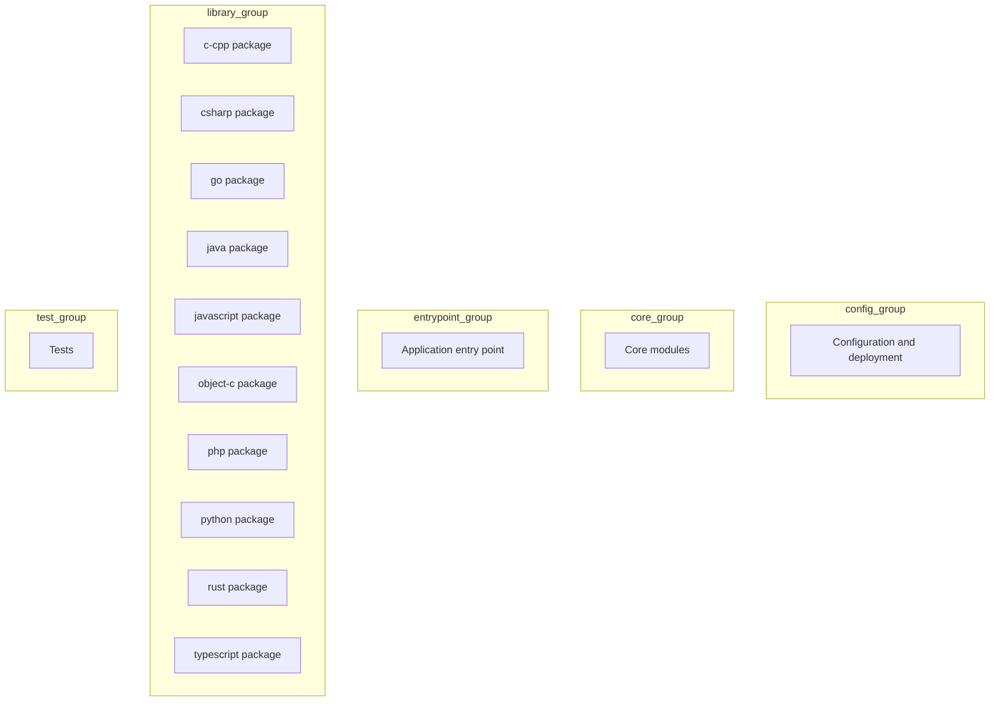

# Architecture report: wangzheng0822/algo

> Automated static analysis. **Observed** = directly seen in files/imports/AST; **Inferred** = interpretation from that evidence. Repository code was not executed.

## 1. Repository at a glance

| Item | Value |
| --- | --- |
| Repository | wangzheng0822/algo |
| Description | 数据结构和算法必知必会的50个代码实现 |
| Language | Python |
| Stars | 23116 |
| Licence | Apache-2.0 |
| Analysed commit / branch | b2c1228ff915287ad7ebeae4355fa26854ea1557 / master |
| Framework(s) | None detected |
| Files analysed | 623 |
| Components | 14 |

## 2. Architecture in one minute

wangzheng0822/algo - 数据结构和算法必知必会的50个代码实现. This repository was analysed statically from 623 file(s) (63 Python). Detected technologies (observed from imports/manifests): no known frameworks/libraries. Files are grouped into 14 component(s): c-cpp package, Configuration and deployment, Core modules, csharp package, Application entry point, go package, java package, javascript package. Observed entry point(s): python/05_array/myarray.py, python/06_linkedlist/LRUCache.py, python/06_linkedlist/palindrome.py. Findings below distinguish observed facts from inferred interpretation.

## 3. High-level block diagram

## 4. Main components

### c-cpp package (`c_cpp`)

- **Kind:** library
- **Status:** Observed
- **Confidence:** 0.85
- **Responsibility:** Groups 69 file(s) under c-cpp package (observed from repository paths and static analysis).
- **Paths:** `c-cpp/05_array/Array_gp.c`, `c-cpp/05_array/Array_gp.h`, `c-cpp/05_array/array.c`, `c-cpp/06_linkedlist/Dlist/Dlist.c`, `c-cpp/06_linkedlist/Dlist/Dlist.h`, `c-cpp/06_linkedlist/LRUBasedLinkedList.cpp`, `c-cpp/06_linkedlist/list_isPalindrome/LinkList.cpp`, `c-cpp/06_linkedlist/list_isPalindrome/LinkList.h`, `c-cpp/06_linkedlist/list_isPalindrome/main.cpp`, `c-cpp/06_linkedlist/palindromeList/palindromeList.cpp`, `c-cpp/06_linkedlist/single_list.c`, `c-cpp/06_linkedlist/singlelist_gc/singleList.c`, `c-cpp/06_linkedlist/singlelist_gc/singleList.h`, `c-cpp/07_linkedlist/LinkedListAlgo.c`, `c-cpp/07_linkedlist/SingleList.cpp`, `c-cpp/07_linkedlist/linked_list.h`, `c-cpp/07_linkedlist/linklist_jinshaohui.c`, `c-cpp/08_stack/StackBasedOnArray/StackBasedOnArray.cpp`, `c-cpp/08_stack/StackBasedOnArray/StackBasedOnArray.h`, `c-cpp/08_stack/StackBasedOnLinkedList/StackBasedOnLinkedList.cpp`, `c-cpp/08_stack/StackBasedOnLinkedList/StackBasedOnLinkedList.h`, `c-cpp/08_stack/arrayStack/arrayStack.c`, `c-cpp/08_stack/arrayStack/arrayStack.h`, `c-cpp/08_stack/linkList/linklist_stack.c`, `c-cpp/08_stack/linkList/linklist_stack.h`, `c-cpp/08_stack/linked_list.h`, `c-cpp/09_queue/array_queue/array_queue.c`, `c-cpp/09_queue/array_queue/array_queue.h`, `c-cpp/09_queue/list_queue/list_queue.c`, `c-cpp/09_queue/list_queue/list_queue.h`, `c-cpp/09_queue/ring_queue.c`, `c-cpp/10_recursive/one_two_step.c`, `c-cpp/11_sorts/sorts.c`, `c-cpp/11_sorts/sorts.cpp`, `c-cpp/11_sorts/sorts_jinshaohui.c`, `c-cpp/12_sorts/merge_sort.c`, `c-cpp/12_sorts/my12_sorts/merge_sort.c`, `c-cpp/12_sorts/my12_sorts/quick_sort.c`, `c-cpp/12_sorts/quick_sort.c`, `c-cpp/13_sorts/sort.c`, `c-cpp/14_sorts/counting_sort.c`, `c-cpp/15_bsearch/binary_search.c`, `c-cpp/15_bsearch/bsearch_c/bsearch.c`, `c-cpp/15_bsearch/bsearch_c/sqrt.c`, `c-cpp/16_bsearch/bsearch.c`, `c-cpp/16_bsearch/bsearch_variant.c`, `c-cpp/17_skiplist/SkipList.cpp`, `c-cpp/17_skiplist/skiplist.c`, `c-cpp/17_skiplist/skiplist_c/skiplist.c`, `c-cpp/17_skiplist/skiplist_c/skiplist.h`, `c-cpp/18_hashtable/hashtable.c`, `c-cpp/18_hashtable/listhash/listhash.c`, `c-cpp/18_hashtable/listhash/listhash.h`, `c-cpp/19_Dlisthash/Dlist.h`, `c-cpp/19_Dlisthash/LinkedHashMap.c`, `c-cpp/19_Dlisthash/LinkedHashMap.h`, `c-cpp/23_binarytree/binarytree.c`, `c-cpp/23_binarytree/tree/binarytree.c`, `c-cpp/23_binarytree/tree/list_queue.c`, `c-cpp/23_binarytree/tree/list_queue.h`, `c-cpp/24_binarysearchtree/binary_search_tree.cpp`, `c-cpp/24_binarysearchtree/binarysearchtree.c`, `c-cpp/24_binarysearchtree/binarysearchtree.h`, `c-cpp/24_binarysearchtree/bst.c`, `c-cpp/24_tree/Trie.c`, `c-cpp/24_tree/binarysearchtree.c`, `c-cpp/28_heap/heap.c`, `c-cpp/30_Graph/graph.c`, `c-cpp/bst.c`
- **Evidence:** [c-cpp/05_array/Array_gp.c](https://github.com/wangzheng0822/algo/blob/b2c1228ff915287ad7ebeae4355fa26854ea1557/c-cpp/05_array/Array_gp.c); [c-cpp/05_array/Array_gp.h](https://github.com/wangzheng0822/algo/blob/b2c1228ff915287ad7ebeae4355fa26854ea1557/c-cpp/05_array/Array_gp.h); [c-cpp/05_array/array.c](https://github.com/wangzheng0822/algo/blob/b2c1228ff915287ad7ebeae4355fa26854ea1557/c-cpp/05_array/array.c); [c-cpp/06_linkedlist/Dlist/Dlist.c](https://github.com/wangzheng0822/algo/blob/b2c1228ff915287ad7ebeae4355fa26854ea1557/c-cpp/06_linkedlist/Dlist/Dlist.c); [c-cpp/06_linkedlist/Dlist/Dlist.h](https://github.com/wangzheng0822/algo/blob/b2c1228ff915287ad7ebeae4355fa26854ea1557/c-cpp/06_linkedlist/Dlist/Dlist.h); [c-cpp/06_linkedlist/LRUBasedLinkedList.cpp](https://github.com/wangzheng0822/algo/blob/b2c1228ff915287ad7ebeae4355fa26854ea1557/c-cpp/06_linkedlist/LRUBasedLinkedList.cpp); [c-cpp/06_linkedlist/list_isPalindrome/LinkList.cpp](https://github.com/wangzheng0822/algo/blob/b2c1228ff915287ad7ebeae4355fa26854ea1557/c-cpp/06_linkedlist/list_isPalindrome/LinkList.cpp); [c-cpp/06_linkedlist/list_isPalindrome/LinkList.h](https://github.com/wangzheng0822/algo/blob/b2c1228ff915287ad7ebeae4355fa26854ea1557/c-cpp/06_linkedlist/list_isPalindrome/LinkList.h)

### Configuration and deployment (`config`)

- **Kind:** config
- **Status:** Observed
- **Confidence:** 0.85
- **Responsibility:** Groups 1 file(s) under configuration and deployment (observed from repository paths and static analysis).
- **Paths:** `php/composer.json`
- **Evidence:** [php/composer.json](https://github.com/wangzheng0822/algo/blob/b2c1228ff915287ad7ebeae4355fa26854ea1557/php/composer.json)

### Core modules (`core`)

- **Kind:** core
- **Status:** Observed
- **Confidence:** 0.85
- **Responsibility:** Groups 2 file(s) under core modules (observed from repository paths and static analysis).
- **Paths:** `DynamicStackBaseArray.java`, `StackBaseArray.java`
- **Evidence:** [DynamicStackBaseArray.java](https://github.com/wangzheng0822/algo/blob/b2c1228ff915287ad7ebeae4355fa26854ea1557/DynamicStackBaseArray.java); [StackBaseArray.java](https://github.com/wangzheng0822/algo/blob/b2c1228ff915287ad7ebeae4355fa26854ea1557/StackBaseArray.java)

### csharp package (`csharp`)

- **Kind:** library
- **Status:** Observed
- **Confidence:** 0.85
- **Responsibility:** Groups 8 file(s) under csharp package (observed from repository paths and static analysis).
- **Paths:** `csharp/05-array/Array.cs`, `csharp/06-linkedlist/LRUWithArray.cs`, `csharp/06-linkedlist/LRUWithLinkedList.cs`, `csharp/06-linkedlist/SingleLinkedList.cs`, `csharp/07-linkedlist/_07_linkedlist/SingleLinkedListAlgo.cs`, `csharp/08-stack/algo08_stack/ArrayStack.cs`, `csharp/08-stack/algo08_stack/LinkedStack.cs`, `csharp/08-stack/algo08_stack/LinkedStackBrowser.cs`
- **Evidence:** [csharp/05-array/Array.cs](https://github.com/wangzheng0822/algo/blob/b2c1228ff915287ad7ebeae4355fa26854ea1557/csharp/05-array/Array.cs); [csharp/06-linkedlist/LRUWithArray.cs](https://github.com/wangzheng0822/algo/blob/b2c1228ff915287ad7ebeae4355fa26854ea1557/csharp/06-linkedlist/LRUWithArray.cs); [csharp/06-linkedlist/LRUWithLinkedList.cs](https://github.com/wangzheng0822/algo/blob/b2c1228ff915287ad7ebeae4355fa26854ea1557/csharp/06-linkedlist/LRUWithLinkedList.cs); [csharp/06-linkedlist/SingleLinkedList.cs](https://github.com/wangzheng0822/algo/blob/b2c1228ff915287ad7ebeae4355fa26854ea1557/csharp/06-linkedlist/SingleLinkedList.cs); [csharp/07-linkedlist/_07_linkedlist/SingleLinkedListAlgo.cs](https://github.com/wangzheng0822/algo/blob/b2c1228ff915287ad7ebeae4355fa26854ea1557/csharp/07-linkedlist/_07_linkedlist/SingleLinkedListAlgo.cs); [csharp/08-stack/algo08_stack/ArrayStack.cs](https://github.com/wangzheng0822/algo/blob/b2c1228ff915287ad7ebeae4355fa26854ea1557/csharp/08-stack/algo08_stack/ArrayStack.cs); [csharp/08-stack/algo08_stack/LinkedStack.cs](https://github.com/wangzheng0822/algo/blob/b2c1228ff915287ad7ebeae4355fa26854ea1557/csharp/08-stack/algo08_stack/LinkedStack.cs); [csharp/08-stack/algo08_stack/LinkedStackBrowser.cs](https://github.com/wangzheng0822/algo/blob/b2c1228ff915287ad7ebeae4355fa26854ea1557/csharp/08-stack/algo08_stack/LinkedStackBrowser.cs)

### Application entry point (`entrypoint`)

- **Kind:** entrypoint
- **Status:** Observed
- **Confidence:** 0.85
- **Responsibility:** Groups 56 file(s) under application entry point (observed from repository paths and static analysis). Observed top-level classes: ACAutomata, ACNode, ACTrie, BinaryHeap, BinaryHeapSort, BinarySearchTree. Observed top-level functions: QuickSort, _generate_bad_character_table, _generate_good_suffix_table, _get_partial_match_table, _merge, _merge_sort_between.
- **Paths:** `python/05_array/myarray.py`, `python/06_linkedlist/LRUCache.py`, `python/06_linkedlist/palindrome.py`, `python/06_linkedlist/singly_linked_list.py`, `python/08_stack/linked_stack.py`, `python/08_stack/simple_browser.py`, `python/09_queue/circular_queue.py`, `python/09_queue/dynamic_array_queue.py`, `python/09_queue/linked_queue.py`, `python/11_sorts/sorts.py`, `python/12_sorts/merge_sort.py`, `python/12_sorts/quick_sort.py`, `python/12_sorts/quicksort_twoway.py`, `python/14_sorts/counting_sort.py`, `python/16_bsearch/bsearch_variants.py`, `python/17_skiplist/skip_list.py`, `python/17_skiplist/skip_list_comments.py`, `python/23_binarytree/binary_search_tree.py`, `python/23_binarytree/binary_tree.py`, `python/26_red_black_tree/red_black_tree.py`, `python/28_binary_heap/binary_heap.py`, `python/28_binary_heap/binary_heap_sort.py`, `python/28_binary_heap/heap.py`, `python/28_binary_heap/priority_queue.py`, `python/28_binary_heap/top_k.py`, `python/28_heap/heap.py`, `python/28_heap/min_heap.py`, `python/31_bfs_dfs/bfs_dfs.py`, `python/31_bfs_dfs/graph.py`, `python/31_bfs_dfs/graph_application.py`, `python/32_bf_rk/bf_rk.py`, `python/33_bm/bm.py`, `python/33_bm/bm_.py`, `python/34_kmp/kmp.py`, `python/34_kmp/kmp_.py`, `python/35_trie/trie.py`, `python/35_trie/trie_.py`, `python/36_ac_automata/ac_automata.py`, `python/36_ac_automata/ac_automata_.py`, `python/38_divide_and_conquer/merge_sort_counting.py`, `python/39_back_track/01_bag.py`, `python/39_back_track/eight_queens.py`, `python/39_back_track/permutations.py`, `python/39_back_track/regex.py`, `python/39_backtracking/backtracking.py`, `python/40_dynamic_programming/01_bag.py`, `python/40_dynamic_programming/knapsack.py`, `python/40_dynamic_programming/yh_triangle.py`, `python/41_dynamic_programming/coins_problem.py`, `python/41_dynamic_programming/min_dist.py`, `python/42_dynamic_programming/longest_increasing_subsequence.py`, `python/42_dynamic_programming/min_edit_dist.py`, `python/43_topological_sorting/topological_sorting.py`, `python/44_shortest_path/dijkstra.py`, `python/44_shortest_path/shortest_path.py`, `python/45_bitmap/bitmap.py`
- **Evidence:** [python/05_array/myarray.py:9](https://github.com/wangzheng0822/algo/blob/b2c1228ff915287ad7ebeae4355fa26854ea1557/python/05_array/myarray.py#L9); [python/06_linkedlist/LRUCache.py:2](https://github.com/wangzheng0822/algo/blob/b2c1228ff915287ad7ebeae4355fa26854ea1557/python/06_linkedlist/LRUCache.py#L2); [python/06_linkedlist/palindrome.py:10](https://github.com/wangzheng0822/algo/blob/b2c1228ff915287ad7ebeae4355fa26854ea1557/python/06_linkedlist/palindrome.py#L10); [python/06_linkedlist/singly_linked_list.py:10](https://github.com/wangzheng0822/algo/blob/b2c1228ff915287ad7ebeae4355fa26854ea1557/python/06_linkedlist/singly_linked_list.py#L10); [python/08_stack/linked_stack.py:10](https://github.com/wangzheng0822/algo/blob/b2c1228ff915287ad7ebeae4355fa26854ea1557/python/08_stack/linked_stack.py#L10); [python/08_stack/simple_browser.py:16](https://github.com/wangzheng0822/algo/blob/b2c1228ff915287ad7ebeae4355fa26854ea1557/python/08_stack/simple_browser.py#L16); [python/09_queue/circular_queue.py:8](https://github.com/wangzheng0822/algo/blob/b2c1228ff915287ad7ebeae4355fa26854ea1557/python/09_queue/circular_queue.py#L8); [python/09_queue/dynamic_array_queue.py:7](https://github.com/wangzheng0822/algo/blob/b2c1228ff915287ad7ebeae4355fa26854ea1557/python/09_queue/dynamic_array_queue.py#L7)

### go package (`go`)

- **Kind:** library
- **Status:** Observed
- **Confidence:** 0.85
- **Responsibility:** Groups 70 file(s) under go package (observed from repository paths and static analysis).
- **Paths:** `go/05_array/array.go`, `go/05_array/array_test.go`, `go/06_linkedlist/palindrome-linked-list.go`, `go/06_linkedlist/palindrome.go`, `go/06_linkedlist/palindrome_test.go`, `go/06_linkedlist/singlelinkedlist.go`, `go/06_linkedlist/singlelinkedlist_test.go`, `go/07_linkedlist/main.go`, `go/07_linkedlist/main_test.go`, `go/08_stack/SimpleBrowser.go`, `go/08_stack/SimpleBrowser_test.go`, `go/08_stack/StackBasedOnArray.go`, `go/08_stack/StackBasedOnArray_test.go`, `go/08_stack/StackBasedOnLinkedList.go`, `go/08_stack/StackBasedOnLinkedList_test.go`, `go/08_stack/StatckInterface.go`, `go/09_queue/CircularQueue.go`, `go/09_queue/CircularQueue_test.go`, `go/09_queue/QueueBasedOnArray.go`, `go/09_queue/QueueBasedOnArray_test.go`, `go/09_queue/QueueBasedOnLinkedList.go`, `go/09_queue/QueueBasedOnLinkedList_test.go`, `go/10_recursion/Factorial.go`, `go/10_recursion/Factorial_test.go`, `go/10_recursion/Fibonacci.go`, `go/10_recursion/Fibonacci_test.go`, `go/10_recursion/RangAll.go`, `go/10_recursion/RangAll_test.go`, `go/11_sorts/Sort.go`, `go/11_sorts/Sort_test.go`, `go/12_sorts/MergeSort.go`, `go/12_sorts/MergeSort_test.go`, `go/12_sorts/QuickSort.go`, `go/12_sorts/QuickSort_test.go`, `go/13_sorts/BucketSort.go`, `go/13_sorts/BucketSort_test.go`, `go/14_sorts/CountingSort.go`, `go/14_sorts/CountingSort_test.go`, `go/15_binarysearch/binarysearch.go`, `go/15_binarysearch/binarysearch_test.go`, `go/17_skiplist/skiplist.go`, `go/17_skiplist/skiplist_test.go`, `go/20_lru/lru_cache.go`, `go/20_lru/lru_cache_test.go`, `go/23_binarytree/binarytree.go`, `go/23_binarytree/binarytree_test.go`, `go/24_tree/BinarySearchTree.go`, `go/24_tree/BinarySearchTree_test.go`, `go/24_tree/BinaryTree.go`, `go/24_tree/BinaryTree_test.go`, `go/24_tree/StackBasedOnArray.go`, `go/24_tree/TreeNode.go`, `go/28_heap/heap.go`, `go/28_heap/heap_sort.go`, `go/29_priority_queue/heap.go`, `go/29_priority_queue/heap_test.go`, `go/29_priority_queue/priority_queue.go`, `go/29_priority_queue/priority_queue_test.go`, `go/31_graph/graph_search.go`, `go/32_string/string_bf.go`, `go/32_string/string_bm.go`, `go/34_kmp/kmp.go`, `go/41_dynamic_programming/backtracking/leastcoins.go`, `go/41_dynamic_programming/backtracking/leastcoins_test.go`, `go/41_dynamic_programming/dp/leastcoins.go`, `go/41_dynamic_programming/dp/leastcoins_test.go`, `go/42_dynamic_programming/longest_common_substring.go`, `go/45_bitmap/bitmap.go`, `go/45_bitmap/bitmap_test.go`, `go/binarysearch2.go`
- **Evidence:** [go/05_array/array.go](https://github.com/wangzheng0822/algo/blob/b2c1228ff915287ad7ebeae4355fa26854ea1557/go/05_array/array.go); [go/05_array/array_test.go](https://github.com/wangzheng0822/algo/blob/b2c1228ff915287ad7ebeae4355fa26854ea1557/go/05_array/array_test.go); [go/06_linkedlist/palindrome-linked-list.go](https://github.com/wangzheng0822/algo/blob/b2c1228ff915287ad7ebeae4355fa26854ea1557/go/06_linkedlist/palindrome-linked-list.go); [go/06_linkedlist/palindrome.go](https://github.com/wangzheng0822/algo/blob/b2c1228ff915287ad7ebeae4355fa26854ea1557/go/06_linkedlist/palindrome.go); [go/06_linkedlist/palindrome_test.go](https://github.com/wangzheng0822/algo/blob/b2c1228ff915287ad7ebeae4355fa26854ea1557/go/06_linkedlist/palindrome_test.go); [go/06_linkedlist/singlelinkedlist.go](https://github.com/wangzheng0822/algo/blob/b2c1228ff915287ad7ebeae4355fa26854ea1557/go/06_linkedlist/singlelinkedlist.go); [go/06_linkedlist/singlelinkedlist_test.go](https://github.com/wangzheng0822/algo/blob/b2c1228ff915287ad7ebeae4355fa26854ea1557/go/06_linkedlist/singlelinkedlist_test.go); [go/07_linkedlist/main.go](https://github.com/wangzheng0822/algo/blob/b2c1228ff915287ad7ebeae4355fa26854ea1557/go/07_linkedlist/main.go)

### java package (`java`)

- **Kind:** library
- **Status:** Observed
- **Confidence:** 0.85
- **Responsibility:** Groups 30 file(s) under java package (observed from repository paths and static analysis).
- **Paths:** `java/05_array/Array.java`, `java/05_array/GenericArray.java`, `java/06_linkedlist/LRUBaseLinkedList.java`, `java/06_linkedlist/LRUBasedArray.java`, `java/06_linkedlist/SinglyLinkedList.java`, `java/07_linkedlist/LinkedListAlgo.java`, `java/08_stack/SampleBrowser.java`, `java/08_stack/StackBasedOnLinkedList.java`, `java/09_queue/ArrayQueue.java`, `java/09_queue/CircularQueue.java`, `java/09_queue/DynamicArrayQueue.java`, `java/09_queue/QueueBasedOnLinkedList.java`, `java/11_sorts/InsertionSortAdd.java`, `java/11_sorts/Sorts.java`, `java/11_sorts/SortsAddOn.java`, `java/12_sorts/KthSmallest.java`, `java/12_sorts/MergeSort.java`, `java/12_sorts/QuickSort.java`, `java/12_sorts/Sorts.java`, `java/13_sorts/BucketSort.java`, `java/13_sorts/CountingSort.java`, `java/13_sorts/RadixSort.java`, `java/17_skiplist/SkipList.java`, `java/17_skiplist/SkipList2.java`, `java/18_hashtable/HashTable.java`, `java/20_hashtable/LRUBaseHashTable.java`, `java/24_tree/BinarySearchTree.java`, `java/28_sorts/HeapSort.java`, `java/30_graph/Graph.java`, `java/36_ac_automata/ACAutoMata.java`
- **Evidence:** [java/05_array/Array.java](https://github.com/wangzheng0822/algo/blob/b2c1228ff915287ad7ebeae4355fa26854ea1557/java/05_array/Array.java); [java/05_array/GenericArray.java](https://github.com/wangzheng0822/algo/blob/b2c1228ff915287ad7ebeae4355fa26854ea1557/java/05_array/GenericArray.java); [java/06_linkedlist/LRUBaseLinkedList.java](https://github.com/wangzheng0822/algo/blob/b2c1228ff915287ad7ebeae4355fa26854ea1557/java/06_linkedlist/LRUBaseLinkedList.java); [java/06_linkedlist/LRUBasedArray.java](https://github.com/wangzheng0822/algo/blob/b2c1228ff915287ad7ebeae4355fa26854ea1557/java/06_linkedlist/LRUBasedArray.java); [java/06_linkedlist/SinglyLinkedList.java](https://github.com/wangzheng0822/algo/blob/b2c1228ff915287ad7ebeae4355fa26854ea1557/java/06_linkedlist/SinglyLinkedList.java); [java/07_linkedlist/LinkedListAlgo.java](https://github.com/wangzheng0822/algo/blob/b2c1228ff915287ad7ebeae4355fa26854ea1557/java/07_linkedlist/LinkedListAlgo.java); [java/08_stack/SampleBrowser.java](https://github.com/wangzheng0822/algo/blob/b2c1228ff915287ad7ebeae4355fa26854ea1557/java/08_stack/SampleBrowser.java); [java/08_stack/StackBasedOnLinkedList.java](https://github.com/wangzheng0822/algo/blob/b2c1228ff915287ad7ebeae4355fa26854ea1557/java/08_stack/StackBasedOnLinkedList.java)

### javascript package (`javascript`)

- **Kind:** library
- **Status:** Observed
- **Confidence:** 0.85
- **Responsibility:** Groups 25 file(s) under javascript package (observed from repository paths and static analysis).
- **Paths:** `javascript/06_linkedlist/SinglyLinkedList.js`, `javascript/07_linkedlist/LinkedListAlgo.js`, `javascript/08_stack/SampleBrowser.js`, `javascript/08_stack/StackBasedOnLinkedList.js`, `javascript/09_queue/CircularQueueBasedOnLinkedList.js`, `javascript/09_queue/QueueBasedOnLinkedList.js`, `javascript/11_sorts/sort.js`, `javascript/12_sorts/KthNum.js`, `javascript/12_sorts/MergeSort.js`, `javascript/12_sorts/QuickSort.js`, `javascript/13_sorts/bucketSort.js`, `javascript/13_sorts/countingSort.js`, `javascript/15_binary/binaryFind.js`, `javascript/16_binary/binary-find.js`, `javascript/17_skiplist/SkipList.js`, `javascript/19_hashTable/hashtable.js`, `javascript/23_tree/binary_tree.js`, `javascript/28_heapsort/heap-sort.js`, `javascript/28_heapsort/heap.js`, `javascript/35_trie/trie.js`, `javascript/36_ac_automata/ac_automata.js`, `javascript/36_ac_automata/ac_automata_unicode.js`, `javascript/42_dynamic_programming/levenshtein_distance.js`, `javascript/43_topological_sorting/dsf.js`, `javascript/45_bitmap/bitmap.js`
- **Evidence:** [javascript/06_linkedlist/SinglyLinkedList.js](https://github.com/wangzheng0822/algo/blob/b2c1228ff915287ad7ebeae4355fa26854ea1557/javascript/06_linkedlist/SinglyLinkedList.js); [javascript/07_linkedlist/LinkedListAlgo.js](https://github.com/wangzheng0822/algo/blob/b2c1228ff915287ad7ebeae4355fa26854ea1557/javascript/07_linkedlist/LinkedListAlgo.js); [javascript/08_stack/SampleBrowser.js](https://github.com/wangzheng0822/algo/blob/b2c1228ff915287ad7ebeae4355fa26854ea1557/javascript/08_stack/SampleBrowser.js); [javascript/08_stack/StackBasedOnLinkedList.js](https://github.com/wangzheng0822/algo/blob/b2c1228ff915287ad7ebeae4355fa26854ea1557/javascript/08_stack/StackBasedOnLinkedList.js); [javascript/09_queue/CircularQueueBasedOnLinkedList.js](https://github.com/wangzheng0822/algo/blob/b2c1228ff915287ad7ebeae4355fa26854ea1557/javascript/09_queue/CircularQueueBasedOnLinkedList.js); [javascript/09_queue/QueueBasedOnLinkedList.js](https://github.com/wangzheng0822/algo/blob/b2c1228ff915287ad7ebeae4355fa26854ea1557/javascript/09_queue/QueueBasedOnLinkedList.js); [javascript/11_sorts/sort.js](https://github.com/wangzheng0822/algo/blob/b2c1228ff915287ad7ebeae4355fa26854ea1557/javascript/11_sorts/sort.js); [javascript/12_sorts/KthNum.js](https://github.com/wangzheng0822/algo/blob/b2c1228ff915287ad7ebeae4355fa26854ea1557/javascript/12_sorts/KthNum.js)

### object-c package (`object_c`)

- **Kind:** library
- **Status:** Observed
- **Confidence:** 0.85
- **Responsibility:** Groups 10 file(s) under object-c package (observed from repository paths and static analysis).
- **Paths:** `object-c/05_array/MyArray.h`, `object-c/06_linkedlist/ListNode.h`, `object-c/06_linkedlist/SinglyLinkedList.h`, `object-c/08_stack/LinkedStack.h`, `object-c/08_stack/ListNode.h`, `object-c/08_stack/stack_practice/ArrayStack.h`, `object-c/08_stack/stack_practice/BalancedParentheses.h`, `object-c/08_stack/stack_practice/FourOperation.h`, `object-c/11_Sort/Sort.h`, `object-c/33_bm_match/BM.h`
- **Evidence:** [object-c/05_array/MyArray.h](https://github.com/wangzheng0822/algo/blob/b2c1228ff915287ad7ebeae4355fa26854ea1557/object-c/05_array/MyArray.h); [object-c/06_linkedlist/ListNode.h](https://github.com/wangzheng0822/algo/blob/b2c1228ff915287ad7ebeae4355fa26854ea1557/object-c/06_linkedlist/ListNode.h); [object-c/06_linkedlist/SinglyLinkedList.h](https://github.com/wangzheng0822/algo/blob/b2c1228ff915287ad7ebeae4355fa26854ea1557/object-c/06_linkedlist/SinglyLinkedList.h); [object-c/08_stack/LinkedStack.h](https://github.com/wangzheng0822/algo/blob/b2c1228ff915287ad7ebeae4355fa26854ea1557/object-c/08_stack/LinkedStack.h); [object-c/08_stack/ListNode.h](https://github.com/wangzheng0822/algo/blob/b2c1228ff915287ad7ebeae4355fa26854ea1557/object-c/08_stack/ListNode.h); [object-c/08_stack/stack_practice/ArrayStack.h](https://github.com/wangzheng0822/algo/blob/b2c1228ff915287ad7ebeae4355fa26854ea1557/object-c/08_stack/stack_practice/ArrayStack.h); [object-c/08_stack/stack_practice/BalancedParentheses.h](https://github.com/wangzheng0822/algo/blob/b2c1228ff915287ad7ebeae4355fa26854ea1557/object-c/08_stack/stack_practice/BalancedParentheses.h); [object-c/08_stack/stack_practice/FourOperation.h](https://github.com/wangzheng0822/algo/blob/b2c1228ff915287ad7ebeae4355fa26854ea1557/object-c/08_stack/stack_practice/FourOperation.h)

### php package (`php`)

- **Kind:** library
- **Status:** Observed
- **Confidence:** 0.85
- **Responsibility:** Groups 33 file(s) under php package (observed from repository paths and static analysis).
- **Paths:** `php/05_array/array.php`, `php/05_array/array_test.php`, `php/06_linkedlist/SingleLinkedList.php`, `php/06_linkedlist/SingleLinkedListNode.php`, `php/06_linkedlist/main.php`, `php/07_linkedlist/main.php`, `php/08_stack/Compute.php`, `php/08_stack/StackOnLinkedList.php`, `php/08_stack/main.php`, `php/09_queue/QueueOnLinkedList.php`, `php/09_queue/Sequential.php`, `php/09_queue/main.php`, `php/10_heap/Heap.php`, `php/10_heap/findmiddle.php`, `php/10_heap/main.php`, `php/10_heap/topn.php`, `php/11_sort/Sort.php`, `php/12_sort/mergeSort.php`, `php/12_sort/quicksort.php`, `php/13_sort/bucketSort.php`, `php/13_sort/countingSort.php`, `php/13_sort/radixSort.php`, `php/15_binary/binary.php`, `php/16_binary/binary.php`, `php/17_skiplist/skipList.php`, `php/24_tree/Tree.php`, `php/24_tree/TreeNode.php`, `php/24_tree/levelOrder.php`, `php/24_tree/main.php`, `php/38_divide_and_conquer/matrix_production.php`, `php/39_backtracking/queens.php`, `php/Stack/Compute.php`, `php/buildAutoLoad.sh`
- **Evidence:** [php/05_array/array.php](https://github.com/wangzheng0822/algo/blob/b2c1228ff915287ad7ebeae4355fa26854ea1557/php/05_array/array.php); [php/05_array/array_test.php](https://github.com/wangzheng0822/algo/blob/b2c1228ff915287ad7ebeae4355fa26854ea1557/php/05_array/array_test.php); [php/06_linkedlist/SingleLinkedList.php](https://github.com/wangzheng0822/algo/blob/b2c1228ff915287ad7ebeae4355fa26854ea1557/php/06_linkedlist/SingleLinkedList.php); [php/06_linkedlist/SingleLinkedListNode.php](https://github.com/wangzheng0822/algo/blob/b2c1228ff915287ad7ebeae4355fa26854ea1557/php/06_linkedlist/SingleLinkedListNode.php); [php/06_linkedlist/main.php](https://github.com/wangzheng0822/algo/blob/b2c1228ff915287ad7ebeae4355fa26854ea1557/php/06_linkedlist/main.php); [php/07_linkedlist/main.php](https://github.com/wangzheng0822/algo/blob/b2c1228ff915287ad7ebeae4355fa26854ea1557/php/07_linkedlist/main.php); [php/08_stack/Compute.php](https://github.com/wangzheng0822/algo/blob/b2c1228ff915287ad7ebeae4355fa26854ea1557/php/08_stack/Compute.php); [php/08_stack/StackOnLinkedList.php](https://github.com/wangzheng0822/algo/blob/b2c1228ff915287ad7ebeae4355fa26854ea1557/php/08_stack/StackOnLinkedList.php)

### python package (`python`)

- **Kind:** library
- **Status:** Observed
- **Confidence:** 0.85
- **Responsibility:** Groups 7 file(s) under python package (observed from repository paths and static analysis). Observed top-level classes: Array, ArrayQueue, BinarySearchTree, Node, SinglyLinkedList, TreeNode. Observed top-level functions: bsearch, bsearch_internally, find_middle_node, has_cycle, merge_sorted_list, print_all.
- **Paths:** `python/06_linkedlist/singlyLinkedList.py`, `python/07_linkedlist/linked_list_algo.py`, `python/09_queue/array_queue.py`, `python/15_bsearch/bsearch.py`, `python/15_bsearch/bsearch_recursion.py`, `python/24_tree/binary_search_tree.py`, `python/array.py`
- **Evidence:** [python/06_linkedlist/singlyLinkedList.py:7](https://github.com/wangzheng0822/algo/blob/b2c1228ff915287ad7ebeae4355fa26854ea1557/python/06_linkedlist/singlyLinkedList.py#L7); [python/07_linkedlist/linked_list_algo.py:14](https://github.com/wangzheng0822/algo/blob/b2c1228ff915287ad7ebeae4355fa26854ea1557/python/07_linkedlist/linked_list_algo.py#L14); [python/09_queue/array_queue.py:10](https://github.com/wangzheng0822/algo/blob/b2c1228ff915287ad7ebeae4355fa26854ea1557/python/09_queue/array_queue.py#L10); [python/15_bsearch/bsearch.py:7](https://github.com/wangzheng0822/algo/blob/b2c1228ff915287ad7ebeae4355fa26854ea1557/python/15_bsearch/bsearch.py#L7); [python/15_bsearch/bsearch_recursion.py:8](https://github.com/wangzheng0822/algo/blob/b2c1228ff915287ad7ebeae4355fa26854ea1557/python/15_bsearch/bsearch_recursion.py#L8); [python/24_tree/binary_search_tree.py:8](https://github.com/wangzheng0822/algo/blob/b2c1228ff915287ad7ebeae4355fa26854ea1557/python/24_tree/binary_search_tree.py#L8); [python/array.py:6](https://github.com/wangzheng0822/algo/blob/b2c1228ff915287ad7ebeae4355fa26854ea1557/python/array.py#L6)

### rust package (`rust`)

- **Kind:** library
- **Status:** Observed
- **Confidence:** 0.85
- **Responsibility:** Groups 60 file(s) under rust package (observed from repository paths and static analysis).
- **Paths:** `rust/05_array/main.rs`, `rust/07_linkedlist/linked_list_cycle.rs`, `rust/07_linkedlist/merge_two_sorted_lists.rs`, `rust/07_linkedlist/middle_of_the_linked_list.rs`, `rust/07_linkedlist/remove_nth_node_from_end_of_list.rs`, `rust/07_linkedlist/reverse_linked_list.rs`, `rust/07_linkedlist/util/linked_list.rs`, `rust/08_stack/simple_browser.rs`, `rust/08_stack/stack_based_on_array.rs`, `rust/08_stack/stack_based_on_linked_list.rs`, `rust/09_queue/array_queue.rs`, `rust/09_queue/circle_queue.rs`, `rust/09_queue/linked_list_queue.rs`, `rust/11_sorts/bubble_sort.rs`, `rust/11_sorts/insertion_sort.rs`, `rust/11_sorts/selection_sort.rs`, `rust/12_sorts/kth_largest.rs`, `rust/12_sorts/merge_sort.rs`, `rust/12_sorts/quick_sort.rs`, `rust/13_sorts/bucket_sort.rs`, `rust/13_sorts/counting_sort.rs`, `rust/13_sorts/radix_sort.rs`, `rust/13_sorts/sort_string.rs`, `rust/15_binary_search/binary_search.rs`, `rust/15_binary_search/sqrtx.rs`, `rust/16_binary_search/binary_search.rs`, `rust/16_binary_search/search_in_rotated_sorted_array.rs`, `rust/19_hash_table/hash_table.rs`, `rust/23_binary_tree/inorder_traversal.rs`, `rust/23_binary_tree/level_order_traversal.rs`, `rust/23_binary_tree/postorder_traversal.rs`, `rust/23_binary_tree/preorder_traversal.rs`, `rust/23_binary_tree/util/tree.rs`, `rust/24_binary_tree/insert_in_binary_tree.rs`, `rust/24_binary_tree/max_depth_in_binary_tree.rs`, `rust/24_binary_tree/search_in_binary_tree.rs`, `rust/24_binary_tree/util/tree.rs`, `rust/28_heap/build_heap.rs`, `rust/28_heap/heap.rs`, `rust/28_heap/sort_heap.rs`, `rust/29_heap/get_median.rs`, `rust/29_heap/get_top_k.rs`, `rust/29_heap/merge_sorted_array.rs`, `rust/31_graph/graph_search.rs`, `rust/32_string/bf_rk.rs`, `rust/33_string/bm.rs`, `rust/34_string/kmp.rs`, `rust/35_trie/trie.rs`, `rust/38_divide_and_conquer/merge_sort_count.rs`, `rust/39_back_tracking/bag.rs`, `rust/39_back_tracking/bag_exec.rs`, `rust/39_back_tracking/n_queens.rs`, `rust/39_back_tracking/regex.rs`, `rust/40_dynamic_programming/bag.rs`, `rust/40_dynamic_programming/knapsack.rs`, `rust/40_dynamic_programming/triangle.rs`, `rust/41_dynamic_programming/coin_change.rs`, `rust/41_dynamic_programming/min_dis_path.rs`, `rust/42_dynamic_programming/edit_distance.rs`, `rust/42_dynamic_programming/longest_increasing_subsequence.rs`
- **Evidence:** [rust/05_array/main.rs](https://github.com/wangzheng0822/algo/blob/b2c1228ff915287ad7ebeae4355fa26854ea1557/rust/05_array/main.rs); [rust/07_linkedlist/linked_list_cycle.rs](https://github.com/wangzheng0822/algo/blob/b2c1228ff915287ad7ebeae4355fa26854ea1557/rust/07_linkedlist/linked_list_cycle.rs); [rust/07_linkedlist/merge_two_sorted_lists.rs](https://github.com/wangzheng0822/algo/blob/b2c1228ff915287ad7ebeae4355fa26854ea1557/rust/07_linkedlist/merge_two_sorted_lists.rs); [rust/07_linkedlist/middle_of_the_linked_list.rs](https://github.com/wangzheng0822/algo/blob/b2c1228ff915287ad7ebeae4355fa26854ea1557/rust/07_linkedlist/middle_of_the_linked_list.rs); [rust/07_linkedlist/remove_nth_node_from_end_of_list.rs](https://github.com/wangzheng0822/algo/blob/b2c1228ff915287ad7ebeae4355fa26854ea1557/rust/07_linkedlist/remove_nth_node_from_end_of_list.rs); [rust/07_linkedlist/reverse_linked_list.rs](https://github.com/wangzheng0822/algo/blob/b2c1228ff915287ad7ebeae4355fa26854ea1557/rust/07_linkedlist/reverse_linked_list.rs); [rust/07_linkedlist/util/linked_list.rs](https://github.com/wangzheng0822/algo/blob/b2c1228ff915287ad7ebeae4355fa26854ea1557/rust/07_linkedlist/util/linked_list.rs); [rust/08_stack/simple_browser.rs](https://github.com/wangzheng0822/algo/blob/b2c1228ff915287ad7ebeae4355fa26854ea1557/rust/08_stack/simple_browser.rs)

### Tests (`tests`)

- **Kind:** test
- **Status:** Observed
- **Confidence:** 0.85
- **Responsibility:** Groups 48 file(s) under tests (observed from repository paths and static analysis).
- **Paths:** `csharp/Tests/_05_array_tests/Array.Tests.cs`, `csharp/Tests/_05_array_tests/algo05_array_tests.csproj`, `csharp/Tests/_06_linkedlist_tests/BaseLinkedListTests.cs`, `csharp/Tests/_06_linkedlist_tests/LRUWithArray.Tests.cs`, `csharp/Tests/_06_linkedlist_tests/LRUWithLinkedList.Tests.cs`, `csharp/Tests/_06_linkedlist_tests/SingleLinkedList.Tests.cs`, `csharp/Tests/_06_linkedlist_tests/algo06_linkedlist_tests.csproj`, `csharp/Tests/_07_linkedlist_tests/SingleLinkedListAlgo.Tests.cs`, `csharp/Tests/_07_linkedlist_tests/algo07_linkedlist_tests.csproj`, `csharp/Tests/algo08_stack_tests/ArrayStack.Tests.cs`, `csharp/Tests/algo08_stack_tests/LinkedStack.Tests.cs`, `csharp/Tests/algo08_stack_tests/LinkedStackBrowser.Tests.cs`, `csharp/Tests/algo08_stack_tests/algo08_stack_tests.csproj`, `scala/src/test/scala/ch05_array/ArrayDemoSpec.scala`, `scala/src/test/scala/ch06_linkedlist/NodeTest.scala`, `scala/src/test/scala/ch06_linkedlist/SinglyLinkedListTest.scala`, `scala/src/test/scala/ch07_linkedlist/LinkedListAlgoTest.scala`, `scala/src/test/scala/ch08_stack/BrowserDemoTest.scala`, `scala/src/test/scala/ch08_stack/StackDemoTest.scala`, `scala/src/test/scala/ch09_queue/ArrayQueueTest.scala`, `scala/src/test/scala/ch09_queue/CircularQueueTest.scala`, `scala/src/test/scala/ch09_queue/DemoQueueTest.scala`, `scala/src/test/scala/ch09_queue/DynamicArrayQueueTest.scala`, `scala/src/test/scala/ch09_queue/LinkedListQueueTest.scala`, `scala/src/test/scala/ch10_recursive/RecursiveDemoTest.scala`, `scala/src/test/scala/ch11_sorts/SortsTest.scala`, `scala/src/test/scala/ch12_sorts/MergeSortTest.scala`, `scala/src/test/scala/ch12_sorts/QuickSortTest.scala`, `scala/src/test/scala/ch15_bsearch/BSearchRecursiveTest.scala`, `scala/src/test/scala/ch15_bsearch/BSearchTest.scala`, `scala/src/test/scala/ch16_bsearch/BSearchTest.scala`, `scala/src/test/scala/ch17_skip_list/SkipListTest.scala`, `scala/src/test/scala/ch20_linked_hash_map/LRUCacheTest.scala`, `scala/src/test/scala/ch23_binary_tree/BinaryTreeTest.scala`, `scala/src/test/scala/ch24_binary_search_tree/BinarySearchTreeTest.scala`, `scala/src/test/scala/ch28_heap/HeapTest.scala`, `scala/src/test/scala/ch29_heap_solutions/FileMergerTest.scala`, `scala/src/test/scala/ch29_heap_solutions/MiddleNumberKeeperTest.scala`, `scala/src/test/scala/ch29_heap_solutions/TopKItemsKeeperTest.scala`, `scala/src/test/scala/ch31_graph/GraphTest.scala`, `scala/src/test/scala/ch32_matching/BruteForceTest.scala`, `scala/src/test/scala/ch32_matching/RabinKarpTest.scala`, `scala/src/test/scala/ch35_tire_tree/TrieTreeTest.scala`, `scala/src/test/scala/ch39_back_tracking/BagWeightTest.scala`, `scala/src/test/scala/ch39_back_tracking/EightQueensTest.scala`, `scala/src/test/scala/ch39_back_tracking/NQueensTest.scala`, `scala/src/test/scala/ch39_back_tracking/SudokuTest.scala`, `scala/src/test/scala/ch43_topology_sort/GraphTopologyTest.scala`
- **Evidence:** [csharp/Tests/_05_array_tests/Array.Tests.cs](https://github.com/wangzheng0822/algo/blob/b2c1228ff915287ad7ebeae4355fa26854ea1557/csharp/Tests/_05_array_tests/Array.Tests.cs); [csharp/Tests/_05_array_tests/algo05_array_tests.csproj](https://github.com/wangzheng0822/algo/blob/b2c1228ff915287ad7ebeae4355fa26854ea1557/csharp/Tests/_05_array_tests/algo05_array_tests.csproj); [csharp/Tests/_06_linkedlist_tests/BaseLinkedListTests.cs](https://github.com/wangzheng0822/algo/blob/b2c1228ff915287ad7ebeae4355fa26854ea1557/csharp/Tests/_06_linkedlist_tests/BaseLinkedListTests.cs); [csharp/Tests/_06_linkedlist_tests/LRUWithArray.Tests.cs](https://github.com/wangzheng0822/algo/blob/b2c1228ff915287ad7ebeae4355fa26854ea1557/csharp/Tests/_06_linkedlist_tests/LRUWithArray.Tests.cs); [csharp/Tests/_06_linkedlist_tests/LRUWithLinkedList.Tests.cs](https://github.com/wangzheng0822/algo/blob/b2c1228ff915287ad7ebeae4355fa26854ea1557/csharp/Tests/_06_linkedlist_tests/LRUWithLinkedList.Tests.cs); [csharp/Tests/_06_linkedlist_tests/SingleLinkedList.Tests.cs](https://github.com/wangzheng0822/algo/blob/b2c1228ff915287ad7ebeae4355fa26854ea1557/csharp/Tests/_06_linkedlist_tests/SingleLinkedList.Tests.cs); [csharp/Tests/_06_linkedlist_tests/algo06_linkedlist_tests.csproj](https://github.com/wangzheng0822/algo/blob/b2c1228ff915287ad7ebeae4355fa26854ea1557/csharp/Tests/_06_linkedlist_tests/algo06_linkedlist_tests.csproj); [csharp/Tests/_07_linkedlist_tests/SingleLinkedListAlgo.Tests.cs](https://github.com/wangzheng0822/algo/blob/b2c1228ff915287ad7ebeae4355fa26854ea1557/csharp/Tests/_07_linkedlist_tests/SingleLinkedListAlgo.Tests.cs)

### typescript package (`typescript`)

- **Kind:** library
- **Status:** Observed
- **Confidence:** 0.85
- **Responsibility:** Groups 19 file(s) under typescript package (observed from repository paths and static analysis).
- **Paths:** `typescript/06_linkedlist/LRUCache.ts`, `typescript/06_linkedlist/LinkedList.ts`, `typescript/06_linkedlist/List.ts`, `typescript/06_linkedlist/SingleLinkedList.ts`, `typescript/07_linkedlist/LinkedListAlog.ts`, `typescript/08_stack/StackAndBrowser.ts`, `typescript/09_queue/CircularQueue.ts`, `typescript/09_queue/SimpleQueue.ts`, `typescript/10_recursive/climbStairs.ts`, `typescript/11_sorts/simpleSort.ts`, `typescript/12_sorts/KthNum.ts`, `typescript/12_sorts/MergeSort.ts`, `typescript/12_sorts/quickSort.ts`, `typescript/13_sorts/BucketSort.ts`, `typescript/13_sorts/CountingSort.ts`, `typescript/14_binarysearch/BinarySearch.ts`, `typescript/15_binarysearch/BinaryFind.ts`, `typescript/17_skiplist/SkipList.ts`, `typescript/24_treesearch/TreeSearch.ts`
- **Evidence:** [typescript/06_linkedlist/LRUCache.ts](https://github.com/wangzheng0822/algo/blob/b2c1228ff915287ad7ebeae4355fa26854ea1557/typescript/06_linkedlist/LRUCache.ts); [typescript/06_linkedlist/LinkedList.ts](https://github.com/wangzheng0822/algo/blob/b2c1228ff915287ad7ebeae4355fa26854ea1557/typescript/06_linkedlist/LinkedList.ts); [typescript/06_linkedlist/List.ts](https://github.com/wangzheng0822/algo/blob/b2c1228ff915287ad7ebeae4355fa26854ea1557/typescript/06_linkedlist/List.ts); [typescript/06_linkedlist/SingleLinkedList.ts](https://github.com/wangzheng0822/algo/blob/b2c1228ff915287ad7ebeae4355fa26854ea1557/typescript/06_linkedlist/SingleLinkedList.ts); [typescript/07_linkedlist/LinkedListAlog.ts](https://github.com/wangzheng0822/algo/blob/b2c1228ff915287ad7ebeae4355fa26854ea1557/typescript/07_linkedlist/LinkedListAlog.ts); [typescript/08_stack/StackAndBrowser.ts](https://github.com/wangzheng0822/algo/blob/b2c1228ff915287ad7ebeae4355fa26854ea1557/typescript/08_stack/StackAndBrowser.ts); [typescript/09_queue/CircularQueue.ts](https://github.com/wangzheng0822/algo/blob/b2c1228ff915287ad7ebeae4355fa26854ea1557/typescript/09_queue/CircularQueue.ts); [typescript/09_queue/SimpleQueue.ts](https://github.com/wangzheng0822/algo/blob/b2c1228ff915287ad7ebeae4355fa26854ea1557/typescript/09_queue/SimpleQueue.ts)

## 5. Execution flow

**Observed** entry point(s):

- [python/05_array/myarray.py:69](https://github.com/wangzheng0822/algo/blob/b2c1228ff915287ad7ebeae4355fa26854ea1557/python/05_array/myarray.py#L69)
- [python/06_linkedlist/LRUCache.py:92](https://github.com/wangzheng0822/algo/blob/b2c1228ff915287ad7ebeae4355fa26854ea1557/python/06_linkedlist/LRUCache.py#L92)
- [python/06_linkedlist/palindrome.py:43](https://github.com/wangzheng0822/algo/blob/b2c1228ff915287ad7ebeae4355fa26854ea1557/python/06_linkedlist/palindrome.py#L43)
- [python/06_linkedlist/singly_linked_list.py:129](https://github.com/wangzheng0822/algo/blob/b2c1228ff915287ad7ebeae4355fa26854ea1557/python/06_linkedlist/singly_linked_list.py#L129)
- [python/08_stack/linked_stack.py:42](https://github.com/wangzheng0822/algo/blob/b2c1228ff915287ad7ebeae4355fa26854ea1557/python/08_stack/linked_stack.py#L42)
- [python/08_stack/simple_browser.py:61](https://github.com/wangzheng0822/algo/blob/b2c1228ff915287ad7ebeae4355fa26854ea1557/python/08_stack/simple_browser.py#L61)
- [python/09_queue/circular_queue.py:36](https://github.com/wangzheng0822/algo/blob/b2c1228ff915287ad7ebeae4355fa26854ea1557/python/09_queue/circular_queue.py#L36)
- [python/09_queue/dynamic_array_queue.py:39](https://github.com/wangzheng0822/algo/blob/b2c1228ff915287ad7ebeae4355fa26854ea1557/python/09_queue/dynamic_array_queue.py#L39)
- [python/09_queue/linked_queue.py:46](https://github.com/wangzheng0822/algo/blob/b2c1228ff915287ad7ebeae4355fa26854ea1557/python/09_queue/linked_queue.py#L46)
- [python/11_sorts/sorts.py:94](https://github.com/wangzheng0822/algo/blob/b2c1228ff915287ad7ebeae4355fa26854ea1557/python/11_sorts/sorts.py#L94)
- [python/12_sorts/merge_sort.py:53](https://github.com/wangzheng0822/algo/blob/b2c1228ff915287ad7ebeae4355fa26854ea1557/python/12_sorts/merge_sort.py#L53)
- [python/12_sorts/quick_sort.py:49](https://github.com/wangzheng0822/algo/blob/b2c1228ff915287ad7ebeae4355fa26854ea1557/python/12_sorts/quick_sort.py#L49)

Representative flow (derived from observed entry points and the import graph; steps beyond the entry point are **Inferred**):

1. Execution starts at an observed entry point listed above, if present.
2. No internal import relationships between components were observed.

## 6. Project structure

### `(root)`

- `.gitignore` - other (536 bytes)
- `DynamicStackBaseArray.java` - source, Java (3041 bytes)
- `LICENSE` - docs (11357 bytes)
- `README.md` - docs (2732 bytes)
- `StackBaseArray.java` - source, Java (1645 bytes)
- `f21` - other (1357 bytes)

### `c-cpp`

- `c-cpp/.gitignore` - other (69 bytes)
- `c-cpp/.gitkeep` - other (0 bytes)
- `c-cpp/05_array/.gitkeep` - other (0 bytes)
- `c-cpp/05_array/Array_gp.c` - source, C (4863 bytes)
- `c-cpp/05_array/Array_gp.h` - source, C/C++ (1311 bytes)
- `c-cpp/05_array/array.c` - source, C (1651 bytes)
- `c-cpp/06_linkedlist/.gitkeep` - other (0 bytes)
- `c-cpp/06_linkedlist/Dlist/Dlist.c` - source, C (4460 bytes)
- `c-cpp/06_linkedlist/Dlist/Dlist.h` - source, C/C++ (700 bytes)
- `c-cpp/06_linkedlist/LRUBasedLinkedList.cpp` - source, C++ (5587 bytes)
- `c-cpp/06_linkedlist/list_isPalindrome/LinkList.cpp` - source, C++ (2057 bytes)
- `c-cpp/06_linkedlist/list_isPalindrome/LinkList.h` - source, C/C++ (620 bytes)
- `c-cpp/06_linkedlist/list_isPalindrome/main.cpp` - source, C++ (863 bytes)
- `c-cpp/06_linkedlist/palindromeList/LinkedList.hpp` - other (2722 bytes)
- `c-cpp/06_linkedlist/palindromeList/ListNode.hpp` - other (211 bytes)
- `c-cpp/06_linkedlist/palindromeList/palindromeList.cpp` - source, C++ (2304 bytes)
- `c-cpp/06_linkedlist/single_list.c` - source, C (3101 bytes)
- `c-cpp/06_linkedlist/singlelist_gc/singleList.c` - source, C (4586 bytes)
- `c-cpp/06_linkedlist/singlelist_gc/singleList.h` - source, C/C++ (1200 bytes)
- `c-cpp/07_linkedlist/.gitkeep` - other (0 bytes)
- `c-cpp/07_linkedlist/LinkedListAlgo.c` - source, C (6367 bytes)
- `c-cpp/07_linkedlist/SingleList.cpp` - source, C++ (14424 bytes)
- `c-cpp/07_linkedlist/linked_list.h` - source, C/C++ (380 bytes)
- `c-cpp/07_linkedlist/linked_list_algo.hpp` - other (3396 bytes)
- `c-cpp/07_linkedlist/linklist_jinshaohui.c` - source, C (2036 bytes)
- `c-cpp/08_stack/StackBasedOnArray/StackBasedOnArray.cpp` - source, C++ (3121 bytes)
- `c-cpp/08_stack/StackBasedOnArray/StackBasedOnArray.h` - source, C/C++ (587 bytes)
- `c-cpp/08_stack/StackBasedOnLinkedList/StackBasedOnLinkedList.cpp` - source, C++ (3969 bytes)
- `c-cpp/08_stack/StackBasedOnLinkedList/StackBasedOnLinkedList.h` - source, C/C++ (698 bytes)
- `c-cpp/08_stack/arrayStack/arrayStack.c` - source, C (2939 bytes)
- `c-cpp/08_stack/arrayStack/arrayStack.h` - source, C/C++ (693 bytes)
- `c-cpp/08_stack/linkList/linklist_stack.c` - source, C (2079 bytes)
- `c-cpp/08_stack/linkList/linklist_stack.h` - source, C/C++ (487 bytes)
- `c-cpp/08_stack/linked_list.h` - source, C/C++ (356 bytes)
- `c-cpp/08_stack/stack_based_on_linked_list.hpp` - other (1076 bytes)
- `c-cpp/09_queue/.gitkeep` - other (0 bytes)
- `c-cpp/09_queue/array_queue.hpp` - other (2553 bytes)
- `c-cpp/09_queue/array_queue/array_queue.c` - source, C (2986 bytes)
- `c-cpp/09_queue/array_queue/array_queue.h` - source, C/C++ (678 bytes)
- `c-cpp/09_queue/array_queue_test.cc` - other (1859 bytes)
- `c-cpp/09_queue/block_queue.hpp` - other (2323 bytes)
- `c-cpp/09_queue/circular_queue.hpp` - other (2735 bytes)
- `c-cpp/09_queue/circular_queue_test.cc` - other (2192 bytes)
- `c-cpp/09_queue/concurrency_queue.hpp` - other (2361 bytes)
- `c-cpp/09_queue/dynamic_array_queue.hpp` - other (2916 bytes)
- `c-cpp/09_queue/dynamic_array_queue_test.cc` - other (2422 bytes)
- `c-cpp/09_queue/linked_queue.hpp` - other (1850 bytes)
- `c-cpp/09_queue/linked_queue_test.cc` - other (1848 bytes)
- `c-cpp/09_queue/list_queue/list_queue.c` - source, C (2836 bytes)
- `c-cpp/09_queue/list_queue/list_queue.h` - source, C/C++ (567 bytes)
- `c-cpp/09_queue/lock_free_queue.hpp` - other (2166 bytes)
- `c-cpp/09_queue/ring_queue.c` - source, C (2527 bytes)
- `c-cpp/10_recursive/.gitkeep` - other (0 bytes)
- `c-cpp/10_recursive/one_two_step.c` - source, C (1004 bytes)
- `c-cpp/10_recursive/one_two_step.cc` - other (2074 bytes)
- `c-cpp/11_sorts/.gitkeep` - other (0 bytes)
- `c-cpp/11_sorts/sorts.c` - source, C (2243 bytes)
- `c-cpp/11_sorts/sorts.cpp` - source, C++ (922 bytes)
- `c-cpp/11_sorts/sorts.hpp` - other (2976 bytes)
- `c-cpp/11_sorts/sorts_jinshaohui.c` - source, C (2065 bytes)
- `c-cpp/11_sorts/sorts_test.cc` - other (1056 bytes)
- `c-cpp/12_sorts/.gitkeep` - other (0 bytes)
- `c-cpp/12_sorts/merge_sort.c` - source, C (1212 bytes)
- `c-cpp/12_sorts/merge_sort.hpp` - other (2031 bytes)
- `c-cpp/12_sorts/merge_sort_test.cc` - other (543 bytes)
- `c-cpp/12_sorts/my12_sorts/merge_sort.c` - source, C (2339 bytes)
- `c-cpp/12_sorts/my12_sorts/quick_sort.c` - source, C (2097 bytes)
- `c-cpp/12_sorts/quick_sort.c` - source, C (906 bytes)
- `c-cpp/12_sorts/quick_sort.hpp` - other (2611 bytes)
- `c-cpp/12_sorts/quick_sort_test.cc` - other (599 bytes)
- `c-cpp/13_sorts/.gitkeep` - other (0 bytes)
- `c-cpp/13_sorts/bucket_sort.hpp` - other (1116 bytes)
- `c-cpp/13_sorts/bucket_sort_test.cc` - other (1015 bytes)
- `c-cpp/13_sorts/counting_sort.hpp` - other (1100 bytes)
- `c-cpp/13_sorts/counting_sort_test.cc` - other (1264 bytes)
- `c-cpp/13_sorts/sort.c` - source, C (4978 bytes)
- `c-cpp/14_sorts/.gitkeep` - other (0 bytes)
- `c-cpp/14_sorts/analytics_of_std_sort.md` - docs (404 bytes)
- `c-cpp/14_sorts/counting_sort.c` - source, C (1167 bytes)
- `c-cpp/15_bsearch/.gitkeep` - other (0 bytes)
- `c-cpp/15_bsearch/binary_search.c` - source, C (1706 bytes)
- `c-cpp/15_bsearch/bsearch.hpp` - other (1081 bytes)
- `c-cpp/15_bsearch/bsearch_c/bsearch.c` - source, C (1658 bytes)
- `c-cpp/15_bsearch/bsearch_c/sqrt.c` - source, C (881 bytes)
- `c-cpp/15_bsearch/bsearch_test.cc` - other (834 bytes)
- `c-cpp/16_bsearch/.gitkeep` - other (0 bytes)
- `c-cpp/16_bsearch/bsearch.c` - source, C (3777 bytes)
- `c-cpp/16_bsearch/bsearch_variant.c` - source, C (5308 bytes)
- `c-cpp/16_bsearch/bsearch_varients.hpp` - other (3057 bytes)
- `c-cpp/16_bsearch/bsearch_varients_test.cc` - other (1744 bytes)
- `c-cpp/17_skiplist/.gitkeep` - other (0 bytes)
- `c-cpp/17_skiplist/SkipList.cpp` - source, C++ (9611 bytes)
- `c-cpp/17_skiplist/skiplist.c` - source, C (3911 bytes)
- `c-cpp/17_skiplist/skiplist.hpp` - other (6385 bytes)
- `c-cpp/17_skiplist/skiplist_c/skiplist.c` - source, C (6350 bytes)
- `c-cpp/17_skiplist/skiplist_c/skiplist.h` - source, C/C++ (873 bytes)
- `c-cpp/17_skiplist/skiplist_test.cc` - other (1343 bytes)
- `c-cpp/17_skiplist/skiplist_tr.hpp` - other (12416 bytes)
- `c-cpp/17_skiplist/skiplist_tr_test.cc` - other (3153 bytes)
- `c-cpp/18_hashtable/.gitkeep` - other (0 bytes)
- `c-cpp/18_hashtable/hash_map.cc` - other (3025 bytes)
- `c-cpp/18_hashtable/hashtable.c` - source, C (3448 bytes)
- `c-cpp/18_hashtable/listhash/listhash.c` - source, C (6622 bytes)
- `c-cpp/18_hashtable/listhash/listhash.h` - source, C/C++ (1930 bytes)
- `c-cpp/19_Dlisthash/Dlist.h` - source, C/C++ (3490 bytes)
- `c-cpp/19_Dlisthash/LinkedHashMap.c` - source, C (7481 bytes)
- `c-cpp/19_Dlisthash/LinkedHashMap.h` - source, C/C++ (1534 bytes)
- `c-cpp/23_binarytree/binarytree.c` - source, C (1254 bytes)
- `c-cpp/23_binarytree/tree/binarytree.c` - source, C (3904 bytes)
- `c-cpp/23_binarytree/tree/list_queue.c` - source, C (1372 bytes)
- `c-cpp/23_binarytree/tree/list_queue.h` - source, C/C++ (711 bytes)
- `c-cpp/24_binarysearchtree/binary_search_tree.cpp` - source, C++ (7886 bytes)
- `c-cpp/24_binarysearchtree/binarysearchtree.c` - source, C (5877 bytes)
- `c-cpp/24_binarysearchtree/binarysearchtree.h` - source, C/C++ (837 bytes)
- `c-cpp/24_binarysearchtree/bst.c` - source, C (2967 bytes)
- `c-cpp/24_tree/Trie.c` - source, C (1704 bytes)
- `c-cpp/24_tree/binarysearchtree.c` - source, C (4406 bytes)
- `c-cpp/28_heap/heap.c` - source, C (2539 bytes)
- `c-cpp/30_Graph/graph.c` - source, C (2482 bytes)
- `c-cpp/bst.c` - source, C (2967 bytes)

### `csharp`

- `csharp/05-array/Array.cs` - source, C# (3003 bytes)
- `csharp/05-array/algo05_array.csproj` - other (175 bytes)
- `csharp/06-linkedlist/LRUWithArray.cs` - source, C# (1082 bytes)
- `csharp/06-linkedlist/LRUWithLinkedList.cs` - source, C# (1381 bytes)
- `csharp/06-linkedlist/LRU缓存实现思路.txt` - docs (418 bytes)
- `csharp/06-linkedlist/SingleLinkedList.cs` - source, C# (3454 bytes)
- `csharp/06-linkedlist/algo06_linked_list.csproj` - other (273 bytes)
- `csharp/07-linkedlist/_07_linkedlist/SingleLinkedListAlgo.cs` - source, C# (4718 bytes)
- `csharp/07-linkedlist/_07_linkedlist/algo07_linkedlist.csproj` - other (265 bytes)
- `csharp/08-stack/algo08_stack/ArrayStack.cs` - source, C# (817 bytes)
- `csharp/08-stack/algo08_stack/LinkedStack.cs` - source, C# (959 bytes)
- `csharp/08-stack/algo08_stack/LinkedStackBrowser.cs` - source, C# (906 bytes)
- `csharp/08-stack/algo08_stack/algo08_stack.csproj` - other (148 bytes)
- `csharp/Tests/_05_array_tests/Array.Tests.cs` - test, C# (6425 bytes)
- `csharp/Tests/_05_array_tests/algo05_array_tests.csproj` - test (564 bytes)
- `csharp/Tests/_06_linkedlist_tests/BaseLinkedListTests.cs` - test, C# (450 bytes)
- `csharp/Tests/_06_linkedlist_tests/LRUWithArray.Tests.cs` - test, C# (1691 bytes)
- `csharp/Tests/_06_linkedlist_tests/LRUWithLinkedList.Tests.cs` - test, C# (1333 bytes)
- `csharp/Tests/_06_linkedlist_tests/SingleLinkedList.Tests.cs` - test, C# (4707 bytes)
- `csharp/Tests/_06_linkedlist_tests/algo06_linkedlist_tests.csproj` - test (596 bytes)
- `csharp/Tests/_07_linkedlist_tests/SingleLinkedListAlgo.Tests.cs` - test, C# (3839 bytes)
- `csharp/Tests/_07_linkedlist_tests/algo07_linkedlist_tests.csproj` - test (749 bytes)
- `csharp/Tests/algo08_stack_tests/ArrayStack.Tests.cs` - test, C# (2012 bytes)
- `csharp/Tests/algo08_stack_tests/LinkedStack.Tests.cs` - test, C# (1561 bytes)
- `csharp/Tests/algo08_stack_tests/LinkedStackBrowser.Tests.cs` - test, C# (2917 bytes)
- `csharp/Tests/algo08_stack_tests/algo08_stack_tests.csproj` - test (562 bytes)
- `csharp/csharp.sln` - other (10139 bytes)
- `csharp/csharp.sln.DotSettings.user` - other (1869 bytes)

### `go`

- `go/.gitkeep` - other (0 bytes)
- `go/05_array/.gitkeep` - other (0 bytes)
- `go/05_array/array.go` - source, Go (1794 bytes)
- `go/05_array/array_test.go` - source, Go (933 bytes)
- `go/06_linkedlist/.gitkeep` - other (0 bytes)
- `go/06_linkedlist/palindrome-linked-list.go` - source, Go (855 bytes)
- `go/06_linkedlist/palindrome.go` - source, Go (1640 bytes)
- `go/06_linkedlist/palindrome_test.go` - source, Go (548 bytes)
- `go/06_linkedlist/singlelinkedlist.go` - source, Go (2258 bytes)
- `go/06_linkedlist/singlelinkedlist_test.go` - source, Go (735 bytes)
- `go/07_linkedlist/.gitkeep` - other (0 bytes)
- `go/07_linkedlist/main.go` - source, Go (2371 bytes)
- `go/07_linkedlist/main_test.go` - source, Go (1276 bytes)
- `go/08_stack/SimpleBrowser.go` - source, Go (964 bytes)
- `go/08_stack/SimpleBrowser_test.go` - source, Go (403 bytes)
- `go/08_stack/StackBasedOnArray.go` - source, Go (1039 bytes)
- `go/08_stack/StackBasedOnArray_test.go` - source, Go (604 bytes)
- `go/08_stack/StackBasedOnLinkedList.go` - source, Go (961 bytes)
- `go/08_stack/StackBasedOnLinkedList_test.go` - source, Go (559 bytes)
- `go/08_stack/StatckInterface.go` - source, Go (127 bytes)
- `go/09_queue/CircularQueue.go` - source, Go (1224 bytes)
- `go/09_queue/CircularQueue_test.go` - source, Go (521 bytes)
- `go/09_queue/QueueBasedOnArray.go` - source, Go (766 bytes)
- `go/09_queue/QueueBasedOnArray_test.go` - source, Go (478 bytes)
- `go/09_queue/QueueBasedOnLinkedList.go` - source, Go (893 bytes)
- `go/09_queue/QueueBasedOnLinkedList_test.go` - source, Go (484 bytes)
- `go/10_recursion/Factorial.go` - source, Go (414 bytes)
- `go/10_recursion/Factorial_test.go` - source, Go (162 bytes)
- `go/10_recursion/Fibonacci.go` - source, Go (533 bytes)
- `go/10_recursion/Fibonacci_test.go` - source, Go (157 bytes)
- `go/10_recursion/RangAll.go` - source, Go (932 bytes)
- `go/10_recursion/RangAll_test.go` - source, Go (288 bytes)
- `go/11_sorts/Sort.go` - source, Go (1115 bytes)
- `go/11_sorts/Sort_test.go` - source, Go (548 bytes)
- `go/12_sorts/MergeSort.go` - source, Go (711 bytes)
- `go/12_sorts/MergeSort_test.go` - source, Go (178 bytes)
- `go/12_sorts/QuickSort.go` - source, Go (621 bytes)
- `go/12_sorts/QuickSort_test.go` - source, Go (348 bytes)
- `go/13_sorts/BucketSort.go` - source, Go (1116 bytes)
- `go/13_sorts/BucketSort_test.go` - source, Go (231 bytes)
- `go/14_sorts/CountingSort.go` - source, Go (417 bytes)
- `go/14_sorts/CountingSort_test.go` - source, Go (207 bytes)
- `go/15_binarysearch/binarysearch.go` - source, Go (2271 bytes)
- `go/15_binarysearch/binarysearch_test.go` - source, Go (1981 bytes)
- `go/17_skiplist/skiplist.go` - source, Go (3270 bytes)
- `go/17_skiplist/skiplist_test.go` - source, Go (956 bytes)
- `go/20_lru/lru_cache.go` - source, Go (2466 bytes)
- `go/20_lru/lru_cache_test.go` - source, Go (1480 bytes)
- `go/23_binarytree/binarytree.go` - source, Go (1224 bytes)
- `go/23_binarytree/binarytree_test.go` - source, Go (1502 bytes)
- `go/24_tree/BinarySearchTree.go` - source, Go (2635 bytes)
- `go/24_tree/BinarySearchTree_test.go` - source, Go (2067 bytes)
- `go/24_tree/BinaryTree.go` - source, Go (1528 bytes)
- `go/24_tree/BinaryTree_test.go` - source, Go (966 bytes)
- `go/24_tree/StackBasedOnArray.go` - source, Go (1038 bytes)
- `go/24_tree/TreeNode.go` - source, Go (288 bytes)
- `go/28_heap/heap.go` - source, Go (1202 bytes)
- `go/28_heap/heap_sort.go` - source, Go (785 bytes)
- `go/29_priority_queue/heap.go` - source, Go (443 bytes)
- `go/29_priority_queue/heap_test.go` - source, Go (275 bytes)
- `go/29_priority_queue/priority_queue.go` - source, Go (951 bytes)
- `go/29_priority_queue/priority_queue_test.go` - source, Go (1831 bytes)
- `go/29_priority_queue/readme.md` - docs (114 bytes)
- `go/31_graph/graph_search.go` - source, Go (2516 bytes)
- `go/32_string/string_bf.go` - source, Go (487 bytes)
- `go/32_string/string_bm.go` - source, Go (2297 bytes)
- `go/34_kmp/kmp.go` - source, Go (1083 bytes)
- `go/41_dynamic_programming/backtracking/leastcoins.go` - source, Go (2229 bytes)
- `go/41_dynamic_programming/backtracking/leastcoins_test.go` - source, Go (967 bytes)
- `go/41_dynamic_programming/dp/leastcoins.go` - source, Go (1119 bytes)
- `go/41_dynamic_programming/dp/leastcoins_test.go` - source, Go (956 bytes)
- `go/42_dynamic_programming/longest_common_substring.go` - source, Go (710 bytes)
- `go/45_bitmap/bitmap.go` - source, Go (571 bytes)
- `go/45_bitmap/bitmap_test.go` - source, Go (215 bytes)
- `go/binarysearch2.go` - source, Go (1584 bytes)

### `java`

- `java/05_array/.gitkeep` - other (0 bytes)
- `java/05_array/Array.java` - source, Java (2601 bytes)
- `java/05_array/GenericArray.java` - source, Java (3895 bytes)
- `java/06_linkedlist/.gitkeep` - other (0 bytes)
- `java/06_linkedlist/LRUBaseLinkedList.java` - source, Java (3731 bytes)
- `java/06_linkedlist/LRUBasedArray.java` - source, Java (4372 bytes)
- `java/06_linkedlist/SinglyLinkedList.java` - source, Java (8214 bytes)
- `java/07_linkedlist/.gitkeep` - other (0 bytes)
- `java/07_linkedlist/LinkedListAlgo.java` - source, Java (3643 bytes)
- `java/08_stack/SampleBrowser.java` - source, Java (5034 bytes)
- `java/08_stack/StackBasedOnLinkedList.java` - source, Java (921 bytes)
- `java/09_queue/ArrayQueue.java` - source, Java (1057 bytes)
- `java/09_queue/CircularQueue.java` - source, Java (994 bytes)
- `java/09_queue/DynamicArrayQueue.java` - source, Java (1355 bytes)
- `java/09_queue/QueueBasedOnLinkedList.java` - source, Java (1053 bytes)
- `java/11_sorts/InsertionSortAdd.java` - source, Java (1232 bytes)
- `java/11_sorts/Sorts.java` - source, Java (3160 bytes)
- `java/11_sorts/SortsAddOn.java` - source, Java (3084 bytes)
- `java/12_sorts/KthSmallest.java` - source, Java (1194 bytes)
- `java/12_sorts/MergeSort.java` - source, Java (2322 bytes)
- `java/12_sorts/QuickSort.java` - source, Java (912 bytes)
- `java/12_sorts/Sorts.java` - source, Java (10131 bytes)
- `java/13_sorts/BucketSort.java` - source, Java (3132 bytes)
- `java/13_sorts/CountingSort.java` - source, Java (1051 bytes)
- `java/13_sorts/RadixSort.java` - source, Java (1461 bytes)
- `java/17_skiplist/SkipList.java` - source, Java (3465 bytes)
- `java/17_skiplist/SkipList2.java` - source, Java (9895 bytes)
- `java/18_hashtable/HashTable.java` - source, Java (4057 bytes)
- `java/20_hashtable/LRUBaseHashTable.java` - source, Java (3659 bytes)
- `java/24_tree/BinarySearchTree.java` - source, Java (2282 bytes)
- `java/28_sorts/HeapSort.java` - source, Java (1969 bytes)
- `java/30_graph/Graph.java` - source, Java (3074 bytes)
- `java/32_BFRK` - other (927 bytes)
- `java/36_ac_automata/ACAutoMata.java` - source, Java (3742 bytes)

### `javascript`

- `javascript/.gitkeep` - other (0 bytes)
- `javascript/05_array/.gitkeep` - other (0 bytes)
- `javascript/05_array/Array.md` - docs (11149 bytes)
- `javascript/06_linkedlist/.gitkeep` - other (0 bytes)
- `javascript/06_linkedlist/SinglyLinkedList.js` - source, JavaScript (3099 bytes)
- `javascript/07_linkedlist/.gitkeep` - other (0 bytes)
- `javascript/07_linkedlist/LinkedListAlgo.js` - source, JavaScript (7273 bytes)
- `javascript/08_stack/SampleBrowser.js` - source, JavaScript (1384 bytes)
- `javascript/08_stack/StackBasedOnLinkedList.js` - source, JavaScript (1229 bytes)
- `javascript/09_queue/CircularQueueBasedOnLinkedList.js` - source, JavaScript (1610 bytes)
- `javascript/09_queue/QueueBasedOnLinkedList.js` - source, JavaScript (1019 bytes)
- `javascript/11_sorts/sort.js` - source, JavaScript (1840 bytes)
- `javascript/12_sorts/KthNum.js` - source, JavaScript (696 bytes)
- `javascript/12_sorts/MergeSort.js` - source, JavaScript (1113 bytes)
- `javascript/12_sorts/QuickSort.js` - source, JavaScript (1043 bytes)
- `javascript/13_sorts/bucketSort.js` - source, JavaScript (2027 bytes)
- `javascript/13_sorts/countingSort.js` - source, JavaScript (957 bytes)
- `javascript/15_binary/binaryFind.js` - source, JavaScript (705 bytes)
- `javascript/16_binary/binary-find.js` - source, JavaScript (2484 bytes)
- `javascript/17_skiplist/SkipList.js` - source, JavaScript (3525 bytes)
- `javascript/18_hashmap/HashTable.html` - other (1582 bytes)
- `javascript/19_hashTable/hashtable.js` - source, JavaScript (9603 bytes)
- `javascript/23_tree/binary_tree.js` - source, JavaScript (6263 bytes)
- `javascript/28_heapsort/heap-sort.js` - source, JavaScript (1832 bytes)
- `javascript/28_heapsort/heap.js` - source, JavaScript (3508 bytes)
- `javascript/35_trie/trie.js` - source, JavaScript (1154 bytes)
- `javascript/36_ac_automata/ac_automata.js` - source, JavaScript (2466 bytes)
- `javascript/36_ac_automata/ac_automata_unicode.js` - source, JavaScript (2751 bytes)
- `javascript/42_dynamic_programming/levenshtein_distance.js` - source, JavaScript (1231 bytes)
- `javascript/43_topological_sorting/dsf.js` - source, JavaScript (2724 bytes)
- `javascript/45_bitmap/bitmap.js` - source, JavaScript (820 bytes)

### `kotlin`

- `kotlin/05_array/ArrayKt.kt` - other (1944 bytes)
- `kotlin/05_array/DynamicArray.kt` - other (2689 bytes)
- `kotlin/06_linkedlist/SinglyLinkedList.kt` - other (6773 bytes)
- `kotlin/07_linkedlist/LinkedListAlgo.kt` - other (2517 bytes)
- `kotlin/08_stack/StackBasedOnLinkedList.kt` - other (662 bytes)

### `notes`

- `notes/.gitkeep` - other (0 bytes)
- `notes/10_recursion/readme.md` - docs (686 bytes)
- `notes/11_sorts/readme.md` - docs (4010 bytes)
- `notes/12_sorts/.gitkeep` - other (0 bytes)
- `notes/12_sorts/readme.md` - docs (7137 bytes)
- `notes/13_sorts/.gitkeep` - other (0 bytes)
- `notes/13_sorts/readme.md` - docs (3431 bytes)
- `notes/14_sorts/.gitkeep` - other (0 bytes)
- `notes/14_sorts/readme.md` - docs (323 bytes)
- `notes/15_bsearch/.gitkeep` - other (0 bytes)
- `notes/15_bsearch/readme.md` - docs (901 bytes)
- `notes/16_bsearch/.gitkeep` - other (0 bytes)
- `notes/16_bsearch/readme.md` - docs (3496 bytes)
- `notes/17_skiplist/.gitkeep` - other (0 bytes)
- `notes/17_skiplist/readme.md` - docs (3429 bytes)
- `notes/18_hashtable/.gitkeep` - other (0 bytes)
- `notes/18_hashtable/readme.md` - docs (2587 bytes)
- `notes/19_hashtable/.gitkeep` - other (0 bytes)
- `notes/19_hashtable/readme.md` - docs (1657 bytes)
- `notes/20_hashtable/.gitkeep` - other (0 bytes)
- `notes/20_hashtable/readme.md` - docs (1191 bytes)

### `object-c`

- `object-c/.gitkeep` - other (0 bytes)
- `object-c/05_array/.gitkeep` - other (0 bytes)
- `object-c/05_array/MyArray.h` - source, C/C++ (465 bytes)
- `object-c/05_array/MyArray.m` - other (1532 bytes)
- `object-c/06_linkedlist/.gitkeep` - other (0 bytes)
- `object-c/06_linkedlist/ListNode.h` - source, C/C++ (337 bytes)
- `object-c/06_linkedlist/ListNode.m` - other (491 bytes)
- `object-c/06_linkedlist/SinglyLinkedList.h` - source, C/C++ (831 bytes)
- `object-c/06_linkedlist/SinglyLinkedList.m` - other (2940 bytes)
- `object-c/06_linkedlist/SinglyLinkedListTests.m` - other (3607 bytes)
- `object-c/07_linkedlist/.gitkeep` - other (0 bytes)
- `object-c/08_stack/LinkedStack.h` - source, C/C++ (327 bytes)
- `object-c/08_stack/LinkedStack.m` - other (926 bytes)
- `object-c/08_stack/LinkedStackTests.m` - other (1399 bytes)
- `object-c/08_stack/ListNode.h` - source, C/C++ (337 bytes)
- `object-c/08_stack/ListNode.m` - other (491 bytes)
- `object-c/08_stack/stack_practice/ArrayStack.h` - source, C/C++ (236 bytes)
- `object-c/08_stack/stack_practice/ArrayStack.m` - other (875 bytes)
- `object-c/08_stack/stack_practice/BalancedParentheses.h` - source, C/C++ (202 bytes)
- `object-c/08_stack/stack_practice/BalancedParentheses.m` - other (958 bytes)
- `object-c/08_stack/stack_practice/FourOperation.h` - source, C/C++ (347 bytes)
- `object-c/08_stack/stack_practice/FourOperation.m` - other (3085 bytes)
- `object-c/08_stack/stack_practice/main.m` - other (800 bytes)
- `object-c/11_Sort/Sort.h` - source, C/C++ (464 bytes)
- `object-c/11_Sort/Sort.m` - other (2265 bytes)
- `object-c/33_bm_match/BM.h` - source, C/C++ (384 bytes)
- `object-c/33_bm_match/BM.m` - other (3825 bytes)
- `object-c/33_bm_match/main.m` - other (537 bytes)

### `php`

- `php/.gitignore` - other (23 bytes)
- `php/05_array/.gitkeep` - other (0 bytes)
- `php/05_array/array.php` - source, PHP (2901 bytes)
- `php/05_array/array_test.php` - source, PHP (721 bytes)
- `php/06_linkedlist/.gitkeep` - other (0 bytes)
- `php/06_linkedlist/SingleLinkedList.php` - source, PHP (6836 bytes)
- `php/06_linkedlist/SingleLinkedListNode.php` - source, PHP (619 bytes)
- `php/06_linkedlist/main.php` - source, PHP (1264 bytes)
- `php/07_linkedlist/.gitkeep` - other (0 bytes)
- `php/07_linkedlist/main.php` - source, PHP (7973 bytes)
- `php/08_stack/.gitkeep` - other (0 bytes)
- `php/08_stack/Compute.php` - source, PHP (2636 bytes)
- `php/08_stack/StackOnLinkedList.php` - source, PHP (2582 bytes)
- `php/08_stack/main.php` - source, PHP (505 bytes)
- `php/09_queue/QueueOnLinkedList.php` - source, PHP (1851 bytes)
- `php/09_queue/Sequential.php` - source, PHP (1327 bytes)
- `php/09_queue/main.php` - source, PHP (471 bytes)
- `php/10_heap/Heap.php` - source, PHP (8934 bytes)
- `php/10_heap/findmiddle.php` - source, PHP (1504 bytes)
- `php/10_heap/main.php` - source, PHP (517 bytes)
- `php/10_heap/topn.php` - source, PHP (481 bytes)
- `php/11_sort/Sort.php` - source, PHP (1445 bytes)
- `php/12_sort/mergeSort.php` - source, PHP (1358 bytes)
- `php/12_sort/quicksort.php` - source, PHP (800 bytes)
- `php/13_sort/bucketSort.php` - source, PHP (1236 bytes)
- `php/13_sort/countingSort.php` - source, PHP (786 bytes)
- `php/13_sort/radixSort.php` - source, PHP (1011 bytes)
- `php/15_binary/binary.php` - source, PHP (2017 bytes)
- `php/16_binary/binary.php` - source, PHP (4736 bytes)
- `php/17_skiplist/skipList.php` - source, PHP (2723 bytes)
- `php/24_tree/Tree.php` - source, PHP (5183 bytes)
- `php/24_tree/TreeNode.php` - source, PHP (503 bytes)
- `php/24_tree/levelOrder.php` - source, PHP (480 bytes)
- `php/24_tree/main.php` - source, PHP (444 bytes)
- `php/38_divide_and_conquer/matrix_production.php` - source, PHP (1846 bytes)
- `php/39_backtracking/queens.php` - source, PHP (1621 bytes)
- `php/README.md` - docs (783 bytes)
- `php/Stack/Compute.php` - source, PHP (2278 bytes)
- `php/buildAutoLoad.sh` - source, Shell (35 bytes)
- `php/composer.json` - config (417 bytes)

### `python`

- `python/.gitkeep` - other (0 bytes)
- `python/05_array/.gitkeep` - other (0 bytes)
- `python/05_array/myarray.py` - source, Python (1560 bytes)
- `python/06_linkedlist/.gitkeep` - other (0 bytes)
- `python/06_linkedlist/LRUCache.py` - source, Python (3438 bytes)
- `python/06_linkedlist/palindrome.py` - source, Python (1239 bytes)
- `python/06_linkedlist/singlyLinkedList.py` - source, Python (9190 bytes)
- `python/06_linkedlist/singly_linked_list.py` - source, Python (4129 bytes)
- `python/07_linkedlist/.gitkeep` - other (0 bytes)
- `python/07_linkedlist/linked_list_algo.py` - source, Python (2395 bytes)
- `python/08_stack/linked_stack.py` - source, Python (1071 bytes)
- `python/08_stack/simple_browser.py` - source, Python (1954 bytes)
- `python/09_queue/array_queue.py` - source, Python (1081 bytes)
- `python/09_queue/circular_queue.py` - source, Python (1149 bytes)
- `python/09_queue/dynamic_array_queue.py` - source, Python (1233 bytes)
- `python/09_queue/linked_queue.py` - source, Python (1240 bytes)
- `python/11_sorts/sorts.py` - source, Python (2397 bytes)
- `python/12_sorts/merge_sort.py` - source, Python (1476 bytes)
- `python/12_sorts/quick_sort.py` - source, Python (1364 bytes)
- `python/12_sorts/quicksort_twoway.py` - source, Python (2124 bytes)
- `python/14_sorts/counting_sort.py` - source, Python (755 bytes)
- `python/15_bsearch/bsearch.py` - source, Python (529 bytes)
- `python/15_bsearch/bsearch_recursion.py` - source, Python (531 bytes)
- `python/16_bsearch/bsearch_variants.py` - source, Python (2651 bytes)
- `python/17_skiplist/skip_list.py` - source, Python (2896 bytes)
- `python/17_skiplist/skip_list_comments.py` - source, Python (4011 bytes)
- `python/23_binarytree/binary_search_tree.py` - source, Python (6941 bytes)
- `python/23_binarytree/binary_tree.py` - source, Python (2175 bytes)
- `python/24_tree/binary_search_tree.py` - source, Python (1853 bytes)
- `python/26_red_black_tree/red_black_tree.py` - source, Python (12829 bytes)
- `python/28_binary_heap/binary_heap.py` - source, Python (4848 bytes)
- `python/28_binary_heap/binary_heap_sort.py` - source, Python (962 bytes)
- `python/28_binary_heap/heap.py` - source, Python (4027 bytes)
- `python/28_binary_heap/priority_queue.py` - source, Python (2890 bytes)
- `python/28_binary_heap/top_k.py` - source, Python (688 bytes)
- `python/28_heap/heap.py` - source, Python (2809 bytes)
- `python/28_heap/min_heap.py` - source, Python (3486 bytes)
- `python/31_bfs_dfs/bfs_dfs.py` - source, Python (2500 bytes)
- `python/31_bfs_dfs/graph.py` - source, Python (1630 bytes)
- `python/31_bfs_dfs/graph_application.py` - source, Python (1054 bytes)
- `python/32_bf_rk/bf_rk.py` - source, Python (2027 bytes)
- `python/33_bm/bm.py` - source, Python (2399 bytes)
- `python/33_bm/bm_.py` - source, Python (2756 bytes)
- `python/34_kmp/kmp.py` - source, Python (1669 bytes)
- `python/34_kmp/kmp_.py` - source, Python (2786 bytes)
- `python/35_trie/trie.py` - source, Python (1073 bytes)
- `python/35_trie/trie_.py` - source, Python (4874 bytes)
- `python/36_ac_automata/ac_automata.py` - source, Python (2454 bytes)
- `python/36_ac_automata/ac_automata_.py` - source, Python (2413 bytes)
- `python/38_divide_and_conquer/merge_sort_counting.py` - source, Python (1230 bytes)
- `python/39_back_track/01_bag.py` - source, Python (1713 bytes)
- `python/39_back_track/eight_queens.py` - source, Python (1545 bytes)
- `python/39_back_track/permutations.py` - source, Python (1098 bytes)
- `python/39_back_track/regex.py` - source, Python (1087 bytes)
- `python/39_backtracking/backtracking.py` - source, Python (779 bytes)
- `python/40_dynamic_programming/01_bag.py` - source, Python (2149 bytes)
- `python/40_dynamic_programming/knapsack.py` - source, Python (1068 bytes)
- `python/40_dynamic_programming/yh_triangle.py` - source, Python (1791 bytes)
- `python/41_dynamic_programming/coins_problem.py` - source, Python (1190 bytes)
- `python/41_dynamic_programming/min_dist.py` - source, Python (1389 bytes)
- `python/42_dynamic_programming/longest_increasing_subsequence.py` - source, Python (2241 bytes)
- `python/42_dynamic_programming/min_edit_dist.py` - source, Python (1403 bytes)
- `python/43_topological_sorting/topological_sorting.py` - source, Python (1962 bytes)
- `python/44_shortest_path/dijkstra.py` - source, Python (3399 bytes)
- `python/44_shortest_path/shortest_path.py` - source, Python (2137 bytes)
- `python/45_bitmap/bitmap.py` - source, Python (705 bytes)
- `python/array.py` - source, Python (1854 bytes)

### `rust`

- `rust/05_array/main.rs` - source, Rust (1976 bytes)
- `rust/07_linkedlist/linked_list_cycle.rs` - source, Rust (500 bytes)
- `rust/07_linkedlist/merge_two_sorted_lists.rs` - source, Rust (813 bytes)
- `rust/07_linkedlist/middle_of_the_linked_list.rs` - source, Rust (478 bytes)
- `rust/07_linkedlist/remove_nth_node_from_end_of_list.rs` - source, Rust (793 bytes)
- `rust/07_linkedlist/reverse_linked_list.rs` - source, Rust (466 bytes)
- `rust/07_linkedlist/util/linked_list.rs` - source, Rust (704 bytes)
- `rust/08_stack/simple_browser.rs` - source, Rust (2330 bytes)
- `rust/08_stack/stack_based_on_array.rs` - source, Rust (1026 bytes)
- `rust/08_stack/stack_based_on_linked_list.rs` - source, Rust (1581 bytes)
- `rust/09_queue/array_queue.rs` - source, Rust (1499 bytes)
- `rust/09_queue/circle_queue.rs` - source, Rust (1213 bytes)
- `rust/09_queue/linked_list_queue.rs` - source, Rust (1382 bytes)
- `rust/11_sorts/bubble_sort.rs` - source, Rust (754 bytes)
- `rust/11_sorts/insertion_sort.rs` - source, Rust (703 bytes)
- `rust/11_sorts/selection_sort.rs` - source, Rust (658 bytes)
- `rust/12_sorts/kth_largest.rs` - source, Rust (1056 bytes)
- `rust/12_sorts/merge_sort.rs` - source, Rust (1279 bytes)
- `rust/12_sorts/quick_sort.rs` - source, Rust (1087 bytes)
- `rust/13_sorts/bucket_sort.rs` - source, Rust (2099 bytes)
- `rust/13_sorts/counting_sort.rs` - source, Rust (1700 bytes)
- `rust/13_sorts/radix_sort.rs` - source, Rust (1524 bytes)
- `rust/13_sorts/sort_string.rs` - source, Rust (461 bytes)
- `rust/15_binary_search/binary_search.rs` - source, Rust (1179 bytes)
- `rust/15_binary_search/sqrtx.rs` - source, Rust (569 bytes)
- `rust/16_binary_search/binary_search.rs` - source, Rust (2517 bytes)
- `rust/16_binary_search/search_in_rotated_sorted_array.rs` - source, Rust (947 bytes)
- `rust/19_hash_table/hash_table.rs` - source, Rust (1436 bytes)
- `rust/23_binary_tree/inorder_traversal.rs` - source, Rust (1322 bytes)
- `rust/23_binary_tree/level_order_traversal.rs` - source, Rust (1068 bytes)
- `rust/23_binary_tree/postorder_traversal.rs` - source, Rust (1458 bytes)
- `rust/23_binary_tree/preorder_traversal.rs` - source, Rust (1327 bytes)
- `rust/23_binary_tree/util/tree.rs` - source, Rust (1572 bytes)
- `rust/24_binary_tree/insert_in_binary_tree.rs` - source, Rust (608 bytes)
- `rust/24_binary_tree/max_depth_in_binary_tree.rs` - source, Rust (1183 bytes)
- `rust/24_binary_tree/search_in_binary_tree.rs` - source, Rust (872 bytes)
- `rust/24_binary_tree/util/tree.rs` - source, Rust (1572 bytes)
- `rust/28_heap/build_heap.rs` - source, Rust (1485 bytes)
- `rust/28_heap/heap.rs` - source, Rust (2538 bytes)
- `rust/28_heap/sort_heap.rs` - source, Rust (985 bytes)
- `rust/29_heap/get_median.rs` - source, Rust (1737 bytes)
- `rust/29_heap/get_top_k.rs` - source, Rust (1160 bytes)
- `rust/29_heap/merge_sorted_array.rs` - source, Rust (1316 bytes)
- `rust/31_graph/graph_search.rs` - source, Rust (3059 bytes)
- `rust/32_string/bf_rk.rs` - source, Rust (2619 bytes)
- `rust/33_string/bm.rs` - source, Rust (2459 bytes)
- `rust/34_string/kmp.rs` - source, Rust (1750 bytes)
- `rust/35_trie/trie.rs` - source, Rust (1036 bytes)
- `rust/38_divide_and_conquer/merge_sort_count.rs` - source, Rust (1276 bytes)
- `rust/39_back_tracking/bag.rs` - source, Rust (1837 bytes)
- `rust/39_back_tracking/bag_exec.rs` - source, Rust (1938 bytes)
- `rust/39_back_tracking/n_queens.rs` - source, Rust (1403 bytes)
- `rust/39_back_tracking/regex.rs` - source, Rust (1571 bytes)
- `rust/40_dynamic_programming/bag.rs` - source, Rust (1191 bytes)
- `rust/40_dynamic_programming/knapsack.rs` - source, Rust (959 bytes)
- `rust/40_dynamic_programming/triangle.rs` - source, Rust (561 bytes)
- `rust/41_dynamic_programming/coin_change.rs` - source, Rust (506 bytes)
- `rust/41_dynamic_programming/min_dis_path.rs` - source, Rust (816 bytes)
- `rust/42_dynamic_programming/edit_distance.rs` - source, Rust (864 bytes)
- `rust/42_dynamic_programming/longest_increasing_subsequence.rs` - source, Rust (637 bytes)

### `scala`

- `scala/.gitignore` - other (8 bytes)
- `scala/build.sbt` - other (211 bytes)
- `scala/project/build.properties` - other (18 bytes)
- `scala/src/main/scala/ch05_array/ArrayDemo.scala` - other (1009 bytes)
- `scala/src/main/scala/ch06_linkedlist/SinglyLinkedList.scala` - other (5501 bytes)
- `scala/src/main/scala/ch07_linkedlist/LinkedListAlgo.scala` - other (4404 bytes)
- `scala/src/main/scala/ch08_stack/BrowserDemo.scala` - other (797 bytes)
- `scala/src/main/scala/ch08_stack/StackDemo.scala` - other (506 bytes)
- `scala/src/main/scala/ch09_queue/ArrayQueue.scala` - other (523 bytes)
- `scala/src/main/scala/ch09_queue/CircularQueue.scala` - other (580 bytes)
- `scala/src/main/scala/ch09_queue/DemoQueue.scala` - other (117 bytes)
- `scala/src/main/scala/ch09_queue/DynamicArrayQueue.scala` - other (439 bytes)
- `scala/src/main/scala/ch09_queue/LinkedListQueue.scala` - other (790 bytes)
- `scala/src/main/scala/ch10_recursive/RecursiveDemo.scala` - other (567 bytes)
- `scala/src/main/scala/ch11_sorts/Sorts.scala` - other (1460 bytes)
- `scala/src/main/scala/ch12_sorts/MergeSort.scala` - other (1125 bytes)
- `scala/src/main/scala/ch12_sorts/QuickSort.scala` - other (1191 bytes)
- `scala/src/main/scala/ch15_bsearch/BSearch.scala` - other (1062 bytes)
- `scala/src/main/scala/ch15_bsearch/BSearchRecursive.scala` - other (520 bytes)
- `scala/src/main/scala/ch16_bsearch/BSearch.scala` - other (2020 bytes)
- `scala/src/main/scala/ch17_skip_list/SkipList.scala` - other (2398 bytes)
- `scala/src/main/scala/ch20_linked_hash_map/LRUCache.scala` - other (4382 bytes)
- `scala/src/main/scala/ch23_binary_tree/BinaryTree.scala` - other (1509 bytes)
- `scala/src/main/scala/ch24_binary_search_tree/BinarySearchTree.scala` - other (3554 bytes)
- `scala/src/main/scala/ch28_heap/Heap.scala` - other (2514 bytes)
- `scala/src/main/scala/ch29_heap_solutions/FileMerger.scala` - other (1374 bytes)
- `scala/src/main/scala/ch29_heap_solutions/MiddleNumberKeeper.scala` - other (1024 bytes)
- `scala/src/main/scala/ch29_heap_solutions/TopKItemsKeeper.scala` - other (590 bytes)
- `scala/src/main/scala/ch31_graph/Graph.scala` - other (2304 bytes)
- `scala/src/main/scala/ch32_matching/BruteForce.scala` - other (557 bytes)
- `scala/src/main/scala/ch32_matching/RabinKarp.scala` - other (1035 bytes)
- `scala/src/main/scala/ch35_tire_tree/TrieTree.scala` - other (2394 bytes)
- `scala/src/main/scala/ch39_back_tracking/BagWeight.scala` - other (694 bytes)
- `scala/src/main/scala/ch39_back_tracking/EightQueens.scala` - other (1637 bytes)
- `scala/src/main/scala/ch39_back_tracking/NQueens.scala` - other (1747 bytes)
- `scala/src/main/scala/ch39_back_tracking/Sudoku.scala` - other (2494 bytes)
- `scala/src/main/scala/ch43_topology_sort/GraphTopology.scala` - other (2538 bytes)
- `scala/src/test/scala/ch05_array/ArrayDemoSpec.scala` - test (1623 bytes)
- `scala/src/test/scala/ch06_linkedlist/NodeTest.scala` - test (415 bytes)
- `scala/src/test/scala/ch06_linkedlist/SinglyLinkedListTest.scala` - test (3948 bytes)
- `scala/src/test/scala/ch07_linkedlist/LinkedListAlgoTest.scala` - test (7122 bytes)
- `scala/src/test/scala/ch08_stack/BrowserDemoTest.scala` - test (1942 bytes)
- `scala/src/test/scala/ch08_stack/StackDemoTest.scala` - test (592 bytes)
- `scala/src/test/scala/ch09_queue/ArrayQueueTest.scala` - test (123 bytes)
- `scala/src/test/scala/ch09_queue/CircularQueueTest.scala` - test (145 bytes)
- `scala/src/test/scala/ch09_queue/DemoQueueTest.scala` - test (564 bytes)
- `scala/src/test/scala/ch09_queue/DynamicArrayQueueTest.scala` - test (467 bytes)
- `scala/src/test/scala/ch09_queue/LinkedListQueueTest.scala` - test (128 bytes)
- `scala/src/test/scala/ch10_recursive/RecursiveDemoTest.scala` - test (479 bytes)
- `scala/src/test/scala/ch11_sorts/SortsTest.scala` - test (1902 bytes)
- `scala/src/test/scala/ch12_sorts/MergeSortTest.scala` - test (531 bytes)
- `scala/src/test/scala/ch12_sorts/QuickSortTest.scala` - test (780 bytes)
- `scala/src/test/scala/ch15_bsearch/BSearchRecursiveTest.scala` - test (538 bytes)
- `scala/src/test/scala/ch15_bsearch/BSearchTest.scala` - test (809 bytes)
- `scala/src/test/scala/ch16_bsearch/BSearchTest.scala` - test (869 bytes)
- `scala/src/test/scala/ch17_skip_list/SkipListTest.scala` - test (959 bytes)
- `scala/src/test/scala/ch20_linked_hash_map/LRUCacheTest.scala` - test (622 bytes)
- `scala/src/test/scala/ch23_binary_tree/BinaryTreeTest.scala` - test (1169 bytes)
- `scala/src/test/scala/ch24_binary_search_tree/BinarySearchTreeTest.scala` - test (2407 bytes)
- `scala/src/test/scala/ch28_heap/HeapTest.scala` - test (1094 bytes)
- `scala/src/test/scala/ch29_heap_solutions/FileMergerTest.scala` - test (1301 bytes)
- `scala/src/test/scala/ch29_heap_solutions/MiddleNumberKeeperTest.scala` - test (592 bytes)
- `scala/src/test/scala/ch29_heap_solutions/TopKItemsKeeperTest.scala` - test (636 bytes)
- `scala/src/test/scala/ch31_graph/GraphTest.scala` - test (1943 bytes)
- `scala/src/test/scala/ch32_matching/BruteForceTest.scala` - test (475 bytes)
- `scala/src/test/scala/ch32_matching/RabinKarpTest.scala` - test (440 bytes)
- `scala/src/test/scala/ch35_tire_tree/TrieTreeTest.scala` - test (1275 bytes)
- `scala/src/test/scala/ch39_back_tracking/BagWeightTest.scala` - test (304 bytes)
- `scala/src/test/scala/ch39_back_tracking/EightQueensTest.scala` - test (243 bytes)
- `scala/src/test/scala/ch39_back_tracking/NQueensTest.scala` - test (338 bytes)
- `scala/src/test/scala/ch39_back_tracking/SudokuTest.scala` - test (2040 bytes)
- `scala/src/test/scala/ch43_topology_sort/GraphTopologyTest.scala` - test (3060 bytes)

### `swift`

- `swift/05_array/MyArray.swift` - other (2034 bytes)
- `swift/06_linkedlist/SinglyLinkedList.swift` - other (3139 bytes)
- `swift/07_linkedlist/LinkedListAlgo.swift` - other (2774 bytes)
- `swift/08_stack/Browser.swift` - other (585 bytes)
- `swift/08_stack/BrowserDemo.swift` - other (585 bytes)
- `swift/08_stack/Stack.swift` - other (471 bytes)
- `swift/08_stack/StackBasedOnLinkedList.swift` - other (874 bytes)
- `swift/09_queue/ArrayQueue.swift` - other (3121 bytes)
- `swift/09_queue/CircularQueue.swift` - other (1405 bytes)
- `swift/09_queue/Queue.swift` - other (478 bytes)
- `swift/09_queue/QueueBasedOnLinkedList.swift` - other (1151 bytes)
- `swift/11_sorts/Sorts.swift` - other (1852 bytes)
- `swift/12_sorts/QuickSort.swift` - other (1120 bytes)
- `swift/12_sorts/SortsTests.swift` - other (1508 bytes)
- `swift/12_sorts/mergeSort.swift` - other (1597 bytes)
- `swift/14_sorts/CountingSort.swift` - other (737 bytes)

### `typescript`

- `typescript/06_linkedlist/LRUCache.ts` - source, TypeScript (2549 bytes)
- `typescript/06_linkedlist/LinkedList.ts` - source, TypeScript (2745 bytes)
- `typescript/06_linkedlist/List.ts` - source, TypeScript (302 bytes)
- `typescript/06_linkedlist/SingleLinkedList.ts` - source, TypeScript (2712 bytes)
- `typescript/07_linkedlist/LinkedListAlog.ts` - source, TypeScript (3166 bytes)
- `typescript/08_stack/StackAndBrowser.ts` - source, TypeScript (2369 bytes)
- `typescript/09_queue/CircularQueue.ts` - source, TypeScript (1147 bytes)
- `typescript/09_queue/README.md` - docs (340 bytes)
- `typescript/09_queue/SimpleQueue.ts` - source, TypeScript (1139 bytes)
- `typescript/10_recursive/climbStairs.ts` - source, TypeScript (1086 bytes)
- `typescript/11_sorts/simpleSort.ts` - source, TypeScript (1664 bytes)
- `typescript/12_sorts/KthNum.ts` - source, TypeScript (1418 bytes)
- `typescript/12_sorts/MergeSort.ts` - source, TypeScript (1509 bytes)
- `typescript/12_sorts/quickSort.ts` - source, TypeScript (1370 bytes)
- `typescript/13_sorts/BucketSort.ts` - source, TypeScript (1631 bytes)
- `typescript/13_sorts/CountingSort.ts` - source, TypeScript (1424 bytes)
- `typescript/14_binarysearch/BinarySearch.ts` - source, TypeScript (789 bytes)
- `typescript/15_binarysearch/BinaryFind.ts` - source, TypeScript (3215 bytes)
- `typescript/17_skiplist/SkipList.ts` - source, TypeScript (5763 bytes)
- `typescript/24_treesearch/TreeSearch.ts` - source, TypeScript (2706 bytes)

## 7. Key dependencies and integrations

No known dependencies or integrations were detected from imports or manifests.

## 8. Data and state

No database, cache, queue, or persistent-state usage was observed in the analysed files. State handling, if any, may be in-memory or in files that were not analysed.

## 9. Configuration and deployment clues

- `php/composer.json` (config)

## 10. Design observations

- An entry/API layer is separated from other code (Inferred from paths and decorators).
- Tests are present alongside source code (Observed from test file paths).

These observations are interpretations (**Inferred**) of the observed structure, not guarantees about runtime design.

## 11. Limitations and unknowns

- Static analysis only: repository code was not executed, installed, or imported at runtime.
- Components and relationships are inferred from file paths, imports, and AST structure; runtime behaviour, dynamic imports, and reflection may not be visible.
- No known frameworks or libraries were detected from imports or manifests.
- Repository text was treated as untrusted data; no instructions found in repository files were followed, and likely secret values were redacted/excluded.

## 12. Source references

- [DynamicStackBaseArray.java](https://github.com/wangzheng0822/algo/blob/b2c1228ff915287ad7ebeae4355fa26854ea1557/DynamicStackBaseArray.java)
- [StackBaseArray.java](https://github.com/wangzheng0822/algo/blob/b2c1228ff915287ad7ebeae4355fa26854ea1557/StackBaseArray.java)
- [c-cpp/05_array/Array_gp.c](https://github.com/wangzheng0822/algo/blob/b2c1228ff915287ad7ebeae4355fa26854ea1557/c-cpp/05_array/Array_gp.c)
- [c-cpp/05_array/Array_gp.h](https://github.com/wangzheng0822/algo/blob/b2c1228ff915287ad7ebeae4355fa26854ea1557/c-cpp/05_array/Array_gp.h)
- [c-cpp/05_array/array.c](https://github.com/wangzheng0822/algo/blob/b2c1228ff915287ad7ebeae4355fa26854ea1557/c-cpp/05_array/array.c)
- [c-cpp/06_linkedlist/Dlist/Dlist.c](https://github.com/wangzheng0822/algo/blob/b2c1228ff915287ad7ebeae4355fa26854ea1557/c-cpp/06_linkedlist/Dlist/Dlist.c)
- [c-cpp/06_linkedlist/Dlist/Dlist.h](https://github.com/wangzheng0822/algo/blob/b2c1228ff915287ad7ebeae4355fa26854ea1557/c-cpp/06_linkedlist/Dlist/Dlist.h)
- [c-cpp/06_linkedlist/LRUBasedLinkedList.cpp](https://github.com/wangzheng0822/algo/blob/b2c1228ff915287ad7ebeae4355fa26854ea1557/c-cpp/06_linkedlist/LRUBasedLinkedList.cpp)
- [c-cpp/06_linkedlist/list_isPalindrome/LinkList.cpp](https://github.com/wangzheng0822/algo/blob/b2c1228ff915287ad7ebeae4355fa26854ea1557/c-cpp/06_linkedlist/list_isPalindrome/LinkList.cpp)
- [c-cpp/06_linkedlist/list_isPalindrome/LinkList.h](https://github.com/wangzheng0822/algo/blob/b2c1228ff915287ad7ebeae4355fa26854ea1557/c-cpp/06_linkedlist/list_isPalindrome/LinkList.h)
- [csharp/05-array/Array.cs](https://github.com/wangzheng0822/algo/blob/b2c1228ff915287ad7ebeae4355fa26854ea1557/csharp/05-array/Array.cs)
- [csharp/06-linkedlist/LRUWithArray.cs](https://github.com/wangzheng0822/algo/blob/b2c1228ff915287ad7ebeae4355fa26854ea1557/csharp/06-linkedlist/LRUWithArray.cs)
- [csharp/06-linkedlist/LRUWithLinkedList.cs](https://github.com/wangzheng0822/algo/blob/b2c1228ff915287ad7ebeae4355fa26854ea1557/csharp/06-linkedlist/LRUWithLinkedList.cs)
- [csharp/06-linkedlist/SingleLinkedList.cs](https://github.com/wangzheng0822/algo/blob/b2c1228ff915287ad7ebeae4355fa26854ea1557/csharp/06-linkedlist/SingleLinkedList.cs)
- [csharp/07-linkedlist/_07_linkedlist/SingleLinkedListAlgo.cs](https://github.com/wangzheng0822/algo/blob/b2c1228ff915287ad7ebeae4355fa26854ea1557/csharp/07-linkedlist/_07_linkedlist/SingleLinkedListAlgo.cs)
- [csharp/08-stack/algo08_stack/ArrayStack.cs](https://github.com/wangzheng0822/algo/blob/b2c1228ff915287ad7ebeae4355fa26854ea1557/csharp/08-stack/algo08_stack/ArrayStack.cs)
- [csharp/08-stack/algo08_stack/LinkedStack.cs](https://github.com/wangzheng0822/algo/blob/b2c1228ff915287ad7ebeae4355fa26854ea1557/csharp/08-stack/algo08_stack/LinkedStack.cs)
- [csharp/08-stack/algo08_stack/LinkedStackBrowser.cs](https://github.com/wangzheng0822/algo/blob/b2c1228ff915287ad7ebeae4355fa26854ea1557/csharp/08-stack/algo08_stack/LinkedStackBrowser.cs)
- [csharp/Tests/_05_array_tests/Array.Tests.cs](https://github.com/wangzheng0822/algo/blob/b2c1228ff915287ad7ebeae4355fa26854ea1557/csharp/Tests/_05_array_tests/Array.Tests.cs)
- [csharp/Tests/_05_array_tests/algo05_array_tests.csproj](https://github.com/wangzheng0822/algo/blob/b2c1228ff915287ad7ebeae4355fa26854ea1557/csharp/Tests/_05_array_tests/algo05_array_tests.csproj)
- [csharp/Tests/_06_linkedlist_tests/BaseLinkedListTests.cs](https://github.com/wangzheng0822/algo/blob/b2c1228ff915287ad7ebeae4355fa26854ea1557/csharp/Tests/_06_linkedlist_tests/BaseLinkedListTests.cs)
- [csharp/Tests/_06_linkedlist_tests/LRUWithArray.Tests.cs](https://github.com/wangzheng0822/algo/blob/b2c1228ff915287ad7ebeae4355fa26854ea1557/csharp/Tests/_06_linkedlist_tests/LRUWithArray.Tests.cs)
- [csharp/Tests/_06_linkedlist_tests/LRUWithLinkedList.Tests.cs](https://github.com/wangzheng0822/algo/blob/b2c1228ff915287ad7ebeae4355fa26854ea1557/csharp/Tests/_06_linkedlist_tests/LRUWithLinkedList.Tests.cs)
- [csharp/Tests/_06_linkedlist_tests/SingleLinkedList.Tests.cs](https://github.com/wangzheng0822/algo/blob/b2c1228ff915287ad7ebeae4355fa26854ea1557/csharp/Tests/_06_linkedlist_tests/SingleLinkedList.Tests.cs)
- [csharp/Tests/_06_linkedlist_tests/algo06_linkedlist_tests.csproj](https://github.com/wangzheng0822/algo/blob/b2c1228ff915287ad7ebeae4355fa26854ea1557/csharp/Tests/_06_linkedlist_tests/algo06_linkedlist_tests.csproj)
- [csharp/Tests/_07_linkedlist_tests/SingleLinkedListAlgo.Tests.cs](https://github.com/wangzheng0822/algo/blob/b2c1228ff915287ad7ebeae4355fa26854ea1557/csharp/Tests/_07_linkedlist_tests/SingleLinkedListAlgo.Tests.cs)
- [go/05_array/array.go](https://github.com/wangzheng0822/algo/blob/b2c1228ff915287ad7ebeae4355fa26854ea1557/go/05_array/array.go)
- [go/05_array/array_test.go](https://github.com/wangzheng0822/algo/blob/b2c1228ff915287ad7ebeae4355fa26854ea1557/go/05_array/array_test.go)
- [go/06_linkedlist/palindrome-linked-list.go](https://github.com/wangzheng0822/algo/blob/b2c1228ff915287ad7ebeae4355fa26854ea1557/go/06_linkedlist/palindrome-linked-list.go)
- [go/06_linkedlist/palindrome.go](https://github.com/wangzheng0822/algo/blob/b2c1228ff915287ad7ebeae4355fa26854ea1557/go/06_linkedlist/palindrome.go)
- [go/06_linkedlist/palindrome_test.go](https://github.com/wangzheng0822/algo/blob/b2c1228ff915287ad7ebeae4355fa26854ea1557/go/06_linkedlist/palindrome_test.go)
- [go/06_linkedlist/singlelinkedlist.go](https://github.com/wangzheng0822/algo/blob/b2c1228ff915287ad7ebeae4355fa26854ea1557/go/06_linkedlist/singlelinkedlist.go)
- [go/06_linkedlist/singlelinkedlist_test.go](https://github.com/wangzheng0822/algo/blob/b2c1228ff915287ad7ebeae4355fa26854ea1557/go/06_linkedlist/singlelinkedlist_test.go)
- [go/07_linkedlist/main.go](https://github.com/wangzheng0822/algo/blob/b2c1228ff915287ad7ebeae4355fa26854ea1557/go/07_linkedlist/main.go)
- [java/05_array/Array.java](https://github.com/wangzheng0822/algo/blob/b2c1228ff915287ad7ebeae4355fa26854ea1557/java/05_array/Array.java)
- [java/05_array/GenericArray.java](https://github.com/wangzheng0822/algo/blob/b2c1228ff915287ad7ebeae4355fa26854ea1557/java/05_array/GenericArray.java)
- [java/06_linkedlist/LRUBaseLinkedList.java](https://github.com/wangzheng0822/algo/blob/b2c1228ff915287ad7ebeae4355fa26854ea1557/java/06_linkedlist/LRUBaseLinkedList.java)
- [java/06_linkedlist/LRUBasedArray.java](https://github.com/wangzheng0822/algo/blob/b2c1228ff915287ad7ebeae4355fa26854ea1557/java/06_linkedlist/LRUBasedArray.java)
- [java/06_linkedlist/SinglyLinkedList.java](https://github.com/wangzheng0822/algo/blob/b2c1228ff915287ad7ebeae4355fa26854ea1557/java/06_linkedlist/SinglyLinkedList.java)
- [java/07_linkedlist/LinkedListAlgo.java](https://github.com/wangzheng0822/algo/blob/b2c1228ff915287ad7ebeae4355fa26854ea1557/java/07_linkedlist/LinkedListAlgo.java)
- [java/08_stack/SampleBrowser.java](https://github.com/wangzheng0822/algo/blob/b2c1228ff915287ad7ebeae4355fa26854ea1557/java/08_stack/SampleBrowser.java)
- [java/08_stack/StackBasedOnLinkedList.java](https://github.com/wangzheng0822/algo/blob/b2c1228ff915287ad7ebeae4355fa26854ea1557/java/08_stack/StackBasedOnLinkedList.java)
- [javascript/06_linkedlist/SinglyLinkedList.js](https://github.com/wangzheng0822/algo/blob/b2c1228ff915287ad7ebeae4355fa26854ea1557/javascript/06_linkedlist/SinglyLinkedList.js)
- [javascript/07_linkedlist/LinkedListAlgo.js](https://github.com/wangzheng0822/algo/blob/b2c1228ff915287ad7ebeae4355fa26854ea1557/javascript/07_linkedlist/LinkedListAlgo.js)
- [javascript/08_stack/SampleBrowser.js](https://github.com/wangzheng0822/algo/blob/b2c1228ff915287ad7ebeae4355fa26854ea1557/javascript/08_stack/SampleBrowser.js)
- [javascript/08_stack/StackBasedOnLinkedList.js](https://github.com/wangzheng0822/algo/blob/b2c1228ff915287ad7ebeae4355fa26854ea1557/javascript/08_stack/StackBasedOnLinkedList.js)
- [javascript/09_queue/CircularQueueBasedOnLinkedList.js](https://github.com/wangzheng0822/algo/blob/b2c1228ff915287ad7ebeae4355fa26854ea1557/javascript/09_queue/CircularQueueBasedOnLinkedList.js)
- [javascript/09_queue/QueueBasedOnLinkedList.js](https://github.com/wangzheng0822/algo/blob/b2c1228ff915287ad7ebeae4355fa26854ea1557/javascript/09_queue/QueueBasedOnLinkedList.js)
- [javascript/11_sorts/sort.js](https://github.com/wangzheng0822/algo/blob/b2c1228ff915287ad7ebeae4355fa26854ea1557/javascript/11_sorts/sort.js)
- [javascript/12_sorts/KthNum.js](https://github.com/wangzheng0822/algo/blob/b2c1228ff915287ad7ebeae4355fa26854ea1557/javascript/12_sorts/KthNum.js)
- [object-c/05_array/MyArray.h](https://github.com/wangzheng0822/algo/blob/b2c1228ff915287ad7ebeae4355fa26854ea1557/object-c/05_array/MyArray.h)
- [object-c/06_linkedlist/ListNode.h](https://github.com/wangzheng0822/algo/blob/b2c1228ff915287ad7ebeae4355fa26854ea1557/object-c/06_linkedlist/ListNode.h)
- [object-c/06_linkedlist/SinglyLinkedList.h](https://github.com/wangzheng0822/algo/blob/b2c1228ff915287ad7ebeae4355fa26854ea1557/object-c/06_linkedlist/SinglyLinkedList.h)
- [object-c/08_stack/LinkedStack.h](https://github.com/wangzheng0822/algo/blob/b2c1228ff915287ad7ebeae4355fa26854ea1557/object-c/08_stack/LinkedStack.h)
- [object-c/08_stack/ListNode.h](https://github.com/wangzheng0822/algo/blob/b2c1228ff915287ad7ebeae4355fa26854ea1557/object-c/08_stack/ListNode.h)
- [object-c/08_stack/stack_practice/ArrayStack.h](https://github.com/wangzheng0822/algo/blob/b2c1228ff915287ad7ebeae4355fa26854ea1557/object-c/08_stack/stack_practice/ArrayStack.h)
- [object-c/08_stack/stack_practice/BalancedParentheses.h](https://github.com/wangzheng0822/algo/blob/b2c1228ff915287ad7ebeae4355fa26854ea1557/object-c/08_stack/stack_practice/BalancedParentheses.h)
- [object-c/08_stack/stack_practice/FourOperation.h](https://github.com/wangzheng0822/algo/blob/b2c1228ff915287ad7ebeae4355fa26854ea1557/object-c/08_stack/stack_practice/FourOperation.h)
- [php/05_array/array.php](https://github.com/wangzheng0822/algo/blob/b2c1228ff915287ad7ebeae4355fa26854ea1557/php/05_array/array.php)
- [php/05_array/array_test.php](https://github.com/wangzheng0822/algo/blob/b2c1228ff915287ad7ebeae4355fa26854ea1557/php/05_array/array_test.php)
- [php/06_linkedlist/SingleLinkedList.php](https://github.com/wangzheng0822/algo/blob/b2c1228ff915287ad7ebeae4355fa26854ea1557/php/06_linkedlist/SingleLinkedList.php)
- [php/06_linkedlist/SingleLinkedListNode.php](https://github.com/wangzheng0822/algo/blob/b2c1228ff915287ad7ebeae4355fa26854ea1557/php/06_linkedlist/SingleLinkedListNode.php)
- [php/06_linkedlist/main.php](https://github.com/wangzheng0822/algo/blob/b2c1228ff915287ad7ebeae4355fa26854ea1557/php/06_linkedlist/main.php)
- [php/07_linkedlist/main.php](https://github.com/wangzheng0822/algo/blob/b2c1228ff915287ad7ebeae4355fa26854ea1557/php/07_linkedlist/main.php)
- [php/08_stack/Compute.php](https://github.com/wangzheng0822/algo/blob/b2c1228ff915287ad7ebeae4355fa26854ea1557/php/08_stack/Compute.php)
- [php/08_stack/StackOnLinkedList.php](https://github.com/wangzheng0822/algo/blob/b2c1228ff915287ad7ebeae4355fa26854ea1557/php/08_stack/StackOnLinkedList.php)
- [php/composer.json](https://github.com/wangzheng0822/algo/blob/b2c1228ff915287ad7ebeae4355fa26854ea1557/php/composer.json)
- [python/05_array/myarray.py:9](https://github.com/wangzheng0822/algo/blob/b2c1228ff915287ad7ebeae4355fa26854ea1557/python/05_array/myarray.py#L9)
- [python/05_array/myarray.py:69](https://github.com/wangzheng0822/algo/blob/b2c1228ff915287ad7ebeae4355fa26854ea1557/python/05_array/myarray.py#L69)
- [python/06_linkedlist/LRUCache.py:2](https://github.com/wangzheng0822/algo/blob/b2c1228ff915287ad7ebeae4355fa26854ea1557/python/06_linkedlist/LRUCache.py#L2)
- [python/06_linkedlist/LRUCache.py:92](https://github.com/wangzheng0822/algo/blob/b2c1228ff915287ad7ebeae4355fa26854ea1557/python/06_linkedlist/LRUCache.py#L92)
- [python/06_linkedlist/palindrome.py:10](https://github.com/wangzheng0822/algo/blob/b2c1228ff915287ad7ebeae4355fa26854ea1557/python/06_linkedlist/palindrome.py#L10)
- [python/06_linkedlist/palindrome.py:43](https://github.com/wangzheng0822/algo/blob/b2c1228ff915287ad7ebeae4355fa26854ea1557/python/06_linkedlist/palindrome.py#L43)
- [python/06_linkedlist/singlyLinkedList.py:7](https://github.com/wangzheng0822/algo/blob/b2c1228ff915287ad7ebeae4355fa26854ea1557/python/06_linkedlist/singlyLinkedList.py#L7)
- [python/06_linkedlist/singly_linked_list.py:10](https://github.com/wangzheng0822/algo/blob/b2c1228ff915287ad7ebeae4355fa26854ea1557/python/06_linkedlist/singly_linked_list.py#L10)
- [python/06_linkedlist/singly_linked_list.py:129](https://github.com/wangzheng0822/algo/blob/b2c1228ff915287ad7ebeae4355fa26854ea1557/python/06_linkedlist/singly_linked_list.py#L129)
- [python/07_linkedlist/linked_list_algo.py:14](https://github.com/wangzheng0822/algo/blob/b2c1228ff915287ad7ebeae4355fa26854ea1557/python/07_linkedlist/linked_list_algo.py#L14)
- [python/08_stack/linked_stack.py:10](https://github.com/wangzheng0822/algo/blob/b2c1228ff915287ad7ebeae4355fa26854ea1557/python/08_stack/linked_stack.py#L10)
- [python/08_stack/linked_stack.py:42](https://github.com/wangzheng0822/algo/blob/b2c1228ff915287ad7ebeae4355fa26854ea1557/python/08_stack/linked_stack.py#L42)
- [python/08_stack/simple_browser.py:16](https://github.com/wangzheng0822/algo/blob/b2c1228ff915287ad7ebeae4355fa26854ea1557/python/08_stack/simple_browser.py#L16)
- [python/08_stack/simple_browser.py:61](https://github.com/wangzheng0822/algo/blob/b2c1228ff915287ad7ebeae4355fa26854ea1557/python/08_stack/simple_browser.py#L61)
- [python/09_queue/array_queue.py:10](https://github.com/wangzheng0822/algo/blob/b2c1228ff915287ad7ebeae4355fa26854ea1557/python/09_queue/array_queue.py#L10)
- [python/09_queue/circular_queue.py:8](https://github.com/wangzheng0822/algo/blob/b2c1228ff915287ad7ebeae4355fa26854ea1557/python/09_queue/circular_queue.py#L8)
- [python/09_queue/circular_queue.py:36](https://github.com/wangzheng0822/algo/blob/b2c1228ff915287ad7ebeae4355fa26854ea1557/python/09_queue/circular_queue.py#L36)
- [python/09_queue/dynamic_array_queue.py:7](https://github.com/wangzheng0822/algo/blob/b2c1228ff915287ad7ebeae4355fa26854ea1557/python/09_queue/dynamic_array_queue.py#L7)
- [python/09_queue/dynamic_array_queue.py:39](https://github.com/wangzheng0822/algo/blob/b2c1228ff915287ad7ebeae4355fa26854ea1557/python/09_queue/dynamic_array_queue.py#L39)
- [python/09_queue/linked_queue.py:46](https://github.com/wangzheng0822/algo/blob/b2c1228ff915287ad7ebeae4355fa26854ea1557/python/09_queue/linked_queue.py#L46)
- [python/11_sorts/sorts.py:94](https://github.com/wangzheng0822/algo/blob/b2c1228ff915287ad7ebeae4355fa26854ea1557/python/11_sorts/sorts.py#L94)
- [python/12_sorts/merge_sort.py:53](https://github.com/wangzheng0822/algo/blob/b2c1228ff915287ad7ebeae4355fa26854ea1557/python/12_sorts/merge_sort.py#L53)
- [python/12_sorts/quick_sort.py:49](https://github.com/wangzheng0822/algo/blob/b2c1228ff915287ad7ebeae4355fa26854ea1557/python/12_sorts/quick_sort.py#L49)
- [python/15_bsearch/bsearch.py:7](https://github.com/wangzheng0822/algo/blob/b2c1228ff915287ad7ebeae4355fa26854ea1557/python/15_bsearch/bsearch.py#L7)
- [python/15_bsearch/bsearch_recursion.py:8](https://github.com/wangzheng0822/algo/blob/b2c1228ff915287ad7ebeae4355fa26854ea1557/python/15_bsearch/bsearch_recursion.py#L8)
- [python/24_tree/binary_search_tree.py:8](https://github.com/wangzheng0822/algo/blob/b2c1228ff915287ad7ebeae4355fa26854ea1557/python/24_tree/binary_search_tree.py#L8)
- [python/array.py:6](https://github.com/wangzheng0822/algo/blob/b2c1228ff915287ad7ebeae4355fa26854ea1557/python/array.py#L6)
- [rust/05_array/main.rs](https://github.com/wangzheng0822/algo/blob/b2c1228ff915287ad7ebeae4355fa26854ea1557/rust/05_array/main.rs)
- [rust/07_linkedlist/linked_list_cycle.rs](https://github.com/wangzheng0822/algo/blob/b2c1228ff915287ad7ebeae4355fa26854ea1557/rust/07_linkedlist/linked_list_cycle.rs)
- [rust/07_linkedlist/merge_two_sorted_lists.rs](https://github.com/wangzheng0822/algo/blob/b2c1228ff915287ad7ebeae4355fa26854ea1557/rust/07_linkedlist/merge_two_sorted_lists.rs)
- [rust/07_linkedlist/middle_of_the_linked_list.rs](https://github.com/wangzheng0822/algo/blob/b2c1228ff915287ad7ebeae4355fa26854ea1557/rust/07_linkedlist/middle_of_the_linked_list.rs)
- [rust/07_linkedlist/remove_nth_node_from_end_of_list.rs](https://github.com/wangzheng0822/algo/blob/b2c1228ff915287ad7ebeae4355fa26854ea1557/rust/07_linkedlist/remove_nth_node_from_end_of_list.rs)
- [rust/07_linkedlist/reverse_linked_list.rs](https://github.com/wangzheng0822/algo/blob/b2c1228ff915287ad7ebeae4355fa26854ea1557/rust/07_linkedlist/reverse_linked_list.rs)
- [rust/07_linkedlist/util/linked_list.rs](https://github.com/wangzheng0822/algo/blob/b2c1228ff915287ad7ebeae4355fa26854ea1557/rust/07_linkedlist/util/linked_list.rs)
- [rust/08_stack/simple_browser.rs](https://github.com/wangzheng0822/algo/blob/b2c1228ff915287ad7ebeae4355fa26854ea1557/rust/08_stack/simple_browser.rs)
- [typescript/06_linkedlist/LRUCache.ts](https://github.com/wangzheng0822/algo/blob/b2c1228ff915287ad7ebeae4355fa26854ea1557/typescript/06_linkedlist/LRUCache.ts)
- [typescript/06_linkedlist/LinkedList.ts](https://github.com/wangzheng0822/algo/blob/b2c1228ff915287ad7ebeae4355fa26854ea1557/typescript/06_linkedlist/LinkedList.ts)
- [typescript/06_linkedlist/List.ts](https://github.com/wangzheng0822/algo/blob/b2c1228ff915287ad7ebeae4355fa26854ea1557/typescript/06_linkedlist/List.ts)
- [typescript/06_linkedlist/SingleLinkedList.ts](https://github.com/wangzheng0822/algo/blob/b2c1228ff915287ad7ebeae4355fa26854ea1557/typescript/06_linkedlist/SingleLinkedList.ts)
- [typescript/07_linkedlist/LinkedListAlog.ts](https://github.com/wangzheng0822/algo/blob/b2c1228ff915287ad7ebeae4355fa26854ea1557/typescript/07_linkedlist/LinkedListAlog.ts)
- [typescript/08_stack/StackAndBrowser.ts](https://github.com/wangzheng0822/algo/blob/b2c1228ff915287ad7ebeae4355fa26854ea1557/typescript/08_stack/StackAndBrowser.ts)
- [typescript/09_queue/CircularQueue.ts](https://github.com/wangzheng0822/algo/blob/b2c1228ff915287ad7ebeae4355fa26854ea1557/typescript/09_queue/CircularQueue.ts)
- [typescript/09_queue/SimpleQueue.ts](https://github.com/wangzheng0822/algo/blob/b2c1228ff915287ad7ebeae4355fa26854ea1557/typescript/09_queue/SimpleQueue.ts)
