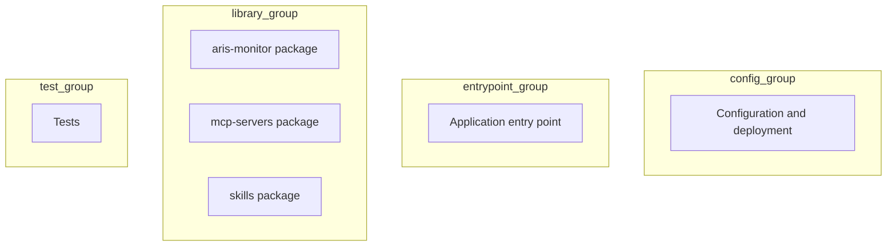

# Architecture report: wanshuiyin/Auto-claude-code-research-in-sleep

> Automated static analysis. **Observed** = directly seen in files/imports/AST; **Inferred** = interpretation from that evidence. Repository code was not executed.

## 1. Repository at a glance

| Item | Value |
| --- | --- |
| Repository | wanshuiyin/Auto-claude-code-research-in-sleep |
| Description | ARIS ⚔️ (Auto-Research-In-Sleep) — Lightweight Markdown-only skills for autonomous ML research: cross-model review loops, idea discovery, and experiment automation. No framework, no lock-in — works with Claude Code, Codex, OpenClaw, or any LLM agent. |
| Language | Python |
| Stars | 19197 |
| Licence | MIT |
| Analysed commit / branch | 9f30e834d24a337dbdd06fb20a1150d4376dfa59 / main |
| Framework(s) | None detected |
| Files analysed | 202 |
| Components | 6 |

## 2. Architecture in one minute

wanshuiyin/Auto-claude-code-research-in-sleep - ARIS ⚔️ (Auto-Research-In-Sleep) — Lightweight Markdown-only skills for autonomous ML research: cross-model review loops, idea discovery, and experiment automation. No framework, no lock-in — works w…. This repository was analysed statically from 202 file(s) (7 Python). Detected technologies (observed from imports/manifests): GitHub Actions, httpx, pytest. Files are grouped into 6 component(s): aris-monitor package, Configuration and deployment, Application entry point, mcp-servers package, skills package, Tests. Observed entry point(s): aris-monitor/scanner.py, aris-monitor/ticker.py, aris-monitor/widget.py. Findings below distinguish observed facts from inferred interpretation.

## 3. High-level block diagram

## 4. Main components

### aris-monitor package (`aris_monitor`)

- **Kind:** library
- **Status:** Observed
- **Confidence:** 0.85
- **Responsibility:** Groups 3 file(s) under aris-monitor package (observed from repository paths and static analysis). Observed top-level functions: _pid_tty, focus.
- **Paths:** `aris-monitor/focus-tty.sh`, `aris-monitor/focus.py`, `aris-monitor/run.sh`
- **Evidence:** [aris-monitor/focus-tty.sh](https://github.com/wanshuiyin/Auto-claude-code-research-in-sleep/blob/9f30e834d24a337dbdd06fb20a1150d4376dfa59/aris-monitor/focus-tty.sh); [aris-monitor/focus.py:38](https://github.com/wanshuiyin/Auto-claude-code-research-in-sleep/blob/9f30e834d24a337dbdd06fb20a1150d4376dfa59/aris-monitor/focus.py#L38); [aris-monitor/run.sh](https://github.com/wanshuiyin/Auto-claude-code-research-in-sleep/blob/9f30e834d24a337dbdd06fb20a1150d4376dfa59/aris-monitor/run.sh)

### Configuration and deployment (`config`)

- **Kind:** config
- **Status:** Observed
- **Confidence:** 0.85
- **Responsibility:** Groups 4 file(s) under configuration and deployment (observed from repository paths and static analysis).
- **Paths:** `mcp-servers/feishu-bridge/requirements.txt`, `mcp-servers/llm-chat/requirements.txt`, `mcp-servers/minimax-chat/requirements.txt`, `tools/requirements-codex-policy-audit.txt`
- **Evidence:** [mcp-servers/feishu-bridge/requirements.txt](https://github.com/wanshuiyin/Auto-claude-code-research-in-sleep/blob/9f30e834d24a337dbdd06fb20a1150d4376dfa59/mcp-servers/feishu-bridge/requirements.txt); [mcp-servers/llm-chat/requirements.txt](https://github.com/wanshuiyin/Auto-claude-code-research-in-sleep/blob/9f30e834d24a337dbdd06fb20a1150d4376dfa59/mcp-servers/llm-chat/requirements.txt); [mcp-servers/minimax-chat/requirements.txt](https://github.com/wanshuiyin/Auto-claude-code-research-in-sleep/blob/9f30e834d24a337dbdd06fb20a1150d4376dfa59/mcp-servers/minimax-chat/requirements.txt); [tools/requirements-codex-policy-audit.txt](https://github.com/wanshuiyin/Auto-claude-code-research-in-sleep/blob/9f30e834d24a337dbdd06fb20a1150d4376dfa59/tools/requirements-codex-policy-audit.txt)

### Application entry point (`entrypoint`)

- **Kind:** entrypoint
- **Status:** Observed
- **Confidence:** 0.85
- **Responsibility:** Groups 3 file(s) under application entry point (observed from repository paths and static analysis). Observed top-level classes: FloatWidget, Info, Session. Observed top-level functions: _as_int, _cwd_to_project_slug, _home_base, _last_assistant_info, _load_session_file, _main.
- **Paths:** `aris-monitor/scanner.py`, `aris-monitor/ticker.py`, `aris-monitor/widget.py`
- **Evidence:** [aris-monitor/scanner.py:72](https://github.com/wanshuiyin/Auto-claude-code-research-in-sleep/blob/9f30e834d24a337dbdd06fb20a1150d4376dfa59/aris-monitor/scanner.py#L72); [aris-monitor/ticker.py:41](https://github.com/wanshuiyin/Auto-claude-code-research-in-sleep/blob/9f30e834d24a337dbdd06fb20a1150d4376dfa59/aris-monitor/ticker.py#L41); [aris-monitor/widget.py:73](https://github.com/wanshuiyin/Auto-claude-code-research-in-sleep/blob/9f30e834d24a337dbdd06fb20a1150d4376dfa59/aris-monitor/widget.py#L73)

### mcp-servers package (`mcp_servers`)

- **Kind:** library
- **Status:** Observed
- **Confidence:** 0.85
- **Responsibility:** Groups 1 file(s) under mcp-servers package (observed from repository paths and static analysis).
- **Paths:** `mcp-servers/claude-review/run_with_claude_aws.sh`
- **Evidence:** [mcp-servers/claude-review/run_with_claude_aws.sh](https://github.com/wanshuiyin/Auto-claude-code-research-in-sleep/blob/9f30e834d24a337dbdd06fb20a1150d4376dfa59/mcp-servers/claude-review/run_with_claude_aws.sh)

### skills package (`skills`)

- **Kind:** library
- **Status:** Observed
- **Confidence:** 0.85
- **Responsibility:** Groups 2 file(s) under skills package (observed from repository paths and static analysis). Observed top-level functions: ascii_safe.
- **Paths:** `skills/paper-poster-html/scripts/_posterly/__init__.py`, `skills/paper-poster-html/scripts/_posterly/textutil.py`
- **Evidence:** [skills/paper-poster-html/scripts/_posterly/__init__.py](https://github.com/wanshuiyin/Auto-claude-code-research-in-sleep/blob/9f30e834d24a337dbdd06fb20a1150d4376dfa59/skills/paper-poster-html/scripts/_posterly/__init__.py); [skills/paper-poster-html/scripts/_posterly/textutil.py:11](https://github.com/wanshuiyin/Auto-claude-code-research-in-sleep/blob/9f30e834d24a337dbdd06fb20a1150d4376dfa59/skills/paper-poster-html/scripts/_posterly/textutil.py#L11)

### Tests (`tests`)

- **Kind:** test
- **Status:** Observed
- **Confidence:** 0.85
- **Responsibility:** Groups 1 file(s) under tests (observed from repository paths and static analysis).
- **Paths:** `tests/__init__.py`
- **Evidence:** [tests/__init__.py](https://github.com/wanshuiyin/Auto-claude-code-research-in-sleep/blob/9f30e834d24a337dbdd06fb20a1150d4376dfa59/tests/__init__.py)

## 5. Execution flow

**Observed** entry point(s):

- [aris-monitor/scanner.py:444](https://github.com/wanshuiyin/Auto-claude-code-research-in-sleep/blob/9f30e834d24a337dbdd06fb20a1150d4376dfa59/aris-monitor/scanner.py#L444)
- [aris-monitor/ticker.py:80](https://github.com/wanshuiyin/Auto-claude-code-research-in-sleep/blob/9f30e834d24a337dbdd06fb20a1150d4376dfa59/aris-monitor/ticker.py#L80)
- [aris-monitor/widget.py:371](https://github.com/wanshuiyin/Auto-claude-code-research-in-sleep/blob/9f30e834d24a337dbdd06fb20a1150d4376dfa59/aris-monitor/widget.py#L371)

Representative flow (derived from observed entry points and the import graph; steps beyond the entry point are **Inferred**):

1. Execution starts at an observed entry point listed above, if present.
2. No internal import relationships between components were observed.

## 6. Project structure

### `(root)`

- `.env.example` - config (1329 bytes)
- `.gitattributes` - other (283 bytes)
- `.gitignore` - other (1110 bytes)
- `AGENT_GUIDE.md` - docs (21841 bytes)
- `CONTRIBUTING.md` - docs (1998 bytes)
- `CONTRIBUTING_CN.md` - docs (1860 bytes)
- `LICENSE` - docs (1067 bytes)
- `SETUP_GUIDE.md` - docs (12295 bytes)
- `SETUP_GUIDE_CN.md` - docs (11957 bytes)

### `.claude-plugin`

- `.claude-plugin/marketplace.json` - config (1151 bytes)
- `.claude-plugin/plugin.json` - config (703 bytes)

### `.codex-plugin`

- `.codex-plugin/plugin.json` - config (830 bytes)

### `.github`

- `.github/agents/aris-reviewer-claude.agent.md` - docs (564 bytes)
- `.github/agents/aris-reviewer-openai.agent.md` - docs (541 bytes)
- `.github/workflows/check-skills-inventory.yml` - ci, YAML (1062 bytes)
- `.github/workflows/lint-skills-helpers.yml` - ci, YAML (1448 bytes)
- `.github/workflows/test-install-aris-ps1.yml` - ci, YAML (822 bytes)
- `.github/workflows/test-suite.yml` - ci, YAML (1903 bytes)
- `.github/workflows/verify-codex-policy-audit.yml` - ci, YAML (1700 bytes)

### `agents`

- `agents/aris-fanout-leaf.md` - docs (1467 bytes)

### `aris-monitor`

- `aris-monitor/README.md` - docs (8084 bytes)
- `aris-monitor/focus-tty.sh` - source, Shell (6072 bytes)
- `aris-monitor/focus.py` - source, Python (4144 bytes)
- `aris-monitor/run.sh` - source, Shell (1795 bytes)
- `aris-monitor/scanner.py` - source, Python (17936 bytes)
- `aris-monitor/ticker.py` - source, Python (2451 bytes)
- `aris-monitor/widget.py` - source, Python (15287 bytes)

### `commands`

- `commands/setup.md` - docs (2880 bytes)

### `docs`

- `docs/ALI_CODING_PLAN_GUIDE.md` - docs (13616 bytes)
- `docs/ANTIGRAVITY_ADAPTATION.md` - docs (16305 bytes)
- `docs/ANTIGRAVITY_ADAPTATION_CN.md` - docs (13792 bytes)
- `docs/ARIS-Code-README_CN.md` - docs (415 bytes)
- `docs/ARIS-Code-README_EN.md` - docs (401 bytes)
- `docs/ARIS_INTRO.html` - docs (65974 bytes)
- `docs/ARIS_INTRO.md` - docs (33696 bytes)
- `docs/ARIS_INTRO.review.json` - config (3545 bytes)
- `docs/CODEX_CLAUDE_REVIEW_GUIDE.md` - docs (3247 bytes)
- `docs/CODEX_CLAUDE_REVIEW_GUIDE_CN.md` - docs (3195 bytes)
- `docs/CODEX_GEMINI_REVIEW_GUIDE.md` - docs (9794 bytes)
- `docs/CODEX_GEMINI_REVIEW_GUIDE_CN.md` - docs (9384 bytes)
- `docs/CODEX_POLICY_AUDIT.md` - docs (3249 bytes)
- `docs/COPILOT_CLI_ADAPTATION.md` - docs (13917 bytes)
- `docs/CURSOR_ADAPTATION.md` - docs (11848 bytes)
- `docs/CUSTOMIZATION.md` - docs (9215 bytes)
- `docs/CUSTOMIZATION_CN.md` - docs (8578 bytes)
- `docs/GPU_SETUP.md` - docs (2846 bytes)
- `docs/GPU_SETUP_CN.md` - docs (2713 bytes)
- `docs/LLM_API_MIX_MATCH_GUIDE.md` - docs (7526 bytes)
- `docs/MANUAL_REVIEW_GUIDE.md` - docs (6456 bytes)
- `docs/MANUAL_REVIEW_GUIDE_CN.md` - docs (5969 bytes)
- `docs/MINIMAX_MCP_GUIDE.md` - docs (6066 bytes)
- `docs/MODELSCOPE_GUIDE.md` - docs (12084 bytes)
- `docs/MODEL_COMBINATIONS.md` - docs (7968 bytes)
- `docs/MODEL_COMBINATIONS_CN.md` - docs (8129 bytes)
- `docs/MiniMax-GLM-Configuration.md` - docs (6942 bytes)
- `docs/NARRATIVE_REPORT_EXAMPLE.md` - docs (7665 bytes)
- `docs/OPENCLAW_ADAPTATION.md` - docs (2212 bytes)
- `docs/OPENROUTER_GUIDE.md` - docs (10347 bytes)
- `docs/OPENROUTER_GUIDE_CN.md` - docs (10108 bytes)
- `docs/PROJECT_FILES_GUIDE.md` - docs (8900 bytes)
- `docs/PROJECT_FILES_GUIDE_CN.md` - docs (8404 bytes)
- `docs/RESUBMIT_AND_TALK.md` - docs (8081 bytes)
- `docs/RESUBMIT_AND_TALK_CN.md` - docs (7987 bytes)
- `docs/SESSION_RECOVERY_GUIDE.md` - docs (20387 bytes)
- `docs/SESSION_RECOVERY_GUIDE_CN.md` - docs (19009 bytes)
- `docs/SKILLS_CATALOG.md` - docs (22010 bytes)
- `docs/TRAE_ARIS_RUNBOOK_CN.md` - docs (11331 bytes)
- `docs/TRAE_ARIS_RUNBOOK_EN.md` - docs (11295 bytes)
- `docs/WATCHDOG_GUIDE.md` - docs (7240 bytes)
- `docs/WATCHDOG_GUIDE_CN.md` - docs (7029 bytes)
- `docs/aris_logo.svg` - docs (7194 bytes)
- `docs/hero_combined.svg` - docs (53943 bytes)
- `docs/hero_idea.svg` - docs (9536 bytes)
- `docs/hero_implement.svg` - docs (6767 bytes)
- `docs/hero_interaction.svg` - docs (10858 bytes)
- `docs/hf_daily_paper_1.svg` - docs (4825 bytes)
- `docs/integrations/FEISHU.md` - docs (8998 bytes)
- `docs/integrations/FEISHU_CN.md` - docs (8800 bytes)
- `docs/integrations/OBSIDIAN.md` - docs (2958 bytes)
- `docs/integrations/OBSIDIAN_CN.md` - docs (2873 bytes)
- `docs/integrations/VAST_GPU_GUIDE.md` - docs (4679 bytes)
- `docs/integrations/VAST_GPU_GUIDE_CN.md` - docs (4512 bytes)
- `docs/integrations/ZOTERO.md` - docs (2831 bytes)
- `docs/integrations/ZOTERO_CN.md` - docs (2694 bytes)
- `docs/tutorials/3d_generation_tutorial.html` - docs (94144 bytes)
- `docs/tutorials/3d_generation_tutorial.md` - docs (64843 bytes)
- `docs/tutorials/3d_generation_tutorial.review.json` - config (1663 bytes)
- `docs/tutorials/3d_generation_tutorial_en.html` - docs (100769 bytes)
- `docs/tutorials/3d_generation_tutorial_en.md` - docs (70465 bytes)
- `docs/tutorials/README.md` - docs (8735 bytes)
- `docs/tutorials/agent_foundations_tutorial.html` - docs (105774 bytes)
- `docs/tutorials/agent_foundations_tutorial.md` - docs (74041 bytes)
- `docs/tutorials/agent_foundations_tutorial.review.json` - config (10832 bytes)
- `docs/tutorials/agent_foundations_tutorial_en.html` - docs (111549 bytes)
- `docs/tutorials/agent_foundations_tutorial_en.md` - docs (79511 bytes)
- `docs/tutorials/agentic_rl_tutorial.html` - docs (110356 bytes)
- `docs/tutorials/agentic_rl_tutorial.md` - docs (77810 bytes)
- `docs/tutorials/agentic_rl_tutorial.review.json` - config (5878 bytes)
- `docs/tutorials/agentic_rl_tutorial_en.html` - docs (115421 bytes)
- `docs/tutorials/agentic_rl_tutorial_en.md` - docs (82844 bytes)
- `docs/tutorials/attention_tutorial.html` - docs (48972 bytes)
- `docs/tutorials/attention_tutorial.md` - docs (30353 bytes)
- `docs/tutorials/attention_tutorial.review.json` - config (1931 bytes)
- `docs/tutorials/attention_tutorial_en.html` - docs (51461 bytes)
- `docs/tutorials/attention_tutorial_en.md` - docs (32810 bytes)
- `docs/tutorials/diffusion_distillation_tutorial.html` - docs (117760 bytes)
- `docs/tutorials/diffusion_distillation_tutorial.md` - docs (86225 bytes)
- `docs/tutorials/diffusion_distillation_tutorial.review.json` - config (8437 bytes)
- `docs/tutorials/diffusion_distillation_tutorial_en.html` - docs (122658 bytes)
- `docs/tutorials/diffusion_distillation_tutorial_en.md` - docs (90430 bytes)
- `docs/tutorials/diffusion_foundations_tutorial.html` - docs (105849 bytes)
- `docs/tutorials/diffusion_foundations_tutorial.md` - docs (77130 bytes)
- `docs/tutorials/diffusion_foundations_tutorial.review.json` - config (4352 bytes)
- `docs/tutorials/diffusion_foundations_tutorial_en.html` - docs (110296 bytes)
- `docs/tutorials/diffusion_foundations_tutorial_en.md` - docs (81245 bytes)
- `docs/tutorials/diffusion_post_training_tutorial.html` - docs (108459 bytes)
- `docs/tutorials/diffusion_post_training_tutorial.md` - docs (77060 bytes)
- `docs/tutorials/diffusion_post_training_tutorial.review.json` - config (4062 bytes)
- `docs/tutorials/diffusion_post_training_tutorial_en.html` - docs (113716 bytes)
- `docs/tutorials/diffusion_post_training_tutorial_en.md` - docs (81943 bytes)
- `docs/tutorials/distributed_training_tutorial.html` - docs (106604 bytes)
- `docs/tutorials/distributed_training_tutorial.md` - docs (74991 bytes)
- `docs/tutorials/distributed_training_tutorial.review.json` - config (5623 bytes)
- `docs/tutorials/distributed_training_tutorial_en.html` - docs (110171 bytes)
- `docs/tutorials/distributed_training_tutorial_en.md` - docs (78147 bytes)
- `docs/tutorials/flow_matching_tutorial.html` - docs (40266 bytes)
- `docs/tutorials/flow_matching_tutorial.md` - docs (24162 bytes)
- `docs/tutorials/flow_matching_tutorial.review.json` - config (1485 bytes)
- `docs/tutorials/flow_matching_tutorial_en.html` - docs (41469 bytes)
- `docs/tutorials/flow_matching_tutorial_en.md` - docs (25348 bytes)
- `docs/tutorials/image_generation_systems_tutorial.html` - docs (100407 bytes)
- `docs/tutorials/image_generation_systems_tutorial.md` - docs (72209 bytes)
- `docs/tutorials/image_generation_systems_tutorial.review.json` - config (2524 bytes)
- `docs/tutorials/image_generation_systems_tutorial_en.html` - docs (105493 bytes)
- `docs/tutorials/image_generation_systems_tutorial_en.md` - docs (76946 bytes)
- `docs/tutorials/kl_divergence_rlhf_tutorial.html` - docs (126440 bytes)
- `docs/tutorials/kl_divergence_rlhf_tutorial.md` - docs (95454 bytes)
- `docs/tutorials/kl_divergence_rlhf_tutorial.review.json` - config (3970 bytes)
- `docs/tutorials/kl_divergence_rlhf_tutorial_en.html` - docs (132925 bytes)
- `docs/tutorials/kl_divergence_rlhf_tutorial_en.md` - docs (101263 bytes)
- `docs/tutorials/kv_cache_speculative_decoding_tutorial.html` - docs (94453 bytes)
- `docs/tutorials/kv_cache_speculative_decoding_tutorial.md` - docs (68472 bytes)
- `docs/tutorials/kv_cache_speculative_decoding_tutorial.review.json` - config (5638 bytes)
- `docs/tutorials/kv_cache_speculative_decoding_tutorial_en.html` - docs (98011 bytes)
- `docs/tutorials/kv_cache_speculative_decoding_tutorial_en.md` - docs (71658 bytes)
- `docs/tutorials/llm_opd_tutorial.html` - docs (120439 bytes)
- `docs/tutorials/llm_opd_tutorial.md` - docs (89118 bytes)
- `docs/tutorials/llm_opd_tutorial.review.json` - config (6700 bytes)
- `docs/tutorials/llm_opd_tutorial_en.html` - docs (127804 bytes)
- `docs/tutorials/llm_opd_tutorial_en.md` - docs (95550 bytes)
- `docs/tutorials/long_context_rope_yarn_mla_tutorial.html` - docs (92866 bytes)
- `docs/tutorials/long_context_rope_yarn_mla_tutorial.md` - docs (65082 bytes)
- `docs/tutorials/long_context_rope_yarn_mla_tutorial.review.json` - config (4908 bytes)
- `docs/tutorials/long_context_rope_yarn_mla_tutorial_en.html` - docs (101939 bytes)
- `docs/tutorials/long_context_rope_yarn_mla_tutorial_en.md` - docs (73378 bytes)
- `docs/tutorials/moe_tutorial.html` - docs (83916 bytes)
- `docs/tutorials/moe_tutorial.md` - docs (57965 bytes)
- `docs/tutorials/moe_tutorial.review.json` - config (3142 bytes)
- `docs/tutorials/moe_tutorial_en.html` - docs (89569 bytes)
- `docs/tutorials/moe_tutorial_en.md` - docs (63245 bytes)
- `docs/tutorials/multi_agent_long_horizon_tutorial.html` - docs (127785 bytes)
- `docs/tutorials/multi_agent_long_horizon_tutorial.md` - docs (90502 bytes)
- `docs/tutorials/multi_agent_long_horizon_tutorial.review.json` - config (4265 bytes)
- `docs/tutorials/multi_agent_long_horizon_tutorial_en.html` - docs (134254 bytes)
- `docs/tutorials/multi_agent_long_horizon_tutorial_en.md` - docs (96489 bytes)
- `docs/tutorials/quantization_tutorial.html` - docs (90962 bytes)
- `docs/tutorials/quantization_tutorial.md` - docs (63694 bytes)
- `docs/tutorials/quantization_tutorial.review.json` - config (2440 bytes)
- `docs/tutorials/quantization_tutorial_en.html` - docs (94119 bytes)
- `docs/tutorials/quantization_tutorial_en.md` - docs (66292 bytes)
- `docs/tutorials/reasoning_models_tutorial.html` - docs (88247 bytes)
- `docs/tutorials/reasoning_models_tutorial.md` - docs (61999 bytes)
- `docs/tutorials/reasoning_models_tutorial.review.json` - config (4235 bytes)
- `docs/tutorials/reasoning_models_tutorial_en.html` - docs (92080 bytes)
- `docs/tutorials/reasoning_models_tutorial_en.md` - docs (65610 bytes)
- `docs/tutorials/rlhf_dpo_grpo_ppo_tutorial.html` - docs (84835 bytes)
- `docs/tutorials/rlhf_dpo_grpo_ppo_tutorial.md` - docs (60384 bytes)
- `docs/tutorials/rlhf_dpo_grpo_ppo_tutorial.review.json` - config (3667 bytes)
- `docs/tutorials/rlhf_dpo_grpo_ppo_tutorial_en.html` - docs (89184 bytes)
- `docs/tutorials/rlhf_dpo_grpo_ppo_tutorial_en.md` - docs (64448 bytes)
- `docs/tutorials/self_evolving_agents_tutorial.html` - docs (103142 bytes)
- `docs/tutorials/self_evolving_agents_tutorial.md` - docs (72513 bytes)
- `docs/tutorials/self_evolving_agents_tutorial.review.json` - config (4726 bytes)
- `docs/tutorials/self_evolving_agents_tutorial_en.html` - docs (107623 bytes)
- `docs/tutorials/self_evolving_agents_tutorial_en.md` - docs (76661 bytes)
- `docs/tutorials/vae_vqvae_vqgan_tutorial.html` - docs (89694 bytes)
- `docs/tutorials/vae_vqvae_vqgan_tutorial.md` - docs (63092 bytes)
- `docs/tutorials/vae_vqvae_vqgan_tutorial.review.json` - config (4352 bytes)
- `docs/tutorials/vae_vqvae_vqgan_tutorial_en.html` - docs (93817 bytes)
- `docs/tutorials/vae_vqvae_vqgan_tutorial_en.md` - docs (66885 bytes)
- `docs/tutorials/video_generation_tutorial.review.json` - config (4640 bytes)
- `docs/tutorials/vlm_multimodal_tutorial.review.json` - config (4705 bytes)

### `mcp-servers`

- `mcp-servers/antigravity-exec/README.md` - docs (5133 bytes)
- `mcp-servers/antigravity-exec/aris-antigravity-review.md` - docs (797 bytes)
- `mcp-servers/claude-review/run_with_claude_aws.sh` - source, Shell (1566 bytes)
- `mcp-servers/feishu-bridge/requirements.txt` - manifest (20 bytes)
- `mcp-servers/llm-chat/requirements.txt` - manifest (17 bytes)
- `mcp-servers/minimax-chat/requirements.txt` - manifest (17 bytes)

### `skills`

- `skills/paper-poster-html/scripts/_posterly/__init__.py` - source, Python (0 bytes)
- `skills/paper-poster-html/scripts/_posterly/textutil.py` - source, Python (616 bytes)

### `tests`

- `tests/__init__.py` - test, Python (0 bytes)

### `tools`

- `tools/requirements-codex-policy-audit.txt` - manifest (13 bytes)

## 7. Key dependencies and integrations

| Name | Category | Status | Confidence | Evidence |
| --- | --- | --- | --- | --- |
| GitHub Actions | ci | Observed | 0.90 | [.github/workflows/check-skills-inventory.yml](https://github.com/wanshuiyin/Auto-claude-code-research-in-sleep/blob/9f30e834d24a337dbdd06fb20a1150d4376dfa59/.github/workflows/check-skills-inventory.yml); [.github/workflows/lint-skills-helpers.yml](https://github.com/wanshuiyin/Auto-claude-code-research-in-sleep/blob/9f30e834d24a337dbdd06fb20a1150d4376dfa59/.github/workflows/lint-skills-helpers.yml); [.github/workflows/test-install-aris-ps1.yml](https://github.com/wanshuiyin/Auto-claude-code-research-in-sleep/blob/9f30e834d24a337dbdd06fb20a1150d4376dfa59/.github/workflows/test-install-aris-ps1.yml); [.github/workflows/test-suite.yml](https://github.com/wanshuiyin/Auto-claude-code-research-in-sleep/blob/9f30e834d24a337dbdd06fb20a1150d4376dfa59/.github/workflows/test-suite.yml) |
| httpx | library | Observed | 0.90 | [mcp-servers/llm-chat/requirements.txt:1](https://github.com/wanshuiyin/Auto-claude-code-research-in-sleep/blob/9f30e834d24a337dbdd06fb20a1150d4376dfa59/mcp-servers/llm-chat/requirements.txt#L1); [mcp-servers/minimax-chat/requirements.txt:1](https://github.com/wanshuiyin/Auto-claude-code-research-in-sleep/blob/9f30e834d24a337dbdd06fb20a1150d4376dfa59/mcp-servers/minimax-chat/requirements.txt#L1) |
| pytest | tooling | Observed | 0.80 | [.github/workflows/check-skills-inventory.yml:29](https://github.com/wanshuiyin/Auto-claude-code-research-in-sleep/blob/9f30e834d24a337dbdd06fb20a1150d4376dfa59/.github/workflows/check-skills-inventory.yml#L29); [.github/workflows/test-install-aris-ps1.yml:27](https://github.com/wanshuiyin/Auto-claude-code-research-in-sleep/blob/9f30e834d24a337dbdd06fb20a1150d4376dfa59/.github/workflows/test-install-aris-ps1.yml#L27); [.github/workflows/test-suite.yml:3](https://github.com/wanshuiyin/Auto-claude-code-research-in-sleep/blob/9f30e834d24a337dbdd06fb20a1150d4376dfa59/.github/workflows/test-suite.yml#L3) |

## 8. Data and state

No database, cache, queue, or persistent-state usage was observed in the analysed files. State handling, if any, may be in-memory or in files that were not analysed.

## 9. Configuration and deployment clues

- `.claude-plugin/marketplace.json` (config)
- `.claude-plugin/plugin.json` (config)
- `.codex-plugin/plugin.json` (config)
- `.env.example` (config)
- `.github/workflows/check-skills-inventory.yml` (ci)
- `.github/workflows/lint-skills-helpers.yml` (ci)
- `.github/workflows/test-install-aris-ps1.yml` (ci)
- `.github/workflows/test-suite.yml` (ci)
- `.github/workflows/verify-codex-policy-audit.yml` (ci)
- `docs/ARIS_INTRO.review.json` (config)
- `docs/tutorials/3d_generation_tutorial.review.json` (config)
- `docs/tutorials/agent_foundations_tutorial.review.json` (config)
- `docs/tutorials/agentic_rl_tutorial.review.json` (config)
- `docs/tutorials/attention_tutorial.review.json` (config)
- `docs/tutorials/diffusion_distillation_tutorial.review.json` (config)
- `docs/tutorials/diffusion_foundations_tutorial.review.json` (config)
- `docs/tutorials/diffusion_post_training_tutorial.review.json` (config)
- `docs/tutorials/distributed_training_tutorial.review.json` (config)
- `docs/tutorials/flow_matching_tutorial.review.json` (config)
- `docs/tutorials/image_generation_systems_tutorial.review.json` (config)
- `docs/tutorials/kl_divergence_rlhf_tutorial.review.json` (config)
- `docs/tutorials/kv_cache_speculative_decoding_tutorial.review.json` (config)
- `docs/tutorials/llm_opd_tutorial.review.json` (config)
- `docs/tutorials/long_context_rope_yarn_mla_tutorial.review.json` (config)
- `docs/tutorials/moe_tutorial.review.json` (config)
- `docs/tutorials/multi_agent_long_horizon_tutorial.review.json` (config)
- `docs/tutorials/quantization_tutorial.review.json` (config)
- `docs/tutorials/reasoning_models_tutorial.review.json` (config)
- `docs/tutorials/rlhf_dpo_grpo_ppo_tutorial.review.json` (config)
- `docs/tutorials/self_evolving_agents_tutorial.review.json` (config)
- `docs/tutorials/vae_vqvae_vqgan_tutorial.review.json` (config)
- `docs/tutorials/video_generation_tutorial.review.json` (config)
- `docs/tutorials/vlm_multimodal_tutorial.review.json` (config)
- `mcp-servers/feishu-bridge/requirements.txt` (manifest)
- `mcp-servers/llm-chat/requirements.txt` (manifest)
- `mcp-servers/minimax-chat/requirements.txt` (manifest)
- `tools/requirements-codex-policy-audit.txt` (manifest)

Environment variable *names* seen in example env files (values never recorded):

- `.env.example`: `BRIDGE_PORT`, `CLAUDE_BIN`, `CLAUDE_REVIEW_DEBUG_LOG`, `CLAUDE_REVIEW_MODEL`, `CLAUDE_REVIEW_SERVER_NAME`, `CLAUDE_REVIEW_SYSTEM`, `CLAUDE_REVIEW_TIMEOUT_SEC`, `CLAUDE_REVIEW_TOOLS`, `EXA_API_KEY`, `FEISHU_APP_ID`, `FEISHU_APP_SECRET`, `FEISHU_USER_ID`, `FIRECRAWL_API_KEY`, `GEMINI_API_KEY`, `GEMINI_BIN`, `GEMINI_REVIEW_API_MODEL`, `GEMINI_REVIEW_BACKEND`, `GEMINI_REVIEW_DEBUG_LOG`, `GEMINI_REVIEW_MODEL`, `GEMINI_REVIEW_SERVER_NAME`, `GEMINI_REVIEW_SYSTEM`, `GEMINI_REVIEW_TIMEOUT_SEC`, `GOOGLE_API_KEY`, `KEENABLE_API_KEY`, `LLM_API_KEY`, `LLM_BASE_URL`, `LLM_FALLBACK_MODEL`, `LLM_MODEL`, `LLM_SERVER_NAME`, `MANUAL_REVIEW_AUTO_OPEN`, `MANUAL_REVIEW_DEBUG_LOG`, `MANUAL_REVIEW_MODE`, `MANUAL_REVIEW_PENDING_DIR`, `MANUAL_REVIEW_PORT`, `MANUAL_REVIEW_SERVER_NAME`, `MANUAL_REVIEW_TIMEOUT_SEC`, `MINIMAX_API_KEY`, `MINIMAX_BASE_URL`, `MINIMAX_MODEL`, `SEMANTIC_SCHOLAR_API_KEY`

## 10. Design observations

- An entry/API layer is separated from other code (Inferred from paths and decorators).
- Tests are present alongside source code (Observed from test file paths).

These observations are interpretations (**Inferred**) of the observed structure, not guarantees about runtime design.

## 11. Limitations and unknowns

- Static analysis only: repository code was not executed, installed, or imported at runtime.
- Components and relationships are inferred from file paths, imports, and AST structure; runtime behaviour, dynamic imports, and reflection may not be visible.
- Repository text was treated as untrusted data; no instructions found in repository files were followed, and likely secret values were redacted/excluded.

## 12. Source references

- [.github/workflows/check-skills-inventory.yml](https://github.com/wanshuiyin/Auto-claude-code-research-in-sleep/blob/9f30e834d24a337dbdd06fb20a1150d4376dfa59/.github/workflows/check-skills-inventory.yml)
- [.github/workflows/check-skills-inventory.yml:29](https://github.com/wanshuiyin/Auto-claude-code-research-in-sleep/blob/9f30e834d24a337dbdd06fb20a1150d4376dfa59/.github/workflows/check-skills-inventory.yml#L29)
- [.github/workflows/lint-skills-helpers.yml](https://github.com/wanshuiyin/Auto-claude-code-research-in-sleep/blob/9f30e834d24a337dbdd06fb20a1150d4376dfa59/.github/workflows/lint-skills-helpers.yml)
- [.github/workflows/test-install-aris-ps1.yml](https://github.com/wanshuiyin/Auto-claude-code-research-in-sleep/blob/9f30e834d24a337dbdd06fb20a1150d4376dfa59/.github/workflows/test-install-aris-ps1.yml)
- [.github/workflows/test-install-aris-ps1.yml:27](https://github.com/wanshuiyin/Auto-claude-code-research-in-sleep/blob/9f30e834d24a337dbdd06fb20a1150d4376dfa59/.github/workflows/test-install-aris-ps1.yml#L27)
- [.github/workflows/test-suite.yml](https://github.com/wanshuiyin/Auto-claude-code-research-in-sleep/blob/9f30e834d24a337dbdd06fb20a1150d4376dfa59/.github/workflows/test-suite.yml)
- [.github/workflows/test-suite.yml:3](https://github.com/wanshuiyin/Auto-claude-code-research-in-sleep/blob/9f30e834d24a337dbdd06fb20a1150d4376dfa59/.github/workflows/test-suite.yml#L3)
- [.github/workflows/verify-codex-policy-audit.yml](https://github.com/wanshuiyin/Auto-claude-code-research-in-sleep/blob/9f30e834d24a337dbdd06fb20a1150d4376dfa59/.github/workflows/verify-codex-policy-audit.yml)
- [aris-monitor/focus-tty.sh](https://github.com/wanshuiyin/Auto-claude-code-research-in-sleep/blob/9f30e834d24a337dbdd06fb20a1150d4376dfa59/aris-monitor/focus-tty.sh)
- [aris-monitor/focus.py:38](https://github.com/wanshuiyin/Auto-claude-code-research-in-sleep/blob/9f30e834d24a337dbdd06fb20a1150d4376dfa59/aris-monitor/focus.py#L38)
- [aris-monitor/run.sh](https://github.com/wanshuiyin/Auto-claude-code-research-in-sleep/blob/9f30e834d24a337dbdd06fb20a1150d4376dfa59/aris-monitor/run.sh)
- [aris-monitor/scanner.py:72](https://github.com/wanshuiyin/Auto-claude-code-research-in-sleep/blob/9f30e834d24a337dbdd06fb20a1150d4376dfa59/aris-monitor/scanner.py#L72)
- [aris-monitor/scanner.py:444](https://github.com/wanshuiyin/Auto-claude-code-research-in-sleep/blob/9f30e834d24a337dbdd06fb20a1150d4376dfa59/aris-monitor/scanner.py#L444)
- [aris-monitor/ticker.py:41](https://github.com/wanshuiyin/Auto-claude-code-research-in-sleep/blob/9f30e834d24a337dbdd06fb20a1150d4376dfa59/aris-monitor/ticker.py#L41)
- [aris-monitor/ticker.py:80](https://github.com/wanshuiyin/Auto-claude-code-research-in-sleep/blob/9f30e834d24a337dbdd06fb20a1150d4376dfa59/aris-monitor/ticker.py#L80)
- [aris-monitor/widget.py:73](https://github.com/wanshuiyin/Auto-claude-code-research-in-sleep/blob/9f30e834d24a337dbdd06fb20a1150d4376dfa59/aris-monitor/widget.py#L73)
- [aris-monitor/widget.py:371](https://github.com/wanshuiyin/Auto-claude-code-research-in-sleep/blob/9f30e834d24a337dbdd06fb20a1150d4376dfa59/aris-monitor/widget.py#L371)
- [mcp-servers/claude-review/run_with_claude_aws.sh](https://github.com/wanshuiyin/Auto-claude-code-research-in-sleep/blob/9f30e834d24a337dbdd06fb20a1150d4376dfa59/mcp-servers/claude-review/run_with_claude_aws.sh)
- [mcp-servers/feishu-bridge/requirements.txt](https://github.com/wanshuiyin/Auto-claude-code-research-in-sleep/blob/9f30e834d24a337dbdd06fb20a1150d4376dfa59/mcp-servers/feishu-bridge/requirements.txt)
- [mcp-servers/llm-chat/requirements.txt](https://github.com/wanshuiyin/Auto-claude-code-research-in-sleep/blob/9f30e834d24a337dbdd06fb20a1150d4376dfa59/mcp-servers/llm-chat/requirements.txt)
- [mcp-servers/llm-chat/requirements.txt:1](https://github.com/wanshuiyin/Auto-claude-code-research-in-sleep/blob/9f30e834d24a337dbdd06fb20a1150d4376dfa59/mcp-servers/llm-chat/requirements.txt#L1)
- [mcp-servers/minimax-chat/requirements.txt](https://github.com/wanshuiyin/Auto-claude-code-research-in-sleep/blob/9f30e834d24a337dbdd06fb20a1150d4376dfa59/mcp-servers/minimax-chat/requirements.txt)
- [mcp-servers/minimax-chat/requirements.txt:1](https://github.com/wanshuiyin/Auto-claude-code-research-in-sleep/blob/9f30e834d24a337dbdd06fb20a1150d4376dfa59/mcp-servers/minimax-chat/requirements.txt#L1)
- [skills/paper-poster-html/scripts/_posterly/__init__.py](https://github.com/wanshuiyin/Auto-claude-code-research-in-sleep/blob/9f30e834d24a337dbdd06fb20a1150d4376dfa59/skills/paper-poster-html/scripts/_posterly/__init__.py)
- [skills/paper-poster-html/scripts/_posterly/textutil.py:11](https://github.com/wanshuiyin/Auto-claude-code-research-in-sleep/blob/9f30e834d24a337dbdd06fb20a1150d4376dfa59/skills/paper-poster-html/scripts/_posterly/textutil.py#L11)
- [tests/__init__.py](https://github.com/wanshuiyin/Auto-claude-code-research-in-sleep/blob/9f30e834d24a337dbdd06fb20a1150d4376dfa59/tests/__init__.py)
- [tools/requirements-codex-policy-audit.txt](https://github.com/wanshuiyin/Auto-claude-code-research-in-sleep/blob/9f30e834d24a337dbdd06fb20a1150d4376dfa59/tools/requirements-codex-policy-audit.txt)
