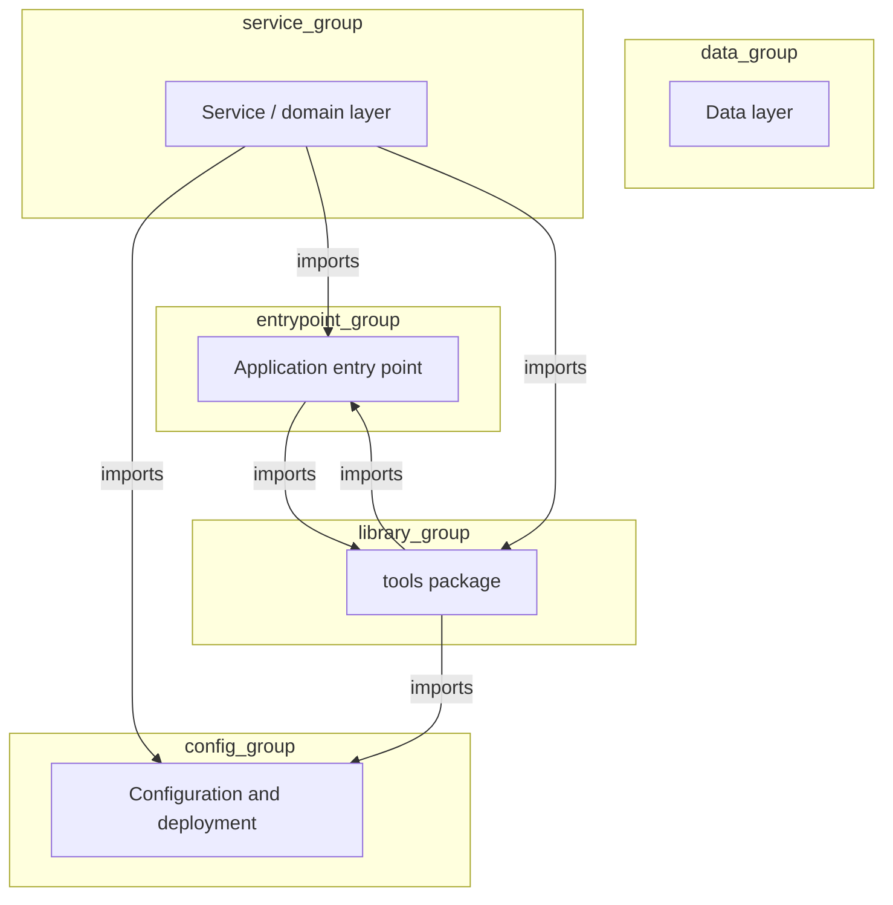

# Architecture report: waydroid/waydroid

> Automated static analysis. **Observed** = directly seen in files/imports/AST; **Inferred** = interpretation from that evidence. Repository code was not executed.

## 1. Repository at a glance

| Item | Value |
| --- | --- |
| Repository | waydroid/waydroid |
| Description | Waydroid uses a container-based approach to boot a full Android system on a regular GNU/Linux system like Ubuntu. |
| Language | Python |
| Stars | 12534 |
| Licence | GPL-3.0 |
| Analysed commit / branch | db7294c4c2bd43157bab94cf8a3015e22d9f1ad8 / main |
| Framework(s) | None detected |
| Files analysed | 81 |
| Components | 5 |

## 2. Architecture in one minute

waydroid/waydroid - Waydroid uses a container-based approach to boot a full Android system on a regular GNU/Linux system like Ubuntu.. This repository was analysed statically from 81 file(s) (43 Python). Detected technologies (observed from imports/manifests): GitHub Actions, Poetry. Files are grouped into 5 component(s): Configuration and deployment, Data layer, Application entry point, Service / domain layer, tools package. Observed entry point(s): tools/__init__.py, waydroid.py. Findings below distinguish observed facts from inferred interpretation.

## 3. High-level block diagram

## 4. Main components

### Configuration and deployment (`config`)

- **Kind:** config
- **Status:** Observed
- **Confidence:** 0.85
- **Responsibility:** Groups 5 file(s) under configuration and deployment (observed from repository paths and static analysis). Observed top-level functions: load, load_channels, save.
- **Paths:** `FUNDING.yml`, `pyproject.toml`, `tools/config/__init__.py`, `tools/config/load.py`, `tools/config/save.py`
- **Evidence:** [FUNDING.yml](https://github.com/waydroid/waydroid/blob/db7294c4c2bd43157bab94cf8a3015e22d9f1ad8/FUNDING.yml); [pyproject.toml](https://github.com/waydroid/waydroid/blob/db7294c4c2bd43157bab94cf8a3015e22d9f1ad8/pyproject.toml); [tools/config/__init__.py](https://github.com/waydroid/waydroid/blob/db7294c4c2bd43157bab94cf8a3015e22d9f1ad8/tools/config/__init__.py); [tools/config/load.py:9](https://github.com/waydroid/waydroid/blob/db7294c4c2bd43157bab94cf8a3015e22d9f1ad8/tools/config/load.py#L9); [tools/config/save.py:7](https://github.com/waydroid/waydroid/blob/db7294c4c2bd43157bab94cf8a3015e22d9f1ad8/tools/config/save.py#L7)

### Data layer (`data_layer`)

- **Kind:** data
- **Status:** Observed
- **Confidence:** 0.85
- **Responsibility:** Groups 2 file(s) under data layer (observed from repository paths and static analysis).
- **Paths:** `data/scripts/waydroid-net.sh`, `data/scripts/waydroid-post-stop.sh`
- **Evidence:** [data/scripts/waydroid-net.sh](https://github.com/waydroid/waydroid/blob/db7294c4c2bd43157bab94cf8a3015e22d9f1ad8/data/scripts/waydroid-net.sh); [data/scripts/waydroid-post-stop.sh](https://github.com/waydroid/waydroid/blob/db7294c4c2bd43157bab94cf8a3015e22d9f1ad8/data/scripts/waydroid-post-stop.sh)

### Application entry point (`entrypoint`)

- **Kind:** entrypoint
- **Status:** Observed
- **Confidence:** 0.85
- **Responsibility:** Groups 3 file(s) under application entry point (observed from repository paths and static analysis). Observed top-level functions: flat_cmd, main, prep_args, root, user.
- **Paths:** `tools/__init__.py`, `tools/helpers/run.py`, `waydroid.py`
- **Evidence:** [tools/__init__.py:17](https://github.com/waydroid/waydroid/blob/db7294c4c2bd43157bab94cf8a3015e22d9f1ad8/tools/__init__.py#L17); [tools/helpers/run.py:7](https://github.com/waydroid/waydroid/blob/db7294c4c2bd43157bab94cf8a3015e22d9f1ad8/tools/helpers/run.py#L7); [waydroid.py](https://github.com/waydroid/waydroid/blob/db7294c4c2bd43157bab94cf8a3015e22d9f1ad8/waydroid.py)

### Service / domain layer (`service_layer`)

- **Kind:** service
- **Status:** Observed
- **Confidence:** 0.85
- **Responsibility:** Groups 5 file(s) under service / domain layer (observed from repository paths and static analysis). Observed top-level functions: start, stop.
- **Paths:** `tools/services/__init__.py`, `tools/services/clipboard_manager.py`, `tools/services/hardware_manager.py`, `tools/services/notification_manager.py`, `tools/services/user_manager.py`
- **Evidence:** [tools/services/__init__.py](https://github.com/waydroid/waydroid/blob/db7294c4c2bd43157bab94cf8a3015e22d9f1ad8/tools/services/__init__.py); [tools/services/clipboard_manager.py:16](https://github.com/waydroid/waydroid/blob/db7294c4c2bd43157bab94cf8a3015e22d9f1ad8/tools/services/clipboard_manager.py#L16); [tools/services/hardware_manager.py:15](https://github.com/waydroid/waydroid/blob/db7294c4c2bd43157bab94cf8a3015e22d9f1ad8/tools/services/hardware_manager.py#L15); [tools/services/notification_manager.py:14](https://github.com/waydroid/waydroid/blob/db7294c4c2bd43157bab94cf8a3015e22d9f1ad8/tools/services/notification_manager.py#L14); [tools/services/user_manager.py:16](https://github.com/waydroid/waydroid/blob/db7294c4c2bd43157bab94cf8a3015e22d9f1ad8/tools/services/user_manager.py#L16)

### tools package (`tools`)

- **Kind:** library
- **Status:** Observed
- **Confidence:** 0.85
- **Responsibility:** Groups 32 file(s) under tools package (observed from repository paths and static analysis). Observed top-level classes: Action, DbusContainerManager, DbusInitializer, DbusSessionManager, INotificationCallback, IPlatform. Observed top-level functions: DBusContainerService, DBusSessionService, adb_connect, adb_disconnect, add_node_entry, add_service.
- **Paths:** `tools/actions/__init__.py`, `tools/actions/app_manager.py`, `tools/actions/bugreport.py`, `tools/actions/container_manager.py`, `tools/actions/initializer.py`, `tools/actions/prop.py`, `tools/actions/session_manager.py`, `tools/actions/status.py`, `tools/actions/upgrader.py`, `tools/helpers/__init__.py`, `tools/helpers/arch.py`, `tools/helpers/arguments.py`, `tools/helpers/drivers.py`, `tools/helpers/gpu.py`, `tools/helpers/http.py`, `tools/helpers/images.py`, `tools/helpers/ipc.py`, `tools/helpers/logging.py`, `tools/helpers/lxc.py`, `tools/helpers/mount.py`, `tools/helpers/net.py`, `tools/helpers/props.py`, `tools/helpers/protocol.py`, `tools/helpers/run_core.py`, `tools/helpers/version.py`, `tools/interfaces/IClipboard.py`, `tools/interfaces/IHardware.py`, `tools/interfaces/INotificationCallback.py`, `tools/interfaces/INotifications.py`, `tools/interfaces/IPlatform.py`, `tools/interfaces/IStatusBarService.py`, `tools/interfaces/IUserMonitor.py`
- **Evidence:** [tools/actions/__init__.py](https://github.com/waydroid/waydroid/blob/db7294c4c2bd43157bab94cf8a3015e22d9f1ad8/tools/actions/__init__.py); [tools/actions/app_manager.py:14](https://github.com/waydroid/waydroid/blob/db7294c4c2bd43157bab94cf8a3015e22d9f1ad8/tools/actions/app_manager.py#L14); [tools/actions/bugreport.py:18](https://github.com/waydroid/waydroid/blob/db7294c4c2bd43157bab94cf8a3015e22d9f1ad8/tools/actions/bugreport.py#L18); [tools/actions/container_manager.py:19](https://github.com/waydroid/waydroid/blob/db7294c4c2bd43157bab94cf8a3015e22d9f1ad8/tools/actions/container_manager.py#L19); [tools/actions/initializer.py:19](https://github.com/waydroid/waydroid/blob/db7294c4c2bd43157bab94cf8a3015e22d9f1ad8/tools/actions/initializer.py#L19); [tools/actions/prop.py:6](https://github.com/waydroid/waydroid/blob/db7294c4c2bd43157bab94cf8a3015e22d9f1ad8/tools/actions/prop.py#L6); [tools/actions/session_manager.py:16](https://github.com/waydroid/waydroid/blob/db7294c4c2bd43157bab94cf8a3015e22d9f1ad8/tools/actions/session_manager.py#L16); [tools/actions/status.py:8](https://github.com/waydroid/waydroid/blob/db7294c4c2bd43157bab94cf8a3015e22d9f1ad8/tools/actions/status.py#L8)

## 5. Execution flow

**Observed** entry point(s):

- [tools/__init__.py:172](https://github.com/waydroid/waydroid/blob/db7294c4c2bd43157bab94cf8a3015e22d9f1ad8/tools/__init__.py#L172)
- [waydroid.py:9](https://github.com/waydroid/waydroid/blob/db7294c4c2bd43157bab94cf8a3015e22d9f1ad8/waydroid.py#L9)

Representative flow (derived from observed entry points and the import graph; steps beyond the entry point are **Inferred**):

1. Execution starts at an observed entry point listed above, if present.
2. `entrypoint` imports `tools` (Application entry point -> tools package).
3. `service_layer` imports `config` (Service / domain layer -> Configuration and deployment).
4. `service_layer` imports `entrypoint` (Service / domain layer -> Application entry point).
5. `service_layer` imports `tools` (Service / domain layer -> tools package).
6. `tools` imports `config` (tools package -> Configuration and deployment).
7. `tools` imports `entrypoint` (tools package -> Application entry point).

## 6. Project structure

### `(root)`

- `.abstruse.yml` - config (739 bytes)
- `.gitignore` - other (1817 bytes)
- `FUNDING.yml` - config (26 bytes)
- `LICENSE` - docs (35149 bytes)
- `Makefile` - other (3440 bytes)
- `README.md` - docs (1212 bytes)
- `pyproject.toml` - manifest (425 bytes)
- `waydroid.py` - source, Python (231 bytes)

### `.github`

- `.github/ISSUE_TEMPLATE/bug_report.yml` - config (1858 bytes)
- `.github/ISSUE_TEMPLATE/feature_request.yml` - config (1224 bytes)
- `.github/dependabot.yaml` - config (217 bytes)
- `.github/workflows/check.yaml` - ci, YAML (750 bytes)

### `data`

- `data/Waydroid.desktop` - other (669 bytes)
- `data/configs/apparmor_profiles/adbd` - other (1213 bytes)
- `data/configs/apparmor_profiles/android_app` - other (1903 bytes)
- `data/configs/apparmor_profiles/lxc-waydroid` - other (1621 bytes)
- `data/configs/config_1` - other (300 bytes)
- `data/configs/config_3` - other (342 bytes)
- `data/configs/config_4` - other (31 bytes)
- `data/configs/config_base` - other (618 bytes)
- `data/configs/waydroid.seccomp` - other (346 bytes)
- `data/id.waydro.waydroid.metainfo.xml` - other (2644 bytes)
- `data/scripts/waydroid-net.sh` - source, Shell (9143 bytes)
- `data/scripts/waydroid-post-stop.sh` - source, Shell (758 bytes)
- `data/waydroid.app.install.desktop` - other (207 bytes)
- `data/waydroid.directory` - other (59 bytes)
- `data/waydroid.market.desktop` - other (347 bytes)
- `data/waydroid.menu` - other (311 bytes)

### `dbus`

- `dbus/id.waydro.Container.conf` - other (408 bytes)
- `dbus/id.waydro.Container.policy` - other (691 bytes)
- `dbus/id.waydro.Container.service` - other (132 bytes)

### `debian`

- `debian/changelog` - other (19629 bytes)
- `debian/compat` - other (3 bytes)
- `debian/control` - other (793 bytes)
- `debian/copyright` - other (2431 bytes)
- `debian/rules` - other (301 bytes)
- `debian/source/format` - other (13 bytes)
- `debian/waydroid.postinst` - other (141 bytes)

### `systemd`

- `systemd/waydroid-container.service` - other (170 bytes)

### `tools`

- `tools/__init__.py` - source, Python (6368 bytes)
- `tools/actions/__init__.py` - source, Python (506 bytes)
- `tools/actions/app_manager.py` - source, Python (5481 bytes)
- `tools/actions/bugreport.py` - source, Python (4211 bytes)
- `tools/actions/container_manager.py` - source, Python (10393 bytes)
- `tools/actions/initializer.py` - source, Python (18157 bytes)
- `tools/actions/prop.py` - source, Python (1014 bytes)
- `tools/actions/session_manager.py` - source, Python (4507 bytes)
- `tools/actions/status.py` - source, Python (953 bytes)
- `tools/actions/upgrader.py` - source, Python (2866 bytes)
- `tools/config/__init__.py` - source, Python (3111 bytes)
- `tools/config/load.py` - source, Python (1891 bytes)
- `tools/config/save.py` - source, Python (299 bytes)
- `tools/helpers/__init__.py` - source, Python (446 bytes)
- `tools/helpers/arch.py` - source, Python (1797 bytes)
- `tools/helpers/arguments.py` - source, Python (8610 bytes)
- `tools/helpers/drivers.py` - source, Python (5731 bytes)
- `tools/helpers/gpu.py` - source, Python (2067 bytes)
- `tools/helpers/http.py` - source, Python (5717 bytes)
- `tools/helpers/images.py` - source, Python (9203 bytes)
- `tools/helpers/ipc.py` - source, Python (511 bytes)
- `tools/helpers/logging.py` - source, Python (3158 bytes)
- `tools/helpers/lxc.py` - source, Python (21537 bytes)
- `tools/helpers/mount.py` - source, Python (5949 bytes)
- `tools/helpers/net.py` - source, Python (1487 bytes)
- `tools/helpers/props.py` - source, Python (1944 bytes)
- `tools/helpers/protocol.py` - source, Python (1257 bytes)
- `tools/helpers/run.py` - source, Python (2557 bytes)
- `tools/helpers/run_core.py` - source, Python (14407 bytes)
- `tools/helpers/version.py` - source, Python (191 bytes)
- `tools/interfaces/IClipboard.py` - source, Python (2032 bytes)
- `tools/interfaces/IHardware.py` - source, Python (3272 bytes)
- `tools/interfaces/INotificationCallback.py` - source, Python (920 bytes)
- `tools/interfaces/INotifications.py` - source, Python (4513 bytes)
- `tools/interfaces/IPlatform.py` - source, Python (11656 bytes)
- `tools/interfaces/IStatusBarService.py` - source, Python (2715 bytes)
- `tools/interfaces/IUserMonitor.py` - source, Python (2197 bytes)
- `tools/services/__init__.py` - source, Python (297 bytes)
- `tools/services/clipboard_manager.py` - source, Python (1234 bytes)
- `tools/services/hardware_manager.py` - source, Python (2396 bytes)
- `tools/services/notification_manager.py` - source, Python (3871 bytes)
- `tools/services/user_manager.py` - source, Python (7245 bytes)

## 7. Key dependencies and integrations

| Name | Category | Status | Confidence | Evidence |
| --- | --- | --- | --- | --- |
| GitHub Actions | ci | Observed | 0.85 | [.github/workflows/check.yaml](https://github.com/waydroid/waydroid/blob/db7294c4c2bd43157bab94cf8a3015e22d9f1ad8/.github/workflows/check.yaml) |
| Poetry | packaging | Observed | 0.85 | [pyproject.toml](https://github.com/waydroid/waydroid/blob/db7294c4c2bd43157bab94cf8a3015e22d9f1ad8/pyproject.toml) |

## 8. Data and state

- Data component `data_layer` (Observed): Groups 2 file(s) under data layer (observed from repository paths and static analysis).

## 9. Configuration and deployment clues

- `.abstruse.yml` (config)
- `.github/ISSUE_TEMPLATE/bug_report.yml` (config)
- `.github/ISSUE_TEMPLATE/feature_request.yml` (config)
- `.github/dependabot.yaml` (config)
- `.github/workflows/check.yaml` (ci)
- `FUNDING.yml` (config)
- `pyproject.toml` (manifest)

## 10. Design observations

- An entry/API layer is separated from other code (Inferred from paths and decorators).
- Data-related code is grouped separately, suggesting a data-layer boundary (Inferred).
- Service/domain code is distinct from entry and data code, suggesting layered separation (Inferred).

These observations are interpretations (**Inferred**) of the observed structure, not guarantees about runtime design.

## 11. Limitations and unknowns

- Static analysis only: repository code was not executed, installed, or imported at runtime.
- Components and relationships are inferred from file paths, imports, and AST structure; runtime behaviour, dynamic imports, and reflection may not be visible.
- Repository text was treated as untrusted data; no instructions found in repository files were followed, and likely secret values were redacted/excluded.

## 12. Source references

- [.github/workflows/check.yaml](https://github.com/waydroid/waydroid/blob/db7294c4c2bd43157bab94cf8a3015e22d9f1ad8/.github/workflows/check.yaml)
- [FUNDING.yml](https://github.com/waydroid/waydroid/blob/db7294c4c2bd43157bab94cf8a3015e22d9f1ad8/FUNDING.yml)
- [data/scripts/waydroid-net.sh](https://github.com/waydroid/waydroid/blob/db7294c4c2bd43157bab94cf8a3015e22d9f1ad8/data/scripts/waydroid-net.sh)
- [data/scripts/waydroid-post-stop.sh](https://github.com/waydroid/waydroid/blob/db7294c4c2bd43157bab94cf8a3015e22d9f1ad8/data/scripts/waydroid-post-stop.sh)
- [pyproject.toml](https://github.com/waydroid/waydroid/blob/db7294c4c2bd43157bab94cf8a3015e22d9f1ad8/pyproject.toml)
- [tools/__init__.py:17](https://github.com/waydroid/waydroid/blob/db7294c4c2bd43157bab94cf8a3015e22d9f1ad8/tools/__init__.py#L17)
- [tools/__init__.py:172](https://github.com/waydroid/waydroid/blob/db7294c4c2bd43157bab94cf8a3015e22d9f1ad8/tools/__init__.py#L172)
- [tools/actions/__init__.py](https://github.com/waydroid/waydroid/blob/db7294c4c2bd43157bab94cf8a3015e22d9f1ad8/tools/actions/__init__.py)
- [tools/actions/app_manager.py:14](https://github.com/waydroid/waydroid/blob/db7294c4c2bd43157bab94cf8a3015e22d9f1ad8/tools/actions/app_manager.py#L14)
- [tools/actions/bugreport.py:18](https://github.com/waydroid/waydroid/blob/db7294c4c2bd43157bab94cf8a3015e22d9f1ad8/tools/actions/bugreport.py#L18)
- [tools/actions/container_manager.py:19](https://github.com/waydroid/waydroid/blob/db7294c4c2bd43157bab94cf8a3015e22d9f1ad8/tools/actions/container_manager.py#L19)
- [tools/actions/initializer.py:19](https://github.com/waydroid/waydroid/blob/db7294c4c2bd43157bab94cf8a3015e22d9f1ad8/tools/actions/initializer.py#L19)
- [tools/actions/prop.py:6](https://github.com/waydroid/waydroid/blob/db7294c4c2bd43157bab94cf8a3015e22d9f1ad8/tools/actions/prop.py#L6)
- [tools/actions/session_manager.py:16](https://github.com/waydroid/waydroid/blob/db7294c4c2bd43157bab94cf8a3015e22d9f1ad8/tools/actions/session_manager.py#L16)
- [tools/actions/status.py:8](https://github.com/waydroid/waydroid/blob/db7294c4c2bd43157bab94cf8a3015e22d9f1ad8/tools/actions/status.py#L8)
- [tools/config/__init__.py](https://github.com/waydroid/waydroid/blob/db7294c4c2bd43157bab94cf8a3015e22d9f1ad8/tools/config/__init__.py)
- [tools/config/load.py:9](https://github.com/waydroid/waydroid/blob/db7294c4c2bd43157bab94cf8a3015e22d9f1ad8/tools/config/load.py#L9)
- [tools/config/save.py:7](https://github.com/waydroid/waydroid/blob/db7294c4c2bd43157bab94cf8a3015e22d9f1ad8/tools/config/save.py#L7)
- [tools/helpers/run.py:7](https://github.com/waydroid/waydroid/blob/db7294c4c2bd43157bab94cf8a3015e22d9f1ad8/tools/helpers/run.py#L7)
- [tools/services/__init__.py](https://github.com/waydroid/waydroid/blob/db7294c4c2bd43157bab94cf8a3015e22d9f1ad8/tools/services/__init__.py)
- [tools/services/clipboard_manager.py:16](https://github.com/waydroid/waydroid/blob/db7294c4c2bd43157bab94cf8a3015e22d9f1ad8/tools/services/clipboard_manager.py#L16)
- [tools/services/hardware_manager.py:15](https://github.com/waydroid/waydroid/blob/db7294c4c2bd43157bab94cf8a3015e22d9f1ad8/tools/services/hardware_manager.py#L15)
- [tools/services/notification_manager.py:14](https://github.com/waydroid/waydroid/blob/db7294c4c2bd43157bab94cf8a3015e22d9f1ad8/tools/services/notification_manager.py#L14)
- [tools/services/user_manager.py:16](https://github.com/waydroid/waydroid/blob/db7294c4c2bd43157bab94cf8a3015e22d9f1ad8/tools/services/user_manager.py#L16)
- [waydroid.py](https://github.com/waydroid/waydroid/blob/db7294c4c2bd43157bab94cf8a3015e22d9f1ad8/waydroid.py)
- [waydroid.py:9](https://github.com/waydroid/waydroid/blob/db7294c4c2bd43157bab94cf8a3015e22d9f1ad8/waydroid.py#L9)
