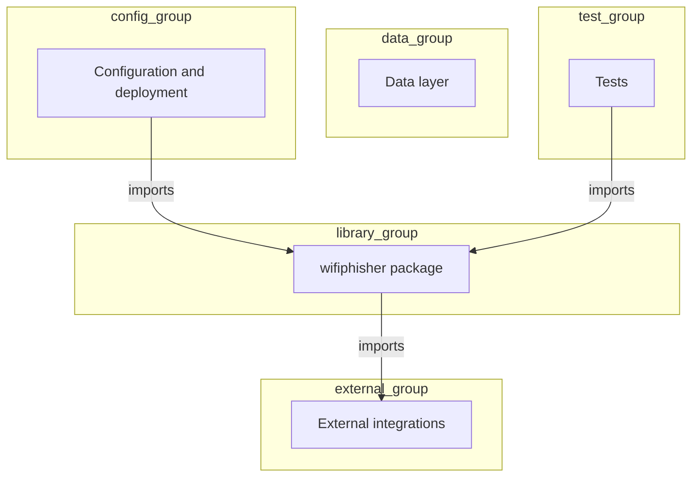

# Architecture report: wifiphisher/wifiphisher

> Automated static analysis. **Observed** = directly seen in files/imports/AST; **Inferred** = interpretation from that evidence. Repository code was not executed.

## 1. Repository at a glance

| Item | Value |
| --- | --- |
| Repository | wifiphisher/wifiphisher |
| Description | The Rogue Access Point Framework |
| Language | Python |
| Stars | 14972 |
| Licence | GPL-3.0 |
| Analysed commit / branch | 4ae336518bf29eed13d3b09f2ee6a16e7973c997 / master |
| Framework(s) | None detected |
| Files analysed | 94 |
| Components | 5 |

## 2. Architecture in one minute

wifiphisher/wifiphisher - The Rogue Access Point Framework. This repository was analysed statically from 94 file(s) (34 Python). Detected technologies (observed from imports/manifests): setuptools, pytest, unittest. Files are grouped into 5 component(s): Configuration and deployment, Data layer, External integrations, Tests, wifiphisher package. Observed entry point(s): wifiphisher/pywifiphisher.py. Findings below distinguish observed facts from inferred interpretation.

## 3. High-level block diagram

## 4. Main components

### Configuration and deployment (`config`)

- **Kind:** config
- **Status:** Observed
- **Confidence:** 0.85
- **Responsibility:** Groups 7 file(s) under configuration and deployment (observed from repository paths and static analysis). Observed top-level classes: CleanCommand. Observed top-level functions: check_dnsmasq, check_required_library.
- **Paths:** `FUNDING.yml`, `MANIFEST.in`, `setup.py`, `wifiphisher/data/phishing-pages/firmware-upgrade/config.ini`, `wifiphisher/data/phishing-pages/oauth-login/config.ini`, `wifiphisher/data/phishing-pages/plugin_update/config.ini`, `wifiphisher/data/phishing-pages/wifi_connect/config.ini`
- **Evidence:** [FUNDING.yml](https://github.com/wifiphisher/wifiphisher/blob/4ae336518bf29eed13d3b09f2ee6a16e7973c997/FUNDING.yml); [MANIFEST.in](https://github.com/wifiphisher/wifiphisher/blob/4ae336518bf29eed13d3b09f2ee6a16e7973c997/MANIFEST.in); [setup.py:35](https://github.com/wifiphisher/wifiphisher/blob/4ae336518bf29eed13d3b09f2ee6a16e7973c997/setup.py#L35); [wifiphisher/data/phishing-pages/firmware-upgrade/config.ini](https://github.com/wifiphisher/wifiphisher/blob/4ae336518bf29eed13d3b09f2ee6a16e7973c997/wifiphisher/data/phishing-pages/firmware-upgrade/config.ini); [wifiphisher/data/phishing-pages/oauth-login/config.ini](https://github.com/wifiphisher/wifiphisher/blob/4ae336518bf29eed13d3b09f2ee6a16e7973c997/wifiphisher/data/phishing-pages/oauth-login/config.ini); [wifiphisher/data/phishing-pages/plugin_update/config.ini](https://github.com/wifiphisher/wifiphisher/blob/4ae336518bf29eed13d3b09f2ee6a16e7973c997/wifiphisher/data/phishing-pages/plugin_update/config.ini); [wifiphisher/data/phishing-pages/wifi_connect/config.ini](https://github.com/wifiphisher/wifiphisher/blob/4ae336518bf29eed13d3b09f2ee6a16e7973c997/wifiphisher/data/phishing-pages/wifi_connect/config.ini)

### Data layer (`data_layer`)

- **Kind:** data
- **Status:** Observed
- **Confidence:** 0.85
- **Responsibility:** Groups 7 file(s) under data layer (observed from repository paths and static analysis).
- **Paths:** `wifiphisher/data/phishing-pages/oauth-login/html/static/js/index.js`, `wifiphisher/data/phishing-pages/oauth-login/html/static/js/jsframe.js`, `wifiphisher/data/phishing-pages/oauth-login/html/static/js/popup.js`, `wifiphisher/data/phishing-pages/wifi_connect/html/behavior.js`, `wifiphisher/data/phishing-pages/wifi_connect/html/static/behavior.js`, `wifiphisher/data/phishing-pages/wifi_connect/html/static/win-behavior.js`, `wifiphisher/data/phishing-pages/wifi_connect/html/win-behavior.js`
- **Evidence:** [wifiphisher/data/phishing-pages/oauth-login/html/static/js/index.js](https://github.com/wifiphisher/wifiphisher/blob/4ae336518bf29eed13d3b09f2ee6a16e7973c997/wifiphisher/data/phishing-pages/oauth-login/html/static/js/index.js); [wifiphisher/data/phishing-pages/oauth-login/html/static/js/jsframe.js](https://github.com/wifiphisher/wifiphisher/blob/4ae336518bf29eed13d3b09f2ee6a16e7973c997/wifiphisher/data/phishing-pages/oauth-login/html/static/js/jsframe.js); [wifiphisher/data/phishing-pages/oauth-login/html/static/js/popup.js](https://github.com/wifiphisher/wifiphisher/blob/4ae336518bf29eed13d3b09f2ee6a16e7973c997/wifiphisher/data/phishing-pages/oauth-login/html/static/js/popup.js); [wifiphisher/data/phishing-pages/wifi_connect/html/behavior.js](https://github.com/wifiphisher/wifiphisher/blob/4ae336518bf29eed13d3b09f2ee6a16e7973c997/wifiphisher/data/phishing-pages/wifi_connect/html/behavior.js); [wifiphisher/data/phishing-pages/wifi_connect/html/static/behavior.js](https://github.com/wifiphisher/wifiphisher/blob/4ae336518bf29eed13d3b09f2ee6a16e7973c997/wifiphisher/data/phishing-pages/wifi_connect/html/static/behavior.js); [wifiphisher/data/phishing-pages/wifi_connect/html/static/win-behavior.js](https://github.com/wifiphisher/wifiphisher/blob/4ae336518bf29eed13d3b09f2ee6a16e7973c997/wifiphisher/data/phishing-pages/wifi_connect/html/static/win-behavior.js); [wifiphisher/data/phishing-pages/wifi_connect/html/win-behavior.js](https://github.com/wifiphisher/wifiphisher/blob/4ae336518bf29eed13d3b09f2ee6a16e7973c997/wifiphisher/data/phishing-pages/wifi_connect/html/win-behavior.js)

### External integrations (`external_integrations`)

- **Kind:** external
- **Status:** Inferred
- **Confidence:** 0.70
- **Responsibility:** Groups 0 file(s) under external integrations (observed from repository paths and static analysis).
- **Evidence:** [wifiphisher/pywifiphisher.py:15](https://github.com/wifiphisher/wifiphisher/blob/4ae336518bf29eed13d3b09f2ee6a16e7973c997/wifiphisher/pywifiphisher.py#L15)

### Tests (`tests`)

- **Kind:** test
- **Status:** Observed
- **Confidence:** 0.85
- **Responsibility:** Groups 6 file(s) under tests (observed from repository paths and static analysis). Observed routes: PATCH wifiphisher.extensions.deauth.ord, PATCH wifiphisher.extensions.deauth.ord, PATCH wifiphisher.extensions.deauth.ord, PATCH wifiphisher.common.constants.DEFAULT_EXTENSIONS, PATCH wifiphisher.common.constants.EXTENSIONS_LOADPATH. Observed top-level classes: TestDeauth, TestExtensionManager, TestGenerateRandomAddress, TestInterfacePropertyDetector, TestIsManagedByNetworkManager, TestIsWirelessInterface. Observed top-level functions: test_does_have_mode_has_mode, test_does_have_mode_has_not_m…
- **Paths:** `tests/__init__.py`, `tests/test_deauth.py`, `tests/test_extensions.py`, `tests/test_interfaces.py`, `tests/test_lure10.py`, `tests/test_victims.py`
- **Evidence:** [tests/__init__.py](https://github.com/wifiphisher/wifiphisher/blob/4ae336518bf29eed13d3b09f2ee6a16e7973c997/tests/__init__.py); [tests/test_deauth.py:13](https://github.com/wifiphisher/wifiphisher/blob/4ae336518bf29eed13d3b09f2ee6a16e7973c997/tests/test_deauth.py#L13); [tests/test_extensions.py:81](https://github.com/wifiphisher/wifiphisher/blob/4ae336518bf29eed13d3b09f2ee6a16e7973c997/tests/test_extensions.py#L81); [tests/test_interfaces.py:16](https://github.com/wifiphisher/wifiphisher/blob/4ae336518bf29eed13d3b09f2ee6a16e7973c997/tests/test_interfaces.py#L16); [tests/test_lure10.py:13](https://github.com/wifiphisher/wifiphisher/blob/4ae336518bf29eed13d3b09f2ee6a16e7973c997/tests/test_lure10.py#L13); [tests/test_victims.py:15](https://github.com/wifiphisher/wifiphisher/blob/4ae336518bf29eed13d3b09f2ee6a16e7973c997/tests/test_victims.py#L15)

### wifiphisher package (`wifiphisher`)

- **Kind:** library
- **Status:** Observed
- **Confidence:** 0.85
- **Responsibility:** Groups 26 file(s) under wifiphisher package (observed from repository paths and static analysis). Observed top-level classes: AccessPoint, AccessPointFinder, ApDisplayInfo, BackendHandler, CaptivePortalHandler, Deauth. Observed top-level functions: calculate_signal_strength, config_section_map, display_string, does_have_mode, execute_commands, find_encryption_type.
- **Paths:** `wifiphisher/__init__.py`, `wifiphisher/common/__init__.py`, `wifiphisher/common/accesspoint.py`, `wifiphisher/common/constants.py`, `wifiphisher/common/extensions.py`, `wifiphisher/common/firewall.py`, `wifiphisher/common/globals.py`, `wifiphisher/common/interfaces.py`, `wifiphisher/common/macmatcher.py`, `wifiphisher/common/opmode.py`, `wifiphisher/common/phishinghttp.py`, `wifiphisher/common/phishingpage.py`, `wifiphisher/common/recon.py`, `wifiphisher/common/sniffer.py`, `wifiphisher/common/tui.py`, `wifiphisher/common/uimethods.py`, `wifiphisher/common/utilities.py`, `wifiphisher/common/victim.py`, `wifiphisher/extensions/__init__.py`, `wifiphisher/extensions/deauth.py`, `wifiphisher/extensions/handshakeverify.py`, `wifiphisher/extensions/knownbeacons.py`, `wifiphisher/extensions/lure10.py`, `wifiphisher/extensions/roguehostapdinfo.py`, `wifiphisher/extensions/wpspbc.py`, `wifiphisher/pywifiphisher.py`
- **Evidence:** [wifiphisher/__init__.py](https://github.com/wifiphisher/wifiphisher/blob/4ae336518bf29eed13d3b09f2ee6a16e7973c997/wifiphisher/__init__.py); [wifiphisher/common/__init__.py](https://github.com/wifiphisher/wifiphisher/blob/4ae336518bf29eed13d3b09f2ee6a16e7973c997/wifiphisher/common/__init__.py); [wifiphisher/common/accesspoint.py:17](https://github.com/wifiphisher/wifiphisher/blob/4ae336518bf29eed13d3b09f2ee6a16e7973c997/wifiphisher/common/accesspoint.py#L17); [wifiphisher/common/constants.py](https://github.com/wifiphisher/wifiphisher/blob/4ae336518bf29eed13d3b09f2ee6a16e7973c997/wifiphisher/common/constants.py); [wifiphisher/common/extensions.py:22](https://github.com/wifiphisher/wifiphisher/blob/4ae336518bf29eed13d3b09f2ee6a16e7973c997/wifiphisher/common/extensions.py#L22); [wifiphisher/common/firewall.py:10](https://github.com/wifiphisher/wifiphisher/blob/4ae336518bf29eed13d3b09f2ee6a16e7973c997/wifiphisher/common/firewall.py#L10); [wifiphisher/common/globals.py](https://github.com/wifiphisher/wifiphisher/blob/4ae336518bf29eed13d3b09f2ee6a16e7973c997/wifiphisher/common/globals.py); [wifiphisher/common/interfaces.py:20](https://github.com/wifiphisher/wifiphisher/blob/4ae336518bf29eed13d3b09f2ee6a16e7973c997/wifiphisher/common/interfaces.py#L20)

## 5. Execution flow

**Observed** entry point(s):

- [wifiphisher/pywifiphisher.py](https://github.com/wifiphisher/wifiphisher/blob/4ae336518bf29eed13d3b09f2ee6a16e7973c997/wifiphisher/pywifiphisher.py)

**Observed** routes (from decorators):

- `PATCH wifiphisher.extensions.deauth.ord` -> `test_get_packet_essid_flag_malformed0_channel_empty_list` in `tests/test_deauth.py:375`
- `PATCH wifiphisher.extensions.deauth.ord` -> `test_get_packet_essid_flag_malformed1_channel_empty_list` in `tests/test_deauth.py:407`
- `PATCH wifiphisher.extensions.deauth.ord` -> `test_get_packet_essid_flag_malformed2_channel_empty_list` in `tests/test_deauth.py:439`
- `PATCH wifiphisher.common.constants.DEFAULT_EXTENSIONS` -> `test_single_extension` in `tests/test_extensions.py:103`
- `PATCH wifiphisher.common.constants.EXTENSIONS_LOADPATH` -> `test_single_extension` in `tests/test_extensions.py:103`
- `PATCH wifiphisher.common.constants.DEFAULT_EXTENSIONS` -> `test_multiple_extensions` in `tests/test_extensions.py:134`
- `PATCH wifiphisher.common.constants.EXTENSIONS_LOADPATH` -> `test_multiple_extensions` in `tests/test_extensions.py:134`
- `PATCH dbus.Interface` -> `test_is_managed_by_networkmanager_is_managed_true` in `tests/test_interfaces.py:239`
- `PATCH dbus.SystemBus` -> `test_is_managed_by_networkmanager_is_managed_true` in `tests/test_interfaces.py:239`
- `PATCH dbus.Interface` -> `test_is_managed_by_networkmanager_is_managed_false` in `tests/test_interfaces.py:255`
- `PATCH dbus.SystemBus` -> `test_is_managed_by_networkmanager_is_managed_false` in `tests/test_interfaces.py:255`
- `PATCH wifiphisher.common.interfaces.dbus` -> `test_is_managed_by_network_manager_unexpected_error_error` in `tests/test_interfaces.py:270`
- `PATCH dbus.Interface` -> `test_is_managed_by_networkmanager_is_managed_false` in `tests/test_interfaces.py:284`
- `PATCH dbus.SystemBus` -> `test_is_managed_by_networkmanager_is_managed_false` in `tests/test_interfaces.py:284`
- `PATCH wifiphisher.common.interfaces.pyw` -> `test_interface_property_detector_has_monitor_mode` in `tests/test_interfaces.py:312`
- `PATCH wifiphisher.common.interfaces.pyw` -> `test_interface_property_detector_no_monitor_mode` in `tests/test_interfaces.py:326`
- `PATCH wifiphisher.common.interfaces.pyw` -> `test_interface_property_detector_has_ap_mode` in `tests/test_interfaces.py:340`
- `PATCH wifiphisher.common.interfaces.pyw` -> `test_interface_property_detector_no_ap_mode` in `tests/test_interfaces.py:354`
- `PATCH wifiphisher.common.interfaces.pyw` -> `test_set_interface_mode_interface_none` in `tests/test_interfaces.py:579`
- `PATCH wifiphisher.common.interfaces.pyw` -> `test_unblock_interface_is_blocked_none` in `tests/test_interfaces.py:875`
- `PATCH wifiphisher.common.interfaces.pyw` -> `test_unblock_interface_not_blocked_none` in `tests/test_interfaces.py:892`
- `PATCH wifiphisher.common.interfaces.pyw` -> `test_set_interface_channel_normal_none` in `tests/test_interfaces.py:909`
- `PATCH wifiphisher.common.interfaces.pyw` -> `test_start_no_interface_none` in `tests/test_interfaces.py:925`
- `PATCH wifiphisher.common.interfaces.pyw` -> `test_start_has_interface_none` in `tests/test_interfaces.py:936`
- `PATCH wifiphisher.common.interfaces.pyw.getcard` -> `test_start_interface_not_compatible_none` in `tests/test_interfaces.py:948`
- `PATCH wifiphisher.common.interfaces.pyw.getcard` -> `test_start_interface_no_such_device_none` in `tests/test_interfaces.py:957`
- `PATCH wifiphisher.common.interfaces.pyw.getcard` -> `test_start_interface_unidentified_error_error` in `tests/test_interfaces.py:968`
- `PATCH wifiphisher.common.interfaces.pyw` -> `test_on_exit_no_active_none` in `tests/test_interfaces.py:983`
- `PATCH wifiphisher.common.interfaces.pyw` -> `test_on_exit_has_active_none` in `tests/test_interfaces.py:992`
- `PATCH wifiphisher.common.interfaces.pyw` -> `test_set_interface_mac_invalid_mac_error` in `tests/test_interfaces.py:1009`
- `PATCH wifiphisher.common.interfaces.pyw` -> `test_set_interface_mac_valid_mac_none` in `tests/test_interfaces.py:1028`
- `PATCH wifiphisher.common.interfaces.pyw` -> `test_set_interface_unexpected_error` in `tests/test_interfaces.py:1046`
- `PATCH wifiphisher.common.interfaces.pyw` -> `test_set_interface_mac_random_none` in `tests/test_interfaces.py:1064`
- `PATCH wifiphisher.common.interfaces.pyw` -> `test_up_interface` in `tests/test_interfaces.py:1097`
- `PATCH wifiphisher.common.interfaces.pyw` -> `test_down_interface` in `tests/test_interfaces.py:1109`
- `PATCH wifiphisher.common.interfaces.pyw` -> `test_add_virtual_interface_success` in `tests/test_interfaces.py:1121`
- `PATCH wifiphisher.common.interfaces.pyw` -> `test_remove_vifs_added` in `tests/test_interfaces.py:1134`
- `PATCH wifiphisher.common.interfaces.pyw` -> `test_add_virtual_interface_first_run_error_second_run_success` in `tests/test_interfaces.py:1143`
- `PATCH wifiphisher.common.interfaces.pyw` -> `test_is_add_vif_required_one_phy_one_vif_tuple_card_true` in `tests/test_interfaces.py:1164`
- `PATCH wifiphisher.common.interfaces.pyw` -> `test_is_add_vif_required_one_phy_two_vifs_tuple_none_true` in `tests/test_interfaces.py:1183`
- `PATCH wifiphisher.common.interfaces.pyw` -> `test_is_add_vif_required_two_phy_two_vifs_tuple_card_true` in `tests/test_interfaces.py:1203`
- `PATCH wifiphisher.common.interfaces.pyw` -> `test_is_add_vif_required_two_phy_two_vifs_tuple_none_false` in `tests/test_interfaces.py:1240`
- `PATCH wifiphisher.common.interfaces.pyw` -> `test_is_add_vif_required_one_ap_one_internet_none_false` in `tests/test_interfaces.py:1275`
- `PATCH wifiphisher.common.interfaces.random` -> `test_generate_random_address` in `tests/test_interfaces.py:1314`
- `PATCH wifiphisher.common.interfaces.pyw` -> `test_is_wireless_interface_false` in `tests/test_interfaces.py:1329`
- `PATCH wifiphisher.common.interfaces.pyw` -> `test_is_wireless_interface_true` in `tests/test_interfaces.py:1339`
- `PATCH wifiphisher.common.interfaces.pyric.pyw` -> `test_does_have_mode_has_mode` in `tests/test_interfaces.py:1351`
- `PATCH wifiphisher.common.interfaces.pyric.pyw` -> `test_does_have_mode_has_not_mode` in `tests/test_interfaces.py:1367`

Representative flow (derived from observed entry points and the import graph; steps beyond the entry point are **Inferred**):

1. Execution starts at an observed entry point listed above, if present.
2. `config` imports `wifiphisher` (Configuration and deployment -> wifiphisher package).
3. `tests` imports `wifiphisher` (Tests -> wifiphisher package).
4. `wifiphisher` imports `external_integrations` (wifiphisher package -> External integrations).

## 6. Project structure

### `(root)`

- `.editorconfig` - config (250 bytes)
- `.gitignore` - other (899 bytes)
- `.style.yapf` - other (30 bytes)
- `.travis.yml` - ci, YAML (453 bytes)
- `CHANGELOG` - other (4083 bytes)
- `CODE_OF_CONDUCT.md` - docs (3233 bytes)
- `FUNDING.yml` - config (67 bytes)
- `ISSUE_TEMPLATE.md` - docs (830 bytes)
- `LICENSE.txt` - docs (35141 bytes)
- `MANIFEST.in` - manifest (67 bytes)
- `README.md` - docs (13666 bytes)
- `pylintrc` - other (12393 bytes)
- `setup.py` - manifest, Python (5793 bytes)

### `bin`

- `bin/wifiphisher` - other (539 bytes)

### `docs`

- `docs/Makefile` - docs (608 bytes)
- `docs/conf.py` - docs (4930 bytes)
- `docs/custom_phishing_scenario.rst` - docs (7543 bytes)
- `docs/extensions.rst` - docs (8782 bytes)
- `docs/faq.rst` - docs (2791 bytes)
- `docs/index.rst` - docs (2968 bytes)
- `docs/opmodes.rst` - docs (4531 bytes)

### `tests`

- `tests/__init__.py` - test, Python (0 bytes)
- `tests/test_deauth.py` - test, Python (31201 bytes)
- `tests/test_extensions.py` - test, Python (5102 bytes)
- `tests/test_interfaces.py` - test, Python (52276 bytes)
- `tests/test_lure10.py` - test, Python (5805 bytes)
- `tests/test_victims.py` - test, Python (4100 bytes)

### `wifiphisher`

- `wifiphisher/__init__.py` - source, Python (0 bytes)
- `wifiphisher/common/__init__.py` - source, Python (0 bytes)
- `wifiphisher/common/accesspoint.py` - source, Python (8304 bytes)
- `wifiphisher/common/constants.py` - source, Python (4380 bytes)
- `wifiphisher/common/extensions.py` - source, Python (12744 bytes)
- `wifiphisher/common/firewall.py` - source, Python (1987 bytes)
- `wifiphisher/common/globals.py` - source, Python (105 bytes)
- `wifiphisher/common/interfaces.py` - source, Python (31040 bytes)
- `wifiphisher/common/macmatcher.py` - source, Python (4261 bytes)
- `wifiphisher/common/opmode.py` - source, Python (12594 bytes)
- `wifiphisher/common/phishinghttp.py` - source, Python (7444 bytes)
- `wifiphisher/common/phishingpage.py` - source, Python (12794 bytes)
- `wifiphisher/common/recon.py` - source, Python (10821 bytes)
- `wifiphisher/common/sniffer.py` - source, Python (39118 bytes)
- `wifiphisher/common/tui.py` - source, Python (36893 bytes)
- `wifiphisher/common/uimethods.py` - source, Python (282 bytes)
- `wifiphisher/common/utilities.py` - source, Python (766 bytes)
- `wifiphisher/common/victim.py` - source, Python (4726 bytes)
- `wifiphisher/data/locs/.gitkeep` - other (0 bytes)
- `wifiphisher/data/phishing-pages/firmware-upgrade/config.ini` - config (683 bytes)
- `wifiphisher/data/phishing-pages/firmware-upgrade/html/index.html` - other (17821 bytes)
- `wifiphisher/data/phishing-pages/firmware-upgrade/html/loading.html` - other (10210 bytes)
- `wifiphisher/data/phishing-pages/firmware-upgrade/html/static/font-awesome-4.7.0/css/font-awesome.css` - other (37414 bytes)
- `wifiphisher/data/phishing-pages/firmware-upgrade/html/upgrading.html` - other (10210 bytes)
- `wifiphisher/data/phishing-pages/oauth-login/config.ini` - config (10325 bytes)
- `wifiphisher/data/phishing-pages/oauth-login/html/fail.html` - other (203 bytes)
- `wifiphisher/data/phishing-pages/oauth-login/html/index.html` - other (7413 bytes)
- `wifiphisher/data/phishing-pages/oauth-login/html/login.html` - other (17801 bytes)
- `wifiphisher/data/phishing-pages/oauth-login/html/oauth.html` - other (156 bytes)
- `wifiphisher/data/phishing-pages/oauth-login/html/static/css/font-awesome.css` - other (37414 bytes)
- `wifiphisher/data/phishing-pages/oauth-login/html/static/css/reset.css` - other (774 bytes)
- `wifiphisher/data/phishing-pages/oauth-login/html/static/css/roboto.css` - other (1449 bytes)
- `wifiphisher/data/phishing-pages/oauth-login/html/static/css/style.css` - other (4917 bytes)
- `wifiphisher/data/phishing-pages/oauth-login/html/static/js/index.js` - source, JavaScript (1018 bytes)
- `wifiphisher/data/phishing-pages/oauth-login/html/static/js/jsframe.js` - source, JavaScript (86764 bytes)
- `wifiphisher/data/phishing-pages/oauth-login/html/static/js/popup.js` - source, JavaScript (3131 bytes)
- `wifiphisher/data/phishing-pages/oauth-login/html/template.html` - other (4109 bytes)
- `wifiphisher/data/phishing-pages/plugin_update/config.ini` - config (329 bytes)
- `wifiphisher/data/phishing-pages/plugin_update/html/css/theme.css` - other (255 bytes)
- `wifiphisher/data/phishing-pages/plugin_update/html/index.html` - other (4516 bytes)
- `wifiphisher/data/phishing-pages/plugin_update/html/static/css/theme.css` - other (255 bytes)
- `wifiphisher/data/phishing-pages/wifi_connect/config.ini` - config (279 bytes)
- `wifiphisher/data/phishing-pages/wifi_connect/html/behavior.js` - source, JavaScript (3006 bytes)
- `wifiphisher/data/phishing-pages/wifi_connect/html/chrome-offline.css` - other (2483 bytes)
- `wifiphisher/data/phishing-pages/wifi_connect/html/index.html` - other (22439 bytes)
- `wifiphisher/data/phishing-pages/wifi_connect/html/loading.html` - other (65 bytes)
- `wifiphisher/data/phishing-pages/wifi_connect/html/mac-network-manager.css` - other (2773 bytes)
- `wifiphisher/data/phishing-pages/wifi_connect/html/opensans.css` - other (169 bytes)
- `wifiphisher/data/phishing-pages/wifi_connect/html/static/behavior.js` - source, JavaScript (3006 bytes)
- `wifiphisher/data/phishing-pages/wifi_connect/html/static/chrome-offline.css` - other (2483 bytes)
- `wifiphisher/data/phishing-pages/wifi_connect/html/static/ios.css` - other (1110 bytes)
- `wifiphisher/data/phishing-pages/wifi_connect/html/static/mac-network-manager.css` - other (2773 bytes)
- `wifiphisher/data/phishing-pages/wifi_connect/html/static/opensans.css` - other (169 bytes)
- `wifiphisher/data/phishing-pages/wifi_connect/html/static/style.css` - other (2803 bytes)
- `wifiphisher/data/phishing-pages/wifi_connect/html/static/win-behavior.js` - source, JavaScript (266 bytes)
- `wifiphisher/data/phishing-pages/wifi_connect/html/style.css` - other (2803 bytes)
- `wifiphisher/data/phishing-pages/wifi_connect/html/win-behavior.js` - source, JavaScript (266 bytes)
- `wifiphisher/data/wifiphisher-known-open-wlans` - other (2799 bytes)
- `wifiphisher/data/wifiphisher-os-initial-requests` - other (552 bytes)
- `wifiphisher/extensions/__init__.py` - source, Python (0 bytes)
- `wifiphisher/extensions/deauth.py` - source, Python (11066 bytes)
- `wifiphisher/extensions/handshakeverify.py` - source, Python (2233 bytes)
- `wifiphisher/extensions/knownbeacons.py` - source, Python (5029 bytes)
- `wifiphisher/extensions/lure10.py` - source, Python (4407 bytes)
- `wifiphisher/extensions/roguehostapdinfo.py` - source, Python (4109 bytes)
- `wifiphisher/extensions/wpspbc.py` - source, Python (11410 bytes)
- `wifiphisher/pywifiphisher.py` - source, Python (32122 bytes)

## 7. Key dependencies and integrations

| Name | Category | Status | Confidence | Evidence |
| --- | --- | --- | --- | --- |
| setuptools | packaging | Observed | 0.90 | [setup.py:23](https://github.com/wifiphisher/wifiphisher/blob/4ae336518bf29eed13d3b09f2ee6a16e7973c997/setup.py#L23) |
| pytest | tooling | Observed | 0.90 | [tests/test_interfaces.py:6](https://github.com/wifiphisher/wifiphisher/blob/4ae336518bf29eed13d3b09f2ee6a16e7973c997/tests/test_interfaces.py#L6) |
| unittest | tooling | Observed | 0.95 | [tests/test_deauth.py:4](https://github.com/wifiphisher/wifiphisher/blob/4ae336518bf29eed13d3b09f2ee6a16e7973c997/tests/test_deauth.py#L4); [tests/test_extensions.py:8](https://github.com/wifiphisher/wifiphisher/blob/4ae336518bf29eed13d3b09f2ee6a16e7973c997/tests/test_extensions.py#L8); [tests/test_interfaces.py:4](https://github.com/wifiphisher/wifiphisher/blob/4ae336518bf29eed13d3b09f2ee6a16e7973c997/tests/test_interfaces.py#L4); [tests/test_lure10.py:5](https://github.com/wifiphisher/wifiphisher/blob/4ae336518bf29eed13d3b09f2ee6a16e7973c997/tests/test_lure10.py#L5) |

## 8. Data and state

- Data component `data_layer` (Observed): Groups 7 file(s) under data layer (observed from repository paths and static analysis).

## 9. Configuration and deployment clues

- `.editorconfig` (config)
- `.travis.yml` (ci)
- `FUNDING.yml` (config)
- `MANIFEST.in` (manifest)
- `setup.py` (manifest)
- `wifiphisher/data/phishing-pages/firmware-upgrade/config.ini` (config)
- `wifiphisher/data/phishing-pages/oauth-login/config.ini` (config)
- `wifiphisher/data/phishing-pages/plugin_update/config.ini` (config)
- `wifiphisher/data/phishing-pages/wifi_connect/config.ini` (config)

Console scripts declared in packaging metadata (**Observed**):

- `wifiphisher` -> `wifiphisher.pywifiphisher:run`

## 10. Design observations

- Data-related code is grouped separately, suggesting a data-layer boundary (Inferred).
- Tests are present alongside source code (Observed from test file paths).
- External integrations appear isolated behind a boundary component (Inferred from imports/paths).

These observations are interpretations (**Inferred**) of the observed structure, not guarantees about runtime design.

## 11. Limitations and unknowns

- Static analysis only: repository code was not executed, installed, or imported at runtime.
- Components and relationships are inferred from file paths, imports, and AST structure; runtime behaviour, dynamic imports, and reflection may not be visible.
- 8 file(s) were skipped during inventory (7 x generated/minified file excluded; 1 x likely secret file excluded).
- Repository text was treated as untrusted data; no instructions found in repository files were followed, and likely secret values were redacted/excluded.

## 12. Source references

- [FUNDING.yml](https://github.com/wifiphisher/wifiphisher/blob/4ae336518bf29eed13d3b09f2ee6a16e7973c997/FUNDING.yml)
- [MANIFEST.in](https://github.com/wifiphisher/wifiphisher/blob/4ae336518bf29eed13d3b09f2ee6a16e7973c997/MANIFEST.in)
- [setup.py:23](https://github.com/wifiphisher/wifiphisher/blob/4ae336518bf29eed13d3b09f2ee6a16e7973c997/setup.py#L23)
- [setup.py:35](https://github.com/wifiphisher/wifiphisher/blob/4ae336518bf29eed13d3b09f2ee6a16e7973c997/setup.py#L35)
- [tests/__init__.py](https://github.com/wifiphisher/wifiphisher/blob/4ae336518bf29eed13d3b09f2ee6a16e7973c997/tests/__init__.py)
- [tests/test_deauth.py:4](https://github.com/wifiphisher/wifiphisher/blob/4ae336518bf29eed13d3b09f2ee6a16e7973c997/tests/test_deauth.py#L4)
- [tests/test_deauth.py:13](https://github.com/wifiphisher/wifiphisher/blob/4ae336518bf29eed13d3b09f2ee6a16e7973c997/tests/test_deauth.py#L13)
- [tests/test_extensions.py:8](https://github.com/wifiphisher/wifiphisher/blob/4ae336518bf29eed13d3b09f2ee6a16e7973c997/tests/test_extensions.py#L8)
- [tests/test_extensions.py:81](https://github.com/wifiphisher/wifiphisher/blob/4ae336518bf29eed13d3b09f2ee6a16e7973c997/tests/test_extensions.py#L81)
- [tests/test_interfaces.py:4](https://github.com/wifiphisher/wifiphisher/blob/4ae336518bf29eed13d3b09f2ee6a16e7973c997/tests/test_interfaces.py#L4)
- [tests/test_interfaces.py:6](https://github.com/wifiphisher/wifiphisher/blob/4ae336518bf29eed13d3b09f2ee6a16e7973c997/tests/test_interfaces.py#L6)
- [tests/test_interfaces.py:16](https://github.com/wifiphisher/wifiphisher/blob/4ae336518bf29eed13d3b09f2ee6a16e7973c997/tests/test_interfaces.py#L16)
- [tests/test_lure10.py:5](https://github.com/wifiphisher/wifiphisher/blob/4ae336518bf29eed13d3b09f2ee6a16e7973c997/tests/test_lure10.py#L5)
- [tests/test_lure10.py:13](https://github.com/wifiphisher/wifiphisher/blob/4ae336518bf29eed13d3b09f2ee6a16e7973c997/tests/test_lure10.py#L13)
- [tests/test_victims.py:5](https://github.com/wifiphisher/wifiphisher/blob/4ae336518bf29eed13d3b09f2ee6a16e7973c997/tests/test_victims.py#L5)
- [tests/test_victims.py:15](https://github.com/wifiphisher/wifiphisher/blob/4ae336518bf29eed13d3b09f2ee6a16e7973c997/tests/test_victims.py#L15)
- [wifiphisher/__init__.py](https://github.com/wifiphisher/wifiphisher/blob/4ae336518bf29eed13d3b09f2ee6a16e7973c997/wifiphisher/__init__.py)
- [wifiphisher/common/__init__.py](https://github.com/wifiphisher/wifiphisher/blob/4ae336518bf29eed13d3b09f2ee6a16e7973c997/wifiphisher/common/__init__.py)
- [wifiphisher/common/accesspoint.py:17](https://github.com/wifiphisher/wifiphisher/blob/4ae336518bf29eed13d3b09f2ee6a16e7973c997/wifiphisher/common/accesspoint.py#L17)
- [wifiphisher/common/constants.py](https://github.com/wifiphisher/wifiphisher/blob/4ae336518bf29eed13d3b09f2ee6a16e7973c997/wifiphisher/common/constants.py)
- [wifiphisher/common/extensions.py:22](https://github.com/wifiphisher/wifiphisher/blob/4ae336518bf29eed13d3b09f2ee6a16e7973c997/wifiphisher/common/extensions.py#L22)
- [wifiphisher/common/firewall.py:10](https://github.com/wifiphisher/wifiphisher/blob/4ae336518bf29eed13d3b09f2ee6a16e7973c997/wifiphisher/common/firewall.py#L10)
- [wifiphisher/common/globals.py](https://github.com/wifiphisher/wifiphisher/blob/4ae336518bf29eed13d3b09f2ee6a16e7973c997/wifiphisher/common/globals.py)
- [wifiphisher/common/interfaces.py:20](https://github.com/wifiphisher/wifiphisher/blob/4ae336518bf29eed13d3b09f2ee6a16e7973c997/wifiphisher/common/interfaces.py#L20)
- [wifiphisher/data/phishing-pages/firmware-upgrade/config.ini](https://github.com/wifiphisher/wifiphisher/blob/4ae336518bf29eed13d3b09f2ee6a16e7973c997/wifiphisher/data/phishing-pages/firmware-upgrade/config.ini)
- [wifiphisher/data/phishing-pages/oauth-login/config.ini](https://github.com/wifiphisher/wifiphisher/blob/4ae336518bf29eed13d3b09f2ee6a16e7973c997/wifiphisher/data/phishing-pages/oauth-login/config.ini)
- [wifiphisher/data/phishing-pages/oauth-login/html/static/js/index.js](https://github.com/wifiphisher/wifiphisher/blob/4ae336518bf29eed13d3b09f2ee6a16e7973c997/wifiphisher/data/phishing-pages/oauth-login/html/static/js/index.js)
- [wifiphisher/data/phishing-pages/oauth-login/html/static/js/jsframe.js](https://github.com/wifiphisher/wifiphisher/blob/4ae336518bf29eed13d3b09f2ee6a16e7973c997/wifiphisher/data/phishing-pages/oauth-login/html/static/js/jsframe.js)
- [wifiphisher/data/phishing-pages/oauth-login/html/static/js/popup.js](https://github.com/wifiphisher/wifiphisher/blob/4ae336518bf29eed13d3b09f2ee6a16e7973c997/wifiphisher/data/phishing-pages/oauth-login/html/static/js/popup.js)
- [wifiphisher/data/phishing-pages/plugin_update/config.ini](https://github.com/wifiphisher/wifiphisher/blob/4ae336518bf29eed13d3b09f2ee6a16e7973c997/wifiphisher/data/phishing-pages/plugin_update/config.ini)
- [wifiphisher/data/phishing-pages/wifi_connect/config.ini](https://github.com/wifiphisher/wifiphisher/blob/4ae336518bf29eed13d3b09f2ee6a16e7973c997/wifiphisher/data/phishing-pages/wifi_connect/config.ini)
- [wifiphisher/data/phishing-pages/wifi_connect/html/behavior.js](https://github.com/wifiphisher/wifiphisher/blob/4ae336518bf29eed13d3b09f2ee6a16e7973c997/wifiphisher/data/phishing-pages/wifi_connect/html/behavior.js)
- [wifiphisher/data/phishing-pages/wifi_connect/html/static/behavior.js](https://github.com/wifiphisher/wifiphisher/blob/4ae336518bf29eed13d3b09f2ee6a16e7973c997/wifiphisher/data/phishing-pages/wifi_connect/html/static/behavior.js)
- [wifiphisher/data/phishing-pages/wifi_connect/html/static/win-behavior.js](https://github.com/wifiphisher/wifiphisher/blob/4ae336518bf29eed13d3b09f2ee6a16e7973c997/wifiphisher/data/phishing-pages/wifi_connect/html/static/win-behavior.js)
- [wifiphisher/data/phishing-pages/wifi_connect/html/win-behavior.js](https://github.com/wifiphisher/wifiphisher/blob/4ae336518bf29eed13d3b09f2ee6a16e7973c997/wifiphisher/data/phishing-pages/wifi_connect/html/win-behavior.js)
- [wifiphisher/pywifiphisher.py](https://github.com/wifiphisher/wifiphisher/blob/4ae336518bf29eed13d3b09f2ee6a16e7973c997/wifiphisher/pywifiphisher.py)
- [wifiphisher/pywifiphisher.py:15](https://github.com/wifiphisher/wifiphisher/blob/4ae336518bf29eed13d3b09f2ee6a16e7973c997/wifiphisher/pywifiphisher.py#L15)
