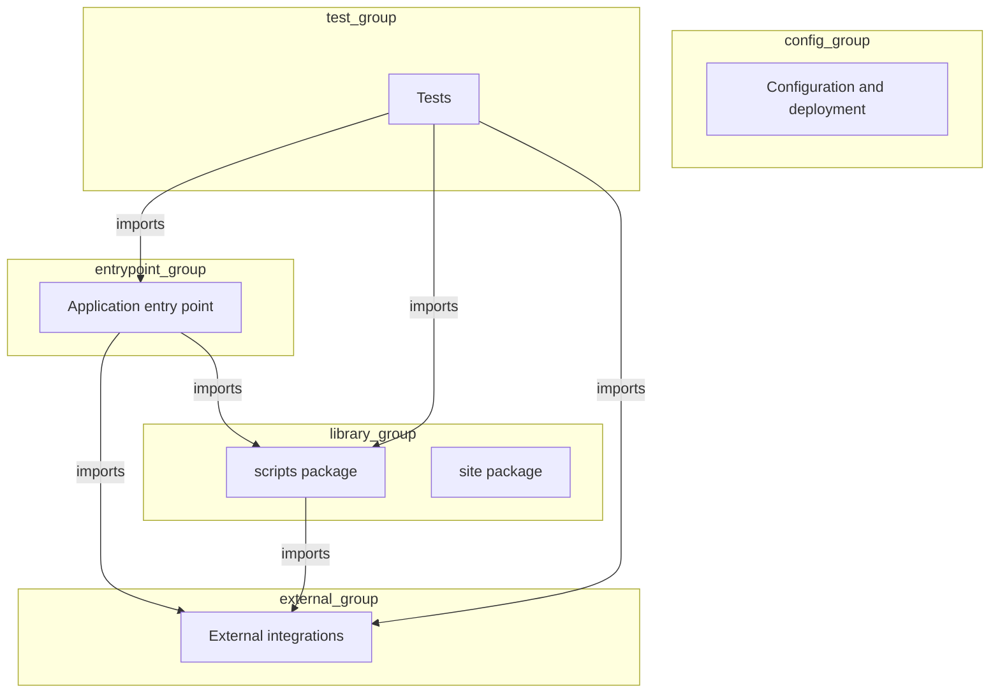

# Architecture report: wilsonfreitas/awesome-quant

> Automated static analysis. **Observed** = directly seen in files/imports/AST; **Inferred** = interpretation from that evidence. Repository code was not executed.

## 1. Repository at a glance

| Item | Value |
| --- | --- |
| Repository | wilsonfreitas/awesome-quant |
| Description | A curated list of insanely awesome libraries, packages and resources for Quants (Quantitative Finance) |
| Language | Python |
| Stars | 30637 |
| Licence | Not detected |
| Analysed commit / branch | f7230363d2b5d8a43244144646c14978dc375016 / main |
| Framework(s) | None detected |
| Files analysed | 45 |
| Components | 6 |

## 2. Architecture in one minute

wilsonfreitas/awesome-quant - A curated list of insanely awesome libraries, packages and resources for Quants (Quantitative Finance). This repository was analysed statically from 45 file(s) (26 Python). Detected technologies (observed from imports/manifests): GitHub Actions, pandas, requests, Poetry, unittest. Files are grouped into 6 component(s): Configuration and deployment, Application entry point, External integrations, scripts package, site package, Tests. Observed entry point(s): .agents/skills/update-pypi-dates/scripts/check_pypi_dates.py, cranscrape.py, parse.py. Findings below distinguish observed facts from inferred interpretation.

## 3. High-level block diagram

## 4. Main components

### Configuration and deployment (`config`)

- **Kind:** config
- **Status:** Observed
- **Confidence:** 0.85
- **Responsibility:** Groups 1 file(s) under configuration and deployment (observed from repository paths and static analysis).
- **Paths:** `pyproject.toml`
- **Evidence:** [pyproject.toml](https://github.com/wilsonfreitas/awesome-quant/blob/f7230363d2b5d8a43244144646c14978dc375016/pyproject.toml)

### Application entry point (`entrypoint`)

- **Kind:** entrypoint
- **Status:** Observed
- **Confidence:** 0.85
- **Responsibility:** Groups 7 file(s) under application entry point (observed from repository paths and static analysis). Observed top-level classes: AuditTarget, Candidate, Finding, FindingKind, Issue, PinnedHTTPSConnection. Observed top-level functions: _candidate_repositories, _candidate_sort_key, _escape_markdown, _finding, _github_findings, _last_result.
- **Paths:** `cranscrape.py`, `parse.py`, `scripts/audit_readme.py`, `scripts/review_pr.py`, `scripts/validate_readme.py`, `site/generate.py`, `topic.py`
- **Evidence:** [cranscrape.py:63](https://github.com/wilsonfreitas/awesome-quant/blob/f7230363d2b5d8a43244144646c14978dc375016/cranscrape.py#L63); [parse.py:22](https://github.com/wilsonfreitas/awesome-quant/blob/f7230363d2b5d8a43244144646c14978dc375016/parse.py#L22); [scripts/audit_readme.py:36](https://github.com/wilsonfreitas/awesome-quant/blob/f7230363d2b5d8a43244144646c14978dc375016/scripts/audit_readme.py#L36); [scripts/review_pr.py:70](https://github.com/wilsonfreitas/awesome-quant/blob/f7230363d2b5d8a43244144646c14978dc375016/scripts/review_pr.py#L70); [scripts/validate_readme.py:40](https://github.com/wilsonfreitas/awesome-quant/blob/f7230363d2b5d8a43244144646c14978dc375016/scripts/validate_readme.py#L40); [site/generate.py:23](https://github.com/wilsonfreitas/awesome-quant/blob/f7230363d2b5d8a43244144646c14978dc375016/site/generate.py#L23); [topic.py:9](https://github.com/wilsonfreitas/awesome-quant/blob/f7230363d2b5d8a43244144646c14978dc375016/topic.py#L9)

### External integrations (`external_integrations`)

- **Kind:** external
- **Status:** Inferred
- **Confidence:** 0.70
- **Responsibility:** Groups 0 file(s) under external integrations (observed from repository paths and static analysis).
- **Evidence:** [cranscrape.py:2](https://github.com/wilsonfreitas/awesome-quant/blob/f7230363d2b5d8a43244144646c14978dc375016/cranscrape.py#L2); [scripts/review_pr.py:12](https://github.com/wilsonfreitas/awesome-quant/blob/f7230363d2b5d8a43244144646c14978dc375016/scripts/review_pr.py#L12); [scripts/url_probe.py:7](https://github.com/wilsonfreitas/awesome-quant/blob/f7230363d2b5d8a43244144646c14978dc375016/scripts/url_probe.py#L7); [tests/test_manual_tools.py:43](https://github.com/wilsonfreitas/awesome-quant/blob/f7230363d2b5d8a43244144646c14978dc375016/tests/test_manual_tools.py#L43); [tests/test_url_probe.py:2](https://github.com/wilsonfreitas/awesome-quant/blob/f7230363d2b5d8a43244144646c14978dc375016/tests/test_url_probe.py#L2)

### scripts package (`scripts`)

- **Kind:** library
- **Status:** Observed
- **Confidence:** 0.85
- **Responsibility:** Groups 3 file(s) under scripts package (observed from repository paths and static analysis). Observed top-level classes: Outcome, RawResponse, ReadmeEntry, UnsafeUrlError, UrlObservation, _PinnedHTTPConnection. Observed top-level functions: _canonical_url, _classify_terminal, _embedded_ipv4_addresses, _host_header, _http_error, _is_public_address.
- **Paths:** `scripts/pypi_metadata.py`, `scripts/readme_entries.py`, `scripts/url_probe.py`
- **Evidence:** [scripts/pypi_metadata.py:11](https://github.com/wilsonfreitas/awesome-quant/blob/f7230363d2b5d8a43244144646c14978dc375016/scripts/pypi_metadata.py#L11); [scripts/readme_entries.py:52](https://github.com/wilsonfreitas/awesome-quant/blob/f7230363d2b5d8a43244144646c14978dc375016/scripts/readme_entries.py#L52); [scripts/url_probe.py:24](https://github.com/wilsonfreitas/awesome-quant/blob/f7230363d2b5d8a43244144646c14978dc375016/scripts/url_probe.py#L24)

### site package (`site`)

- **Kind:** library
- **Status:** Observed
- **Confidence:** 0.85
- **Responsibility:** Groups 1 file(s) under site package (observed from repository paths and static analysis).
- **Paths:** `site/static/main.js`
- **Evidence:** [site/static/main.js](https://github.com/wilsonfreitas/awesome-quant/blob/f7230363d2b5d8a43244144646c14978dc375016/site/static/main.js)

### Tests (`tests`)

- **Kind:** test
- **Status:** Observed
- **Confidence:** 0.85
- **Responsibility:** Groups 15 file(s) under tests (observed from repository paths and static analysis). Observed top-level classes: AuditReadmeMainTests, AuditReadmeTests, FakeBaseRepository, FakeClient, FakeGithubClient, FakeIssue. Observed top-level functions: entry, observation, public_validation.
- **Paths:** `tests/__init__.py`, `tests/test_audit_readme.py`, `tests/test_historical_projects.py`, `tests/test_manual_tools.py`, `tests/test_nested_reference_repairs.py`, `tests/test_pr_review_workflow.py`, `tests/test_pypi_date_updater.py`, `tests/test_pypi_metadata.py`, `tests/test_readme_audit_workflow.py`, `tests/test_readme_entries.py`, `tests/test_review_documentation.py`, `tests/test_review_pr.py`, `tests/test_site_generation.py`, `tests/test_test_workflow.py`, `tests/test_url_probe.py`
- **Evidence:** [tests/__init__.py](https://github.com/wilsonfreitas/awesome-quant/blob/f7230363d2b5d8a43244144646c14978dc375016/tests/__init__.py); [tests/test_audit_readme.py:35](https://github.com/wilsonfreitas/awesome-quant/blob/f7230363d2b5d8a43244144646c14978dc375016/tests/test_audit_readme.py#L35); [tests/test_historical_projects.py:13](https://github.com/wilsonfreitas/awesome-quant/blob/f7230363d2b5d8a43244144646c14978dc375016/tests/test_historical_projects.py#L13); [tests/test_manual_tools.py:13](https://github.com/wilsonfreitas/awesome-quant/blob/f7230363d2b5d8a43244144646c14978dc375016/tests/test_manual_tools.py#L13); [tests/test_nested_reference_repairs.py:24](https://github.com/wilsonfreitas/awesome-quant/blob/f7230363d2b5d8a43244144646c14978dc375016/tests/test_nested_reference_repairs.py#L24); [tests/test_pr_review_workflow.py:47](https://github.com/wilsonfreitas/awesome-quant/blob/f7230363d2b5d8a43244144646c14978dc375016/tests/test_pr_review_workflow.py#L47); [tests/test_pypi_date_updater.py:16](https://github.com/wilsonfreitas/awesome-quant/blob/f7230363d2b5d8a43244144646c14978dc375016/tests/test_pypi_date_updater.py#L16); [tests/test_pypi_metadata.py:10](https://github.com/wilsonfreitas/awesome-quant/blob/f7230363d2b5d8a43244144646c14978dc375016/tests/test_pypi_metadata.py#L10)

## 5. Execution flow

**Observed** entry point(s):

- [.agents/skills/update-pypi-dates/scripts/check_pypi_dates.py:92](https://github.com/wilsonfreitas/awesome-quant/blob/f7230363d2b5d8a43244144646c14978dc375016/.agents/skills/update-pypi-dates/scripts/check_pypi_dates.py#L92)
- [cranscrape.py:84](https://github.com/wilsonfreitas/awesome-quant/blob/f7230363d2b5d8a43244144646c14978dc375016/cranscrape.py#L84)
- [parse.py:253](https://github.com/wilsonfreitas/awesome-quant/blob/f7230363d2b5d8a43244144646c14978dc375016/parse.py#L253)
- [scripts/audit_readme.py:538](https://github.com/wilsonfreitas/awesome-quant/blob/f7230363d2b5d8a43244144646c14978dc375016/scripts/audit_readme.py#L538)
- [scripts/review_pr.py:884](https://github.com/wilsonfreitas/awesome-quant/blob/f7230363d2b5d8a43244144646c14978dc375016/scripts/review_pr.py#L884)
- [scripts/validate_readme.py:395](https://github.com/wilsonfreitas/awesome-quant/blob/f7230363d2b5d8a43244144646c14978dc375016/scripts/validate_readme.py#L395)
- [site/generate.py:439](https://github.com/wilsonfreitas/awesome-quant/blob/f7230363d2b5d8a43244144646c14978dc375016/site/generate.py#L439)
- [site/static/main.js](https://github.com/wilsonfreitas/awesome-quant/blob/f7230363d2b5d8a43244144646c14978dc375016/site/static/main.js)
- [topic.py:24](https://github.com/wilsonfreitas/awesome-quant/blob/f7230363d2b5d8a43244144646c14978dc375016/topic.py#L24)

Representative flow (derived from observed entry points and the import graph; steps beyond the entry point are **Inferred**):

1. Execution starts at an observed entry point listed above, if present.
2. `entrypoint` imports `external_integrations` (Application entry point -> External integrations).
3. `entrypoint` imports `scripts` (Application entry point -> scripts package).
4. `scripts` imports `external_integrations` (scripts package -> External integrations).
5. `tests` imports `entrypoint` (Tests -> Application entry point).
6. `tests` imports `external_integrations` (Tests -> External integrations).
7. `tests` imports `scripts` (Tests -> scripts package).

## 6. Project structure

### `(root)`

- `.gitignore` - other (102 bytes)
- `AGENTS.md` - docs (7318 bytes)
- `CONTRIBUTING.md` - docs (12143 bytes)
- `README.md` - docs (156485 bytes)
- `cranscrape.py` - source, Python (4179 bytes)
- `parse.py` - source, Python (8035 bytes)
- `pyproject.toml` - manifest (318 bytes)
- `topic.py` - source, Python (742 bytes)

### `.agents`

- `.agents/skills/bprr/SKILL.md` - docs (2841 bytes)
- `.agents/skills/create-entry/SKILL.md` - docs (6837 bytes)
- `.agents/skills/sprr/SKILL.md` - docs (10941 bytes)
- `.agents/skills/update-pypi-dates/SKILL.md` - docs (1198 bytes)
- `.agents/skills/update-pypi-dates/scripts/check_pypi_dates.py` - source, Python (3068 bytes)
- `.agents/skills/update-pypi-dates/scripts/update_pypi_dates.sh` - source, Shell (261 bytes)

### `.github`

- `.github/workflows/build.yml` - ci, YAML (1035 bytes)
- `.github/workflows/pr-review.yml` - ci, YAML (1170 bytes)
- `.github/workflows/pr-validate.yml` - ci, YAML (968 bytes)
- `.github/workflows/readme-audit.yml` - ci, YAML (948 bytes)
- `.github/workflows/tests.yml` - ci, YAML (562 bytes)

### `docs`

- `docs/codex-setup.md` - docs (4964 bytes)

### `scripts`

- `scripts/audit_readme.py` - source, Python (17450 bytes)
- `scripts/pypi_metadata.py` - source, Python (1895 bytes)
- `scripts/readme_entries.py` - source, Python (7388 bytes)
- `scripts/review_pr.py` - source, Python (28855 bytes)
- `scripts/url_probe.py` - source, Python (13990 bytes)
- `scripts/validate_readme.py` - source, Python (12436 bytes)

### `site`

- `site/.nojekyll` - other (0 bytes)
- `site/generate.py` - source, Python (17107 bytes)
- `site/static/main.js` - source, JavaScript (8707 bytes)
- `site/static/style.css` - other (17198 bytes)

### `tests`

- `tests/__init__.py` - test, Python (51 bytes)
- `tests/test_audit_readme.py` - test, Python (40661 bytes)
- `tests/test_historical_projects.py` - test, Python (3256 bytes)
- `tests/test_manual_tools.py` - test, Python (2611 bytes)
- `tests/test_nested_reference_repairs.py` - test, Python (6235 bytes)
- `tests/test_pr_review_workflow.py` - test, Python (1649 bytes)
- `tests/test_pypi_date_updater.py` - test, Python (2660 bytes)
- `tests/test_pypi_metadata.py` - test, Python (3135 bytes)
- `tests/test_readme_audit_workflow.py` - test, Python (1345 bytes)
- `tests/test_readme_entries.py` - test, Python (1625 bytes)
- `tests/test_review_documentation.py` - test, Python (1997 bytes)
- `tests/test_review_pr.py` - test, Python (54778 bytes)
- `tests/test_site_generation.py` - test, Python (6066 bytes)
- `tests/test_test_workflow.py` - test, Python (1920 bytes)
- `tests/test_url_probe.py` - test, Python (13160 bytes)

## 7. Key dependencies and integrations

| Name | Category | Status | Confidence | Evidence |
| --- | --- | --- | --- | --- |
| GitHub Actions | ci | Observed | 0.90 | [.github/workflows/build.yml](https://github.com/wilsonfreitas/awesome-quant/blob/f7230363d2b5d8a43244144646c14978dc375016/.github/workflows/build.yml); [.github/workflows/pr-review.yml](https://github.com/wilsonfreitas/awesome-quant/blob/f7230363d2b5d8a43244144646c14978dc375016/.github/workflows/pr-review.yml); [.github/workflows/pr-validate.yml](https://github.com/wilsonfreitas/awesome-quant/blob/f7230363d2b5d8a43244144646c14978dc375016/.github/workflows/pr-validate.yml); [.github/workflows/readme-audit.yml](https://github.com/wilsonfreitas/awesome-quant/blob/f7230363d2b5d8a43244144646c14978dc375016/.github/workflows/readme-audit.yml) |
| pandas | library | Observed | 0.95 | [cranscrape.py:5](https://github.com/wilsonfreitas/awesome-quant/blob/f7230363d2b5d8a43244144646c14978dc375016/cranscrape.py#L5); [parse.py:7](https://github.com/wilsonfreitas/awesome-quant/blob/f7230363d2b5d8a43244144646c14978dc375016/parse.py#L7); [pyproject.toml:10](https://github.com/wilsonfreitas/awesome-quant/blob/f7230363d2b5d8a43244144646c14978dc375016/pyproject.toml#L10) |
| requests | library | Observed | 0.95 | [cranscrape.py:2](https://github.com/wilsonfreitas/awesome-quant/blob/f7230363d2b5d8a43244144646c14978dc375016/cranscrape.py#L2); [tests/test_manual_tools.py:43](https://github.com/wilsonfreitas/awesome-quant/blob/f7230363d2b5d8a43244144646c14978dc375016/tests/test_manual_tools.py#L43) |
| Poetry | packaging | Observed | 0.85 | [pyproject.toml](https://github.com/wilsonfreitas/awesome-quant/blob/f7230363d2b5d8a43244144646c14978dc375016/pyproject.toml) |
| unittest | tooling | Observed | 0.95 | [tests/test_audit_readme.py:8](https://github.com/wilsonfreitas/awesome-quant/blob/f7230363d2b5d8a43244144646c14978dc375016/tests/test_audit_readme.py#L8); [tests/test_audit_readme.py:13](https://github.com/wilsonfreitas/awesome-quant/blob/f7230363d2b5d8a43244144646c14978dc375016/tests/test_audit_readme.py#L13); [tests/test_historical_projects.py:3](https://github.com/wilsonfreitas/awesome-quant/blob/f7230363d2b5d8a43244144646c14978dc375016/tests/test_historical_projects.py#L3); [tests/test_manual_tools.py:7](https://github.com/wilsonfreitas/awesome-quant/blob/f7230363d2b5d8a43244144646c14978dc375016/tests/test_manual_tools.py#L7) |

## 8. Data and state

No database, cache, queue, or persistent-state usage was observed in the analysed files. State handling, if any, may be in-memory or in files that were not analysed.

## 9. Configuration and deployment clues

- `.github/workflows/build.yml` (ci)
- `.github/workflows/pr-review.yml` (ci)
- `.github/workflows/pr-validate.yml` (ci)
- `.github/workflows/readme-audit.yml` (ci)
- `.github/workflows/tests.yml` (ci)
- `pyproject.toml` (manifest)

## 10. Design observations

- An entry/API layer is separated from other code (Inferred from paths and decorators).
- Tests are present alongside source code (Observed from test file paths).
- External integrations appear isolated behind a boundary component (Inferred from imports/paths).

These observations are interpretations (**Inferred**) of the observed structure, not guarantees about runtime design.

## 11. Limitations and unknowns

- Static analysis only: repository code was not executed, installed, or imported at runtime.
- Components and relationships are inferred from file paths, imports, and AST structure; runtime behaviour, dynamic imports, and reflection may not be visible.
- 1 file(s) were skipped during inventory (1 x lockfile excluded).
- Repository text was treated as untrusted data; no instructions found in repository files were followed, and likely secret values were redacted/excluded.

## 12. Source references

- [.agents/skills/update-pypi-dates/scripts/check_pypi_dates.py:92](https://github.com/wilsonfreitas/awesome-quant/blob/f7230363d2b5d8a43244144646c14978dc375016/.agents/skills/update-pypi-dates/scripts/check_pypi_dates.py#L92)
- [.github/workflows/build.yml](https://github.com/wilsonfreitas/awesome-quant/blob/f7230363d2b5d8a43244144646c14978dc375016/.github/workflows/build.yml)
- [.github/workflows/pr-review.yml](https://github.com/wilsonfreitas/awesome-quant/blob/f7230363d2b5d8a43244144646c14978dc375016/.github/workflows/pr-review.yml)
- [.github/workflows/pr-validate.yml](https://github.com/wilsonfreitas/awesome-quant/blob/f7230363d2b5d8a43244144646c14978dc375016/.github/workflows/pr-validate.yml)
- [.github/workflows/readme-audit.yml](https://github.com/wilsonfreitas/awesome-quant/blob/f7230363d2b5d8a43244144646c14978dc375016/.github/workflows/readme-audit.yml)
- [.github/workflows/tests.yml](https://github.com/wilsonfreitas/awesome-quant/blob/f7230363d2b5d8a43244144646c14978dc375016/.github/workflows/tests.yml)
- [cranscrape.py:2](https://github.com/wilsonfreitas/awesome-quant/blob/f7230363d2b5d8a43244144646c14978dc375016/cranscrape.py#L2)
- [cranscrape.py:5](https://github.com/wilsonfreitas/awesome-quant/blob/f7230363d2b5d8a43244144646c14978dc375016/cranscrape.py#L5)
- [cranscrape.py:63](https://github.com/wilsonfreitas/awesome-quant/blob/f7230363d2b5d8a43244144646c14978dc375016/cranscrape.py#L63)
- [cranscrape.py:84](https://github.com/wilsonfreitas/awesome-quant/blob/f7230363d2b5d8a43244144646c14978dc375016/cranscrape.py#L84)
- [parse.py:7](https://github.com/wilsonfreitas/awesome-quant/blob/f7230363d2b5d8a43244144646c14978dc375016/parse.py#L7)
- [parse.py:22](https://github.com/wilsonfreitas/awesome-quant/blob/f7230363d2b5d8a43244144646c14978dc375016/parse.py#L22)
- [parse.py:253](https://github.com/wilsonfreitas/awesome-quant/blob/f7230363d2b5d8a43244144646c14978dc375016/parse.py#L253)
- [pyproject.toml](https://github.com/wilsonfreitas/awesome-quant/blob/f7230363d2b5d8a43244144646c14978dc375016/pyproject.toml)
- [pyproject.toml:10](https://github.com/wilsonfreitas/awesome-quant/blob/f7230363d2b5d8a43244144646c14978dc375016/pyproject.toml#L10)
- [scripts/audit_readme.py:36](https://github.com/wilsonfreitas/awesome-quant/blob/f7230363d2b5d8a43244144646c14978dc375016/scripts/audit_readme.py#L36)
- [scripts/audit_readme.py:538](https://github.com/wilsonfreitas/awesome-quant/blob/f7230363d2b5d8a43244144646c14978dc375016/scripts/audit_readme.py#L538)
- [scripts/pypi_metadata.py:11](https://github.com/wilsonfreitas/awesome-quant/blob/f7230363d2b5d8a43244144646c14978dc375016/scripts/pypi_metadata.py#L11)
- [scripts/readme_entries.py:52](https://github.com/wilsonfreitas/awesome-quant/blob/f7230363d2b5d8a43244144646c14978dc375016/scripts/readme_entries.py#L52)
- [scripts/review_pr.py:12](https://github.com/wilsonfreitas/awesome-quant/blob/f7230363d2b5d8a43244144646c14978dc375016/scripts/review_pr.py#L12)
- [scripts/review_pr.py:70](https://github.com/wilsonfreitas/awesome-quant/blob/f7230363d2b5d8a43244144646c14978dc375016/scripts/review_pr.py#L70)
- [scripts/review_pr.py:884](https://github.com/wilsonfreitas/awesome-quant/blob/f7230363d2b5d8a43244144646c14978dc375016/scripts/review_pr.py#L884)
- [scripts/url_probe.py:7](https://github.com/wilsonfreitas/awesome-quant/blob/f7230363d2b5d8a43244144646c14978dc375016/scripts/url_probe.py#L7)
- [scripts/url_probe.py:24](https://github.com/wilsonfreitas/awesome-quant/blob/f7230363d2b5d8a43244144646c14978dc375016/scripts/url_probe.py#L24)
- [scripts/validate_readme.py:40](https://github.com/wilsonfreitas/awesome-quant/blob/f7230363d2b5d8a43244144646c14978dc375016/scripts/validate_readme.py#L40)
- [scripts/validate_readme.py:395](https://github.com/wilsonfreitas/awesome-quant/blob/f7230363d2b5d8a43244144646c14978dc375016/scripts/validate_readme.py#L395)
- [site/generate.py:23](https://github.com/wilsonfreitas/awesome-quant/blob/f7230363d2b5d8a43244144646c14978dc375016/site/generate.py#L23)
- [site/generate.py:439](https://github.com/wilsonfreitas/awesome-quant/blob/f7230363d2b5d8a43244144646c14978dc375016/site/generate.py#L439)
- [site/static/main.js](https://github.com/wilsonfreitas/awesome-quant/blob/f7230363d2b5d8a43244144646c14978dc375016/site/static/main.js)
- [tests/__init__.py](https://github.com/wilsonfreitas/awesome-quant/blob/f7230363d2b5d8a43244144646c14978dc375016/tests/__init__.py)
- [tests/test_audit_readme.py:8](https://github.com/wilsonfreitas/awesome-quant/blob/f7230363d2b5d8a43244144646c14978dc375016/tests/test_audit_readme.py#L8)
- [tests/test_audit_readme.py:13](https://github.com/wilsonfreitas/awesome-quant/blob/f7230363d2b5d8a43244144646c14978dc375016/tests/test_audit_readme.py#L13)
- [tests/test_audit_readme.py:35](https://github.com/wilsonfreitas/awesome-quant/blob/f7230363d2b5d8a43244144646c14978dc375016/tests/test_audit_readme.py#L35)
- [tests/test_historical_projects.py:3](https://github.com/wilsonfreitas/awesome-quant/blob/f7230363d2b5d8a43244144646c14978dc375016/tests/test_historical_projects.py#L3)
- [tests/test_historical_projects.py:13](https://github.com/wilsonfreitas/awesome-quant/blob/f7230363d2b5d8a43244144646c14978dc375016/tests/test_historical_projects.py#L13)
- [tests/test_manual_tools.py:7](https://github.com/wilsonfreitas/awesome-quant/blob/f7230363d2b5d8a43244144646c14978dc375016/tests/test_manual_tools.py#L7)
- [tests/test_manual_tools.py:8](https://github.com/wilsonfreitas/awesome-quant/blob/f7230363d2b5d8a43244144646c14978dc375016/tests/test_manual_tools.py#L8)
- [tests/test_manual_tools.py:13](https://github.com/wilsonfreitas/awesome-quant/blob/f7230363d2b5d8a43244144646c14978dc375016/tests/test_manual_tools.py#L13)
- [tests/test_manual_tools.py:43](https://github.com/wilsonfreitas/awesome-quant/blob/f7230363d2b5d8a43244144646c14978dc375016/tests/test_manual_tools.py#L43)
- [tests/test_nested_reference_repairs.py:5](https://github.com/wilsonfreitas/awesome-quant/blob/f7230363d2b5d8a43244144646c14978dc375016/tests/test_nested_reference_repairs.py#L5)
- [tests/test_nested_reference_repairs.py:7](https://github.com/wilsonfreitas/awesome-quant/blob/f7230363d2b5d8a43244144646c14978dc375016/tests/test_nested_reference_repairs.py#L7)
- [tests/test_nested_reference_repairs.py:24](https://github.com/wilsonfreitas/awesome-quant/blob/f7230363d2b5d8a43244144646c14978dc375016/tests/test_nested_reference_repairs.py#L24)
- [tests/test_pr_review_workflow.py:1](https://github.com/wilsonfreitas/awesome-quant/blob/f7230363d2b5d8a43244144646c14978dc375016/tests/test_pr_review_workflow.py#L1)
- [tests/test_pr_review_workflow.py:47](https://github.com/wilsonfreitas/awesome-quant/blob/f7230363d2b5d8a43244144646c14978dc375016/tests/test_pr_review_workflow.py#L47)
- [tests/test_pypi_date_updater.py:16](https://github.com/wilsonfreitas/awesome-quant/blob/f7230363d2b5d8a43244144646c14978dc375016/tests/test_pypi_date_updater.py#L16)
- [tests/test_pypi_metadata.py:10](https://github.com/wilsonfreitas/awesome-quant/blob/f7230363d2b5d8a43244144646c14978dc375016/tests/test_pypi_metadata.py#L10)
- [tests/test_url_probe.py:2](https://github.com/wilsonfreitas/awesome-quant/blob/f7230363d2b5d8a43244144646c14978dc375016/tests/test_url_probe.py#L2)
- [topic.py:9](https://github.com/wilsonfreitas/awesome-quant/blob/f7230363d2b5d8a43244144646c14978dc375016/topic.py#L9)
- [topic.py:24](https://github.com/wilsonfreitas/awesome-quant/blob/f7230363d2b5d8a43244144646c14978dc375016/topic.py#L24)
